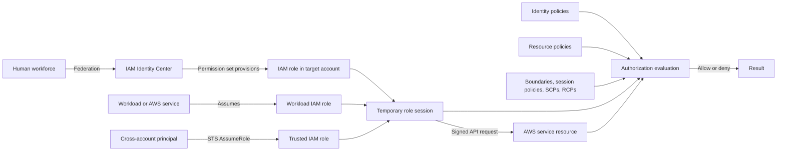
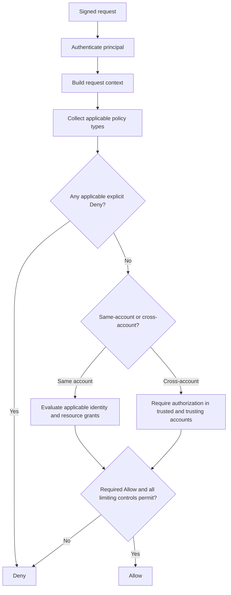
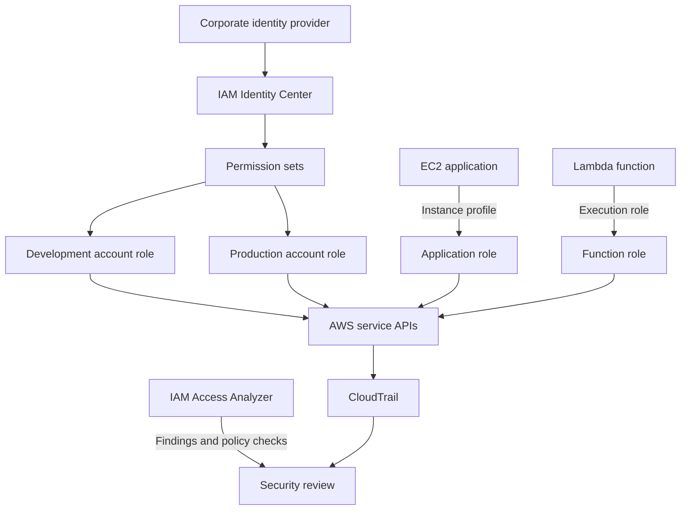

<div align="center">

# 🔐 AWS Identity and Access Management (IAM)

### Complete GitHub Study Guide · Cloud Practitioner + Solutions Architect – Associate

[](https://aws.amazon.com/iam/)


[](#official-references)

**One sentence to remember:** IAM authenticates identities and authorizes requests by evaluating the applicable policies, trust relationships, conditions, and organization guardrails.

[🟢 CCP essentials](#ccp-essentials) · [🔵 SAA architecture](#saa-deep-dive) · [⚔️ Comparisons](#service-comparisons) · [⚠️ Exam traps](#exam-traps) · [🧪 Practice](#practice-questions)

</div>

---

## Table of contents

1. [What is IAM?](#what-is-iam)
2. [What problem does IAM solve?](#problem-solved)
3. [Core concepts and components](#core-concepts)
4. [How IAM authorization works](#how-it-works)
5. [Key features and capabilities](#features)
6. [Use cases and selection guidance](#use-cases)
7. [Cloud Practitioner essentials](#ccp-essentials)
8. [Solutions Architect deep dive](#saa-deep-dive)
9. [Service and feature comparisons](#service-comparisons)
10. [Integration and architecture patterns](#integration-patterns)
11. [Security and shared responsibility](#security)
12. [Auditing and troubleshooting](#troubleshooting)
13. [Pricing and cost optimization](#pricing)
14. [Practical policy examples](#practical-examples)
15. [Exam traps](#exam-traps)
16. [Interview questions](#interview-questions)
17. [Practice questions](#practice-questions)
18. [Scenario drills](#scenario-drills)
19. [Decision tree and keyword recognition](#decision-tree)
20. [Quick-revision cheat sheet](#quick-revision)
21. [Official references](#official-references)
22. [Closing takeaway](#closing-takeaway)

---

<a id="what-is-iam"></a>
## 1. What is IAM?

AWS Identity and Access Management (IAM) is the AWS service for controlling **who or what can authenticate to AWS and which actions they may perform on which resources under which conditions**.

More precisely, IAM provides account-level identities, credentials, roles, policies, and authorization controls. An AWS service receives a signed request, constructs a request context, and evaluates all applicable policy types before allowing or denying the operation. IAM works with service-specific controls such as Amazon S3 bucket policies and AWS KMS key policies; it does not replace them.

> [!IMPORTANT]
> **Authentication** proves an identity. **Authorization** decides whether the authenticated principal may perform the requested action.

### Real-world analogy

Think of IAM as a building's identity desk and access-control system:

- an **identity** is a person or workload registered with the system;
- **credentials** prove who is presenting the badge;
- a **role** is a temporary job badge;
- a **policy** describes which doors and activities are permitted;
- an explicit deny is a locked safety barrier that an allow cannot override.

The analogy is incomplete: AWS evaluates machine-readable request context, multiple policy layers, cross-account trust, and resource-specific rules—not just one badge against one door.

### IAM at a glance

| Fact | Exam-ready meaning |
|---|---|
| Service category | Security, identity, and compliance |
| Scope | IAM identities and policies are global within an AWS partition/account, not recreated per Region |
| Default | A new IAM identity has no permissions unless applicable policies grant them |
| Human access baseline | Prefer federation and IAM Identity Center with temporary credentials |
| Workload access baseline | Prefer IAM roles and temporary credentials; do not embed long-term keys |
| Authorization model | Request context plus all applicable identity, resource, session, boundary, and organization policies |
| Strongest general rule | An applicable explicit `Deny` overrides an `Allow` |
| Availability behavior | IAM is highly available but changes are eventually consistent |
| Price | IAM, IAM Identity Center, and AWS STS are offered at no additional charge; related services can charge |
| Audit source | AWS CloudTrail records IAM and STS API activity and identifies calling principals |

> [!NOTE]
> Saying “IAM is global” does not make every related feature global. AWS STS has global and Regional endpoints, IAM Access Analyzer analyzers have type-specific Regional behavior, and the resources being accessed can be Regional.

---

<a id="problem-solved"></a>
## 2. What problem does IAM solve?

Without centralized identity and authorization, teams might share the root user, distribute permanent access keys, or grant every workload broad access. Those patterns make revocation, attribution, least privilege, and cross-account governance difficult.

IAM provides a controlled model:

| Before IAM design | With an IAM-centered design |
|---|---|
| Shared credentials | Individually attributable federated sessions or roles |
| Keys stored in application code | Automatically delivered temporary role credentials |
| Ad hoc permissions | Reusable, reviewable policies and guardrails |
| Separate user copies in every account | Identity Center assignments and cross-account roles |
| Unclear external sharing | Resource policies plus IAM Access Analyzer findings |
| Root used for administration | Root secured; routine work uses delegated roles |

Typical uses include:

- centralizing workforce access to multiple accounts;
- giving EC2, Lambda, ECS, or other workloads narrowly scoped permissions;
- delegating administration without granting unrestricted access;
- enabling vendors or teams to assume cross-account roles;
- restricting principals or resources with organization guardrails;
- auditing who performed an API action and refining unused permissions.

IAM does not provide network filtering, encrypt data, or automatically make policies least privilege. Security groups, network ACLs, AWS KMS, AWS Organizations, CloudTrail, and Access Analyzer solve complementary problems.

---

<a id="core-concepts"></a>
## 3. Core concepts and components

### Identity, principal, credentials, and request

| Term | Meaning | Example |
|---|---|---|
| Identity | An IAM object that can receive permissions | IAM user or IAM role |
| Principal | The authenticated entity making a request | IAM user, assumed-role session, root user, federated session, or AWS service |
| Credentials | Proof used to sign in or sign API requests | Password + MFA, access keys, or temporary access key/secret/session token |
| Request context | Principal, action, resource, conditions, and environmental attributes AWS evaluates | `s3:GetObject` on one object from a tagged role session |
| Permission | Authorization to perform an action on a resource under conditions | Allow `s3:GetObject` on `reports/*` over TLS |
| Effective permissions | The final result after all applicable grants and restrictions | Allowed read, denied delete |

An IAM group is an identity-management container, but it is **not a principal** and cannot sign requests or appear as a `Principal` in a resource-based policy.

### Identities and access methods

| Component | Credentials | Best fit | Important limitation |
|---|---|---|---|
| AWS account root user | Root password, MFA, optional access keys (strongly discouraged) | Rare root-required tasks | Not a routine administrator; cannot receive identity policies or a permissions boundary |
| IAM user | Long-term console password and/or access keys when configured | Exceptional account-local or service-specific use cases | Long-term credential lifecycle is customer-managed |
| IAM group | None | Apply common identity policies to IAM users | Users only; no nested groups; not assumable |
| IAM role | Temporary credentials issued for a session | Workloads, federation, AWS services, and cross-account access | Requires trust plus permissions; the role itself has no password or permanent access keys |
| IAM Identity Center user/group | Authenticates through the selected identity source | Central workforce access to accounts and applications | Account permissions are delivered through permission sets and controlled IAM roles |

### Long-term and temporary credentials

- **Console passwords** authenticate root or IAM users to the AWS Management Console.
- **Access keys** sign CLI, SDK, and API requests. An access key ID is not secret; the secret access key is.
- **MFA** adds a second authentication factor. AWS recommends phishing-resistant options such as passkeys or security keys where possible.
- **Temporary credentials** contain an access key ID, secret access key, session token, and expiration. AWS STS issues them for roles and federation.
- **Roles for workloads** let supported compute environments deliver and rotate credentials without placing secrets in code.

> [!TIP]
> Human workforce → federation/Identity Center. AWS workload → IAM role. IAM user access key → exception that needs a documented reason and lifecycle.

### IAM policy language

Most AWS authorization policies are JSON documents. Element order does not affect evaluation, and not every policy type supports every element.

| Element | Purpose | Key caution |
|---|---|---|
| `Version` | Policy-language version; normally `2012-10-17` | Not the version number of a managed policy |
| `Statement` | One statement or an array of statements | Statements combine during evaluation |
| `Sid` | Optional statement identifier | Useful for review; not a permission |
| `Effect` | `Allow` or `Deny` | An applicable explicit deny wins |
| `Action` | API actions affected | Mutually exclusive with `NotAction` in one statement |
| `NotAction` | All actions except the listed actions | Scope carefully; it does not mean “deny these actions” by itself |
| `Resource` | Resources affected | Some actions do not support resource-level scoping and require `*` |
| `NotResource` | All resources except those listed | Mutually exclusive with `Resource` in one statement |
| `Principal` | Who the resource-based policy trusts or affects | Not valid in an ordinary identity-based policy |
| `NotPrincipal` | Principals excluded from a supported resource-policy statement | Not supported in identity policies or role trust policies; AWS recommends condition-based alternatives for new designs |
| `Condition` | Constraints evaluated from request context | Missing context keys can change results; understand `IfExists` and set operators |
| Policy variable | Substitutes a request-context value into supported elements | Availability depends on the context key and element |

### Example identity-based permission policy

This policy can be attached to a user, group, or role. It deliberately has no `Principal`; the attached identity is implicit.

```json
{
  "Version": "2012-10-17",
  "Statement": [
    {
      "Sid": "ReadProjectReports",
      "Effect": "Allow",
      "Action": "s3:GetObject",
      "Resource": "arn:aws:s3:::example-project-reports/*",
      "Condition": {
        "StringEquals": {
          "aws:PrincipalTag/Department": "Analytics"
        }
      }
    }
  ]
}
```

### Example resource-based policy statement

An S3 bucket policy names the principal allowed to use the resource. Cross-account callers also need permission on their side.

```json
{
  "Version": "2012-10-17",
  "Statement": [
    {
      "Sid": "AllowReportingRoleRead",
      "Effect": "Allow",
      "Principal": {
        "AWS": "arn:aws:iam::111122223333:role/ReportingRole"
      },
      "Action": "s3:GetObject",
      "Resource": "arn:aws:s3:::example-project-reports/*",
      "Condition": {
        "Bool": {
          "aws:SecureTransport": "true"
        }
      }
    }
  ]
}
```

### Policy families: grants, trust, and guardrails

| Policy/control | Attached to | Can grant permissions? | Primary job |
|---|---|:---:|---|
| Identity-based managed or inline policy | User, group, or role | Yes | Defines what that identity may do |
| Resource-based policy | Supported resource | Yes | Defines which principals may access that resource |
| Role trust policy | IAM role | Grants role assumption only | Names who may request a role session and under what conditions |
| Permissions boundary | IAM user or role | No | Maximum permissions identity policies may grant to that entity |
| Session policy | Role or federated session | No | Narrows the permissions available to that session |
| Service control policy (SCP) | Organization root, OU, or member account | No | Principal-centric maximum for member-account principals, including member root |
| Resource control policy (RCP) | Organization root, OU, or member account | No | Resource-centric maximum for supported resources in member accounts |
| VPC endpoint policy | VPC endpoint | No by itself | Limits principals/resources usable through that endpoint |

#### Managed and inline identity policies

| Type | Owner | Reusable | Change behavior | Best fit |
|---|---|:---:|---|---|
| AWS managed | AWS | Yes | AWS can update it for every attachment | Fast starting point; review breadth and move toward least privilege |
| Customer managed | Your account | Yes | You create versions and choose the default version | Reusable, reviewable organization-specific permissions |
| Inline | Your account | No; embedded in one identity | Edited with that identity and deleted with it | Narrow one-to-one exception where tight lifecycle coupling is intentional |

> [!WARNING]
> `"Version": "2012-10-17"` selects policy-language semantics. Customer managed policy versions such as `v1` and `v2` are separate stored documents; AWS managed policies also have AWS-controlled version history.

### Component relationships



---

<a id="how-it-works"></a>
## 4. How IAM authorization works

### Request lifecycle

1. A human or workload obtains credentials, preferably temporary credentials.
2. The principal signs an API request or uses an authenticated console session.
3. The target AWS service authenticates the principal when authentication is required.
4. AWS builds the request context: principal, action, resource, account, tags, network/source attributes, time, and other available condition keys.
5. AWS identifies all applicable policies and organization controls.
6. AWS checks for applicable explicit denies.
7. AWS determines whether the required allow exists and whether every applicable limiting policy permits the request.
8. The service performs or rejects the operation. CloudTrail records IAM/STS activity and other covered events according to the event type and logging configuration.



> [!IMPORTANT]
> The diagram is a reasoning aid, not a claim that every service evaluates policy types in one simple linear order. The exact result depends on principal type, account relationship, resource-policy principal, and supported policy types.

### Union, intersection, and explicit deny

| Combination | Simplified relationship | Meaning |
|---|---|---|
| Multiple applicable identity policies | Union of allows, subject to denies and guardrails | One identity policy can allow an action another does not mention |
| Group and direct user policies | Union of allows, subject to denies and guardrails | Group membership adds applicable permissions; groups do not create sessions |
| Same-account identity and resource policies | Usually union of grants | Principal-specific exceptions matter; explicit deny still wins |
| Identity policy and permissions boundary | Intersection | Both must permit an identity-policy grant; boundary never grants |
| Role permissions and session policy | Intersection | The session policy can only narrow the role session |
| Permissions and an applicable SCP | Intersection | The SCP sets a principal-side maximum in member accounts |
| Permissions and an applicable RCP | Intersection | The RCP sets a resource-side maximum for supported member-account resources |
| Cross-account request | Allow required on both sides | Trusted principal and trusting resource/account must authorize the request |

### Same-account resource-policy nuance

Do not memorize “identity policy + resource policy is always a union” without context:

- A resource policy that grants directly to an **IAM user ARN** in the same account is not limited by an implicit deny in that user's identity policy or permissions boundary.
- A grant to a **role ARN** is limited by an implicit deny in the role's boundary or session policy.
- A grant directly to a **role-session ARN** gives permission to that session and is not limited by an implicit deny in an identity policy, boundary, or session policy.
- An applicable **explicit deny** remains effective.
- Service-specific policies and organization controls can add requirements.

These [permissions-boundary and resource-principal rules](https://docs.aws.amazon.com/IAM/latest/UserGuide/access_policies_boundaries.html) are SAA-level nuances. Prefer clear role- and resource-policy designs instead of depending on subtle principal-ARN behavior.

### Conflicting policy examples

| Situation | Result | Why |
|---|---|---|
| Group allows `s3:GetObject`; another group says nothing | Allow, if no limiter blocks | Identity allows combine |
| Role policy allows `s3:GetObject`; boundary omits S3 | Deny | Boundary intersection does not permit it |
| Role allows `ec2:TerminateInstances`; SCP explicitly denies it | Deny | Applicable explicit deny wins |
| Bucket policy allows an external role; external role policy lacks `s3:GetObject` | Deny | Cross-account authorization is incomplete |
| Session policy allows only `s3:GetObject`; role also allows `s3:DeleteObject` | Delete denied | Session policy narrows the session |
| Identity policy allows KMS decrypt; key policy does not enable that IAM grant | Deny | KMS key-policy authorization is also required |

### Role assumption has two authorization stages

1. **Obtain the session:** the role trust policy must trust the caller, and a cross-account caller must be allowed to call `sts:AssumeRole`. Conditions such as MFA, external ID, organization, source identity, or tags may apply.
2. **Use the session:** the role's identity policies provide permissions, while the permissions boundary, session policy, SCPs, RCPs, resource policies, and explicit denies can restrict the requested resource action.

AWS STS issues the temporary credentials; the IAM role defines trust and role permissions. STS is not a replacement for the role.

---

<a id="features"></a>
## 5. Key features and capabilities

| Capability | What it does | Example | Exam significance |
|---|---|---|---|
| Identities and groups | Represents account-local users/roles and groups IAM users for permission assignment | Put exceptional account-local users in a policy group | Know user/group/role differences |
| Roles and STS | Produces temporary sessions for trusted principals | Lambda assumes its execution role | Prefer temporary credentials |
| Federation | Maps external authentication to AWS role access | Corporate IdP → Identity Center → account role | Workforce users need not be IAM users |
| Policy conditions | Restricts grants using request context | Require TLS, tags, source account, or MFA context | An allow applies only when conditions match |
| Permissions boundaries | Caps delegated IAM user/role permissions | Developers create roles only within an approved maximum | Boundary limits; it does not grant |
| Organization guardrails | Applies SCPs to principals and RCPs to supported resources | Deny risky Regions or block external resource access | Organization policies need underlying grants |
| Access analysis | Finds external/internal/unused access and validates policies | Flag an externally shared bucket | Analyzer reports; it does not automatically remediate |
| Last-accessed information | Helps identify unused services/actions | Refine a broad role | Evidence supports least-privilege iteration |
| Credential and access reports | Supports review of IAM-user credential state and service access | Find an old access key | Review and remove unused credentials |
| Tags and ABAC | Uses attributes in policies | Principal and resource department tags must match | Scales access when tagging is governed |

### Important restrictions and defaults

- New IAM users and roles do not receive permissions automatically.
- A role has a trust policy, but trust alone does not provide useful resource permissions.
- Groups contain IAM users only; groups cannot be nested and cannot be assumed.
- Permissions boundaries attach only to IAM users or roles and must be managed policies.
- SCPs and RCPs require an AWS Organizations organization with all features enabled; neither grants access.
- [RCPs](https://docs.aws.amazon.com/organizations/latest/userguide/orgs_manage_policies_rcps.html) apply only to supported resource types in member accounts, not management-account resources.
- IAM changes propagate with [eventual consistency](https://docs.aws.amazon.com/IAM/latest/UserGuide/troubleshoot.html#troubleshoot_general_eventual-consistency). Do not make an IAM update part of a critical request path and immediately assume every endpoint sees it.
- AWS managed policies can change when AWS updates them; attachment is an operational dependency.

---

<a id="use-cases"></a>
## 6. Real-world use cases and when to choose IAM

| Requirement | Choose | Why | Avoid |
|---|---|---|---|
| Employees need several AWS accounts | IAM Identity Center + federation + permission sets | Central lifecycle and temporary role sessions | Separate IAM users in every account |
| EC2 application reads one S3 prefix | EC2 role in an instance profile with narrow policy | SDK obtains temporary credentials automatically | Keys in source code or user data |
| Lambda writes logs and reads a table | Lambda execution role | Service assumes role at runtime | Reusing a human administrator role |
| Vendor needs temporary account access | Cross-account role with unique vendor-provided external ID | Revocable, attributable, no shared user key | Creating a permanent vendor IAM user |
| Team needs a reusable policy | Customer managed policy | Central review, reuse, version selection | Copying many inline policies |
| Developers may create bounded roles | Delegated IAM permissions + permissions boundary + controlled pass-role | Caps what delegated identities can grant | Assuming the boundary grants permissions |
| Organization must restrict principals | SCP | Principal-centric maximum in member accounts | Using SCP as an identity permission grant |
| Organization must restrict access to supported resources | RCP | Resource-centric maximum across member accounts | Assuming every AWS resource supports RCPs |
| Security team needs external-access findings | IAM Access Analyzer | Policy reasoning identifies access outside a trust zone | Using CloudTrail alone to infer all possible access |

### When IAM is not the entire answer

- Use **security groups and network ACLs** for network traffic controls, not API authorization.
- Use **AWS KMS key policies and grants** for KMS key authorization in addition to IAM where required.
- Use **AWS Organizations** for multi-account hierarchy and guardrails; IAM provides identities and permissions inside accounts.
- Use **CloudTrail** to record activity; IAM decides whether requests are authorized.
- Use **Secrets Manager or another supported secret store** for application secrets; never treat an IAM policy as secret storage.

---

<a id="ccp-essentials"></a>
## 7. 🟢 Cloud Practitioner (CCP) essentials


### Fundamental facts to memorize

1. IAM controls authentication and authorization for AWS access.
2. IAM users are account-local identities that can have long-term credentials.
3. IAM groups organize IAM users and provide shared identity-policy permissions.
4. IAM roles are assumed and provide temporary credentials.
5. Policies are JSON documents that allow or deny actions on resources under conditions.
6. New IAM identities have no permissions by default.
7. An applicable explicit deny overrides an allow.
8. Use least privilege: grant only what the task requires.
9. Prefer federation and IAM Identity Center for workforce access.
10. Prefer roles for AWS workloads instead of embedded access keys.
11. Protect the root user, enable MFA, and use root only for required tasks.
12. IAM is global within an AWS account/partition, but related features and target resources can be Regional.
13. IAM Identity Center centralizes workforce access to multiple AWS accounts and applications.
14. AWS Organizations centrally groups accounts and applies governance controls; it does not replace IAM.
15. CloudTrail records API activity; IAM authorizes it.
16. IAM Access Analyzer helps find unintended or unused access and validate policies.

### High-value keyword bank

`least privilege` · `explicit deny` · `implicit deny` · `MFA` · `federation` · `temporary credentials` · `IAM role` · `IAM group` · `root user` · `access key` · `policy` · `cross-account role` · `IAM Identity Center` · `AWS STS` · `CloudTrail` · `IAM Access Analyzer`

### If a CCP question says…

| Question clue | Think |
|---|---|
| “Central workforce access to many accounts” | IAM Identity Center |
| “AWS service needs permissions” | IAM role/service role |
| “Application on EC2 needs S3” | EC2 role through an instance profile |
| “Extra sign-in factor” | MFA |
| “Only the permissions needed” | Least privilege |
| “Original account identity” | Root user |
| “Collection of IAM users” | IAM group |
| “Temporary AWS credentials” | IAM role and AWS STS |
| “Who made this API call?” | CloudTrail |
| “Resource shared publicly or externally?” | IAM Access Analyzer |
| “Control network traffic” | Security group/NACL, not IAM |

### Beginner misconceptions

- A group is not a login and cannot contain roles or other groups.
- A role does not have a permanent password or permanent access keys.
- “Read-only policy” does not stop another policy from granting writes.
- AdministratorAccess is not the root user.
- An SCP does not grant an IAM identity access.
- IAM Identity Center complements IAM roles and policies; it does not remove them from account authorization.

### 30-second CCP answer

IAM is the global AWS service that controls identities and permissions. Users can have long-term credentials, groups organize users, and roles provide temporary credentials. Policies express allows and denies. Prefer least privilege, MFA, federation/Identity Center for people, roles for workloads, and minimal use of the root user.

---

<a id="saa-deep-dive"></a>
## 8. 🔵 Solutions Architect – Associate (SAA) deep dive


### Architecture rules

- Design identity around **temporary role sessions**, not distributed long-term credentials.
- Treat trust (“who may assume?”) separately from permissions (“what may the session do?”).
- Model effective permissions with both grants and every applicable limiting control.
- Evaluate cross-account requests in the trusted and trusting accounts.
- Use Identity Center for workforce access and workload roles for applications.
- Use permissions boundaries for delegated administration inside an account, SCPs for principal guardrails, and RCPs for supported resource guardrails.
- Use explicit conditions to reduce trust: organization IDs, source accounts/resources, tags, MFA, source identity, and external IDs where applicable.
- Design for eventual consistency; provision access before the critical execution path.

### Substantial architecture scenarios

#### Scenario 1: Multi-account workforce access

A company has development, staging, and production accounts. Connect the corporate identity provider to IAM Identity Center, define job-oriented permission sets, and assign groups to accounts. Identity Center [provisions controlled IAM roles](https://docs.aws.amazon.com/singlesignon/latest/userguide/identity-center-and-iam-roles.html) in target accounts; users receive temporary credentials through the access portal or CLI.

**Why:** centralized joiner/mover/leaver lifecycle and no duplicate IAM-user passwords. **Pitfall:** a permission set is a template; the resulting account role and its policies still determine permissions.

#### Scenario 2: EC2 reads one S3 prefix

Create a workload role with `s3:GetObject` on one prefix and associate it with the EC2 instance through an instance profile. The SDK credential provider retrieves rotating temporary credentials.

**Why:** no key distribution or manual rotation. **Pitfall:** every process able to use the instance credentials may share the role's AWS permissions; isolate workloads when their trust differs.

#### Scenario 3: Vendor access with confused-deputy protection

Create a cross-account role that trusts the vendor account and requires the unique external ID supplied by the vendor. The vendor's identity policy must allow `sts:AssumeRole`; the role policy grants only the required resources.

**Why:** temporary, revocable access. **Pitfall:** an external ID is not a secret; it binds the vendor's request to the correct customer context.

#### Scenario 4: Delegated role creation

Allow a platform team to create roles only when it attaches an approved permissions boundary. Restrict `iam:PassRole` to approved role paths and services, and protect boundary policies from modification.

**Why:** teams can self-service within a maximum. **Pitfall:** a boundary alone does not stop escalation if the delegate can alter the boundary, attach another policy path, or pass an overprivileged role.

#### Scenario 5: Organization-wide data perimeter

Use SCPs to constrain member-account principals and RCPs to constrain access to supported member-account resources. Add resource policies and identity policies for the required business access.

**Why:** layered principal- and resource-centric guardrails. **Pitfall:** neither policy type grants access, RCP support is service-specific, and management-account resources are not affected by RCPs.

#### Scenario 6: Cross-account encrypted S3 data

Authorize the caller in the source account, the S3 bucket policy in the data account, and the KMS key policy/IAM delegation for the customer managed KMS key. Test both object and key permissions.

**Why:** S3 and KMS are separate authorization systems. **Pitfall:** an S3 allow does not imply `kms:Decrypt`, and a KMS IAM allow is ineffective unless the key policy permits the delegation.

### Availability, scaling, and performance

- IAM is a highly available control service, but policy and identity updates are eventually consistent.
- Create and update roles/policies outside latency-critical or high-availability application paths.
- Prefer [Regional STS endpoints](https://docs.aws.amazon.com/IAM/latest/UserGuide/id_credentials_temp_enable-regions.html) to reduce latency and align failure containment for credential vending.
- Temporary credentials issued from Regional or global STS endpoints can be used across enabled Regions, subject to permissions and service behavior.
- IAM authorization scales with AWS services; the architecture task is to control policy complexity, session issuance, quotas, and operational ownership.

### ABAC and RBAC

- **Role-based access control (RBAC):** permissions follow job roles, groups, or permission sets. It is easy to explain but can create many roles.
- **Attribute-based access control (ABAC):** policy conditions compare principal/session tags and resource tags. It can scale across many resources, but only when tag creation and mutation are governed.
- Many architectures combine them: roles establish trust and baseline permissions; tags refine which resources each session may access.

### Break-glass access

A break-glass design uses a tightly protected emergency role or access path with strong authentication, limited membership, approval, monitoring, short sessions, and post-use review. It is not a shared administrator access key and does not justify routine root use.

---

<a id="service-comparisons"></a>
## 9. ⚔️ Service and feature comparisons

### Identity choices

| Compare | First option | Second option | Choose based on |
|---|---|---|---|
| IAM user vs IAM role | Long-term account identity | Temporary assumed identity | Use role for workloads/federation; user only for justified long-term use |
| IAM user vs root user | Delegated permissions | Original account identity with inherent authority | Use IAM/federated admin routinely; root only for root-required tasks |
| IAM group vs Identity Center group | Groups IAM users in one account | Groups workforce identities for centralized assignments | Use Identity Center groups for workforce/multi-account access |
| IAM role vs AWS STS | Identity with trust and permissions | Service/API that issues temporary credentials | They work together; neither replaces the other |

### Service choices

| Service/control | Primary purpose | Scope | Prefer when | Does not replace |
|---|---|---|---|---|
| IAM | Account identities and AWS authorization | Global per account/partition | Define roles and permissions | Organizations or Identity Center |
| IAM Identity Center | Central workforce access | Organization/accounts/apps | People need centralized sign-in and assignments | IAM roles/policies in target accounts |
| AWS Organizations | Account hierarchy and governance | Organization | Need OUs, SCPs/RCPs, consolidated governance | IAM identity permissions |
| AWS STS | Temporary credential issuance | Global service with Regional endpoints | Assume roles/federate | Role trust and permission policies |
| IAM Access Analyzer | Reason about external/internal/unused access and policy quality | Account/organization; analyzer-dependent Regions | Find possible access and policy issues | CloudTrail activity evidence |
| IAM Policy Simulator | Test modeled authorization for supplied context | Simulation | Ask “would this request be allowed?” | Live testing or Access Analyzer findings |
| CloudTrail | Record API and sign-in activity | Account/organization trails and event stores | Ask “what happened and who called?” | IAM authorization |
| Security group/NACL | Filter network traffic | VPC resource/subnet | Control ports, protocols, and sources/destinations | IAM API permissions |

### Policy comparisons

| Comparison | Key distinction |
|---|---|
| Trust policy vs permissions policy | Trust policy names who may assume a role; permissions policies describe what the resulting role session may do |
| Identity-based vs resource-based | Identity policy follows an identity; resource policy names principals allowed on one resource |
| AWS managed vs customer managed vs inline | AWS owns updates; customer managed is reusable/versioned by you; inline is embedded one-to-one |
| Boundary vs SCP vs RCP | Boundary caps one IAM user/role's identity grants; SCP caps member-account principals; RCP caps supported member-account resources |

<details>
<summary>IAM versus IAM Identity Center</summary>

IAM defines account identities, roles, and authorization policies. IAM Identity Center connects workforce identities to accounts and applications, commonly through permission sets. Assigning a permission set causes Identity Center to create and manage corresponding IAM roles in target accounts. Use both: Identity Center for workforce lifecycle and IAM for account authorization.

</details>

<details>
<summary>IAM Access Analyzer versus IAM Policy Simulator</summary>

Access Analyzer produces findings and policy checks using automated reasoning or access data, depending on the feature. Policy Simulator evaluates selected policies, actions, resources, and supplied context without calling the live service. The simulator does not support every live control—for example, it does not support RCPs—so a simulated allow is not a production guarantee.

</details>

<details>
<summary>IAM authorization versus security groups and NACLs</summary>

IAM answers whether a principal may invoke an AWS action. Security groups and NACLs control network traffic. A role allowed to call an API can still fail to connect through a network path; a permitted network packet does not grant AWS API authorization.

</details>

---

<a id="integration-patterns"></a>
## 10. Integration and architecture patterns

| Integration | IAM relationship | Design note |
|---|---|---|
| Amazon EC2 | Role is delivered through an instance profile | SDKs can retrieve temporary credentials from instance metadata; protect metadata access |
| AWS Lambda | Execution role supplies runtime permissions | Function resource policies control who may invoke where supported; execution role controls what code can call |
| Amazon S3 | Identity and bucket/access-point policies can authorize requests | Include both bucket and object ARNs when actions require them; cross-account requires both sides |
| AWS KMS | Key policies, IAM policies, and grants can participate | A key policy must permit IAM delegation; cross-account key use needs key-policy and caller-side IAM permission |
| IAM Identity Center | Permission sets provision controlled roles | Centralizes workforce assignments and temporary account access |
| AWS Organizations | SCPs/RCPs apply organization guardrails | Guardrails do not grant permissions |
| CloudTrail | Records IAM/STS activity and covered service events | Use trails or event data stores and enable required event categories for ongoing evidence beyond Event history |
| IAM Access Analyzer | Analyzes access and policies | External analysis is not the same as observed use |
| AWS Config | Records/evaluates supported configurations and rules | Configuration compliance is not live IAM authorization |
| CloudWatch | Can alarm on CloudTrail-derived events/metrics | IAM itself is not a network or application metric system |
| Security Hub CSPM | Aggregates supported security findings, including Access Analyzer integration | Aggregation does not change the underlying permission |

### Workforce and workload pattern



### Confused-deputy safeguards

- For a third-party provider that serves many customers, require the [unique external ID generated by that provider](https://docs.aws.amazon.com/IAM/latest/UserGuide/id_roles_common-scenarios_third-party.html) in the role trust policy.
- For AWS service principals, use supported global condition keys such as `aws:SourceArn`, `aws:SourceAccount`, `aws:SourceOrgID`, or `aws:SourceOrgPaths` as documented by the integrating service.
- Do not treat an external ID as a password. It provides request context, not secrecy.

---

<a id="security"></a>
## 11. Security, compliance, and shared responsibility

### Least-privilege lifecycle

1. Start with the job or workload requirement, not a broad policy name.
2. Grant the smallest actions, resources, and conditions that work.
3. Test with policy validation, simulation, and a safe environment.
4. Observe CloudTrail and last-accessed data over a representative period.
5. Refine permissions and review external/unused access findings.
6. Re-review when the workload, service, or AWS managed policy changes.

### Credential-leakage prevention

- Do not commit passwords, access keys, or session tokens to Git.
- Prefer role credential providers in supported compute environments.
- Use short sessions and MFA for privileged human access.
- Restrict who can create keys, update trust, attach policies, or pass roles.
- Rotate or replace long-term credentials when the use case requires them, and remove unused credentials.
- If credentials leak, deactivate/revoke them, investigate CloudTrail, assess sessions and permissions, and remediate the source—not just the key.

### Root-user protection

- Do not use root for daily administration or create root access keys.
- Protect applicable root credentials and recovery channels with strong controls and MFA.
- In Organizations, [centralize root access for member accounts](https://docs.aws.amazon.com/IAM/latest/UserGuide/id_root-enable-root-access.html) where appropriate, remove long-term root credentials, and use privileged root sessions for supported tasks.
- Remember that SCPs and RCPs can affect a member-account root user; management-account treatment differs.

### Shared responsibility

| AWS manages | Customer manages |
|---|---|
| IAM service infrastructure, availability, and underlying credential-validation systems | Identity lifecycle, federation configuration, policies, trust, MFA requirements, and access reviews |
| AWS managed policy contents and service integrations | Whether an AWS managed policy is appropriate and what identities receive it |
| STS credential issuance infrastructure | Who may assume roles, session constraints, and safe credential use |
| Policy evaluation engine | Correct policies, resource ownership, tags, guardrails, logging, and remediation |

> [!WARNING]
> IAM policies are authorization data, not secrets, and IAM does not encrypt application data. Use service encryption and KMS controls where required.

---

<a id="troubleshooting"></a>
## 12. Observability, auditing, troubleshooting, and failure behavior

### Tool selection

| Question | Tool |
|---|---|
| What API call occurred, when, and by which principal/session? | CloudTrail |
| Could a policy expose a supported resource outside the trust zone? | IAM Access Analyzer external access |
| Who inside the organization can reach selected supported resources? | Access Analyzer internal access |
| Which roles, credentials, or permissions appear unused? | Access Analyzer unused access and IAM last-accessed information |
| Would selected policies allow this modeled request? | IAM Policy Simulator |
| Does this policy contain syntax/security findings? | Access Analyzer policy validation/custom checks |
| Does a supported resource configuration comply with a rule? | AWS Config |
| Where can supported security findings be aggregated? | Security Hub CSPM |

### `AccessDenied` troubleshooting order

1. Read the complete error and capture the principal ARN, action, resource ARN, Region, and request ID.
2. Confirm the caller with `aws sts get-caller-identity`; do not assume the active profile or role.
3. Verify the requested API action and exact resource type/ARN.
4. Check identity policies, group permissions, role policies, and conditions.
5. Check the resource policy, role trust policy, KMS key policy, or service-specific authorization.
6. Check permissions boundaries and session policies.
7. Check SCPs, RCPs, and VPC endpoint policies where applicable.
8. For cross-account access, verify an allow in both accounts and every trust condition.
9. Check Region/account mismatch, expired temporary credentials, clock/signing problems, tags, MFA, and source conditions.
10. Use CloudTrail, policy simulation, and Access Analyzer as supporting evidence; account for eventual consistency after changes.

### Common failure examples

| Symptom | Likely cause | Investigation |
|---|---|---|
| `AssumeRole` denied | Caller lacks permission, trust does not match, or trust condition fails | Caller policy + target trust policy + external ID/MFA/org conditions |
| S3 access allowed but decrypt fails | Missing KMS authorization | Caller IAM policy + KMS key policy/grant + encryption context |
| Console page partially fails | Console calls several read/list APIs | CloudTrail/error details; add only required supporting actions |
| New role briefly unavailable | IAM eventual consistency | Retry with bounded backoff; remove IAM creation from critical path |
| Simulator says allow, live call denies | Missing live context or unsupported control such as RCP/VPC endpoint behavior | Inspect live policies and CloudTrail; do not treat simulation as proof |
| Role session has less access than role | Session policy, boundary, SCP, RCP, or resource policy | Inspect the actual session and all limiting controls |

---

<a id="pricing"></a>
## 13. Pricing and cost optimization

IAM, IAM Identity Center, and AWS STS are offered at no additional charge. You still pay for AWS resources and requests used by the authorized principal.

IAM Access Analyzer has mixed pricing:

- external access analysis, policy validation, and policy generation are offered at no additional charge;
- internal access analysis is charged per monitored resource per Region per month;
- unused access analysis is charged per analyzed IAM user or role per analyzer per month;
- custom policy checks are charged per API check.

Prices can change, so use the [official IAM Access Analyzer pricing page](https://aws.amazon.com/iam/access-analyzer/pricing/) rather than embedding a durable numeric estimate here.

### Cost optimization principles

- Do not duplicate paid analyzers without understanding their Region and scope behavior.
- Retain CloudTrail data at a level that meets investigation/compliance needs; S3, CloudTrail Lake, analysis, and alerting can add cost.
- Centralized federation reduces long-term credential administration, even though Identity Center itself has no additional charge.
- Least privilege can reduce the financial blast radius of compromised credentials, but it does not directly discount AWS service pricing.

---

<a id="practical-examples"></a>
## 14. Practical policy and CLI examples

### Valid role trust policy for EC2

```json
{
  "Version": "2012-10-17",
  "Statement": [
    {
      "Sid": "AllowEC2AssumeRole",
      "Effect": "Allow",
      "Principal": {
        "Service": "ec2.amazonaws.com"
      },
      "Action": "sts:AssumeRole"
    }
  ]
}
```

The trust policy lets EC2 assume the role. A separate permissions policy defines what the session may do. EC2 receives the role through an instance profile.

### Validate before creating a customer managed policy

Save the identity policy from the earlier example as `project-report-read.json`, then validate it:

```bash
aws accessanalyzer validate-policy \
  --policy-document file://project-report-read.json \
  --policy-type IDENTITY_POLICY
```

After resolving findings and completing peer review, an authorized administrator could create the managed policy:

```bash
aws iam create-policy \
  --policy-name ProjectReportRead \
  --policy-document file://project-report-read.json
```

> [!CAUTION]
> These are illustrative commands, not a production change procedure. They require authenticated AWS CLI access and appropriate permissions. Validation findings are not a substitute for architecture review, testing, or every service-specific authorization rule. Never place credentials in the JSON or repository.

### Source corrections and updates

The original overview's accurate identity, least-privilege, root, role, policy, federation, and exam-trap concepts were retained. The upgrade corrected the default workforce pattern to federation/Identity Center, expanded evaluation beyond “allow unless explicitly denied,” distinguished policy-language `Version` from managed-policy versions, added RCPs and resource-principal nuances, and qualified IAM's global scope.

---

<a id="exam-traps"></a>
## 15. ⚠️ Common exam traps and misconceptions

| # | ❌ Misconception | ✅ Correct interpretation | Level |
|---:|---|---|---|
| 1 | IAM is Regional | IAM identities/policies are global within an account/partition; related features/resources can be Regional | CCP |
| 2 | Employees should normally receive IAM users | Prefer federation and IAM Identity Center with temporary credentials | CCP |
| 3 | Roles have permanent access keys | Roles produce temporary sessions through STS | CCP |
| 4 | Groups can contain roles or groups | IAM groups contain IAM users only and cannot nest | CCP |
| 5 | A group can be a resource-policy principal | Groups are not principals | SAA |
| 6 | AdministratorAccess equals the root user | It is an identity policy and cannot perform root-only tasks or bypass every guardrail | CCP |
| 7 | Any allow defeats default deny | An allow must be applicable and every limiting policy must permit; explicit deny wins | CCP/SAA |
| 8 | Effective permissions are always the union of policies | Grants can combine, while boundaries, sessions, SCPs, and RCPs act as intersections/limits | SAA |
| 9 | A permissions boundary grants access | It only caps identity-policy permissions | SAA |
| 10 | An SCP grants all identities the listed actions | SCPs set a maximum; IAM/resource policies still need to grant | CCP/SAA |
| 11 | An RCP restricts principals in the same way as an SCP | RCPs are resource-centric and apply only to supported member-account resources | SAA |
| 12 | A trust policy tells the role what it can do | It tells who may assume; permissions policies define session actions | CCP/SAA |
| 13 | Trusting another account alone grants its users the role | Cross-account callers also need caller-side `sts:AssumeRole` permission | SAA |
| 14 | An external ID is a secret supplied by the customer | It is nonsecret context normally generated by the third-party provider | SAA |
| 15 | `Principal` belongs in an identity policy | The attached identity is implicit; `Principal` belongs in supported resource policies | SAA |
| 16 | Policy `Version` is a managed-policy revision | `2012-10-17` is the policy-language version | CCP/SAA |
| 17 | An AWS managed policy is automatically least privilege | It is generalized and AWS-controlled; refine for the workload | CCP/SAA |
| 18 | ReadOnlyAccess guarantees the identity cannot write | Other policies may grant writes, and read access can expose sensitive data | SAA |
| 19 | Bucket-policy access automatically grants KMS decrypt | KMS key authorization is evaluated separately | SAA |
| 20 | Policy Simulator perfectly predicts production | It uses supplied context and omits some controls such as RCPs | SAA |
| 21 | Access Analyzer automatically fixes findings | It analyzes/reports; administrators remediate | CCP |
| 22 | CloudTrail grants or blocks permissions | CloudTrail records activity; IAM/service controls authorize it | CCP |
| 23 | Security groups can replace IAM | Network reachability and API authorization are separate | CCP |
| 24 | IAM changes are instantly visible everywhere | IAM is eventually consistent | SAA |
| 25 | Root is unaffected by organization policies | Applicable SCPs/RCPs can affect member-account root; management-account behavior differs | SAA |

---

<a id="interview-questions"></a>
## 16. Interview questions and short answers

1. **What is the difference between an identity and a principal?**

   An identity is an IAM object such as a user or role; a principal is the authenticated entity in a request, such as an assumed-role session.

2. **Why prefer roles over access keys for workloads?**

   Roles provide expiring credentials through supported credential providers, reducing secret distribution and rotation risk.

3. **Why can a role with an allow still receive `AccessDenied`?**

   A condition may fail, or a boundary, session policy, SCP, RCP, resource policy, endpoint policy, or explicit deny may restrict it.

4. **How do trust and permissions policies differ?**

   Trust determines who can obtain a role session; permissions determine what that session may do.

5. **How would you design workforce access to 50 accounts?**

   Federate the corporate IdP through IAM Identity Center, assign groups to permission sets/accounts, and use temporary account roles.

6. **What must be authorized for a cross-account role?**

   The source principal must be allowed to call `sts:AssumeRole`, the target trust policy must trust it, and the resulting session/resource request must pass target permissions and guardrails.

7. **When would you use a permissions boundary?**

   To delegate creation/management of users or roles while imposing a maximum on permissions their identity policies may grant.

8. **How do you prevent a third-party confused deputy?**

   Require the provider's unique customer external ID in trust; for AWS services use supported source condition keys.

9. **What goes wrong if ABAC tags are not governed?**

   A principal that can change authorization-relevant tags may escalate or redirect access.

10. **How do you troubleshoot a simulated allow that fails live?**

    Confirm the real principal/context, inspect CloudTrail and service errors, then check resource policies, RCPs, endpoint policies, KMS, session state, and eventual consistency.

---

<a id="practice-questions"></a>
## 17. 🧪 Original practice questions

These are original study questions, not actual AWS exam questions.

<details>
<summary>Q1 · CCP · Which IAM component is a collection of IAM users?</summary>

**Answer:** An IAM group. Groups simplify shared permission assignment but have no credentials, cannot be assumed, and cannot contain roles or nested groups.

</details>

<details>
<summary>Q2 · CCP · A Lambda function needs to write logs. What is the preferred identity?</summary>

**Answer:** A Lambda execution role with only the required permissions. An IAM user access key in environment variables is a tempting but unsafe long-term-secret design.

</details>

<details>
<summary>Q3 · CCP · What happens to a new IAM user’s permissions by default?</summary>

**Answer:** The user has no permissions until an applicable policy grants them. Creating a console password or access key does not itself grant AWS actions.

</details>

<details>
<summary>Q4 · CCP · Which service should centralize workforce access to multiple AWS accounts?</summary>

- A. IAM users copied into every account
- B. AWS IAM Identity Center
- C. Security groups
- D. AWS CloudTrail

**Answer: B — AWS IAM Identity Center.** It centralizes workforce assignments and temporary account access. IAM still supplies target-account roles and policies, while Organizations supplies account structure and governance. IAM users (A) create duplicated long-term identities; security groups (C) filter traffic; CloudTrail (D) records activity.

</details>

<details>
<summary>Q5 · CCP · Which statement wins when an applicable Allow conflicts with an explicit Deny?</summary>

**Answer:** The explicit deny. This applies across applicable policy types; first confirm that the deny's action, resource, principal, and conditions match the request.

</details>

<details>
<summary>Q6 · CCP · What is the safest routine use of the root user?</summary>

**Answer:** None. Protect root with MFA and use it only for tasks that require root credentials. Routine administration belongs to federated or delegated roles.

</details>

<details>
<summary>Q7 · CCP · What issues temporary credentials when a role is assumed?</summary>

**Answer:** AWS Security Token Service (AWS STS). The role defines trust and permissions; STS creates the temporary session credentials.

</details>

<details>
<summary>Q8 · CCP · A question asks “who changed this IAM role yesterday?” Which service fits?</summary>

- A. IAM Access Analyzer
- B. AWS CloudTrail
- C. IAM Policy Simulator
- D. A network ACL

**Answer: B — AWS CloudTrail.** It records IAM and STS API activity and caller identity. Access Analyzer (A) reasons about possible or unused access, Policy Simulator (C) models authorization, and a NACL (D) filters subnet traffic.

</details>

<details>
<summary>Q9 · CCP · Does an SCP grant permissions to a role?</summary>

**Answer:** No. An SCP sets the maximum available permissions for principals in affected member accounts. An IAM or resource policy must still grant the action.

</details>

<details>
<summary>Q10 · CCP · Which control manages TCP port 443 traffic: IAM or a security group?</summary>

**Answer:** A security group controls network traffic. IAM controls whether a principal may invoke AWS API actions; the controls are complementary.

</details>

<details>
<summary>Q11 · CCP · Why is MFA important?</summary>

**Answer:** It requires an additional authentication factor, reducing the risk that a stolen password alone enables sign-in. It does not replace least-privilege authorization.

</details>

<details>
<summary>Q12 · CCP · Which tool identifies supported resources shared outside an account or organization?</summary>

- A. IAM Access Analyzer external access analysis
- B. AWS CloudTrail Event history
- C. IAM Policy Simulator
- D. Amazon CloudWatch metrics

**Answer: A.** Access Analyzer reasons about resource policies and a defined trust zone. CloudTrail (B) shows observed calls, Policy Simulator (C) evaluates selected hypothetical requests, and CloudWatch metrics (D) do not enumerate authorization paths.

</details>

<details>
<summary>Q13 · SAA · A role policy allows S3, but its boundary allows only DynamoDB. Is S3 allowed?</summary>

**Answer:** No. For identity-policy permissions, effective access is the intersection of the role policy and boundary. The boundary does not contain the required S3 permission.

</details>

<details>
<summary>Q14 · SAA · Account A’s role must read a bucket in Account B. What is required?</summary>

- A. Only an identity policy in Account A
- B. Only a bucket policy in Account B
- C. Caller-side permission in A and resource-side permission in B
- D. AdministratorAccess in both accounts

**Answer: C.** Cross-account access requires authorization in both the trusted and trusting accounts, and relevant guardrails and denies must also permit it. A or B alone is incomplete; D is unnecessarily broad and still cannot bypass applicable denies.

</details>

<details>
<summary>Q15 · SAA · A vendor tells every customer to invent an external ID. What is wrong?</summary>

**Answer:** The vendor should generate and control a unique external ID for each customer so one customer cannot cause the vendor to use another customer's role. The ID is context, not a secret.

</details>

<details>
<summary>Q16 · SAA · Can a session policy add S3 access that the role lacks?</summary>

**Answer:** No. Session policies narrow permissions; they do not grant beyond the role's available permissions. The relevant sets intersect.

</details>

<details>
<summary>Q17 · SAA · Why might `Principal` make an identity policy invalid?</summary>

**Answer:** The principal is implicit in an identity-based policy because the policy is attached to the identity. `Principal` belongs in supported resource-based policies such as role trust or bucket policies.

</details>

<details>
<summary>Q18 · SAA · A role has S3 and KMS permissions but cannot decrypt an object. What next?</summary>

**Answer:** Inspect the KMS key policy/grants and encryption context as well as the caller policy. KMS IAM permission is effective only when the key policy permits that authorization path.

</details>

<details>
<summary>Q19 · SAA · Which guardrail is resource-centric across an organization?</summary>

- A. Permissions boundary
- B. Service control policy
- C. Resource control policy
- D. Session policy

**Answer: C — a resource control policy (RCP).** An SCP (B) is principal-centric, while a boundary (A) limits one IAM user or role and a session policy (D) narrows one session. None of these controls grants access.

</details>

<details>
<summary>Q20 · SAA · Why should IAM creation not sit in an application’s critical request path?</summary>

**Answer:** IAM is eventually consistent, so a successful update might not be visible everywhere immediately. Provision access separately and use bounded retries where appropriate.

</details>

<details>
<summary>Q21 · SAA · A Policy Simulator result says Allow, but production denies. Name two causes.</summary>

Which explanation is best?

- A. Production must be wrong because simulation is authoritative
- B. The simulation may lack live context or unsupported controls such as an RCP
- C. Explicit denies apply only in simulation
- D. CloudTrail automatically denied the call

**Answer: B.** The simulation does not execute the real request and may omit live context or controls such as an RCP, endpoint policy, service-specific policy, or current resource policy. A overstates the simulator; C reverses deny behavior; D confuses logging with authorization.

</details>

<details>
<summary>Q22 · SAA · How does Identity Center deliver account permissions from a permission set?</summary>

**Answer:** It creates and manages a corresponding IAM role in the assigned account and attaches the permission-set policies. Authorized workforce users assume that role using temporary credentials.

</details>

<details>
<summary>Q23 · SAA · A developer can attach a boundary but can also edit that boundary. Is delegation safe?</summary>

**Answer:** No. The developer could expand the supposed maximum. Protect boundary policies, restrict attachment paths and `iam:PassRole`, and review all alternative escalation paths.

</details>

<details>
<summary>Q24 · SAA · Which trust conditions help an AWS service avoid a cross-service confused deputy?</summary>

**Answer:** Use the conditions supported by that integration, commonly `aws:SourceArn`, `aws:SourceAccount`, `aws:SourceOrgID`, or `aws:SourceOrgPaths`. Do not assume every integration supplies every key.

</details>

<details>
<summary>Q25 · SAA · Two groups allow different actions. How are an IAM user’s allows combined?</summary>

**Answer:** Applicable identity-policy allows combine as a union, but any applicable explicit deny and all limiting controls still affect the result. Removing one group might not remove access granted elsewhere.

</details>

<details>
<summary>Q26 · SAA · Why can direct grants to a role session behave differently from grants to a role ARN?</summary>

**Answer:** In the same account, a resource-policy grant to a session ARN is granted directly to that session and is not limited by certain implicit denies; a grant to the role ARN is evaluated with the role's boundary/session limits. Explicit denies still apply.

</details>

<details>
<summary>Q27 · SAA · What should a break-glass role include?</summary>

**Answer:** Strong authentication, tightly limited assumers, short sessions, approval, immediate monitoring, and post-use review. A shared permanent admin key is not a sound break-glass mechanism.

</details>

<details>
<summary>Q28 · SAA · Why use Regional STS endpoints?</summary>

**Answer:** AWS recommends them to reduce latency and improve failure containment/redundancy for credential vending. The resulting credentials remain usable across enabled Regions subject to permissions.

</details>

<details>
<summary>Q29 · SAA · An ABAC policy compares principal and resource tags. What control is essential?</summary>

**Answer:** Govern who may set or change authorization-relevant principal, session, and resource tags. Otherwise tag mutation can become privilege escalation.

</details>

<details>
<summary>Q30 · SAA · An RCP allows an action, but no identity or resource policy grants it. Is it allowed?</summary>

**Answer:** No. RCPs define a maximum for supported resources; they never grant permissions. A valid underlying grant is still required.

</details>

---

<a id="scenario-drills"></a>
## 18. Scenario drills

| Requirement | Recommended design | Reasoning | Critical pitfall |
|---|---|---|---|
| Contractors need eight-hour project access to one account | Federated Identity Center assignment to a narrow permission set | Central expiry/lifecycle and temporary credentials | Do not create shared IAM-user keys |
| Build service in Account A deploys to Account B | Cross-account deployment role with narrow trust and permissions | Separates build identity from target privileges | Both assume-role authorization and target actions must pass |
| Hundreds of tagged projects need similar access | Governed ABAC using session/principal and resource tags | Avoids one role per project | Tag mutation must be restricted |
| Security team must prevent supported data resources from trusting outsiders | RCP plus appropriate resource/identity policies | Central resource-side guardrail | RCP support is not universal and it grants nothing |
| Operations role sometimes gets unexplained denial | Capture principal/action/resource; inspect boundary/session/SCP/RCP/resource conditions | Effective permissions span policy types | Adding AdministratorAccess may not fix a limiting control and increases risk |
| Third-party SaaS reads cost data | Cross-account role with vendor-generated external ID and narrow actions | No permanent vendor credentials | External ID alone is not authorization or secrecy |

---

<a id="decision-tree"></a>
## 19. Exam-question decision tree and keyword recognition

```text
Who needs access?
├─ Human workforce across accounts → IAM Identity Center + federation + permission sets
├─ AWS workload/service → IAM role + temporary credentials
├─ External AWS account → cross-account role or supported resource policy
└─ Rare account-owner task → protected root user only if the task requires root

What is the question asking?
├─ Define permissions inside an account → IAM identity/resource policies
├─ Limit one delegated user/role → permissions boundary
├─ Limit principals across member accounts → SCP
├─ Limit supported resources across member accounts → RCP
├─ Record what happened → CloudTrail
├─ Find possible external/internal/unused access → IAM Access Analyzer
├─ Test a modeled authorization result → IAM Policy Simulator
└─ Control packets/ports → security group or NACL, not IAM
```

### Disambiguating clues

| If the wording includes… | Consider | What changes the answer |
|---|---|---|
| “Temporary” | Role/STS/federation | Who trusts the session and what limits it? |
| “Central workforce” | Identity Center | Accounts/apps, identity source, permission sets |
| “Maximum permissions” | Boundary, SCP, or RCP | One entity vs member-account principals vs resources |
| “Cross-account” | Trust/resource policy plus caller allow | Role assumption vs direct resource access |
| “Who did it?” | CloudTrail | Possible access is an Analyzer question instead |
| “Publicly accessible?” | Access Analyzer | Network-public traffic may require service/network tools too |
| “AccessDenied” | All applicable policies and context | Never assume one attached allow is the whole answer |

---

<a id="quick-revision"></a>
## 20. 📌 Quick-revision cheat sheet

```text
IAM = authenticate identities + authorize AWS requests.

People: federate through IAM Identity Center → permission set → temporary account role.
Workloads: IAM role → AWS STS temporary credentials; never hard-code keys.

User = account identity with optional long-term credentials.
Group = users only; permissions container; not a principal.
Role = trusted, assumable identity; no permanent password/keys.
Root = protect with MFA; use only for root-required tasks.

Identity/resource policies can grant.
Trust policy controls role assumption.
Boundary/session policy/SCP/RCP limit; they do not grant.

Default = implicit deny.
Applicable Allow is required.
Applicable explicit Deny wins.
Cross-account = authorization required on both sides.

CloudTrail = what happened.
Access Analyzer = who could access / policy findings.
Policy Simulator = modeled allow or deny.

Biggest traps:
1. Effective permissions are not always a simple union.
2. AdministratorAccess is not root and cannot bypass every guardrail.
3. IAM authorization is not network filtering.
```

**Memory trick:** Users are named badges, groups organize badges, roles are temporary job badges, and policies are the access rules.

**One-sentence exam answer:** IAM is the global AWS identity and authorization service that uses users, groups, roles, credentials, and policies to enforce least-privilege access to AWS resources.

---

<a id="official-references"></a>
## 21. Official AWS references and currency note

Reviewed against official AWS documentation on **2026-11-05**.

- [Introduction to AWS IAM](https://docs.aws.amazon.com/IAM/latest/UserGuide/introduction.html)
- [Security best practices in IAM](https://docs.aws.amazon.com/IAM/latest/UserGuide/best-practices.html)
- [Policies and permissions in IAM](https://docs.aws.amazon.com/IAM/latest/UserGuide/access_policies.html)
- [IAM JSON policy element reference](https://docs.aws.amazon.com/IAM/latest/UserGuide/reference_policies_elements.html)
- [Policy evaluation logic](https://docs.aws.amazon.com/IAM/latest/UserGuide/reference_policies_evaluation-logic.html)
- [Cross-account policy evaluation](https://docs.aws.amazon.com/IAM/latest/UserGuide/reference_policies_evaluation-logic-cross-account.html)
- [Permissions boundaries](https://docs.aws.amazon.com/IAM/latest/UserGuide/access_policies_boundaries.html)
- [Temporary credentials and AWS STS](https://docs.aws.amazon.com/IAM/latest/UserGuide/id_credentials_temp.html)
- [IAM roles created by IAM Identity Center](https://docs.aws.amazon.com/singlesignon/latest/userguide/identity-center-and-iam-roles.html)
- [AWS Organizations authorization policies: SCPs and RCPs](https://docs.aws.amazon.com/organizations/latest/userguide/orgs_manage_policies_authorization_policies.html)
- [IAM Access Analyzer](https://docs.aws.amazon.com/IAM/latest/UserGuide/what-is-access-analyzer.html)
- [Root-user best practices](https://docs.aws.amazon.com/IAM/latest/UserGuide/root-user-best-practices.html)
- [CloudTrail logging for IAM and STS](https://docs.aws.amazon.com/IAM/latest/UserGuide/cloudtrail-integration.html)
- [CLF-C02 Domain 2: Security and Compliance](https://docs.aws.amazon.com/aws-certification/latest/cloud-practitioner-02/cloud-practitioner-02-domain2.html)
- [SAA-C03 exam guide](https://docs.aws.amazon.com/aws-certification/latest/solutions-architect-associate-03.html)

AWS capabilities, managed policies, supported resources, pricing, and exam guides can change. Recheck official documentation for production designs and before relying on a time-sensitive detail.

### Continue the IAM learning path

| Previous/next topic | Guide |
|---|---|
| IAM directory index | [AWS IAM lessons](README.md) |
| Identities | [IAM users](02-users.md) · [IAM groups](03-groups.md) · [IAM roles](04-roles.md) |
| Policy types | [Customer managed policies](05-customer-managed-policies.md) · [Inline policies](06-inline-policies.md) |
| AWS managed examples | [ReadOnlyAccess](07-read-only-access-policy.md) · [AdministratorAccess](08-administrator-access-policy.md) |
| Analysis and account owner | [IAM Access Analyzer](09-access-analyzer.md) · [Root user](10-root-user.md) |

[Back to IAM index](README.md) · [Back to category](../README.md) · [Repository home](../../README.md)

---

<a id="closing-takeaway"></a>
## 22. Closing study takeaway

<div align="center">


**Authenticate carefully. Grant narrowly. Prefer temporary credentials. Evaluate the whole request context.**

</div>
