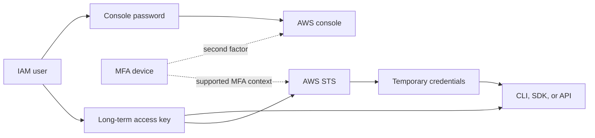
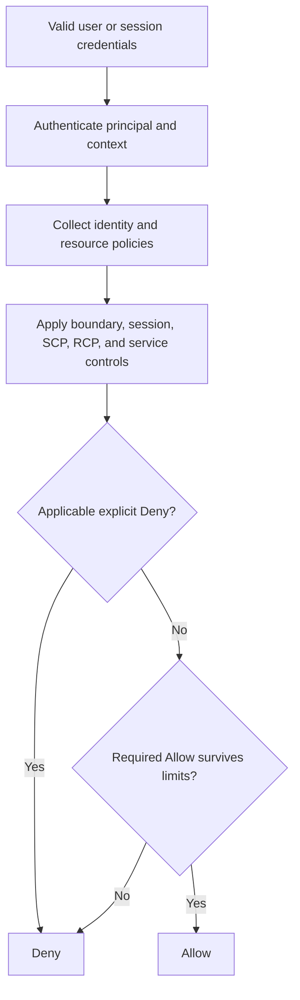
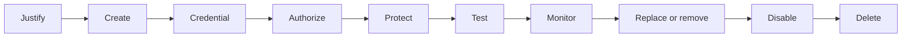

<div align="center">

# AWS IAM Users

**Account-local identities, long-term credentials, least privilege, and modern alternatives**


[IAM index](README.md) · [IAM overview](01-overview.md) · [IAM groups](03-groups.md) · [IAM roles](04-roles.md)

</div>

> [!IMPORTANT]
> An IAM user is a supported long-term identity inside one AWS account, but it is not the preferred default for a modern human workforce. AWS recommends federation—commonly through AWS IAM Identity Center—so people receive temporary credentials. Workloads should normally use IAM roles.

---

## Table of contents

1. [What is an IAM user?](#what-is-an-iam-user)
2. [What problem does it solve?](#what-problem-does-it-solve)
3. [Core concepts and credentials](#core-concepts-and-credentials)
4. [How an IAM user works](#how-an-iam-user-works)
5. [Capabilities, defaults, and restrictions](#capabilities-defaults-and-restrictions)
6. [When to use—and not use—an IAM user](#when-to-use-and-not-use-an-iam-user)
7. [CCP essentials](#ccp-essentials)
8. [SAA deep dive](#saa-deep-dive)
9. [Comparisons](#comparisons)
10. [Integration and architecture patterns](#integration-and-architecture-patterns)
11. [Security and shared responsibility](#security-and-shared-responsibility)
12. [Auditing and troubleshooting](#auditing-and-troubleshooting)
13. [Pricing and cost optimization](#pricing-and-cost-optimization)
14. [Operational workflow and CLI examples](#operational-workflow-and-cli-examples)
15. [Exam traps and misconceptions](#exam-traps-and-misconceptions)
16. [Technical interview questions](#technical-interview-questions)
17. [Practice questions](#practice-questions)
18. [Scenario drills](#scenario-drills)
19. [Decision tree and exam keywords](#decision-tree-and-exam-keywords)
20. [Quick-revision cheat sheet](#quick-revision-cheat-sheet)
21. [Official references](#official-references)
22. [Closing takeaway](#closing-takeaway)

---

<a id="what-is-an-iam-user"></a>
## 1. What is an IAM user?

### Beginner definition

An **IAM user** is a named identity created inside one AWS account. It can have its own credentials and can receive permissions through IAM policies.

Think of it as a durable badge issued by one account. The badge identifies the caller; policies determine what that caller may do.

### Technical definition

An IAM user is an IAM resource with a stable name, ARN, path, unique ID, optional tags, optional long-term credentials, and an account-local permission context. A user can represent a person or an application, but current AWS guidance favors:

- **federated workforce identities** for people;
- **IAM roles and temporary credentials** for workloads; and
- IAM users only when a supported use case cannot use those preferred patterns.

Creating a user does **not** create a separate AWS account, billing boundary, or isolated resource environment.

### User, principal, and account are different

| Term | Meaning | Key distinction |
|---|---|---|
| IAM user | A durable identity resource in one account | Can have a password, access keys, policies, and group memberships |
| Principal | An identity represented in an AWS request | A user can be a principal; roles, sessions, services, and federated identities can also be principals |
| AWS account | Resource, billing, and administrative boundary | Contains IAM resources; a user is not an account |
| Root user | Identity established with the AWS account | Has account-owner capabilities and is not an IAM user |

> [!NOTE]
> IAM is described as a global service: users are not recreated per AWS Region. Requests still target Regional services, and other controls or service behavior can be Regional.

---

<a id="what-problem-does-it-solve"></a>
## 2. What problem does it solve?

IAM users identify a long-lived caller without sharing root credentials. They support individual accountability, separate legacy-system credentials, least privilege, console or programmatic access, group-based administration, credential auditing, and migration from older key patterns.

The original example remains useful: Anna may need billing-report access, Omar may operate EC2, and Sara may upload to S3. Separate identities make activity attributable and permissions separable. In a modern organization, however, those employees would usually use a workforce identity provider and IAM Identity Center rather than three account-local users.

An IAM user is not automatically permissioned, multi-account, temporary, or a network control. It does not by itself provide centralized workforce lifecycle management or safe workload credential delivery.

---

<a id="core-concepts-and-credentials"></a>
## 3. Core concepts and credentials

### Authentication versus authorization

- **Authentication:** Who is making the request, and are the credentials valid?
- **Authorization:** May that principal perform this action on this resource under these conditions?

MFA strengthens authentication. Policies control authorization. MFA does not grant access.

### Three credential categories

| Category | Contents | Typical use | Lifetime |
|---|---|---|---|
| Console credentials | User name, account ID/alias, password, MFA when configured | Console | Password is long-term |
| Long-term programmatic credentials | Access key ID + secret access key | Legacy CLI, SDK, API | Until inactive/deleted |
| Temporary security credentials | Access key ID + secret + session token | Roles, federation, Identity Center, STS | Expires automatically |

An IAM user can exist with **no credentials**. A CLI/API-created user starts without a password or access key unless one is added.



### Console and programmatic access

Console sign-in uses the account ID/alias, user name, password, and—when assigned—one MFA device. The password is independent of access keys: password expiration does not disable a key.

An access key has an **access key ID** and a **secret access key**. The CLI/SDK commonly signs requests using AWS Signature Version 4. The secret is displayed only at key creation and cannot be recovered later.

> [!WARNING]
> Replace a lost or exposed secret. Never put credentials in source code, AMIs, images, tickets, logs, or chat.

The CLI/SDK do **not** always need IAM-user keys. Depending on support and precedence, providers can use Identity Center, assumed roles, EC2/ECS credentials, web identity, environment variables, or shared profiles.

### Access-key lifecycle

As verified on **2026-11-05**, one user can have at most **two access keys**:

1. Create the replacement while the old key works.
2. Move every consumer and test.
3. Check the old key with `GetAccessKeyLastUsed` and monitoring.
4. Make the old key **Inactive**.
5. Observe and reactivate only for rollback.
6. Delete it after confidence is established.

Inactive is reversible; deleted is irreversible.

| Storage/source | Assessment |
|---|---|
| Source code, AMI, ticket, chat | Never appropriate |
| Environment variables | Still process-visible and long-term if static |
| Shared credentials file/profile | Supported plaintext storage; profile organization is not encryption |
| Identity Center/role provider | Preferred for people; temporary credentials |
| EC2/ECS/Lambda role provider | Preferred for AWS workloads |
| Managed secret store | Mitigation for unavoidable legacy secrets; rotation still matters |

---

<a id="how-an-iam-user-works"></a>
## 4. How an IAM user works



The rule is not “attach one Allow and it works.” See the [IAM overview](01-overview.md#how-it-works) for the full model.

### Defaults and lifecycle

1. Decide whether a user is justified.
2. Create it; a new user has no permissions.
3. Add only the required credential type.
4. Grant least privilege using group/direct policies as appropriate.
5. Add MFA, boundary, and organizational guardrails where required.
6. Test the exact use case.
7. Monitor and review activity.
8. Replace or remove credentials.
9. Disable every access path, remove dependencies, and delete when retired.



Console deletion removes associated user information. CLI deletion requires cleanup of the login profile, keys, MFA associations, policies, groups, and other credentials. Deletion is not recoverable.

---

<a id="capabilities-defaults-and-restrictions"></a>
## 5. Capabilities, defaults, and restrictions

| Area | Current behavior | Design implication |
|---|---|---|
| Scope | One account; IAM resources are global | Do not duplicate workforce users across accounts |
| Permissions | None by default | Provision deliberately |
| Groups | Multiple groups; no nesting | Allows accumulate; denies still win |
| Console | Optional password | Do not create it for API-only exceptions |
| Programmatic | Optional long-term keys | Prefer temporary providers |
| Access keys | Maximum two per user, checked 2026-11-05 | Use second slot for replacement |
| MFA | Up to eight devices, checked 2026-11-05 | Register resilient factors for privileged exceptions |
| Boundary | Supported for users | Ceiling, not a grant |
| Cross-account | Role or supported resource policy | Avoid duplicate users |
| Consistency | IAM changes can be eventually consistent | Retry safely; provision outside critical paths |

### Password policy

Verified on **2026-11-05**:

| Setting | Default without custom policy | Custom option |
|---|---|---|
| Length | 8–128 characters | Configurable supported minimum |
| Character mix | Three of uppercase, lowercase, number, non-alphanumeric | Individual requirements |
| Account-name match | Cannot equal account name/email | Default protection remains relevant |
| Expiration | Never | Configurable |
| Reuse | No custom history | Prevent reuse of prior passwords |
| Failed-attempt lockout | No customer-configurable IAM lockout | Use MFA, monitoring, federation |

The policy applies to IAM passwords—not root passwords or keys. Most complexity changes apply at the next password change; expiration can affect existing passwords immediately. An expired password blocks console sign-in but leaves active keys separate.

Administrators can create, update, or delete a user's login profile and can require a password change at first sign-in. The account policy can allow users to change their own passwords; otherwise an authorized administrator performs the reset. An IAM user who loses the only usable MFA device must contact an administrator to deactivate/replace it.

### MFA methods

IAM supports synced/device-bound **passkeys and security keys**, **virtual TOTP authenticators**, and supported **hardware TOTP tokens**. AWS recommends phishing-resistant factors where practical. FIDO devices are enabled in the console and cannot be passed as MFA data to STS APIs; TOTP-backed flows can provide codes to supported STS operations. Current `aws login` behavior is a separate CLI capability.

---

<a id="when-to-use-and-not-use-an-iam-user"></a>
## 6. When to use—and not use—an IAM user

Use a user only when a caller needs a durable account-local identity and cannot use a role, federation, Identity Center, Roles Anywhere, workload identity, or service-specific mechanism. A legacy third-party integration accepting only an access key may qualify.

Treat it as a documented exception: one identity per workload, no unnecessary password, narrow permissions/boundary, secure storage, owner/review date, monitoring, staged replacement, and migration plan.

| Requirement | Preferred choice | Why |
|---|---|---|
| Employees across accounts | IAM Identity Center + IdP + permission sets | Central lifecycle; temporary role credentials |
| EC2 code accesses S3 | Instance profile/role | Automatic temporary credentials |
| Lambda accesses DynamoDB | Execution role | No embedded secret |
| Temporary administrator | Federated privileged role | Short-lived, auditable elevation |
| External CI supports OIDC | OIDC federation to role | No stored AWS key |
| Another AWS account | Cross-account role/resource policy | No duplicate user |
| Certificate-capable on-premises workload | IAM Roles Anywhere where suitable | Temporary role credentials |

IAM users are not deprecated or universally prohibited. They are higher-lifecycle-cost exceptions for most modern people and workload designs.

---

<a id="ccp-essentials"></a>
## 7.  CCP essentials

- A user is an identity inside **one account** and has **no permissions by default**.
- Passwords are for console sign-in; access keys sign programmatic requests.
- A user may have either, both, or neither.
- Groups organize users/permissions; they do not sign in.
- Roles are assumed and normally yield temporary credentials.
- Root is not an IAM user and should not handle routine work.
- MFA adds authentication but grants no permission.
- CloudTrail records API activity; credential reports summarize credential posture.
- Federation/Identity Center is the modern workforce baseline.

| Wording | Think |
|---|---|
| “Durable identity in one account” | IAM user may fit |
| “Employees across accounts” | Identity Center/federation |
| “Application on EC2” | Instance role |
| “Console sign-in” | Password + configured MFA |
| “CLI credentials” | Can be temporary |
| “Who made the call?” | CloudTrail |
| “Password/key/MFA status” | Credential report |

**Refined original memory aid:** Root owns the account, a user has a durable account badge, and a role is a temporary job badge. Employees should usually receive temporary role access through federation.

---

<a id="saa-deep-dive"></a>
## 8.  SAA deep dive

### Policy choices for a user

| Policy type/path | Ownership and behavior | Design guidance |
|---|---|---|
| AWS managed policy | Reusable policy maintained by AWS | Convenient baseline, often broader than one workload; AWS can update it |
| Customer managed policy | Reusable, versioned policy owned in the account | Preferred when several identities need a controlled custom permission set |
| Inline user policy | Embedded one-to-one in the user | Use only when strict lifecycle coupling outweighs reuse and central management |
| Group policy | Permissions inherited through each group membership | Prefer for repeated IAM-user job functions |
| Direct user attachment | Managed policy attached straight to the user | Reserve for documented exceptions and inventory for drift |

### Effective permissions

Possible grants include direct managed/inline user policies, every group policy, supported resource policies, and permissions after role assumption. Limits can include a user boundary, session policy, SCP, RCP, endpoint policy, KMS key/bucket policy, and conditions.

Applicable identity-policy allows normally combine, but an applicable explicit deny wins. A boundary, SCP, or RCP never grants. If `Developers` allows `s3:GetObject` and `Auditors` denies it, the deny wins regardless of attachment order.

> [!CAUTION]
> “Permissions are the union” is incomplete. Union describes grants of the same class; explicit denies and limiting policy types still shape the result.

### Resource-policy and cross-account nuance

A supported resource policy can name a user's ARN. A same-account direct user grant can behave differently from an identity-policy grant under an implicit boundary or identity-policy deny; explicit denies still win. Cross-account access needs authorization in both accounts, subject to guardrails.

### MFA-protected API access

Long-term key requests lack MFA context. A TOTP-enabled user can call `GetSessionToken` with MFA data and use the temporary result.

```json
{
  "Version": "2012-10-17",
  "Statement": [{
    "Sid": "DenySensitiveActionsWithoutMFA",
    "Effect": "Deny",
    "Action": ["ec2:StopInstances", "ec2:TerminateInstances"],
    "Resource": "*",
    "Condition": {
      "BoolIfExists": {"aws:MultiFactorAuthPresent": "false"}
    }
  }]
}
```

`Deny` + `BoolIfExists` + `false` also catches long-term-key requests where the context key is absent and can intentionally break static-key automation. MFA supplied to `AssumeRole` protects assumption; do not assume every later role-session request exposes the same condition context.

### Role sessions and guardrails

When a trusted role is assumed, the caller uses temporary role-session credentials and the role/session permission context—ideal for cross-account access and elevation. SCPs constrain principals in affected member accounts, RCPs constrain supported resources, and boundaries cap one identity's identity-policy permissions. None grants access.

---

<a id="comparisons"></a>
## 9. Comparisons

| Compare | IAM user | Alternative | Conclusion |
|---|---|---|---|
| User vs group | Principal with optional credentials | Users-only permission container | Users sign in; groups do not |
| User vs role | Durable account identity | Assumable temporary sessions | Prefer role for workloads/cross-account/elevation |
| User vs root | No permission by default | Account-owner identity | Protect root; delegate routine work |
| User vs Identity Center user | One-account IAM resource | Central workforce identity | Prefer Identity Center for workforce |
| User vs federated identity | Optional long-term credentials | External identity exchanged for temporary access | Federation centralizes lifecycle |
| User vs EC2 role | Key distribution required | Metadata-delivered temporary credentials | Choose the EC2 role |
| User vs cross-account role | Duplicate/local identity | Temporary target-account session | Choose the role |

| Characteristic | Console password | User access keys | Temporary credentials |
|---|---|---|---|
| Use | Console | CLI/SDK/API | CLI/SDK/API/federation |
| Components | Password (+ MFA) | ID + secret | ID + secret + token |
| Expiry | Policy-dependent | No automatic expiry | Yes |
| Preferred use | Rare exception | Legacy exception | People/workloads/delegation |

| Policy placement | Best fit | Key point |
|---|---|---|
| Group managed policy | Repeated job-function access | Membership changes access |
| Direct managed policy | Documented user exception | Can create one-off drift |
| Inline user policy | Strict lifecycle coupling | Deleted with user; not reusable |
| Permissions boundary | Delegation ceiling | Never grants |

---

<a id="integration-and-architecture-patterns"></a>
## 10. Integration and architecture patterns

- **Workforce:** corporate IdP → IAM Identity Center → permission set/account role → temporary credentials.
- **AWS workload:** EC2/ECS/Lambda → workload role → rotating temporary credentials → service API.
- **Legacy exception:** dedicated user → protected secret store → narrow policy/boundary → monitoring → migration plan.
- **Cross-account:** source identity allowed to call `sts:AssumeRole` + target trust → temporary target-role session.
- **Elevation:** low-privilege federated identity → approval/strong authentication → short privileged role session → monitoring/review.

Separate each legacy workload identity. Sharing a user couples permissions and rotation, widens blast radius, and destroys useful attribution.

---

<a id="security-and-shared-responsibility"></a>
## 11. Security and shared responsibility

### Customer responsibilities

- Justify every user and credential type.
- Protect root and privileged identities with strong MFA.
- Grant and periodically review least privilege.
- Secure, replace, deactivate, and delete credentials.
- Keep secrets out of Git history, artifacts, logs, chat, and tickets.
- Govern user/key/policy/tag creation and `iam:PassRole`.
- Review CloudTrail, credential reports, last-accessed data, and Access Analyzer.
- Offboard people and applications promptly.

AWS operates IAM, validates credentials and signatures, evaluates configured policies, and supplies integrations. AWS does not choose identities, narrow an overbroad customer policy, or remove a forgotten key.

### Defensive baseline

1. Prefer federation/roles and temporary credentials.
2. Create only required credential types.
3. Prefer repeatable group/customer-managed policies over unexplained drift.
4. Require MFA for IAM users with console access, especially privileged ones.
5. Prefer phishing-resistant MFA where the access path supports it.
6. Restrict credential management and privilege-escalation paths.
7. Use Access Analyzer as an aid, then review its findings/policies.
8. Record owner, purpose, and review date.
9. Monitor unexpected services, Regions, addresses, and privilege changes.
10. Remove unused users and credentials.

### Compromised access-key response

1. Identify the user/key and preserve relevant evidence.
2. Make the key inactive immediately, or delete it when rollback is unnecessary.
3. Apply a deny/quarantine control if broader containment is needed.
4. Assess temporary credentials already issued. Disabling the source key does not necessarily invalidate them; use an issue-time deny strategy or delete/recreate the user if the incident plan requires it.
5. Search CloudTrail and service logs for activity, new credentials, policies, roles, resources, and persistence.
6. Remove unauthorized changes and assess data/resource impact.
7. Restore narrower access only after remediation.
8. Document lessons and migrate to temporary credentials.

> [!CAUTION]
> Rotation alone is not incident response. An attacker may already have created persistence, sessions, resources, or data copies.

---

<a id="auditing-and-troubleshooting"></a>
## 12. Auditing and troubleshooting

| Tool/data | Answers | Does not prove |
|---|---|---|
| CloudTrail | Which principal called an API, when, from where, and result | Every permission it could have used |
| Credential report | Password, MFA, first two key status/age/use fields | Complete service-specific credential inventory |
| `GetAccessKeyLastUsed` | Most recent recorded service, Region, and time | That an unseen key is nowhere in use |
| Last accessed information | Allowed service/action use within reporting limits | That deletion is impact-free |
| Access Analyzer | Supported possible/unused access and policy findings | That an event occurred |
| Policy Simulator | Modeled result for supplied context | Authoritative production behavior for every control |

AWS permits one credential report generation every four hours. It covers the first two keys and omits some service-specific credentials; use dedicated list APIs for complete inventory.

### `AccessDenied` workflow

1. Capture the principal/session ARN, action, resource ARN, Region, time, and request ID.
2. Confirm which profile/provider and credentials the CLI/SDK used.
3. Check authentication and session expiry.
4. Inspect direct user and every group policy.
5. Check conditions, resource policy, boundary, session policy, SCP, RCP, endpoint policy, KMS key policy, and service controls as relevant.
6. Find any applicable explicit deny.
7. Confirm resource spelling, partition, account, Region, tags, and encryption dependencies.
8. Correlate CloudTrail; use simulator/Analyzer within their limits.
9. Make the smallest justified fix and retest.

| Symptom | Likely cause/check |
|---|---|
| Console fails but CLI works | Login profile/password/MFA issue; key remains separate |
| CLI uses unexpected identity | Higher-precedence environment/static source shadows intended SSO/role profile |
| Direct Allow still denies | Boundary/SCP/RCP/resource policy/condition/explicit deny |
| Replacement breaks one server | Hidden consumer still uses old key |
| CLI user deletion fails | Dependent credentials, policies, groups, or devices remain |
| New change is briefly inconsistent | Eventual consistency or cached credentials; bounded retry/refresh |

---

<a id="pricing-and-cost-optimization"></a>
## 13. Pricing and cost optimization

IAM users, policies, and AWS STS have no separate IAM usage charge; IAM Identity Center also has no additional service charge. Integrated logging, secret storage, security services, and external IdPs may incur charges.

Long-term identities also create operational cost: replacement, audits, offboarding, duplicate-account users, and incident exposure. Optimize by reducing identity sprawl, centralizing workforce access, using workload roles, and deleting unused credentials—not by weakening MFA or logging.

---

<a id="operational-workflow-and-cli-examples"></a>
## 14. Operational workflow and CLI examples

These commands are **illustrative** and were not run against an AWS account. Use a sandbox, change control, and scoped administrator credentials.

### Create only after justification

```bash
aws iam create-user \
  --user-name LegacyReportExporter \
  --tags Key=Owner,Value=FinancePlatform Key=ReviewDate,Value=2027-02-01
```

Do not add a password or key by default. Avoid passwords on command lines because shell history/process inspection can expose them.

### Grant narrow permissions

This identity policy lists one bucket prefix and reads its objects. It has no `Principal` because it attaches to an identity.

```json
{
  "Version": "2012-10-17",
  "Statement": [
    {
      "Sid": "ListApprovedPrefix",
      "Effect": "Allow",
      "Action": "s3:ListBucket",
      "Resource": "arn:aws:s3:::example-finance-reports",
      "Condition": {
        "StringLike": {"s3:prefix": "exports/*"}
      }
    },
    {
      "Sid": "ReadApprovedObjects",
      "Effect": "Allow",
      "Action": "s3:GetObject",
      "Resource": "arn:aws:s3:::example-finance-reports/exports/*"
    }
  ]
}
```

The bucket is illustrative. SSE-KMS objects also require an appropriate KMS authorization path.

### Inventory and stage replacement

```bash
aws iam list-access-keys --user-name LegacyReportExporter

aws iam get-access-key-last-used \
  --access-key-id AKIAEXAMPLEONLY0000

aws iam generate-credential-report
aws iam get-credential-report
```

The key ID is nonfunctional. Creating a key returns its secret once; route that output to approved secret handling, not a transcript. After migration/testing:

```bash
aws iam update-access-key \
  --user-name LegacyReportExporter \
  --access-key-id AKIAEXAMPLEONLY0000 \
  --status Inactive
```

After the observation window:

```bash
aws iam delete-access-key \
  --user-name LegacyReportExporter \
  --access-key-id AKIAEXAMPLEONLY0000
```

### Offboard safely

Review recent use, disable access, preserve evidence, and remove the login profile, keys, signing/SSH/service-specific credentials, MFA associations, policies, and group memberships before:

```bash
aws iam delete-user --user-name LegacyReportExporter
```

In the console, use **Users**, **Permissions**, **Groups**, **Tags**, **Security credentials**, and **Access Advisor**. Console cleanup is convenient but does not replace impact review.

---

<a id="exam-traps-and-misconceptions"></a>
## 15. Exam traps and misconceptions

| # | Incorrect assumption | Correct explanation and reason | Level |
|---:|---|---|---|
| 1 | New users can use AWS immediately | No permissions by default; they may also have no credentials | CCP |
| 2 | Every user joins a default group | Membership is explicit; no automatic all-users group | CCP |
| 3 | Groups can contain groups | Groups contain users only | CCP |
| 4 | Every employee should get a user | Prefer federation/Identity Center | Both |
| 5 | CLI always needs user keys | It can use Identity Center, roles, metadata, web identity, and other providers | Both |
| 6 | Password equals access key | Separate credentials and paths | CCP |
| 7 | Password expiry disables the user | Active keys remain separate | Both |
| 8 | MFA grants permissions | It strengthens authentication only | CCP |
| 9 | Every MFA method supplies STS MFA context | FIDO/passkey and TOTP flows differ | SAA |
| 10 | Long-term key calls have MFA context | They do not; use supported temporary-credential flow | SAA |
| 11 | Secret keys can be viewed later | Shown once; replace when lost | CCP |
| 12 | Two keys double permissions | Both authenticate the same user | CCP |
| 13 | Inactive equals deleted | Inactive is reversible; deletion is permanent | CCP |
| 14 | Environment variables make keys temporary | Storage does not change lifetime | Both |
| 15 | Named profiles encrypt keys | Profiles organize plaintext settings | SAA |
| 16 | Group policy order resolves conflicts | No order; allows combine and explicit deny wins | Both |
| 17 | `ReadOnlyAccess` guarantees no writes | Other grants may allow writes; reads can expose data | SAA |
| 18 | Boundary grants listed actions | It limits identity grants | SAA |
| 19 | SCP grants access | It is a principal-side maximum | Both |
| 20 | RCP is a user policy | It limits supported resources and never grants | SAA |
| 21 | `AdministratorAccess` defeats all denies | Guardrails/resource controls/explicit denies still apply | SAA |
| 22 | Users are Regional | They are account-global | CCP |
| 23 | A user works automatically in every account | It belongs to one account; use cross-account roles | Both |
| 24 | Deactivating a key ends every session | Issued temporary credentials may need separate containment | SAA |
| 25 | CloudTrail lists possible permissions | It records activity | SAA |
| 26 | “Never used” proves safe deletion | Validate owner/consumers and stage inactivation | SAA |
| 27 | Deleting a user deletes managed policies | Attachments go; reusable managed policies remain | SAA |
| 28 | Shared users simplify auditing | They destroy individual attribution | CCP |

---

<a id="technical-interview-questions"></a>
## 16. Technical interview questions

### 1. When would you approve an IAM user today?

For a documented long-term account-local exception that cannot use roles or federation. Require narrow permissions, isolated credentials, secure storage, monitoring, owner/review date, and migration plan.

### 2. How do you replace an access key without downtime?

Create the second key, deploy/test it everywhere, inspect old-key use, make old inactive, observe, then delete it. Inactive provides rollback.

### 3. Two groups conflict. What happens?

Applicable allows combine, but an applicable explicit deny wins. Boundaries, Organizations policies, resource policies, and conditions can also limit access; policy order does not.

### 4. Why use an EC2 role instead of a user key?

The instance profile provides rotating temporary credentials without embedded/distributed long-term secrets.

### 5. Password disabled versus user disabled?

Removing the login profile blocks password sign-in only. Keys/sessions may remain; full deactivation must cover every path, often with a temporary explicit deny.

### 6. How do you investigate `AccessDenied`?

Capture exact principal/action/resource/context, confirm credential provider, then inspect grants, conditions, explicit denies, boundary, SCP/RCP, resource/service policies, and dependencies such as KMS.

### 7. Why might console MFA not protect an access key?

The paths are separate and long-term keys lack MFA context. Use MFA-backed temporary credentials or require MFA for role assumption, and remove unnecessary keys.

### 8. What if a key appears in public Git?

Contain it, preserve evidence, assess sessions/persistence, investigate CloudTrail and resources, eradicate unauthorized changes, and restore safe access. Removing the line is insufficient.

### 9. Credential report versus CloudTrail?

The report snapshots account credential posture; CloudTrail records API events and caller context.

### 10. How do employees avoid one user per account?

Federate through Identity Center, assign permission sets, and use temporary credentials for provisioned account roles.

---

<a id="practice-questions"></a>
## 17. Practice questions

These 30 original questions are study material, not leaked exam content.

<details>
<summary>Q1 · CCP · What permissions does a new IAM user have?</summary>

- A. Read-only
- B. Billing
- C. None
- D. The creator's permissions

**Answer: C.** A user starts implicitly denied. A/B need grants; D is not inherited.
</details>

<details>
<summary>Q2 · CCP · Which credential supports IAM-user console sign-in?</summary>

- A. Console password
- B. Secret key alone
- C. SSH key
- D. Bucket key

**Answer: A.** A login profile/password supports the console. Access keys sign APIs; C is service-specific; D is not an IAM credential.
</details>

<details>
<summary>Q3 · CCP · Which statement describes an IAM group?</summary>

- A. It signs in
- B. It contains users and helps assign permissions
- C. It contains nested groups
- D. It is an account

**Answer: B.** A group is a users-only permission container. It is not a principal, nested group, or account.
</details>

<details>
<summary>Q4 · CCP · What does MFA do?</summary>

- A. Grants admin
- B. Adds an authentication factor
- C. Replaces policies
- D. Publishes a key

**Answer: B.** MFA strengthens authentication. It grants nothing, does not replace authorization, and does not publish credentials.
</details>

<details>
<summary>Q5 · CCP · Employees need five accounts. Preferred baseline?</summary>

- A. Five users each
- B. Shared root
- C. Identity Center, federation, permission sets
- D. Key in code

**Answer: C.** It centralizes lifecycle and provides temporary role access. A creates sprawl; B/D are severe anti-patterns.
</details>

<details>
<summary>Q6 · CCP · Which service records IAM-user API activity?</summary>

- A. CloudTrail
- B. Route 53
- C. Budgets
- D. Security groups

**Answer: A.** CloudTrail records API events. The distractors handle DNS, cost thresholds, and network filtering.
</details>

<details>
<summary>Q7 · CCP · Can a user have both password and keys?</summary>

**Answer: Yes, if both are required.** They are independent. “Every user needs both” and “a user must have at least one” are false.
</details>

<details>
<summary>Q8 · CCP · A secret access key is lost. What now?</summary>

- A. Ask AWS to reveal it
- B. Derive it from its ID
- C. Replace it and remove the lost key
- D. Convert the password

**Answer: C.** Secrets cannot be retrieved after creation. A, B, and D are unsupported.
</details>

<details>
<summary>Q9 · CCP · Safest EC2-to-S3 identity?</summary>

- A. Root key
- B. User key in AMI
- C. Instance profile role
- D. Shared password

**Answer: C.** It supplies rotating temporary credentials. The others expose durable secrets.
</details>

<details>
<summary>Q10 · CCP · Is an IAM user Regional?</summary>

**Answer: No.** Users are global within the account. Recreating one per Region is unnecessary; target services can still be Regional.
</details>

<details>
<summary>Q11 · CCP · Which report summarizes password, MFA, and key status?</summary>

- A. IAM credential report
- B. VPC flow log
- C. Cost and Usage Report
- D. Route table

**Answer: A.** The others cover network traffic, costs, or routing.
</details>

<details>
<summary>Q12 · CCP · Why not share root for daily administration?</summary>

**Answer:** It has account-owner capabilities, widens blast radius, and undermines delegation/accountability. Federated/role access is preferred; “root is simplest” ignores security.
</details>

<details>
<summary>Q13 · SAA · Group A allows `s3:GetObject`; Group B denies it. Result?</summary>

- A. A wins alphabetically
- B. Allow because grants union
- C. Deny
- D. Random

**Answer: C.** Applicable explicit deny wins. Policy order and alphabetic order have no meaning.
</details>

<details>
<summary>Q14 · SAA · Boundary lists EC2 but no policy allows EC2. Result?</summary>

**Answer: Deny.** A boundary limits grants; it never creates them. Treating it as an Allow is the trap.
</details>

<details>
<summary>Q15 · SAA · Why might CLI ignore the intended SSO profile?</summary>

**Answer:** A higher-precedence credential source, such as environment variables, may win. Inspect the provider chain; broadening the intended role does not fix use of the wrong identity.
</details>

<details>
<summary>Q16 · SAA · Correct key-replacement order?</summary>

- A. Delete old first
- B. Create, deploy/test, inspect, inactivate, observe, delete
- C. Keep both forever
- D. Rename secret

**Answer: B.** It enables safe migration/rollback. A risks outage, C expands exposure, and D is not a key operation.
</details>

<details>
<summary>Q17 · SAA · Password expires; active key does what?</summary>

- A. Expires too
- B. Remains usable unless separately blocked
- C. Becomes MFA
- D. Gains root

**Answer: B.** Password and key paths are independent. The other choices invent behavior.
</details>

<details>
<summary>Q18 · SAA · How can a TOTP user satisfy API MFA context?</summary>

**Answer:** Call a supported STS flow such as `GetSessionToken` with the device/code and use its temporary credentials. Enabling console MFA alone does not add context to long-term-key calls.
</details>

<details>
<summary>Q19 · SAA · Best one-hour developer elevation?</summary>

- A. Permanent admin key
- B. Federated identity assumes approved monitored role
- C. Root by email
- D. User in every account

**Answer: B.** It limits duration and centralizes control. A/C/D create durable privilege, sharing, or sprawl.
</details>

<details>
<summary>Q20 · SAA · Cross-account access without duplicate users?</summary>

**Answer:** Authorize the source identity to assume a trusted target role, or use a supported resource policy. Copying users/keys fragments governance.
</details>

<details>
<summary>Q21 · SAA · A key is public. Is deletion enough?</summary>

**Answer: No.** Contain it, assess sessions, inspect logs/resources, remove persistence, and recover safely. Deleting only the Git line or rotating without investigation misses impact.
</details>

<details>
<summary>Q22 · SAA · Why can `AdministratorAccess` still get `AccessDenied`?</summary>

**Answer:** Explicit deny, boundary, SCP/RCP, resource/endpoint/key policy, or condition can block it. Another broad Allow cannot override those limits.
</details>

<details>
<summary>Q23 · SAA · What's wrong with a user key in an AMI?</summary>

**Answer:** Copies expose the same durable secret, replacement is manual, and blast radius/attribution are poor. Use an instance role; AMI encryption does not solve delivery to running instances.
</details>

<details>
<summary>Q24 · SAA · Can an SCP allow an action absent from user policies?</summary>

**Answer: No.** An SCP is a maximum, not a grant. A valid underlying authorization is still needed.
</details>

<details>
<summary>Q25 · SAA · Does deleting a user delete attached customer managed policies?</summary>

**Answer: No.** The attachment goes, but reusable policies remain. Inline user policies are lifecycle-bound. Confusing detachment with deletion is the trap.
</details>

<details>
<summary>Q26 · SAA · Why isn't last-used data enough to delete a key?</summary>

**Answer:** Reporting context and infrequent hidden consumers matter. Combine inventory, owner validation, logs, and staged inactivation; keeping all keys forever is not safer.
</details>

<details>
<summary>Q27 · SAA · Strongest limited auditor access?</summary>

- A. Shared admin user
- B. Federated audit role with time-limited scoped access
- C. Root
- D. Public keys

**Answer: B.** It is attributable, temporary, and scoped. A/C are overprivileged; D exposes credentials. Review “read” access for sensitive data.
</details>

<details>
<summary>Q28 · SAA · User Allow conflicts with bucket-policy explicit Deny. Result?</summary>

**Answer: Deny.** Applicable explicit deny wins; policy order is irrelevant.
</details>

<details>
<summary>Q29 · SAA · What precedes CLI user deletion?</summary>

**Answer:** Review activity and remove login profile, keys, MFA devices, memberships, attached/inline policies, and service-specific/SSH/signing credentials. Calling `delete-user` first can fail.
</details>

<details>
<summary>Q30 · SAA · Why not share one user among three applications?</summary>

**Answer:** It combines permissions/blast radius, obscures attribution, and couples rotation/lifecycle. Prefer roles per workload or, for a true legacy exception, a distinct narrow user per workload.
</details>

---

<a id="scenario-drills"></a>
## 18. Scenario drills

| Requirement | Recommended solution and why | Weaker alternatives | Prerequisites, security, failures |
|---|---|---|---|
| Workforce across accounts | IdP + Identity Center assignments/permission sets; temporary account-role credentials | Per-account users duplicate lifecycle | Identity source, assignments, role permissions, MFA/session policy; missing assignment or guardrail can deny |
| EC2 app reads S3 prefix | Instance profile with narrow role plus KMS path if needed | User key in code/AMI | Attach role, bucket/prefix/key authorization, protect IMDS; bucket/key policy or wrong profile can fail |
| Temporary elevation | Federated user assumes approved privileged role with strong auth, short session, monitoring | Permanent admin key | Trust/caller permission, approval, CloudTrail; MFA/trust/boundary/SCP can block |
| Legacy key-only app | Dedicated no-console user, narrow policy/boundary, secret store, monitoring, replacement/migration plan | Shared/broad key | Confirm limitation, owner, test rotation; hidden consumer/two-key limit/leak are risks |
| Cross-account | Trusted target role or supported resource policy | Duplicate users/keys | Caller allow + target trust/resource allow + guardrails; wrong ARN/condition/deny can fail |
| `AccessDenied` | Identify actual credentials; evaluate grants, conditions, boundaries, Organizations/resource/service controls | Adding admin is risky and may not work | Exact context required; common issues are wrong profile, deny, tag, ARN, KMS dependency |
| Group + direct permissions | Prefer job-function groups; document direct exception; inspect all grant paths | Assuming direct replaces group | Removing one attachment may leave another grant |
| Compromised key | Inactivate, quarantine, assess sessions, investigate, eradicate, recover | Rotate only | Incident authority/logs; preserve evidence and avoid premature destruction |
| Organizational restriction | Verify intended SCP/RCP path with policy owner | Broad local policy cannot override it | OU inheritance and explicit deny matter |
| Limited auditor | Federated audit role/permission set with reviewed data scope | Durable user or generic admin | Define evidence/accounts/time; KMS/resource policies and missing org visibility can fail |

---

<a id="decision-tree-and-exam-keywords"></a>
## 19. Decision tree and exam keywords

```text
Who needs access?
├─ Human workforce → IAM Identity Center + federation
├─ AWS workload → service/workload role
├─ External workload → OIDC/SAML/Roles Anywhere where suitable
├─ Another account → cross-account role or supported resource policy
├─ Exceptional durable account-local need → controlled IAM user
└─ Root-required task → protected root for that task only

What failed?
├─ Sign-in → account alias/ID, password, MFA, login profile
├─ Unexpected CLI identity → profile/provider precedence
├─ Expired authentication → refresh temporary session
├─ Authorization → grants + denies + boundary + SCP/RCP + resource/service controls
└─ Deletion → remove dependent credentials, policies, devices, groups
```

| Keyword | Likely answer | Caveat |
|---|---|---|
| Long-term programmatic credential | User access key | Prefer temporary alternative |
| Temporary | Role/STS/federation | Inspect source, trust, session, limits |
| Central workforce | Identity Center | Permission sets provision roles |
| EC2 credentials | Instance role | Not a key in code |
| Conflicting groups | Explicit deny wins | Other controls still apply |
| Credential inventory | Credential report | Supplement service-specific lists |
| Observed API call | CloudTrail | Different from possible access |
| Maximum permission | Boundary/SCP/RCP | None grants |
| Leaked key | Contain, investigate, eradicate, recover | Rotation alone is incomplete |

---

<a id="quick-revision-cheat-sheet"></a>
## 20. Quick-revision cheat sheet

```text
IAM user = durable identity inside one account.
New user = no permissions; it may also have no credentials.

Console = account ID/alias + name + password + configured MFA.
Programmatic = signed request using long-term or temporary credentials.
Access key = ID + secret; secret shown once; maximum two (checked 2026-11-05).
Temporary credentials = ID + secret + session token; expire.

People → federation / IAM Identity Center.
AWS workloads → roles.
Cross-account → role or supported resource policy.
IAM user → documented long-term exception.

Applicable allows can accumulate; explicit Deny wins.
Boundary, SCP, and RCP limit; they do not grant.
MFA authenticates; it does not authorize.

Key replacement: create → deploy → test → inspect → inactivate → observe → delete.
Incident: contain → assess sessions → investigate → eradicate → recover.

CloudTrail = what happened.
Credential report = credential posture.
Access Analyzer = supported possible/unused access and policy findings.
```

**Short exam answer:** An IAM user is an account-local identity with optional long-term credentials and policy-based permissions; use federation for people and roles for workloads whenever possible.

**Memory trick:** **User = durable badge; role = borrowed badge; group = badge organizer; policy = rules.**

---

<a id="official-references"></a>
## 21. Official references

Reviewed against official AWS documentation on **2026-11-05**.

- [IAM users](https://docs.aws.amazon.com/IAM/latest/UserGuide/id_users.html)
- [Security best practices](https://docs.aws.amazon.com/IAM/latest/UserGuide/best-practices.html)
- [Manage user access keys](https://docs.aws.amazon.com/IAM/latest/UserGuide/access-keys-admin-managed.html)
- [Update keys without interruption](https://docs.aws.amazon.com/IAM/latest/UserGuide/id-credentials-access-keys-update.html)
- [Credential reports](https://docs.aws.amazon.com/IAM/latest/UserGuide/id_credentials_getting-report.html)
- [IAM password policy](https://docs.aws.amazon.com/IAM/latest/UserGuide/id_credentials_passwords_account-policy.html)
- [AWS MFA in IAM](https://docs.aws.amazon.com/IAM/latest/UserGuide/id_credentials_mfa.html)
- [MFA-protected API access](https://docs.aws.amazon.com/IAM/latest/UserGuide/id_credentials_mfa_configure-api-require.html)
- [Global condition context keys](https://docs.aws.amazon.com/IAM/latest/UserGuide/reference_policies_condition-keys.html)
- [Remove or deactivate a user](https://docs.aws.amazon.com/IAM/latest/UserGuide/id_users_remove.html)
- [Policy evaluation logic](https://docs.aws.amazon.com/IAM/latest/UserGuide/reference_policies_evaluation-logic.html)
- [Permissions boundaries](https://docs.aws.amazon.com/IAM/latest/UserGuide/access_policies_boundaries.html)
- [SDK/tool credential providers](https://docs.aws.amazon.com/sdkref/latest/guide/standardized-credentials.html)
- [AWS CLI authentication](https://docs.aws.amazon.com/cli/latest/userguide/cli-chap-authentication.html)
- [CLI with Identity Center](https://docs.aws.amazon.com/cli/latest/userguide/cli-configure-sso.html)
- [Identity Center and IAM roles](https://docs.aws.amazon.com/singlesignon/latest/userguide/identity-center-and-iam-roles.html)
- [Temporary credentials](https://docs.aws.amazon.com/IAM/latest/UserGuide/id_credentials_temp.html)
- [CloudTrail logging for IAM and STS](https://docs.aws.amazon.com/IAM/latest/UserGuide/cloudtrail-integration.html)
- [IAM Access Analyzer](https://docs.aws.amazon.com/IAM/latest/UserGuide/what-is-access-analyzer.html)
- [Organizations authorization policies](https://docs.aws.amazon.com/organizations/latest/userguide/orgs_manage_policies_authorization_policies.html)
- [CLF-C02 Domain 2](https://docs.aws.amazon.com/aws-certification/latest/cloud-practitioner-02/cloud-practitioner-02-domain2.html)
- [SAA-C03 exam guide](https://docs.aws.amazon.com/aws-certification/latest/solutions-architect-associate-03.html)

Access methods, MFA, quotas, managed policies, pricing, and exam guides can change. Recheck official documentation for production decisions.

### Continue the learning path

| Topic | Guide |
|---|---|
| Foundation | [IAM overview](01-overview.md) |
| Next | [IAM groups](03-groups.md) |
| Temporary access | [IAM roles](04-roles.md) |
| Policy options | [Customer managed](05-customer-managed-policies.md) · [Inline](06-inline-policies.md) |
| Audit/account owner | [Access Analyzer](09-access-analyzer.md) · [Root user](10-root-user.md) |

[Back to IAM index](README.md) · [Back to category](../README.md) · [Repository home](../../README.md)

---

<a id="closing-takeaway"></a>
## 22. Closing takeaway

<div align="center">


**Create fewer long-term identities. Give each justified user only the access path and permissions it needs. Audit continuously, and migrate to temporary credentials.**

</div>
