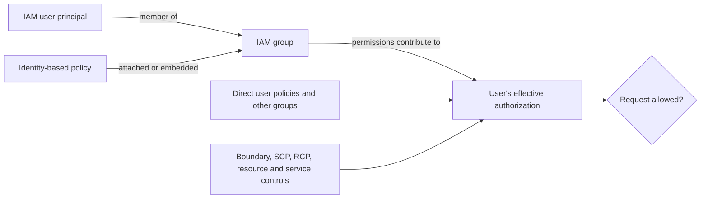
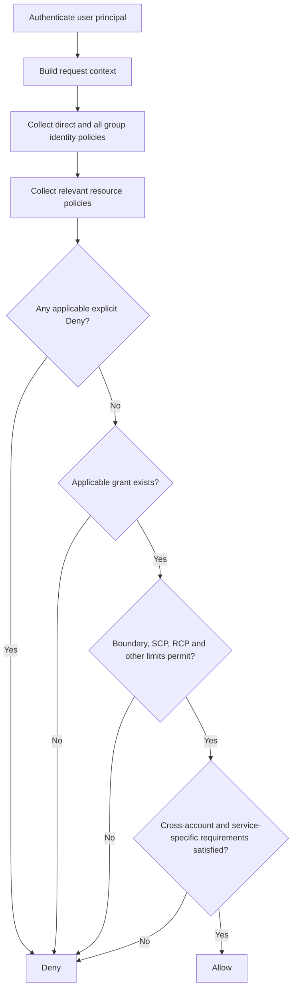

<div align="center">

# AWS IAM User Groups

**Account-local permission containers for IAM users—not identities, credentials, or roles**


[IAM index](README.md) · [IAM overview](01-overview.md) · [IAM users](02-users.md) · [IAM roles](04-roles.md)

</div>

> [!IMPORTANT]
> An IAM user group is a permissions-management container for IAM users in one AWS account. It does not authenticate, have credentials, become a principal, or assume a role. For a modern multi-account workforce, prefer federation through AWS IAM Identity Center.

---

## Table of contents

1. [What is an IAM group?](#what-is-an-iam-group)
2. [What problem does it solve?](#what-problem-does-it-solve)
3. [Core characteristics and constraints](#core-characteristics-and-constraints)
4. [How groups work and change](#how-groups-work-and-change)
5. [Permission inheritance and effective access](#permission-inheritance-and-effective-access)
6. [Group policies and capabilities](#group-policies-and-capabilities)
7. [CCP essentials](#ccp-essentials)
8. [SAA deep dive](#saa-deep-dive)
9. [Comparisons](#comparisons)
10. [Identity Center and architecture patterns](#identity-center-and-architecture-patterns)
11. [Security and shared responsibility](#security-and-shared-responsibility)
12. [Auditing and troubleshooting](#auditing-and-troubleshooting)
13. [Pricing and cost optimization](#pricing-and-cost-optimization)
14. [Practical console and CLI management](#practical-console-and-cli-management)
15. [Exam traps and misconceptions](#exam-traps-and-misconceptions)
16. [Technical interview questions](#technical-interview-questions)
17. [Practice questions](#practice-questions)
18. [Architecture scenario drills](#architecture-scenario-drills)
19. [Decision framework and keywords](#decision-framework-and-keywords)
20. [Quick-revision cheat sheet](#quick-revision-cheat-sheet)
21. [Official references](#official-references)
22. [Closing takeaway](#closing-takeaway)

---

<a id="what-is-an-iam-group"></a>
## 1. What is an IAM group?

### Simple definition

An **IAM user group** is a collection of IAM users used to manage shared permissions.

Instead of attaching the same policy separately to ten developers, an administrator can attach it once to a `Developers` group and add the ten users.

### Accurate technical definition

An IAM group is an account-local IAM resource with a friendly name, path, ARN, stable unique ID, membership list, and optional attached or embedded identity-based policies. Those policies contribute permissions to each member user when that user makes a request.

A group is **not**:

- an authenticated identity or principal;
- a separate AWS account or security boundary;
- a role, session, or source of temporary credentials;
- a container for roles or other groups;
- a resource-policy principal; or
- a multi-account workforce directory group.

AWS explicitly states that a group cannot be named as a policy `Principal` because groups concern permission management, not authentication. A group ARN can still be the **resource** of IAM administration actions such as controlling who may update that group.

### Analogy—and its limit

Think of a group as a shared job-description folder:

- users are employees with badges;
- the group folder contains common access rules; and
- each employee's effective access reflects every applicable rule source.

The analogy stops there. The folder cannot sign in, present a badge, call an API, or borrow a role. Only an authenticated principal makes a request.

### One-line mental model

> **Users join groups; policies attach to groups; permissions apply to users; only principals make requests.**

---

<a id="what-problem-does-it-solve"></a>
## 2. What problem does it solve?

### Without groups

An administrator might attach the same policy directly to many users. This creates repeated attachments, makes joiner/mover/leaver changes harder to review, and increases the chance that one person's permissions drift from the team baseline.

### With groups

Groups provide account-local role-based permission management for IAM users:

- define a reusable permission baseline for a team or job function;
- add a new user to receive the existing baseline;
- remove membership when responsibilities change;
- update one attached managed policy for all members;
- combine several job-function groups for one user; and
- inspect membership and policy attachment separately.

### What groups do not solve

Groups do not centralize identities across accounts, issue temporary credentials, provide cross-account trust, or guarantee least privilege. A broad group policy is still broad, and membership is only one source of a user's effective permissions.

The original development example remains sound for a small legacy account: ten IAM users needing the same S3 artifact, CloudWatch log, and source-repository permissions can share a `Developers` group policy. In a modern workforce spanning accounts, those people should usually be provisioned through IAM Identity Center groups and permission sets instead.

---

<a id="core-characteristics-and-constraints"></a>
## 3. Core characteristics and constraints

### Membership rules

| Characteristic | Actual behavior | Exam/design meaning |
|---|---|---|
| Members | IAM users only | No roles, service principals, root users, or federated sessions |
| Multiple membership | A user can join multiple groups | Applicable identity-policy allows can accumulate |
| Membership optional | A user can belong to no group | There is no automatic baseline permission |
| Nested groups | Not supported | A group cannot contain another group |
| Default group | None | Create and maintain an all-users group yourself if truly needed |
| Authentication | None | No password, access key, MFA device, or console sign-in |
| Role assumption | Group cannot assume | Member users may receive `sts:AssumeRole` permission through group policy |
| Resource-policy principal | Unsupported | Name an authenticated account/user/role/session/service as supported |
| Account scope | One AWS account | It cannot span or be shared as an IAM group across accounts |
| Region scope | IAM resource is global in the account | Do not recreate the group per Region |
| Permissions boundary | Cannot attach to a group | Boundaries apply to individual users or roles |
| Tags | IAM groups cannot be tagged | Use naming, paths, policy inventory, or external governance metadata |

These constraints follow the official [IAM user group model](https://docs.aws.amazon.com/IAM/latest/UserGuide/id_groups.html), including the separate rules for supported [resource-policy principals](https://docs.aws.amazon.com/IAM/latest/UserGuide/reference_policies_elements_principal.html), [permissions boundaries](https://docs.aws.amazon.com/IAM/latest/UserGuide/access_policies_boundaries.html), and [taggable IAM resources](https://docs.aws.amazon.com/IAM/latest/UserGuide/id_tags.html).

### Names, paths, and identifiers

- Group names must be unique within the account and are not distinguished by case: `ADMINS` and `admins` cannot coexist.
- The name supports IAM's documented character set and has a maximum of 128 characters.
- An optional path can organize names and form part of the ARN, such as `arn:aws:iam::111122223333:group/platform/Developers`.
- IAM assigns a stable unique group ID; automation normally uses the friendly name or ARN.
- Recreating a deleted group with the same friendly name creates a new IAM resource, while policies that refer to that name/ARN may require careful review.

### Current quotas

Checked against the official [IAM and STS quotas](https://docs.aws.amazon.com/IAM/latest/UserGuide/reference_iam-quotas.html) and [IAM service quotas](https://docs.aws.amazon.com/general/latest/gr/iam-service.html) on **2026-11-05**:

| Quota | Current value | Adjustable? |
|---|---:|---|
| Groups per account | 300 default; 500 maximum | Yes |
| Groups per user | 10 | No |
| Managed policies attached per group | 10 | No |
| Group name | 128 characters | No |
| Aggregate inline-policy size per group | 5,120 characters, excluding whitespace | No |

Quotas are date-sensitive. Use Service Quotas and current documentation for production planning.

---

<a id="how-groups-work-and-change"></a>
## 4. How groups work and change

### Lifecycle

1. Determine whether account-local IAM users are justified.
2. Create or identify the users.
3. Create a group with a job-function-oriented name.
4. Create or select least-privilege policies.
5. Attach managed policies or embed an inline policy.
6. Add approved users.
7. Test expected allows and expected denies.
8. Monitor membership and policy changes.
9. Review and remove stale memberships or policies.
10. Remove dependencies and delete the group when retired.



The group is not inserted into authentication. The user authenticates; AWS then includes applicable group policies while authorizing that user's request.

### What changes do

| Change | Permission effect | Important caveat |
|---|---|---|
| Add user to group | Group policies begin contributing to that user | Boundary/guardrails/denies still apply |
| Remove user | Group-derived permissions stop contributing | Other groups, direct policies, roles, or resource policies may preserve access |
| Attach policy | Its statements affect all group members | A managed policy may also affect identities attached elsewhere |
| Update managed policy | New default version affects every attachment | Review blast radius and eventual consistency |
| Detach managed policy | Its contribution ends for group members | The managed policy object remains |
| Delete inline policy | Embedded permissions disappear | Other grants can remain |
| Delete group in console | Members removed, managed policies detached, inline policies deleted | Users and reusable managed policies remain |
| Delete group via CLI/API | Cleanup must be performed first | Remove members, delete inline policies, detach managed policies |

IAM changes are eventually consistent. Keep membership/policy changes out of a latency-critical application path and verify propagation before relying on them.

### Deletion and name-reuse risk

The console automates group cleanup, but it does not delete external policies that refer to the group as an IAM resource. If a similarly named group is recreated later, stale delegated-administration policies may unexpectedly apply. Review references before deletion and name reuse; AWS documents this risk in [Delete an IAM user group](https://docs.aws.amazon.com/IAM/latest/UserGuide/id_groups_manage_delete.html).

---

<a id="permission-inheritance-and-effective-access"></a>
## 5. Permission inheritance and effective access

“Inheritance” means that policies associated with a user's groups participate in authorization requests made by that **user**. It does not copy policy documents into the user, create credentials for the group, or turn the group into a principal.

### Mandatory example 1: multiple groups

Assume no applicable deny or limiting control:

| Group | Statement |
|---|---|
| Developers | Allow `s3:GetObject` on the specified objects |
| Auditors | Allow `ec2:DescribeInstances` |

A user in both groups can perform both allowed actions on the covered resources. IAM does not select one group and ignore the other. Unmentioned actions remain implicitly denied.

### Mandatory example 2: conflicting policies

| Group | Statement |
|---|---|
| Developers | Allow `s3:DeleteObject` on a prefix |
| RestrictedUsers | Deny `s3:DeleteObject` on that prefix |

If both statements match the same request, the explicit deny wins. Group order, creation time, and console display order do not matter.

### Mandatory example 3: direct plus group policy

| Source | Statement |
|---|---|
| Direct user policy | Allow `s3:PutObject` |
| Group policy | Allow `s3:GetObject` |

Assuming both cover the requested resources and no other control blocks them, the user receives both allows. Direct policy does not replace group policy.

### Mandatory example 4: permissions boundary

A group allows `dynamodb:PutItem`, but the member user has a boundary that permits only read actions. The identity-policy grant and boundary intersect, so `PutItem` is denied. The boundary is a ceiling; it did not grant the read actions by itself.

### Mandatory example 5: organizational guardrail

A group allows `ec2:RunInstances`, but an applicable SCP denies or does not permit that action under the organization's policy strategy. The request is denied. The group Allow cannot bypass an SCP, and the SCP does not grant anything.

### Resource-policy qualification

A resource-based policy cannot name the group as `Principal`, but it can name a user, role, session, account, service, or other supported principal. Same-account direct resource-policy grants to a user can have boundary/implicit-deny nuances; cross-account access requires authorization on both sides. Applicable explicit denies still win.

### Practical evaluation sequence



This is a study model, not a replacement for the complete [AWS policy evaluation logic](https://docs.aws.amazon.com/IAM/latest/UserGuide/reference_policies_evaluation-logic.html) or the explanation in the [IAM overview](01-overview.md#how-it-works).

---

<a id="group-policies-and-capabilities"></a>
## 6. Group policies and capabilities

### Policy types

| Policy type | Ownership/reuse | Update and deletion behavior | Best use |
|---|---|---|---|
| AWS managed policy | Maintained by AWS; reusable | AWS can update it; detaching does not delete it | Convenient baseline after scope review |
| Customer managed policy | Account-owned; reusable | Default-version change affects every attachment | Controlled reusable team permission set |
| Group inline policy | Embedded in one group | Deleted with the group; not independently reusable | Rare strict lifecycle coupling |

Attaching a policy document does not guarantee an action is effectively allowed. Membership, resource coverage, conditions, boundaries, Organizations controls, resource policies, and service rules still matter.

### Managed policy versus inline policy

| Decision | Group-attached managed policy | Group inline policy |
|---|---|---|
| Reuse across identities | Yes | No |
| Central inventory | Stronger | Harder to discover at scale |
| Version management | Customer managed policies support saved versions | Updated in place as embedded policy |
| Lifecycle | Survives group deletion after detachment | Deleted with group |
| Change blast radius | Every attached identity | Members of one group |
| Typical preference | Reusable customer managed policy | Narrow lifecycle-bound exception |

### Valid group identity policy

This example can be attached to `Developers`. It deliberately has no `Principal`; the member user is implied when the identity policy is evaluated.

```json
{
  "Version": "2012-10-17",
  "Statement": [
    {
      "Sid": "ListArtifactPrefix",
      "Effect": "Allow",
      "Action": "s3:ListBucket",
      "Resource": "arn:aws:s3:::example-artifacts",
      "Condition": {
        "StringLike": {
          "s3:prefix": "team-a/*"
        }
      }
    },
    {
      "Sid": "ReadTeamArtifacts",
      "Effect": "Allow",
      "Action": "s3:GetObject",
      "Resource": "arn:aws:s3:::example-artifacts/team-a/*"
    }
  ]
}
```

The names are illustrative. Encrypted objects can also require KMS permissions and key-policy support.

---

<a id="ccp-essentials"></a>
## 7.  CCP essentials

### Facts to recognize

- A group contains IAM users and helps assign shared permissions.
- It has no credentials and cannot sign in.
- A user can join several groups or none.
- Groups cannot contain roles or other groups.
- There is no automatic default group.
- Policies attached to a group affect its members.
- An explicit deny that applies to a request wins over an allow.
- Removing membership removes that source of permissions, not necessarily every source.
- A role is assumed; a group is not.
- Identity Center groups are the modern multi-account workforce mechanism.

### If the question says X → think Y

| If the question says… | Think… |
|---|---|
| “Several IAM users in one account need the same permissions” | IAM group |
| “One user needs an exception” | Direct policy only if justified; avoid drift |
| “EC2 needs S3” | IAM role, not group |
| “Employees need many accounts” | IAM Identity Center group + permission set |
| “Temporary cross-account access” | IAM role |
| “Group Allow and explicit Deny” | Deny |
| “No policy permits the action” | Implicit deny |
| “Group removed but access remains” | Search other permission paths |

### 30-second CCP summary

An IAM group is a collection of account-local IAM users used to share permissions. It cannot sign in, contain roles/groups, or be assumed. Users can join multiple groups, so applicable allows accumulate, but explicit denies still win. Use Identity Center rather than account-local groups for a modern multi-account workforce.

---

<a id="saa-deep-dive"></a>
## 8.  SAA deep dive

### Architecture model

Group policies are identity-based policies evaluated for each member user. For a same-account request, applicable identity-policy grants can combine with supported resource-policy grants. A boundary on the user intersects identity-policy permissions. SCPs constrain affected member-account principals; RCPs constrain supported resources. Neither grants.

### Worked evaluation table

| Case | Inputs | Result and reason |
|---|---|---|
| Multiple allows | Group A allows S3 read; Group B allows EC2 describe | Both, assuming resources/conditions match and no limit blocks |
| Conflicting statements | Group A allows delete; Group B denies same delete | Deny; explicit deny wins |
| Missing grant | Boundary allows Lambda, but no identity/resource policy grants it | Deny; a boundary is not a grant |
| Boundary limit | Group allows S3 write; user's boundary allows S3 read only | Write denied by intersection |
| SCP limit | Group allows leaving an organization; SCP denies it | Deny; local policies cannot override |
| Resource dependency | Group allows S3 read of SSE-KMS object; key path lacks decrypt authorization | Deny at KMS dependency |
| Removed membership | User leaves Developers but has same allow directly | Access remains through direct policy |
| Cross-account | Source group allows `sts:AssumeRole`; target role trust accepts source | Assumption can succeed if all conditions and guardrails pass |

### Group-assisted role assumption

A group itself never assumes a role. A group policy can allow its member users to call `sts:AssumeRole`:

```json
{
  "Version": "2012-10-17",
  "Statement": [{
    "Sid": "AllowMembersToRequestAuditRole",
    "Effect": "Allow",
    "Action": "sts:AssumeRole",
    "Resource": "arn:aws:iam::444455556666:role/CrossAccountAudit"
  }]
}
```

The target role's trust policy must independently trust an appropriate supported principal and satisfy any conditions. It cannot name the IAM group as `Principal`. The resulting role session receives role/session permissions, not “group credentials.”

### Union and intersection language

- **Union is appropriate** for applicable allows across a user's identity-based policies, including all group and direct policies.
- **Intersection is appropriate** between identity-policy permissions and the user's boundary, and when applicable Organizations controls establish maximums.
- **Explicit deny is decisive** when its action, resource, principal, and conditions match.
- **Resource-policy nuance matters** because direct same-account user grants and cross-account evaluation are not captured by a single universal set formula.

### SAA troubleshooting principle

Never fix unexplained denial by attaching a broader group policy first. Determine the actual principal, action, resource, context, grant path, and every limiting control. Conversely, when removing unexpected access, find every surviving grant rather than removing only the most visible group.

---

<a id="comparisons"></a>
## 9. Comparisons

### Identity and organization concepts

| Concept | Primary purpose | Scope/behavior | When it fits |
|---|---|---|---|
| IAM user | Durable principal with optional credentials | One account; may join groups | Documented account-local exception |
| IAM group | Shared policies for IAM users | One account; not a principal | Several justified users need common permissions |
| IAM role | Assumable identity with temporary sessions | Trust + permissions; service/cross-account/federated use | Workloads, delegation, temporary access |
| Identity Center group | Workforce directory grouping | Assign to accounts/apps; can come from external IdP | Central workforce management |
| Permission set | Template for account access | Provisions controlled IAM roles in assigned accounts | Repeatable multi-account permission level |
| Organizations OU | Hierarchical account container | Holds accounts/OUs; receives organization policies | Governance and account grouping |
| AWS managed policy | AWS-maintained reusable policy | Attaches to users/groups/roles | Reviewed convenience baseline |

### Easily confused pairs

| Pair | Key difference | Important clue |
|---|---|---|
| IAM group vs user | Container versus principal | User authenticates; group does not |
| IAM group vs role | Membership versus assumption | Role yields temporary session |
| IAM group vs Identity Center group | Account-local IAM users versus workforce directory users | Multi-account workforce → Identity Center |
| Identity Center group vs permission set | Who receives access versus what account permissions are provisioned | Assignment combines group + account + permission set |
| IAM group vs OU | Users versus AWS accounts | OU is Organizations governance |
| IAM group vs managed policy | Membership container versus reusable permission document | Policy can attach to multiple identity types |
| Group policy vs direct user policy | Shared inherited baseline versus user-specific attachment | Direct exceptions create drift |
| Group inline vs customer managed | Embedded one-group lifecycle versus reusable standalone policy | Managed policy supports reuse/versioning |
| Group permission vs boundary | Grant source versus maximum on each user | No group boundary exists |
| IAM group vs federation | Local permission organization versus external authentication/temporary access | Federation avoids long-term workforce users |

These concepts can complement each other. For example, an Identity Center group is assigned a permission set that provisions roles across accounts, while an exceptional legacy IAM user in one account may still join an IAM group.

---

<a id="identity-center-and-architecture-patterns"></a>
## 10. Identity Center and architecture patterns

### Small legacy single-account pattern

```text
IAM users → IAM group membership → group identity policies → account resources
```

This can be manageable for a small number of justified account-local users. Each user still needs credential lifecycle, MFA where applicable, and offboarding.

### Modern organization workforce pattern

```text
Corporate IdP / Identity Center directory
    → IAM Identity Center group
    → account + permission-set assignment
    → Identity Center-managed IAM role in each account
    → temporary workforce session
```

[IAM Identity Center groups](https://docs.aws.amazon.com/singlesignon/latest/userguide/users-groups-provisioning.html) represent directory users and can be provisioned from an external IdP. [Permission sets](https://docs.aws.amazon.com/singlesignon/latest/userguide/permissionsetsconcept.html) define account access and create/update corresponding [Identity Center-managed IAM roles](https://docs.aws.amazon.com/singlesignon/latest/userguide/identity-center-and-iam-roles.html). This is not an IAM user group copied across accounts.

| Requirement | IAM group | Identity Center group |
|---|---|---|
| Member type | IAM users | Identity Center/external-directory users |
| Account reach | One account | Assignments across organization accounts/apps |
| Authentication | Members use IAM-user credentials | Workforce authenticates through configured identity source |
| Permission delivery | Group identity policies | Permission sets provision role access |
| Credentials | User's long-term or derived credentials | Temporary account-role credentials |
| Lifecycle | Per-account IAM administration | Central joiner/mover/leaver provisioning |

IAM groups are supported and not deprecated. They simply solve a narrower, older account-local problem than Identity Center.

### Cross-account pattern

Do not create an identical group and user in every account. Give source users permission—potentially through a group—to assume a target-account role, and configure target trust. For a large workforce, use Identity Center instead.

### Workload pattern

An EC2 instance, Lambda function, ECS task, or external OIDC-capable CI system needs a role. Groups cannot contain these workloads or issue their credentials.

---

<a id="security-and-shared-responsibility"></a>
## 11. Security and shared responsibility

### Least-privilege design

- Build groups around stable job functions, not individual people.
- Prefer narrow customer managed policies over broad convenience policies.
- Separate developer, production-operator, billing, audit, and identity-administration duties.
- Keep administrative membership small, strongly authenticated, approved, and monitored.
- Restrict who can add users, attach policies, create policy versions, and pass roles.
- Protect policy-management paths: controlling membership alone is insufficient if a delegate can broaden the attached policy.
- Review last-accessed evidence before narrowing access, then validate expected denials.
- Avoid overlapping groups whose combined permissions create unintended privilege.
- Remove old department memberships during mover workflows.
- Use boundaries on individual users for delegated-administration ceilings where appropriate; a group cannot receive one.

### Accidental privilege expansion

A user in `Developers`, `Support`, and `DeploymentOperators` may combine individually modest permissions into a privilege-escalation path—for example, changing code and passing a powerful role. Evaluate combinations, not just each group in isolation.

### Controls versus evidence tools

| Tool/control | Function |
|---|---|
| Group/direct identity policy | Can grant or explicitly deny user actions |
| Boundary/SCP/RCP | Limits applicable permissions; does not grant |
| Resource/service policy | Grants or limits according to service evaluation |
| CloudTrail | Records IAM and service API activity; does not enforce permission |
| IAM Access Analyzer | Analyzes supported access/policies; does not grant or revoke |
| Policy validation | Finds syntax/security issues; does not prove full runtime behavior |
| Last accessed data | Helps refine permissions; not complete proof that removal is safe |

### Shared responsibility

AWS operates IAM and policy evaluation. Customers own group design, memberships, policies, credential choices for members, monitoring, review, and remediation.

---

<a id="auditing-and-troubleshooting"></a>
## 12. Auditing and troubleshooting

[CloudTrail records IAM API operations](https://docs.aws.amazon.com/IAM/latest/UserGuide/cloudtrail-integration.html) such as `CreateGroup`, `AddUserToGroup`, `AttachGroupPolicy`, `RemoveUserFromGroup`, and `DeleteGroup`. Use organization trails or appropriately protected trails for durable evidence.

### Unexpected access workflow

1. Confirm the actual principal/session with request context or `sts:GetCallerIdentity`.
2. List every group membership and direct attachment.
3. Inspect managed-policy current versions and group inline policies.
4. Check supported resource policies and role sessions.
5. Check boundary, SCP, RCP, endpoint, KMS, and service-specific controls.
6. Find every applicable allow and deny.
7. Correlate CloudTrail and membership/policy change events.
8. Remove the narrowest unintended grant; test before closing.

### `AccessDenied` despite group Allow

| Cause | Evidence to inspect |
|---|---|
| Wrong identity/profile/session | Caller ARN and credential provider |
| Action/resource mismatch | Exact API action and ARN |
| Condition not satisfied | Tags, source network, time, MFA/session context |
| User boundary excludes action | Boundary policy on user |
| SCP/RCP limit | Account/OU policy inheritance and target resource |
| Resource or key policy | Bucket, queue, topic, KMS key, role trust |
| Endpoint/service control | VPC endpoint or service-specific authorization |
| Eventual consistency | Change time and controlled retry |

### Removal does not remove access

After group removal, check other groups, direct policies, supported resource-policy grants, active role sessions, and cached/temporary credentials. Group removal does not revoke an already issued role session merely because the source user's later identity permissions changed.

---

<a id="pricing-and-cost-optimization"></a>
## 13. Pricing and cost optimization

[IAM, IAM Identity Center, and AWS STS are offered at no additional charge](https://docs.aws.amazon.com/IAM/latest/UserGuide/introduction.html). Related logging, external directories, security services, and workloads can incur charges.

The larger cost is operational: duplicated users/groups across accounts, manual membership reviews, broad policy incidents, and stale access. Centralize workforce access, reuse controlled policies, and remove obsolete groups. Cost optimization never means weakening least privilege or audit retention.

---

<a id="practical-console-and-cli-management"></a>
## 14. Practical console and CLI management

> [!WARNING]
> The write commands below change real permissions if executed. They are examples only and were not run. Use placeholders, a sandbox, approvals, and a principal with the exact IAM administration permissions required.

### Console workflow

1. Open **IAM → User groups → Create group**.
2. Choose a unique job-function name and select reviewed policies.
3. Add only approved IAM users.
4. Open the group to review **Users**, **Permissions**, and **Access Advisor**.
5. Update memberships through the **Users** tab.
6. Attach/detach managed policies or manage inline policies through **Permissions**.
7. Before deletion, review activity and external policies that reference the group.
8. Delete only after confirming impact; the console removes members, detaches managed policies, and deletes inline policies.

### CLI examples

| Command | Read or write? | Required purpose |
|---|---|---|
| `create-group` | Write | Create the group |
| `add-user-to-group` | Write | Add membership and its inherited permissions |
| `attach-group-policy` | Write | Attach a managed permission policy |
| `list-groups` | Read | Inventory groups |
| `get-group` | Read | Return group details and members |
| `list-groups-for-user` | Read | Find a user's memberships |
| `remove-user-from-group` | Write | Remove one membership |

```bash
# WRITE: creates an IAM group.
aws iam create-group --group-name Developers

# WRITE: adds an existing user to the existing group.
aws iam add-user-to-group \
  --group-name Developers \
  --user-name EXAMPLE_USER

# WRITE: attaches an existing customer managed policy.
aws iam attach-group-policy \
  --group-name Developers \
  --policy-arn arn:aws:iam::ACCOUNT_ID:policy/DeveloperBaseline

# READ: lists groups in the account.
aws iam list-groups

# READ: returns group metadata and members.
aws iam get-group --group-name Developers

# READ: lists every group for one user.
aws iam list-groups-for-user --user-name EXAMPLE_USER

# WRITE: removes the membership and its permission contribution.
aws iam remove-user-from-group \
  --group-name Developers \
  --user-name EXAMPLE_USER
```

Replace `ACCOUNT_ID` and `EXAMPLE_USER`; do not paste credentials into commands.

### CLI deletion sequence

```bash
# READ before changing anything.
aws iam get-group --group-name Developers
aws iam list-group-policies --group-name Developers
aws iam list-attached-group-policies --group-name Developers

# WRITE for each dependency identified:
aws iam remove-user-from-group --group-name Developers --user-name EXAMPLE_USER
aws iam delete-group-policy --group-name Developers --policy-name INLINE_POLICY_NAME
aws iam detach-group-policy \
  --group-name Developers \
  --policy-arn arn:aws:iam::ACCOUNT_ID:policy/DeveloperBaseline

# WRITE and destructive after cleanup:
aws iam delete-group --group-name Developers
```

Detaching a customer managed policy does not delete the policy. Deleting the group does not delete its users.

---

<a id="exam-traps-and-misconceptions"></a>
## 15. Exam traps and misconceptions

| # | Incorrect assumption | Correct interpretation and reason | Level |
|---:|---|---|---|
| 1 | Every user must join a group | Membership is optional; no permissions are automatic | CCP |
| 2 | IAM creates an all-users group | No default group exists | CCP |
| 3 | Groups can contain groups | IAM user groups cannot nest | CCP |
| 4 | Groups can contain roles | They contain IAM users only | CCP |
| 5 | A group has login credentials | It never authenticates or signs in | CCP |
| 6 | A group can assume a role | Only a principal assumes; group policy may authorize member users to request it | Both |
| 7 | A group is a resource-policy principal | AWS does not support groups in `Principal` | SAA |
| 8 | First-listed group wins | Policy order and console order do not decide access | Both |
| 9 | A user can join only one group | Current quota is 10 groups per user | CCP |
| 10 | Allows from multiple groups do not combine | Applicable identity-policy allows can accumulate | Both |
| 11 | A group Allow overrides any deny | An applicable explicit deny wins | Both |
| 12 | Removing one group removes all access | Other groups/direct/resource grants or sessions can remain | Both |
| 13 | Group permissions are always admin | Policies define scope; groups have no inherent permissions | CCP |
| 14 | A group can have a permissions boundary | Boundaries attach to users or roles, not groups | SAA |
| 15 | Boundary permissions add to group permissions | A boundary limits identity grants and grants nothing | SAA |
| 16 | An SCP grants group members access | SCPs are maximum-permission guardrails | Both |
| 17 | An RCP is another group policy | It limits supported resources and never grants | SAA |
| 18 | Group Allow guarantees cross-account access | Target trust/resource authorization and other controls are also required | SAA |
| 19 | Group membership bypasses bucket/key policies | Resource/service policy requirements still apply | SAA |
| 20 | Group inline policies are reusable | They are embedded in one group | Both |
| 21 | Deleting a group deletes attached managed policies | Managed policies survive detachment; inline policies do not | SAA |
| 22 | Deleting a group deletes its users | It removes membership, not user identities | CCP |
| 23 | IAM group equals Identity Center group | They have different identity stores, assignments, and scope | Both |
| 24 | IAM groups span AWS accounts | Each belongs to one account | CCP |
| 25 | IAM group equals Organizations OU | Groups contain users; OUs organize accounts/OUs | CCP |
| 26 | Groups are always best for employees | Identity Center/federation is preferred for modern workforce access | Both |
| 27 | Shared group policies guarantee least privilege | Policy scope and combined memberships still require review | Both |
| 28 | Removing membership immediately revokes issued role sessions | Existing temporary sessions follow their own expiry/controls | SAA |

---

<a id="technical-interview-questions"></a>
## 16. Technical interview questions

### 1. Why do IAM groups exist?

They let administrators manage a shared identity-policy baseline for several account-local IAM users. They reduce repetitive attachments but do not centralize workforce identities across accounts.

### 2. Can a user belong to multiple groups?

Yes—up to the current quota. Applicable allows from all groups and direct policies can combine; explicit denies and limiting controls still apply.

### 3. What if two groups conflict?

If an Allow and explicit Deny both match a request, the deny wins. There is no group precedence or ordering rule.

### 4. Can a group assume a role?

No. A group is not a principal. A group policy can grant member users `sts:AssumeRole`, while the role trust policy must accept a supported principal.

### 5. What happens when a user leaves a group?

That group's policies stop contributing to future authorization after propagation. Other groups, direct/resource policies, or existing sessions can preserve access.

### 6. How do you troubleshoot unexpected access?

Identify the actual principal and enumerate every group, direct policy, resource-policy grant, role session, managed-policy version, and applicable guardrail. Correlate CloudTrail changes.

### 7. IAM group versus Identity Center group?

An IAM group contains account-local IAM users and carries identity policies. An Identity Center group represents workforce directory users and receives account/application assignments, commonly through permission sets and temporary roles.

### 8. How do SCPs affect group permissions?

They constrain principals in affected member accounts. A group Allow is ineffective if the applicable SCP maximum excludes or denies the action; the SCP grants nothing.

### 9. How would you design least-privilege team access?

Use stable job-function groups, narrow reviewed customer managed policies, separation of duties, restricted membership/policy administration, periodic evidence-based review, and direct exceptions only when documented.

### 10. What is the deletion risk with a recreated group name?

Policies elsewhere may still authorize administration of the old group ARN/name pattern. Recreating the name can make stale delegated permissions relevant again, so review external references.

---

<a id="practice-questions"></a>
## 17. Practice questions

These 28 original questions are study material, not official or recalled AWS exam questions.

<details>
<summary>Q1 · CCP · What is the primary purpose of an IAM group?</summary>

- A. Authenticate AWS services
- B. Assign shared permissions to IAM users
- C. Store temporary credentials
- D. Organize AWS accounts

**Answer: B.** Groups manage common user permissions. Roles authenticate workloads/sessions, credentials are not stored in groups, and OUs organize accounts.
</details>

<details>
<summary>Q2 · CCP · Which member can an IAM group contain?</summary>

- A. IAM user
- B. IAM role
- C. Another IAM group
- D. Root user

**Answer: A.** Groups contain IAM users only. B/C/D are unsupported membership types.
</details>

<details>
<summary>Q3 · CCP · Does AWS automatically place every user in a default group?</summary>

**Answer: No.** There is no automatic all-users group. An administrator must create a group and add each user; assuming automatic baseline access is the trap.
</details>

<details>
<summary>Q4 · CCP · Can an IAM group sign in to the console?</summary>

- A. Yes, with the group password
- B. Yes, after MFA
- C. No
- D. Only in us-east-1

**Answer: C.** A group has no credentials and is not a principal. MFA and Region do not change that.
</details>

<details>
<summary>Q5 · CCP · Can one user belong to several IAM groups?</summary>

**Answer: Yes, within the current quota.** Permissions from applicable group policies can combine. “Only one group” confuses membership with a single job title.
</details>

<details>
<summary>Q6 · CCP · Which is assumed temporarily?</summary>

- A. IAM group
- B. IAM role
- C. Customer managed policy
- D. Organizational unit

**Answer: B.** Roles create temporary sessions. Groups/policies/OUs are not assumable identities.
</details>

<details>
<summary>Q7 · CCP · Ten account-local users need the same policy. Best fit?</summary>

- A. Share root
- B. IAM group
- C. Ten embedded access keys
- D. Security group

**Answer: B.** A group centralizes their IAM permissions. Root/key sharing is unsafe; a security group filters network traffic.
</details>

<details>
<summary>Q8 · CCP · What remains after a group is deleted?</summary>

**Answer:** Its IAM users and detached reusable managed policies remain; group inline policies do not. “Users are deleted too” confuses membership with identity lifecycle.
</details>

<details>
<summary>Q9 · CCP · Groups A and B allow different actions. What normally happens?</summary>

**Answer:** Both applicable identity-policy allows can contribute, assuming their resources/conditions match and no deny or limiting control blocks them. IAM does not choose the first group.
</details>

<details>
<summary>Q10 · CCP · Best workforce mechanism across many accounts?</summary>

- A. Duplicate IAM groups/users
- B. Identity Center groups and permission sets
- C. Shared account password
- D. One access key

**Answer: B.** It centralizes workforce lifecycle and provides temporary role access. A creates sprawl; C/D share durable secrets.
</details>

<details>
<summary>Q11 · CCP · Can a group have an access key?</summary>

**Answer: No.** Access keys belong to supported identities such as IAM users or temporary sessions, not permission containers.
</details>

<details>
<summary>Q12 · CCP · IAM group and Organizations OU differ how?</summary>

**Answer:** A group contains IAM users in one account; an OU organizes AWS accounts or child OUs for governance. Calling both “groups” does not make them interchangeable.
</details>

<details>
<summary>Q13 · SAA · Developers allows `s3:DeleteObject`; RestrictedUsers denies it. Result?</summary>

- A. Developers wins
- B. RestrictedUsers wins only if listed first
- C. Deny when both statements match
- D. Last-created policy wins

**Answer: C.** Applicable explicit deny wins. Group order and creation time are irrelevant.
</details>

<details>
<summary>Q14 · SAA · Direct policy allows PutObject; group allows GetObject. Result?</summary>

**Answer:** Both can be allowed on covered resources, assuming no applicable deny/limit. Direct attachments do not replace group-derived permissions.
</details>

<details>
<summary>Q15 · SAA · Group allows DynamoDB write; user's boundary allows reads only. Result?</summary>

**Answer: Deny for write.** Identity-policy permissions intersect the user boundary. The boundary is not a separate read grant.
</details>

<details>
<summary>Q16 · SAA · Group allows EC2 launch; SCP denies it. Result?</summary>

**Answer: Deny.** An applicable SCP constrains member-account principals. A local group Allow cannot bypass it, and an SCP does not grant.
</details>

<details>
<summary>Q17 · SAA · Can a bucket policy name an IAM group ARN as Principal?</summary>

**Answer: No.** A group is not authenticated. Name a supported account/user/role/session/service principal; group membership cannot substitute for `Principal`.
</details>

<details>
<summary>Q18 · SAA · How can group members receive cross-account role access?</summary>

**Answer:** A source group policy may allow members to call `sts:AssumeRole`; the target role trust must independently authorize a supported source principal and conditions. The group itself never assumes.
</details>

<details>
<summary>Q19 · SAA · Why might access remain after group removal?</summary>

- A. Groups cannot remove permissions
- B. Another group, direct/resource grant, or active session may remain
- C. Explicit deny creates access
- D. IAM groups are Regional

**Answer: B.** Removal eliminates one source. A/C/D are false explanations.
</details>

<details>
<summary>Q20 · SAA · Why can a group Allow still produce AccessDenied?</summary>

**Answer:** Resource/condition mismatch, explicit deny, user boundary, SCP/RCP, resource/key/endpoint policy, wrong identity, or service dependency can block it. Attaching broader access first hides the cause.
</details>

<details>
<summary>Q21 · SAA · Managed policy or group inline policy for reuse?</summary>

**Answer:** A customer managed policy. It is standalone and reusable. An inline group policy is embedded and deleted with that group.
</details>

<details>
<summary>Q22 · SAA · Does attaching an AWS managed policy guarantee least privilege?</summary>

**Answer: No.** AWS managed policies are convenient and AWS-maintained but may be broader and can change. Review scope and prefer narrower customer policies when required.
</details>

<details>
<summary>Q23 · SAA · A user's three groups create a pass-role escalation chain. What matters?</summary>

**Answer:** Effective permissions across all groups, direct policies, role trust, and `iam:PassRole`/service actions must be assessed together. Reviewing each group alone misses composed privilege.
</details>

<details>
<summary>Q24 · SAA · Can a permissions boundary be attached to a group?</summary>

**Answer: No.** Attach boundaries to individual IAM users or roles. A similarly worded policy attached to a group acts as an ordinary identity policy, not a boundary.
</details>

<details>
<summary>Q25 · SAA · Does removing a user from a group revoke an issued role session?</summary>

**Answer: Not automatically.** The session uses temporary credentials until expiry or separate containment. Membership removal affects new authorization using the user identity after propagation.
</details>

<details>
<summary>Q26 · SAA · Best department-transfer process?</summary>

**Answer:** Review effective access, add approved destination access, remove obsolete source memberships/direct grants, test, and audit. Adding the new group without removing the old one can accumulate privilege.
</details>

<details>
<summary>Q27 · SAA · What records `AddUserToGroup` activity?</summary>

- A. CloudTrail
- B. Access Analyzer alone
- C. Security group flow logs
- D. Route table

**Answer: A.** CloudTrail records IAM API activity. Analyzer reasons about supported access/policies; C/D concern networking.
</details>

<details>
<summary>Q28 · SAA · Why inspect references before recreating a deleted group name?</summary>

**Answer:** Delegated-administration policies elsewhere may still match that group name/path and unexpectedly empower old administrators. The new resource is distinct, but stale policy patterns can remain relevant.
</details>

---

<a id="architecture-scenario-drills"></a>
## 18. Architecture scenario drills

| Scenario and requirement | Correct solution and why it works | Weaker alternatives, prerequisites, and failure conditions | Level |
|---|---|---|---|
| Development team needs common access in one legacy account | Attach a narrow customer managed policy to `Developers`; add justified users | Direct duplicate attachments drift; verify resource/KMS policies and boundaries | Both |
| User needs Developers and Auditors access | Add both memberships; applicable allows combine | Do not copy policies into one user; explicit denies/guardrails can still block | Both |
| Developers allows delete; RestrictedUsers denies it | Keep/resolve the deliberate deny according to policy intent; matching deny wins | Reordering groups cannot change evaluation; verify action/resource/conditions | SAA |
| New employee joins an existing team | Provision identity through preferred workforce system; for a justified IAM user, add reviewed group membership | Creating a bespoke policy duplicates baseline; credentials/MFA remain separate | Both |
| Employee changes departments | Remove obsolete memberships/direct grants and add destination access through controlled mover workflow | Merely adding the new group accumulates privilege; validate existing sessions | SAA |
| User retains access after removal | Enumerate other groups, direct/resource grants, role sessions, and temporary credentials | Repeatedly removing the same membership cannot eliminate another source | SAA |
| Group has broad administrator policy | Replace with task/resource-scoped policies, restrict membership/policy editors, monitor changes | Renaming `Admins` changes no permissions; boundary on members may help but does not fix broad grant alone | SAA |
| Users require another account | Use a trusted cross-account role; source group may allow `AssumeRole` for member users | Duplicate users/groups and shared keys fragment lifecycle; target trust is required | SAA |
| Organization workforce needs many accounts | External IdP or directory + Identity Center groups + permission sets + temporary roles | Account-local groups cannot span accounts and should not be “synchronized” as the primary design | Both |
| Group policy allows an action but request is denied | Capture exact principal/action/resource/context; inspect boundary, SCP/RCP, resource/key/endpoint policies, conditions, and propagation | Adding `AdministratorAccess` may not overcome limits and increases risk | SAA |

### Developers, operations, and auditors example

- `Developers`: read/write development artifacts and view development logs.
- `Operations`: perform approved production operations, without policy administration.
- `Auditors`: read required configuration and audit evidence, with sensitive-data scope reviewed.

A developer who also performs an audit can join two groups in a small account. Production elevation should usually use a temporary role rather than permanent `Operations` membership. Any explicit deny or organizational guardrail still applies to all three.

---

<a id="decision-framework-and-keywords"></a>
## 19. Decision framework and keywords

```text
What needs access?
├─ Several justified IAM users in one account need the same policy → IAM group
├─ One user has a legitimate exception → reviewed direct policy or dedicated role
├─ EC2/Lambda/ECS workload → workload IAM role
├─ Workforce across accounts/apps → IAM Identity Center group + permission set
├─ External vendor/another account → trusted role or supported resource policy
└─ Maximum permission for one user/role → permissions boundary

Why is access denied?
├─ No applicable grant → implicit deny
├─ Matching explicit deny → deny
├─ Group grants but boundary excludes → deny
├─ SCP/RCP or service/resource control blocks → deny
├─ Cross-account other side missing → deny
└─ Expected recent change → verify identity and propagation
```

| Requirement clue | Select | Why not IAM group? |
|---|---|---|
| Shared permissions for local users | IAM group | This is the core fit |
| Unique temporary privilege | IAM role | Group membership is durable |
| EC2 reads S3 | Instance role | Workloads cannot join groups |
| Multi-account workforce | Identity Center | IAM groups are account-local |
| Vendor temporary access | Cross-account role | Group is not a trusted principal |
| User maximum permission | User boundary | Boundary cannot attach to group |
| Group Allow but denial | Full evaluation/troubleshooting | Another group Allow may not address the limit |

### Keyword recognition

| Keyword | Think |
|---|---|
| “Membership” | IAM or Identity Center group—identify which directory |
| “Assume” or “temporary” | IAM role/session |
| “Permission set” | IAM Identity Center |
| “OU” | AWS Organizations accounts, not users |
| “Inherited through group” | Identity-based user authorization |
| “Maximum” | Boundary, SCP, or RCP—not a grant |
| “Who changed membership?” | CloudTrail |
| “Could access?” | Policy analysis/evaluation, not activity logs alone |

---

<a id="quick-revision-cheat-sheet"></a>
## 20. Quick-revision cheat sheet

```text
Definition: IAM group = account-local container of IAM users + shared policies.
Purpose: manage common permissions once for several users.

CAN:
- contain IAM users
- have AWS/customer managed policies attached
- have group inline policies embedded
- contribute permissions to every member

CANNOT:
- sign in or have credentials
- contain groups or roles
- be assumed
- be a resource-policy Principal
- receive a permissions boundary
- span AWS accounts
- be tagged

User can join multiple groups (current quota: 10).
No default group exists.
Applicable allows from group + direct policies can combine.
Applicable explicit Deny wins.
Boundary/SCP/RCP limit; none grants.
Removing membership removes one permission source—not necessarily all access.

CCP keywords: users, shared permissions, no nesting, no credentials.
SAA keywords: effective permissions, union, boundary, SCP/RCP, cross-account, Identity Center.
```

### Three biggest misconceptions

1. A group is an identity—it is not.
2. One group wins—AWS evaluates all applicable policies.
3. Removing a group removes every access path—it may not.

**One-sentence exam answer:** An IAM group is a non-principal, account-local collection of IAM users used to apply shared identity-based permissions; users may inherit from multiple groups, subject to denies and guardrails.

**Memory line preserved and refined:** **Users join groups; users and services assume roles; policies define permissions.**

---

<a id="official-references"></a>
## 21. Official references

Sources checked on **2026-11-05**:

- [IAM user groups](https://docs.aws.amazon.com/IAM/latest/UserGuide/id_groups.html)
- [What is IAM?](https://docs.aws.amazon.com/IAM/latest/UserGuide/introduction.html)
- [IAM and STS quotas](https://docs.aws.amazon.com/IAM/latest/UserGuide/reference_iam-quotas.html)
- [IAM endpoints and service quotas](https://docs.aws.amazon.com/general/latest/gr/iam-service.html)
- [IAM identifiers and names](https://docs.aws.amazon.com/IAM/latest/UserGuide/reference_identifiers.html)
- [AWS JSON policy `Principal`](https://docs.aws.amazon.com/IAM/latest/UserGuide/reference_policies_elements_principal.html)
- [Policies and permissions](https://docs.aws.amazon.com/IAM/latest/UserGuide/access_policies.html)
- [Policy evaluation logic](https://docs.aws.amazon.com/IAM/latest/UserGuide/reference_policies_evaluation-logic.html)
- [Permissions boundaries](https://docs.aws.amazon.com/IAM/latest/UserGuide/access_policies_boundaries.html)
- [Attach policies to IAM groups](https://docs.aws.amazon.com/IAM/latest/UserGuide/id_groups_manage_attach-policy.html)
- [Add and remove group users](https://docs.aws.amazon.com/IAM/latest/UserGuide/id_groups_manage_add-remove-users.html)
- [Delete an IAM group](https://docs.aws.amazon.com/IAM/latest/UserGuide/id_groups_manage_delete.html)
- [Managed and inline policy operations](https://docs.aws.amazon.com/IAM/latest/UserGuide/access_policies_manage-attach-detach.html)
- [IAM resource tagging limitations](https://docs.aws.amazon.com/IAM/latest/UserGuide/id_tags.html)
- [AWS CLI IAM command reference](https://docs.aws.amazon.com/cli/latest/reference/iam/)
- [CloudTrail logging for IAM and STS](https://docs.aws.amazon.com/IAM/latest/UserGuide/cloudtrail-integration.html)
- [IAM Access Analyzer](https://docs.aws.amazon.com/IAM/latest/UserGuide/what-is-access-analyzer.html)
- [IAM security best practices](https://docs.aws.amazon.com/IAM/latest/UserGuide/best-practices.html)
- [Identity Center users, groups, and provisioning](https://docs.aws.amazon.com/singlesignon/latest/userguide/users-groups-provisioning.html)
- [Identity Center permission sets](https://docs.aws.amazon.com/singlesignon/latest/userguide/permissionsetsconcept.html)
- [IAM roles created by Identity Center](https://docs.aws.amazon.com/singlesignon/latest/userguide/identity-center-and-iam-roles.html)
- [Organizations authorization policies](https://docs.aws.amazon.com/organizations/latest/userguide/orgs_manage_policies_authorization_policies.html)
- [CLF-C02 Domain 2](https://docs.aws.amazon.com/aws-certification/latest/cloud-practitioner-02/cloud-practitioner-02-domain2.html)
- [SAA-C03 exam guide](https://docs.aws.amazon.com/aws-certification/latest/solutions-architect-associate-03.html)

Quotas, Identity Center capabilities, policy behavior, and exam guides can change. Recheck current official documentation for production decisions.

### Continue the IAM learning path

| Topic | Guide |
|---|---|
| Foundations | [IAM overview](01-overview.md) |
| Previous | [IAM users](02-users.md) |
| Next | [IAM roles](04-roles.md) |
| Policy implementation | [Customer managed policies](05-customer-managed-policies.md) · [Inline policies](06-inline-policies.md) |
| Analysis | [IAM Access Analyzer](09-access-analyzer.md) |

[Back to IAM index](README.md) · [Back to category](../README.md) · [Repository home](../../README.md)

---

<a id="closing-takeaway"></a>
## 22. Closing takeaway

<div align="center">


**Use IAM groups for shared permissions among justified account-local users. Use roles for temporary access and IAM Identity Center for the workforce.**

</div>
