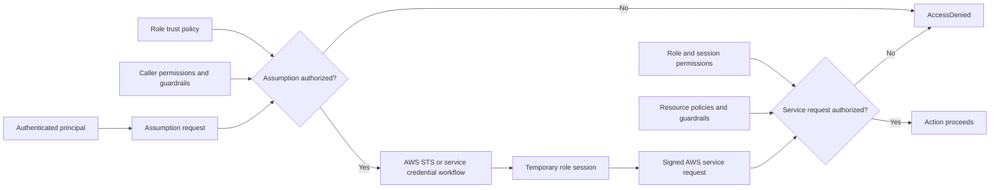
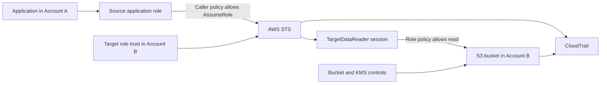

<div align="center">

# AWS IAM Roles

**Assumable AWS identities that deliver temporary credentials for workloads, federation, services, and delegated access**

[](https://docs.aws.amazon.com/IAM/latest/UserGuide/id_roles.html)


[](#official-references)

**One sentence to remember:** A role defines who may obtain a temporary session and what that session may do; AWS STS issues the credentials, and every later request is authorized separately.

[IAM index](README.md) · [IAM overview](01-overview.md) · [IAM users](02-users.md) · [IAM groups](03-groups.md) · [Next: managed policies](05-customer-managed-policies.md)

</div>

> [!IMPORTANT]
> A role has no permanent console password or access keys. An authorized principal assumes it—or an AWS service obtains its credentials through a service integration—and uses the resulting temporary role session.

---

## Table of contents

1. [What is an IAM role?](#what-is-an-iam-role)
2. [What problem does it solve?](#what-problem-does-it-solve)
3. [Core components and policy model](#core-components-and-policy-model)
4. [How role assumption and AWS STS work](#how-role-assumption-and-aws-sts-work)
5. [Role sessions, capabilities, and restrictions](#role-sessions-capabilities-and-restrictions)
6. [Use cases and selection guidance](#use-cases-and-selection-guidance)
7. [CCP essentials](#ccp-essentials)
8. [SAA architecture and design](#saa-architecture-and-design)
9. [Role and access comparisons](#role-and-access-comparisons)
10. [AWS service and workload role patterns](#aws-service-and-workload-role-patterns)
11. [Security, PassRole, and confused-deputy defenses](#security-passrole-and-confused-deputy-defenses)
12. [Auditing, troubleshooting, and revocation](#auditing-troubleshooting-and-revocation)
13. [Pricing and operational considerations](#pricing-and-operational-considerations)
14. [Practical configuration and CLI workflow](#practical-configuration-and-cli-workflow)
15. [Exam traps and misconceptions](#exam-traps-and-misconceptions)
16. [Technical interview questions](#technical-interview-questions)
17. [Practice questions](#practice-questions)
18. [Architecture scenario drills](#architecture-scenario-drills)
19. [Decision framework and keyword recognition](#decision-framework-and-keyword-recognition)
20. [Quick-revision cheat sheet](#quick-revision-cheat-sheet)
21. [Official references](#official-references)
22. [Closing takeaway](#closing-takeaway)

---

<a id="what-is-an-iam-role"></a>
## 1. What is an IAM role?

### Beginner definition

An **IAM role** is an AWS identity that can be assumed by a trusted principal to obtain temporary security credentials. Policies associated with the role help determine what the resulting session can do.

Think of a role as a temporary job badge:

- the **trust policy** says who may request the badge;
- the **permissions policies** describe what the badge can authorize;
- **AWS STS** issues temporary credentials for the badge; and
- the **role session** is the active use of that badge by one principal.

The analogy stops at the word “badge.” AWS evaluates machine-readable policies, request context, service controls, and organization guardrails for each request. Possessing a session is not a universal allow.

### Precise technical definition

An IAM role is a global IAM identity resource inside one AWS account. It has a name, path, ARN, unique ID, trust policy, optional permissions policies, optional permissions boundary, tags, and a configurable maximum session duration. The role itself is persistent configuration. An **assumed-role session** is a temporary principal created when an allowed assumption succeeds.

| Object | Example ARN | Meaning |
|---|---|---|
| IAM role | `arn:aws:iam::222233334444:role/AppReadRole` | Persistent IAM resource and policy attachment point |
| Role session | `arn:aws:sts::222233334444:assumed-role/AppReadRole/build-1042` | Temporary principal using the role |
| Instance profile | `arn:aws:iam::222233334444:instance-profile/AppReadProfile` | EC2 attachment container for a role |

The role ARN and role-session ARN are different principal forms. This distinction matters in resource policies, CloudTrail, permissions boundaries, session policies, and revocation.

### Role versus other identities

| Concept | Authentication/credentials | Permission model | Primary fit |
|---|---|---|---|
| IAM role | Temporary credentials for a session | Trust + role permissions + applicable limits | Workloads, services, federation, cross-account, elevation |
| IAM user | Optional long-term password/keys | User/group policies and limits | Documented account-local exception |
| IAM group | None; not a principal | Policies contribute to member users | Shared permissions for IAM users |
| Root user | Account-owner credentials | Inherent account authority, subject to documented organization controls | Rare root-required tasks |
| Role session | Temporary access key, secret, token, expiration | Role permissions narrowed by session and other limits | Actual signed requests after assumption |

### Who can assume roles?

Depending on the trust and supported workflow:

- an IAM user or IAM role in the same or another AWS account;
- an AWS service principal such as `ec2.amazonaws.com` or `lambda.amazonaws.com`;
- a SAML 2.0 or OIDC federated principal;
- an IAM Identity Center workforce user through an Identity Center-controlled role;
- an AWS workload integration such as EC2, ECS, Lambda, EKS, or Roles Anywhere; or
- another role session, creating a role chain.

An IAM group cannot assume a role. A group policy can allow its member users to call `sts:AssumeRole`, but the users—not the group—are the callers.

### What a role does not provide by itself

Creating a role does not automatically:

- create a human login;
- create permanent credentials;
- authorize any principal to assume it;
- grant resource access without permissions;
- satisfy a bucket policy, KMS key policy, or other service requirement;
- bypass a boundary, session policy, SCP, RCP, or explicit deny;
- attach the role to a compute resource; or
- refresh credentials in custom code that ignores supported credential providers.

---

<a id="what-problem-does-it-solve"></a>
## 2. What problem does it solve?

Roles separate durable authorization configuration from short-lived credential use.

| Risky or cumbersome design | Role-based design |
|---|---|
| Access keys embedded in an EC2 AMI | Instance profile delivers rotating role credentials |
| Lambda code stores a developer key | Lambda assumes its execution role |
| One IAM user copied to every account | Source identity assumes a target-account role |
| Vendor receives a customer-owned access key | Vendor assumes a narrow cross-account role with an external ID |
| Employees maintain per-account passwords | Identity Center provisions account roles and temporary access |
| Administrator privilege is permanent | Approved principal assumes a short privileged session |
| One node role is shared by every container | ECS task role or EKS workload identity separates applications |

### Before-and-after example: EC2 reads S3

**Before:** a developer stores an IAM-user key on the instance. Every copy of the AMI may contain the secret; rotation and attribution are difficult.

**After:** EC2 receives a role through an instance profile. A supported SDK retrieves temporary credentials from the Instance Metadata Service (IMDS) and refreshes them. The role permits only the required S3 prefix, with KMS authorization added when needed.

### Before-and-after example: multi-account administration

**Before:** an operator has a separate long-term user in development, staging, and production.

**After:** the operator authenticates centrally and receives temporary sessions in account-specific roles. Each target role has separate trust, permissions, duration, and monitoring.

### Problems roles are designed to solve

- workload authentication without embedded long-term keys;
- controlled delegation to AWS services;
- temporary cross-account access;
- federated workforce and web-identity access;
- temporary elevation and separation of duties;
- third-party access without customer-owned vendor credentials;
- reusable job identities for automation; and
- session attribution through names, tags, and source identity.

Roles reduce credential lifecycle risk, but they do not guarantee least privilege. A broad role with broad trust is still dangerous.

---

<a id="core-components-and-policy-model"></a>
## 3. Core components and policy model

### Component glossary

| Component | What it controls | What it does not control | Example |
|---|---|---|---|
| Role identity | Persistent IAM configuration | One active caller | `AppReadRole` |
| Trust policy | Which principals may obtain a role session and under what conditions | The session’s S3/EC2/DynamoDB actions | Trust `lambda.amazonaws.com` |
| Permissions policy | AWS actions/resources available to role sessions | Who may assume the role | Allow one S3 prefix |
| Permissions boundary | Maximum for role identity-policy permissions | A grant or trust relationship | Limit delegated roles to approved services |
| Principal | Entity named in trust/resource policy | Automatically sufficient authorization in every account relationship | Source role ARN or service principal |
| AWS STS | Issues and describes temporary sessions | Persistent role configuration | `AssumeRole` |
| Role session name | Human/application-provided session label | Immutable identity proof | `deploy-1042` |
| Session policy | Narrows one session | Extra permissions beyond the role | Read-only subset |
| Session tag | Attribute on a session for ABAC/audit | Role tag stored on the role | `Project=Atlas` |
| Transitive tag | Session tag allowed to persist through role chaining | All role tags automatically | `Department=Finance` |
| Source identity | Attribution value that persists through a chain when configured | A permissions grant | Workforce subject ID |
| Role tag | Metadata on the persistent role | A session attribute unless used by policy/context | `Owner=Platform` |
| SCP | Principal-side organization maximum in affected member accounts | An allow | Deny a sensitive API |
| RCP | Resource-side organization maximum for supported resources | A role policy | Limit external resource access |

Optional session features depend on the assumption method and trust configuration. For example, passing session tags requires the relevant `sts:TagSession` authorization; using source identity requires `sts:SetSourceIdentity` in the applicable trust/permission path.

### Trust policy

A role trust policy is the IAM resource-based policy attached to the role. It answers:

> **Who may request this role session, using which STS operation, and under what conditions?**

A role has one trust policy document, which can contain multiple statements.

#### Cross-account role trust example

```json
{
  "Version": "2012-10-17",
  "Statement": [{
    "Sid": "TrustSourceApplicationRole",
    "Effect": "Allow",
    "Principal": {
      "AWS": "arn:aws:iam::111122223333:role/SourceApplicationRole"
    },
    "Action": "sts:AssumeRole",
    "Condition": {
      "StringEquals": {
        "aws:PrincipalOrgID": "o-exampleorgid"
      }
    }
  }]
}
```

This trust policy permits only the named source role, subject to the organization condition. It does not grant S3 access to the resulting session.

#### OIDC trust example

```json
{
  "Version": "2012-10-17",
  "Statement": [{
    "Sid": "TrustSpecificRepository",
    "Effect": "Allow",
    "Principal": {
      "Federated": "arn:aws:iam::222233334444:oidc-provider/token.example.invalid"
    },
    "Action": "sts:AssumeRoleWithWebIdentity",
    "Condition": {
      "StringEquals": {
        "token.example.invalid:aud": "sts.amazonaws.com",
        "token.example.invalid:sub": "repo:example-org/example-repo:ref:refs/heads/main"
      }
    }
  }]
}
```

The provider and claims are illustrative. Use the real IdP’s documented issuer, audience, subject format, thumbprints/keys, and claim conditions. Restricting only the audience while accepting arbitrary subjects is usually too broad.

### Permissions policy

A role’s attached AWS managed or customer managed policies and embedded inline policies are identity-based policies. They answer:

> **What AWS actions may the resulting role session perform on which resources under which conditions?**

#### S3 permissions example

```json
{
  "Version": "2012-10-17",
  "Statement": [
    {
      "Sid": "ListApprovedPrefix",
      "Effect": "Allow",
      "Action": "s3:ListBucket",
      "Resource": "arn:aws:s3:::example-data-bucket",
      "Condition": {
        "StringLike": {
          "s3:prefix": "incoming/*"
        }
      }
    },
    {
      "Sid": "ReadApprovedObjects",
      "Effect": "Allow",
      "Action": "s3:GetObject",
      "Resource": "arn:aws:s3:::example-data-bucket/incoming/*"
    }
  ]
}
```

This policy contains no `Principal` because the attached role is implicit. SSE-KMS objects also require a valid KMS authorization path.

### Trust policy versus permissions policy

| Dimension | Trust policy | Permissions policy |
|---|---|---|
| Primary question | Who may obtain a session? | What may the session do? |
| Policy family | Resource-based policy on the role | Identity-based managed or inline policy |
| Attached to | Role only | Role, and managed policies can be reused |
| `Principal` | Required in Allow/Deny statements as supported | Not used; attached identity is implicit |
| Typical action | `sts:AssumeRole`, `sts:AssumeRoleWithSAML`, `sts:AssumeRoleWithWebIdentity` | `s3:GetObject`, `dynamodb:PutItem`, and other service APIs |
| Conditions | MFA, external ID, org, principal, OIDC/SAML claims, source attributes | resource tags, network, encryption, requested Region, session attributes |
| Grants | Ability to request the role session | Service authorization available to that role |
| Common mistake | Trusting an entire account without controlling delegation | Granting `*` actions/resources |
| Exam clue | “Who can assume?” | “What can it access?” |

> [!IMPORTANT]
> Trust and permission are separate decisions. A valid trust path can yield a session that has no useful resource permission. A broad role policy is irrelevant if the caller cannot obtain the session.

### Same-account and cross-account assumption

For `AssumeRole`:

- **Cross-account:** the target trust policy must trust the source, and the source principal needs caller-side permission to call `sts:AssumeRole` on the target role.
- **Same account:** a trust policy can grant directly to the caller principal, in which case a separate identity-policy Allow might not be required. Alternatively, trust the account and delegate `sts:AssumeRole` through an identity policy.
- Boundaries, SCPs, explicit denies, trust conditions, and service-specific rules can still prevent either pattern.

Trusting an account principal delegates authority to that account’s administrators; it does not mean every identity can automatically assume the role.

---

<a id="how-role-assumption-and-aws-sts-work"></a>
## 4. How role assumption and AWS STS work

### Complete assumption workflow

1. A principal authenticates through IAM, federation, Identity Center, or a workload integration.
2. It identifies a target role ARN and the appropriate assumption mechanism.
3. It requests a role session, directly or through the integrating AWS service.
4. AWS evaluates the caller’s authorization, role trust, conditions, and applicable guardrails.
5. On success, AWS STS or the service integration supplies temporary credentials.
6. The caller becomes a role-session principal with an ARN containing the role and session name.
7. It signs a service request with the temporary access key, secret, and session token.
8. The target service separately evaluates the action, resource, context, role/session policies, resource policies, and guardrails.
9. Credentials expire; a supported provider refreshes them or the principal requests a new session.



The STS decision and the later service decision are distinct. Successful `AssumeRole` proves only that the session was issued.

### Temporary credential components

| Component | Purpose | Handling rule |
|---|---|---|
| Access key ID | Identifies the temporary key | Not secret, but still avoid unnecessary exposure |
| Secret access key | Signs requests | Secret; never log or commit |
| Session token | Proves the temporary session | Required with every signed request |
| Expiration | End of credential validity | Refresh before expiry; do not assume a fixed lifetime |

Temporary credentials work much like access keys but expire. They are generated dynamically rather than stored on the IAM role.

### AWS STS is broader than role assumption

[AWS STS](https://docs.aws.amazon.com/IAM/latest/UserGuide/id_credentials_temp_request.html) provides several credential and identity operations:

| Operation | Caller/input | Result and best fit | Important distinction |
|---|---|---|---|
| `AssumeRole` | Signed AWS request from authorized principal | Role session for same/cross-account delegation | Trust + caller authorization as applicable |
| `AssumeRoleWithSAML` | Valid SAML 2.0 assertion | Role session for SAML federation | Request is not signed with AWS credentials |
| `AssumeRoleWithWebIdentity` | Valid OIDC/JWT token | Role session for web/workload identity | Request is not signed with AWS credentials |
| `GetSessionToken` | Long-term IAM-user credentials, commonly with TOTP MFA | Temporary session retaining user permissions | Not an IAM role; no policy permission required to call |
| `GetFederationToken` | IAM-user credentials used by a custom broker | STS federated-user session narrowed by session policy | Not a role session; requires permission to call |
| `GetCallerIdentity` | Current signed credentials | Returns account, ARN, and principal ID | Issues no credentials; no permission is required |

Do not describe every temporary credential as “an assumed role.” `GetSessionToken` and `GetFederationToken` create other session types.

### STS endpoints and Regions

AWS recommends [Regional STS endpoints](https://docs.aws.amazon.com/IAM/latest/UserGuide/id_credentials_temp_enable-regions.html) to reduce latency and improve failure isolation. Regional-endpoint tokens work in all enabled Regions. Global-endpoint behavior and token compatibility have additional Region rules, so configure the SDK/CLI deliberately rather than assuming the endpoint.

IAM role configuration is global within the account; STS calls and the services used by the session can be Regional.

---

<a id="role-sessions-capabilities-and-restrictions"></a>
## 5. Role sessions, capabilities, and restrictions

### Role configuration versus active session

| Persistent role configuration | Individual role session |
|---|---|
| IAM ARN and unique ID | STS assumed-role ARN and access key ID |
| Trust policy | Original caller and assumption event |
| Attached/inline permission policies | Session name, expiration, optional session policy |
| Boundary and role tags | Optional session tags and source identity |
| Maximum session duration | Requested/issued duration |
| Last-used metadata | CloudTrail events for actual requests |

### Session duration and role chaining

For the `AssumeRole` API, the requested duration is 15 minutes up to the role’s configured maximum. A role’s maximum-session setting can be 1–12 hours, and the API default is one hour. [Role chaining is limited to one hour](https://docs.aws.amazon.com/STS/latest/APIReference/API_AssumeRole.html), even if the target role allows longer sessions.

Important qualifications:

- the maximum-session setting does not govern every AWS-service-created session in the same way;
- EC2 role credentials are not constrained by that role setting;
- console federation/session duration has related but separate controls; and
- changing the role maximum does not retroactively extend an existing session.

A chain occurs when credentials from one role session assume another role. An IAM user initially assuming a role is not role chaining.

### Session policies

An `AssumeRole` request can include one inline session policy and up to ten managed session-policy ARNs, within the API’s combined plaintext limit. Session policies **narrow** the role session; they never add permissions beyond the role’s identity policies.

Example restrictive session policy:

```json
{
  "Version": "2012-10-17",
  "Statement": [{
    "Effect": "Allow",
    "Action": [
      "s3:GetObject"
    ],
    "Resource": "arn:aws:s3:::example-data-bucket/incoming/*"
  }]
}
```

If the role allows S3 read and write but this session policy allows only `GetObject`, identity-policy permissions for writes are unavailable to that session. Resource-policy principal nuances and explicit denies still require the full evaluation model.

### Session names, tags, and source identity

| Attribute | Purpose | Persistence/visibility |
|---|---|---|
| Session name | Distinguishes sessions; appears in assumed-role ARN | Chosen per assumption; visible cross-account and in CloudTrail |
| Session tags | ABAC and audit attributes | Apply to that session; can override same-key role tags for authorization |
| Transitive session tags | Preserve selected attributes in a chain | Pass to later role sessions when configured |
| Source identity | Stable original identity attribution/control | Cannot be changed after set and persists through role chaining |

Do not put secrets or sensitive personal data in session names or tags; they can appear in logs and principal identifiers.

### Credential delivery and refresh

Use supported credential-provider chains:

- EC2 SDK provider retrieves instance-profile credentials from IMDS;
- ECS provider retrieves task credentials from the task credential endpoint;
- Lambda makes execution-role credentials available to the runtime;
- EKS IRSA uses a projected web identity token;
- EKS Pod Identity uses its agent and EKS Auth integration;
- CLI role profiles call STS and cache/refresh credentials;
- Identity Center credential providers obtain temporary account-role credentials.

Applications that copy credentials into static configuration defeat automatic refresh and can fail when the session expires.

### Effective role-session permissions

Do not apply one universal formula. For the common identity-policy path:

- role identity-policy grants are limited by the role boundary;
- session policies narrow the session;
- applicable SCPs constrain the role principal in a member account;
- applicable RCPs constrain supported target resources;
- resource and key policies can grant or limit according to principal type;
- cross-account requests require authorization on both sides; and
- any applicable explicit deny wins.

Within the same account, a resource-policy grant to a **role ARN** is subject to implicit limits from the role boundary/session policy. A direct grant to a specific **role-session ARN** is granted to that session and has different implicit-deny behavior. Explicit denies and organization/service controls still matter. See the [official boundary and principal rules](https://docs.aws.amazon.com/IAM/latest/UserGuide/access_policies_boundaries.html).

### Worked authorization examples

| Scenario | Result | Why |
|---|---|---|
| Caller policy allows `AssumeRole`; trust rejects caller | Assumption denied | Caller permission cannot replace target trust |
| Trust directly accepts a same-account user; no separate caller Allow | Can succeed, subject to limits/conditions | Same-account resource-based trust can grant directly |
| Target trusts another account; source identity has no `AssumeRole` Allow | Assumption denied | Cross-account source-side authorization is missing |
| Role allows `s3:GetObject`; bucket policy explicitly denies it | Object request denied | Explicit deny wins |
| Role allows EC2 termination; applicable SCP denies it | Request denied | Role policy cannot exceed the organization maximum |
| Role allows read/write; session policy allows read | Write denied on identity-policy path | Session policy narrows the session |
| Role allows S3 read; KMS path lacks decrypt | Encrypted-object workflow fails | S3 and KMS authorization are separate |
| Session expired | Authentication fails until refreshed | Expired temporary credentials are no longer accepted |

---

<a id="use-cases-and-selection-guidance"></a>
## 6. Use cases and selection guidance

| Requirement | Preferred mechanism | Why | Important caveat |
|---|---|---|---|
| EC2 application calls S3 | EC2 role via instance profile | Rotating credentials; no embedded key | All processes on instance may share role |
| Lambda calls DynamoDB | Lambda execution role | Service-delivered temporary credentials | Invocation permission is separate |
| ECS application calls AWS APIs | ECS task role | Permissions reach application containers | Execution role serves the agent |
| EKS pod calls AWS APIs | EKS Pod Identity or IRSA | Workload-level identity | Platform/prerequisites differ |
| Employee accesses many accounts | Identity Center permission sets/roles | Central workforce lifecycle | Permission set is a role template, not the role itself |
| Vendor accesses customer account | Cross-account role + external ID | Temporary, revocable, attributable | Vendor should generate unique ID |
| Source AWS account accesses target | Cross-account role or supported resource policy | Avoid duplicate users | Choose based on service and identity semantics |
| Temporary administrator | Federated privileged role | Short-lived, monitored elevation | Strong authentication/approval |
| On-premises X.509 workload | IAM Roles Anywhere where suitable | Temporary credentials without stored IAM key | Requires PKI/trust-anchor design |
| One resource directly trusts external principal | Resource-based policy may fit | Avoids role switch for supported service | Cross-account caller permission still required |

### When not to choose a role

A role is not automatically the best answer when:

- several justified IAM users only need shared account-local policies—an IAM group may be the direct mechanism;
- a supported resource policy is simpler and preserves the external caller identity;
- the requirement is network filtering, encryption, or secret storage;
- a human workforce needs centralized authentication—use Identity Center, which then uses roles;
- a service requires a specific service-linked role rather than an arbitrary custom role; or
- the task genuinely requires root credentials.

---

<a id="ccp-essentials"></a>
## 7.  CCP essentials

### Facts to recognize

1. A role is an AWS identity with permissions.
2. A role is assumed; it is not a user login.
3. The role has no permanent password or access keys.
4. Role sessions use temporary credentials.
5. Temporary credentials include an access key ID, secret, and session token.
6. AWS STS issues temporary credentials for role-assumption APIs.
7. Trust policy means “who may assume.”
8. Permissions policy means “what the session may do.”
9. AWS services and workloads commonly use roles.
10. EC2 receives a role through an instance profile.
11. Lambda uses an execution role.
12. Roles enable cross-account access without duplicate users.
13. Federation and Identity Center lead to role sessions.
14. Roles avoid hard-coded application keys.
15. Roles must still follow least privilege.
16. A successful assumption does not guarantee every later AWS action.

### If the question says X → think Y

| Question clue | Think |
|---|---|
| “EC2 must read S3 without stored keys” | Instance profile + IAM role |
| “Lambda writes DynamoDB” | Lambda execution role |
| “Temporary permissions” | Role session / STS |
| “Another account needs access” | Cross-account role or supported resource policy |
| “Who may assume?” | Trust policy |
| “What may the session do?” | Permissions policy |
| “Employees need many accounts” | Identity Center permission sets and roles |
| “Assign a role to a service” | `iam:PassRole` may be required |
| “Third-party vendor serves many customers” | Cross-account role + external ID |
| “Container application permissions” | ECS task role, not task execution role |

### 30-second CCP summary

An IAM role is an assumable AWS identity. It has trust rules and permissions, but no permanent password or keys. AWS STS or a service integration provides temporary credentials. Use roles for AWS services, applications, federation, temporary elevation, and cross-account access instead of embedding long-term credentials.

---

<a id="saa-architecture-and-design"></a>
## 8.  SAA architecture and design

### SAA design rules

- Separate permission to assume from permission after assumption.
- Restrict both trust and role permissions; least privilege needs both.
- Prefer exact principal ARNs and documented conditions over broad account trust.
- Govern `iam:PassRole` as a privilege-escalation path.
- Use session duration, policies, tags, and source identity deliberately.
- Evaluate boundaries, SCPs, RCPs, resource policies, KMS, and endpoint controls.
- Use Regional STS endpoints and supported credential providers.
- Treat role sessions as principals with their own ARNs and audit context.
- Design revocation before an incident.
- Keep IAM changes out of latency-critical paths because propagation is eventually consistent.

### Cross-account role architecture

Account A runs an application. Account B owns `example-target-data`.

1. **Account B:** create `TargetDataReader`.
2. **Account B trust:** trust Account A’s exact `SourceApplicationRole`, with organization or source conditions where appropriate.
3. **Account A caller policy:** allow `sts:AssumeRole` only on `TargetDataReader`.
4. **Account B role policy:** allow only `s3:GetObject` for the required prefix and `s3:ListBucket` as needed.
5. **Bucket/KMS controls:** ensure no bucket deny blocks the role; if using SSE-KMS, authorize the target role through the key-policy/IAM path.
6. **Application:** uses its source credentials to call STS, then uses target-role credentials for S3.
7. **Monitoring:** inspect the STS event and target service events in CloudTrail.



If the target role and S3 bucket are both in Account B, the role’s identity policy can provide the S3 allow; a bucket policy is not automatically required. Bucket explicit denies, ownership settings, access points, and KMS authorization can still add requirements.

### Cross-account role versus direct resource policy

| Decision | Target-account role | Direct resource policy |
|---|---|---|
| Identity used on target request | Target role session | Original external principal/session |
| Best for | Multiple target services or coherent job permissions | One supported resource/service |
| Permission management | Central role policy | Per-resource policy |
| Caller action | `sts:AssumeRole` then service call | Direct service call |
| Session controls | Duration, session policy/tags/source identity | Original caller session controls |
| Limitation | Trust/caller policy and chaining complexity | Only services/resources supporting resource policies |

### Federation and IAM Identity Center

For a modern workforce:

```text
Corporate IdP or Identity Center directory
  → user authenticates centrally
  → group/account/permission-set assignment
  → Identity Center-controlled IAM role in target account
  → temporary console or CLI role session
```

A [permission set is a template](https://docs.aws.amazon.com/singlesignon/latest/userguide/permissionsetsconcept.html). Identity Center creates and manages corresponding roles in assigned accounts. Do not edit those roles directly in IAM; change the permission set and assignment.

| Concept | What it represents |
|---|---|
| Federated principal | External identity participating through SAML/OIDC or brokered access |
| Identity Center user | Workforce identity in the configured identity source |
| Permission set | Template of policies/session settings for account assignments |
| Identity Center-controlled role | IAM role provisioned from the permission set |
| Role session | Actual temporary principal used in the account |

Not every federation flow requires an application to call STS manually. Identity Center, SDK providers, console federation, and service integrations can broker the exchange.

### SAA failure reasoning

| Failure | Reasoning path |
|---|---|
| `AssumeRole` denied | Actual caller → caller Allow → trust Principal/action/conditions → boundary/SCP → Region/endpoint |
| Assumption succeeds; S3 denies | Role/session policy → bucket/access point → SCP/RCP → KMS → action/resource/conditions |
| 12-hour request fails | Role max too low or caller is already a role and chaining cap applies |
| Role works locally, not cross-account | Second account authorization or target resource/key policy is missing |
| Service cannot use configured role | Wrong service principal, missing `PassRole`, or service-specific attachment/configuration |
| Session attribution is poor | Generic session names and missing source identity/tags |

---

<a id="role-and-access-comparisons"></a>
## 9. Role and access comparisons

### Core identity comparisons

| Comparison | First | Second | Exam/design decision |
|---|---|---|---|
| Role vs user | Assumable; temporary credentials | Durable account identity; optional long-term credentials | Roles for workloads/delegation |
| Role vs group | Principal/identity | Users-only permission container | Roles are assumed; users join groups |
| Role vs STS | Persistent trust/permission configuration | Service issuing temporary credentials | They complement each other |
| Role vs role session | IAM resource | Temporary principal using the role | Policies attach to role; calls come from session |
| Role vs instance profile | Permission identity | EC2 attachment container | EC2 uses profile containing role |
| Role vs permission set | IAM identity | Identity Center template | Assignment provisions controlled roles |
| Role vs long-term key | Expiring credential source | Durable secret | Prefer role/provider where supported |

### Policy and operation comparisons

| Comparison | Key distinction |
|---|---|
| Trust policy vs permissions policy | Who may obtain session vs what session may do |
| Role permissions vs session policy | Baseline grants vs one-session restriction |
| `iam:PassRole` vs `sts:AssumeRole` | Configure service with role vs caller becomes role session |
| Service role vs service-linked role | Customer-manageable role used by service vs service-owned predefined subtype |
| Cross-account role vs resource policy | Target session identity vs direct external-principal access |
| External ID vs `SourceArn`/`SourceAccount` | Third-party customer context vs AWS service acting for expected source |
| ECS task role vs execution role | Application container permissions vs ECS agent permissions |
| IRSA vs EKS Pod Identity | OIDC/web-identity trust vs EKS service/agent association |

### Role, boundary, SCP, and RCP

| Control | Attached/applied to | Grants? | Primary limit |
|---|---|:---:|---|
| Role permission policy | Role | Yes | Session service actions |
| Permissions boundary | Role | No | Role identity-policy maximum |
| Session policy | One STS session | No | Session maximum |
| SCP | Organization root/OU/member account | No | Member-account principal maximum |
| RCP | Organization root/OU/member account | No | Supported member-account resource maximum |

---

<a id="aws-service-and-workload-role-patterns"></a>
## 10. AWS service and workload role patterns

### Service role versus service-linked role

| Dimension | Service role | Service-linked role |
|---|---|---|
| Definition | Role a service assumes to act for you | Service-owned subtype linked directly to one service |
| Creation | Customer, console wizard, or service | Service automatically/on request, or `CreateServiceLinkedRole` |
| Trust/permissions | Customer can generally manage; follow service contract | Predefined and controlled by linked service |
| Reuse | Depends on service design | Only the linked service |
| Path/name | Customer/service-specific | Commonly under `/aws-service-role/`; exact name is documented |
| Deletion | IAM after dependency review | Usually linked-service workflow after dependent resources are removed |
| Risk | Customer can break or overbroaden it | Indirect service capabilities still require governance |

A service-linked role can appear automatically when a feature is enabled. Do not delete or attempt to repurpose it merely because it was not manually created.

### Amazon EC2: role and instance profile

EC2 attaches an **instance profile**, which contains an IAM role. Applications use a supported SDK/CLI provider to retrieve temporary role credentials from IMDS.

```text
EC2 instance → instance profile → IAM role → temporary credentials from IMDS → AWS API
```

Security considerations:

- require IMDSv2 where compatible and test hop-limit/container needs;
- restrict unnecessary network paths to IMDS;
- use one workload trust boundary per instance or isolate workloads;
- remember all applications on one instance can share the one assigned role; and
- do not call `AssumeRole` merely to refresh the same instance role—providers refresh it.

The profile is not a second permission system. It is the IAM container EC2 uses to associate the role.

### AWS Lambda: execution role

Lambda assumes the execution role automatically. The role trust uses `lambda.amazonaws.com`, and its permission policies authorize function code to call AWS services. CloudWatch Logs requires the relevant log permissions; the common managed baseline may be broader than a final least-privilege policy.

Invocation authorization is separate: a Lambda resource policy can control who or which service may invoke the function. The execution role controls what the running function may call.

Avoid manually assuming the same execution role from function code unless a specific design requires self-assumption and the trust policy explicitly permits it.

### Amazon ECS: task role versus task execution role

| Role | Used by | Typical permissions | Visible to application? |
|---|---|---|---|
| Task role | Application containers | S3, DynamoDB, SQS, service APIs | Yes, through task credential provider |
| Task execution role | ECS/Fargate agent | Pull ECR image, send logs, retrieve referenced secrets/config | No, not directly to application containers |

An image-pull failure can be an execution-role problem. An `AccessDenied` from application code is usually a task-role or downstream resource-policy problem.

### Amazon EKS: IRSA versus EKS Pod Identity

| Dimension | IRSA | EKS Pod Identity |
|---|---|---|
| Trust mechanism | Per-cluster IAM OIDC provider and JWT claims | `pods.eks.amazonaws.com` service principal + EKS association |
| Credential operation | `AssumeRoleWithWebIdentity` | EKS Auth `AssumeRoleForPodIdentity` workflow |
| Cluster component | No Pod Identity Agent | Agent required unless EKS Auto Mode supplies it |
| Role/account | Can trust OIDC provider directly, including designed cross-account patterns | Associated role must be in cluster account; chain for cross-account |
| Platforms | Broader EKS/Kubernetes deployment support | Supported EKS Linux EC2 nodes; not Fargate/Windows/Outposts/EKS Anywhere |
| ABAC | Claims/role design | EKS-provided session tags |
| Best fit | Existing OIDC/IRSA or unsupported Pod Identity platform | AWS-recommended option when supported |

Both require a supported SDK/default credential chain and careful restriction of node-role/IMDS access. Containers are not a security boundary.

### Other meaningful service patterns

| Service | Role pattern | Design note |
|---|---|---|
| CloudFormation | Optional service role performs stack actions | Users able to operate stack may indirectly use role permissions; restrict `PassRole` |
| CodeBuild | Service role performs build actions | Build code can use its credentials; scope artifact/log/deployment access |
| Step Functions | Execution role invokes workflow integrations | Scope actions and target ARNs |
| EventBridge | Target role for integrations that require it | Service principal and source conditions depend on target |
| AWS Glue | Service role accesses data/catalog/log resources | Include S3/KMS/network dependencies as needed |

Always follow the individual service’s documented trust principal and confused-deputy conditions. Do not guess service principals.

---

<a id="security-passrole-and-confused-deputy-defenses"></a>
## 11. Security, `iam:PassRole`, and confused-deputy defenses

### `PassRole` versus `AssumeRole`

| Dimension | `iam:PassRole` | `sts:AssumeRole` |
|---|---|---|
| What happens | Caller configures an AWS service with a role ARN | Caller obtains a role session |
| API operation? | No; IAM permission checked during another service API | Yes, an STS API |
| Who uses role | The configured AWS service later | The caller |
| Account rule | Role and service resource are in the same account | Same or cross-account |
| Required trust | Role trusts the service principal | Role trusts caller/account as designed |
| Main risk | Caller passes a more powerful role to an exploitable service | Caller directly gains target role permissions |
| Least privilege | Restrict role ARN/path and `iam:PassedToService` | Restrict role ARN, principals, and trust conditions |

#### Lambda example

A developer calls `lambda:CreateFunction` with an execution-role ARN:

1. The developer needs permission to create the function.
2. IAM checks whether the developer may `iam:PassRole` for that exact role.
3. The role trust must allow `lambda.amazonaws.com`.
4. Lambda later assumes the execution role.
5. Function code receives the execution role’s permissions.

The developer did not call `PassRole` as an API and did not become the execution role. An unrestricted `iam:PassRole` plus control of Lambda code can become privilege escalation.

AWS documents that `PassRole` applies to a role passed to a service in the same account. Cross-account service designs require an appropriate role in the service’s account and an additional cross-account role pattern.

### Third-party confused deputy and external ID

A SaaS provider serving many customers may be tricked into using Customer A’s role for Customer B. The provider should generate and control a unique external ID per customer. Customer A requires it in the trust policy:

```json
{
  "Version": "2012-10-17",
  "Statement": [{
    "Sid": "TrustVendorForThisCustomer",
    "Effect": "Allow",
    "Principal": {
      "AWS": "arn:aws:iam::555566667777:role/VendorServiceRole"
    },
    "Action": "sts:AssumeRole",
    "Condition": {
      "StringEquals": {
        "sts:ExternalId": "provider-generated-customer-id"
      }
    }
  }]
}
```

The external ID is not a secret and does not replace a narrow principal, role permissions, monitoring, or contract/lifecycle controls.

### Cross-service confused deputy

An AWS service principal may act for resources owned by many customers. When the integration supplies them, use:

- `aws:SourceArn` to bind access to an expected source resource;
- `aws:SourceAccount` to bind it to an expected account;
- `aws:SourceOrgID` or `aws:SourceOrgPaths` for documented organization-wide patterns.

Illustrative trust statement:

```json
{
  "Version": "2012-10-17",
  "Statement": [{
    "Sid": "TrustExpectedServiceSource",
    "Effect": "Allow",
    "Principal": {
      "Service": "SERVICE_PRINCIPAL"
    },
    "Action": "sts:AssumeRole",
    "Condition": {
      "ArnLike": {
        "aws:SourceArn": "SOURCE_RESOURCE_ARN_PATTERN"
      },
      "StringEquals": {
        "aws:SourceAccount": "111122223333"
      }
    }
  }]
}
```

This is a pattern, not a deployable policy: replace both placeholders only with values documented by the integrating AWS service. External ID and source conditions solve different deputy problems and are not interchangeable.

### Least-privilege security baseline

- Trust exact principals; avoid unnecessary `Principal: "*"`.
- Restrict account trust with principal/org/tag/MFA conditions where supported.
- Scope permissions to actions, resources, and conditions.
- Protect trust-policy updates, policy attachment, role creation, boundary changes, and `PassRole`.
- Use short privileged sessions and require strong authentication/approval.
- Govern session/principal/resource tags used for ABAC.
- Use source identity and meaningful session names for shared roles.
- Prefer Regional STS endpoints and supported automatic credential refresh.
- Detect external trust with IAM Access Analyzer; confirm activity with CloudTrail.
- Plan how to stop new assumptions and revoke/limit existing sessions.
- Review role last-used/accessed data, but do not treat absence as proof of safety.

### Shared responsibility

AWS operates IAM/STS infrastructure, signs and validates temporary credentials, and implements service integrations. Customers define principals, trust, permissions, boundaries, session rules, organization controls, workload isolation, logging, review, and incident response.

---

<a id="auditing-troubleshooting-and-revocation"></a>
## 12. Auditing, troubleshooting, and revocation

### Evidence sources

| Need | Tool or data | Limitation |
|---|---|---|
| Who called `AssumeRole`? | CloudTrail STS event | Ensure durable trail/event-store coverage |
| What did session do? | Service CloudTrail events with `AssumedRole` identity | Data events may need explicit configuration |
| Original identity across chain | Source identity when configured | Must be supplied/required correctly |
| Session distinction | Role session name and assumed-role ARN | Caller-controlled names need governance |
| Could an outsider assume role? | IAM Access Analyzer external access | Analyzer reports; it does not remediate |
| Would selected policy/context allow? | IAM Policy Simulator | Not authoritative for every live control |
| Which permissions appear unused? | Last-accessed data/Access Analyzer unused access | Reporting windows and service support apply |

### Troubleshooting decision table

| Symptom | Likely cause | Investigate | Possible remediation |
|---|---|---|---|
| `AssumeRole` AccessDenied | Caller Allow missing or explicit deny | Actual caller ARN, identity policy, boundary/SCP | Narrow caller Allow or remove unintended deny |
| Trust mismatch | Wrong ARN/account/service/IdP | Target trust `Principal` and action | Correct exact trusted principal |
| Conditional trust fails | External ID, MFA, org, source, OIDC claim mismatch | Request parameters/token claims/context | Fix caller input or trust condition—not broaden blindly |
| 12-hour session rejected | Target max lower or role chaining | Caller ARN and `DurationSeconds` | Request allowed duration; redesign chain if necessary |
| `PassRole` denied | Creator lacks permission for role/service | Creating API, role ARN, `iam:PassedToService` | Grant narrowly scoped `iam:PassRole` |
| Service cannot assume role | Wrong service principal or attachment | Trust, service configuration, Region/account | Use documented trust/use case |
| EC2 has no credentials | Profile missing, IMDS disabled, provider overridden | Instance profile, IMDS options, SDK chain | Attach correct profile and restore supported provider |
| ECS image/log startup fails | Execution role missing permissions | Task definition and agent events | Fix task execution role |
| ECS app call denied | Task role or resource control | Caller identity inside container, task role | Fix task role/resource policy |
| Assumption succeeds; action denied | Role/session/boundary/SCP/RCP/resource/KMS issue | Exact action/resource/context and all controls | Make smallest justified policy correction |
| Expired token | Provider failed to refresh/static copy used | Credential source and expiration | Use supported provider; reacquire session |
| Wrong identity | Profile/environment/container source precedence | `sts:GetCallerIdentity` | Remove shadowing source/use correct profile |
| New trust change not visible | Eventual consistency | Change time and bounded retry | Provision earlier; retry safely |
| Cross-account direct access fails | One side lacks allow | Caller policy and target resource policy | Add both scoped authorizations |

### Revocation and incident response

To contain a role incident:

1. identify the role, session, issue time, source, and affected resources;
2. prevent new sessions by narrowing trust or caller authorization;
3. change role/resource permissions to stop harmful requests;
4. use the documented **Revoke active sessions** mechanism when broad role-session invalidation is required;
5. remember that IAM console revocation adds a time-based deny policy and affects every older session for that role;
6. separately revoke Identity Center permission-set sessions through Identity Center;
7. investigate CloudTrail for persistence and impact; and
8. restore least privilege only after the assumption path and workload are safe.

Service-linked role sessions cannot use the normal IAM role-session revocation feature. Deleting a role without dependency review can break workloads and is not a substitute for an incident plan.

---

<a id="pricing-and-operational-considerations"></a>
## 13. Pricing and operational considerations

[IAM, IAM Identity Center, and AWS STS have no additional feature charge](https://docs.aws.amazon.com/IAM/latest/UserGuide/introduction.html). You still pay for resources and requests made by the session, plus related services such as CloudTrail data-event delivery/storage, external directories, KMS, security analysis, and workloads.

Operational cost usually dominates:

- excessive roles create policy and trust-review overhead;
- one role shared across unrelated workloads increases blast radius;
- duplicate per-account users create credential lifecycle work;
- role chaining complicates duration and attribution;
- broad managed policies accelerate setup but can increase security exposure;
- short sessions improve risk posture but require reliable refresh; and
- logging retention and analysis should match investigation/compliance needs.

Optimize by standardizing role patterns, using Identity Center for workforce access, using workload credential providers, centralizing reviewed policies, and removing unused roles after dependency review—not by reducing auditability.

IAM and trust changes are eventually consistent. Provision and update roles outside critical high-availability request paths.

---

<a id="practical-configuration-and-cli-workflow"></a>
## 14. Practical configuration and CLI workflow

> [!WARNING]
> Write commands below change real authorization if executed. They were not run. Use a sandbox, peer review, placeholders, and an administrator with only the required IAM permissions.

### 1. Prepare a trust policy

Save as `trust-policy.json`:

```json
{
  "Version": "2012-10-17",
  "Statement": [{
    "Sid": "TrustDeploymentRole",
    "Effect": "Allow",
    "Principal": {
      "AWS": "arn:aws:iam::111122223333:role/DeploymentSourceRole"
    },
    "Action": "sts:AssumeRole"
  }]
}
```

### 2. Create and inspect the role

```bash
# WRITE
aws iam create-role \
  --role-name ExampleTargetRole \
  --assume-role-policy-document file://trust-policy.json \
  --max-session-duration 3600

# READ
aws iam get-role --role-name ExampleTargetRole
```

### 3. Attach a reviewed customer managed policy

```bash
# WRITE
aws iam attach-role-policy \
  --role-name ExampleTargetRole \
  --policy-arn arn:aws:iam::222233334444:policy/ExampleTargetRead

# READ
aws iam list-attached-role-policies \
  --role-name ExampleTargetRole

aws iam list-role-policies \
  --role-name ExampleTargetRole
```

The example assumes the policy already exists and is appropriate. Attaching a policy does not validate the resource policy, KMS path, boundary, or organization controls.

### 4. Authorize and assume from the source

The source principal needs an appropriate `sts:AssumeRole` Allow for:

```text
arn:aws:iam::222233334444:role/ExampleTargetRole
```

Then request a session:

```bash
aws sts assume-role \
  --role-arn arn:aws:iam::222233334444:role/ExampleTargetRole \
  --role-session-name example-deployment-1042 \
  --duration-seconds 3600
```

The response contains credentials. Do not paste them into Git, tickets, or command history. Prefer a CLI role profile or SDK provider that handles credential caching and refresh.

### 5. Confirm the identity

```bash
aws sts get-caller-identity
```

Expected ARN shape:

```text
arn:aws:sts::222233334444:assumed-role/ExampleTargetRole/example-deployment-1042
```

### 6. Update trust only after review

```bash
# WRITE: replaces the role trust policy with the supplied document.
aws iam update-assume-role-policy \
  --role-name ExampleTargetRole \
  --policy-document file://trust-policy.json
```

### 7. Retire safely

Review last use and service dependencies. Detach managed policies, delete inline policies, remove the role from instance profiles/services, stop new assumptions, and revoke affected sessions before deletion where required. Do not delete a service-linked role through a generic workflow; follow its service documentation.

### Console workflow

1. Open **IAM → Roles → Create role**.
2. Select the correct trusted-entity type/use case.
3. Review the generated trust policy rather than accepting broad defaults blindly.
4. Attach narrow policies or create a reviewed customer managed policy.
5. Set name, path/tags, description, boundary, and maximum duration as required.
6. Test both allowed and denied operations.
7. Review **Trust relationships**, **Permissions**, **Access Advisor**, and recent CloudTrail activity.
8. Update or retire through change control.

---

<a id="exam-traps-and-misconceptions"></a>
## 15. Exam traps and misconceptions

| # | Incorrect assumption | Correct interpretation and technical reason | Level |
|---:|---|---|---|
| 1 | A role has permanent access keys | STS/service integrations issue expiring session credentials | CCP |
| 2 | A role has a console password | Humans authenticate elsewhere and assume/access the role | CCP |
| 3 | Roles are only for EC2 | Services, workloads, federation, vendors, and accounts use roles | CCP |
| 4 | Only AWS services assume roles | IAM/federated principals and other roles can assume when trusted | CCP |
| 5 | Trust policy grants S3/DynamoDB access | It grants the assumption path; role permissions govern service APIs | Both |
| 6 | Permissions policies decide who assumes | Trust policy handles principals and assumption conditions | Both |
| 7 | Trust alone always permits `AssumeRole` | Cross-account callers also need source permission; limits/conditions apply | SAA |
| 8 | Same-account and cross-account rules are identical | Same-account direct trust can grant without separate identity Allow; cross-account needs both sides | SAA |
| 9 | STS and IAM roles are the same | STS vends sessions; the IAM role stores trust/permissions | CCP |
| 10 | Every STS credential is a role session | `GetSessionToken` and `GetFederationToken` create other session types | SAA |
| 11 | Temporary credentials omit a secret | They contain ID, secret, token, and expiration | CCP |
| 12 | Temporary credentials cannot be used by CLI | CLI profiles/providers use them routinely | CCP |
| 13 | Successful assumption means resource access | The later service request receives separate authorization | Both |
| 14 | Session policy adds permission | It narrows role identity-policy permissions | SAA |
| 15 | Boundary grants its listed actions | It is a maximum on role identity-policy permissions | SAA |
| 16 | Administrator role bypasses SCP/RCP | Organization guardrails and explicit denies still apply | SAA |
| 17 | Role chaining can request the target’s full 12 hours | Chained role sessions are capped at one hour | SAA |
| 18 | Every service session obeys the role max identically | AWS-service sessions and EC2 credentials have documented exceptions | SAA |
| 19 | Instance profile and role are the same object | Profile is the EC2 attachment container containing a role | Both |
| 20 | Lambda code should re-assume its execution role | Lambda already supplies it; self-assumption needs explicit special design | SAA |
| 21 | ECS task and execution roles are interchangeable | App uses task role; agent uses execution role | SAA |
| 22 | An EKS pod should use the node role | Use Pod Identity/IRSA for workload-level least privilege | SAA |
| 23 | IRSA and Pod Identity have identical prerequisites | OIDC versus agent/service association and platform support differ | SAA |
| 24 | `PassRole` means caller assumes the role | It authorizes configuring a service with the role | Both |
| 25 | `PassRole` is a standalone API call | It is checked during another service API using a role ARN | SAA |
| 26 | Broad `PassRole` is harmless | It can enable privilege escalation through service-controlled execution | SAA |
| 27 | A role can be passed directly to a service in another account | `PassRole` is same-account; use an intermediate cross-account design | SAA |
| 28 | External ID is a secret chosen by customer | Provider generates a unique nonsecret ID per customer | SAA |
| 29 | External ID replaces principal restrictions | It supplements narrow trust and permissions | SAA |
| 30 | `SourceArn` and external ID are interchangeable | They address AWS-service and third-party deputy contexts respectively | SAA |
| 31 | Service-linked roles are freely editable/deletable | Linked service owns permissions/lifecycle and may require dependency cleanup | Both |
| 32 | Deleting trust instantly neutralizes every old credential | It stops new sessions; existing sessions need permission/revocation handling | SAA |
| 33 | CloudTrail or Access Analyzer enforces least privilege | They record/analyze; policies and controls enforce | Both |
| 34 | Resource policies never affect role sessions | They can grant/deny, with principal-form-specific evaluation nuances | SAA |

Harder traps share one theme: identify the **actual principal** and separate session issuance from the authorization of each subsequent request.

---

<a id="technical-interview-questions"></a>
## 16. Technical interview questions

### 1. What is an IAM role?

A persistent AWS identity with trust and permission configuration that authorized principals can use through temporary sessions. It has no permanent password or access keys.

### 2. What happens when a role is assumed?

AWS evaluates the caller and target trust, then STS or a service workflow issues temporary credentials. Requests made with them identify an assumed-role session and are authorized against role/session/resource/organization controls.

### 3. Trust policy versus permissions policy?

Trust is the role’s resource-based policy defining who may obtain a session and under what conditions. Permissions policies are identity-based policies defining service actions available to that session.

### 4. What does AWS STS do?

It supplies temporary credentials for role and federation flows and exposes identity/session operations. It does not store the role or replace its trust and permissions.

### 5. What is an EC2 instance profile?

An IAM container used to attach one role to EC2. It exposes the role’s rotating temporary credentials through IMDS to supported credential providers.

### 6. `PassRole` versus `AssumeRole`?

`PassRole` authorizes configuring an AWS service with a role; the service later uses it. `AssumeRole` returns credentials that make the caller a role-session principal.

### 7. How does cross-account role assumption work?

The source principal is allowed to call `sts:AssumeRole`, the target trust accepts it, STS issues a target-account session, and target role/resource/organization controls authorize later calls.

### 8. How do you prevent confused deputies?

For multi-customer third parties, use the provider-generated external ID plus narrow trust. For AWS service principals, use the service-documented `SourceArn`, `SourceAccount`, or organization conditions.

### 9. What limits effective role-session permissions?

Role policies, boundary, session policies, applicable SCP/RCP, explicit denies, resource/key/endpoint policies, trust/session attributes, and service-specific rules. None can be summarized safely as one universal intersection.

### 10. How do you troubleshoot failed assumption versus post-assumption denial?

For failed assumption inspect actual caller, source Allow, target trust/action/conditions, boundary/SCP, duration, and endpoint. After assumption inspect the session ARN, exact service action/resource, role/session policies, resource/KMS policies, SCP/RCP, and explicit denies.

### 11. Why can a role with broad permissions still fail?

Its requested resource may not match; a condition can fail; the session policy/boundary/organization control can limit it; or a bucket, KMS key, VPC endpoint, or service policy can deny or withhold required authorization.

### 12. How would you respond to exposed role credentials?

Stop new sessions where needed, narrow or deny role/resource permissions, revoke older sessions through the supported mechanism, investigate CloudTrail and persistence, fix the workload, then restore least privilege.

---

<a id="practice-questions"></a>
## 17. Practice questions

These 32 questions are original study material, not official or recalled AWS exam questions.

<details>
<summary>Q1 · CCP · What is an IAM role?</summary>

- A. A collection of users
- B. An assumable AWS identity
- C. A permanent access key
- D. A network firewall

**Answer: B.** A role is an assumable identity that produces temporary sessions. A is a group, C is a credential anti-pattern, and D controls traffic rather than AWS authorization.
</details>


<details>
<summary>Q2 · CCP · Which credentials are associated permanently with a role?</summary>

- A. Console password
- B. Two access keys
- C. None
- D. Root password

**Answer: C.** The role stores trust and permissions, not permanent credentials. Sessions receive temporary credentials; A/B/D belong to different identity concepts.
</details>

<details>
<summary>Q3 · CCP · What issues temporary role credentials?</summary>

- A. AWS STS
- B. Route 53
- C. AWS Budgets
- D. A security group

**Answer: A.** STS provides temporary credential operations. The distractors handle DNS, cost alerts, and network filtering.
</details>

<details>
<summary>Q4 · CCP · Which policy answers “who may assume?”</summary>

- A. Trust policy
- B. S3 lifecycle policy
- C. Permissions boundary alone
- D. Password policy

**Answer: A.** The role trust policy names principals/actions/conditions. C only limits permissions and grants no assumption; B/D solve unrelated problems.
</details>

<details>
<summary>Q5 · CCP · EC2 code needs S3 access without embedded keys. Best design?</summary>

- A. Root key in user data
- B. IAM user key in the AMI
- C. Instance profile with a narrow role
- D. Shared console password

**Answer: C.** The instance profile delivers rotating role credentials. A/B/D distribute durable secrets and weaken attribution.
</details>

<details>
<summary>Q6 · CCP · Can an IAM group assume a role?</summary>

**Answer: No.** A group is not a principal. Its policy can allow member users to request a role, but the users are the callers.
</details>

<details>
<summary>Q7 · CCP · Why use cross-account roles?</summary>

**Answer:** They provide temporary target-account access without duplicating users or sharing long-term credentials. Target trust and source authorization are still required.
</details>

<details>
<summary>Q8 · CCP · Which role does Lambda use while function code runs?</summary>

- A. Execution role
- B. IAM group
- C. Root user
- D. Bucket policy

**Answer: A.** Lambda assumes the execution role. A resource policy may authorize invocation, but it is not the runtime identity; B/C are inappropriate.
</details>

<details>
<summary>Q9 · CCP · Does a trust policy define the role’s DynamoDB actions?</summary>

**Answer: No.** Trust controls assumption. A permissions policy defines DynamoDB actions; both are needed for a useful role.
</details>

<details>
<summary>Q10 · CCP · Workforce users need many accounts. Preferred baseline?</summary>

- A. IAM user in each account
- B. Identity Center with permission sets and account roles
- C. Shared root credentials
- D. Access keys in a spreadsheet

**Answer: B.** It centralizes lifecycle and delivers temporary role access. A creates sprawl; C/D are unsafe.
</details>

<details>
<summary>Q11 · CCP · What is the third component beyond temporary key ID and secret?</summary>

**Answer:** The session token. Omitting it makes signed requests fail; temporary credentials also have an expiration.
</details>

<details>
<summary>Q12 · CCP · Are roles only for AWS services?</summary>

**Answer: No.** IAM/federated principals, external accounts, workloads, and AWS services can use roles when the trust and workflow support them.
</details>

<details>
<summary>Q13 · SAA · Source policy allows `AssumeRole` but target trust omits the caller. Result?</summary>

- A. Success because source Allow wins
- B. Failure
- C. Root session
- D. Session without permissions

**Answer: B.** The assumption itself is denied. Source permission cannot replace the target role’s trust decision; C/D invent outcomes.
</details>

<details>
<summary>Q14 · SAA · Target trusts Account A, but Account A principal lacks caller-side `AssumeRole` permission. Result?</summary>

**Answer: Denied for cross-account assumption.** Account-level trust delegates the possibility, but an administrator in Account A must authorize the source principal. A same-account direct-principal trust has a documented exception, which does not apply here.
</details>

<details>
<summary>Q15 · SAA · A role allows S3 read, but bucket policy explicitly denies the session. Result?</summary>

**Answer: Deny.** An applicable explicit deny wins. Adding another role Allow cannot override it.
</details>

<details>
<summary>Q16 · SAA · Role allows read/write; session policy allows read only. Can it write?</summary>

**Answer: No on the role identity-policy path.** Session policies narrow rather than extend the role. Direct resource-policy session grants have nuances, but no fact in the question supplies one.
</details>

<details>
<summary>Q17 · SAA · Chained role requests a four-hour session. What happens?</summary>

- A. Four hours because target max is 12
- B. Request fails because chaining is capped at one hour
- C. Credentials become long-term
- D. SCP is bypassed

**Answer: B.** Role chaining has a one-hour maximum. Target role maximum does not override it; C/D are false.
</details>

<details>
<summary>Q18 · SAA · Developer creates Lambda with an execution role. Which special permission may be required?</summary>

- A. `iam:PassRole`
- B. `sts:GetSessionToken`
- C. `iam:AddUserToGroup`
- D. `route53:ChangeResourceRecordSets`

**Answer: A.** Lambda receives the role ARN during `CreateFunction` and later assumes it. PassRole is checked then; the developer does not assume the execution role.
</details>

<details>
<summary>Q19 · SAA · Why is `iam:PassRole` on `*` dangerous?</summary>

**Answer:** A caller controlling a compatible service workload may pass a powerful role and cause the service to perform actions beyond the caller’s direct permissions. Restrict role ARNs and destination services.
</details>

<details>
<summary>Q20 · SAA · ECS application cannot read DynamoDB, but image pull worked. Which role first?</summary>

- A. Task role
- B. Task execution role
- C. EC2 Spot service-linked role
- D. Root

**Answer: A.** The task role serves application code. The execution role handled image/log/secret setup; C/D are unrelated.
</details>

<details>
<summary>Q21 · SAA · ECS task cannot pull a private ECR image. Which role first?</summary>

**Answer:** The task execution role. It supplies agent permissions for image pulls and supported startup integrations. The task role is for application calls after start.
</details>

<details>
<summary>Q22 · SAA · Main trust difference between IRSA and EKS Pod Identity?</summary>

**Answer:** IRSA trusts a cluster-associated OIDC provider/claims and uses `AssumeRoleWithWebIdentity`. Pod Identity trusts `pods.eks.amazonaws.com` and uses an EKS association/agent workflow.
</details>

<details>
<summary>Q23 · SAA · Vendor serves many customers. Who should create the external ID?</summary>

- A. Each customer independently
- B. The vendor, uniquely per customer
- C. AWS root user
- D. CloudTrail

**Answer: B.** The vendor must bind its request context to the correct customer. External ID is nonsecret and supplements—not replaces—narrow trust. C/D do not manage this mapping.
</details>

<details>
<summary>Q24 · SAA · AWS service writes to your resource for one source resource. Best deputy defense?</summary>

**Answer:** Use the exact service-documented source condition, commonly `aws:SourceArn` plus `aws:SourceAccount`. External ID is for a different third-party pattern and condition availability is integration-specific.
</details>

<details>
<summary>Q25 · SAA · Role has admin policy; SCP denies one API. Result?</summary>

**Answer: Deny.** The SCP limits principals in the affected member account. A broad role Allow cannot bypass the organization guardrail.
</details>

<details>
<summary>Q26 · SAA · Role can read S3 but encrypted object fails at decrypt. Next check?</summary>

**Answer:** The KMS key policy/grants and role `kms:Decrypt` permission, including encryption-context conditions. S3 object authorization does not imply KMS authorization.
</details>

<details>
<summary>Q27 · SAA · `AssumeRole` succeeded. Does that prove `s3:GetObject` will succeed?</summary>

**Answer: No.** STS credential issuance and S3 authorization are separate. Role/session policies, bucket/access-point policy, SCP/RCP, KMS, and conditions can still deny.
</details>

<details>
<summary>Q28 · SAA · Best way to identify the active CLI principal?</summary>

- A. `aws sts get-caller-identity`
- B. List security groups
- C. Read the profile name only
- D. Add AdministratorAccess

**Answer: A.** It returns the actual account and ARN. Profile names can be shadowed by provider precedence; B/D do not identify the caller.
</details>

<details>
<summary>Q29 · SAA · Trust was removed. Are all existing sessions necessarily unusable immediately?</summary>

**Answer: No.** Trust prevents new sessions; existing sessions require permission changes, resource denies, expiry, or supported session revocation. Account for propagation.
</details>

<details>
<summary>Q30 · SAA · Identity Center permission set equals IAM role?</summary>

**Answer: No.** It is a template. Identity Center creates and manages corresponding IAM roles in assigned accounts, and users obtain sessions in them.
</details>

<details>
<summary>Q31 · SAA · Why might a 12-hour initial user-to-role session work while role-to-role fails?</summary>

**Answer:** The first is not role chaining and can request up to the target’s configured maximum. The second uses role credentials and is capped at one hour.
</details>

<details>
<summary>Q32 · SAA · Direct bucket policy or target role for one external reader?</summary>

**Answer:** It depends. A bucket policy can preserve the external principal and avoid a role switch for that supported resource; a target role centralizes permissions across services and adds session controls. Both need correct cross-account authorization and guardrails.
</details>
---

<a id="architecture-scenario-drills"></a>
## 18. Architecture scenario drills

| Scenario and requirement | Correct architecture and why | Trust/permission prerequisites | Weaker alternative and common failure | Level |
|---|---|---|---|---|
| 1. EC2 reads one S3 prefix | Instance profile containing narrow EC2 role; SDK provider uses IMDS credentials | Trust EC2; role S3/KMS permissions; bucket/key controls permit | User key in AMI leaks and needs manual rotation; missing profile/KMS causes denial | Both |
| 2. Lambda writes one DynamoDB table | Lambda execution role scoped to table plus required log permissions | Trust Lambda; developer may need narrow `PassRole` | Developer key in environment is durable; invocation permission is separate | Both |
| 3. ECS application pulls ECR and calls SQS | Execution role for image/log startup; task role for application SQS calls | Both trust ECS tasks; task definition names correct roles; creator can pass them | One broad role confuses agent/app privileges; wrong role produces different failure stage | SAA |
| 4. EKS pod calls S3 | Use EKS Pod Identity when supported, otherwise IRSA; isolate node IMDS | Service account association or OIDC trust; supported SDK; role/resource permission | Node role overprivileges every pod; unsupported platform/agent/OIDC claim fails | SAA |
| 5. Account A workload reads Account B S3 | Source role assumes narrow target role in B, then reads bucket | A caller Allow; B trust; B role S3/KMS permissions; guardrails | Duplicate user/key fragments lifecycle; trusting account alone is insufficient | SAA |
| 6. Vendor reads billing data | Target cross-account role trusts vendor role and requires vendor-generated external ID | Exact vendor principal; unique ID; narrow billing permissions; monitoring | Customer-created/shared ID can fail deputy defense; key sharing creates ownership risk | SAA |
| 7. Temporary administrator access | Federated user assumes approved short-duration admin role after strong auth/approval | Restricted trust, session duration, monitoring, break-glass procedure, guardrails | Permanent admin user/key increases standing privilege | Both |
| 8. Workforce accesses 40 accounts | External IdP + Identity Center groups + permission sets + controlled account roles | Identity source, account assignments, least-privilege policies/session settings | IAM users per account create sprawl; direct edits to controlled roles drift | Both |
| 9. Service requires service-linked role | Allow documented service workflow to create/use its linked role | Required `CreateServiceLinkedRole`/PassRole where documented; dependent resources | Repurposing/deleting role can break service; arbitrary custom role may be unsupported | SAA |
| 10. Cross-account `AccessDenied` | Split assumption from target action; inspect both accounts and resource/KMS policies | Actual caller/session ARN, CloudTrail, trust, caller Allow, role/session/SCP/RCP | Adding admin may not overcome deny and worsens risk | SAA |
| 11. Role chaining needs four hours | Remove unnecessary chain or redesign initial federation/target access; chained hop remains ≤1 hour | Direct trust/assignment where appropriate; credential refresh | Raising target max to 12 hours does not override chain cap | SAA |
| 12. Developer can pass deployment role | Restrict `PassRole` to approved role/path and service; restrict code/config APIs | Role trusts service; developer has exact create/update and PassRole rights | `PassRole` on `*` plus executable service control can escalate privilege | SAA |

### Secure versus insecure architecture

**Secure:** one workload role per trust boundary, exact trust, scoped policies, automatic credential provider, governed `PassRole`, source attribution, CloudTrail, Access Analyzer, and planned revocation.

**Insecure:** shared administrator role trusted by `*`, long sessions, generic session names, embedded fallback keys, unrestricted role passing, ungoverned session tags, and no durable audit trail.

---

<a id="decision-framework-and-keyword-recognition"></a>
## 19. Decision framework and keyword recognition

```text
Who or what needs access?
├─ EC2 workload → role through instance profile
├─ Lambda code → execution role
├─ ECS application → task role
├─ ECS agent startup → task execution role
├─ Supported EKS pod → Pod Identity; IRSA where its model/platform fits
├─ Workforce across accounts → Identity Center + permission sets + account roles
├─ Another AWS account → cross-account role or supported resource policy
├─ Third-party provider → cross-account role + provider-generated external ID
└─ AWS service acting for you → documented service/service-linked role

What failed?
├─ No session issued → caller authorization + trust + conditions + duration + STS endpoint
├─ Service cannot be configured with role → iam:PassRole + service trust + same-account rule
├─ Session issued but API denied → role/session/boundary/SCP/RCP/resource/KMS conditions
├─ Credentials expired → refresh through supported provider
└─ Identity unclear → sts:GetCallerIdentity + CloudTrail
```

| Requirement clue | Appropriate mechanism | Why | Caveat that changes the answer |
|---|---|---|---|
| “No hard-coded keys” | Workload role/provider | Temporary rotating credentials | Use service-specific delivery method |
| “Who can assume?” | Trust policy | Resource-side assumption authorization | Cross-account also needs caller Allow |
| “What can it do?” | Role permission policy | Session service permissions | Session/boundary/guardrails may narrow |
| “Configure Lambda with role” | `iam:PassRole` | Developer passes role to service | Lambda—not developer—assumes |
| “Become target role” | `sts:AssumeRole` | Caller receives target session | Trust and source authorization |
| “Many customers, one SaaS” | External ID | Binds provider request to customer | Nonsecret; provider generates it |
| “AWS service for one trail/topic/function” | `SourceArn`/`SourceAccount` | Restricts service-deputy context | Only when integration supplies/supports keys |
| “Four-hour chained role” | Redesign chain | Chain cap is one hour | Initial user/federation assumption differs |
| “Pod on EKS Fargate” | IRSA where supported | Pod Identity platform restriction | Verify current EKS documentation |
| “Direct one-bucket cross-account read” | Bucket policy may fit | Preserves source principal | KMS and caller permission still apply |
| “Multiple target services/job identity” | Cross-account role | Central target permission set | Additional STS hop/session semantics |
| “Maximum for delegated role” | Permissions boundary | Caps role identity grants | Boundary grants nothing |

### Keyword bank

`AssumeRole` · `PassRole` · trust policy · permissions policy · role session · temporary credentials · session token · session policy · role chaining · source identity · transitive tag · instance profile · execution role · task role · service-linked role · external ID · `SourceArn` · Identity Center · permission set · IRSA · EKS Pod Identity · explicit deny · SCP · RCP

---

<a id="quick-revision-cheat-sheet"></a>
## 20. Quick-revision cheat sheet

```text
IAM role = persistent assumable identity configuration.
Role session = temporary principal using the role.

Trust policy → who may obtain a session and under what conditions.
Permissions policy → what the session may do.
STS → temporary credential/session operations.
Credentials → access key ID + secret access key + session token + expiration.

AssumeRole → caller becomes a role session.
PassRole → caller configures an AWS service with a same-account role.
PassRole is not a standalone API.

EC2 → role inside instance profile → IMDS/provider.
Lambda → execution role.
ECS app → task role.
ECS agent → task execution role.
EKS pod → Pod Identity or IRSA, based on prerequisites/platform.
Workforce → Identity Center permission set → controlled account role.

Cross-account assumption:
1. source permission
2. target trust
3. STS session
4. target role/resource authorization
5. all guardrails and explicit denies

Session policy/boundary/SCP/RCP limit; none grants.
Role chaining → maximum one hour.
External ID → third-party multi-customer deputy defense.
SourceArn/SourceAccount → supported AWS service deputy defense.
CloudTrail → observed calls.
Access Analyzer → possible access/policy findings.

Biggest mistakes:
1. Trust is not resource permission.
2. Successful assumption is not successful service authorization.
3. Broad PassRole can be privilege escalation.
```

**One-sentence exam answer:** An IAM role is a trusted AWS identity whose temporary sessions receive the role’s permissions subject to session, resource, boundary, and organization controls.

**Memory trick:** **Trust gets you into the role; permissions govern the work; STS lends the temporary keys.**

### Source corrections and preserved ideas

The original role definition, temporary-badge analogy, trust/permissions split, STS distinction, service and cross-account use cases, instance-profile distinction, EC2-to-S3 example, short exam answer, and “users log in; roles are assumed” memory line were retained and expanded.

The upgrade corrected the implication that trust plus one permission policy is the entire decision, distinguished a role from its sessions, added same-account/cross-account exceptions, session and chaining rules, federation, service-role variants, `PassRole`, confused-deputy defenses, EKS workload identity, and full failure/revocation reasoning.

---

<a id="official-references"></a>
## 21. Official references

Reviewed against current official AWS documentation on **2026-11-05**.

### IAM roles, sessions, and authorization

- [IAM roles terms and concepts](https://docs.aws.amazon.com/IAM/latest/UserGuide/id_roles.html)
- [When to use IAM roles](https://docs.aws.amazon.com/IAM/latest/UserGuide/when-to-use-iam.html)
- [Methods to assume a role](https://docs.aws.amazon.com/IAM/latest/UserGuide/id_roles_manage-assume.html)
- [`AssumeRole` API](https://docs.aws.amazon.com/STS/latest/APIReference/API_AssumeRole.html)
- [Request temporary security credentials](https://docs.aws.amazon.com/IAM/latest/UserGuide/id_credentials_temp_request.html)
- [Temporary security credentials](https://docs.aws.amazon.com/IAM/latest/UserGuide/id_credentials_temp.html)
- [Regional AWS STS endpoints](https://docs.aws.amazon.com/IAM/latest/UserGuide/id_credentials_temp_enable-regions.html)
- [Session tags](https://docs.aws.amazon.com/IAM/latest/UserGuide/id_session-tags.html)
- [Source identity and role monitoring](https://docs.aws.amazon.com/IAM/latest/UserGuide/id_credentials_temp_control-access_monitor.html)
- [Policy evaluation logic](https://docs.aws.amazon.com/IAM/latest/UserGuide/reference_policies_evaluation-logic.html)
- [Permissions boundaries and role-session principal nuances](https://docs.aws.amazon.com/IAM/latest/UserGuide/access_policies_boundaries.html)
- [Cross-account role tutorial](https://docs.aws.amazon.com/IAM/latest/UserGuide/tutorial_cross-account-with-roles.html)
- [Cross-account resource access](https://docs.aws.amazon.com/IAM/latest/UserGuide/access_policies-cross-account-resource-access.html)

### Services, workloads, and federation

- [Grant EC2 applications permissions with a role](https://docs.aws.amazon.com/IAM/latest/UserGuide/id_roles_use_switch-role-ec2.html)
- [EC2 Instance Metadata Service options](https://docs.aws.amazon.com/AWSEC2/latest/UserGuide/configuring-instance-metadata-options.html)
- [Lambda execution roles](https://docs.aws.amazon.com/lambda/latest/dg/lambda-intro-execution-role.html)
- [ECS task roles](https://docs.aws.amazon.com/AmazonECS/latest/developerguide/task-iam-roles.html)
- [ECS task execution roles](https://docs.aws.amazon.com/AmazonECS/latest/developerguide/task_execution_IAM_role.html)
- [EKS IAM roles for service accounts](https://docs.aws.amazon.com/eks/latest/userguide/iam-roles-for-service-accounts.html)
- [EKS Pod Identity](https://docs.aws.amazon.com/eks/latest/userguide/pod-identities.html)
- [EKS service-account workload access comparison](https://docs.aws.amazon.com/eks/latest/userguide/service-accounts.html)
- [Identity Center permission sets](https://docs.aws.amazon.com/singlesignon/latest/userguide/permissionsetsconcept.html)
- [IAM roles created by Identity Center](https://docs.aws.amazon.com/singlesignon/latest/userguide/identity-center-and-iam-roles.html)

### Security, operations, and tooling

- [Grant permission to pass a role](https://docs.aws.amazon.com/IAM/latest/UserGuide/id_roles_use_passrole.html)
- [Confused-deputy protections](https://docs.aws.amazon.com/IAM/latest/UserGuide/confused-deputy.html)
- [Third-party external IDs](https://docs.aws.amazon.com/IAM/latest/UserGuide/id_roles_common-scenarios_third-party.html)
- [Service-linked roles](https://docs.aws.amazon.com/IAM/latest/UserGuide/id_roles_create-service-linked-role.html)
- [Troubleshoot IAM roles](https://docs.aws.amazon.com/IAM/latest/UserGuide/troubleshoot_roles.html)
- [Revoke role sessions](https://docs.aws.amazon.com/IAM/latest/UserGuide/id_roles_use_revoke-sessions.html)
- [CloudTrail logging for IAM and STS](https://docs.aws.amazon.com/IAM/latest/UserGuide/cloudtrail-integration.html)
- [IAM Access Analyzer](https://docs.aws.amazon.com/IAM/latest/UserGuide/what-is-access-analyzer.html)
- [AWS CLI IAM command reference](https://docs.aws.amazon.com/cli/latest/reference/iam/)
- [AWS CLI STS command reference](https://docs.aws.amazon.com/cli/latest/reference/sts/)
- [Organizations authorization policies](https://docs.aws.amazon.com/organizations/latest/userguide/orgs_manage_policies_authorization_policies.html)
- [IAM/STS pricing statement](https://docs.aws.amazon.com/IAM/latest/UserGuide/introduction.html)
- [CLF-C02 Domain 2](https://docs.aws.amazon.com/aws-certification/latest/cloud-practitioner-02/cloud-practitioner-02-domain2.html)
- [SAA-C03 exam guide](https://docs.aws.amazon.com/aws-certification/latest/solutions-architect-associate-03.html)

Session limits, service principals, supported condition keys, EKS platforms, service integrations, pricing, and exam guides can change. Recheck the relevant service documentation before production deployment.

### Continue the IAM learning path

| Topic | Guide |
|---|---|
| Foundations | [IAM overview](01-overview.md) |
| Durable identities | [IAM users](02-users.md) |
| Shared user permissions | [IAM groups](03-groups.md) |
| Next | [Customer managed policies](05-customer-managed-policies.md) |
| Policy lifecycle | [Inline policies](06-inline-policies.md) |
| Analysis | [IAM Access Analyzer](09-access-analyzer.md) |

[Back to IAM index](README.md) · [Back to category](../README.md) · [Repository home](../../README.md)

---

<a id="closing-takeaway"></a>
## 22. Closing takeaway

<div align="center">


**For CCP, recognize roles as the temporary-access identity. For SAA, reason through who obtains the session, what it can do, which controls limit it, and how it is audited and revoked.**

</div>
