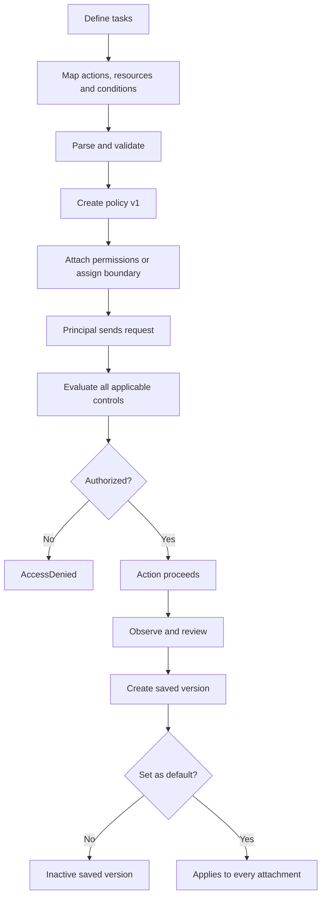
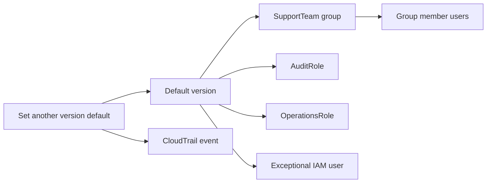

<div align="center">

# AWS IAM Customer Managed Policies

**Reusable, customer-controlled identity policies for precise AWS authorization**

[](https://docs.aws.amazon.com/IAM/latest/UserGuide/access_policies_managed-vs-inline.html)


[](#official-references)

**One sentence to remember:** A customer managed policy is a reusable, account-scoped IAM permissions document whose default saved version applies to every attached identity, subject to all other authorization controls.

[IAM index](README.md) · [IAM overview](01-overview.md) · [Previous: roles](04-roles.md) · [Next: inline policies](06-inline-policies.md)

</div>

<!-- Source provenance is maintained in docs/reorganization/PHASE-4-CANONICAL-SOURCE-MAP.csv. -->

> [!IMPORTANT]
> A customer managed policy grants nothing merely by existing. It must be attached as a permissions policy to an eligible identity—or assigned as a permissions boundary—and the resulting request must survive the complete AWS authorization evaluation.

---

## Table of contents

1. [What is a customer managed policy?](#what-is-a-customer-managed-policy)
2. [What problem does it solve?](#what-problem-does-it-solve)
3. [Core concepts and IAM JSON](#core-concepts-and-iam-json)
4. [How customer managed policies work](#how-customer-managed-policies-work)
5. [Managed-policy versioning and change behavior](#managed-policy-versioning-and-change-behavior)
6. [Use cases and selection guidance](#use-cases-and-selection-guidance)
7. [CCP essentials](#ccp-essentials)
8. [SAA architecture and effective permissions](#saa-architecture-and-effective-permissions)
9. [Policy and feature comparisons](#policy-and-feature-comparisons)
10. [Attachment, boundaries, and multi-account patterns](#attachment-boundaries-and-multi-account-patterns)
11. [Least privilege and security risks](#least-privilege-and-security-risks)
12. [Validation, auditing, and troubleshooting](#validation-auditing-and-troubleshooting)
13. [Pricing and operational considerations](#pricing-and-operational-considerations)
14. [Practical console and CLI lifecycle](#practical-console-and-cli-lifecycle)
15. [Exam traps and misconceptions](#exam-traps-and-misconceptions)
16. [Technical interview questions](#technical-interview-questions)
17. [Practice questions](#practice-questions)
18. [Architecture scenario drills](#architecture-scenario-drills)
19. [Decision framework and keyword recognition](#decision-framework-and-keyword-recognition)
20. [Quick-revision cheat sheet](#quick-revision-cheat-sheet)
21. [Official references](#official-references)
22. [Closing takeaway](#closing-takeaway)

---

<a id="what-is-a-customer-managed-policy"></a>
## 1. What is a customer managed policy?

### Beginner definition

A **customer managed policy** is an IAM policy that you create and administer in your AWS account. It is a standalone JSON permissions document that can be attached to multiple IAM users, IAM groups, and IAM roles in that account.

Think of it as a reusable permission template. You write the rules once, attach the template to the identities that need it, and centrally update the template when requirements change.

The analogy has limits: a policy is not a static checklist applied in isolation. AWS evaluates its default version together with request context, other identity policies, resource policies, permissions boundaries, session policies, organization guardrails, and explicit denies.

### Precise technical definition

A customer managed policy is a standalone, versioned IAM managed-policy resource owned by one AWS account. It has an ARN, name, optional path and description, tags, attachment metadata, up to five saved policy versions, and exactly one default version. Its default policy document can provide identity-based permissions when attached to an eligible IAM identity. A managed policy can instead be used as a permissions boundary for an IAM user or role, where it limits rather than grants identity-policy permissions.

Example ARN:

```text
arn:aws:iam::111122223333:policy/application/SupportReadOnlyCustom
```

IAM resources are global within an AWS account and partition; the resources and API endpoints governed by the policy can be Regional.

### At a glance

| Fact | Meaning |
|---|---|
| Owner | The customer account creates, reviews, versions, attaches, and deletes it |
| Policy family | Standalone managed identity policy; it can also serve as a boundary |
| Format | IAM JSON policy language |
| Reuse | Attach to eligible users, groups, and roles in the same account |
| Active document | Exactly one saved version is the default |
| Saved versions | Up to five for a customer managed policy |
| Update behavior | Changing the default affects all attachments after IAM propagation |
| Scope | Account-scoped policy resource with an account-specific ARN |
| Default effect | No permission merely from creation; no attachment is created automatically |
| Responsibility | Customer owns content, testing, rollout, rollback, and lifecycle |

### Main characteristics

- Customer-created and customer-controlled.
- Stored independently of the identities that use it.
- Reusable across multiple eligible identities in its account.
- Can contain `Allow` and explicit `Deny` statements.
- Can define actions, resources, and supported request conditions.
- Supports saved managed-policy versions and customer-selected rollback.
- Can be attached or detached without deleting the policy.
- Can be used as a permissions boundary for users and roles.
- Does not contain a `Principal` when used as an ordinary identity policy.
- Does not guarantee least privilege merely because it is customer managed.

---

<a id="what-problem-does-it-solve"></a>
## 2. What problem does it solve?

Customer managed policies separate a reusable permission definition from the identities that consume it.

| Without a shared managed policy | With a customer managed policy |
|---|---|
| Copy similar inline rules into many identities | Attach one reviewed policy to several identities |
| Update every copy separately | Activate one new default version centrally |
| Drift between teams and roles | Standardize a permission contract |
| No managed-policy rollback point | Retain selected nondefault versions for rollback |
| Broad AWS policy used for convenience | Create environment-specific least privilege |
| Hard to discover every copied rule | Query attachments from one policy resource |

### Benefits and trade-offs

| Benefit | Corresponding trade-off |
|---|---|
| Reuse and consistency | One policy can become too broad for different jobs |
| Central updates | One unsafe change has a large blast radius |
| Custom actions/resources/conditions | Customer owns correctness and testing |
| Saved rollback versions | Only retained versions are available; this is not source control |
| Attachment inventory | It still does not show complete effective permissions |

### Worked support-team example

An account creates `SupportReadOnlyCustom` and attaches it to a `SupportTeam` IAM group, an `AuditRole`, and one exceptional IAM user. Adding a required RDS read action to a new default version changes that shared policy for every attachment. Each identity can still have additional grants or restrictions from other policies, so the central update does not fully define any identity's effective permissions.

---

<a id="core-concepts-and-iam-json"></a>
## 3. Core concepts and IAM JSON

### Component glossary

| Component | Purpose | Important caution |
|---|---|---|
| Policy ARN | Identifies the standalone policy resource | Includes owning account and optional path |
| Policy document | JSON permission statements | Syntax validity is not security correctness |
| Policy version | Saved revision such as `v1` or `v3` | Different from JSON language `Version` |
| Default version | Operative revision for all attachments | Only one is active at a time |
| Attachment | Links policy as permissions to user/group/role | Policy existence alone grants nothing |
| Permissions boundary | Managed policy assigned as a maximum to user/role | Boundary grants nothing |
| Request context | Principal, action, resource, tags and other attributes | Conditions require supported keys and correct values |
| Effective permissions | Final authorization result | Not equal to one policy's contents |

### Policy-language elements

| Element | Function | Design caution |
|---|---|---|
| `Version` | Selects policy-language semantics; normally `2012-10-17` | Not a saved-policy version ID |
| `Statement` | Contains one statement or an array | Required |
| `Sid` | Optional statement identifier | Useful for review; not a permission |
| `Effect` | `Allow` or `Deny` | Applicable explicit deny wins |
| `Action` | AWS service actions affected | Mutually exclusive with `NotAction` in one statement |
| `NotAction` | All applicable actions except those listed | Meaning depends on effect/resource/scope |
| `Resource` | Resource ARN or `*` | Action must support that resource type |
| `NotResource` | All applicable resources except those listed | Easy to overbroaden |
| `Condition` | Constraints from request context | Key availability, operator and value types matter |
| Policy variable | Substitutes context in supported locations | Missing values may prevent a match |

An ordinary customer managed identity policy does **not** include `Principal`; the attached user, group, or role is implicit. `Principal` belongs in supported resource-based policies—such as an S3 bucket policy—or in an IAM role trust policy.

### Five distinct correctness questions

1. **JSON parsing:** can a parser read it?
2. **IAM grammar:** are elements valid for this policy type?
3. **Service semantics:** do actions support the resources and conditions?
4. **Functional authorization:** does the intended live request succeed?
5. **Least privilege:** is the result no broader than justified?

### Example 1: S3 read-only policy with multiple statements

```json
{
  "Version": "2012-10-17",
  "Statement": [
    {
      "Sid": "ListReportsPrefix",
      "Effect": "Allow",
      "Action": "s3:ListBucket",
      "Resource": "arn:aws:s3:::example-company-reports",
      "Condition": {
        "StringLike": {
          "s3:prefix": ["published", "published/*"]
        }
      }
    },
    {
      "Sid": "ReadPublishedReports",
      "Effect": "Allow",
      "Action": "s3:GetObject",
      "Resource": "arn:aws:s3:::example-company-reports/published/*"
    }
  ]
}
```

`s3:ListBucket` targets the bucket ARN; `s3:GetObject` targets object ARNs. The S3 console may require additional listing/location actions.

### Example 2: EC2 describe/read permissions

Many EC2 `Describe*` actions, including these examples, do not support resource-level restriction and require `Resource: "*"`:

```json
{
  "Version": "2012-10-17",
  "Statement": [{
    "Sid": "DescribeSelectedEC2State",
    "Effect": "Allow",
    "Action": [
      "ec2:DescribeInstances",
      "ec2:DescribeInstanceStatus",
      "ec2:DescribeTags"
    ],
    "Resource": "*",
    "Condition": {
      "StringEquals": {
        "ec2:Region": "eu-central-1"
      }
    }
  }]
}
```

Least privilege can still narrow actions and use supported conditions when a resource ARN is unavailable.

### Example 3: resource-scoped DynamoDB read

```json
{
  "Version": "2012-10-17",
  "Statement": [{
    "Sid": "ReadOrdersTableAndIndexes",
    "Effect": "Allow",
    "Action": ["dynamodb:GetItem", "dynamodb:Query"],
    "Resource": [
      "arn:aws:dynamodb:eu-central-1:111122223333:table/Orders",
      "arn:aws:dynamodb:eu-central-1:111122223333:table/Orders/index/*"
    ]
  }]
}
```

The index ARN supports queries against secondary indexes; this grants neither scans nor writes.

### Example 4: meaningful ABAC condition and variable

```json
{
  "Version": "2012-10-17",
  "Statement": [{
    "Sid": "UseMatchingProjectQueues",
    "Effect": "Allow",
    "Action": [
      "sqs:GetQueueAttributes",
      "sqs:ReceiveMessage",
      "sqs:SendMessage"
    ],
    "Resource": "arn:aws:sqs:eu-central-1:111122223333:*",
    "Condition": {
      "StringEquals": {
        "aws:ResourceTag/access-project": "${aws:PrincipalTag/access-project}"
      }
    }
  }]
}
```

This assumes those SQS actions support the global resource-tag key and that tag mutation is governed. ABAC fails safely or unexpectedly when required context is missing or untrusted.

### Example 5: justified explicit deny

```json
{
  "Version": "2012-10-17",
  "Statement": [{
    "Sid": "DenyInsecureTransportForReports",
    "Effect": "Deny",
    "Action": "s3:*",
    "Resource": [
      "arn:aws:s3:::example-company-reports",
      "arn:aws:s3:::example-company-reports/*"
    ],
    "Condition": {
      "Bool": {
        "aws:SecureTransport": "false"
      }
    }
  }]
}
```

This blocks non-TLS requests for the listed resources but grants nothing. A bucket policy may be the stronger location when every principal path to the bucket must be protected.

> [!WARNING]
> `NotAction` and `NotResource` are not shorthand for “deny this item.” Their meaning depends on `Effect` and statement scope. Prefer explicit lists when possible and review these constructs carefully.

---

<a id="how-customer-managed-policies-work"></a>
## 4. How customer managed policies work

### End-to-end workflow

1. Identify required tasks.
2. Map tasks to AWS service actions.
3. Determine supported resource ARN types.
4. Add supported conditions and variables.
5. Parse and validate the policy.
6. Create the customer managed policy; IAM creates default `v1`.
7. Attach it as permissions or assign it as a boundary.
8. The principal authenticates and sends a signed request.
9. AWS evaluates every applicable authorization control.
10. The service allows or denies the action.
11. Owners observe usage and create later versions.
12. A reviewed version is activated or a retained version is restored.



| Event | What happens | What does not happen |
|---|---|---|
| Create policy | Policy ARN and default `v1` are created | No identity is attached automatically |
| Attach policy | Default version contributes identity permissions | No credentials are created |
| Authenticate | AWS establishes the calling principal | Authorization is not guaranteed |
| Create version | New saved document is stored | It is inactive unless default |
| Set default | Revision becomes operative for all attachments | Attachments need not be recreated |

A policy containing only `Deny` statements grants nothing. IAM changes are eventually consistent, so deploy before a critical path and use bounded retries rather than inventing a propagation guarantee.

---

<a id="managed-policy-versioning-and-change-behavior"></a>
## 5. Managed-policy versioning and change behavior

### Two unrelated meanings of “Version”

| Concept | Example | Meaning |
|---|---|---|
| Policy-language version | `"Version": "2012-10-17"` | IAM language semantics inside JSON |
| Managed-policy version ID | `v1`, `v2`, `v7` | One saved revision of a managed policy |

A document stored as `v7` still normally contains `"Version": "2012-10-17"`.

### AWS managed versus customer managed versioning

Both managed-policy types have versions. Customers create versions and choose the default only for customer managed policies. AWS creates and selects versions for AWS managed policies; customers cannot edit them or set their default. Inline policies do not use managed-policy versioning.

### Version rules

- A new customer managed policy starts with default `v1`.
- Exactly one version is default and operative for every attachment.
- IAM retains at most **five** customer managed policy versions.
- CLI/API creation of a sixth requires deletion of a nondefault version first; the console prompts for removal.
- The default version cannot be deleted.
- Deleting versions does not renumber the rest, so IDs can be nonsequential.
- Saving without activating does not change permissions.
- Setting an earlier retained version as default performs rollback without reattachment.

### Worked `DeveloperS3ReadPolicy` example

| Version | Definition | Behavior |
|---|---|---|
| `v1` | `s3:GetObject` for the initial approved scope | Default when created |
| `v2` | Adds `s3:PutObject` | When default, every attachment receives that added identity-policy grant |
| `v3` | Restricts get/put to one approved bucket prefix | Inactive until default; safer candidate after testing |

If `v2` is default, retained `v1` and `v3` do not combine with it. Selecting `v3` changes every attachment without recreation; selecting retained `v1` rolls back. Other denies, boundaries, sessions, SCPs/RCPs, resource policies, and cross-account requirements still apply.



`iam:CreatePolicyVersion` can create and optionally activate a new revision. `iam:SetDefaultPolicyVersion` can activate a retained revision. To prevent unauthorized default changes, protect both actions, plus attachment, deletion, boundary, and related IAM mutation paths.

---

<a id="use-cases-and-selection-guidance"></a>
## 6. Use cases and selection guidance

| Requirement | Recommended mechanism | Reason | Caveat |
|---|---|---|---|
| Several roles need identical organization-specific access | Customer managed policy | Reusable, centrally reviewed | Shared update blast radius |
| One identity needs deliberately unique lifecycle-coupled rules | Inline policy may fit | Deleted with that identity | Harder to reuse, discover, and version |
| Team needs a standard AWS-provided baseline | Reviewed AWS managed policy | AWS-maintained, quick to attach | Can be broad and changes under AWS control |
| Workload needs narrow S3/DynamoDB access | Customer policy attached to its role | Exact actions/resources/conditions | Trust and resource/key policies remain separate |
| Delegated role creators need a maximum | Managed policy as permissions boundary | Caps identity-policy grants | Grants nothing and needs protected ownership |
| One bucket must trust an external principal | Bucket policy plus caller authorization | Resource owns the cross-account grant | Not cross-account policy attachment |
| Organization must prohibit actions in an OU | SCP | Organization principal guardrail | Does not grant access |
| Many accounts need the same definition | IaC/StackSets deploy account-local copies | Repeatable standardization | Detect drift and coordinate changes |

Do not choose a customer managed policy to define role trust, replace a required resource/key policy, or combine unrelated jobs merely to reduce policy count. It is a strong choice when **customer control + reuse + central version management** are actual requirements, not a universal best practice.

---

<a id="ccp-essentials"></a>
## 7.  CCP essentials

### Facts to memorize

1. Customers create and maintain customer managed policies.
2. They are standalone IAM managed-policy resources.
3. They are JSON permissions documents.
4. They attach to users, groups, and roles in the owning account.
5. One policy can be reused by several identities.
6. Creating one does not grant permission automatically.
7. They can contain `Allow` and `Deny` statements.
8. One saved version is the active default.
9. Customers control versions and rollback for their policies.
10. AWS managed policies also have versions, controlled by AWS.
11. Inline policies are embedded one-to-one and are not managed-policy-versioned.
12. Central updates affect all attachments.
13. Customer managed does not automatically mean least privilege.
14. Applicable explicit deny overrides allow.
15. A permissions boundary limits but does not grant.

### If the question says X → think Y

| Question clue | Think |
|---|---|
| Custom and reusable permissions | Customer managed policy |
| AWS creates and updates it | AWS managed policy |
| Embedded in exactly one identity | Inline policy |
| Update once for several roles | Shared customer managed policy |
| Roll back a reusable policy | Select earlier saved version as default |
| Maximum permissions for user/role | Managed policy as permissions boundary |
| Prohibit action across an OU | SCP |
| Authorize external principal on one bucket | S3 bucket policy plus caller authorization |
| Policy exists but request is denied | Verify attachment and complete evaluation |

**Keywords:** `customer controlled` · `standalone` · `reusable` · `attachment` · `JSON` · `least privilege` · `default version` · `rollback` · `central update` · `permissions boundary`

### 30-second CCP summary

A customer managed policy is a reusable IAM permissions policy created in your account. Attach it to users, groups, or roles when several identities need the same custom permissions. AWS controls AWS managed policies; an inline policy belongs to one identity. Only the customer policy's default saved version is operative, and other authorization controls still apply.

---

<a id="saa-architecture-and-effective-permissions"></a>
## 8.  SAA architecture and effective permissions

### Design rules

- Design from required APIs, resource types, and request context—not console page names.
- Separate syntax validity, IAM semantic validity, functional correctness, least privilege, and live effective authorization.
- Treat a shared policy as a versioned dependency with owners, testing, rollback, and blast-radius analysis.
- Protect policy mutation and attachment permissions as privileged capabilities.
- Use boundaries for delegated maximums and SCPs/RCPs for organization guardrails.
- Deploy separate policy resources to each account; do not assume cross-account attachment.
- Use CloudTrail and access data to refine policy without assuming observed history represents every future need.

### Effective-permission reasoning

On the common identity-policy path, applicable identity-policy allows combine. Boundaries restrict user/role identity grants, session policies narrow sessions, SCPs constrain member-account principals, and RCPs constrain supported member-account resources. Resource and KMS key policies can add grants or requirements; cross-account requests need authorization on the relevant sides; applicable explicit deny wins.

Do not use one universal union/intersection slogan. Same-account resource-policy grants to an IAM user ARN, role ARN, or role-session ARN have different implicit-deny interactions with boundaries and sessions. See the [official boundary rules](https://docs.aws.amazon.com/IAM/latest/UserGuide/access_policies_boundaries.html).

### Required authorization scenarios

| Scenario and assumptions | Result | Why |
|---|---|---|
| A. Attached customer policy allows S3 read; nothing blocks | Allow | Applicable identity allow exists |
| B. Another applicable policy explicitly denies the same request | Deny | Explicit deny wins |
| C. Role policy allows; boundary omits action | Deny on identity-policy path | Both grant and boundary maximum must permit |
| D. Customer policy allows; applicable SCP restricts | Deny | Identity policy cannot exceed organization maximum |
| E. Role allows read/write; session policy allows read | Write denied | Session policy narrows the session |
| F. Source policy allows target bucket; target supplies no cross-account grant | Deny | Both sides are not authorized |

### Six architecture examples

1. **Shared roles:** attach `OrdersReadPolicy` to independently trusted application roles. Trust remains role-specific; split the shared policy if applications need different resources.
2. **Staged version rollout:** save a nondefault candidate, validate/diff/test it, approve it, activate it, monitor, and retain a known-good rollback version.
3. **Delegated IAM:** require an approved boundary, protect it from mutation, restrict attach/create operations, and scope `iam:PassRole`.
4. **Cross-account workload:** source permission and target trust create a target role session; a target-account policy grants its service actions. The source policy cannot attach to the target role.
5. **Identity Center:** deploy matching name/path policies to every assigned account, then reference them from a permission set. Identity Center does not create the policies.
6. **Encrypted S3:** `s3:GetObject` can still fail without `kms:Decrypt` and a valid KMS key-policy path.

---

<a id="policy-and-feature-comparisons"></a>
## 9. Policy and feature comparisons

### Three identity-policy forms

| Dimension | AWS managed | Customer managed | Inline |
|---|---|---|---|
| Owner | AWS | Customer | Customer |
| Customer editable | No | Yes through versions | Yes, replaces embedded document |
| Reusable | Yes | Yes | No |
| Attachment | Users/groups/roles | Users/groups/roles | Exactly one user/group/role |
| Versioning | AWS-controlled | Up to five saved; customer default | No managed-policy versions |
| Central update | AWS update affects attachments | Customer default update affects attachments | Only one embedded identity |
| Lifecycle | Customer detaches only | Customer detaches and deletes | Deleted with identity/removal |
| Best fit | Standard starting point | Reusable custom access | Intentional one-to-one coupling |
| Main risk | Breadth and AWS-controlled change | Customer error and shared blast radius | Duplication and drift |
| Exam clue | Maintained by AWS | Custom + reusable | Embedded in one identity |

The source claim that AWS managed policies lack versions was false. Both managed-policy types are versioned; the controlling party differs.

### Related mechanisms

| Mechanism | Purpose/scope | Location | Grants independently? | Recognition clue |
|---|---|---|:---:|---|
| Customer managed policy | Account-local reusable identity permissions | User/group/role | Yes when attached as permissions | Custom reusable template |
| Resource-based policy | Access to one supported resource | Bucket/queue/key/etc. | Often; semantics vary | Resource names principals |
| IAM role | Assumable identity | IAM account | Its permissions serve sessions | Temporary workload/cross-account identity |
| IAM group | Users-only container | IAM account | Attached policies contribute to users | Shared IAM-user permissions |
| Permissions boundary | User/role identity maximum | User or role | No | Delegated maximum |
| SCP | Principal-centric organization maximum | Root/OU/account | No | OU guardrail |
| RCP | Resource-centric maximum for supported resources | Root/OU/account | No | Organization resource guardrail |
| Identity Center permission set | Account-role template | Identity Center | Provisioned role policies grant | Workforce assignments |
| S3 bucket policy | S3 resource policy | Bucket | Yes under applicable rules | Bucket/cross-account authorization |
| KMS key policy | KMS authorization root | KMS key | Yes/enables IAM path | Encrypt/decrypt authorization |
| IAM Access Analyzer | Analysis/validation | Analyzer/check | No | Findings and policy checks |
| CloudFormation managed policy | Deployment definition | Stack | Deployed/attached policy can grant | Repeatable IaC |

Do not confuse an IAM customer managed policy with a **KMS customer managed key** or an **AWS RAM customer managed permission**. They are different resources, services, and authorization models.

---

<a id="attachment-boundaries-and-multi-account-patterns"></a>
## 10. Attachment, boundaries, and multi-account patterns

### Attachment lifecycle

1. Create and validate the policy.
2. Identify intended user, group, and role consumers.
3. Attach it by ARN with approval.
4. Test allowed and denied requests through each principal type.
5. Inventory direct attachments and indirect group members.
6. Update through controlled saved versions.
7. Detach when the permission contract ends.
8. Before deletion, remove permissions attachments and boundary uses, then delete every nondefault version.

Detaching removes only this policy's contribution. Other identity policies, groups, resource policies, and sessions can still allow an action.

### Current attachment quotas

Verified on 2026-11-05:

| Target | Default | Maximum |
|---|---:|---:|
| Managed policies per user | 10 | 20 |
| Managed policies per group | 10 | 10 |
| Managed policies per role | 20 | 25 |

Some quotas are adjustable and can change; recheck [IAM quotas](https://docs.aws.amazon.com/IAM/latest/UserGuide/reference_iam-quotas.html).

### Permissions boundary example

```json
{
  "Version": "2012-10-17",
  "Statement": [{
    "Sid": "BoundaryAllowsApprovedServices",
    "Effect": "Allow",
    "Action": ["s3:*", "cloudwatch:*", "logs:*"],
    "Resource": "*"
  }]
}
```

If a role identity policy allows S3, CloudWatch, EC2, and IAM, the boundary permits only overlapping S3 and CloudWatch actions. It does not grant Logs without a separate grant. Explicit denies still win. Boundaries apply to users/roles, not groups, and require a managed—not inline—policy.

### Multi-account architecture

A policy ARN in Account A cannot attach to an identity in Account B. Deploy consistent account-local copies using CloudFormation StackSets or another governed IaC pipeline. Use target-account roles for cross-account jobs and SCPs/RCPs as complementary guardrails.

Identity Center customer managed policy references require a policy with the matching **name and path** in every target account. Identity Center does not create it. Documents can technically differ, but consistent deployments should prevent that drift.

```text
Central reviewed source
  → StackSet deploys account-local policies
  → CI verifies name, path, document and tags
  → permission set references matching policy
  → Identity Center provisions account role
  → CloudTrail and drift checks monitor changes
```

---

<a id="least-privilege-and-security-risks"></a>
## 11. Least privilege and security risks

### Before: deliberately broad S3 access

```json
{
  "Version": "2012-10-17",
  "Statement": [{
    "Effect": "Allow",
    "Action": "s3:*",
    "Resource": "*"
  }]
}
```

### After: narrow report-reader access

```json
{
  "Version": "2012-10-17",
  "Statement": [
    {
      "Sid": "ListPublishedPrefix",
      "Effect": "Allow",
      "Action": "s3:ListBucket",
      "Resource": "arn:aws:s3:::example-company-reports",
      "Condition": {
        "StringLike": {"s3:prefix": ["published", "published/*"]},
        "Bool": {"aws:SecureTransport": "true"}
      }
    },
    {
      "Sid": "ReadPublishedObjects",
      "Effect": "Allow",
      "Action": "s3:GetObject",
      "Resource": "arn:aws:s3:::example-company-reports/published/*",
      "Condition": {"Bool": {"aws:SecureTransport": "true"}}
    }
  ]
}
```

The narrower policy limits actions, resources, prefix, and its own allows to TLS. It does not globally deny an insecure grant from another policy; use an explicit deny at the appropriate identity/resource layer for that invariant.

### Refinement method

- Start from required workflows and API actions.
- Verify action/resource/condition support in the Service Authorization Reference.
- Avoid wildcards unless required or justified.
- Govern tags used for ABAC.
- Validate and peer-review candidate changes.
- Observe CloudTrail and last-accessed information over a representative period.
- Retest console, SDK, automation, error, and recovery paths before removal.

### Privilege-escalation controls

| Capability | Risk | Defense |
|---|---|---|
| `iam:CreatePolicyVersion` | Can create and activate broader policy | Scope, approve, monitor; control default path |
| `iam:SetDefaultPolicyVersion` | Can reactivate retained powerful version | Protect versions and separate duties |
| `iam:AttachUserPolicy` / `iam:AttachRolePolicy` | Can attach existing powerful policy | Restrict identity and policy ARNs |
| `iam:Put*Policy` | Can inject inline permissions | Restrict identities; enforce boundaries |
| `iam:PassRole` | Service can use powerful role | Restrict role and `iam:PassedToService` |
| Boundary modification | Changes delegated maximum | Separate ownership and deny mutations |
| Shared policy update | Broadens many principals | Inventory, test, approve, and retain rollback |

Do not grant version or attachment administration merely because a delegate cannot edit the current JSON in place. Those alternate mutation paths can have the same security outcome.

### Shared responsibility

AWS operates IAM and its evaluation engine and maintains AWS managed policies. Customers own customer policy intent, content, versions, attachments, boundaries, approvals, testing, monitoring, deployment automation, and incident response.

---

<a id="validation-auditing-and-troubleshooting"></a>
## 12. Validation, auditing, and troubleshooting

### Evidence sources

| Tool | Answers | Does not prove alone |
|---|---|---|
| JSON parser | Valid JSON? | IAM semantics/security |
| IAM/Access Analyzer validation | Grammar, action, ARN, condition, warning findings? | Live effective result |
| Custom policy check | Candidate adds/provides specified access? | All environmental/account facts |
| Policy Simulator | Modeled request result? | Every live service/resource/RCP/endpoint nuance |
| Live test | Exact request currently works? | Every other context |
| CloudTrail | What covered call occurred and who made it? | All possible permission |
| Access Analyzer finding | Supported external/internal/unused access? | Automatic remediation |
| Last-accessed data | Reported use where supported? | Proof unused access is unnecessary |

### Troubleshooting table

| Symptom | Possible cause | Verify | Resolution |
|---|---|---|---|
| Creation rejects document | JSON/IAM grammar error | Parser and finding | Fix syntax/elements |
| Invalid action | Wrong prefix/action | Service Authorization Reference | Use exact action |
| Allow ineffective | Wrong ARN/resource type | Action resource table | Correct ARN or `*` when required |
| AccessDenied | No allow/condition mismatch | Caller/action/resource/context | Add only justified match |
| Explicit deny | Identity/resource/SCP/RCP/endpoint deny | Error, policies, CloudTrail | Fix intended control; another allow cannot override |
| Condition never matches | Unsupported/missing key or wrong operator | Validation and request context | Correct or redesign condition |
| Wrong identity | Attachment/group/caller mismatch | Caller ARN and attachment list | Attach to intended consumer |
| Old behavior | Unexpected default/version propagation | Get/list versions | Select correct default; retry safely |
| Boundary/SCP/session block | Limiting control omits action | Inspect each control | Governed correction only |
| Cross-account failure | One side or KMS path missing | Source + target + key policy | Add both scoped paths |
| Unexpected permissions | New shared default or other grant | CloudTrail, diff, attachments | Roll back/contain and review all paths |

### Auditing and governance

Monitor CloudTrail events corresponding to `CreatePolicy`, `CreatePolicyVersion`, `SetDefaultPolicyVersion`, attach/detach operations, boundary changes, version deletion, and `DeletePolicy`.

Before a shared change: identify owner, current default, retained versions, attachments, group members, boundary use, permission diff, usage evidence, tests, approval, monitor, and rollback. Afterward: verify default content, test positive/negative cases, watch errors and unexpected success, reconcile accounts, remove obsolete risky versions, and document evidence.

---

<a id="pricing-and-operational-considerations"></a>
## 13. Pricing and operational considerations

IAM customer managed policies have no additional IAM feature charge. Authorized workloads still incur charges for resources and requests. CloudTrail storage/data events, paid Access Analyzer capabilities, Config, deployment pipelines, and third-party governance can add cost.

Operational cost includes design, review, testing across attachments, five-version retention, monitoring, incident response, multi-account deployment, and ABAC tag governance. Optimize for coherent permission contracts and ownership—not the smallest possible policy count.

---

<a id="practical-console-and-cli-lifecycle"></a>
## 14. Practical console and CLI lifecycle

> [!WARNING]
> Commands marked **WRITE** change authorization and were not executed. Use placeholders, a sandbox, peer review, least-privileged credentials, and a rollback plan.

### Console workflow

1. Open **IAM → Policies → Create policy**.
2. Use visual or JSON editor; review actions, resources, and conditions.
3. Resolve grammar errors and Access Analyzer findings.
4. Name, path/tag, describe, and create the policy.
5. Attach it to intended identities and test allow/deny cases.
6. Save later documents as versions; choose deliberately whether to make one default.
7. Roll back by setting a retained version default.
8. To delete: remove attachments/boundary uses and nondefault versions first.

### Create and inspect

```bash
# ANALYSIS
aws accessanalyzer validate-policy \
  --policy-type IDENTITY_POLICY \
  --policy-document file://support-read-policy.json

# WRITE: creates policy with default v1.
aws iam create-policy \
  --policy-name SupportReadOnlyCustom \
  --path /support/ \
  --policy-document file://support-read-policy.json

# READ
aws iam get-policy \
  --policy-arn arn:aws:iam::111122223333:policy/support/SupportReadOnlyCustom

aws iam list-policy-versions \
  --policy-arn arn:aws:iam::111122223333:policy/support/SupportReadOnlyCustom

aws iam list-entities-for-policy \
  --policy-arn arn:aws:iam::111122223333:policy/support/SupportReadOnlyCustom
```

### Version lifecycle

```bash
# WRITE: save candidate without activation.
aws iam create-policy-version \
  --policy-arn arn:aws:iam::111122223333:policy/support/SupportReadOnlyCustom \
  --policy-document file://support-read-policy-v2.json \
  --no-set-as-default

# READ
aws iam get-policy-version \
  --policy-arn arn:aws:iam::111122223333:policy/support/SupportReadOnlyCustom \
  --version-id v2

# WRITE: activate or roll back by selecting a retained ID.
aws iam set-default-policy-version \
  --policy-arn arn:aws:iam::111122223333:policy/support/SupportReadOnlyCustom \
  --version-id v2

# WRITE: only nondefault versions can be deleted.
aws iam delete-policy-version \
  --policy-arn arn:aws:iam::111122223333:policy/support/SupportReadOnlyCustom \
  --version-id v1
```

`create-policy-version --set-as-default` combines saving and activation, but separating review from activation often reduces rollout risk.

### Attach, detach, and retire

```bash
# WRITE
aws iam attach-role-policy \
  --role-name AuditRole \
  --policy-arn arn:aws:iam::111122223333:policy/support/SupportReadOnlyCustom

# WRITE
aws iam detach-role-policy \
  --role-name AuditRole \
  --policy-arn arn:aws:iam::111122223333:policy/support/SupportReadOnlyCustom

# WRITE: only after every lifecycle prerequisite is resolved.
aws iam delete-policy \
  --policy-arn arn:aws:iam::111122223333:policy/support/SupportReadOnlyCustom
```

Equivalent attachment operations exist for users and groups. Prefer group/role assignment over repeated direct user attachments when that matches the identity model.

---

<a id="exam-traps-and-misconceptions"></a>
## 15. Exam traps and misconceptions

| # | Incorrect assumption | Correct interpretation and why it matters | Level |
|---:|---|---|---|
| 1 | AWS creates customer managed policies | The customer creates and owns them | CCP |
| 2 | AWS managed policies have no versions | AWS creates and controls their managed-policy versions | Both |
| 3 | Inline policies use managed-policy versioning | They are embedded documents without saved managed-policy versions | Both |
| 4 | JSON `Version` identifies saved revision | `2012-10-17` is language semantics; `v1` is a saved revision | Both |
| 5 | Customer managed is always best practice | Choose from reuse, ownership, scope, and lifecycle requirements | Both |
| 6 | Creating a policy grants permission | It must be attached as permissions; existence alone grants nothing | CCP |
| 7 | Managed policies attach only to users | They attach to users, groups, and roles | CCP |
| 8 | One managed policy has one attachment | It can be reused within its account | CCP |
| 9 | A default update affects only future attachments | Every existing attachment uses the new default after propagation | Both |
| 10 | All saved versions are active | Exactly one default version is operative | Both |
| 11 | Newest version is always default | Creation can leave it nondefault; admins can select an older version | SAA |
| 12 | Nondefault versions add permissions | They are inactive until selected as default | Both |
| 13 | Default version can be deleted | Another version must first become default | SAA |
| 14 | Version IDs stay sequential | Deletions do not renumber; later IDs can have gaps | SAA |
| 15 | Customers control AWS managed defaults | Only AWS controls AWS managed policy updates/default | Both |
| 16 | Customer policy is attachable across accounts | Each account needs its own local policy resource | SAA |
| 17 | Customer policy overrides explicit deny | Applicable explicit deny wins | Both |
| 18 | Permissions boundary grants listed actions | It only limits identity-policy permissions | SAA |
| 19 | SCP/RCP grants access | Both are organization maximums, not grants | SAA |
| 20 | Identity policy needs `Principal` | Attached identity is implicit; `Principal` belongs in supported resource policies | SAA |
| 21 | Every action can use a specific ARN | Some actions require `Resource: "*"` | SAA |
| 22 | Valid JSON means valid/secure IAM | Grammar, action/resource support, context, and least privilege remain | Both |
| 23 | Customer managed automatically means least privilege | A customer can write `Action: "*"`, `Resource: "*"` | Both |
| 24 | `s3:GetObject` also lists a bucket | Listing requires `s3:ListBucket` on the bucket ARN | Both |
| 25 | Default change cannot affect running principals | Subsequent requests use the operative policy after propagation | SAA |
| 26 | Editing a shared policy affects only one role | It changes every direct/indirect consumer of that policy | SAA |
| 27 | Access Analyzer automatically fixes policy | It reports findings/checks; owners decide and remediate | Both |
| 28 | `iam:CreatePolicyVersion` is harmless | It can create and optionally activate a more powerful revision | SAA |
| 29 | `SetDefaultPolicyVersion` is read-only | It changes operative permissions across all attachments | SAA |
| 30 | Boundary limits every resource-policy grant identically | Principal form and same/cross-account semantics matter | SAA |
| 31 | Identity Center creates referenced customer policies | Matching name/path policies must already exist in target accounts | SAA |
| 32 | Policy Simulator guarantees production behavior | It cannot reproduce every live service/resource/organization context | SAA |

The hardest questions separate **policy content** from **policy activation**, then place that policy inside the complete authorization path.

---

<a id="technical-interview-questions"></a>
## 16. Technical interview questions

### 1. What is a customer managed policy?

A standalone, account-owned IAM managed policy whose default version can grant reusable identity permissions to attached users, groups, and roles, or serve as a boundary for users/roles.

### 2. Why choose it over an inline policy?

Choose it for reuse, independent lifecycle, attachment discovery, central updates, saved versions, and rollback. Inline can fit an intentional one-to-one lifecycle requirement.

### 3. AWS managed versus customer managed?

Both are reusable and versioned. AWS controls AWS managed content/defaults; customers control their customer managed policy documents, saved versions, and default.

### 4. What happens when a shared policy's default changes?

The selected document becomes operative for every attachment without reattachment, subject to IAM propagation and all other controls.

### 5. Policy `Version` versus version ID?

`2012-10-17` selects policy-language semantics. IDs such as `v3` identify saved managed-policy revisions.

### 6. How does rollback work?

Set a retained nondefault version as default. Attachments remain unchanged. You cannot roll back to a deleted version without recreating its document.

### 7. Can one policy be reused across AWS accounts?

Not as one attachment resource. Deploy equivalent account-local policies; cross-account authorization is a different mechanism.

### 8. How can it be a permissions boundary?

Assign the managed policy to an IAM user or role as its maximum for identity-policy grants. The boundary itself grants nothing.

### 9. Why might an attached allow still be denied?

The action/resource/condition may not match, or a boundary, session policy, SCP, RCP, resource/key policy requirement, cross-account rule, or explicit deny can block it.

### 10. Why are policy-version permissions sensitive?

Creating or selecting a version can broaden the operative permissions of every attachment, so those actions can become privilege-escalation paths.

### 11. How would you audit before changing a shared policy?

Inventory attachments and boundary uses, compare current/candidate documents, review activity and dependencies, validate/test, approve, define monitoring, and retain a known-good rollback.

### 12. How do you troubleshoot a policy that looks correct?

Confirm actual caller, action, resource ARN, default version, attachment, condition context, boundaries/session controls, SCP/RCP, resource/KMS policies, cross-account halves, and CloudTrail evidence.

---

<a id="practice-questions"></a>
## 17. Practice questions

These 30 questions are original study material, not official or recalled AWS exam questions.

<details>
<summary>Q1 · CCP · What is a customer managed policy?</summary>

**Answer:** A standalone reusable IAM policy created and administered by the customer in one AWS account. It differs from an AWS managed policy (AWS-owned) and an inline policy (embedded in one identity).
</details>

<details>
<summary>Q2 · CCP · Which identities can receive a customer managed policy as permissions?</summary>

- A. IAM users only
- B. IAM users and roles only
- C. IAM users, IAM groups, and IAM roles
- D. AWS accounts directly

**Answer: C.** Managed identity policies attach to users, groups, and roles. A/D confuse identities and account/resource controls.
</details>

<details>
<summary>Q3 · CCP · Does creating a policy immediately grant access?</summary>

**Answer: No.** It must be attached as a permissions policy to an eligible identity; a boundary assignment limits rather than grants. Authentication and complete evaluation still follow.
</details>

<details>
<summary>Q4 · CCP · Who controls an AWS managed policy's updates?</summary>

- A. Every attaching customer
- B. AWS
- C. The IAM group
- D. CloudTrail

**Answer: B.** AWS owns its content/default version. Customers choose whether to attach it; C/D do not edit it.
</details>

<details>
<summary>Q5 · CCP · Which policy is embedded one-to-one in a user, group, or role?</summary>

**Answer:** An inline policy. Customer and AWS managed policies are standalone and reusable.
</details>

<details>
<summary>Q6 · CCP · Several roles need identical custom access. Best baseline?</summary>

- A. Copy inline policy into each role
- B. One customer managed policy attached to each role
- C. Root credentials
- D. Security group

**Answer: B.** It provides reuse and central updates. A creates drift; C/D are unrelated or unsafe.
</details>

<details>
<summary>Q7 · CCP · What does `Effect: "Deny"` do by itself?</summary>

**Answer:** It blocks matching access that another source might allow; it grants nothing. A policy containing only denies provides no positive permission.
</details>

<details>
<summary>Q8 · CCP · Is a customer managed policy automatically least privilege?</summary>

**Answer: No.** Customer ownership permits precision but also permits broad wildcards. Least privilege requires justified actions, resources, conditions, and review.
</details>

<details>
<summary>Q9 · CCP · Which element normally contains `2012-10-17`?</summary>

- A. Managed-policy ID
- B. JSON policy-language `Version`
- C. Role session name
- D. SCP attachment

**Answer: B.** It selects policy-language semantics. A saved revision uses an ID such as `v2`; C/D are unrelated.
</details>

<details>
<summary>Q10 · CCP · What is the main risk of a central shared update?</summary>

**Answer:** Blast radius. The new default affects every attachment, so an error can remove required access or broadly expand it.
</details>

<details>
<summary>Q11 · SAA · How many saved customer managed policy versions can IAM retain?</summary>

- A. One
- B. Five
- C. Ten
- D. Unlimited

**Answer: B.** At five, CLI/API creation requires deleting a nondefault version first. Inline policies do not use this version system.
</details>

<details>
<summary>Q12 · SAA · A new version was saved without making it default. What changes?</summary>

**Answer:** Nothing in operative attachment permissions. It is retained but inactive until selected as default.
</details>

<details>
<summary>Q13 · SAA · Can the current default version be deleted?</summary>

**Answer: No.** First select another retained version as default, then delete the now-nondefault version if lifecycle policy permits.
</details>

<details>
<summary>Q14 · SAA · Versions v2 and v4 were deleted. Must later versions be renamed?</summary>

**Answer: No.** IAM does not renumber them. New IDs continue forward, so the remaining list can be nonsequential.
</details>

<details>
<summary>Q15 · SAA · A role policy allows S3 read, but its boundary omits S3. Result?</summary>

**Answer:** Denied on the identity-policy path. The boundary limits what the role identity policy can grant and does not itself provide permission.
</details>

<details>
<summary>Q16 · SAA · Policy allows an action, but an applicable SCP denies it. Result?</summary>

**Answer:** Deny. The identity grant cannot exceed the organization principal guardrail; adding another allow does not help.
</details>

<details>
<summary>Q17 · SAA · Why are separate S3 bucket and object ARNs required?</summary>

**Answer:** `s3:ListBucket` operates on the bucket ARN, while `s3:GetObject` operates on object ARNs such as `bucket/prefix/*`. Using the wrong type prevents matching.
</details>

<details>
<summary>Q18 · SAA · Why can EC2 `DescribeInstances` use `Resource: "*"` in a narrow policy?</summary>

**Answer:** That action does not support resource-level restriction. Narrow its action set and supported conditions instead of inventing an instance ARN restriction.
</details>

<details>
<summary>Q19 · SAA · Can Account A attach its policy ARN to Account B's role?</summary>

**Answer: No.** Customer managed policies are account-scoped. Deploy a local copy in B or use a target-account role/resource policy for cross-account authorization.
</details>

<details>
<summary>Q20 · SAA · What must exist for an Identity Center customer policy reference?</summary>

**Answer:** A customer managed policy with matching name and path in every target account. Identity Center does not create it; missing matches cause provisioning failure.
</details>

<details>
<summary>Q21 · SAA · Why protect both `CreatePolicyVersion` and `SetDefaultPolicyVersion`?</summary>

**Answer:** The first can create and optionally activate a broad document; the second can reactivate any retained broad version. Either can change effective permissions.
</details>

<details>
<summary>Q22 · SAA · Does `validate-policy` prove a live request will succeed?</summary>

**Answer: No.** It checks grammar and best-practice findings, not every live attachment, condition, resource policy, organization control, or service dependency.
</details>

<details>
<summary>Q23 · SAA · Simulator says allow but live request fails. What next?</summary>

**Answer:** Confirm actual caller/action/resource/context and inspect unsupported or live controls such as resource/key policies, RCPs, VPC endpoint policies, sessions, and cross-account requirements. A simulation is not production proof.
</details>

<details>
<summary>Q24 · SAA · Shared policy default becomes overly broad. Fast controlled response?</summary>

**Answer:** Set a retained known-good version as default, contain related mutation/attachment paths, verify propagation and tests, inspect CloudTrail and impact, then correct through review. Do not delete evidence first.
</details>

<details>
<summary>Q25 · SAA · Does a policy boundary apply to an IAM group?</summary>

**Answer: No.** Boundaries attach to IAM users and roles. Groups contribute identity permissions to users but cannot receive a boundary.
</details>

<details>
<summary>Q26 · SAA · Why can S3 access succeed but SSE-KMS decryption fail?</summary>

**Answer:** S3 and KMS authorization are separate. The principal also needs `kms:Decrypt` through an enabling KMS key-policy/IAM path and matching context.
</details>

<details>
<summary>Q27 · SAA · One shared policy is attached to two jobs with different needs. Best design?</summary>

**Answer:** Split it into coherent job policies rather than broadening one to the union of unrelated needs. Reuse is valuable only across a genuine shared permission contract.
</details>

<details>
<summary>Q28 · SAA · A policy uses an unsupported condition key for an action. What happens?</summary>

**Answer:** The intended statement may not match or validation may report a problem. Verify each action's supported keys and request availability; valid JSON alone is insufficient.
</details>

<details>
<summary>Q29 · SAA · Policy was detached but access remains. Why?</summary>

**Answer:** Another direct/group/managed/inline/resource-policy grant or session may still allow the action. Inspect the complete authorization path and actual principal.
</details>

<details>
<summary>Q30 · SAA · Customer managed policy or bucket policy for one external S3 reader?</summary>

**Answer:** The external principal needs caller-side permission and the bucket needs a target-side grant; a bucket policy is usually central to direct cross-account S3 access. A target role with a local customer policy may fit a broader job across services. The account and identity requirements decide.
</details>

---

<a id="architecture-scenario-drills"></a>
## 18. Architecture scenario drills

| Scenario and requirement | Recommended design and reasoning | Prerequisites and controls | Weaker alternative/common mistake | Level |
|---|---|---|---|---|
| 1. Support employees share read access | Narrow policy on `SupportTeam` group; federated workforce should instead receive equivalent account-role permissions | Correct actions/resources; membership lifecycle; other grants reviewed | Direct copies drift; broad AWS policy may expose excess data | Both |
| 2. Developers need one S3 prefix | Two statements for bucket listing prefix and object operations | Correct bucket/object ARNs; KMS path if used | `s3:*` on `*`; object ARN for `ListBucket` | Both |
| 3. One permission contract serves several roles | Attach one policy to independently trusted roles | Attachment inventory and role-specific trust | One giant policy combining unrelated jobs | SAA |
| 4. Shared policy update | Save nondefault, diff/validate/test/approve, then activate | Known-good rollback; CloudTrail monitoring | Editing without attachment/blast-radius review | SAA |
| 5. Dangerous version needs rollback | Set retained known-good version default | Protect version APIs; test and investigate | Reattaching identities or deleting evidence first | SAA |
| 6. Allow still receives deny | Inspect boundary/session/SCP/RCP/resource/KMS/condition | Actual caller/action/resource and both accounts | Adding AdministratorAccess cannot override deny | SAA |
| 7. User has multiple policies | Combine applicable allows, then apply limits/denies | Direct and group inventory | Assuming one selected policy is complete permissions | Both |
| 8. Delegated IAM administration | Approved boundary plus scoped create/attach/pass-role rights | Boundary immutable to delegate; separation of duties | Boundary alone while delegate can replace it | SAA |
| 9. Same policy across 30 accounts | IaC/StackSet deploys local copies with drift checks | Account-local ARNs and rollout coordination | Trying to attach one central ARN everywhere | SAA |
| 10. Identity Center customer policy reference | Matching name/path policy predeployed per account | Permission set assignment/provisioning and content consistency | Assuming Identity Center creates the policy | SAA |
| 11. Policy accidentally grants IAM admin | Roll back/contain; audit version and attachment changes | CloudTrail, protected management paths, incident review | Treating `CreatePolicyVersion` as routine edit | SAA |
| 12. Wrong ARN or condition | Use authorization reference and validation, then live negative/positive tests | Correct service action/resource/key and context | Trusting valid JSON or simulator alone | SAA |

### Secure versus insecure operating model

**Secure:** coherent policies, named owners, exact attachments, protected version APIs, staged defaults, IaC for accounts, CloudTrail, validation, test cases, and retained rollback.

**Insecure:** wildcard IAM administration, unknown attachments, direct production activation, stale powerful versions, inconsistent account copies, and no negative testing.

---

<a id="decision-framework-and-keyword-recognition"></a>
## 19. Decision framework and keyword recognition

| Requirement | Recommended mechanism | Reason | Caveat |
|---|---|---|---|
| Several roles need identical custom permissions | Customer managed policy | Reuse and central lifecycle | Shared blast radius |
| One identity needs unique lifecycle-coupled permissions | Inline policy may fit | One-to-one ownership | No standalone versions/reuse |
| Team accepts an AWS-maintained baseline | AWS managed policy | Fast reusable starting point | Review breadth and AWS updates |
| Organization wants reusable least privilege | Customer managed policy | Customer controls exact policy | Control does not guarantee quality |
| Customer wants rollback | Customer managed saved versions | Set earlier retained version default | Maximum five retained |
| Role needs a maximum-permission ceiling | Managed policy as boundary | Limits identity grants | Grants nothing |
| OU must prohibit a service | SCP | Organization principal maximum | Underlying permissions still required |
| Bucket authorizes external principal | Bucket policy plus caller permission | Two-sided cross-account authorization | KMS may add another path |
| Many accounts need standardized policy | IaC/StackSets local copies | Repeatable account-local resources | Drift/version coordination |
| Attached allow still gets AccessDenied | Full evaluation/troubleshooting | Another control/context blocks | Do not add broad access blindly |
| Security team needs policy warnings | Access Analyzer validation/checks | Finds grammar/security issues | Not live authorization proof |

```text
Need a permission document?
├─ AWS owns and updates a standard baseline → AWS managed policy
├─ Customer needs reusable custom access → customer managed policy
├─ Permission intentionally belongs to exactly one identity → inline policy
├─ User/role needs a maximum rather than a grant → managed policy as boundary
├─ Resource must name principals → supported resource-based policy
└─ Organization needs a principal/resource maximum → SCP or RCP

Customer managed policy selected?
├─ Verify actions, resources and condition support
├─ Validate JSON and IAM semantics
├─ Inventory attachments and boundary uses
├─ Save/test candidate version
├─ Activate one default deliberately
└─ Monitor and retain a known-good rollback
```

### Keyword bank

`standalone` · `customer controlled` · `reusable` · `policy ARN` · `attachment` · `default version` · `five saved versions` · `rollback` · `central change` · `blast radius` · `permissions boundary` · `Access Analyzer validation` · `account scoped` · `StackSets` · `Identity Center reference`

---

<a id="quick-revision-cheat-sheet"></a>
## 20. Quick-revision cheat sheet

```text
Customer managed policy = standalone reusable IAM policy owned by one account.

Attach as permissions → user, group, or role.
Assign as boundary → user or role; boundary limits and grants nothing.
Creation alone → no permission.

JSON core:
Version 2012-10-17 = policy-language semantics.
Statement = Effect + Action/NotAction + Resource/NotResource + optional Condition.
Ordinary identity policy has no Principal.

Managed-policy versions:
- up to five saved customer versions
- exactly one default is operative
- saving != activating
- default cannot be deleted
- IDs can become nonsequential
- rollback = set retained version as default
- attachments do not need recreation

AWS managed → AWS owns content and versions.
Customer managed → customer owns content, versions and default.
Inline → embedded one-to-one; no managed-policy versions.

Effective access can still be limited by:
explicit deny, boundary, session policy, SCP, RCP, resource/key policy,
condition context, VPC endpoint policy, and cross-account requirements.

Multi-account:
deploy local policy copies; one account's ARN is not globally attachable.
Identity Center reference requires matching name/path policy in each account.

Essential CLI:
create-policy → create-policy-version → set-default-policy-version
list-policy-versions → get-policy-version → delete-policy-version
list-entities-for-policy → attach/detach → delete-policy

Three biggest traps:
1. 2012-10-17 is not v1/v2.
2. Only the default saved version is active.
3. Customer managed does not automatically mean least privilege.
```

**One-sentence exam answer:** A customer managed policy is a reusable, versioned IAM policy created in one customer account and attached to eligible identities for custom permissions, subject to all other authorization controls.

**Memory trick:** **Customer makes it, attachments share it, the default version runs it.**

### Source corrections and preserved material

The original reusable-template analogy, customer ownership, team examples, central updates, least-privilege purpose, three policy-type distinction, support scenario, revision checklist, and memory aids were retained and integrated.

The upgrade corrected the false statement that AWS managed policies have no versions, replaced the malformed comparison table, removed the claim that customer managed policies are categorically best, and added standalone ARNs, default/version behavior, rollback, attachments, boundaries, JSON semantics, complete evaluation, multi-account design, defensive administration, validation, questions, and references.

The provenance comment was preserved exactly. On 2026-11-06, the referenced map was verified at the learning-content root as `learnings/docs/reorganization/PHASE-4-CANONICAL-SOURCE-MAP.csv`. Its row for this canonical lesson records two consolidated source paths and marks the content verified. The comment is provenance metadata rather than a lesson-relative navigation link.

---

<a id="official-references"></a>
## 21. Official references

Reviewed against official AWS documentation on **2026-11-05**.

### Policy concepts, JSON, and evaluation

- [Policies and permissions in IAM](https://docs.aws.amazon.com/IAM/latest/UserGuide/access_policies.html)
- [Choose managed policies or inline policies](https://docs.aws.amazon.com/IAM/latest/UserGuide/access_policies-choosing-managed-or-inline.html)
- [IAM JSON policy element reference](https://docs.aws.amazon.com/IAM/latest/UserGuide/reference_policies_elements.html)
- [Policy evaluation logic](https://docs.aws.amazon.com/IAM/latest/UserGuide/reference_policies_evaluation-logic.html)
- [Cross-account policy evaluation](https://docs.aws.amazon.com/IAM/latest/UserGuide/reference_policies_evaluation-logic-cross-account.html)
- [Actions, resources, and condition keys for AWS services](https://docs.aws.amazon.com/service-authorization/latest/reference/reference_policies_actions-resources-contextkeys.html)
- [IAM policy variables and tags](https://docs.aws.amazon.com/IAM/latest/UserGuide/reference_policies_variables.html)

### Managed policies, versions, boundaries, and quotas

- [Versioning IAM policies](https://docs.aws.amazon.com/IAM/latest/UserGuide/access_policies_managed-versioning.html)
- [Manage IAM policies](https://docs.aws.amazon.com/IAM/latest/UserGuide/access_policies_manage.html)
- [Edit IAM policies with the AWS CLI](https://docs.aws.amazon.com/IAM/latest/UserGuide/access_policies_manage-edit-cli.html)
- [Permissions boundaries for IAM entities](https://docs.aws.amazon.com/IAM/latest/UserGuide/access_policies_boundaries.html)
- [IAM and AWS STS quotas](https://docs.aws.amazon.com/IAM/latest/UserGuide/reference_iam-quotas.html)
- [IAM security best practices](https://docs.aws.amazon.com/IAM/latest/UserGuide/best-practices.html)

### Validation, operations, and multi-account use

- [IAM policy validation](https://docs.aws.amazon.com/IAM/latest/UserGuide/access_policies_policy-validator.html)
- [Validate policies with IAM Access Analyzer](https://docs.aws.amazon.com/IAM/latest/UserGuide/access-analyzer-policy-validation.html)
- [AWS CLI IAM command reference](https://docs.aws.amazon.com/cli/latest/reference/iam/)
- [Use customer managed policies in Identity Center permission sets](https://docs.aws.amazon.com/singlesignon/latest/userguide/howtocmp.html)
- [Organizations authorization policies](https://docs.aws.amazon.com/organizations/latest/userguide/orgs_manage_policies_authorization_policies.html)
- [CloudTrail logging for IAM and STS](https://docs.aws.amazon.com/IAM/latest/UserGuide/cloudtrail-integration.html)
- [IAM and STS pricing statement](https://docs.aws.amazon.com/IAM/latest/UserGuide/introduction.html)

### Example action/resource authority and exam scope

- [How Amazon S3 works with IAM](https://docs.aws.amazon.com/AmazonS3/latest/userguide/security_iam_service-with-iam.html)
- [EC2 actions, resources, and condition keys](https://docs.aws.amazon.com/service-authorization/latest/reference/list_amazonec2.html)
- [DynamoDB actions, resources, and condition keys](https://docs.aws.amazon.com/service-authorization/latest/reference/list_dynamodb.html)
- [CLF-C02 Domain 2](https://docs.aws.amazon.com/aws-certification/latest/cloud-practitioner-02/cloud-practitioner-02-domain2.html)
- [SAA-C03 exam guide](https://docs.aws.amazon.com/aws-certification/latest/solutions-architect-associate-03.html)

Policy quotas, service actions/resource types/condition keys, IAM Identity Center provisioning behavior, pricing, and exam guides can change. Recheck the relevant official source before production deployment.

### Continue the IAM learning path

| Topic | Guide |
|---|---|
| IAM foundations | [IAM overview](01-overview.md) |
| IAM users | [IAM users](02-users.md) |
| IAM groups | [IAM groups](03-groups.md) |
| IAM roles | [IAM roles](04-roles.md) |
| Next policy type | [Inline policies](06-inline-policies.md) |
| Policy analysis | [IAM Access Analyzer](09-access-analyzer.md) |

[Back to IAM index](README.md) · [Back to category](../README.md) · [Repository home](../../README.md)

---

<a id="closing-takeaway"></a>
## 22. Closing takeaway

<div align="center">


**For CCP, recognize customer managed policies as reusable custom permissions. For SAA, design their JSON, versions, attachments, boundaries, rollout, and multi-account lifecycle within the complete authorization model.**

</div>
