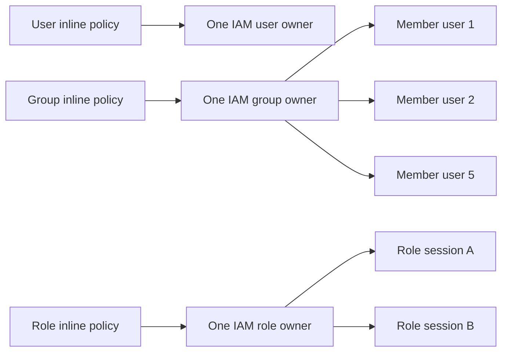
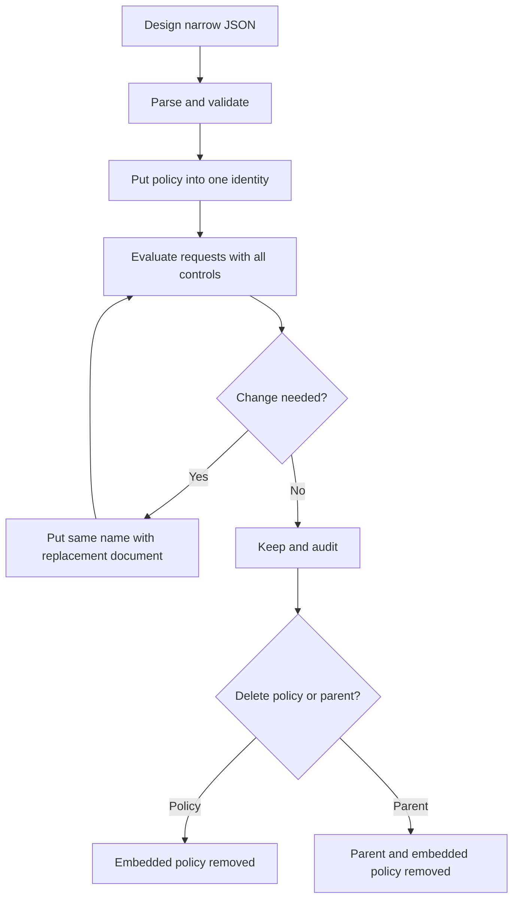

<div align="center">

# AWS IAM Inline Policies

**Identity-owned permission documents for deliberately coupled authorization**

[](https://docs.aws.amazon.com/IAM/latest/UserGuide/access_policies.html)


[](#official-references)

**One sentence to remember:** An IAM inline policy is a JSON permissions document embedded in exactly one IAM user, group, or role and deleted with that identity, although its permissions can affect group members or role sessions.

[IAM index](README.md) · [IAM overview](01-overview.md) · [Previous: customer managed policies](05-customer-managed-policies.md) · [Next: ReadOnlyAccess](07-read-only-access-policy.md)

</div>

> [!IMPORTANT]
> "Inline" describes storage and ownership, not priority, duration, security, or the number of people who can benefit. An inline allow still must survive every applicable authorization control.

---

## Table of contents

1. [What is an inline policy?](#what-is-an-inline-policy)
2. [What problem does it solve?](#what-problem-does-it-solve)
3. [Supported identities and one-to-one ownership](#supported-identities-and-one-to-one-ownership)
4. [IAM JSON and worked examples](#iam-json-and-worked-examples)
5. [Lifecycle, modification, and deletion](#lifecycle-modification-and-deletion)
6. [Use cases and selection guidance](#use-cases-and-selection-guidance)
7. [CCP essentials](#ccp-essentials)
8. [SAA architecture and effective permissions](#saa-architecture-and-effective-permissions)
9. [Policy and feature comparisons](#policy-and-feature-comparisons)
10. [Integration and infrastructure-as-code patterns](#integration-and-infrastructure-as-code-patterns)
11. [Least privilege and security risks](#least-privilege-and-security-risks)
12. [Auditing and troubleshooting](#auditing-and-troubleshooting)
13. [Pricing and operational considerations](#pricing-and-operational-considerations)
14. [Practical console and CLI lifecycle](#practical-console-and-cli-lifecycle)
15. [Exam traps and misconceptions](#exam-traps-and-misconceptions)
16. [Technical interview questions](#technical-interview-questions)
17. [Practice questions](#practice-questions)
18. [Architecture scenario drills](#architecture-scenario-drills)
19. [Decision framework and keyword recognition](#decision-framework-and-keyword-recognition)
20. [Quick-revision cheat sheet](#quick-revision-cheat-sheet)
21. [Official references](#official-references)
22. [Closing takeaway](#closing-takeaway)

---

<a id="what-is-an-inline-policy"></a>
## 1. What is an inline policy?

### Beginner definition

An **IAM inline policy** is a permissions document placed directly inside one IAM user, IAM group, or IAM role. It belongs to that identity instead of existing as a reusable policy object.

Think of a managed policy as a reusable permission template in a library. An inline policy is a permission note glued inside one identity's folder. If the folder is deleted, the note is deleted too.

The analogy has limits. A group folder can have many user members, and a role can create many sessions. The policy still has one owner even when multiple requesters receive its permissions through that owner.

### Precise technical definition

An inline identity policy is a named IAM JSON permissions document embedded in exactly one IAM user, group, or role. It has no independent managed-policy ARN, attachment list, default version, or saved IAM managed-policy versions. IAM evaluates it as an identity-based policy together with every other applicable control.

### At a glance

| Fact | Meaning |
|---|---|
| Owner | Exactly one IAM user, group, or role |
| Storage | Conceptually stored within that parent identity |
| Policy family | Identity-based permissions policy |
| Format | IAM JSON policy language |
| Reuse | Not the same standalone policy object across identities |
| ARN | No separate managed-policy ARN |
| Versions | No native IAM managed-policy version IDs or selectable default |
| Lifecycle | Deleted when the owning identity is deleted |
| Duration | Persistent until changed/deleted; not one-time or temporary |
| Authorization | Contributes allow/deny statements but has no special priority |

### What an inline policy is not

- It is not a principal, user, group, role, credential, or session.
- It is not automatically temporary or single-use.
- It is not independently attachable or detachable like a managed policy.
- It is not a permissions boundary; boundaries require managed policies.
- It is not a role trust policy and does not decide who can assume a role.
- It is not inherently least-privilege, privileged, safer, or less safe.

### Terminology nuance: two uses of “inline”

AWS documentation also describes **resource-based policies** as inline policies because their documents are attached directly to resources and there are no managed resource-based policies. In everyday IAM discussions, however, “IAM inline policy” usually means the identity-based policy embedded in one user, group, or role. This guide focuses on that identity-policy meaning and calls the other category **resource-based policy** to avoid ambiguity.

---

<a id="what-problem-does-it-solve"></a>
## 2. What problem does it solve?

Inline policies provide strict lifecycle coupling between a permission document and one IAM identity.

| Requirement | Inline-policy value | Trade-off |
|---|---|---|
| Policy must exist only with one role | Deleting the role deletes the policy | No independent reuse or retention |
| One identity has exceptional permissions | Exception is visible under that identity | Exceptions can become hard to inventory at scale |
| Policy and identity are one deployment unit | IaC can change them together | Native IAM rollback/version history is absent |
| Unique permission must not be accidentally shared | Same object cannot be attached elsewhere | Equivalent copies can still be created and drift |

Inline policies are an available design choice, not AWS's general default. AWS recommends managed policies in most cases because they are reusable, centrally changeable, and easier to manage consistently. A strict one-to-one requirement can justify inline storage; governance, automation, auditability, and rollback requirements may still favor a customer managed policy even for one identity.

### Two contrasting examples

**Twenty support employees:** one customer managed policy attached to a `SupportTeam` group is usually more maintainable than 20 independently copied user inline policies. A central update changes one policy object and an attachment inventory exposes its consumers.

**One specialized `BillingAuditRole`:** a narrow inline policy can be appropriate when its permissions are deliberately unique, deployed with the role, and must disappear with the role. A customer managed policy remains reasonable if the organization values independent review, native policy versions, reuse, or centralized discovery more than lifecycle coupling.

---

<a id="supported-identities-and-one-to-one-ownership"></a>
## 3. Supported identities and one-to-one ownership

### Supported parent identities

| Parent | Who receives the policy's permissions? | What ends the relationship? |
|---|---|---|
| IAM user | Requests made as that user, subject to all controls | Delete the inline policy or user |
| IAM group | Every current IAM user member inherits the group permissions | Remove member, delete policy, or delete group |
| IAM role | Sessions that assume the role use its identity permissions | Delete/change policy or role; session revocation is separate |

Service-linked roles are managed by their AWS service; IAM does not let customers embed inline policies in them.

### What one-to-one actually means



The **policy-to-parent-object relationship** is one-to-one. The permission audience is not necessarily one person:

- A `Developers` group inline policy belongs to one group, but all five current group members can receive its `ec2:DescribeInstances` allow.
- Removing one member removes that member's group-derived permission; it does not delete the group or its inline policy.
- A role inline policy belongs to one role, but many workloads or people can obtain role sessions if the trust and caller authorization paths allow assumption.
- A user inline policy belongs to one user and disappears when that user is deleted.

### Three required ownership examples

1. `ReportReader` user owns an inline `ReadReports` policy allowing `s3:GetObject`. Deleting only the policy removes that grant; deleting `ReportReader` also deletes the embedded policy.
2. `Developers` group owns `DescribeFleet`. Five users are members, so five users can inherit its allow. Removing Alice affects Alice, not the policy or the other four members.
3. `BillingAuditRole` owns `ReadBillingExports`. The policy does not authorize `sts:AssumeRole`; the role trust policy and caller authorization establish who can create sessions. Once assumed, the role's permissions help authorize requests.

---

<a id="iam-json-and-worked-examples"></a>
## 4. IAM JSON and worked examples

### Policy elements

| Element | Purpose | Important caution |
|---|---|---|
| `Version` | Policy-language semantics; normally `2012-10-17` | Not an IAM managed-policy version |
| `Statement` | One statement or an array | Required |
| `Sid` | Optional statement identifier | Helps review; grants nothing |
| `Effect` | `Allow` or `Deny` | Applicable explicit deny wins |
| `Action` / `NotAction` | API operations included/excluded | Scope depends on the rest of the statement |
| `Resource` / `NotResource` | Resources included/excluded | Action must support the ARN type |
| `Condition` | Request-context requirements | Key/operator/value must apply to the action |

An ordinary inline **identity permissions policy has no `Principal`**. The owning user, group, or role supplies the identity context. A role trust policy is resource-based and normally has `Principal`.

### Example 1: user-owned S3 object read

```json
{
  "Version": "2012-10-17",
  "Statement": [{
    "Sid": "ReadPublishedReports",
    "Effect": "Allow",
    "Action": "s3:GetObject",
    "Resource": "arn:aws:s3:::example-company-reports/published/*"
  }]
}
```

This could be embedded in one user. It does not allow bucket listing, writes, or KMS decryption for an SSE-KMS object.

### Example 2: group-owned EC2 visibility

```json
{
  "Version": "2012-10-17",
  "Statement": [{
    "Sid": "DescribeFleet",
    "Effect": "Allow",
    "Action": [
      "ec2:DescribeInstances",
      "ec2:DescribeInstanceStatus",
      "ec2:DescribeTags"
    ],
    "Resource": "*"
  }]
}
```

These EC2 describe actions require `Resource: "*"`; least privilege still narrows the action list. Every current member can inherit this group permission.

### Example 3: role-owned DynamoDB read

```json
{
  "Version": "2012-10-17",
  "Statement": [{
    "Sid": "ReadOrdersAndIndexes",
    "Effect": "Allow",
    "Action": ["dynamodb:GetItem", "dynamodb:Query"],
    "Resource": [
      "arn:aws:dynamodb:eu-central-1:111122223333:table/Orders",
      "arn:aws:dynamodb:eu-central-1:111122223333:table/Orders/index/*"
    ]
  }]
}
```

The table and index resources cover direct item reads and queries of that table's indexes; scans and writes remain ungranted.

### Example 4: S3 bucket listing plus object read

```json
{
  "Version": "2012-10-17",
  "Statement": [
    {
      "Sid": "ListPublishedPrefix",
      "Effect": "Allow",
      "Action": "s3:ListBucket",
      "Resource": "arn:aws:s3:::example-company-reports",
      "Condition": {
        "StringLike": {
          "s3:prefix": ["published", "published/*"]
        }
      }
    },
    {
      "Sid": "ReadPublishedObjects",
      "Effect": "Allow",
      "Action": "s3:GetObject",
      "Resource": "arn:aws:s3:::example-company-reports/published/*"
    }
  ]
}
```

Bucket actions and object actions require different ARN forms.

### Example 5: ABAC with matching project tags

```json
{
  "Version": "2012-10-17",
  "Statement": [{
    "Sid": "ManageMatchingProjectQueues",
    "Effect": "Allow",
    "Action": [
      "sqs:GetQueueAttributes",
      "sqs:ReceiveMessage",
      "sqs:SendMessage"
    ],
    "Resource": "arn:aws:sqs:eu-central-1:111122223333:*",
    "Condition": {
      "StringEquals": {
        "aws:ResourceTag/access-project": "${aws:PrincipalTag/access-project}"
      }
    }
  }]
}
```

This assumes trusted principal tags and supported SQS tag condition behavior. Govern who can change identity, session, and resource tags.

### Example 6: explicit deny for insecure S3 transport

```json
{
  "Version": "2012-10-17",
  "Statement": [{
    "Sid": "DenyInsecureTransport",
    "Effect": "Deny",
    "Action": "s3:*",
    "Resource": [
      "arn:aws:s3:::example-company-reports",
      "arn:aws:s3:::example-company-reports/*"
    ],
    "Condition": {
      "Bool": {
        "aws:SecureTransport": "false"
      }
    }
  }]
}
```

This deny grants nothing. A bucket policy is often the better enforcement point when the control must cover all access paths to the bucket.

### Five levels of correctness

1. JSON parses.
2. IAM policy grammar is valid for this policy type.
3. Actions support the chosen resource types and condition keys.
4. The intended live request succeeds with its real context and all controls.
5. Positive and negative tests show no broader access than intended.

Valid JSON proves only the first level.

---

<a id="lifecycle-modification-and-deletion"></a>
## 5. Lifecycle, modification, and deletion

### Native lifecycle



`PutUserPolicy`, `PutGroupPolicy`, and `PutRolePolicy` create or update a named inline policy. Updating the same name replaces its stored document; IAM does not create a managed-policy version, retain a selectable prior revision, or maintain a default-version pointer.

| Operation | Result | Important distinction |
|---|---|---|
| Put a new policy name | Creates another embedded document | Still belongs to the same parent |
| Put an existing name | Replaces that policy document | No native IAM version history |
| Delete inline policy | Removes that document | Parent identity remains |
| Delete parent identity | Deletes its embedded policies | No standalone policy survives |
| Remove user from group | User stops inheriting group grants | Group and policy remain |
| Delete role policy | Role loses that identity-policy contribution | Trust policy and other permissions may remain |

### IaC and source control are not IAM managed-policy versioning

Git history, CloudFormation change sets, Terraform state, deployment artifacts, or backups can preserve earlier definitions externally. They can enable controlled rollback, but IAM still stores the inline policy as its current embedded document. Do not describe external revision history as native IAM policy versions.

### Role sessions and deletion

A role inline policy is evaluated as part of the role's permissions; changes are subject to IAM propagation. Do not assume that deleting a role or merely removing its trust automatically performs targeted session revocation. AWS provides **Revoke active sessions**, which adds a conditional `AWSRevokeOlderSessions` inline deny policy based on `aws:TokenIssueTime`. For incident response, use the documented revocation procedure and account for propagation rather than relying on deletion folklore.

> [!WARNING]
> The revoke operation affects all applicable sessions issued before the cutoff, not one selected user. It is an emergency control and can interrupt workloads.

---

<a id="use-cases-and-selection-guidance"></a>
## 6. Use cases and selection guidance

### Good candidates

- A role has a deliberately unique policy that must be deleted with the role.
- A small, governed exception belongs to one identity and independent reuse is undesirable.
- An IaC component treats the parent identity and embedded policy as one lifecycle unit.
- AWS creates an operational inline policy for a documented mechanism, such as `AWSRevokeOlderSessions` during role-session revocation.

### Prefer a managed policy when

- multiple identities need the same permissions;
- the organization needs a central attachment inventory or reusable standard;
- native saved versions and default-version rollback matter;
- permission ownership must remain independent of an identity;
- policy changes need a deliberate shared rollout.

### Design trade-offs

| Design | Strength | Risk or cost |
|---|---|---|
| Inline on one specialized role | Strong ownership/lifecycle coupling | No native saved versions; hidden in role inventory |
| Customer managed policy on one role | Independent review and rollback | Separate resource can outlive role |
| Customer managed policy on many roles | Reuse and central consistency | Shared change has larger blast radius |
| Group inline policy | One group-owned definition for members | Still less reusable/discoverable than managed policy |
| User inline exception | Directly attributable exception | User-specific access and long-term credentials are often poor workforce design |

The right question is not “Is unique always inline?” It is “Does strict ownership coupling outweigh independent governance, reuse, discovery, and rollback?”

---

<a id="ccp-essentials"></a>
## 7. CCP essentials


For Cloud Practitioner preparation, know these points:

- IAM controls authentication and authorization; a policy is an authorization document.
- Inline policies can be embedded in IAM users, groups, and roles.
- They maintain a strict one-to-one relationship with the owning identity.
- A group inline policy can still give permissions to all group members.
- A role inline policy does not create temporary credentials; STS role assumption does.
- Deleting the parent identity deletes the embedded policy.
- Managed policies are standalone and reusable; inline policies are not.
- The same IAM JSON language expresses permissions.
- An applicable explicit deny overrides an allow.
- IAM and STS have no additional charge, though actions on other services can incur charges.

**CCP recognition clue:** “permission belongs only to this identity and should disappear with it” points toward an inline policy. “Reusable across identities” points toward a managed policy.

---

<a id="saa-architecture-and-effective-permissions"></a>
## 8. SAA architecture and effective permissions


### Where the inline policy fits

For an IAM user or role, identity-based allows from inline and managed policies combine. That union is then constrained by applicable boundaries, session policies, SCPs, RCPs, endpoint policies, resource/key policies, request conditions, and explicit denies. The exact evaluation varies by principal type, account relationship, and resource-policy `Principal`.

```text
identity-based allows (inline + managed + group-derived where applicable)
        constrained by boundary, session policy, SCP, RCP, and endpoint controls
        combined with applicable resource-based authorization
        overridden by any applicable explicit deny
        plus service-specific and cross-account requirements
= final request decision
```

This shorthand is intentionally not a universal algebraic formula. Resource-policy grants to a same-account IAM user ARN or role-session ARN have important boundary/session nuances, while grants to a role ARN are limited differently. Always identify the exact principal and use the official evaluation logic.

### Worked authorization cases

| Case | Inline statement | Other control | Result |
|---|---|---|---|
| User can read report | Allows `s3:GetObject` | No applicable deny; bucket permits account path | Allowed |
| User boundary omits S3 | Allows `s3:GetObject` | User permissions boundary does not allow it | Denied on identity-policy path |
| Role session narrowed | Role policy allows `s3:*` | Session policy allows only `GetObject` | Session is limited to intersection |
| Member-account guardrail | Allows EC2 termination | SCP explicitly denies termination | Denied |
| Protected resource | Allows S3 read | Bucket policy explicitly denies insecure transport | Denied over HTTP |
| Cross-account bucket | Caller inline policy allows read | Target bucket gives no cross-account grant | Denied; caller-side allow is only half |
| SSE-KMS object | Allows S3 read | KMS authorization does not enable decrypt | Object retrieval/decryption fails |

### Role permissions policy versus trust policy

| Question | Inline role permissions policy | Role trust policy |
|---|---|---|
| What does it answer? | What may a role session do? | Who/what may assume the role, under which conditions? |
| Policy type | Identity-based | Resource-based policy on the role |
| `Principal` | Normally absent | Normally required |
| Typical action | `s3:GetObject` | `sts:AssumeRole` or federated equivalent |
| Sufficient alone? | No; role must also be assumable | No; session still needs workload permissions |

### Cross-account reasoning

An inline policy cannot be attached across accounts. For direct cross-account resource access, the caller generally needs identity-side authorization and the target resource needs a resource-based grant, unless an AWS mechanism such as assuming a target-account role changes the principal path. KMS keys add their own authorization model. SCPs and RCPs are guardrails, not grants.

---

<a id="policy-and-feature-comparisons"></a>
## 9. Policy and feature comparisons

### Inline versus customer managed versus AWS managed

| Dimension | Inline identity policy | Customer managed policy | AWS managed policy |
|---|---|---|---|
| Owner/editor | Customer; embedded in one identity | Customer account | AWS |
| Standalone ARN | No | Yes | Yes |
| Reusable attachment | No | Yes, in owning account | Yes |
| Native saved versions | No | Yes; customer selects default | Yes; AWS controls versions/default |
| Deleted with identity | Yes | No | No |
| Central update | Only one parent | Every attachment uses default version | AWS changes every attachment |
| Boundary use | No | Yes | Yes where appropriate |
| Best clue | Strict identity coupling | Reusable custom standard | AWS-maintained baseline |

### Inline policy compared with other mechanisms

| Mechanism | Location/owner | Grants or limits? | Preferred scenario | Critical caveat |
|---|---|---|---|---|
| User inline policy | One IAM user | Can grant/deny | Deliberate user-specific exception | Prefer federation/roles for workforce access |
| Group inline policy | One IAM group | Can grant/deny to members | Group-coupled rule | One owner can affect many members |
| Role inline policy | One IAM role | Can grant/deny to role sessions | Unique workload/job rule | Does not establish role trust |
| Customer managed policy | Standalone account resource | Can grant/deny; can be boundary | Reusable custom access | Shared update blast radius |
| AWS managed policy | Standalone AWS resource | Can grant/deny; can be boundary | Reviewed AWS baseline | AWS controls content changes |
| Role trust policy | IAM role resource | Enables/denies assumption | Define trusted principals | Not workload permissions |
| Resource-based policy | Supported resource | Can grant/deny principals | Resource ownership/cross-account | Service-specific semantics |
| Permissions boundary | User/role; managed policy | Limits maximum | Delegated administration | Does not grant permission |
| Session policy | Passed when session created | Narrows session | Just-in-time session limit | Cannot expand role/user grants |
| SCP | Organization root/OU/account | Principal guardrail | Limit member-account principals | Does not grant; management account excluded |
| RCP | Organization root/OU/account | Resource guardrail | Limit supported member resources | Does not grant; supported services vary |
| VPC endpoint policy | VPC endpoint | Endpoint-path control | Restrict traffic through endpoint | Does not replace identity/resource policies |
| Identity Center permission set | Identity Center assignment model | Provisions account role access | Workforce multi-account access | Not an IAM group or inline policy |
| ACL | Supported resource/subresource | Service-specific grant/control | Legacy or specialized resource access | Prefer policy-based control when appropriate |
| Service control feature | Service-specific | Varies | Service-native guardrail | Must understand that service's evaluation |

Complementary mechanisms are often used together. For example, a role can have an inline permission, a boundary, a session policy, an SCP, and a bucket policy in the same request path.

---

<a id="integration-and-infrastructure-as-code-patterns"></a>
## 10. Integration and infrastructure-as-code patterns

### CloudFormation choices

| Resource/property | Use |
|---|---|
| `Policies` on `AWS::IAM::User`, `Group`, or `Role` | Embed policy definitions with the parent |
| `AWS::IAM::UserPolicy` | Separate template resource for one user's inline policy |
| `AWS::IAM::GroupPolicy` | Separate template resource for one group's inline policy |
| `AWS::IAM::RolePolicy` | Separate template resource for one role's inline policy |
| `AWS::IAM::Policy` | Embed one inline document in named users/groups/roles |
| `AWS::IAM::ManagedPolicy` | Create a standalone reusable managed policy |

`AWS::IAM::Policy` can target multiple identities in one template, but it still creates embedded inline relationships; it does not turn the document into a reusable IAM managed-policy object. Model dependencies carefully so CloudFormation does not remove a role before resources that still reference it.

### Example 7: CloudFormation role with embedded inline policy

```json
{
  "BillingAuditRole": {
    "Type": "AWS::IAM::Role",
    "Properties": {
      "AssumeRolePolicyDocument": {
        "Version": "2012-10-17",
        "Statement": [{
          "Effect": "Allow",
          "Principal": {"Service": "lambda.amazonaws.com"},
          "Action": "sts:AssumeRole"
        }]
      },
      "Policies": [{
        "PolicyName": "ReadBillingExports",
        "PolicyDocument": {
          "Version": "2012-10-17",
          "Statement": [{
            "Effect": "Allow",
            "Action": "s3:GetObject",
            "Resource": "arn:aws:s3:::example-billing-exports/*"
          }]
        }
      }]
    }
  }
}
```

The trust document and permission document are separate even though both are inside the role resource definition.

### IaC operating pattern

1. Define identity, trust, and permissions separately in review.
2. Validate JSON and service semantics before deployment.
3. Use a change set/plan and inspect replacement/deletion behavior.
4. Keep source-controlled revisions and approval evidence.
5. Deploy to a test account, run positive and negative authorization tests, then promote.
6. Detect out-of-band edits and reconcile drift.

---

<a id="least-privilege-and-security-risks"></a>
## 11. Least privilege and security risks

Inline is neither a security control nor a security flaw by itself. Quality depends on the document, owner, management paths, and surrounding guardrails.

### Least-privilege checklist

- Start from required tasks, not broad service access.
- Use exact actions and supported resource ARNs.
- Add supported conditions with real request-context values.
- Separate bucket/object, table/index, and other distinct resource types.
- Protect tag mutation when ABAC depends on tags.
- Test allowed and deliberately forbidden requests.
- Review last-accessed and CloudTrail evidence, then refine.
- Remove stale exceptions and record their owners/expiry review.

### Privilege-escalation paths

Permissions such as `iam:PutUserPolicy`, `iam:PutGroupPolicy`, and `iam:PutRolePolicy` can add powerful permissions to identities. `iam:PassRole`, trust-policy modification, boundary removal, policy attachment, credential creation, and tag mutation can also create escalation paths. Scope IAM administration by resource and condition where supported, require boundaries for delegated role creation, and ensure delegates cannot change or escape their guardrails.

> [!CAUTION]
> An operator allowed to put an arbitrary inline policy onto a role they can assume may grant themselves the role's maximum available permissions. Review the complete escalation chain, not only the current inline document.

### Why extensive inline use becomes risky

- Policies are distributed across identities, making inventory harder.
- Equivalent copied documents drift.
- No native managed-policy rollback exists.
- Identity deletion destroys the embedded document unless externally retained.
- User-specific exceptions can outlive business justification.
- Reviewers can miss group-derived or role-session impact.

---

<a id="auditing-and-troubleshooting"></a>
## 12. Auditing and troubleshooting

### Inventory commands by parent

| Task | User | Group | Role |
|---|---|---|---|
| List policy names | `list-user-policies` | `list-group-policies` | `list-role-policies` |
| Get document | `get-user-policy` | `get-group-policy` | `get-role-policy` |
| Put document | `put-user-policy` | `put-group-policy` | `put-role-policy` |
| Delete document | `delete-user-policy` | `delete-group-policy` | `delete-role-policy` |

Unlike a managed policy, there is no single inline-policy ARN to query for all attachments. Inventory starts from users, groups, and roles, then lists and retrieves each embedded document.

### AccessDenied workflow

| Check | Question | Common finding |
|---|---|---|
| Caller | Which principal/session actually signed the request? | Wrong profile or assumed role |
| Request | What exact action, resource, Region, and context were used? | Wrong ARN or missing tag/key |
| Identity grants | Do direct, group, inline, and managed policies allow it? | Missing dependency action |
| Limits | Do boundary/session/SCP/RCP/endpoint controls permit it? | Maximum omits or denies action |
| Resource path | Does resource/key policy enable or deny the principal? | Missing cross-account or KMS grant |
| Conditions | Are values present and operators correct? | MFA, source IP/VPC, tag mismatch |
| Timing | Has an IAM change propagated? | Eventual-consistency delay |
| Evidence | What do CloudTrail/error context and simulation show? | Actual principal differs from assumption |

IAM Access Analyzer policy validation can find syntax, security, error, and best-practice findings. The IAM Policy Simulator can model many policy types but does not reproduce every live service behavior and does not currently simulate RCPs. Neither is proof that the production request works.

CloudTrail records IAM API activity such as policy changes when logging coverage is configured. Monitor `Put*Policy`, `Delete*Policy`, role/trust changes, session revocation, boundary changes, and related escalation operations. Preserve event history outside the identity lifecycle.

### Deletion troubleshooting

Deleting one inline policy does **not** prove all access is gone. The identity may retain managed policies, other inline policies, group-derived policies, resource-based grants, or active session paths. Conversely, deleting a group policy can affect every member, and deleting a role policy can affect workloads using that role after propagation.

---

<a id="pricing-and-operational-considerations"></a>
## 13. Pricing and operational considerations

- IAM and AWS STS are offered at no additional charge.
- Requests authorized by a policy can incur charges in the services they use.
- Policy counts and sizes are subject to IAM quotas; check the current official quota page rather than memorizing changeable values.
- Distributed discovery, review, drift correction, and incident response create operational cost even without an IAM line-item charge.
- Inline policy changes are eventually consistent. Do not hard-code an unsupported propagation duration; use safe deployment sequencing and bounded retries.
- Global IAM identity configuration can authorize Regional service resources. Keep Regions and ARN partitions correct in policy documents.

### Operational ownership

Every inline policy should have a documented parent owner, business purpose, reviewer, source-of-truth location, test evidence, and review/retirement trigger. Lifecycle coupling reduces orphaned policy objects but does not remove governance work.

---

<a id="practical-console-and-cli-lifecycle"></a>
## 14. Practical console and CLI lifecycle

### Console workflow

1. Open the intended IAM user, user group, or role.
2. Choose **Add permissions** and **Create inline policy**.
3. Build or paste the policy and inspect the summary.
4. Validate actions, resources, conditions, and intended owner.
5. Name and create the embedded policy.
6. Test the complete authorization path and monitor changes.

### Safe CLI example for a role

Store the reviewed JSON in `read-billing-exports.json`, then run:

```powershell
aws iam put-role-policy `
  --role-name BillingAuditRole `
  --policy-name ReadBillingExports `
  --policy-document file://read-billing-exports.json

aws iam list-role-policies --role-name BillingAuditRole

aws iam get-role-policy `
  --role-name BillingAuditRole `
  --policy-name ReadBillingExports
```

After impact review, removal is explicit:

```powershell
aws iam delete-role-policy `
  --role-name BillingAuditRole `
  --policy-name ReadBillingExports
```

Use equivalent `user` or `group` command families for those parents. `Put*Policy` means create-or-replace by policy name; it is not an attach operation. `Get*Policy` responses may return a URL-encoded policy document depending on the interface/SDK handling.

### Change procedure

1. Retrieve and preserve the current document externally.
2. Diff the proposed policy and review affected parent/members/sessions.
3. Parse and validate the candidate.
4. Test service semantics and negative cases.
5. Put the reviewed document.
6. Confirm CloudTrail evidence and live behavior after propagation.
7. Roll back from the approved external revision if necessary.

---

<a id="exam-traps-and-misconceptions"></a>
## 15. Exam traps and misconceptions

| # | Incorrect assumption | Correct explanation and technical reason | Level |
|---:|---|---|---|
| 1 | Inline policies belong only to users. | Users, groups, and roles support them; service-linked roles are customer-editing exceptions. | Both |
| 2 | Groups cannot have inline policies. | A group can own one, and every current member can inherit its permissions. | Both |
| 3 | Roles cannot have inline policies. | Roles support embedded permissions policies separate from their trust policies. | Both |
| 4 | Inline means used once. | It remains until updated, deleted, or its parent is deleted. | CCP |
| 5 | Inline means temporary. | Storage is identity-coupled; temporary credentials come from STS/session mechanisms. | Both |
| 6 | One inline policy can be attached to many identities. | It is embedded in one parent; equivalent copies are distinct policies. | Both |
| 7 | It is a standalone managed policy. | It has no independent managed-policy object or attachment list. | Both |
| 8 | It has a separate policy ARN. | It is addressed by parent identity and policy name, not a standalone managed-policy ARN. | SAA |
| 9 | It supports `v1`, `v2`, and other IAM policy versions. | `Put*Policy` replaces the current document; external history is not native versioning. | SAA |
| 10 | It has a selectable default version. | Only managed policies have default saved versions. | SAA |
| 11 | Inline is always more secure. | Security depends on permissions, controls, management rights, and governance. | Both |
| 12 | Inline is always less secure. | A narrow, governed, deliberately coupled policy can be appropriate. | Both |
| 13 | Every unique permission should be inline. | Managed policy governance/versioning can outweigh coupling even for one consumer. | SAA |
| 14 | Inline policies are never appropriate. | Strict one-to-one lifecycle is an explicit supported use case. | Both |
| 15 | One-to-one means one person can benefit. | It means one parent owner; group members and role sessions can be numerous. | Both |
| 16 | A group inline policy affects only the group object. | Group permissions contribute to every current member's identity authorization. | Both |
| 17 | Removing Alice deletes the group's inline policy. | It only removes Alice's membership-derived permission; group/policy remain. | Both |
| 18 | Deleting the identity preserves the policy for reuse. | The embedded policy is deleted with its parent. | Both |
| 19 | Inline policies grant administrator access by default. | They grant only matching `Allow` statements and may contain only denies. | CCP |
| 20 | An inline allow overrides explicit deny. | Any applicable explicit deny wins. Policy storage gives no priority. | Both |
| 21 | Inline policies outrank managed policies. | Identity-policy statements are evaluated together; no inline precedence exists. | SAA |
| 22 | Inline policies bypass permissions boundaries. | A boundary constrains identity-policy grants for its user/role path. | SAA |
| 23 | They bypass SCPs, RCPs, or session policies. | Applicable guardrails and session limits still constrain authorization. | SAA |
| 24 | A role inline policy decides who assumes the role. | The trust policy and caller-side authority govern assumption; permissions govern session actions. | Both |
| 25 | An inline identity policy needs `Principal`. | Its owner is implicit; `Principal` belongs in supported resource-based policies/trust. | SAA |
| 26 | Valid JSON guarantees access. | IAM grammar, service support, request context, and all other policies still matter. | Both |
| 27 | Inline policies are automatically shared across accounts. | They are embedded in account-local IAM identities; cross-account access needs an authorization design. | SAA |
| 28 | Inline automatically means least privilege. | Wildcards can make it excessive; least privilege requires design and testing. | Both |
| 29 | A role inline policy can expand a restrictive session policy. | Session permissions are limited by the intersection with role identity permissions. | SAA |
| 30 | Deleting one inline policy removes all identity access. | Other direct, group, managed, resource-policy, or session paths can remain. | Both |

These are original study traps, not claims about exact AWS exam questions.

---

<a id="technical-interview-questions"></a>
## 16. Technical interview questions

1. **What is an IAM inline policy?** A named IAM JSON permissions document embedded in one user, group, or role and deleted with that identity. It is identity-based and not a standalone managed policy.
2. **What does one-to-one mean?** One policy object has one parent identity. It does not mean one human: a group can have many members and a role many sessions.
3. **Can groups have inline policies?** Yes. Current group members inherit their permissions; removing a member does not delete the group policy.
4. **Can inline policies be reused?** Not as the same object. You can copy JSON, but each embedded copy has independent ownership and drift risk.
5. **What happens when the parent is deleted?** The policy is deleted too. Preserve source/revision evidence externally if recovery or audit history matters.
6. **How does inline differ from customer managed?** Inline is identity-coupled with no ARN/native versions; customer managed is standalone, reusable, ARN-addressable, and versioned.
7. **Can an inline policy override an explicit deny?** No. An applicable explicit deny overrides its allow.
8. **How does a role inline policy differ from its trust policy?** The inline identity policy governs what sessions may do; the resource-based trust policy governs who can assume the role.
9. **Why avoid extensive inline-policy use?** Distributed discovery, copied drift, missing native rollback, and hidden group/session blast radius increase operations cost.
10. **How do you troubleshoot an inline allow with AccessDenied?** Confirm actual caller/action/resource/context, then inspect boundaries, sessions, SCPs/RCPs, resource/key/endpoint policies, conditions, cross-account requirements, and propagation.
11. **When would you recommend inline?** When one identity deliberately owns a unique permission and lifecycle coupling is more valuable than reuse, central discovery, and native version rollback.
12. **How do you revoke existing role sessions?** Use AWS's documented revoke-sessions mechanism, which adds a time-conditioned inline deny; do not assume a normal policy/trust deletion is equivalent.

---

<a id="practice-questions"></a>
## 17. Practice questions

These are original educational questions, not official exam items.

<details>
<summary>Q1 · CCP · Which identities support inline policies?</summary>

- A. Users only
- B. Users and groups only
- C. Users, groups, and roles
- D. AWS accounts only

**Answer: C.** IAM users, groups, and roles support inline policies. A/B omit valid parents; D is not an inline-policy parent. Service-linked roles cannot be customer-edited this way.
</details>

<details>
<summary>Q2 · CCP · What does “embedded” mean?</summary>

**Answer:** The document is stored as part of one parent IAM identity rather than as an independently attachable managed-policy resource. It is still evaluated with other policies.
</details>

<details>
<summary>Q3 · CCP · Does inline mean temporary or one-time?</summary>

**Answer: No.** It persists until replaced/deleted or the parent is deleted. STS credentials and sessions supply temporary access, not the inline storage model.
</details>

<details>
<summary>Q4 · CCP · Five users join a group with one inline policy. Who can inherit it?</summary>

**Answer:** All five current members. One-to-one describes ownership by one group, not a one-person audience; other authorization controls still apply.
</details>

<details>
<summary>Q5 · CCP · Alice leaves the group. Is the group policy deleted?</summary>

**Answer: No.** Alice stops receiving group-derived permissions, but the group and its policy continue for remaining members. Deleting the group deletes its inline policy.
</details>

<details>
<summary>Q6 · CCP · What happens to a user inline policy when its user is deleted?</summary>

**Answer:** It is deleted with the user. It does not become a standalone managed policy or remain attachable.
</details>

<details>
<summary>Q7 · CCP · Twenty employees need identical permissions. Best default choice?</summary>

- A. Twenty copied user inline policies
- B. One reviewed managed policy attached to a group
- C. Twenty access keys
- D. A role trust policy

**Answer: B.** Reuse and central change favor the managed policy. A creates drift, C is credentials not authorization design, and D controls role assumption.
</details>

<details>
<summary>Q8 · CCP · Does an inline policy have a separate managed-policy ARN?</summary>

**Answer: No.** Retrieve it by parent identity and policy name. Managed policies are the standalone ARN-addressable resources.
</details>

<details>
<summary>Q9 · CCP · Can an inline policy contain an explicit Deny?</summary>

**Answer: Yes.** It supports normal IAM permission statements. A deny grants nothing and overrides matching allows when applicable.
</details>

<details>
<summary>Q10 · CCP · Is IAM charged per inline policy?</summary>

**Answer: No additional IAM charge.** Authorized use of other AWS services can incur their normal charges, and governance still has operational cost.
</details>

<details>
<summary>Q11 · SAA · What does `PutRolePolicy` do for an existing name?</summary>

**Answer:** It replaces/updates that embedded document. It does not create a saved managed-policy version or attach a standalone policy.
</details>

<details>
<summary>Q12 · SAA · Is `"Version": "2012-10-17"` an inline-policy revision?</summary>

**Answer: No.** It selects policy-language semantics. Inline policies have no IAM `v1`/`v2` saved-version system.
</details>

<details>
<summary>Q13 · SAA · Role inline policy allows S3, but its boundary omits S3. Result?</summary>

**Answer:** Denied through the ordinary role identity-policy path. A boundary is a maximum, not a grant; exact resource-policy principal nuances must still be considered.
</details>

<details>
<summary>Q14 · SAA · Role policy allows `s3:*`; session policy allows only `GetObject`. Effective session scope?</summary>

**Answer:** At most `s3:GetObject` within both documents' matching scope. A session policy narrows and cannot expand the role's identity permissions.
</details>

<details>
<summary>Q15 · SAA · Inline allow conflicts with an SCP deny. Which wins?</summary>

**Answer:** The applicable explicit SCP deny. Adding more identity allows cannot override an organization guardrail.
</details>

<details>
<summary>Q16 · SAA · Why should an ordinary role inline policy omit `Principal`?</summary>

**Answer:** The owning role supplies identity context. `Principal` belongs in the role's resource-based trust policy, which answers who may assume it.
</details>

<details>
<summary>Q17 · SAA · Role has workload permissions but `AssumeRole` fails. Where do you look?</summary>

**Answer:** Inspect its trust policy, caller-side authorization, conditions, organization controls, and request context. Workload permissions do not establish trust.
</details>

<details>
<summary>Q18 · SAA · Caller policy allows a cross-account bucket read; target bucket is silent. Result?</summary>

**Answer:** Normally denied for direct cross-account access because the target side must also authorize the external principal. A target-account role is an alternative design.
</details>

<details>
<summary>Q19 · SAA · S3 `GetObject` is allowed but SSE-KMS read fails. Why?</summary>

**Answer:** KMS authorization is separate. The principal needs an enabling KMS key-policy/IAM path and matching encryption context in addition to S3 permission.
</details>

<details>
<summary>Q20 · SAA · Why are bucket and object ARNs separate in the example?</summary>

**Answer:** `ListBucket` targets the bucket while `GetObject` targets objects. Using an unsupported resource type prevents the statement from matching as intended.
</details>

<details>
<summary>Q21 · SAA · Can an inline policy serve as a permissions boundary?</summary>

**Answer: No.** A boundary is a managed policy assigned to a user or role. It limits identity-policy grants and grants nothing itself.
</details>

<details>
<summary>Q22 · SAA · Team needs native IAM rollback among saved revisions. Inline or managed?</summary>

**Answer:** Customer managed policy. It supports saved versions and a selected default; inline rollback requires an external retained definition and another put operation.
</details>

<details>
<summary>Q23 · SAA · Does deleting one role inline policy guarantee no remaining access?</summary>

**Answer: No.** Other inline/managed policies, resource grants, session paths, or different principals can still authorize requests. Audit the complete path.
</details>

<details>
<summary>Q24 · SAA · Why is `iam:PutRolePolicy` security-sensitive?</summary>

**Answer:** It can embed powerful permissions in a role. Combined with assumption or pass-role capabilities, it can create escalation; scope and guard administration carefully.
</details>

<details>
<summary>Q25 · SAA · Policy Simulator says allow but production denies. Next step?</summary>

**Answer:** Inspect real principal/context and live resource, KMS, endpoint, organization, and cross-account controls. Simulation is useful but does not reproduce every production factor or RCP.
</details>

<details>
<summary>Q26 · SAA · What does `AWS::IAM::Policy` create?</summary>

**Answer:** Inline policy relationships for specified users/groups/roles, even if one template resource names several parents. It is not `AWS::IAM::ManagedPolicy`.
</details>

<details>
<summary>Q27 · SAA · Is copying identical inline JSON to ten roles reuse?</summary>

**Answer:** It reuses text, not one IAM policy object. Ten independent copies can drift; use a managed policy when one shared contract is intended.
</details>

<details>
<summary>Q28 · SAA · When can a one-role inline policy be reasonable?</summary>

**Answer:** When the permission is deliberately unique and lifecycle-coupled, with external source control, testing, inventory, and review. Managed can still be preferable for governance/versioning.
</details>

<details>
<summary>Q29 · SAA · How does AWS revoke older role sessions?</summary>

**Answer:** The documented console operation adds an `AWSRevokeOlderSessions` inline deny conditioned on `aws:TokenIssueTime`. It can affect all older sessions, so assess workload impact.
</details>

<details>
<summary>Q30 · SAA · What evidence should an inline-policy audit collect?</summary>

**Answer:** Parent identity, policy name/document, group members or role consumers, other controls, source owner, CloudTrail changes, tests, last-used evidence, and business justification. One document alone is not effective permissions.
</details>

---

<a id="architecture-scenario-drills"></a>
## 18. Architecture scenario drills

| # | Requirement | Recommended IAM mechanism | Reason | Important caveat |
|---:|---|---|---|---|
| 1 | One role needs tightly coupled custom permission | Narrow role inline policy, if governance supports it | One role owns and deletes the document | Managed policy may be better for versions/audit |
| 2 | Many roles need identical permissions | Customer managed policy | One reusable, centrally reviewed object | Shared update blast radius |
| 3 | Group needs permissions for members | Managed policy attached to group by default; inline if deliberately group-coupled | Members inherit group grants | Group policy is still one owner with many beneficiaries |
| 4 | User needs one specific extra permission | Prefer role/group/managed design; narrow user inline exception only if justified | Makes exception explicit | Review direct user access and lifecycle |
| 5 | Application needs temporary credentials | IAM role plus STS/service integration | Role session produces temporary credentials | Inline policy can define role permissions but creates no credentials |
| 6 | Company wants centrally reusable policy | Customer managed policy | Independent ARN, attachments, versions | Account-local; deploy copies across accounts |
| 7 | IAM grants need a maximum | Managed policy as permissions boundary | Caps user/role identity grants | Boundary does not grant and cannot be inline |
| 8 | Prohibit service throughout an OU | SCP | Central principal guardrail for member accounts | Does not grant access; exceptions/design need care |
| 9 | Resource grants cross-account access | Resource-based policy plus caller-side authorization | Target resource names external principal | KMS/service semantics and both accounts matter |
| 10 | Auditor needs effective permissions | Inventory/simulator/Access Analyzer/CloudTrail plus full control review | No single policy is the final decision | Simulator has limitations, including no RCP simulation |
| 11 | Team wants native managed-policy rollback | Customer managed policy versions | Retained version can become default | Inline requires external revision and replacement |
| 12 | Role cannot be assumed despite inline permission | Fix trust/caller authorization path | Inline workload policy does not establish assumption | Conditions, SCPs, principal ARN, and context can block |

---

<a id="decision-framework-and-keyword-recognition"></a>
## 19. Decision framework and keyword recognition

| Requirement | Recommended mechanism | Why | Important caveat |
|---|---|---|---|
| Permission must be owned/deleted by exactly one identity | Inline policy | Strict lifecycle coupling | One owner can affect many members/sessions |
| Same custom permission is needed repeatedly | Customer managed policy | Reuse and central lifecycle | Default change affects every attachment |
| AWS maintains an acceptable baseline | AWS managed policy | AWS operates the policy | Review breadth and AWS changes |
| User/role needs a maximum | Managed policy as boundary | Limits identity-policy grants | Grants nothing |
| Role needs trusted principals | Role trust policy | Governs assumption | Separate from workload permissions |
| Resource must name a principal | Supported resource-based policy | Resource-side authorization | Cross-account often needs caller-side allow too |
| Session needs narrower access | Session policy | Intersects with identity permissions | Cannot expand them |
| OU needs a guardrail on principals | SCP | Central organization maximum | Does not grant |
| OU needs a guardrail on supported resources | RCP | Central resource maximum | Does not grant; service coverage varies |
| Need native saved-policy rollback | Customer managed policy | Version/default system | Inline has no native versions |

```text
Need to express permissions?
├─ Reusable custom definition? → customer managed policy
├─ AWS-maintained baseline? → AWS managed policy
├─ Deliberately owned by one user/group/role? → consider inline policy
├─ Maximum for a user/role? → managed policy as permissions boundary
├─ Who may assume a role? → role trust policy
├─ Which principal may access a resource? → supported resource-based policy
└─ Organization-wide maximum? → SCP or RCP

Considering inline?
├─ Confirm strict lifecycle coupling is intentional
├─ Identify all group members or role-session consumers
├─ Keep external revision and rollback evidence
├─ Validate actions, resources, conditions, and escalation paths
└─ Audit the complete authorization path
```

### Keyword bank

`embedded` · `one parent identity` · `strict one-to-one relationship` · `user, group, or role` · `not reusable` · `no standalone ARN` · `no managed-policy versions` · `deleted with parent` · `group members` · `role sessions` · `PutRolePolicy` · `trust policy is separate` · `explicit deny wins` · `lifecycle coupling`

---

<a id="quick-revision-cheat-sheet"></a>
## 20. Quick-revision cheat sheet

```text
IAM inline identity policy = JSON embedded in one user, group, or role.

Ownership:
- one policy → one parent identity
- group policy → can affect all current members
- role policy → can affect role sessions

Lifecycle:
- put same name → replace current document
- delete policy → parent remains
- delete parent → embedded policy is deleted
- remove group member → group/policy remain

Not included:
- no standalone managed-policy ARN
- no attach/detach reuse
- no v1/v2 saved managed-policy versions
- no selectable default version
- no temporary credentials
- no automatic trust, admin access, or least privilege

Policy language:
- Version 2012-10-17 = language semantics, not revision
- ordinary identity permissions policy has no Principal
- role trust policy is separate and governs assumption

Authorization:
- inline and managed identity allows combine
- applicable boundaries, sessions, SCPs, RCPs, endpoint/resource/key
  policies, conditions, and cross-account rules still matter
- applicable explicit deny wins

Choose inline when strict one-identity lifecycle coupling is valuable.
Choose managed when reuse, central inventory, or native version rollback matters.

CLI families:
put/list/get/delete-user-policy
put/list/get/delete-group-policy
put/list/get/delete-role-policy
```

### Top misconceptions

1. One-to-one means one owner, not one human beneficiary.
2. Inline means embedded, not temporary or one-time.
3. Inline has no higher priority than managed policies.
4. Role permissions and role trust answer different questions.
5. Valid JSON and an `Allow` do not prove final access.

**One-sentence exam answer:** An IAM inline policy is a non-reusable JSON permissions document embedded in one user, group, or role and deleted with that identity, while remaining subject to complete AWS authorization evaluation.

**Memory trick:** **Inline lives inside one identity; delete the identity, delete the policy.**

### Preserved and corrected source material

The upgrade preserved the source's glued-note analogy, “inline is not one-time” correction, user/group/role support, deletion coupling, `BillingAuditRole` example, policy comparisons, use cases, exam keywords, short answers, and memory aid.

It corrected the incomplete one-to-one explanation by separating owner from beneficiaries; added real JSON, native replacement semantics, no-ARN/no-version behavior, complete evaluation, trust/boundary/session/SCP/RCP distinctions, cross-account reasoning, IaC, CLI, audit, troubleshooting, security administration, assessment, and official references. Repeated source passages were consolidated without removing distinct useful facts.

---

<a id="official-references"></a>
## 21. Official references

Reviewed against official AWS documentation on **2026-11-05**.

### Inline policies, ownership, and management

- [Policies and permissions in IAM](https://docs.aws.amazon.com/IAM/latest/UserGuide/access_policies.html)
- [Choose between managed policies and inline policies](https://docs.aws.amazon.com/IAM/latest/UserGuide/access_policies-choosing-managed-or-inline.html)
- [Adding and removing IAM identity permissions](https://docs.aws.amazon.com/IAM/latest/UserGuide/access_policies_manage-attach-detach.html)
- [Create IAM policies with the AWS CLI](https://docs.aws.amazon.com/IAM/latest/UserGuide/access_policies_create-cli.html)
- [Update permissions for a role](https://docs.aws.amazon.com/IAM/latest/UserGuide/id_roles_update-role-permissions.html)
- [AWS CLI IAM command reference](https://docs.aws.amazon.com/cli/latest/reference/iam/)

### Policy language and authorization

- [IAM JSON policy element reference](https://docs.aws.amazon.com/IAM/latest/UserGuide/reference_policies_elements.html)
- [Policy evaluation logic](https://docs.aws.amazon.com/IAM/latest/UserGuide/reference_policies_evaluation-logic.html)
- [Cross-account policy evaluation](https://docs.aws.amazon.com/IAM/latest/UserGuide/reference_policies_evaluation-logic-cross-account.html)
- [Permissions boundaries for IAM entities](https://docs.aws.amazon.com/IAM/latest/UserGuide/access_policies_boundaries.html)
- [Session policies](https://docs.aws.amazon.com/IAM/latest/UserGuide/access_policies.html#policies_session)
- [Organizations service control policies](https://docs.aws.amazon.com/organizations/latest/userguide/orgs_manage_policies_scps.html)
- [Organizations resource control policies](https://docs.aws.amazon.com/organizations/latest/userguide/orgs_manage_policies_rcps.html)
- [Actions, resources, and condition keys for AWS services](https://docs.aws.amazon.com/service-authorization/latest/reference/reference_policies_actions-resources-contextkeys.html)

### Roles, validation, operations, and IaC

- [IAM role terms and concepts](https://docs.aws.amazon.com/IAM/latest/UserGuide/id_roles_terms-and-concepts.html)
- [Revoke IAM role temporary security credentials](https://docs.aws.amazon.com/IAM/latest/UserGuide/id_roles_use_revoke-sessions.html)
- [Delete roles or instance profiles](https://docs.aws.amazon.com/IAM/latest/UserGuide/id_roles_manage_delete.html)
- [Validate policies with IAM Access Analyzer](https://docs.aws.amazon.com/IAM/latest/UserGuide/access-analyzer-policy-validation.html)
- [IAM policy simulator](https://docs.aws.amazon.com/IAM/latest/UserGuide/access_policies_testing-policies.html)
- [CloudTrail logging for IAM and AWS STS](https://docs.aws.amazon.com/IAM/latest/UserGuide/cloudtrail-integration.html)
- [Create IAM resources with CloudFormation](https://docs.aws.amazon.com/IAM/latest/UserGuide/creating-resources-with-cloudformation.html)
- [CloudFormation IAM resource reference](https://docs.aws.amazon.com/AWSCloudFormation/latest/TemplateReference/AWS_IAM.html)
- [IAM and AWS STS quotas](https://docs.aws.amazon.com/IAM/latest/UserGuide/reference_iam-quotas.html)
- [IAM introduction and pricing statement](https://docs.aws.amazon.com/IAM/latest/UserGuide/introduction.html)

### Example semantics and certification scope

- [Amazon S3 actions, resources, and condition keys](https://docs.aws.amazon.com/service-authorization/latest/reference/list_amazons3.html)
- [Amazon EC2 actions, resources, and condition keys](https://docs.aws.amazon.com/service-authorization/latest/reference/list_amazonec2.html)
- [DynamoDB actions, resources, and condition keys](https://docs.aws.amazon.com/service-authorization/latest/reference/list_dynamodb.html)
- [Amazon SQS actions, resources, and condition keys](https://docs.aws.amazon.com/service-authorization/latest/reference/list_sqs.html)
- [CLF-C02 exam guide](https://docs.aws.amazon.com/aws-certification/latest/cloud-practitioner-02/)
- [SAA-C03 exam guide](https://docs.aws.amazon.com/aws-certification/latest/solutions-architect-associate-03.html)

Service action/resource/condition support, quotas, CloudFormation behavior, organization-policy coverage, pricing, and exam guides can change. Recheck official sources before production deployment.

### Continue the IAM learning path

| Topic | Guide |
|---|---|
| IAM foundations | [IAM overview](01-overview.md) |
| IAM users | [IAM users](02-users.md) |
| IAM groups | [IAM groups](03-groups.md) |
| IAM roles | [IAM roles](04-roles.md) |
| Reusable custom policies | [Customer managed policies](05-customer-managed-policies.md) |
| Next topic | [ReadOnlyAccess managed policy](07-read-only-access-policy.md) |
| Policy analysis | [IAM Access Analyzer](09-access-analyzer.md) |

[Back to IAM index](README.md) · [Back to category](../README.md) · [Repository home](../../README.md)

---

<a id="closing-takeaway"></a>
## 22. Closing takeaway

<div align="center">


**For CCP, recognize what inline policies are and where they live. For SAA, choose lifecycle coupling deliberately, protect modification paths, and reason across every authorization control.**

</div>
