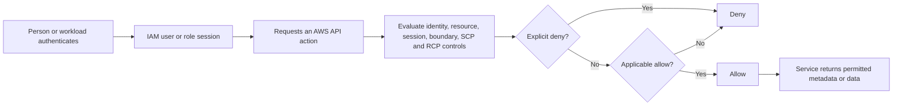
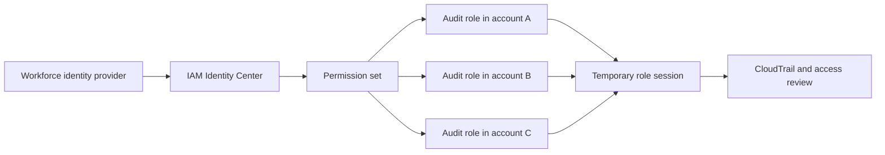

# AWS managed policy: ReadOnlyAccess


`ReadOnlyAccess` is broad visibility, not a confidentiality boundary and not a guarantee that an identity can never change state.

> [!IMPORTANT]
> **Currency check (2026-11-05):** the AWS managed-policy reference reported default version **v191**, last edited **2026-10-30 17:27 UTC**. AWS can change this policy. Recheck the live policy document before approving access or relying on an action list.

## Contents

1. [What is ReadOnlyAccess?](#1-what-is-readonlyaccess)
2. [What problem does it solve?](#2-what-problem-does-it-solve)
3. [Core concepts: read, metadata, and data](#3-core-concepts-read-metadata-and-data)
4. [How it works and changes over time](#4-how-it-works-and-changes-over-time)
5. [Capabilities and restrictions](#5-capabilities-and-restrictions)
6. [Use cases and selection guidance](#6-use-cases-and-selection-guidance)
7. [CCP essentials](#7-ccp-essentials)
8. [SAA deep dive: effective permissions](#8-saa-deep-dive-effective-permissions)
9. [Comparisons](#9-comparisons)
10. [Integration and architecture patterns](#10-integration-and-architecture-patterns)
11. [Security, least privilege, and shared responsibility](#11-security-least-privilege-and-shared-responsibility)
12. [Audit, validation, and troubleshooting](#12-audit-validation-and-troubleshooting)
13. [Pricing and cost optimization](#13-pricing-and-cost-optimization)
14. [Practical console and CLI workflow](#14-practical-console-and-cli-workflow)
15. [Common exam traps](#15-common-exam-traps)
16. [Technical interview questions](#16-technical-interview-questions)
17. [Practice questions](#17-practice-questions)
18. [Scenario drills](#18-scenario-drills)
19. [Decision framework](#19-decision-framework)
20. [Quick-revision sheet](#20-quick-revision-sheet)
21. [Official references](#21-official-references)
22. [Closing takeaway](#22-closing-takeaway)

---

## 1. What is ReadOnlyAccess?

`ReadOnlyAccess` is an **AWS managed IAM policy** maintained by AWS. Its ARN is:

```text
arn:aws:iam::aws:policy/ReadOnlyAccess
```

It contains a large, explicitly enumerated set of actions intended to provide read-only access across many AWS services and resources. It is attachable to IAM users, IAM groups, and IAM roles. An IAM Identity Center permission set can also reference it; Identity Center then provisions an IAM role in each assigned account.

| Property | Meaning |
|---|---|
| Owner | AWS, not the customer account |
| Scope | Broad, multi-service permissions listed in the current policy version |
| Reuse | One policy can be attached to many identities |
| Updates | AWS may publish and select a new default version |
| Customization | The AWS managed policy itself cannot be edited by the customer |
| Enforcement role | It grants listed permissions; it does not cap permissions from other policies |

Think of it as a broad **visitor pass**. A visitor can inspect many rooms and may be able to read some documents inside them. The pass does not mean every room exists, every door will open, or every document is nonsensitive. Other passes can add powers, and organizational or resource controls can block access.

The old slogan “See everything, change nothing” is unsafe. A better memory line is:

> **Broad AWS-managed observation; exact visibility and effective access depend on the current actions, resources, conditions, and every applicable policy layer.**

---

## 2. What problem does it solve?

Organizations often need a fast baseline for people or tooling that must inspect many services but should not receive general administration permissions. Writing and maintaining hundreds of service-specific read actions can be expensive and easy to get wrong. `ReadOnlyAccess` supplies an AWS-maintained starting point.

It helps with broad account discovery, architecture inventory, temporary reviews whose approved scope includes data-reading actions, and training in accounts with synthetic data. It also follows AWS updates without the customer copying the policy.

It does **not** provide least privilege for a known narrow task, separate metadata from stored content, create cross-account trust, authenticate a user, guarantee that no write is possible, or freeze the action list.

---

## 3. Core concepts: read, metadata, and data

### Access levels are classification aids

AWS service authorization tables classify actions as **List**, **Read**, **Write**, **Permissions management**, or **Tagging**. These classifications help policy design, but IAM does not authorize an action from its English verb or prefix. Authorization uses the exact action in the policy and request context.

Do not assume every `Get*`, `List*`, or `Describe*` action is harmless or returns only metadata. The checked `ReadOnlyAccess` document even contains less intuitive actions such as `access-analyzer:ValidatePolicy`, `logs:StartQuery`, and `logs:StartLiveTail`. Inspect the service authorization reference and API behavior.

| Visibility category | Examples | Confidentiality impact |
|---|---|---|
| Resource discovery | Names, ARNs, Regions, tags, inventories | Reveals topology, ownership clues, and business metadata |
| Configuration/security metadata | Network rules, encryption settings, IAM configuration, logging status | Reveals security posture and attack-relevant detail |
| Data contents | S3 object bodies, DynamoDB items, log events, query results | Can disclose customer, business, credential, or regulated data |

“Read-only” does not mean “metadata only,” “public information,” or “low risk.”

### S3 and DynamoDB distinction

| Need | Representative actions | Included by checked broad policy? | Design implication |
|---|---|---:|---|
| Discover S3 buckets | `s3:ListAllMyBuckets` | Yes | Reveals inventory |
| Inspect a bucket | `s3:ListBucket`, configuration-oriented `s3:Get*` | Yes | Can expose object names and configuration |
| Read S3 content | `s3:GetObject` through `s3:Get*` | Yes | Data-plane exposure |
| Inspect a DynamoDB table | `dynamodb:DescribeTable` | Yes | Configuration visibility |
| Read DynamoDB items | `GetItem`, `BatchGetItem`, `Query`, `Scan`, `PartiQLSelect` | Yes | Data-plane exposure |

AWS explicitly warns that `ReadOnlyAccess` can permit reading data in services including Amazon S3 and DynamoDB. If a reviewer needs structure but not content, use a narrower policy—often `ViewOnlyAccess` after inspecting its exact document, a service-specific policy, or a customer-managed policy.

The policy is an enumerated action list, not an IAM feature meaning “allow every present and future read operation.” A new API is usable only if the current default version includes it and every other authorization layer permits the request.

---

## 4. How it works and changes over time



Attaching `ReadOnlyAccess` contributes allows. AWS still evaluates principal, action, resource, conditions, and applicable policy types. An explicit deny overrides an allow. Cross-account access generally requires permissions on both the caller/trusted side and the target/trusting side.

### Managed-policy lifecycle

1. AWS creates and owns the policy.
2. AWS may update it as services and APIs evolve.
3. An update creates another managed-policy version.
4. AWS selects the default version used by attachments.
5. Existing attachments automatically use that default version.

The policy-language element `"Version": "2012-10-17"` is unrelated to managed-policy IDs such as `v191`. Before an audit, record the ARN, default version, document, and retrieval time.

> [!CAUTION]
> Copying the JSON into a customer-managed policy freezes the copy; later AWS changes do not flow into it. That provides change control but transfers maintenance responsibility to you.

---

## 5. Capabilities and restrictions

### What it can do

- Allow exact actions in the current default version across resources covered by its statements.
- Support broad, multi-service inspection without customer maintenance of the source policy.
- Attach to IAM users, groups, and roles or be referenced by permission sets.
- Evolve as AWS revises its maintained policy.

### What it cannot do by itself

- Create cross-account trust or supply credentials.
- Override an explicit deny.
- Exceed a boundary, session policy, SCP, applicable RCP, or resource control.
- Decrypt every encrypted resource.
- Prevent another policy from adding writes.
- Guarantee every service or newly launched API is visible.

The checked policy includes KMS metadata actions such as `kms:Describe*`, `kms:Get*`, and `kms:List*`, but not `kms:Decrypt`. Reading an SSE-KMS encrypted S3 object requires the relevant S3 permission and KMS decryption authorization. The checked version also did not include `secretsmanager:GetSecretValue`. Do not generalize those observations into a confidentiality guarantee: broad data reads exist elsewhere and AWS can revise the policy.

---

## 6. Use cases and selection guidance

| Requirement | Better starting choice | Why |
|---|---|---|
| Broad exploration, content reads accepted | `ReadOnlyAccess` | Broad AWS-maintained coverage |
| Broad resource view with reduced storage-content access | `ViewOnlyAccess` | Metadata-oriented baseline; still inspect exact actions |
| Security configuration/compliance review | `SecurityAudit` | Security-audit job function |
| IAM-only inspection | `IAMReadOnlyAccess` | IAM domain rather than broad services |
| EC2-, S3-, or CloudWatch-only observation | Relevant service-specific policy | Smaller service scope; verify data exposure |
| One resource or action set | Customer-managed policy | Resource/action/condition precision |
| Workforce access to many accounts | Identity Center permission set plus reviewed policy | Central assignment and temporary sessions |
| Unique one-identity exception | Inline policy only when lifecycle coupling is intentional | Tight ownership but poor reuse/versioning |

**External metadata-only consultant:** do not choose `ReadOnlyAccess` by reflex. Start with `ViewOnlyAccess` or custom permissions, inspect data-returning actions, use a target-account audit role, and limit duration.

**Compliance security audit:** start with `SecurityAudit`, then add narrowly justified gaps.

**IAM-only security engineer:** start with `IAMReadOnlyAccess`, then decide whether Access Analyzer, Organizations, CloudTrail, or other security reads are needed.

**Manager, support engineer, or learner:** define the exact visibility required. Billing, inventory, dashboards, logs, and stored data are different scopes. Use nonproduction accounts and synthetic data for learning.

---

## 7. CCP essentials

- `ReadOnlyAccess` is an **AWS managed policy**; AWS maintains its versions.
- It is broad across services, unlike `IAMReadOnlyAccess` or a service-specific policy.
- It can attach to users, groups, and roles, but temporary federated workforce access is preferred.
- It does not make an identity globally read-only; another policy can grant writes.
- Read permissions can disclose sensitive configuration and content.
- Least privilege often requires a narrower policy.
- IAM, Identity Center, and STS have no additional charge, but allowed service operations can cost money.

**CCP recognition:** “Broad visibility across services and content reads are acceptable” suggests `ReadOnlyAccess`. “View resources but not storage data,” “audit security,” or “one service only” suggests a more specific choice.

---

## 8. SAA deep dive: effective permissions

An attachment name is not an authorization result. Evaluate the principal, action, resource, conditions, and every policy layer.

```text
effective access = applicable allows
                   constrained by boundaries and session policy
                   constrained by SCPs and RCPs where applicable
                   subject to resource policies and service rules
                   minus every applicable explicit deny
```

This is a learning model, not a literal formula for every resource-policy principal case.

| Case | Controls | Request | Result and reason |
|---|---|---|---|
| A | Only current `ReadOnlyAccess` | `s3:GetObject` on an otherwise permitted object | **Potentially allowed**; bucket, conditions, and other controls still apply |
| B | `ReadOnlyAccess` plus allow for `ec2:StartInstances` | Start the named instance | **Allowed** if nothing blocks it; identity is not effectively read-only |
| C | `ReadOnlyAccess` plus explicit deny on an S3 prefix | Read an object there | **Denied**; explicit deny wins |
| D | `ReadOnlyAccess`; boundary omits `dynamodb:Scan` | Scan a table | **Denied**; boundary limits identity permissions |
| E | Role has `ReadOnlyAccess`; session policy allows only EC2 describes | Read an S3 object | **Denied**; session policy narrows the session |
| F | `ReadOnlyAccess`; SCP denies the service | Listed read API | **Denied**; the SCP maximum/deny applies |
| G | S3 read allowed; SSE-KMS object; no `kms:Decrypt` path | Download plaintext | **Denied**; all required S3 and KMS authorization is absent |

- **Identity policies** generally combine compatible grants; a write allow can expand access.
- **Boundaries** and **session policies** limit permissions and grant nothing by themselves.
- **SCPs** and **RCPs** set organization guardrails; they grant nothing.
- **Resource policies** can contribute, require, or deny access, especially cross-account.
- **KMS key policies and grants** participate in KMS authorization.

This additional policy makes an identity with `ReadOnlyAccess` able to start one instance if no other control blocks it:

```json
{
  "Version": "2012-10-17",
  "Statement": [{
    "Sid": "StartOneApprovedInstance",
    "Effect": "Allow",
    "Action": "ec2:StartInstances",
    "Resource": "arn:aws:ec2:eu-central-1:111122223333:instance/i-0123456789abcdef0"
  }]
}
```

---

## 9. Comparisons

### ReadOnlyAccess versus ViewOnlyAccess

| Question | `ReadOnlyAccess` | `ViewOnlyAccess` |
|---|---|---|
| Intent | Broad read access to services and resources | View resources and basic metadata across services |
| S3 example in checked version | Broad `s3:Get*`/`s3:List*`, including object-read capability | Bucket discovery/listing but not `s3:GetObject` |
| DynamoDB concern | Includes `GetItem`, `Query`, `Scan`, and other item reads | Intended to reduce content access; inspect current exact actions |
| Confidentiality guarantee | No | No universal guarantee—review each relevant service action |
| Best fit | Broad observation where content exposure is approved | Broad viewing where a lower-content baseline is desired |

`ViewOnlyAccess` is materially different, but it is still a large, changing AWS managed policy with many `Get` actions. Validate it against the services and data in scope.

### Alternatives matrix

| Policy or method | Scope and purpose | Difference from `ReadOnlyAccess` | Selection warning |
|---|---|---|---|
| `SecurityAudit` | Security configuration metadata for audits | Security job-function focus | May need narrow additions for particular evidence |
| `IAMReadOnlyAccess` | IAM inspection, reports, and policy simulation | IAM domain only | Simulation has limitations and does not execute requests |
| `AdministratorAccess` | `Action: "*"`, `Resource: "*"` allow | Broad administration | Guardrails may constrain it; extremely high privilege |
| `PowerUserAccess` | Broad operation with current `NotAction` exclusions/exceptions | Can create and change many resources | Do not reduce it to “everything except IAM”; inspect the document |
| `AmazonEC2ReadOnlyAccess` | EC2 plus related ELB, CloudWatch, and Auto Scaling reads | Compute-oriented, smaller domain | Its label does not mean EC2 APIs only |
| `AmazonS3ReadOnlyAccess` | Current `s3:Get*`, `s3:List*`, `s3:Describe*` on `*` | S3-only but includes object reads | Narrow service is not narrow resource/data scope |
| `CloudWatchReadOnlyAccess` | Metrics, alarms, logs, queries/live tail, related reads | Observability-focused | Logs/query results may contain sensitive data |
| Other service policies | Service-oriented permissions | Smaller service surface | Check dependencies, resources, data, and update history |
| Customer-managed policy | Customer-owned reusable JSON | Precise scope and controlled versions | Customer owns monitoring and updates |
| Inline policy | Embedded in one user, group, or role | One-owner lifecycle | Poor reuse; no standalone ARN/native versions |
| Identity Center permission set | Central workforce access definition | Provisions roles and temporary sessions | Requires account assignment/provisioning; contents still need review |

### Metadata observed on 2026-11-05

| AWS managed policy | ARN suffix | Default version / last edit observed |
|---|---|---|
| `ReadOnlyAccess` | `ReadOnlyAccess` | v191 / 2026-10-30 |
| `ViewOnlyAccess` | `job-function/ViewOnlyAccess` | v46 / 2026-09-30 |
| `SecurityAudit` | `SecurityAudit` | v94 / 2026-09-30 |
| `IAMReadOnlyAccess` | `IAMReadOnlyAccess` | v4 / 2018-01-25 |
| `AmazonEC2ReadOnlyAccess` | `AmazonEC2ReadOnlyAccess` | v5 / 2026-02-12 |
| `AmazonS3ReadOnlyAccess` | `AmazonS3ReadOnlyAccess` | v3 (live reference checked) |
| `CloudWatchReadOnlyAccess` | `CloudWatchReadOnlyAccess` | v25 / 2026-09-22 |
| `PowerUserAccess` | `PowerUserAccess` | v12 / 2026-02-12 |

These are dated audit observations, not permanent facts. Use the live references in section 21.

---

## 10. Integration and architecture patterns

For employees and contractors, prefer federation and temporary credentials—commonly IAM Identity Center—over long-lived IAM users. A permission set can reference an AWS managed or customer-managed policy. Assignment causes Identity Center to provision a role in the selected account.



### Cross-account auditor design

A sound design separates authentication and assignment, target-account trust, target-role permissions, organization/resource/encryption guardrails, and evidence. For an external provider, trust a specific provider role and use an external ID supplied by the provider. The provider-side principal must also be allowed to call `sts:AssumeRole`.

```json
{
  "Version": "2012-10-17",
  "Statement": [{
    "Sid": "TrustNamedExternalAuditorRole",
    "Effect": "Allow",
    "Principal": {
      "AWS": "arn:aws:iam::444455556666:role/ExternalAuditBroker"
    },
    "Action": "sts:AssumeRole",
    "Condition": {
      "StringEquals": {
        "sts:ExternalId": "provider-generated-customer-specific-value"
      }
    }
  }]
}
```

Attach the selected permission policy to the **target role**, not the trust policy. Trust answers who may request a session; permissions answer what the session may do. Use MFA conditions where supported, short duration, provider-unique external IDs, account-specific assignments, and rapid revocation. An external ID is a confused-deputy control, not a password.

---

## 11. Security, least privilege, and shared responsibility

### Building genuinely narrow observational access

1. Start from required evidence, not a policy name.
2. Separate discovery, configuration, and data contents.
3. Inspect exact actions in the live default version.
4. Limit accounts, Regions, resources, tags, conditions, and duration where supported.
5. Remove unnecessary content APIs.
6. Ensure no other identity, group, session, or resource policy adds writes.
7. Apply boundaries and Organizations controls where appropriate; they grant nothing.
8. Test representative allows and denies in a controlled environment.
9. Configure evidence: management events alone may not prove every data read.
10. Reassess when AWS updates a policy or the task changes.

This explicit deny blocks object reads under one prefix even if `ReadOnlyAccess` allows them; it grants nothing:

```json
{
  "Version": "2012-10-17",
  "Statement": [{
    "Sid": "DenySensitiveObjectReads",
    "Effect": "Deny",
    "Action": "s3:GetObject",
    "Resource": "arn:aws:s3:::example-sensitive-data/restricted/*"
  }]
}
```

Use denies deliberately: they can complicate delegation and diagnosis, and the control must cover every action/resource form relevant to its objective.

### Before and after: DynamoDB metadata only

**Before:** `ReadOnlyAccess` can permit `GetItem`, `Query`, `Scan`, and `PartiQLSelect` as well as configuration reads.

**After:** this customer-managed policy allows metadata for one table and optional table discovery without item reads:

```json
{
  "Version": "2012-10-17",
  "Statement": [
    {
      "Sid": "InspectOneTableConfiguration",
      "Effect": "Allow",
      "Action": [
        "dynamodb:DescribeTable",
        "dynamodb:DescribeContinuousBackups",
        "dynamodb:DescribeTimeToLive",
        "dynamodb:ListTagsOfResource"
      ],
      "Resource": "arn:aws:dynamodb:eu-central-1:111122223333:table/Orders"
    },
    {
      "Sid": "DiscoverTablesForConsoleNavigation",
      "Effect": "Allow",
      "Action": "dynamodb:ListTables",
      "Resource": "*"
    }
  ]
}
```

The first statement scopes supported actions to `Orders`. `ListTables` does not support resource-level selection, so the optional discovery statement requires `Resource: "*"`; remove it if callers know the table ARN and do not need discovery. Validate current resource and condition support in the service authorization reference.

AWS maintains the managed policy and IAM infrastructure. The customer is responsible for selecting it, controlling assignments/trust, classifying data, logging, reviewing AWS changes, protecting identities, applying guardrails, and responding to misuse. “AWS managed” does not mean “AWS approved for this workload.”

---

## 12. Audit, validation, and troubleshooting

### Evidence checklist

- Record ARN, default version, retrieved document, and UTC retrieval time.
- Inventory users, groups, roles, permission sets, and account assignments using it.
- Resolve group inheritance and role-assumption paths to effective principals.
- Diff new default versions and review added data-returning actions.
- Find other policies that add writes and all applicable denies.
- Review boundaries, session policies, SCPs, RCPs, resource policies, KMS controls, and endpoint policies.
- Use Access Analyzer validation as evidence, not proof of business correctness.
- Use last-accessed information and CloudTrail with their documented scope/latency limits.
- Test representative allows and denies; console navigation alone is insufficient.
- Revoke assignments and sessions when the review ends.

| Symptom | Likely cause | Check |
|---|---|---|
| `AccessDenied` for a listed action | Limiter, condition, resource control, or dependency | All policy layers and CloudTrail |
| Can list an S3 object but not download it | Missing object/KMS path or bucket restriction | Object ARN, bucket/endpoint/key policies, encryption |
| Can see table metadata but not items | Data action intentionally absent | `GetItem`, `Query`, `Scan`, and resource scope |
| New service is invisible | Managed policy lacks actions or console dependencies | Live default policy and service authorization table |
| Simulator allows, live call fails | Unmodeled context/control or simulator limitation | Resource/SCP/RCP/key policies, tags, service rules |
| Console page partly fails | Extra discovery/dependent APIs | Browser/API error, CloudTrail, console requirements |
| User can modify a resource | Another policy grants a write | Direct/group/session/resource grants and permission set |
| Access changed without deployment | AWS changed the default version | Version history and change monitoring |
| Cross-account assumption fails | Caller allow or trust/condition missing | Both accounts, ARN, external ID/MFA/source conditions |
| Session persists after detachment | Temporary credentials still valid | Expiration, revocation controls, incident runbook |

`iam simulate-principal-policy` does not execute the API and cannot perfectly reproduce every resource policy, SCP/RCP, KMS path, service rule, or live state. Treat it as diagnostic evidence, not final proof.

---

## 13. Pricing and cost optimization

IAM, IAM Identity Center, and AWS STS are available at no additional charge. Activity is not necessarily cost-free: service API calls, CloudTrail data events, log ingestion/queries, data retrieval, and transfer follow service pricing. Broad access also increases review and response overhead. A copied policy adds maintenance and drift cost.

Right-size permission sets and audit evidence, but never suppress logs required by risk or compliance merely to save money.

---

## 14. Practical console and CLI workflow

### Console

1. Open **IAM → Policies**, filter to **AWS managed**, and select `ReadOnlyAccess`.
2. Record ARN, default version, edit time, and policy document.
3. Review attached entities and version history.
4. Inspect Identity Center permission sets, assignments, and provisioning separately.
5. Compare actions with service authorization references.
6. Document approval, data classification, expiry, and reviewer.

### CLI

Retrieve metadata, then the exact default version reported by the response:

```bash
aws iam get-policy \
  --policy-arn arn:aws:iam::aws:policy/ReadOnlyAccess

aws iam get-policy-version \
  --policy-arn arn:aws:iam::aws:policy/ReadOnlyAccess \
  --version-id v191
```

List direct IAM attachments:

```bash
aws iam list-entities-for-policy \
  --policy-arn arn:aws:iam::aws:policy/ReadOnlyAccess
```

Direct attachments omit group membership resolution, role paths, Identity Center assignments, session policies, resource policies, and organization controls.

Diagnostic simulation example:

```bash
aws iam simulate-principal-policy \
  --policy-source-arn arn:aws:iam::111122223333:role/ExampleAuditRole \
  --action-names s3:GetObject ec2:StartInstances \
  --resource-arns \
    arn:aws:s3:::example-bucket/example.txt \
    arn:aws:ec2:eu-central-1:111122223333:instance/i-0123456789abcdef0
```

Use controlled validation. A simulated `allowed` is not a live guarantee, and a console test may call extra APIs.

---

## 15. Common exam traps

1. **“Read-only means no security risk.”** Reads can expose objects, items, logs, topology, tags, and security configuration.
2. **“It shows everything.”** Only enumerated actions and otherwise authorized resources are reachable.
3. **“It prevents writes.”** It grants permissions; another policy can add writes.
4. **“AWS managed means customer approved.”** AWS maintains it; the customer must decide whether it fits.
5. **“AWS never changes it.”** AWS publishes new versions and selects the default.
6. **“A copied policy receives AWS updates.”** A customer copy is independent.
7. **“Version 2012-10-17 is policy revision v191.”** One is policy-language syntax; the other is a managed-policy version ID.
8. **“Every Get/List/Describe call is metadata-only.”** Some return data contents or initiate queries.
9. **“ReadOnlyAccess and ViewOnlyAccess are synonyms.”** Their intent and action sets differ.
10. **“ViewOnlyAccess guarantees no content access.”** Inspect every relevant action; it is not a universal data boundary.
11. **“SecurityAudit is broader ReadOnlyAccess.”** It is a security-audit job-function policy with different coverage.
12. **“IAMReadOnlyAccess reads all AWS services.”** It is focused on IAM.
13. **“AmazonS3ReadOnlyAccess cannot read objects.”** Its broad `s3:Get*` includes object reads.
14. **“A service-specific policy is resource-specific.”** It may still use `Resource: "*"` across the service.
15. **“CloudWatch reads contain no business data.”** Logs and query results can contain sensitive content.
16. **“PowerUserAccess is read-only plus a few writes.”** It permits broad service operations.
17. **“AdministratorAccess cannot be constrained.”** Explicit denies and applicable guardrails can limit it.
18. **“A permissions boundary grants read access.”** A boundary only limits identity-based permissions.
19. **“An SCP grants the managed policy.”** SCPs set maxima; they do not grant.
20. **“A session policy can expand the role.”** It can only narrow the session relative to role permissions.
21. **“A resource-policy allow always wins.”** Explicit denies and evaluation nuances still matter.
22. **“S3 permission alone reads SSE-KMS plaintext.”** The required KMS authorization must also succeed.
23. **“A KMS key policy is irrelevant to read-only roles.”** It is central to encrypted-data access.
24. **“The trust policy contains the role's service permissions.”** Trust controls assumption; attached/inline policies control actions.
25. **“ExternalId authenticates a human.”** It mitigates confused-deputy risk; it is not a password.
26. **“Direct attachment inventory finds every beneficiary.”** Groups, role assumption, and permission sets require resolution.
27. **“The simulator proves production access.”** It does not execute requests and has coverage limitations.
28. **“Console success proves least privilege.”** The console may use extra APIs and does not test all prohibited operations.
29. **“CloudTrail management events show every data read.”** Service data events may need separate configuration.
30. **“Detaching a role policy instantly invalidates every session.”** Existing temporary credentials and revocation behavior need consideration.
31. **“No IAM charge means no cost.”** Service calls, queries, logging, retrieval, and transfer may cost money.
32. **“Broad read access is the safest training option.”** Use isolated accounts and synthetic data; confidentiality still matters.

---

## 16. Technical interview questions

1. **Why is `ReadOnlyAccess` not a permissions boundary?** It contributes allows. It does not limit permissions granted elsewhere; a boundary is a separate maximum for identity permissions.
2. **How would you prove what the policy allowed on a date?** Preserve ARN, default version ID, exact decoded document, retrieval timestamp, attachments, and surrounding controls.
3. **How do `ReadOnlyAccess` and `ViewOnlyAccess` differ?** The former includes broad data-reading actions; the latter targets resource/basic-metadata viewing, but both require exact-document review.
4. **Why might `s3:GetObject` fail with this policy?** Bucket/endpoint policy, object/resource mismatch, explicit deny, session/boundary/SCP/RCP, or missing KMS decryption authorization.
5. **What would you grant a security auditor?** Begin from `SecurityAudit`, map evidence requirements, add narrow gaps, use temporary sessions, and log/review access.
6. **How do you design cross-account external audit access?** Specific trusted provider role, unique external ID, caller-side AssumeRole allow, target role permissions, short sessions, guardrails, and evidence.
7. **How can AWS updates create risk?** A new default version can add a data-returning action to every existing attachment without a customer deployment.
8. **Why can a read call still have operational effects?** API naming and access-level classification are not authorization semantics; some observation APIs start queries or consume billable capacity.
9. **What is the role of an SCP here?** It restricts maximum permissions in member accounts and can deny actions, but never supplies the underlying allow.
10. **How would you expose DynamoDB metadata without items?** Allow selected describe/tag actions on table ARNs, add only necessary discovery on `*`, and omit item data actions.
11. **What does Policy Simulator not prove?** It does not execute the API and may not model every resource, organization, KMS, context, or service-specific rule.
12. **How would you detect write permission accidentally added to an audit role?** Inventory all grants, analyze policies, simulate/test prohibited actions, monitor CloudTrail, and alert on attachment/permission-set changes.

---

## 17. Practice questions

<details><summary>1. A consultant needs broad resource metadata but must not read S3 objects. Best starting point?</summary>

**Answer:** `ViewOnlyAccess` or a custom policy, after exact action review. `ReadOnlyAccess` includes S3 content reads.
</details>

<details><summary>2. Who maintains the source `ReadOnlyAccess` policy?</summary>

**Answer:** AWS. The customer still owns assignment, risk acceptance, guardrails, and monitoring.
</details>

<details><summary>3. A role has ReadOnlyAccess and a second policy allows StartInstances. Can it start instances?</summary>

**Answer:** Yes, if no explicit deny or limiting policy blocks it. Compatible allows combine.
</details>

<details><summary>4. Which policy is the better baseline for a security-configuration audit?</summary>

**Answer:** `SecurityAudit`, followed by a gap analysis for the required evidence.
</details>

<details><summary>5. What does an explicit deny of s3:GetObject on a prefix do?</summary>

**Answer:** It blocks that request even when `ReadOnlyAccess` contains an applicable allow.
</details>

<details><summary>6. Does a permissions boundary allow DynamoDB Scan?</summary>

**Answer:** No. A boundary grants nothing; it only limits permissions supplied elsewhere.
</details>

<details><summary>7. Why record the default version ID during an audit?</summary>

**Answer:** AWS may change the policy, so the ID and document preserve what was evaluated at that time.
</details>

<details><summary>8. Does copying the AWS policy preserve automatic AWS updates?</summary>

**Answer:** No. A customer-managed copy becomes independently maintained.
</details>

<details><summary>9. Which checked policy permits S3 object reads: ReadOnlyAccess or ViewOnlyAccess?</summary>

**Answer:** `ReadOnlyAccess`; the checked `ViewOnlyAccess` did not include `s3:GetObject`.
</details>

<details><summary>10. Why might an SSE-KMS S3 download fail?</summary>

**Answer:** The principal also needs a valid KMS decryption authorization path; the checked broad policy lacks `kms:Decrypt`.
</details>

<details><summary>11. What is wrong with “See everything, change nothing”?</summary>

**Answer:** Coverage is enumerated and incomplete, data exposure is possible, and other grants can add writes.
</details>

<details><summary>12. Which policy is focused on IAM inspection?</summary>

**Answer:** `IAMReadOnlyAccess`.
</details>

<details><summary>13. Does an SCP attach ReadOnlyAccess to an account?</summary>

**Answer:** No. An SCP is an organization guardrail and does not grant permissions.
</details>

<details><summary>14. Can a session policy add an action absent from the role?</summary>

**Answer:** No. A session policy narrows the session; it cannot exceed the role's identity permissions.
</details>

<details><summary>15. What is required besides target-role trust for cross-account AssumeRole?</summary>

**Answer:** The caller needs permission to call `sts:AssumeRole`, and all trust conditions must match.
</details>

<details><summary>16. Is ExternalId a secret authentication credential?</summary>

**Answer:** No. It is a confused-deputy mitigation used in the role trust condition.
</details>

<details><summary>17. Which current service-specific policy includes S3 object reads?</summary>

**Answer:** `AmazonS3ReadOnlyAccess`, because its broad `s3:Get*` covers `GetObject`.
</details>

<details><summary>18. Why can CloudWatch read access be sensitive?</summary>

**Answer:** Log events, query results, dashboards, and operational metrics can contain sensitive information.
</details>

<details><summary>19. Does Policy Simulator execute the requested API?</summary>

**Answer:** No. It is a diagnostic simulation with documented limitations.
</details>

<details><summary>20. Why can console access require more permissions than a scripted call?</summary>

**Answer:** Console pages commonly call discovery and dependent APIs to populate their interface.
</details>

<details><summary>21. Which event category may be needed to record S3 object reads?</summary>

**Answer:** CloudTrail data events, configured for the relevant resource/event scope.
</details>

<details><summary>22. Is ReadOnlyAccess automatically least privilege for an auditor?</summary>

**Answer:** No. It is broad and includes content access; map permissions to the task.
</details>

<details><summary>23. What does Resource "*" mean in the ListTables example?</summary>

**Answer:** The action does not support resource-level selection; it does not add item-reading permissions.
</details>

<details><summary>24. Where should service permissions for a cross-account audit role be placed?</summary>

**Answer:** In identity policies attached or inline to the target role, not in its trust statement.
</details>

<details><summary>25. Can a resource policy deny a request otherwise allowed by ReadOnlyAccess?</summary>

**Answer:** Yes. An applicable explicit deny overrides the identity-policy allow.
</details>

<details><summary>26. Why inspect group membership during an attachment audit?</summary>

**Answer:** Group members inherit the group's policy even though it is not directly attached to each user.
</details>

<details><summary>27. How does Identity Center deliver a permission set in an account?</summary>

**Answer:** It provisions an IAM role and authorized users obtain temporary role sessions through assignment.
</details>

<details><summary>28. Is IAMReadOnlyAccess appropriate for broad EC2 and S3 inventory?</summary>

**Answer:** No. It is IAM-focused; choose appropriate broader or service-specific permissions.
</details>

<details><summary>29. What is the safest response when AWS changes the default managed-policy version?</summary>

**Answer:** Diff it against the prior version, assess new exposure, test, document acceptance, and narrow or replace it if needed.
</details>

<details><summary>30. IAM has no additional charge. Are audit activities always free?</summary>

**Answer:** No. Service queries, retrieval, transfer, and logging can incur normal charges.
</details>

---

## 18. Scenario drills

Exactly twelve architecture scenarios follow.

### Scenario 1 — External metadata-only consultant

Use federation into a target-account role with `ViewOnlyAccess` or reviewed custom metadata permissions, not broad `ReadOnlyAccess` by default. Limit accounts/duration, exclude content APIs, log access, and revoke on completion.

### Scenario 2 — Compliance security audit

Start with `SecurityAudit`; map each control to evidence sources and add narrow gaps. Preserve policy versions and CloudTrail evidence.

### Scenario 3 — IAM-only security engineer

Use `IAMReadOnlyAccess`; add only justified Access Analyzer, Organizations, or CloudTrail reads. Do not expose unrelated service data.

### Scenario 4 — Broad internal architecture inventory

If content exposure is approved, deliver `ReadOnlyAccess` through an Identity Center permission set and temporary sessions. Monitor AWS policy-version changes.

### Scenario 5 — One DynamoDB table's configuration

Use the metadata-only policy in section 11. Omit `GetItem`, `Query`, `Scan`, and `PartiQLSelect`; include `ListTables` on `*` only if discovery is needed.

### Scenario 6 — Encrypted S3 troubleshooting

Separate bucket/object authorization from KMS authorization. Add `kms:Decrypt` only for the necessary key and context if plaintext inspection is approved.

### Scenario 7 — Multi-account workforce observers

Use Identity Center account assignments and a reviewed permission set. Apply organization guardrails, short sessions, and centralized evidence.

### Scenario 8 — Third-party auditor role

Trust a named provider role, require the provider's unique external ID, grant minimal target-role permissions, and ensure caller-side AssumeRole authorization.

### Scenario 9 — Training cohort

Use isolated sandbox accounts with synthetic data, budgets, guardrails, and temporary access. Read-only naming does not make production data suitable for training.

### Scenario 10 — Support engineer needs logs only

Prefer scoped CloudWatch Logs permissions for named log groups and necessary query actions. Avoid broad multi-service observation and review log sensitivity.

### Scenario 11 — Read-only role unexpectedly starts instances

Inventory every direct, group, role, session, permission-set, and resource grant. Remove the added write, test a deny path, and review CloudTrail and change history.

### Scenario 12 — Stable regulated baseline

Copy only required actions into a customer-managed policy, control versions and rollout, monitor new AWS APIs, and conduct scheduled recertification. Accept that AWS updates no longer flow automatically.

---

## 19. Decision framework

```text
Does the task need administration or mutation?
├─ Yes → ReadOnlyAccess is not the answer; design the required write permissions.
└─ No
   ├─ Security-configuration audit? → Start with SecurityAudit.
   ├─ IAM only? → Start with IAMReadOnlyAccess.
   ├─ One service/resource? → Service-specific or customer-managed policy.
   └─ Broad services
      ├─ Stored data content approved? → Consider ReadOnlyAccess.
      └─ Metadata/basic resource view only? → Consider ViewOnlyAccess or custom.

For every branch: inspect current JSON → evaluate all policy layers → test → log → expire/review.
```

Keyword recognition:

| Exam phrase | Likely direction |
|---|---|
| Broad visibility, data reads acceptable | `ReadOnlyAccess` |
| View resources/basic metadata | `ViewOnlyAccess` |
| Security posture/compliance | `SecurityAudit` |
| IAM inventory and reports only | `IAMReadOnlyAccess` |
| One service | Service-specific or custom |
| One resource or sensitive dataset | Custom least-privilege policy |
| Workforce across accounts | Identity Center permission set and temporary roles |
| Prevent grants beyond a maximum | Boundary/SCP/RCP as applicable, not `ReadOnlyAccess` |

---

## 20. Quick-revision sheet

| Remember | Correct idea |
|---|---|
| Type | AWS managed policy |
| ARN | `arn:aws:iam::aws:policy/ReadOnlyAccess` |
| Coverage | Large exact list across services; changes over time |
| Data | Can read S3 objects, DynamoDB items, logs, and other sensitive information |
| Grant vs guardrail | Grant; not a cap or deny boundary |
| Updates | AWS can publish/select a new default version |
| Other policies | Can add writes; explicit denies and limiters can block reads |
| Better metadata baseline | Often `ViewOnlyAccess`, after exact review |
| Security audit | `SecurityAudit` |
| IAM only | `IAMReadOnlyAccess` |
| Human access | Prefer federation/Identity Center temporary sessions |
| Evidence | Record version/document/time and audit effective principals |

**Memory model: V-D-E**

- **V — Version:** Which exact AWS-managed default version is in force?
- **D — Data:** Does an allowed API return metadata or content?
- **E — Effective access:** What do all grants, guardrails, resource policies, conditions, and encryption controls produce?

---

## 21. Official references

All references were reviewed on **2026-11-05**. Date-sensitive policy metadata should be rechecked live.

- [ReadOnlyAccess managed-policy reference](https://docs.aws.amazon.com/aws-managed-policy/latest/reference/ReadOnlyAccess.html)
- [ViewOnlyAccess managed-policy reference](https://docs.aws.amazon.com/aws-managed-policy/latest/reference/ViewOnlyAccess.html)
- [SecurityAudit managed-policy reference](https://docs.aws.amazon.com/aws-managed-policy/latest/reference/SecurityAudit.html)
- [IAMReadOnlyAccess managed-policy reference](https://docs.aws.amazon.com/aws-managed-policy/latest/reference/IAMReadOnlyAccess.html)
- [AdministratorAccess managed-policy reference](https://docs.aws.amazon.com/aws-managed-policy/latest/reference/AdministratorAccess.html)
- [PowerUserAccess managed-policy reference](https://docs.aws.amazon.com/aws-managed-policy/latest/reference/PowerUserAccess.html)
- [AmazonEC2ReadOnlyAccess reference](https://docs.aws.amazon.com/aws-managed-policy/latest/reference/AmazonEC2ReadOnlyAccess.html)
- [AmazonS3ReadOnlyAccess reference](https://docs.aws.amazon.com/aws-managed-policy/latest/reference/AmazonS3ReadOnlyAccess.html)
- [CloudWatchReadOnlyAccess reference](https://docs.aws.amazon.com/aws-managed-policy/latest/reference/CloudWatchReadOnlyAccess.html)
- [AWS managed job-function policies](https://docs.aws.amazon.com/IAM/latest/UserGuide/access_policies_job-functions.html)
- [Versioning IAM policies](https://docs.aws.amazon.com/IAM/latest/UserGuide/access_policies_managed-versioning.html)
- [Policy evaluation logic](https://docs.aws.amazon.com/IAM/latest/UserGuide/reference_policies_evaluation-logic.html)
- [IAM policy action access levels](https://docs.aws.amazon.com/IAM/latest/UserGuide/access_policies_understand-policy-summary-access-level-summaries.html)
- [DynamoDB actions, resources, and condition keys](https://docs.aws.amazon.com/service-authorization/latest/reference/list_amazondynamodb.html)
- [CloudWatch actions, resources, and condition keys](https://docs.aws.amazon.com/service-authorization/latest/reference/list_amazoncloudwatch.html)
- [S3 SSE-KMS permissions](https://docs.aws.amazon.com/AmazonS3/latest/userguide/UsingKMSEncryption.html)
- [IAM Identity Center predefined permission sets](https://docs.aws.amazon.com/singlesignon/latest/userguide/permissionsetpredefined.html)
- [Create a permission set](https://docs.aws.amazon.com/singlesignon/latest/userguide/howtocreatepermissionset.html)
- [IAM Identity Center permission sets](https://docs.aws.amazon.com/singlesignon/latest/userguide/permissionsets.html)
- [IAM CLI `simulate-principal-policy`](https://docs.aws.amazon.com/cli/latest/reference/iam/simulate-principal-policy.html)
- [IAM introduction and pricing note](https://docs.aws.amazon.com/IAM/latest/UserGuide/introduction.html)
- [Cloud Practitioner exam guide](https://docs.aws.amazon.com/aws-certification/latest/cloud-practitioner-02/)
- [Solutions Architect Associate exam guide](https://docs.aws.amazon.com/aws-certification/latest/solutions-architect-associate-03.html)

---

## 22. Closing takeaway

`ReadOnlyAccess` is convenient broad observation maintained by AWS. Its name is not a security boundary: the current document can expose data, AWS can revise it, other policies can add writes, and other controls can deny reads. Choose it only after the task, data classification, current actions, effective-permission layers, delivery model, evidence, and expiry have been reviewed.

**Best final memory line:** broad read grant, changing action list, potentially sensitive data, full-policy evaluation.

---

[← Inline policies](06-inline-policies.md) | [IAM index](README.md) | [AdministratorAccess →](08-administrator-access-policy.md)
