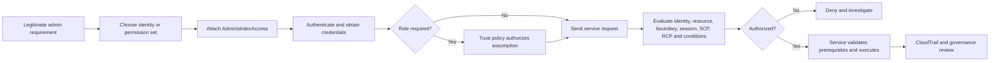
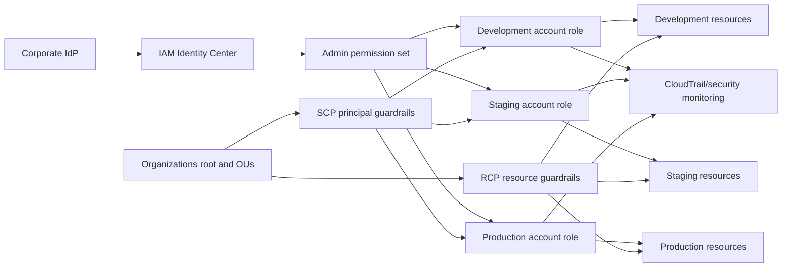

<div align="center">

# AWS managed policy: AdministratorAccess


**Mental model:** `AdministratorAccess` supplies a broad administrative Allow; it is not root identity or universal immunity from AWS authorization restrictions.

</div>

> [!IMPORTANT]
> **Currency check (2026-11-06):** the official reference reported default version **v1**, created and last edited **2015-02-06 18:39 UTC**. AWS can change managed policies, so recheck the live reference before making a privileged-access decision.

## Contents

1. [What is AdministratorAccess?](#what)
2. [What problem does it solve?](#problem)
3. [Exact policy and core concepts](#policy)
4. [How it works](#how)
5. [Capabilities, identity types, and restrictions](#capabilities)
6. [Use cases and selection guidance](#use-cases)
7. [CCP essentials](#ccp)
8. [SAA deep dive: effective permissions](#saa)
9. [Comparisons](#comparisons)
10. [Integration and architecture patterns](#architecture)
11. [Security, least privilege, and emergency access](#security)
12. [Observability, auditing, and troubleshooting](#operations)
13. [Pricing and operational cost](#pricing)
14. [Practical console and CLI workflow](#practical)
15. [Common exam traps](#traps)
16. [Technical interview questions](#interviews)
17. [Practice questions](#questions)
18. [Architecture scenarios](#scenarios)
19. [Decision framework](#decision)
20. [Quick-revision sheet](#revision)
21. [Official references](#references)
22. [Closing takeaway](#closing)

---

<a id="what"></a>

## 1. What is AdministratorAccess?

`AdministratorAccess` is an **AWS managed identity-based policy** that AWS describes as providing full access to AWS services and resources. Its ARN is:

```text
arn:aws:iam::aws:policy/AdministratorAccess
```

IAM is a global control-plane service, so this managed-policy ARN has no Region segment. The permissions can authorize operations against global or Regional services according to each service's own resource model, endpoint, and authorization rules.

It can be attached to IAM users, groups, and roles. An IAM Identity Center permission set can reference it, causing Identity Center to provision account roles with those permissions for assigned workforce users and groups.

It is **not** an IAM user, group, role, root user, authentication method, credential, or separate AWS service. It supplies authorization statements to an identity. Authentication and credential delivery are separate.

| Property | Meaning |
|---|---|
| Owner | AWS |
| Type | AWS managed identity policy |
| Policy ARN | `arn:aws:iam::aws:policy/AdministratorAccess` |
| Policy purpose | Broad administrative authorization |
| Attachments | IAM users, groups, and roles; usable by reference in permission sets |
| Maintenance | AWS selects the default AWS managed-policy version |
| Least privilege | Generally inconsistent with a narrow task-based grant |

### Master-badge analogy—and its limit

Imagine an AWS account as a secured campus. `AdministratorAccess` is a master badge programmed for every action and resource recognized by its IAM policy. The badge is exceptionally powerful, but it does not change the badge holder into the legal owner, open another company's campus, override a central lockdown, satisfy a cryptographic key's rules, or perform a task reserved for the account root identity.

---

<a id="problem"></a>

## 2. What problem does it solve?

Some legitimate tasks span many services and cannot be completed efficiently through a small service role: initial platform setup, controlled cloud administration, infrastructure recovery, security incident containment, broad sandbox operation, or emergency restoration. The AWS managed policy offers a simple AWS-maintained bootstrap permission set.

It can be reasonable for:

- a very small number of accountable platform administrators;
- temporary setup while required actions are still being discovered;
- isolated sandboxes with strong cost and organization guardrails;
- a carefully protected emergency role;
- time-bound recovery or incident-response sessions.

It is a poor default for every employee, developer, CI/CD workload, support analyst, or long-lived IAM user. Broad IAM permissions can alter identities and trust, attach policies, pass roles, disable controls, delete resources, expose data, and create expensive infrastructure. Start broad only when justified, observe usage, and move toward least privilege.

---

<a id="policy"></a>

## 3. Exact policy and core concepts

The verified policy document is deliberately short:

```json
{
  "Version": "2012-10-17",
  "Statement": [
    {
      "Effect": "Allow",
      "Action": "*",
      "Resource": "*"
    }
  ]
}
```

This corrects the malformed JSON formerly shown in this lesson.

| Element | Exact meaning |
|---|---|
| `Version` | IAM policy-language version; it is not the saved managed-policy version ID |
| `Statement` | Array containing permission statements |
| `Effect: Allow` | Contributes an explicit Allow when action, resource, and context match |
| `Action: "*"` | All IAM-recognized actions in the applicable policy context |
| `Resource: "*"` | All resources to which those actions apply |

The two wildcards answer different questions: the `Action` wildcard is **what operations**, while the `Resource` wildcard is **which applicable resources**. They do not erase request conditions, policy evaluation, ownership, service prerequisites, root-only requirements, KMS rules, or target-account authorization.

### Two unrelated kinds of version

- `"Version": "2012-10-17"` selects IAM JSON language behavior.
- `v1` is the current saved/default version of this AWS managed policy as checked on 2026-11-06.

Customers cannot edit the AWS managed policy. Copying it creates a separate customer-managed policy that no longer inherits AWS updates.

---

<a id="how"></a>

## 4. How it works



1. The organization approves an administrative requirement.
2. It selects a role, permission set, or exceptional IAM identity.
3. The policy is attached or referenced.
4. The person or workload authenticates.
5. For roles, the caller must also satisfy the trust policy and `sts:AssumeRole` authorization.
6. AWS builds a request context and evaluates all applicable policy types.
7. If authorized, the service still validates configuration, state, quotas, dependencies, and task-specific requirements.
8. Activity is logged and reviewed.

Broad authorization and successful service execution are different. A valid Allow cannot make a malformed request valid, create a missing dependency, make a Region support a feature, overcome a service quota, or turn an IAM role into root.

---

<a id="capabilities"></a>

## 5. Capabilities, identity types, and restrictions

### Representative powers

The policy can supply identity-based authorization to create, change, and delete resources; manage VPCs, EC2, Lambda, S3, RDS, DynamoDB, CloudFormation, CloudWatch, and CloudTrail; administer IAM identities and policies; call account and Organizations APIs where the account and service permit; and use KMS operations when the required KMS authorization path exists.

Because it includes broad IAM actions, it also enables sensitive operations such as policy attachment, trust-policy updates, managed-policy version changes, credential administration, and `iam:PassRole` unless another control restricts them.

### Delivery by identity type

| Identity path | How permissions arrive | Major risk/control |
|---|---|---|
| IAM user | Direct attachment or inherited from a group | Long-lived credentials; use only for an approved exception, require MFA, avoid access keys |
| IAM group | Members inherit the attachment | Membership becomes privilege assignment; tightly control and review it |
| IAM role | Attached to role; trusted callers receive temporary sessions | Trust, source authorization, session duration/policy, and session attribution matter |
| IAM Identity Center | Permission set references policy; assigned account role is provisioned | Central workforce lifecycle and temporary sessions; permission-set assignment remains high risk |

Identity Center users are not account-local IAM users, and a permission set is not itself an IAM role. Assignment and provisioning create/manage corresponding account roles.

### What the policy does not do

- authenticate anyone or create credentials;
- create a role trust relationship;
- grant access to another account automatically;
- override applicable explicit Deny statements;
- exceed a permissions boundary or session policy;
- bypass applicable SCPs or RCPs;
- guarantee access through every resource or KMS key policy;
- perform root-only tasks as an IAM identity;
- exempt a request from service prerequisites or ownership rules.

---

<a id="use-cases"></a>

## 6. Use cases and selection guidance

| Requirement | Prefer | Why |
|---|---|---|
| Routine application deployment | Custom deployment role or carefully reviewed `PowerUserAccess` | Avoid unrestricted identity administration |
| One service or bounded platform task | Customer-managed least-privilege role | Scope actions, resources, and conditions |
| Broad temporary platform setup | Time-bound admin role/permission set | Temporary credentials and accountable assignment |
| Emergency recovery | Dedicated controlled break-glass path | Separate from daily administration; alert and review every use |
| Read-only inventory | `ReadOnlyAccess`, `ViewOnlyAccess`, or custom | Administration is unnecessary |
| Security audit | `SecurityAudit` plus justified gaps | Audit task differs from administration |
| Multi-account workforce administration | Identity Center permission sets, account assignments, and guardrails | Central lifecycle and temporary sessions |
| Root-only operation | Root process or supported centralized root session | An admin policy does not change principal type |

### Growing-startup example

A startup may initially give one senior engineer a temporary administrator role to build VPCs, workloads, monitoring, and IAM foundations. As it grows, it separates developer, finance, support, security, and platform duties; narrows production permissions; adds Identity Center and Organizations guardrails; and reserves broad access for a small audited group. This preserves the useful original lesson while completing the least-privilege journey.

---

<a id="ccp"></a>

## 7. CCP essentials


- `AdministratorAccess` is an AWS managed IAM policy, not an identity.
- Its policy document allows all actions on all applicable resources.
- It can attach to users, groups, and roles; root does not receive identity policies.
- It is far broader than `ReadOnlyAccess` and broader in identity administration than `PowerUserAccess`.
- It is not the AWS account root user and cannot satisfy a root-only task.
- Explicit Deny and applicable guardrails can still block requests.
- AWS recommends federation/temporary credentials for human users and least privilege.
- MFA strengthens authentication but does not reduce authorization scope.

| If the question says… | Think… |
|---|---|
| Full administration across services | Administrator role/permission set, used sparingly |
| Actual account owner or root-only task | Root identity or supported centralized root process |
| Deploy applications but avoid unrestricted IAM administration | Custom role or evaluate `PowerUserAccess` |
| View without changing | Read/view/audit policy, not AdministratorAccess |
| Maximum permissions for member-account identities | SCP/boundary as applicable; those controls do not grant |
| Best practice for workforce access | Federation/Identity Center and temporary sessions |

**30-second summary:** `AdministratorAccess` is AWS’s broad `Allow */*` managed policy. It is powerful, not least privilege, not root, and not immune to explicit denies, boundaries, sessions, Organizations controls, resource authorization, or root-only requirements.

---

<a id="saa"></a>

## 8. SAA deep dive: effective permissions


Do not use one universal arithmetic formula for every principal/resource case. Identify the principal type, account relationship, action, resource, request context, and each policy type. Resource-policy grants to users, roles, role sessions, and federated sessions have different boundary/session interactions.

### Ten required authorization cases

| Case | Assumptions | Expected result | Reason and caveat |
|---|---|---|---|
| A — no restriction | Role identity has AdministratorAccess; action supports IAM; no other blocker | Normally allowed | `Allow */*` supplies the identity Allow; service validation can still fail |
| B — explicit Deny | Applicable identity/resource policy denies `s3:DeleteObject` | Denied | Explicit Deny overrides the admin Allow |
| C — boundary | Role boundary omits IAM writes | IAM write denied | Role identity permissions are limited by the boundary; boundary grants nothing |
| D — SCP | Member-account role; parent SCP denies `ec2:TerminateInstances` | Denied | SCP limits member principals, including member root; it does not affect management-account users/roles |
| E — RCP | Request targets a supported protected resource in a member account; RCP denies it | Denied | RCP limits access to covered member-account resources, including external callers; verify service support and exceptions |
| F — session policy | Assumed-role session policy permits only incident actions | Other admin actions denied | Session permissions intersect with role identity permissions; session policy cannot expand the role |
| G — resource policy | Resource policy contains applicable explicit Deny | Denied | Resource policies participate in evaluation; principal-type nuances matter for same-account allows |
| H — KMS | IAM admin Allow exists; key policy does not enable/delegate the required use and no grant allows it | Denied | KMS authorization uses key policies, IAM policies, grants, and possibly endpoint policy; every key has a key policy |
| I — cross-account | Administrator in Account A calls a resource in Account B without target trust/resource authorization | Denied | Account A’s identity Allow does not control Account B; both sides must authorize the cross-account path |
| J — root-only task | Admin role requests a task that requires actual root identity | Denied/not eligible | The role remains an IAM role; use documented root or supported centralized member-account root procedure |

### Explicit Deny example

This additional identity policy prevents destructive S3 object deletion even when AdministratorAccess is attached:

```json
{
  "Version": "2012-10-17",
  "Statement": [
    {
      "Sid": "DenyProtectedObjectDeletion",
      "Effect": "Deny",
      "Action": [
        "s3:DeleteObject",
        "s3:DeleteObjectVersion"
      ],
      "Resource": "arn:aws:s3:::example-protected-records/*"
    }
  ]
}
```

### Permissions-boundary example

If this customer-managed policy is set as the role’s boundary, AdministratorAccess can grant only the listed service operations; the boundary itself grants none:

```json
{
  "Version": "2012-10-17",
  "Statement": [
    {
      "Sid": "ApprovedMaximum",
      "Effect": "Allow",
      "Action": [
        "ec2:*",
        "s3:*",
        "cloudwatch:*"
      ],
      "Resource": "*"
    }
  ]
}
```

### Management-account and root nuance

SCPs apply to principals, including root, in member accounts; they do not restrict users or roles in the Organizations management account. RCPs affect supported resources in member accounts and not resources in the management account. Service-linked roles have documented SCP/RCP exceptions. Root cannot receive identity policies or a permissions boundary, but a member-account root is affected by applicable SCPs and RCPs.

Centralized root access can remove member-account root credentials and let an authorized management/delegated-administrator principal use `sts:AssumeRoot` for a limited set of privileged tasks with short-term credentials. That is a different mechanism from an ordinary role carrying AdministratorAccess.

---

<a id="comparisons"></a>

## 9. Comparisons

### AdministratorAccess versus the account root user

| Dimension | AdministratorAccess identity | AWS account root user |
|---|---|---|
| Type | IAM policy attached to a user/group/role | Original account identity |
| Creation | AWS supplies policy; customer creates/assigns identity | Exists with the account |
| Credentials | Depends on user/role/federation path | Root sign-in credentials, unless member credentials are centrally removed |
| Permissions source | Identity policy plus other applicable controls | Inherent root authority; no identity-policy attachment |
| Policy attachment | Yes, to IAM identity | No |
| Permissions boundary | Can restrict an IAM user/role | Cannot be attached to root |
| SCP/RCP | Applicable to member-account principal/resources | Applicable SCPs/RCPs affect member root; management-account scope differs |
| Root-only tasks | Cannot satisfy solely through this policy | Root can perform documented root-only tasks; some member tasks support centralized root sessions |
| MFA | Require for privileged human authentication | Root MFA is enforced by default but must be registered as prompted; protect/restrict root process |
| Daily administration | Use controlled role/permission set if broad access is justified | Do not use root routinely |
| Main risk | Privilege escalation, deletion, control changes, data exposure | Account-owner credential compromise and root-only authority |
| Multi-account | Role trust/Identity Center assignment per target account | Separate root identity per account; centralized member-root management is available |
| Exam clue | “IAM policy,” “admin role,” `Allow */*` | “Account owner,” “root credentials,” “task requires root” |

**Worked scenario:** an incident role has AdministratorAccess, but the required action is explicitly documented as needing root credentials. The role cannot perform it merely because its policy says `Action: "*"`. Use the account’s secured root process or, for a supported member-account privileged task, an authorized centralized root session. Exact root-only tasks evolve; consult the current official list.

### AdministratorAccess versus PowerUserAccess

The checked `PowerUserAccess` default version (v12, edited 2026-02-12) uses `NotAction` to exclude `iam:*`, `organizations:*`, and `account:*`, then adds specific exceptions such as service-linked-role operations and read-only organization/account information. It is not accurately described as “everything except every IAM action.”

| Need | AdministratorAccess | PowerUserAccess | Custom role | Identity Center permission set |
|---|---|---|---|---|
| Broad service operation | Yes | Yes, subject to current exclusions/exceptions | Only defined actions | Depends on included policies |
| Unrestricted identity administration | Broadly allowed | Not generally supplied | Should be narrowly scoped | Depends on included policies |
| Best for application engineer | Usually excessive | Possible bootstrap fit | Strongest least-privilege fit | Preferred workforce delivery wrapper |
| Change control | AWS controls source policy | AWS controls source policy | Customer owns policy/version | Centrally manages assignment and account-role provisioning |

For an application engineer, first build a custom deployment role containing the services, resources, `iam:PassRole` targets, and conditions needed. A reviewed `PowerUserAccess` permission set may be a temporary starting point when breadth is genuinely needed. `AdministratorAccess` is appropriate only if unrestricted identity/control administration is part of the approved job.

### ReadOnlyAccess combination

`ReadOnlyAccess` is another Allow policy. Attaching it beside AdministratorAccess normally adds nothing and does not narrow `Allow */*`. Restriction requires an applicable Deny or limiting layer such as a boundary, session policy, SCP, or RCP—not another broad Allow.

### Privileged mechanisms matrix

| Mechanism | Purpose/owner | Grants or limits | Choose it for | Important limitation/exam clue |
|---|---|---|---|---|
| Account root | Account-owner identity | Inherent authority | Documented root-only work/recovery | Not an IAM policy; avoid daily use |
| `AdministratorAccess` | AWS managed policy | Grants `*/*` | Rare broad administration | Not least privilege or root |
| `PowerUserAccess` | AWS managed policy | Broad grant with current exclusions/exceptions | Developers needing broad service operations | Inspect current document; IAM exceptions exist |
| `ReadOnlyAccess` | AWS managed policy | Broad read grant | Approved read/data access | Does not limit admin permissions |
| `ViewOnlyAccess` | AWS job-function policy | Metadata-oriented viewing grant | Broad resource inspection | Exact actions still require review |
| `SecurityAudit` | AWS managed audit policy | Security audit grant | Security/compliance evidence | Not administration |
| Customer-managed admin policy | Customer-owned reusable policy | Defined grants/denies | Controlled scope, versions, conditions | Customer owns maintenance |
| Inline admin policy | Embedded customer policy | Defined grants/denies | Exceptional one-owner lifecycle | No reuse/standalone ARN/native versioning |
| Administrator role | IAM identity with trust + permissions | Temporary session obtains role permissions | Human/workload/cross-account administration | Trust is separate from permissions |
| Identity Center permission set | Central access configuration | Provisions/manages account roles | Workforce access across accounts | Not itself an IAM role; assignment required |
| Permissions boundary | AWS/customer managed policy used as boundary | Limits identity-policy permissions | Delegated IAM administration | Grants nothing; user/role only |
| SCP | Organizations policy | Limits member-account principals | Central principal guardrails | Grants nothing; management-account users/roles unaffected |
| RCP | Organizations policy | Limits access to supported member resources | Resource perimeter, including external callers | Grants nothing; service/resource scope is limited |
| Management account | Organizations account | Organization administration context | Organization governance | Keep workloads out; SCPs do not restrict its principals |
| Delegated administrator | Member account registered for a service | Service-specific delegated management | Separate security/operations duties | Still a member account; SCP/RCP applicability remains |
| Service-linked role | Service-owned role | Lets a linked service act | Required AWS service integration | Trust/permissions controlled by service; guardrail exceptions exist |
| KMS key policy | KMS resource policy | Controls key access/delegation | Cryptographic key authorization | IAM `Allow */*` may be ineffective unless key policy enables it |
| Resource-based policy | Policy attached to resource | Grants/denies resource access | Same/cross-account resource control | Principal-type and explicit-deny nuances |
| Break-glass role/process | Customer emergency design | Depends on configured permissions | Recovery when normal path fails | Must be independent, tested, monitored, and non-routine |
| Least-privilege role | Customer task-specific identity | Narrow grant | Routine production work | Requires discovery and maintenance |

---

<a id="architecture"></a>

## 10. Integration and architecture patterns

### Multi-account workforce administration



Use separate permission sets by environment and duty. Development may permit broad experimentation within cost/region guardrails; production should favor task-specific roles, shorter sessions, approvals outside IAM where required, and tightly controlled emergency elevation. Identity Center centralizes assignment and temporary credentials, but it does not automatically implement just-in-time approval.

### Cross-account administrator role

AdministratorAccess in a central account does not control target accounts. The target role needs a trust policy, the source principal needs `sts:AssumeRole`, and the target role needs target permissions.

```json
{
  "Version": "2012-10-17",
  "Statement": [
    {
      "Sid": "TrustCentralAdministrationRole",
      "Effect": "Allow",
      "Principal": {
        "AWS": "arn:aws:iam::111122223333:role/CentralAdministratorBroker"
      },
      "Action": "sts:AssumeRole",
      "Condition": {
        "StringEquals": {
          "aws:PrincipalOrgID": "o-exampleorgid"
        }
      }
    }
  ]
}
```

The organization condition is defense in depth; the named role is still the trusted principal. Use `sts:ExternalId` for third-party confused-deputy protection where appropriate, require source identity/session tags when the design supports them, and log target sessions.

### Organizations guardrail scenario

Developers hold administrative roles in development member accounts. An SCP attached to the development OU denies a short list of centrally prohibited operations (for example, leaving the organization or disabling designated security controls). AdministratorAccess supplies broad identity allows, but a denied action fails because the SCP caps member-account principals. The SCP grants nothing, does not constrain management-account principals, and cannot replace task-level IAM permissions. Test guardrails in a staged OU and preserve emergency management paths.

### Traditional IAM administrator versus Identity Center

| Concern | Account-local IAM administrator user | Identity Center workforce administrator |
|---|---|---|
| Authentication | Account-local password/MFA | Central identity source/IdP and configured MFA |
| AWS credentials | Can have long-lived access keys | Temporary account role credentials |
| Lifecycle | Repeated per account | Central user/group assignment |
| Multi-account coverage | Separate users/trust configuration | Permission set assignments across accounts |
| Session control | User credentials persist | Account session duration is configurable |
| Offboarding | Remove each user/key | Remove central assignment; existing role sessions expire according to session behavior |
| Preferred baseline | Exception | Preferred for human workforce administration |

---

<a id="security"></a>

## 11. Security, least privilege, and emergency access

### Privilege-escalation risk

Broad permissions can attach `AdministratorAccess`, add inline policies, create/set a permissive managed-policy version, change role trust, pass a powerful role to a service, create credentials, or disable monitoring. Particularly sensitive permissions include:

- `iam:AttachUserPolicy`, `iam:AttachRolePolicy`, `iam:PutUserPolicy`, and `iam:PutRolePolicy`;
- `iam:CreatePolicyVersion` and `iam:SetDefaultPolicyVersion`;
- `iam:UpdateAssumeRolePolicy` and `sts:AssumeRole`;
- `iam:PassRole`, which is checked when a role is passed to a service and is not itself a standalone API call.

Defenses include separation of duties, restricted policy-administration roles, resource-scoped `iam:PassRole`, `iam:PassedToService`, protected boundary policies, SCP/RCP guardrails, policy validation, approvals, CloudTrail alerts, and regular entitlement review.

Example for passing only approved application roles to Lambda:

```json
{
  "Version": "2012-10-17",
  "Statement": [
    {
      "Sid": "PassApprovedRolesToLambda",
      "Effect": "Allow",
      "Action": "iam:PassRole",
      "Resource": "arn:aws:iam::111122223333:role/application/lambda-*",
      "Condition": {
        "StringEquals": {
          "iam:PassedToService": "lambda.amazonaws.com"
        }
      }
    }
  ]
}
```

### Delegated role creation with a boundary

Allow a delegated builder to create only `application/*` roles when the approved boundary is supplied, and separately deny boundary removal. Do not grant the builder permission to edit/version the boundary policy or attach itself broader privileges. Apply organization controls for non-negotiable limits.

```json
{
  "Version": "2012-10-17",
  "Statement": [
    {
      "Sid": "CreateApplicationRolesWithApprovedBoundary",
      "Effect": "Allow",
      "Action": [
        "iam:CreateRole",
        "iam:PutRolePermissionsBoundary"
      ],
      "Resource": "arn:aws:iam::111122223333:role/application/*",
      "Condition": {
        "StringEquals": {
          "iam:PermissionsBoundary": "arn:aws:iam::111122223333:policy/ApprovedApplicationBoundary"
        }
      }
    },
    {
      "Sid": "DenyBoundaryRemoval",
      "Effect": "Deny",
      "Action": "iam:DeleteRolePermissionsBoundary",
      "Resource": "arn:aws:iam::111122223333:role/application/*"
    }
  ]
}
```

This is illustrative, not a complete delegation policy. Creating, attaching policies to, tagging, passing, or deleting roles needs additional carefully scoped permissions and controls.

### Routine, specialized, and emergency roles

| Model | Advantage | Risk/trade-off |
|---|---|---|
| Broad administrator role | Fast coverage for unknown or sweeping tasks | Large blast radius and escalation capability |
| Specialized task role | Least privilege and clearer evidence | Policy discovery/maintenance; missing dependencies |
| Emergency role | Resilient recovery path separate from daily access | Dangerous if untested, permanently active, or weakly monitored |

### Break-glass architecture

Assume normal federation is unavailable. Maintain a dedicated recovery path with independently protected authentication, phishing-resistant MFA where possible, tightly limited custodians, secure recovery material, tested target trust, short sessions, immediate alerts, immutable/central logs, revocation, and mandatory post-use review. Avoid persistent access keys and do not make routine root sign-in the default.

Dependencies matter: if the emergency role depends on the same identity provider, network, approval system, or KMS key that failed, it is not resilient. Account root recovery and centralized root sessions are separate procedures for the limited tasks that truly require them.

### Administrative identity checklist

- Prefer federation, temporary sessions, and separate daily versus privileged personas.
- Require strong MFA and protect recovery channels.
- Minimize session duration and production assignments.
- Restrict trust, source accounts, organization IDs, external IDs, and role passing as applicable.
- Apply boundaries and Organizations guardrails without mistaking them for grants.
- Monitor policy versions, attachments, trust changes, credentials, and root/privileged sessions.
- Review and remove unused privileged identities and assignments.
- Maintain tested incident containment and revocation procedures.

---

<a id="operations"></a>

## 12. Observability, auditing, and troubleshooting

CloudTrail records IAM and STS API activity and management operations such as `AttachRolePolicy`. Configure organization trails or event data stores, integrity/retention, alerts, and data events where the protected data plane requires them. IAM Access Analyzer validates policies and identifies supported access risks; Policy Simulator models selected requests; AWS Config evaluates supported configuration state; Security Hub aggregates findings. None independently prevents or automatically remediates every misuse.

| Symptom | Likely cause | Investigate | Possible resolution |
|---|---|---|---|
| Admin policy attached, action denied | Explicit deny, boundary, session, SCP/RCP, resource rule | Error context, CloudTrail, all policy layers | Change only the incorrect control or request |
| SCP blocks administrator | Member account/OU parent denies or omits action in allow-list design | Organizations effective policies and parents | Update tested guardrail or use approved management path |
| Boundary limits role | Action absent/denied in boundary | `get-role`, boundary document, identity policies | Adjust approved maximum or task role |
| Session is narrower | AssumeRole session policy or permission-set policy | Session creation and role/session policies | Create an approved new session; do not expect expansion |
| Cross-account AssumeRole fails | Caller allow, target trust, MFA/external/source condition mismatch | Source and target CloudTrail/trust | Correct both sides/conditions |
| Root-only operation fails | Caller is an IAM role | Official root-only task list and centralized root support | Use secured root or supported privileged root session |
| KMS call denied | Key policy/grant/endpoint/SCP/RCP conflict | Key policy, IAM, grants, encryption context, endpoint | Add the minimum valid KMS path |
| Resource access denied | Resource policy/ownership/service rule | Resource policy and principal type | Correct explicit deny/trust/ownership path |
| Unexpected admin through group | Group carries policy | Group membership and direct/inherited policies | Remove membership and review provisioning process |
| Permission-set update not reflected | Not provisioned yet, propagation, old session | Assignment/provision status and session age | Reprovision; obtain a new session after propagation |
| Developer cannot pass Lambda role | Missing/scoped `iam:PassRole` or trust mismatch | Passed role ARN, condition, Lambda trust | Allow only approved role/service pair |
| Temporary admin session expired | Configured duration elapsed | STS/Identity Center session settings | Reauthenticate under approved process |

Distinguish authorization from execution: an `AccessDenied` often indicates policy evaluation, whereas invalid parameters, unsupported Regions, dependency failures, service quotas, or resource state can fail after authorization.

Policy Simulator does not call the live service and currently does not support RCP simulation. Access Analyzer validation finds syntax/security issues but cannot prove that a policy matches business intent.

---

<a id="pricing"></a>

## 13. Pricing and operational cost

IAM, IAM Identity Center, and STS are offered at no additional charge. AdministratorAccess itself has no attachment fee. Administrators can, however, create billable resources, transfer/retrieve data, run expensive services, and change monitoring. CloudTrail data/Insights events, Access Analyzer unused-access analysis/custom checks, Config, Security Hub, and related tools can have charges.

Operational costs include access reviews, MFA/recovery processes, permission engineering, monitoring, emergency exercises, and incident response. Broad uncontrolled creation also increases direct cloud spend and security exposure; budgets and cost controls are alerts/governance aids, not authorization boundaries.

---

<a id="practical"></a>

## 14. Practical console and CLI workflow

### Console review

In IAM, open **Policies**, filter for AWS managed policies, and select `AdministratorAccess`. Inspect its ARN, JSON, default version, and attached entities. To review a role, open **Roles**, select the role, and inspect permissions, trust relationships, boundary, tags, last activity, and maximum session duration. Console labels can evolve; verify the current interface before following a production runbook.

For an approved pre-existing role, use its **Permissions** area to add permissions, choose the managed-policy attachment workflow, select `AdministratorAccess`, review the high-impact change, and confirm it. To remove unnecessary access, select the attached policy in the role's permissions list and use the removal workflow. Confirm the target account, role, trust, boundary, recovery path, and change ticket before either operation.

Attaching or removing the policy changes live authorization. Use change approval, a recovery path, and a test account. Never attach an identity policy to root; root does not receive identity-based policy attachments.

### Safe CLI examples

Prerequisites: authenticated AWS CLI, permission for the command, correct account/profile, and approved placeholders. Read commands can expose sensitive metadata. The attach/detach commands are **writes** and are illustrative only.

Inspect current caller:

```bash
aws sts get-caller-identity
```

Inspect policy metadata, list versions, then retrieve the default version reported by `get-policy`:

```bash
aws iam get-policy \
  --policy-arn arn:aws:iam::aws:policy/AdministratorAccess

aws iam list-policy-versions \
  --policy-arn arn:aws:iam::aws:policy/AdministratorAccess

aws iam get-policy-version \
  --policy-arn arn:aws:iam::aws:policy/AdministratorAccess \
  --version-id v1
```

Review an existing role and its attached managed policies:

```bash
aws iam get-role --role-name ExampleControlledAdminRole

aws iam list-attached-role-policies \
  --role-name ExampleControlledAdminRole
```

**WRITE — do not run without authorization:**

```bash
aws iam attach-role-policy \
  --role-name ExampleControlledAdminRole \
  --policy-arn arn:aws:iam::aws:policy/AdministratorAccess

aws iam detach-role-policy \
  --role-name ExampleControlledAdminRole \
  --policy-arn arn:aws:iam::aws:policy/AdministratorAccess
```

Assume a pre-existing trusted role and request a restrictive session policy file:

```bash
aws sts assume-role \
  --role-arn arn:aws:iam::222233334444:role/ExampleControlledAdminRole \
  --role-session-name approved-change-1234 \
  --policy file://approved-session-policy.json \
  --duration-seconds 3600
```

The caller needs `sts:AssumeRole`, the trust must match, and the session policy can only narrow. Never print or commit returned temporary secrets.

Diagnostic simulation:

```bash
aws iam simulate-principal-policy \
  --policy-source-arn arn:aws:iam::111122223333:role/ExampleControlledAdminRole \
  --action-names s3:DeleteObject iam:AttachRolePolicy \
  --resource-arns arn:aws:s3:::example-bucket/example-object
```

Simulation is not a live request and cannot model every control or service prerequisite.

---

<a id="traps"></a>

## 15. Common exam traps

| # | Incorrect assumption | Correct interpretation and reason | Level |
|---:|---|---|---|
| 1 | AdministratorAccess is root | It is a policy; root is the account-owner identity | CCP |
| 2 | It is customer managed | AWS owns and maintains the source policy | CCP |
| 3 | It is an IAM identity | It attaches permissions to identities | CCP |
| 4 | It is an AWS service | It is an IAM managed policy | CCP |
| 5 | Attach it to root | Root cannot receive identity-policy attachments | CCP |
| 6 | It overrides explicit Deny | Any applicable explicit Deny wins | CCP/SAA |
| 7 | It bypasses every SCP | Member-account principals, including root, are limited by applicable SCPs | SAA |
| 8 | It bypasses every RCP | Applicable RCPs limit access to supported member-account resources | SAA |
| 9 | It bypasses a boundary | Role/user identity permissions intersect with the boundary | SAA |
| 10 | It bypasses session policy | A role session is narrowed by its session policy | SAA |
| 11 | It controls all accounts | Cross-account access requires source authorization and target trust/resource authorization | CCP/SAA |
| 12 | It guarantees every KMS call | Key policies, grants, IAM delegation, and other controls participate | SAA |
| 13 | It grants root-only abilities | Principal type remains IAM user/role/session | CCP |
| 14 | It follows least privilege | `Allow */*` is intentionally broad | CCP |
| 15 | Every developer should have it | Use task roles, scoped deployment access, and separation of duties | CCP |
| 16 | PowerUserAccess is identical | Its current document excludes broad IAM/Organizations/account actions then adds specific exceptions | CCP/SAA |
| 17 | Adding ReadOnlyAccess restricts it | Allows combine; another Allow is not a maximum | SAA |
| 18 | AWS managed policies have no versions | They have saved/default versions; AWS controls the default | CCP/SAA |
| 19 | The policy provides credentials | Authentication and credential delivery are separate | CCP |
| 20 | MFA makes broad permissions safe | MFA strengthens authentication, not authorization scope | CCP |
| 21 | Admin role needs no trust | Trust controls who can obtain the role session | SAA |
| 22 | Anyone can assume an admin role | Target trust, caller authorization, and conditions must match | SAA |
| 23 | Identity Center users are IAM users | Workforce identities receive sessions through provisioned account roles | CCP/SAA |
| 24 | An SCP grants admin | SCPs only limit member-account permissions | CCP/SAA |
| 25 | A boundary grants admin | A boundary only limits permissions supplied by another policy | SAA |
| 26 | Admin in A controls B | Account B must authorize the path | SAA |
| 27 | Broad IAM Allow guarantees service success | Service state, prerequisites, quotas, and request validity still apply | SAA |
| 28 | SCPs restrict management-account roles | SCPs do not affect users/roles in the management account | SAA |
| 29 | Admin permission prevents data exposure | It enables broad reading, sharing, policy change, and deletion | CCP/SAA |
| 30 | An admin role is automatically break glass | Resilience, independent authentication, testing, alerts, and procedure must be designed | SAA |
| 31 | Customers can edit this AWS policy | Customers may attach/detach or copy it, not modify AWS’s source | CCP |
| 32 | `*/*` overrides ownership and every resource rule | Effective authorization still includes resource/service/cross-account/root rules | SAA |

---

<a id="interviews"></a>

## 16. Technical interview questions

1. **What is AdministratorAccess?** An AWS managed identity policy containing `Allow`, `Action: "*"`, and `Resource: "*"`; it supplies broad identity authorization but is not root or a credential.
2. **What do the two wildcards mean?** The action wildcard covers IAM-recognized operations; the resource wildcard covers applicable resources. Other authorization and execution requirements remain.
3. **How does it differ from root?** Root is the account-owner principal and can perform documented root-only tasks; AdministratorAccess is attachable IAM authorization.
4. **Can an SCP restrict it?** Yes for principals in member accounts. SCPs do not grant and do not restrict management-account users/roles.
5. **Can a boundary restrict it?** Yes. For a role/user’s identity permissions, only actions allowed by both the admin policy and boundary survive.
6. **Why can KMS still deny?** Every KMS key has a key policy; IAM permissions work only through the applicable key-policy/delegation/grant path, plus other controls.
7. **How does PowerUserAccess differ?** Its current `NotAction` excludes IAM, Organizations, and account namespaces broadly, then a second statement grants specific exceptions.
8. **How would you design multi-account administration?** Central federation/Identity Center, environment-specific target roles/permission sets, SCP/RCP guardrails, short sessions, and centralized CloudTrail evidence.
9. **Why prefer Identity Center to permanent admin users?** Central lifecycle, external identity/MFA integration, account assignments, and temporary role credentials reduce long-lived credential sprawl.
10. **How do you reduce IAM escalation?** Separate policy administration, protect boundary policies, scope role creation/attachment/`PassRole`, restrict trust, validate policies, and alert on changes.
11. **What is break-glass access?** A separately protected, tested, monitored emergency path used only when routine administration is unavailable.
12. **How do you investigate admin AccessDenied?** Identify principal/action/resource/context, inspect every policy layer and KMS/resource rules, use CloudTrail/simulation carefully, then distinguish authorization from service prerequisites.

---

<a id="questions"></a>

## 17. Practice questions

These are original study questions, not AWS exam content.

<details><summary>1. Which statement best defines AdministratorAccess?</summary>

A. Root credential · B. AWS managed `Allow */*` policy · C. Service · D. Boundary

**Answer: B (CCP).** It is an AWS managed identity policy. **Assumption:** current official document. **Why not others:** root is an identity, it is not a service, and a boundary limits rather than grants.
</details>

<details><summary>2. Which is the valid policy document?</summary>

A. `Effect Allow` · B. `{"Effect":"Allow"}` · C. Version/Statement with `Effect:Allow`, `Action:*`, `Resource:*` · D. `Principal:*` only

**Answer: C (CCP).** IAM JSON requires the structured statement. **Exception:** a trust/resource policy has different required context. **Why not others:** A/B are incomplete or invalid; D does not grant identity actions.
</details>

<details><summary>3. What does `Action: "*"` mean?</summary>

A. All resources · B. All recognized actions in context · C. Root tasks only · D. All accounts

**Answer: B (CCP).** Action selects operations. **Assumption:** other controls permit them. **Why not others:** resources use `Resource`; principal/account/root requirements are separate.
</details>

<details><summary>4. Can the policy be attached to root?</summary>

A. Yes · B. Only with MFA · C. No · D. Only in management account

**Answer: C (CCP).** Root does not receive identity-policy attachments. **Exception:** root can be named in resource policies and affected by applicable organization controls. **Why not others:** MFA/account type does not change this.
</details>

<details><summary>5. An explicit identity-policy Deny conflicts with AdministratorAccess. Result?</summary>

A. Allow · B. Deny · C. Random · D. Root session

**Answer: B (CCP/SAA).** Explicit Deny overrides Allow. **Assumption:** the deny applies to request context. **Why not others:** policy order/privilege does not override an applicable Deny.
</details>

<details><summary>6. A member-account admin is denied by an SCP. Best explanation?</summary>

A. SCP grants too little · B. SCP caps member permissions · C. Policy is invalid · D. Root required

**Answer: B (SAA).** SCPs limit but do not grant. **Exception:** management-account users/roles are not restricted by SCPs. **Why not others:** identity JSON may be valid and root does not bypass member SCPs.
</details>

<details><summary>7. A boundary allows only EC2 and S3. Role also has AdministratorAccess. Effective identity scope?</summary>

A. All services · B. Only compatible EC2/S3 permissions · C. None automatically · D. Root

**Answer: B (SAA).** The admin grant intersects with the boundary. **Assumption:** no other denies and boundary/identity statements match. **Why not others:** boundary does not expand to all or change identity type; C ignores the admin grant.
</details>

<details><summary>8. Can a restrictive session policy expand an admin role?</summary>

A. Yes · B. Only cross-account · C. No · D. Only with MFA

**Answer: C (SAA).** Session policies only narrow role identity permissions. **Exception:** resource-session grant nuances still require exact evaluation. **Why not others:** account/MFA does not convert a limiter into a grant.
</details>

<details><summary>9. Why may KMS Decrypt fail for an administrator?</summary>

A. KMS ignores IAM always · B. Key authorization path may not delegate/allow it · C. Admin is read-only · D. KMS is root-only

**Answer: B (SAA).** KMS evaluates key policies, IAM policies, grants, and other controls. **Assumption:** a customer managed key. **Why not others:** IAM can participate; admin is broad; decrypt is not categorically root-only.
</details>

<details><summary>10. Admin role in Account A needs Account B access. What is required?</summary>

A. Nothing · B. AdministratorAccess in A only · C. Source authorization and target authorization/trust · D. Root email

**Answer: C (SAA).** Cross-account requests require both sides. **Exception:** exact resource-policy/role flow varies. **Why not others:** A’s policy cannot unilaterally control B.
</details>

<details><summary>11. A documented task requires root. Can an admin role perform it?</summary>

A. Always · B. No merely from this policy · C. If ReadOnlyAccess is added · D. If session is longer

**Answer: B (CCP).** Policy breadth does not change principal type. **Exception:** some member-account tasks support centralized privileged root sessions. **Why not others:** added Allow/session time is irrelevant.
</details>

<details><summary>12. Which is preferable for human access across many accounts?</summary>

A. Shared root · B. Repeated permanent admin keys · C. Identity Center assignments and temporary roles · D. Public trust

**Answer: C (CCP/SAA).** It centralizes lifecycle and temporary sessions. **Assumption:** workforce use. **Why not others:** shared/long-lived/public access increases risk.
</details>

<details><summary>13. Developer needs broad deployment without unrestricted IAM administration. Best first design?</summary>

A. Root · B. Custom deployment role; evaluate current PowerUserAccess if needed · C. AdministratorAccess always · D. SecurityAudit

**Answer: B (SAA).** Task permissions and scoped `PassRole` follow least privilege. **Exception:** approved broad admin duties change the answer. **Why not others:** root/admin are excessive; SecurityAudit is observational.
</details>

<details><summary>14. Adding ReadOnlyAccess to AdministratorAccess has what normal effect?</summary>

A. Narrows writes · B. Revokes IAM · C. Does not cap the admin Allow · D. Creates boundary

**Answer: C (SAA).** Compatible Allows combine. **Assumption:** no explicit deny/limiter elsewhere. **Why not others:** an Allow policy is not a guardrail.
</details>

<details><summary>15. Which current PowerUserAccess description is accurate?</summary>

A. Exact copy of admin · B. Read-only · C. Broad `NotAction` exclusions plus explicit exceptions · D. Root policy

**Answer: C (SAA).** The current document excludes IAM/Organizations/account broadly and adds named actions. **Assumption:** checked version dated in references. **Why not others:** its JSON disproves A/B/D.
</details>

<details><summary>16. Which action is especially sensitive for privilege delegation to services?</summary>

A. `iam:PassRole` · B. `ec2:DescribeRegions` · C. `s3:ListAllMyBuckets` · D. `sts:GetCallerIdentity`

**Answer: A (SAA).** It can let a service operate with the passed role. **Exception:** only succeeds with a compatible service/configuration. **Why not others:** the alternatives are observational.
</details>

<details><summary>17. How should `iam:PassRole` usually be reduced?</summary>

A. Resource `*` · B. Approved role ARNs and `iam:PassedToService` where appropriate · C. Root keys · D. Add ReadOnlyAccess

**Answer: B (SAA).** It constrains role and receiving service. **Assumption:** action supports stated condition. **Why not others:** wildcard/root/additional Allow increases or does not reduce risk.
</details>

<details><summary>18. What does a permissions boundary grant?</summary>

A. Its allowed actions · B. Nothing by itself · C. Root access · D. Cross-account trust

**Answer: B (SAA).** It sets a maximum for user/role identity permissions. **Exception:** resource-policy nuances still matter. **Why not others:** grants/trust must come elsewhere.
</details>

<details><summary>19. What does an RCP primarily constrain?</summary>

A. Supported resources in member accounts · B. Management-account users only · C. Billing · D. Authentication

**Answer: A (SAA).** It sets resource-side maximum permissions and can affect internal/external callers. **Assumption:** supported resource/service and applicable attachment. **Why not others:** RCPs do not authenticate or target management resources.
</details>

<details><summary>20. Does an SCP restrict a management-account administrator role?</summary>

A. Yes always · B. No · C. Only with MFA · D. Only S3

**Answer: B (SAA).** SCPs do not affect users/roles in the management account. **Exception:** other controls still can. **Why not others:** MFA/service do not change SCP scope.
</details>

<details><summary>21. Best emergency-access characteristic?</summary>

A. Same failed dependency · B. Permanent shared keys · C. Independent, tested, monitored, short-lived path · D. Routine root use

**Answer: C (SAA).** Resilience and accountability define break glass. **Assumption:** organization-specific design. **Why not others:** they create fragility or severe credential risk.
</details>

<details><summary>22. CloudTrail does what for admin access?</summary>

A. Prevents every misuse · B. Records configured activity for evidence · C. Grants access · D. Replaces SCPs

**Answer: B (CCP).** It supplies audit events; alerting/retention must be designed. **Exception:** event categories and target/source logging differ. **Why not others:** it is not an authorization control.
</details>

<details><summary>23. Policy Simulator reports Allow. Is production success guaranteed?</summary>

A. Yes · B. No · C. Only KMS · D. Only root

**Answer: B (SAA).** It does not execute the service call or model every control; it lacks RCP support. **Assumption:** current simulator behavior. **Why not others:** service/identity type does not create a guarantee.
</details>

<details><summary>24. Identity Center permission set is best described as?</summary>

A. Root user · B. Account access configuration that provisions/manages roles upon assignment · C. IAM group · D. Access key

**Answer: B (CCP/SAA).** It defines policies/session settings used for assigned account access. **Exception:** provisioning/assignment is required. **Why not others:** it is none of those identity/credential types.
</details>

<details><summary>25. A permission-set update is not visible in an existing session. Why?</summary>

A. AWS ignores updates · B. Provisioning/propagation or an already-issued role session · C. Root owns it · D. JSON Version

**Answer: B (SAA).** Existing sessions can persist to expiry and accounts must be provisioned. **Assumption:** update is valid. **Why not others:** ownership/language version is unrelated.
</details>

<details><summary>26. Which prevents a delegated builder from creating unbounded roles?</summary>

A. AdministratorAccess alone · B. Required approved boundary plus protected boundary management · C. ReadOnlyAccess · D. Longer session

**Answer: B (SAA).** Creation conditions and non-removal/change controls cap created roles. **Exception:** policy attachment/pass-role paths also need scoping. **Why not others:** they do not enforce the maximum.
</details>

<details><summary>27. What is the risk of `iam:CreatePolicyVersion` plus `SetDefaultPolicyVersion`?</summary>

A. None · B. A principal may make a shared policy more permissive · C. It shortens STS · D. It changes root email

**Answer: B (SAA).** Version control can escalate every attachment. **Assumption:** principal can modify the target customer policy. **Why not others:** unrelated mechanisms.
</details>

<details><summary>28. Administrator cannot delete an object despite `*/*`. First step?</summary>

A. Use root immediately · B. Identify principal/action/resource/context and inspect all applicable controls · C. Disable CloudTrail · D. Add ReadOnlyAccess

**Answer: B (SAA).** Evidence-led diagnosis locates explicit deny or limiter. **Exception:** service state can also cause failure. **Why not others:** they are risky or ineffective.
</details>

<details><summary>29. IAM is free, so resources created by an administrator are free. True?</summary>

A. True · B. False · C. Only EC2 · D. Only root

**Answer: B (CCP).** IAM has no additional charge, but used services and monitoring can be billable. **Assumption:** normal pricing. **Why not others:** authorization does not change service pricing.
</details>

<details><summary>30. Which sentence is the safest exam answer?</summary>

A. Admin means root · B. Admin bypasses all controls · C. It is a broad AWS managed Allow subject to effective authorization and root-only distinctions · D. It is metadata-only

**Answer: C (CCP/SAA).** It captures ownership, breadth, and limits. **Assumption:** current policy. **Why not others:** each is a core misconception.
</details>

---

<a id="scenarios"></a>

## 18. Architecture scenarios

### Scenario 1 — Small company with one trusted administrator

**Requirement/environment:** one person must establish a new account. **Architecture:** federated temporary admin role, MFA, no persistent keys, CloudTrail, and a time-boxed plan to split duties. **Permissions/restrictions:** broad setup access plus organization/cost guardrails. **Why/risks/failure:** faster than guessing every bootstrap action but creates concentration and compromise risk; recovery and review must exist. **Certification:** CCP ownership/least privilege; SAA guardrails.

### Scenario 2 — Developers deploy but do not administer IAM

**Requirement/environment:** application teams operate compute, storage, databases, and pipelines. **Architecture:** custom deployment permission set with scoped `iam:PassRole`; evaluate current PowerUserAccess only as a transitional baseline. **Restrictions:** no unrestricted user/policy/trust administration. **Why/risks/failure:** safer than AdministratorAccess; deployments fail if dependent actions or approved roles are omitted. **Certification:** CCP policy comparison; SAA least privilege.

### Scenario 3 — Admin role limited by an SCP

**Requirement/environment:** development member account with a prohibited high-risk operation. **Architecture:** AdministratorAccess role inside an OU with a tested Deny SCP. **Permissions/restrictions:** IAM Allow remains broad, SCP caps the principal. **Why/risks/failure:** centralized guardrail wins; wrong OU/policy inheritance or management-account assumptions break the design. **Certification:** SAA Organizations evaluation.

### Scenario 4 — Admin role limited by a boundary

**Requirement/environment:** delegated operator needs broad EC2/S3 administration but not IAM. **Architecture:** attach AdministratorAccess as identity policy and a protected service-limited boundary. **Permissions/restrictions:** intersection supplies only boundary-compatible operations. **Why/risks/failure:** reusable maximum; removal/edit rights would defeat it. **Certification:** SAA boundaries.

### Scenario 5 — Admin role limited by a session policy

**Requirement/environment:** one incident needs a small subset of a broad role. **Architecture:** assume the role with an approved restrictive session policy and short duration. **Permissions/restrictions:** session cannot exceed role and boundary. **Why/risks/failure:** avoids a new permanent role; omitted actions fail and direct resource-session grants require careful evaluation. **Certification:** SAA STS.

### Scenario 6 — KMS call fails despite admin

**Requirement/environment:** an administrator must decrypt with a customer managed key. **Architecture:** inspect key policy, IAM delegation, grants, encryption context, endpoint/organization controls. **Permissions/restrictions:** add only required key use if approved. **Why/risks/failure:** `Allow */*` alone can be ineffective when the key policy does not enable the path; changing key policy broadly creates severe exposure. **Certification:** SAA KMS authorization.

### Scenario 7 — Multi-account administration

**Requirement/environment:** central security team manages development, staging, and production. **Architecture:** Identity Center with environment-specific permission sets or trusted target roles, temporary credentials, source identity, SCP/RCP guardrails, organization trail. **Permissions/restrictions:** production gets narrower/shorter access. **Why/risks/failure:** central lifecycle and evidence; missing assignments/trust or guardrail conflicts deny access. **Certification:** SAA multi-account design.

### Scenario 8 — Migrate permanent IAM administrators

**Requirement/environment:** each account has IAM users and access keys. **Architecture:** integrate the workforce identity source with Identity Center, map groups to permission sets, test, remove keys/users in stages. **Permissions/restrictions:** temporary provisioned roles and reviewed assignments. **Why/risks/failure:** reduces credential sprawl; old sessions/keys and incomplete offboarding are migration risks. **Certification:** CCP/SAA federation.

### Scenario 9 — External consultant needs temporary privilege

**Requirement/environment:** a named provider needs a maintenance window. **Architecture:** target role trusting a named provider role, provider-unique external ID, short session, narrowly scoped maintenance policy, alerts. **Permissions/restrictions:** avoid AdministratorAccess unless the documented task truly needs it. **Why/risks/failure:** target retains control; wildcard trust or reused external IDs weaken isolation. **Certification:** SAA cross-account confused deputy.

### Scenario 10 — Break-glass recovery

**Requirement/environment:** standard federation is unavailable. **Architecture:** independently authenticated emergency role/process, secured MFA/recovery material, short session, immediate alerting, tested runbook, post-use rotation/review. **Permissions/restrictions:** enough recovery permission, guarded from routine use. **Why/risks/failure:** resilient alternative to daily root; shared permanent keys or common dependencies can fail/compromise it. **Certification:** SAA resilience/security.

### Scenario 11 — Privileged role is compromised

**Requirement/environment:** suspicious activity uses an admin session. **Architecture:** preserve evidence, revoke/contain sessions and trust, disable affected credentials/assignments, apply temporary guardrails, investigate CloudTrail, rotate exposed secrets, restore from known-good IaC. **Permissions/restrictions:** incident authority must be separate and protected. **Why/risks/failure:** limits blast radius; deleting evidence or relying on the compromised path impairs recovery. **Certification:** SAA incident response.

### Scenario 12 — Administrator cannot perform root-only task

**Requirement/environment:** role has AdministratorAccess; operation explicitly requires root. **Architecture:** use secured standalone root procedure or a supported centralized member-account privileged root session. **Permissions/restrictions:** only documented task, with alerts and review. **Why/risks/failure:** principal type matters; routine root use or assuming every root task supports `AssumeRoot` is unsafe. **Certification:** CCP root distinction; SAA modern root management.

### Scenario 13 — Safe delegated IAM role creation

**Requirement/environment:** developers create application roles. **Architecture:** enforce a named boundary at creation, protect boundary versions, scope role paths, attachments, trust, tags, and `PassRole`; add SCP controls for invariants. **Permissions/restrictions:** builders cannot remove/alter the maximum. **Why/risks/failure:** enables autonomy without admin equivalence; any unscoped alternate escalation path defeats it. **Certification:** SAA delegated administration.

### Scenario 14 — Troubleshoot unexpected AccessDenied

**Requirement/environment:** an approved admin action fails. **Architecture:** capture caller ARN, action, resource, Region, error/request ID and time; inspect identity/resource/boundary/session/SCP/RCP/KMS/endpoint controls and CloudTrail; validate service prerequisites. **Permissions/restrictions:** change only the proven cause. **Why/risks/failure:** avoids dangerous policy widening; simulator gaps or missing target-account logs can mislead. **Certification:** SAA authorization reasoning.

---

<a id="decision"></a>

## 19. Decision framework

| Requirement | Recommended mechanism | Reason | Caveat |
|---|---|---|---|
| Full account administration | Temporary controlled admin role/permission set | Broad operations with attribution | Use sparingly; not root |
| Deployment without unrestricted IAM | Custom role or reviewed PowerUserAccess baseline | Separates app operation from identity administration | Include scoped dependencies/`PassRole` |
| Read-only inspection | ReadOnly/ViewOnly/custom | No mutation grant | Review content exposure |
| Security audit | SecurityAudit plus narrow gaps | Audit-focused | Not administrative control |
| Central workforce | Identity Center | Central assignments and temporary roles | Does not automatically provide approval/JIT |
| Multi-account administration | Identity Center or trusted target roles | Explicit account access paths | Each target and guardrail must authorize |
| Temporary privilege | Short session, narrower policy/assignment | Reduces persistence | Existing sessions last to expiry/revocation behavior |
| Emergency recovery | Tested independent break-glass path | Resilience | Alert and review every use |
| Root-only task | Secured root or supported centralized root session | Correct principal/capability | Do not use for routine work |
| Prevent member risky actions | SCP | Central principal guardrail | Grants nothing; management account differs |
| Limit delegated roles | Boundary plus protected delegation controls | Caps identity permissions | Resource-session policy nuances remain |
| Protect member resources from callers | RCP/resource policy | Resource-side perimeter | Verify supported resource types |
| Sensitive KMS restriction | Key policy/grants/IAM and guardrails | KMS-specific authorization | Avoid lockout and overly broad delegation |
| Diagnose denied admin | Evidence-led full evaluation | Finds actual limiter/prerequisite | Simulator is not the live service |

---

<a id="revision"></a>

## 20. Quick-revision sheet

| Item | Remember |
|---|---|
| Definition | AWS managed broad administrative identity policy |
| ARN | `arn:aws:iam::aws:policy/AdministratorAccess` |
| JSON | `Effect: Allow`, `Action: "*"`, `Resource: "*"` |
| Root | Policy does not turn a principal into root |
| Power user | Current policy broadly excludes IAM/Organizations/account, then adds named exceptions |
| Read-only | Another Allow does not narrow admin |
| Explicit Deny | Overrides applicable Allow |
| Boundary/session | Limit user/role identity or session permissions; grant nothing |
| SCP | Limits member-account principals; not management-account users/roles |
| RCP | Limits access to supported member-account resources |
| Resource/KMS | Resource/key authorization can still determine result |
| Cross-account | Source and target must authorize |
| Identity Center | Permission sets provision/manage temporary account roles |
| Security | Federation, MFA, short sessions, separation, monitoring, reviews |
| CCP keywords | AWS managed, full access, not root, least privilege |
| SAA keywords | effective permissions, SCP/RCP, boundary, session, KMS, trust |

**Three biggest misconceptions:** it is root; it overrides every Deny; it automatically controls other accounts.

**One-sentence exam answer:** AdministratorAccess is AWS’s broad `Allow */*` managed IAM policy, but effective authorization, account boundaries, resource/KMS controls, and root-only requirements still apply.

**Memory trick:** **Master badge, not sovereign immunity—broad administrative Allow is not universal immunity from AWS authorization restrictions.**

---

<a id="references"></a>

## 21. Official references

Reviewed on **2026-11-06**; recheck date-sensitive policies and service behavior.

- [AdministratorAccess managed-policy reference](https://docs.aws.amazon.com/aws-managed-policy/latest/reference/AdministratorAccess.html)
- [PowerUserAccess managed-policy reference](https://docs.aws.amazon.com/aws-managed-policy/latest/reference/PowerUserAccess.html)
- [ReadOnlyAccess managed-policy reference](https://docs.aws.amazon.com/aws-managed-policy/latest/reference/ReadOnlyAccess.html)
- [IAM policy evaluation logic](https://docs.aws.amazon.com/IAM/latest/UserGuide/reference_policies_evaluation-logic.html)
- [Policies and the root user](https://docs.aws.amazon.com/IAM/latest/UserGuide/access_policies.html)
- [Permissions boundaries](https://docs.aws.amazon.com/IAM/latest/UserGuide/access_policies_boundaries.html)
- [IAM security best practices](https://docs.aws.amazon.com/IAM/latest/UserGuide/best-practices.html)
- [AWS account root user and root-only tasks](https://docs.aws.amazon.com/IAM/latest/UserGuide/id_root-user.html)
- [Root-user best practices](https://docs.aws.amazon.com/IAM/latest/UserGuide/root-user-best-practices.html)
- [Troubleshoot root access](https://docs.aws.amazon.com/IAM/latest/UserGuide/troubleshooting_root-user.html)
- [Service control policies](https://docs.aws.amazon.com/organizations/latest/userguide/orgs_manage_policies_scps.html)
- [Resource control policies](https://docs.aws.amazon.com/organizations/latest/userguide/orgs_manage_policies_rcps.html)
- [Organizations authorization policies](https://docs.aws.amazon.com/organizations/latest/userguide/orgs_manage_policies_authorization_policies.html)
- [IAM Identity Center permission-set concepts](https://docs.aws.amazon.com/singlesignon/latest/userguide/permissionsetsconcept.html)
- [IAM Identity Center permission sets](https://docs.aws.amazon.com/singlesignon/latest/userguide/permissionsets.html)
- [Identity Center account session duration](https://docs.aws.amazon.com/singlesignon/latest/userguide/howtosessionduration.html)
- [Cross-account IAM roles](https://docs.aws.amazon.com/IAM/latest/UserGuide/tutorial_cross-account-with-roles.html)
- [AWS CLI `assume-role`](https://docs.aws.amazon.com/cli/latest/reference/sts/assume-role.html)
- [Grant permission to pass a role](https://docs.aws.amazon.com/IAM/latest/UserGuide/id_roles_use_passrole.html)
- [KMS access control](https://docs.aws.amazon.com/kms/latest/developerguide/control-access.html)
- [Using IAM policies with KMS](https://docs.aws.amazon.com/kms/latest/developerguide/iam-policies.html)
- [CloudTrail integration with IAM and STS](https://docs.aws.amazon.com/IAM/latest/UserGuide/cloudtrail-integration.html)
- [CloudTrail management events](https://docs.aws.amazon.com/awscloudtrail/latest/userguide/logging-management-events-with-cloudtrail.html)
- [IAM Access Analyzer policy validation](https://docs.aws.amazon.com/IAM/latest/UserGuide/access_policies_policy-validator.html)
- [IAM Policy Simulator](https://docs.aws.amazon.com/IAM/latest/UserGuide/access_policies_testing-policies.html)
- [Adding and removing identity permissions](https://docs.aws.amazon.com/IAM/latest/UserGuide/access_policies_manage-attach-detach.html)
- [IAM and STS service costs](https://docs.aws.amazon.com/IAM/latest/UserGuide/introduction.html)
- [Cloud Practitioner exam guide](https://docs.aws.amazon.com/aws-certification/latest/cloud-practitioner-02/)
- [Solutions Architect Associate exam guide](https://docs.aws.amazon.com/aws-certification/latest/solutions-architect-associate-03.html)

---

<a id="closing"></a>

## 22. Closing takeaway

`AdministratorAccess` is intentionally simple and exceptionally powerful: it supplies a broad identity-based Allow for every action and applicable resource. Secure architecture begins where that JSON ends—choose the right principal, prefer temporary federation, constrain accounts and sessions, protect IAM/KMS/resource paths, apply organization guardrails, monitor every privileged change, maintain recovery, and replace routine broad access with least privilege.

---

[← ReadOnlyAccess](07-read-only-access-policy.md) | [IAM index](README.md) | [IAM Access Analyzer →](09-access-analyzer.md)
