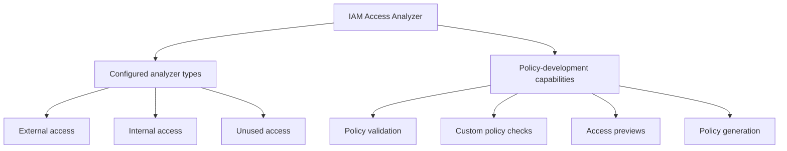
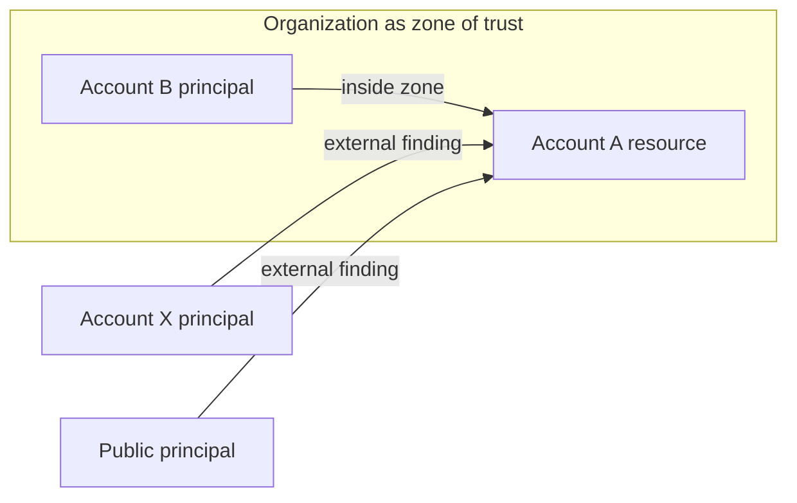
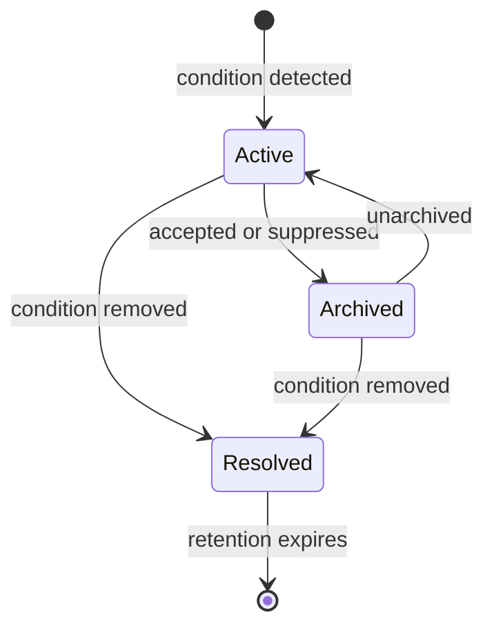
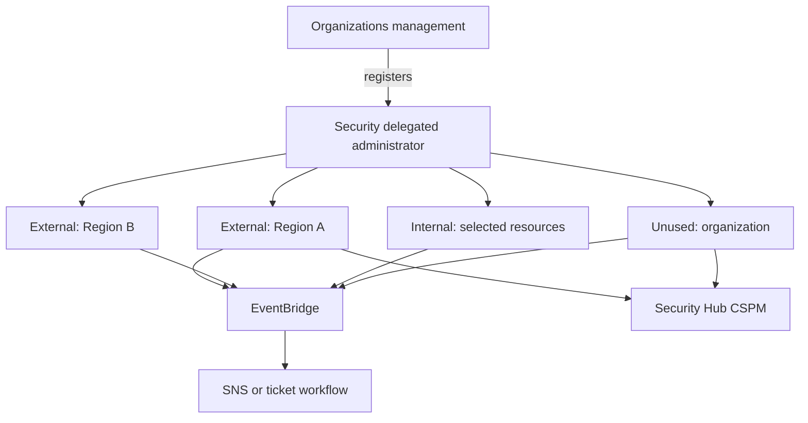

<div align="center">

# AWS IAM Access Analyzer


**Find unintended external access, understand internal access paths, identify unused access, and improve policies.**

</div>

> [!IMPORTANT]
> IAM Access Analyzer does not grant, block, or automatically repair access. It analyzes policies or usage evidence and reports results. Change the relevant IAM or resource policy to change authorization.

## Contents

1. [What Is IAM Access Analyzer?](#1-what-is-iam-access-analyzer)
2. [What Problem Does It Solve?](#2-what-problem-does-it-solve)
3. [Core Concepts and Components](#3-core-concepts-and-components)
4. [How It Works](#4-how-it-works)
5. [Key Features, Capabilities, and Restrictions](#5-key-features-capabilities-and-restrictions)
6. [Real-World Use Cases](#6-real-world-use-cases)
7. [CCP Essentials](#7-ccp-essentials)
8. [SAA Deep Dive](#8-saa-deep-dive)
9. [Comparisons with Related Services](#9-comparisons-with-related-services)
10. [Integration and Architecture Patterns](#10-integration-and-architecture-patterns)
11. [Security, Permissions, and Shared Responsibility](#11-security-permissions-and-shared-responsibility)
12. [Operations, Auditing, and Troubleshooting](#12-operations-auditing-and-troubleshooting)
13. [Pricing and Cost Optimization](#13-pricing-and-cost-optimization)
14. [Console, CLI, and Policy Examples](#14-console-cli-and-policy-examples)
15. [Common Exam Traps and Misconceptions](#15-common-exam-traps-and-misconceptions)
16. [Technical Interview Questions](#16-technical-interview-questions)
17. [Practice Questions](#17-practice-questions)
18. [Architecture Scenario Drills](#18-architecture-scenario-drills)
19. [Decision Tree and Keyword Recognition](#19-decision-tree-and-keyword-recognition)
20. [Quick-Revision Cheat Sheet](#20-quick-revision-cheat-sheet)
21. [Official References and Currency Note](#21-official-references-and-currency-note)
22. [Closing Study Takeaway](#22-closing-study-takeaway)

<a id="1-what-is-iam-access-analyzer"></a>
## 1. What Is IAM Access Analyzer?

IAM Access Analyzer is a set of AWS capabilities that reasons about IAM and resource policies, reports selected access paths, checks policy documents, and uses recent activity to help refine permissions.

Think of it as a **security reviewer for access**. It can answer:

- Can a principal outside my account or organization reach a supported resource?
- Which principals inside my environment can reach a selected sensitive resource?
- Which IAM roles, credentials, or permissions appear unused?
- Does a proposed policy contain an error or introduce new access?
- What policy template reflects recently observed CloudTrail activity?

The service contains **three separately configured analyzer types** and several additional capabilities. It is not one universal analyzer.

<a id="2-what-problem-does-it-solve"></a>
## 2. What Problem Does It Solve?

AWS authorization is distributed across identity policies, resource policies, role trust policies, permissions boundaries, session policies, service control policies (SCPs), resource control policies (RCPs), and service controls. Manual review becomes difficult at scale.

Access Analyzer helps teams discover unintended sharing, map supported internal paths, remove stale access, check policies before deployment, preview external exposure, and derive a least-privilege starting point from activity.

It does not prove that an environment is secure, that a principal used reported access, or that a generated policy contains every future permission an application will need.

<a id="3-core-concepts-and-components"></a>
## 3. Core Concepts and Components

### Analyzer types versus capabilities

| Category | Function | Main question | Evidence |
|---|---|---|---|
| Analyzer type | External access | Who outside the zone of trust could access a supported resource? | Policy reasoning |
| Analyzer type | Internal access | Which in-scope internal IAM principals could access selected resources? | Applicable policy layers |
| Analyzer type | Unused access | Which IAM identities, credentials, or permissions have not been used? | Last-accessed information |
| Capability | Policy validation | Does a policy violate IAM grammar or best-practice checks? | Static checks |
| Capability | Custom policy checks | Does a policy grant new, prohibited, or public access? | Automated reasoning |
| Capability | Access previews | What external findings would a proposed configuration generate? | Proposed configuration |
| Capability | Policy generation | What template reflects observed activity? | CloudTrail and service last-accessed data |



### Zone of trust

The **zone of trust** is the boundary used by an external analyzer: either the current AWS account or the AWS Organizations organization. A principal outside that boundary is external.



An external finding can represent legitimate sharing. It means the policy permits a path beyond the selected boundary, not that compromise occurred.

### Finding status

- **Active** — the condition exists and is not archived.
- **Archived** — a reviewer accepted or suppressed it; authorization is unchanged.
- **Resolved** — the access or unused condition was removed.
- **Error finding** — analysis could not complete; correcting the analysis error removes this finding.

Archive rules automatically archive matching new findings and can optionally apply to existing active findings. Use narrow rules so public access is not accidentally hidden.

### Potential access versus observed activity

External and internal analyzers reason about **possible/effective policy paths**; they are not access logs. Unused analysis and policy generation use activity evidence, but absence of activity is not proof that permission will never be needed.

<a id="4-how-it-works"></a>
## 4. How It Works

### External access

1. Create an `ACCOUNT` or `ORGANIZATION` analyzer in a Region.
2. Its account or organization becomes the zone of trust.
3. Access Analyzer evaluates supported resources in that Region.
4. It creates findings for public access or principals outside the zone.
5. Archive approved access or change the policy to remove unintended access.
6. After reanalysis, removed access becomes resolved.

AWS uses automated-reasoning technology called **Zelkova** to translate policies into logical statements. Findings describe permitted access, not proof that a principal exercised it.

### Internal access

1. Create an `ACCOUNT_INTERNAL_ACCESS` or `ORGANIZATION_INTERNAL_ACCESS` analyzer.
2. Select supported resources by exact ARN or supported scope.
3. Review which in-scope IAM users and roles can reach them.
4. Modify the appropriate identity, resource, boundary, SCP, or RCP control.

Internal analysis considers applicable identity policies, resource policies, permissions boundaries, SCPs, and RCPs. An organization in scope cannot exceed the documented combined limit of 70,000 IAM users and roles.

### Unused access

1. Create an `ACCOUNT_UNUSED_ACCESS` or `ORGANIZATION_UNUSED_ACCESS` analyzer.
2. Set a tracking period from 1 through 365 days.
3. Optionally exclude organization accounts or principals by tags.
4. Review inactive roles, unused user credentials, and unused permissions.
5. Validate business need, remediate safely, and wait for the next analysis.

Only identities that existed for the entire tracking period are evaluated. Service-linked roles are excluded. Results do not vary by Region.



Resolved findings are deleted 90 days after their last status update. External changes are normally analyzed in about 30 minutes; Multi-Region Access Point and certain S3 cases can take up to six hours, while RCP-only changes or missed notifications can wait for a periodic scan within 24 hours. Internal rescans can take minutes or hours and all policies are automatically rescanned every 24 hours.

<a id="5-key-features-capabilities-and-restrictions"></a>
## 5. Key Features, Capabilities, and Restrictions

### External supported resources

Current resource types, checked 2026-11-06:

- S3 general purpose buckets and directory buckets
- IAM roles (trust policies), KMS keys, Lambda functions and layers
- SQS queues, SNS topics, and Secrets Manager secrets
- EBS volume snapshots, RDS DB snapshots, and DB cluster snapshots
- ECR repositories and EFS file systems
- DynamoDB tables and streams

S3 analysis includes applicable bucket policies, ACLs, access points, and Multi-Region Access Points. S3 Block Public Access can prevent public access. IAM roles are global, so an eligible role finding can appear in each enabled Region.

### Internal supported resources

Current selected resource types are narrower:

- S3 general purpose buckets and directory buckets
- RDS DB snapshots and DB cluster snapshots
- DynamoDB tables and streams

For S3, exact bucket ARNs are supported; object and prefix ARNs are not. Never assume internal and external analyzers support identical resources.

### Unused finding categories

- `UnusedIAMRole`
- `UnusedIAMUserAccessKey`
- `UnusedIAMUserPassword`
- `UnusedPermission`

One unused analyzer per partition and scope is normally sufficient because IAM identity evidence is global.

### Policy validation

`ValidatePolicy` reports **errors**, **security warnings**, **general warnings**, and **suggestions** for IAM grammar and AWS best practices. It does not prove least privilege or calculate every runtime result. Console validation supports managed policies and inline user/role policies; use the API/CLI when the desired policy type is not exposed there.

| Review layer | Question | Tool |
|---|---|---|
| JSON syntax | Can a JSON parser read the document? | JSON parser/linter |
| IAM grammar | Are policy elements, actions, and combinations structurally valid? | `ValidatePolicy` errors |
| Security quality | Does AWS identify risky or improvable patterns? | Validation warnings/suggestions and custom checks |
| Effective authorization | Will this principal’s request succeed with all policy layers and context? | Policy evaluation, Simulator/controlled test, and CloudTrail evidence |

### Custom policy checks

Paid, assertion-oriented checks for CI/CD include:

- **Check no new access** — compare a proposed policy with a reference.
- **Check access not granted** — assert that named actions/resources are not granted.
- **Check no public access** — assert that a resource policy is not public.

These are environment-agnostic. Conditions such as `aws:PrincipalOrgId` can limit what the engine concludes; treat indeterminate results conservatively.

### Access previews

An access preview predicts external findings before a proposed resource configuration is deployed. The API supports S3 buckets, KMS keys, IAM roles, SQS queues, and Secrets Manager secrets; S3 also has a console workflow. It requires an external analyzer and is not a general request simulator.

### Policy generation

Policy generation reviews up to 90 days of CloudTrail activity plus service last-accessed information. It returns an editable template with action-level detail for supported services and service-level placeholders otherwise. Denied CloudTrail events can contribute activity evidence, so each generated permission still needs review.

Limitations:

- Unobserved future, seasonal, recovery, and break-glass actions can be absent.
- CloudTrail data events are not used for action-level generation.
- `iam:PassRole` is not tracked by CloudTrail and is not generated.
- Generated policies remain available in the console for seven days.
- One console generation can run at a time.
- AWS Control Tower-created trails are not supported.
- A service role must permit access to the chosen trail logs and last-accessed data.

Review, edit, test, stage, and monitor the result. It is not automatically attached and is not an audit report.

### What it cannot tell you

- It does not prove that possible access was used; use CloudTrail.
- It does not block access; use IAM/resource policies and guardrails.
- It does not detect malware or anomalous behavior; consider GuardDuty.
- It does not discover sensitive data contents; consider Macie.
- It does not support every AWS resource or policy-analysis question.

<a id="6-real-world-use-cases"></a>
## 6. Real-World Use Cases

- Find a public or cross-account S3 bucket.
- Review whether an IAM role trusts an outside vendor account.
- Determine which internal roles can reach a sensitive DynamoDB table.
- Identify old access keys, roles, and permissions.
- Fail a deployment when a policy adds access beyond an approved reference.
- Preview a bucket-policy change.
- Generate a least-privilege starting point from representative activity.
- Centralize organization findings in a delegated security account.

Do not choose Access Analyzer merely because a question says “access.” Choose it for policy exposure, supported internal paths, unused IAM access, policy checks, previews, or policy generation.

<a id="7-ccp-essentials"></a>
## 7. CCP Essentials

1. IAM grants and controls access; Access Analyzer **analyzes** access.
2. External means outside the selected account or organization boundary.
3. A finding may represent approved access; review it.
4. Archiving does not revoke access.
5. Removing permission resolves a finding after reanalysis.
6. CloudTrail records API activity; Security Hub aggregates findings.
7. Access Analyzer supports least privilege through unused analysis, checks, and generation.
8. External findings and basic policy validation have no additional Access Analyzer charge; some other capabilities are paid.

**Memory trick:** “Analyzer does not allow—it audits access.” More precisely, it analyzes; policies authorize or deny.

<a id="8-saa-deep-dive"></a>
## 8. SAA Deep Dive

### Region and scope

| Analyzer | Scope | Region behavior | Design consequence |
|---|---|---|---|
| External | Account or organization | Regional supported-resource analysis | Enable in every relevant Region; global role findings may repeat |
| Internal | Account or organization | Regional selected-resource analysis | Enable in required Regions and select exact supported resources |
| Unused | Account or organization | Identity evidence is not Regional | One analyzer per partition/scope is normally sufficient |

### Account A shares S3 with Account B

- With **Account A** as zone, Account B is external and produces a finding.
- With an **organization containing A and B** as zone, that share alone is internal and produces no external finding.
- Public access remains external in both cases.
- The finding proves policy-enabled exposure, not object access.

### Organization administration

An organization analyzer is managed by the Organizations management account or a registered delegated administrator. Only the management account can register, remove, or change the delegate. A security-tooling account is a common delegate.

Changing the delegated administrator disables the former delegate’s organization analyzers; the new delegate must create analyzers. Avoid duplicate paid analyzers unless intentional.

An organization can have only one organization-level internal access analyzer. Design its selected-resource scope centrally rather than expecting separate organization internal analyzers for each team.

### Service-linked role

Analyzers use `AWSServiceRoleForAccessAnalyzer`. Organization analysis can create it in member accounts. Deleting or blocking it can disable analysis or cause errors.

### Authorization nuance

Findings do not replace request authorization. Cross-account access commonly needs permission on both sides, and explicit denies or service controls can still block it. External analysis describes resource-side exposure; internal analysis maps supported paths; Policy Simulator answers a request-specific question.

<a id="9-comparisons-with-related-services"></a>
## 9. Comparisons with Related Services

| Service or feature | Best question | Enforces? | Distinction |
|---|---|---:|---|
| IAM policies/roles | Who should be allowed? | Yes | Defines identity authorization and trust |
| Policy Simulator | Would this action/resource request be allowed with supplied context? | No | Request simulation, not broad exposure discovery |
| Access Analyzer | What external/internal/unused access or policy issue exists? | No | Policy reasoning and refinement |
| CloudTrail | What API activity was recorded? | No | Audit events, not possible permissions |
| AWS Config | Did configuration change or violate a rule? | No | Configuration history/compliance |
| Security Hub CSPM | Where are security findings aggregated? | No | Aggregates; does not replace analyzer details |
| GuardDuty | Is suspicious activity indicated? | No | Threat detection |
| Macie | Does S3 contain sensitive data? | No | Data discovery and S3 security |
| S3 Block Public Access | Should public S3 access be blocked? | Yes | Preventive S3 control |
| Organizations SCP/RCP | What maximum access should be constrained? | Yes | Organization guardrails |
| Control Tower | How is a governed landing zone built? | Through controls | Governance orchestration |

For “can this role call one API on one resource?”, use Policy Simulator or a controlled test plus logs. Use validation for policy quality and CloudTrail for recorded activity.

<a id="10-integration-and-architecture-patterns"></a>
## 10. Integration and Architecture Patterns



External/internal analyzers cover required Regions; one organization unused analyzer covers IAM identities in the partition. EventBridge carries new, updated, and deleted finding events plus preview status changes. New or updated finding events normally arrive within about an hour, separate from analysis latency.

When both services are enabled, Security Hub integration is automatic. It receives supported external and unused findings, not the complete Access Analyzer view. For multiple cross-account principals, Security Hub can surface one external principal at a time until that finding is resolved; investigate the complete list and internal findings in Access Analyzer.

### CI/CD gate

1. Parse JSON.
2. Call `ValidatePolicy`.
3. Run the relevant custom policy check.
4. For supported resource policies, create an access preview.
5. Require review for indeterminate or sensitive changes.
6. Deploy through IaC and monitor findings.

### Policy refinement loop

Observe a representative period, generate a template, add justified unobserved/recovery and `iam:PassRole` needs, test outside production, deploy gradually, and monitor `AccessDenied` plus CloudTrail.

<a id="11-security-permissions-and-shared-responsibility"></a>
## 11. Security, Permissions, and Shared Responsibility

AWS provides `IAMAccessAnalyzerFullAccess` and `IAMAccessAnalyzerReadOnlyAccess`. Prefer narrow administration where practical. Separate permission to manage analyzers/archive rules, read findings, change policies, run paid checks, and pass the generation role.

The generation operator needs appropriate Access Analyzer actions and `iam:PassRole`. The service role trusts `access-analyzer.amazonaws.com` and should receive only required CloudTrail/S3 and last-accessed permissions.

AWS operates the service and reasoning engine. Customers choose types, scope, Regions, resources, and tracking period; maintain required roles; review and remediate findings; protect logs; control archives and costs; and test policy changes.

Never delete a key, role, or permission solely because it appears unused. Confirm ownership, workload cycles, emergencies, and observation coverage; stage the change and preserve rollback.

```json
{
  "Version": "2012-10-17",
  "Statement": [
    {
      "Sid": "ListOneBucket",
      "Effect": "Allow",
      "Action": "s3:ListBucket",
      "Resource": "arn:aws:s3:::example-reports"
    },
    {
      "Sid": "ReadReportObjects",
      "Effect": "Allow",
      "Action": "s3:GetObject",
      "Resource": "arn:aws:s3:::example-reports/reports/*"
    }
  ]
}
```

Validation can inspect this policy’s syntax and patterns. It cannot prove the application needs nothing else or that another layer will not deny it.

<a id="12-operations-auditing-and-troubleshooting"></a>
## 12. Operations, Auditing, and Troubleshooting

### Review workflow

1. Identify analyzer type, scope, Region, resource, principal, action, and condition.
2. Determine whether access is approved.
3. Inspect all relevant policy and preventive controls.
4. Correlate CloudTrail for actual-use questions.
5. Archive intentional access or remediate unintended access.
6. Confirm reanalysis; use `StartResourceScan` where supported.
7. Record owner, decision, evidence, and review date.

For intentional cross-account sharing, validate principal, actions, resources, conditions, and owner, then archive the finding or use a narrow archive rule. **Archiving changes only finding status; permission remains.**

After an unintended S3 statement is removed, the finding stays active until reanalysis confirms the path is gone, then becomes resolved. Use a supported resource scan or wait. CloudTrail is still required to investigate whether access occurred.

| Symptom | Likely cause | Verify | Remediation |
|---|---|---|---|
| No external finding | Wrong Region/type, disabled analyzer, principal inside zone | Type/status/Region/support/zone | Enable correct analyzer or use another control |
| Account B not external | A and B are in organization zone | Zone and membership | Use account-zone analyzer if required |
| Internal resource unavailable | Type or ARN granularity unsupported | Current list and exact ARN | Select supported resource or use other analysis |
| Duplicate role findings | Global IAM role, Regional external analyzers | ARN and Regions | Correlate; retain needed Regional coverage |
| Finding remains active | Rescan pending or another grant exists | Policies, timestamp, scan | Wait/scan/remove remaining path |
| Unused result seems wrong | Tracking eligibility or business cycle | Creation date and period | Use representative period; verify owner |
| Generated policy misses action | Unobserved/data event/unsupported/`PassRole` | Trail and output | Add justified action and test |
| `AccessDenied` after validation | Validation is not authorization | CloudTrail/simulator/all policy layers | Fix actual denying layer |
| Organization analyzer disabled | Delegate changed or role issue | Registration/status/role | Re-register, recreate, or restore role |
| Security Hub lacks detail | Normalized subset only | Access Analyzer view | Investigate in source service |
| Custom check indeterminate | Context cannot be fully reasoned | API reason/condition keys | Fail safely and review |

CloudTrail records Access Analyzer administrative APIs, finding-status changes, checks, previews, and generation jobs. EventBridge supports workflow; CloudTrail remains the audit record.

<a id="13-pricing-and-cost-optimization"></a>
## 13. Pricing and Cost Optimization

Pricing model checked 2026-11-06:

| Capability | Access Analyzer charge | Possible related charge |
|---|---|---|
| External findings | No additional charge | Workflow/logging |
| Internal analysis | Per monitored resource, analyzer, Region, month | Workflow tooling |
| Unused analysis | Per IAM user or role, analyzer, month | Workflow tooling |
| Basic validation | No additional charge | CI/CD tooling |
| Custom checks | Per check/API call | CI/CD tooling |
| Access previews | Check current pricing page | Workflow tooling |
| Policy generation | No additional Access Analyzer charge | S3 requests/data transfer for trail logs |

Rates vary and can change, so no numerical price is embedded. Avoid duplicate unused/organization analyzers, monitor only justified internal resources, and control paid check frequency. Do not remove needed Regional security coverage merely to save money.

<a id="14-console-cli-and-policy-examples"></a>
## 14. Console, CLI, and Policy Examples

> [!CAUTION]
> Commands are instructional. Creating analyzers or changing finding state writes AWS state and may incur charges. Replace examples and obtain approval.

Console paths: IAM → Access Analyzer → **Resource analysis – External access**, **Resource analysis – Internal access**, or **Unused access**. Policy validation appears while editing supported IAM policies; policy generation starts from a user or role.

```bash
aws accessanalyzer list-analyzers --region us-east-1

aws accessanalyzer get-analyzer \
  --analyzer-name security-external \
  --region us-east-1

aws accessanalyzer create-analyzer \
  --analyzer-name security-external \
  --type ACCOUNT \
  --region us-east-1
```

Other types are `ORGANIZATION`, `ACCOUNT_INTERNAL_ACCESS`, `ORGANIZATION_INTERNAL_ACCESS`, `ACCOUNT_UNUSED_ACCESS`, and `ORGANIZATION_UNUSED_ACCESS`. Internal/unused analyzers require type-appropriate configuration; use and review a CLI skeleton.

Use legacy finding APIs for external findings and V2 for internal/unused findings:

```bash
aws accessanalyzer list-findings --analyzer-arn <external-analyzer-arn>
aws accessanalyzer get-finding --analyzer-arn <external-analyzer-arn> --id <finding-id>

aws accessanalyzer list-findings-v2 --analyzer-arn <internal-or-unused-analyzer-arn>
aws accessanalyzer get-finding-v2 --analyzer-arn <internal-or-unused-analyzer-arn> --id <finding-id>
```

V2 IAM authorization action names remain `access-analyzer:ListFindings` and `access-analyzer:GetFinding`.

Archive an approved finding with the matching analyzer ARN and finding ID:

```bash
aws accessanalyzer update-findings \
  --analyzer-arn <analyzer-arn> \
  --ids <finding-id> \
  --status ARCHIVED
```

This changes finding state only. It does not edit the resource or its policy.

```bash
aws accessanalyzer validate-policy \
  --policy-document file://candidate-policy.json \
  --policy-type IDENTITY_POLICY

aws accessanalyzer check-no-new-access \
  --new-policy-document file://candidate-policy.json \
  --existing-policy-document file://reference-policy.json \
  --policy-type IDENTITY_POLICY

aws accessanalyzer check-access-not-granted \
  --policy-document file://candidate-policy.json \
  --access file://prohibited-access.json \
  --policy-type IDENTITY_POLICY

aws accessanalyzer check-no-public-access \
  --policy-document file://bucket-policy.json \
  --resource-type AWS::S3::Bucket
```

```bash
aws accessanalyzer create-access-preview \
  --analyzer-arn <external-analyzer-arn> \
  --configurations file://proposed-configurations.json

aws accessanalyzer list-access-previews --analyzer-arn <external-analyzer-arn>
aws accessanalyzer get-access-preview --analyzer-arn <external-analyzer-arn> --access-preview-id <preview-id>
aws accessanalyzer list-access-preview-findings --analyzer-arn <external-analyzer-arn> --access-preview-id <preview-id>

aws accessanalyzer start-resource-scan \
  --analyzer-arn <external-analyzer-arn> \
  --resource-arn arn:aws:s3:::example-reports
```

```bash
aws accessanalyzer start-policy-generation \
  --policy-generation-details '{"principalArn":"arn:aws:iam::111122223333:role/AppRole"}' \
  --cloud-trail-details file://cloudtrail-details.json

aws accessanalyzer list-policy-generations
aws accessanalyzer get-generated-policy --job-id <job-id>
```

Example `cloudtrail-details.json`:

```json
{
  "accessRole": "arn:aws:iam::111122223333:role/AccessAnalyzerTrailRole",
  "startTime": "2026-08-08T00:00:00Z",
  "trails": [
    {
      "allRegions": true,
      "cloudTrailArn": "arn:aws:cloudtrail:us-east-1:111122223333:trail/organization-trail"
    }
  ]
}
```

Confirm trail, S3 location, role trust/permissions, and dates before starting. Use `cancel-policy-generation` for an unneeded job.

<a id="15-common-exam-traps-and-misconceptions"></a>
## 15. Common Exam Traps and Misconceptions

1. **“It grants permissions.”** It analyzes; policies grant or deny.
2. **“It automatically remediates.”** Findings require customer decisions and changes.
3. **“There is one analyzer for everything.”** External, internal, and unused are distinct types.
4. **“External means outside the Region.”** It means outside the account/organization zone of trust.
5. **“Cross-account always produces a finding.”** Not when both accounts are inside an organization zone.
6. **“A finding proves use.”** External/internal findings describe possible access.
7. **“A finding proves malicious activity.”** Approved sharing can also create findings.
8. **“Archive revokes permission.”** Archive changes finding status only.
9. **“Resolved means archived.”** Resolved means the triggering condition was removed.
10. **“An archive rule changes policies.”** It only manages matching findings.
11. **“All resource types are supported.”** Coverage is explicit and finite.
12. **“Internal and external support the same resources.”** Internal support is narrower.
13. **“Internal analysis is an activity log.”** It reasons about possible paths.
14. **“Unused means safe to delete.”** Validate business cycles and emergencies first.
15. **“Unused analysis includes service-linked roles.”** It excludes them.
16. **“Create unused analyzers in every Region.”** Evidence is global within a partition.
17. **“One external analyzer covers all Regions.”** External analysis is Regional.
18. **“IAM roles are Regional.”** Roles are global and findings may repeat by analyzer Region.
19. **“Validation proves authorization.”** It checks grammar and best-practice findings.
20. **“Valid JSON is a valid IAM policy.”** IAM grammar and semantics are additional layers.
21. **“No validation findings means least privilege.”** It does not prove necessity.
22. **“Basic validation and custom checks cost the same.”** Basic validation is free; custom checks are paid.
23. **“Custom checks simulate the account.”** They are environment-agnostic assertions.
24. **“No-new-access means no operational regression.”** It compares granted access, not workload needs.
25. **“Access preview works for every service.”** It supports a defined subset.
26. **“Preview answers whether a caller succeeds.”** It predicts external findings.
27. **“Generated policy is production-ready.”** It requires review and testing.
28. **“Generation observes every action.”** Data events and `iam:PassRole` are important gaps.
29. **“No CloudTrail event means no permission needed.”** The observation window may be incomplete.
30. **“CloudTrail and Access Analyzer are interchangeable.”** Activity history differs from policy reasoning.
31. **“Security Hub contains every analyzer detail.”** Its integration is a normalized subset.
32. **“S3 Block Public Access and Access Analyzer do the same job.”** One enforces; one analyzes.
33. **“SCPs grant access.”** SCPs set ceilings and can affect internal paths; they do not grant.
34. **“Changing delegated administrator transfers analyzers.”** The new delegate must create them.
35. **“External analysis is always paid.”** External findings have no additional charge.

<a id="16-technical-interview-questions"></a>
## 16. Technical Interview Questions

1. **How do the three analyzer types differ?** External evaluates access beyond an account/organization boundary; internal maps in-scope principals to selected supported resources; unused uses last-accessed evidence for IAM identities and permissions.
2. **What is a zone of trust?** The account or organization boundary against which an external principal is classified.
3. **Does a finding mean a breach occurred?** No. It identifies a policy-enabled path or an unused condition; CloudTrail and other evidence establish activity.
4. **Archive or resolve?** Archive documented, intentional access; remove the triggering access/condition to resolve it.
5. **Why deploy external analyzers per Region?** They analyze supported Regional resources in their Region; one Region does not cover all others.
6. **Why not deploy unused analyzers per Region?** IAM identity usage results do not change by Region, while duplicate analyzers add charges.
7. **Validation versus a custom no-new-access check?** Validation checks syntax and best practices; the custom check compares semantic access against a reference and is paid.
8. **Access preview versus Policy Simulator?** Preview predicts external findings from supported proposed resource configurations; Simulator evaluates a request-shaped action/resource decision.
9. **What can policy generation miss?** Unobserved paths, data-event actions, `iam:PassRole`, future/seasonal/recovery actions, and action detail for unsupported services.
10. **How would you centralize Access Analyzer?** Register a security account as delegated administrator, deploy type/Region-appropriate organization analyzers, route events through EventBridge, and aggregate supported findings in Security Hub.
11. **How do you verify remediation?** Inspect the policy, request a supported resource scan or await reanalysis, confirm resolved status, and use CloudTrail separately for historical-use investigation.
12. **What would make a custom check indeterminate?** A policy or context the reasoning engine cannot fully evaluate, including some organization-related condition reasoning; fail safely and review.

<a id="17-practice-questions"></a>
## 17. Practice Questions

These are original study questions, not official AWS exam questions.

<details><summary>1. Which capability finds an S3 bucket shared outside an organization?</summary>

**Answer:** An organization-scoped external access analyzer in the bucket’s Region. It evaluates access beyond the organization zone.
</details>

<details><summary>2. What happens when an approved external finding is archived?</summary>

**Answer:** It leaves the active list but the permission remains. Archiving is findings management, not authorization.
</details>

<details><summary>3. Which service shows whether the reported external principal actually called an API?</summary>

**Answer:** AWS CloudTrail, assuming the relevant event was logged. Access Analyzer reports possible access.
</details>

<details><summary>4. Accounts A and B are in the analyzer’s organization zone. Will A-to-B sharing alone be external?</summary>

**Answer:** No. B is inside that zone of trust.
</details>

<details><summary>5. Which analyzer identifies internal roles that can reach a selected DynamoDB table?</summary>

**Answer:** An internal access analyzer with the supported table selected.
</details>

<details><summary>6. Can an internal analyzer select an S3 object-prefix ARN?</summary>

**Answer:** No. It supports exact bucket ARNs, not object or prefix ARNs.
</details>

<details><summary>7. Which analyzer reports an IAM access key unused during the configured period?</summary>

**Answer:** An unused access analyzer.
</details>

<details><summary>8. Why should an architect avoid one unused analyzer per Region?</summary>

**Answer:** Results are not Regional, while billing applies per identity analyzed per analyzer.
</details>

<details><summary>9. Does unused analysis include service-linked roles?</summary>

**Answer:** No.
</details>

<details><summary>10. An identity was created halfway through a 90-day tracking period. Is it eligible for that full-period analysis?</summary>

**Answer:** No. The identity must have existed for the entire configured period.
</details>

<details><summary>11. Which free capability finds IAM grammar errors?</summary>

**Answer:** Basic policy validation (`ValidatePolicy`).
</details>

<details><summary>12. Which check compares a candidate policy with the existing policy?</summary>

**Answer:** The paid no-new-access custom policy check.
</details>

<details><summary>13. Which check asserts that a bucket policy does not grant public access?</summary>

**Answer:** Check no public access.
</details>

<details><summary>14. Does a successful validation guarantee the request will be allowed?</summary>

**Answer:** No. Boundaries, session policies, SCPs, RCPs, resource policies, KMS policies, and explicit denies still matter.
</details>

<details><summary>15. Which capability predicts external findings before a supported bucket policy is deployed?</summary>

**Answer:** An access preview using an external analyzer.
</details>

<details><summary>16. Is access preview a universal IAM request simulator?</summary>

**Answer:** No. It evaluates supported proposed resource configurations for external access.
</details>

<details><summary>17. What is the maximum policy-generation observation window?</summary>

**Answer:** Up to 90 days.
</details>

<details><summary>18. Why might a generated policy omit `iam:PassRole`?</summary>

**Answer:** That permission is not tracked by CloudTrail for policy generation and must be reviewed manually.
</details>

<details><summary>19. Are CloudTrail data events used for action-level generation?</summary>

**Answer:** No.
</details>

<details><summary>20. Can a generated policy be attached without review?</summary>

**Answer:** Technically it is a template, but operationally it must be reviewed, completed, tested, and staged.
</details>

<details><summary>21. Which finding API is required for internal and unused analyzers?</summary>

**Answer:** `ListFindingsV2`/`GetFindingV2` (CLI `list-findings-v2` and `get-finding-v2`).
</details>

<details><summary>22. After an unintended policy is removed, what status should appear?</summary>

**Answer:** Resolved after reanalysis confirms the path is gone.
</details>

<details><summary>23. How long are resolved findings retained after their last status update?</summary>

**Answer:** 90 days.
</details>

<details><summary>24. Which integration can trigger an SNS or ticket workflow for finding changes?</summary>

**Answer:** Amazon EventBridge.
</details>

<details><summary>25. Does Security Hub replace the Access Analyzer console?</summary>

**Answer:** No. It aggregates supported normalized findings; full detail remains in Access Analyzer.
</details>

<details><summary>26. Who can register an Access Analyzer delegated administrator?</summary>

**Answer:** Only the AWS Organizations management account.
</details>

<details><summary>27. What happens when the delegated administrator changes?</summary>

**Answer:** The former delegate’s organization analyzers are disabled; the new delegate creates new analyzers.
</details>

<details><summary>28. Which role enables Access Analyzer service operations?</summary>

**Answer:** The `AWSServiceRoleForAccessAnalyzer` service-linked role.
</details>

<details><summary>29. External analysis is enabled in us-east-1 only, but a bucket is in eu-west-1. Is it covered?</summary>

**Answer:** No. Create an external analyzer in eu-west-1 for that Regional resource.
</details>

<details><summary>30. Why can a global IAM role finding appear in multiple Regions?</summary>

**Answer:** Each Regional external analyzer evaluates the global role’s trust policy.
</details>

<details><summary>31. Which service is preventive for public S3 exposure?</summary>

**Answer:** S3 Block Public Access. Access Analyzer is analytical/detective.
</details>

<details><summary>32. A role receives `AccessDenied`; which tool should lead the investigation?</summary>

**Answer:** Inspect CloudTrail/error context and all authorization layers, optionally with Policy Simulator. Clean Access Analyzer validation does not mean the request is allowed.
</details>

<a id="18-architecture-scenario-drills"></a>
## 18. Architecture Scenario Drills

### Scenario 1 — Public S3 bucket exposure

| Element | Design |
|---|---|
| Business/resources/question | A reports bucket must be private. The S3 bucket policy or ACL may expose it publicly. Can anyone outside the zone read it? |
| Capability/configuration | Create an external analyzer in the bucket’s Region and keep S3 Block Public Access enabled as a preventive control. |
| Result/why | A public-access finding identifies the policy path because public principals are outside every account/organization zone. |
| Alternatives/limits/cost | Config can test configuration and CloudTrail can show use, but neither replaces policy reasoning. External findings have no additional charge; related tooling may charge. |
| Exam relevance | CCP: analysis versus enforcement. SAA: combine detective analysis with Block Public Access and logging. |

### Scenario 2 — Cross-account S3 sharing

| Element | Design |
|---|---|
| Business/resources/question | Account A intentionally shares a bucket with analytics Account B. Is B external? |
| Capability/configuration | Use an external analyzer in the bucket Region. Choose Account A as the zone to report B, or an organization zone containing both to treat B as internal. |
| Result/why | The finding depends on the zone, not merely the presence of a different account ID. Review both resource-side and principal-side authorization. |
| Alternatives/limits/cost | CloudTrail proves recorded reads, not potential access. Archive approved sharing without pretending permission was revoked. External analysis is free. |
| Exam relevance | CCP: organization as trust boundary. SAA: two-sided cross-account authorization and documented exceptions. |

### Scenario 3 — IAM role trusts an external account

| Element | Design |
|---|---|
| Business/resources/question | A vendor assumes a role. Does its trust policy expose assumption beyond the approved party? |
| Capability/configuration | Enable an external analyzer; inspect the role finding, principal, conditions, external ID, and organization boundary. |
| Result/why | Role trust policies are supported and the analyzer reports principals outside the zone. |
| Alternatives/limits/cost | Policy Simulator does not broadly inventory external trust. A finding does not prove `AssumeRole` occurred; use CloudTrail. Role findings can repeat across Regions; external analysis is free. |
| Exam relevance | SAA: third-party trust, confused-deputy protection, and global-role/Regional-analyzer behavior. |

### Scenario 4 — Internal access to sensitive S3 resources

| Element | Design |
|---|---|
| Business/resources/question | Security needs to know which internal roles can reach a finance bucket. |
| Capability/configuration | Create an internal analyzer in the bucket Region and select the exact bucket ARN; ensure organization principal count is supported. |
| Result/why | Findings map eligible IAM users/roles through applicable identity, resource, boundary, SCP, and RCP paths. |
| Alternatives/limits/cost | External analysis will not answer internal reachability. Object/prefix selection is unsupported. Internal analysis charges per monitored resource/analyzer/Region/month. |
| Exam relevance | SAA: selected-resource reachability and correct analyzer type. |

### Scenario 5 — Unused IAM access keys

| Element | Design |
|---|---|
| Business/resources/question | A company wants to retire dormant long-term IAM user keys safely. |
| Capability/configuration | Use an account/organization unused analyzer with a representative 1–365 day period; identify owners and exclusions. |
| Result/why | `UnusedIAMUserAccessKey` findings use last-accessed evidence after the identity has existed for the whole period. |
| Alternatives/limits/cost | Credential reports help inventory, but analyzer findings support a managed workflow. Disable, observe, then delete; never delete blindly. Charged per analyzed identity/analyzer/month. |
| Exam relevance | CCP: least privilege. SAA: staged credential retirement and global scope. |

### Scenario 6 — Unused IAM roles

| Element | Design |
|---|---|
| Business/resources/question | Hundreds of legacy workload roles may be abandoned. Which are inactive? |
| Capability/configuration | Configure one unused analyzer for the required scope/partition with a period covering business cycles. |
| Result/why | `UnusedIAMRole` findings identify eligible roles without recent use; service-linked roles are excluded. |
| Alternatives/limits/cost | CloudTrail searches alone can miss incomplete retention/Regions. Confirm owners, scheduled jobs, DR, and break-glass paths. Per-identity charges apply. |
| Exam relevance | SAA: evidence-informed cleanup without breaking rare workloads. |

### Scenario 7 — Unused permissions in a workload role

| Element | Design |
|---|---|
| Business/resources/question | An application role works but appears overprivileged. Which grants were unused? |
| Capability/configuration | Use unused analysis over a representative period; pair it with policy generation and application requirements. |
| Result/why | `UnusedPermission` findings identify granted permissions without recorded use during the period. |
| Alternatives/limits/cost | Absence of use is not proof of no need. Stage narrower policies and monitor denials. Unused-analysis charges apply; generation itself has no added charge. |
| Exam relevance | SAA: least-privilege refinement and safe rollout. |

### Scenario 8 — Validate a policy before deployment

| Element | Design |
|---|---|
| Business/resources/question | CI/CD must reject malformed or risky IAM policies. Is the document valid and aligned with AWS checks? |
| Capability/configuration | Parse JSON, call `ValidatePolicy`, and fail on errors or organization-defined warning thresholds. |
| Result/why | Findings identify IAM grammar errors, security/general warnings, and suggestions before deployment. |
| Alternatives/limits/cost | JSON validation alone misses IAM grammar; validation does not prove runtime access or least privilege. Basic validation has no additional charge. |
| Exam relevance | CCP/SAA: distinguish syntactic/policy quality from authorization. |

### Scenario 9 — Check whether a policy change grants new access

| Element | Design |
|---|---|
| Business/resources/question | A modified production policy must not exceed the approved version. Does it add access? |
| Capability/configuration | Run `CheckNoNewAccess` with candidate and reference documents in the deployment gate. |
| Result/why | Automated reasoning compares semantic grants rather than text differences. |
| Alternatives/limits/cost | A normal diff misses equivalent policy forms; validation does not compare versions. The custom check is paid and can be indeterminate. |
| Exam relevance | SAA: preventive least-privilege control in CI/CD. |

### Scenario 10 — Preview a bucket-policy change

| Element | Design |
|---|---|
| Business/resources/question | Before applying a new S3 policy, determine whether it introduces public or cross-account exposure. |
| Capability/configuration | Use an external analyzer and create an S3 access preview with the proposed configuration; inspect preview findings. |
| Result/why | The preview predicts external findings against the analyzer’s zone before deployment. |
| Alternatives/limits/cost | Policy Simulator answers a request question, not broad proposed exposure. Preview is limited to supported resources/configuration; check the current pricing page. |
| Exam relevance | SAA: predeployment resource-policy analysis. |

### Scenario 11 — Generate least privilege from CloudTrail activity

| Element | Design |
|---|---|
| Business/resources/question | A mature application role has a broad policy. What narrower starting template matches recent behavior? |
| Capability/configuration | Supply a representative up-to-90-day trail and least-privilege service role, then run policy generation. |
| Result/why | The result contains action-level detail where supported and service-level placeholders otherwise. Review and test it. |
| Alternatives/limits/cost | It can miss data events, `iam:PassRole`, rare and future paths; Control Tower-created trails are unsupported. Generation is free, but S3 log reads/transfer can charge. |
| Exam relevance | SAA: activity-informed refinement, not automatic correctness. |

### Scenario 12 — Organization-wide access governance

| Element | Design |
|---|---|
| Business/resources/question | A large organization needs centralized external, internal, and unused visibility. |
| Capability/configuration | Register a security-tooling delegated administrator; deploy organization external/internal analyzers per Region and one unused analyzer per partition/scope. |
| Result/why | Central analyzers use the organization boundary and member service-linked roles; EventBridge drives workflow. |
| Alternatives/limits/cost | Account analyzers fragment operations. Changing delegates disables old analyzers. Internal/unused charges apply; avoid duplicates in management and delegated accounts. |
| Exam relevance | SAA: delegated administration, scope, Regions, and cost. |

### Scenario 13 — Multi-Region external monitoring

| Element | Design |
|---|---|
| Business/resources/question | Buckets, KMS keys, and queues span three Regions. How is external exposure covered? |
| Capability/configuration | Create an external analyzer with the intended zone in every resource Region and aggregate events centrally. |
| Result/why | Each Regional analyzer evaluates supported resources there; global role findings may repeat. |
| Alternatives/limits/cost | One analyzer cannot cover all Regions. External analysis is free, but aggregation services can charge. |
| Exam relevance | SAA: Regional service behavior and centralized operations. |

### Scenario 14 — Security Hub integration

| Element | Design |
|---|---|
| Business/resources/question | SOC analysts need Access Analyzer findings in their central queue. |
| Capability/configuration | Enable Security Hub CSPM and Access Analyzer in required accounts/Regions; use the automatic integration and EventBridge for workflow. |
| Result/why | Supported external and unused findings arrive as ASFF findings and status updates are synchronized. |
| Alternatives/limits/cost | Security Hub does not contain every cross-account detail or internal findings; investigate in Access Analyzer. Security Hub pricing applies. |
| Exam relevance | CCP: aggregator versus source. SAA: centralized detection workflow. |

### Scenario 15 — `AccessDenied` troubleshooting versus policy analysis

| Element | Design |
|---|---|
| Business/resources/question | A developer’s role receives `AccessDenied` for one API. Is Access Analyzer the primary diagnostic? |
| Capability/configuration | No. Inspect the API error and CloudTrail, then evaluate identity/resource policies, boundaries, session policies, SCPs/RCPs, KMS, and context; use Policy Simulator where suitable. |
| Result/why | Request-level evidence identifies the denial layer. `ValidatePolicy` can still check a proposed correction. |
| Alternatives/limits/cost | External/internal findings answer broader supported-access questions and may not explain the exact denial. Most diagnostic APIs have no Access Analyzer charge. |
| Exam relevance | CCP/SAA: choose CloudTrail/Simulator for actual request diagnosis, not a generic “access” tool. |

### Scenario 16 — Intentional external sharing to archive

| Element | Design |
|---|---|
| Business/resources/question | A partner account legitimately reads a narrowly scoped dataset. How should the persistent external finding be handled? |
| Capability/configuration | Verify owner, principal, actions, resources, conditions, expiry, and logs. Archive the finding or create a narrow rule that excludes public access. |
| Result/why | It leaves the active queue while preserving evidence and the intentionally configured permission. |
| Alternatives/limits/cost | Deleting the permission breaks the requirement; broad archive rules can hide risk. Schedule review. External findings are free; workflow/log retention can charge. |
| Exam relevance | CCP: findings need judgment. SAA: exception governance and lifecycle. |

<a id="19-decision-tree-and-keyword-recognition"></a>
## 19. Decision Tree and Keyword Recognition

```text
Question about access?
├─ "outside account/organization", public, cross-account → External analyzer
├─ "which internal users/roles can reach selected resource" → Internal analyzer
├─ inactive role/key/password or unused permission → Unused analyzer
├─ grammar, warning, suggestion → ValidatePolicy
├─ new/prohibited/public grant in a proposed policy → Custom policy check
├─ predicted external exposure before resource-policy deployment → Access preview
├─ build a template from recent activity → Policy generation
├─ did an API call happen? → CloudTrail
├─ will this specific action/resource request be allowed? → Policy Simulator/test
├─ aggregate security findings → Security Hub CSPM
└─ prevent public S3 access → S3 Block Public Access
```

| Keyword | Strong candidate | Caution |
|---|---|---|
| “outside trusted account/organization” | External analyzer | Confirm zone and Region |
| “inside organization can reach sensitive bucket” | Internal analyzer | Confirm resource support |
| “not used for 90 days” | Unused analyzer | Verify identity existed for period |
| “before deployment; syntax/best practice” | Validation | Not runtime simulation |
| “beyond current version” | No-new-access check | Paid custom check |
| “before changing bucket policy” | Access preview | Supported configuration only |
| “actual activity” | CloudTrail | Not possible-access inventory |
| “least-privilege template from activity” | Policy generation | Complete and test gaps |

<a id="20-quick-revision-cheat-sheet"></a>
## 20. Quick-Revision Cheat Sheet

| Remember | Answer |
|---|---|
| Three analyzer types | External, internal, unused |
| Zone of trust | Account or organization; external analyzer only |
| Regional | External and internal |
| Not meaningfully Regional | Unused identity findings |
| Finding ≠ use | Use CloudTrail for recorded activity |
| Archive ≠ revoke | Permission remains |
| Remove condition | Finding resolves after reanalysis |
| Basic validation | Grammar/best-practice findings; free |
| Custom checks | Assertions/comparison; paid per check |
| Preview | Predicted external findings for supported proposed resources |
| Generation | Up to 90 days; template, not complete policy |
| Important generation gaps | Data events, `iam:PassRole`, unobserved paths |
| External price | No additional charge |
| Internal price | Per resource/analyzer/Region/month |
| Unused price | Per identity/analyzer/month |
| Main memory model | **Analyzer checks access; policies control access.** |

<a id="21-official-references-and-currency-note"></a>
## 21. Official References and Currency Note

Service behavior, supported resources, analyzer types, integrations, and pricing were checked against official AWS documentation on **2026-11-06**. Recheck date-sensitive coverage and pricing before production use.

- [What is IAM Access Analyzer?](https://docs.aws.amazon.com/IAM/latest/UserGuide/what-is-access-analyzer.html)
- [How findings work and analyzer concepts](https://docs.aws.amazon.com/IAM/latest/UserGuide/access-analyzer-concepts.html)
- [Supported resource types](https://docs.aws.amazon.com/IAM/latest/UserGuide/access-analyzer-resources.html)
- [Create an external access analyzer](https://docs.aws.amazon.com/IAM/latest/UserGuide/access-analyzer-create-external.html)
- [Create an internal access analyzer](https://docs.aws.amazon.com/IAM/latest/UserGuide/access-analyzer-create-internal.html)
- [Create an unused access analyzer](https://docs.aws.amazon.com/IAM/latest/UserGuide/access-analyzer-create-unused.html)
- [Review findings](https://docs.aws.amazon.com/IAM/latest/UserGuide/access-analyzer-findings-view.html)
- [Archive findings](https://docs.aws.amazon.com/IAM/latest/UserGuide/access-analyzer-findings-archive.html)
- [Archive rules](https://docs.aws.amazon.com/IAM/latest/UserGuide/access-analyzer-archive-rules.html)
- [Resolve findings](https://docs.aws.amazon.com/IAM/latest/UserGuide/access-analyzer-findings-remediate.html)
- [Policy validation](https://docs.aws.amazon.com/IAM/latest/UserGuide/access-analyzer-policy-validation.html)
- [Custom policy checks](https://docs.aws.amazon.com/IAM/latest/UserGuide/access-analyzer-checks-validating-policies.html)
- [Access previews](https://docs.aws.amazon.com/IAM/latest/UserGuide/access-analyzer-access-preview.html)
- [Policy generation](https://docs.aws.amazon.com/IAM/latest/UserGuide/access-analyzer-policy-generation.html)
- [Delegated administrator](https://docs.aws.amazon.com/IAM/latest/UserGuide/access-analyzer-delegated-administrator.html)
- [EventBridge monitoring](https://docs.aws.amazon.com/IAM/latest/UserGuide/access-analyzer-eventbridge.html)
- [Security Hub CSPM integration](https://docs.aws.amazon.com/IAM/latest/UserGuide/access-analyzer-securityhub-integration.html)
- [Permissions and getting started](https://docs.aws.amazon.com/IAM/latest/UserGuide/access-analyzer-getting-started.html)
- [IAM Access Analyzer pricing](https://aws.amazon.com/iam/access-analyzer/pricing/)
- [AWS CLI Access Analyzer command reference](https://docs.aws.amazon.com/cli/latest/reference/accessanalyzer/)
- [IAM Access Analyzer API reference](https://docs.aws.amazon.com/access-analyzer/latest/APIReference/Welcome.html)
- [AWS Certified Cloud Practitioner exam guide](https://docs.aws.amazon.com/aws-certification/latest/cloud-practitioner-02/cloud-practitioner-02.html)
- [AWS Certified Solutions Architect – Associate exam guide](https://docs.aws.amazon.com/aws-certification/latest/solutions-architect-associate-03/solutions-architect-associate-03.html)

<a id="22-closing-study-takeaway"></a>
## 22. Closing Study Takeaway

IAM Access Analyzer is best understood as a family of focused analysis tools:

- **External** asks who outside the trust boundary could reach supported resources.
- **Internal** asks which in-scope IAM principals could reach selected supported resources.
- **Unused** asks which IAM identities, credentials, and grants lack recent use.
- **Validation, custom checks, previews, and generation** improve policy design at different stages.

The exam-safe rule is simple: **Access Analyzer analyzes; it does not authorize, block, prove use, or automatically remediate.** Choose the exact analyzer type or capability that matches the question, then combine it with IAM controls, CloudTrail evidence, and an intentional review process.

---

[← Previous: AdministratorAccess](08-administrator-access-policy.md) · [IAM Index](README.md) · [Next: AWS Account Root User →](10-root-user.md)
