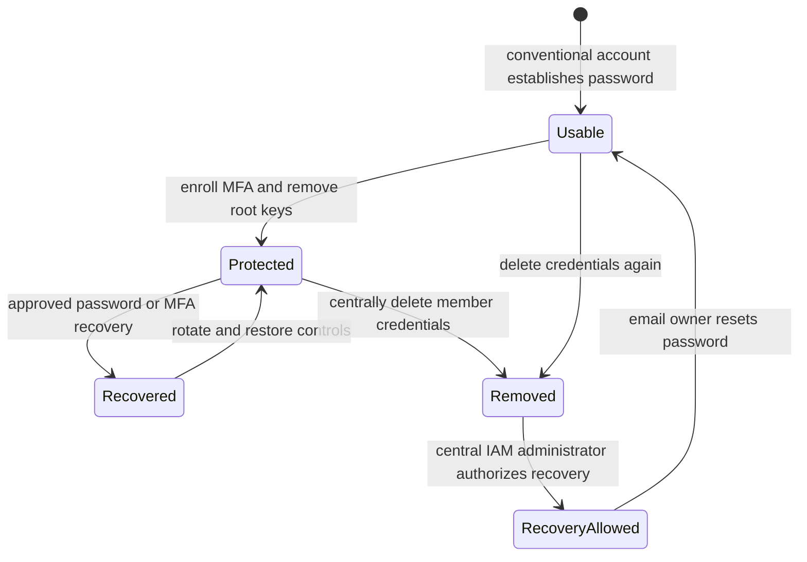
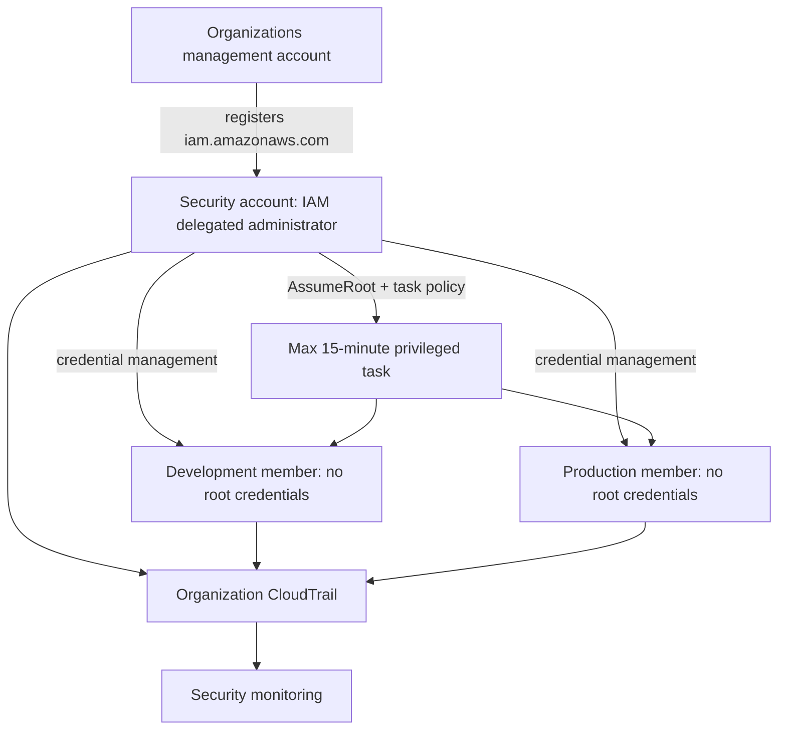
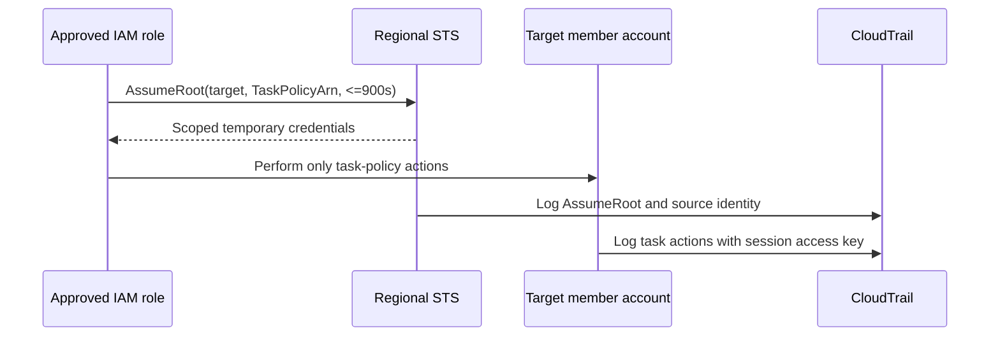
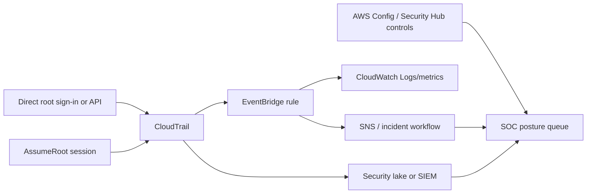

<div align="center">

# AWS Account Root User


**The exceptional account identity—not the everyday administrator. Protect usable root credentials, or eliminate them from Organizations member accounts where AWS supports it.**

</div>

> [!IMPORTANT]
> Root has inherent account authority, but it is not universally immune to authorization controls. Applicable SCPs can restrict a member-account root user, and applicable RCPs can restrict access to supported member-account resources. Use root only for a documented task that truly requires it.

## Contents

1. [What Is the AWS Account Root User?](#1-what-is-the-aws-account-root-user)
2. [What Problem Does Root Access Solve?](#2-what-problem-does-root-access-solve)
3. [Core Concepts and Comparisons](#3-core-concepts-and-comparisons)
4. [Authentication and Authorization](#4-authentication-and-authorization)
5. [Key Capabilities, Root-Only Tasks, and Restrictions](#5-key-capabilities-root-only-tasks-and-restrictions)
6. [When Root Is and Is Not Appropriate](#6-when-root-is-and-is-not-appropriate)
7. [CCP Essentials](#7-ccp-essentials)
8. [SAA Deep Dive](#8-saa-deep-dive)
9. [Comparison with Related AWS Concepts](#9-comparison-with-related-aws-concepts)
10. [Integration and Architecture Patterns](#10-integration-and-architecture-patterns)
11. [Security, Shared Responsibility, and Incident Response](#11-security-shared-responsibility-and-incident-response)
12. [Operations, Auditing, Recovery, and Troubleshooting](#12-operations-auditing-recovery-and-troubleshooting)
13. [Pricing and Operational Considerations](#13-pricing-and-operational-considerations)
14. [Safe Console and CLI Workflows](#14-safe-console-and-cli-workflows)
15. [Common Exam Traps and Misconceptions](#15-common-exam-traps-and-misconceptions)
16. [Technical Interview Questions](#16-technical-interview-questions)
17. [Practice Questions](#17-practice-questions)
18. [Architecture Scenario Drills](#18-architecture-scenario-drills)
19. [Decision Framework and Keyword Recognition](#19-decision-framework-and-keyword-recognition)
20. [Quick-Revision Cheat Sheet](#20-quick-revision-cheat-sheet)
21. [Official References and Currency Note](#21-official-references-and-currency-note)
22. [Closing Study Takeaway](#22-closing-study-takeaway)

<a id="1-what-is-the-aws-account-root-user"></a>
## 1. What Is the AWS Account Root User?

### Beginner definition

The AWS account root user is the exceptional identity associated with an AWS account. In a conventional customer-created account, it is authenticated with the account email address, root password, and—when credentials exist—MFA.

### Precise definition

Root is an account-level principal with inherent authority in its own account and a small set of identity-specific operations that IAM administrators cannot perform merely by receiving broad policies. Customers do not create additional root users inside an account.

The standard root principal ARN is:

```text
arn:aws:iam::123456789012:root
```

That ARN has two important meanings:

1. In an event or direct identity context, it can identify the account root principal.
2. In a resource-based policy’s `Principal`, an account ARN delegates authority to the **account**. It does not limit the grant to direct root sign-in; an administrator in that account must delegate the permission to an identity.

```json
{
  "Principal": {
    "AWS": "arn:aws:iam::123456789012:root"
  }
}
```

The shortened account ID form behaves the same in that policy context. See [AWS account principals](https://docs.aws.amazon.com/IAM/latest/UserGuide/reference_policies_elements_principal.html#Principal_specifying).

### What root is not

Root is not an IAM user, group, role, policy, Identity Center user, Linux superuser, or the AWS Organizations hierarchy **root**. It is also not the `AdministratorAccess` managed policy.

### Bounded analogy

Think of root as the master key and ownership identity for one AWS account. The analogy helps explain its rarity and risk, but it is imperfect: organization and resource guardrails can still restrict requests, and member-account root credentials can be removed centrally without deleting the account or root identity.

### Account-creation qualification

Conventional advanced AWS sign-up creates an account with a root email and password. Accounts created as AWS Organizations members can have no usable root credentials by default after centralized root access is enabled. AWS also documents a newer project-account experience owned through AWS Builder ID rather than a root email; this guide focuses on conventional customer accounts used in CCP/SAA scenarios. See [Using the AWS account root user](https://docs.aws.amazon.com/accounts/latest/reference/root-user.html).

<a id="2-what-problem-does-root-access-solve"></a>
## 2. What Problem Does Root Access Solve?

AWS needs an account ownership identity and recovery path that exists outside ordinary IAM lifecycle administration. Root supports exceptional account, credential, billing-enablement, and lockout-recovery tasks.

The security problem is that persistent ownership credentials combine enormous authority with weak attribution if shared. Modern AWS design separates:

- everyday workforce administration through IAM Identity Center and roles;
- direct root sign-in for the small remaining tasks that require it;
- centralized removal of member-account root credentials; and
- short-lived, task-scoped root sessions for a supported subset of privileged member-account tasks.

Before: every account retains recoverable credentials that someone must protect. After centralized management: member accounts can have no password, access key, signing certificate, or root MFA configuration, while approved administrators perform only supported privileged tasks through audited sessions.

<a id="3-core-concepts-and-comparisons"></a>
## 3. Core Concepts and Comparisons

### Root versus IAM user

| Dimension | Root user | IAM user |
|---|---|---|
| Creation | Associated with account creation | Created in IAM |
| Quantity | One root identity per conventional account | Many possible |
| Purpose | Ownership, exceptional tasks, recovery | Exceptional long-term human/workload identity |
| Sign-in | Account email, password, MFA | Account ID/alias, username, password, MFA |
| Permissions | Inherent account authority; policy-type qualifications apply | Granted by identity/resource policies and limited by guardrails |
| Policy attachment | Identity policies cannot be attached | Managed/inline policies can be attached/embedded |
| Boundary | Cannot have a permissions boundary | Can have one |
| Access keys | Technically supported, strongly discouraged | Supported, but roles/temporary credentials preferred |
| Root-only tasks | Direct root can perform documented tasks | Cannot become root through a policy |
| Daily use | Never recommended | Identity Center/federation preferred for workforce access |

An IAM user with `AdministratorAccess` remains an IAM user. The policy grants broad IAM actions; it does not supply the root email/password, change the principal type, or unlock identity-specific root operations.

### Root versus IAM role

| Dimension | Root | IAM role/session |
|---|---|---|
| Identity | Persistent account identity | IAM identity assumed into a session |
| Credentials | Root password/MFA or discouraged long-term keys | Temporary STS credentials |
| Authorization | Inherent authority plus applicable controls | Trust policy permits assumption; permissions policies and guardrails limit session |
| Cross-account | Does not automatically own other accounts | Standard pattern for delegated cross-account access |
| Daily administration | Avoid | Preferred through federation/Identity Center |
| STS operation | Eligible central identities can call `AssumeRoot`; root credentials cannot | Eligible principals call `AssumeRole` according to trust/permissions |

`sts:AssumeRole` creates a role session based on a role trust policy. `sts:AssumeRoot` creates a maximum-15-minute, task-policy-scoped session in an Organizations member account and requires centralized root sessions. It is not ordinary role assumption or direct root sign-in.

### Root versus `AdministratorAccess`

| Question | Root | `AdministratorAccess` |
|---|---|---|
| What is it? | Account principal | AWS managed identity policy |
| Credentials? | Root credentials may exist | None; attached identity supplies credentials |
| Broad permissions? | Inherent in own account, subject to applicable controls | `Allow` on `*` actions/resources, subject to all applicable controls |
| Root-only identity operations? | Yes, where documented | No |
| SCP/RCP effect? | Member root/resources can be restricted | Attached member identity/resources can be restricted |
| Best everyday choice? | No | Also overly broad; use scoped role/permission set |

If an administrator role has `AdministratorAccess` but the task requires direct root identity, the role is insufficient. First check whether one of the five supported `AssumeRoot` task policies covers the operation. If it does not, an authorized direct-root or recovery workflow may still be required.

### Authentication methods must not be conflated

| Method | Identity and entry point | Credential model |
|---|---|---|
| Direct root sign-in | Root option at AWS sign-in, account email | Password plus enforced MFA enrollment when credentials exist |
| IAM user | Account ID/alias and username | Password/MFA or long-term keys |
| Identity Center | Organization access portal | Federated workforce session and temporary account role |
| External federation | Enterprise IdP portal | Temporary role session |
| Ordinary STS | IAM role/federated session | Temporary credentials |
| Central root session | Management/delegated-admin IAM principal calls `AssumeRoot` | Temporary, task-scoped credentials in target member account |

<a id="4-authentication-and-authorization"></a>
## 4. Authentication and Authorization

Authentication proves which principal is acting; authorization decides whether the requested action is permitted. Possession of root credentials does not erase every authorization layer.

### Root credential lifecycle



### MFA

Current AWS documentation states that all account types require root MFA configuration when usable root sign-in credentials exist. A user must register MFA within **35 days of the first console sign-in attempt** if MFA is not already enabled. This is product behavior checked 2026-11-06, not a timeless exam constant.

Supported root MFA types are passkeys/security keys, virtual authenticator applications, and hardware TOTP devices. Up to eight devices can be registered; any one can complete sign-in. Prefer phishing-resistant passkeys/security keys and retain independently controlled recovery devices. Centrally removed member credentials legitimately have no root MFA because root sign-in and local recovery are disabled; AWS Config’s `root-account-mfa-enabled` rule returns `NOT_APPLICABLE` when root credentials are absent.

### Root programmatic access

AWS technically supports long-term root access keys but strongly recommends never creating them. If discovered, identify use, replace with a role or other temporary access, disable/observe where appropriate, then delete under approved incident/change procedures.

AWS CLI v2.32.0 or later supports `aws login`, a browser flow that can use root console credentials and provides automatically refreshed temporary credentials for up to 12 hours. This is safer than persistent root keys but does not make routine root API work advisable. Identity Center or roles remain the normal workforce/workload design.

### Authorization rules

- Identity-based IAM policies cannot be attached to root.
- A permissions boundary cannot be attached to root.
- Resource policies and ACLs can name root/account principals.
- Applicable SCPs restrict principals—including root—in member accounts.
- SCPs do not restrict principals in the Organizations management account.
- Applicable RCPs restrict access to supported resources in member accounts, including requests by root users.
- RCPs do not restrict resources in the management account.
- Cross-account root does not automatically receive access; the target-side resource/trust grant and source-side delegation/context still matter.
- Service-specific requirements and explicit denies remain relevant.

See [policies and the root user](https://docs.aws.amazon.com/IAM/latest/UserGuide/access_policies.html#access_policies-root) and current [SCP](https://docs.aws.amazon.com/organizations/latest/userguide/orgs_manage_policies_scps.html) and [RCP](https://docs.aws.amazon.com/organizations/latest/userguide/orgs_manage_policies_rcps.html) behavior.

### Seven worked authorization cases

| Case | Assumptions and controls | Expected result and reasoning |
|---|---|---|
| A. Standalone root | Valid credentials; ordinary operation on owned resource; no blocking resource control | Normally allowed by inherent authority, subject to service/resource rules |
| B. Member root + SCP deny | Account under an OU SCP denying the action | Denied; SCP limits include member root |
| C. Root + applicable RCP | Request targets a supported member-account resource whose RCP denies action | Denied; RCP follows the resource and includes root callers |
| D. Management root + SCP | SCP attached above management account | SCP has no effect on management-account principals; other controls may still matter |
| E. Cross-account resource | Root in A calls resource in B | Not automatically allowed; B must authorize account/principal and applicable B-side RCP/resource controls apply |
| F. Admin role + root-only task | Role has `AdministratorAccess` | Fails if operation requires root identity; use a supported central task or approved direct-root path |
| G. Member without credentials | Root password/keys/MFA removed centrally | Direct sign-in and local password recovery are unavailable; central administrator chooses a supported task or explicitly allows recovery |

<a id="5-key-capabilities-root-only-tasks-and-restrictions"></a>
## 5. Key Capabilities, Root-Only Tasks, and Restrictions

The authoritative list changes. The table below reflects [current AWS root-user tasks](https://docs.aws.amazon.com/IAM/latest/UserGuide/id_root-user.html#root-user-tasks) checked 2026-11-06.

| Task/category | Why or qualification | Alternative workflow | `AssumeRoot` task? | Exam relevance |
|---|---|---|---:|---|
| Change standalone root email, password, or root keys | Root credential/ownership operation | Organizations can centrally update member email/settings; normal contacts/settings often do not require root | Password recovery/removal only | CCP/SAA |
| Close standalone account | Ownership operation | Management/delegated admin can close member accounts with Organizations all features | No | CCP |
| Reopen eligible standalone account during post-closure period | Requires direct root sign-in | Follow account recovery/closure process | No | SAA |
| Restore lost IAM administrator permissions | Root is outside IAM administrator lifecycle | Prefer tested break-glass role; direct root where credentials exist | No general IAM admin session | CCP/SAA |
| Activate IAM access to Billing console | Initial account-level enablement | After activation, authorize IAM/Identity Center roles for billing | No | CCP |
| Certain billing/tax invoice tasks | Entity-specific AWS billing rules | Many billing functions use IAM billing permissions; not all require root | No | CCP |
| Sign up for AWS GovCloud (US) | Documented account-owner task | Follow GovCloud onboarding | No | SAA awareness |
| Request GovCloud root access keys from Support | Special documented GovCloud case | AWS Support workflow | No | Awareness |
| Register as Reserved Instance Marketplace seller | Documented EC2 account task | None documented as central root task | No | Awareness |
| Recover an unmanageable KMS key through Support | Support verifies OTP through root primary phone | Maintain correct contacts and key governance | No | SAA |
| Configure S3 MFA Delete | Root credentials required for the documented configuration | Use versioning/governance and prevent lockout | No | SAA |
| Edit/delete S3 policy denying all principals | Resource-owner root recovery | `S3UnlockBucketPolicy` for supported member account | Yes | SAA |
| Edit/delete SQS policy denying all principals | Resource-owner root recovery | `SQSUnlockQueuePolicy` for supported member account | Yes | SAA |
| Audit member root credentials | Central security operation | `IAMAuditRootUserCredentials` | Yes | SAA |
| Delete member root credentials | Central hardening | `IAMDeleteRootUserCredentials` | Yes | SAA |
| Allow member password recovery | Needed for remaining direct-root-only task | `IAMCreateRootUserPassword`, then email owner resets password | Yes | SAA |

Not every account setting, billing operation, KMS action, or sensitive change requires root. Account names, contacts, alternate contacts, payment currency preference, and Region settings have non-root workflows. Organizations with all features can centrally manage several member-account settings.

<a id="6-when-root-is-and-is-not-appropriate"></a>
## 6. When Root Is and Is Not Appropriate

Use direct root only when all are true:

1. AWS documentation says the task requires direct root for this account type.
2. No supported centralized privileged task covers it.
3. The action is approved, time-bounded, monitored, and attributable.
4. Credentials and recovery channels are controlled.
5. The session ends immediately after verification.

Do not use root for deployments, application credentials, ordinary IAM management, cross-account workforce access, cost review, daily console work, or routine incident investigation. Use Identity Center permission sets, IAM roles, temporary credentials, and scoped break-glass roles instead.

<a id="7-ccp-essentials"></a>
## 7. CCP Essentials


- Root is the exceptional account identity, not an IAM user or policy.
- Protect usable root credentials with MFA and never share them.
- Do not create long-term root access keys for applications.
- An IAM administrator—even with `AdministratorAccess`—is not root.
- Use IAM Identity Center/federation for workforce administration.
- Use root only for documented root-only tasks.
- In Organizations, member-account root credentials can be removed centrally.
- CloudTrail records root sign-in and API activity; alerts require additional configuration.

| If the question says… | Think… |
|---|---|
| Daily employee administration | Identity Center/role, not root |
| Close a standalone account | Root |
| IAM administrator policy | Broad IAM permission, not root identity |
| Protect the most privileged sign-in | MFA, secure email/phone, rare use |
| Automation credential | Workload role, never root key |
| Member accounts at scale | Centralized root access management |
| Actual root activity | CloudTrail |

**30-second summary:** Root is one exceptional identity per conventional AWS account. It has inherent account authority and performs rare ownership/recovery tasks. Protect usable credentials with MFA, avoid root keys and daily use, and prefer centralized removal plus scoped sessions for Organizations member accounts.

<a id="8-saa-deep-dive"></a>
## 8. SAA Deep Dive


### Organization root versus account root

The **organization root** is the top container in the Organizations hierarchy to which accounts, OUs, SCPs, and RCPs relate. An **account root user** is a principal for one AWS account. The hierarchy object has no password and cannot sign in.

### Management account versus member account

| Dimension | Management account | Member account |
|---|---|---|
| Root identity | Exists and is exceptionally sensitive | Exists even if credentials are absent |
| SCP effect | Principals are not restricted | Root/IAM principals are restricted by applicable SCPs |
| RCP effect | Resources are not restricted | Supported resources are restricted by applicable RCPs |
| Central credential removal | Member workflow does not apply to management root | Supported after centralization |
| `AssumeRoot` target | Calls originate from eligible management/delegate identities | Target of supported privileged session |
| Recovery | Protect direct recovery channels | Can be centrally prevented/temporarily allowed |
| Design | Keep workloads and human access minimal | Use roles, controls, and credential removal |

### Centralized root access has two capabilities

1. **Root credentials management** lets the management account or IAM delegated administrator remove member root password, keys, signing certificates, and MFA; it prevents local recovery. New member accounts have no root credentials by default after enablement.
2. **Privileged root sessions** lets explicitly authorized IAM principals in the management/delegated account call `sts:AssumeRoot` for a supported task.

These capabilities are independently enabled. Trusted access for IAM in Organizations is required. Account recovery after deletion requires privileged root actions to be enabled.



The management-account root remains separately protected. The security account receives narrowly authorized central permissions; development, staging, and production use Identity Center roles for normal work and no recoverable local root credential. CloudTrail records central and target-account actions.

### `sts:AssumeRoot` deep dive

`AssumeRoot` returns temporary credentials for a target member account. It requires:

- an Organizations management-account or IAM delegated-administrator IAM user/role as caller;
- explicit `sts:AssumeRoot` authorization;
- centralized root sessions enabled;
- a target member account ID/ARN;
- one approved `TaskPolicyArn`;
- a Regional STS endpoint—the global endpoint is unsupported; and
- STS active in the selected Region.

Root credentials cannot call `AssumeRoot`. Duration defaults to and cannot exceed 900 seconds (15 minutes). The credentials are not permanent, not unrestricted, and not a general console ownership session.



### Root task policies

| AWS-managed root-task policy | Purpose | Typical operation |
|---|---|---|
| `IAMAuditRootUserCredentials` | Inspect root password/key/certificate/MFA status | Compliance audit |
| `IAMCreateRootUserPassword` | Allow password recovery for credentialless member | Remaining direct-root task |
| `IAMDeleteRootUserCredentials` | Remove root password, keys, certificates, MFA | Account hardening |
| `S3UnlockBucketPolicy` | Read/update/delete locked bucket policy | S3 resource-policy incident |
| `SQSUnlockQueuePolicy` | Inspect/remove locked queue policy | SQS resource-policy incident |

These policies live under `arn:aws:iam::aws:policy/root-task/...` and are passed to `AssumeRoot`; they cannot be attached to ordinary IAM identities. Use `sts:TaskPolicyArn` in the caller policy to restrict which task may be selected.

```json
{
  "Version": "2012-10-17",
  "Statement": [
    {
      "Sid": "AllowOnlyS3UnlockSessions",
      "Effect": "Allow",
      "Action": "sts:AssumeRoot",
      "Resource": "arn:aws:iam::*:root",
      "Condition": {
        "ArnEquals": {
          "sts:TaskPolicyArn": "arn:aws:iam::aws:policy/root-task/S3UnlockBucketPolicy"
        }
      }
    }
  ]
}
```

Add organization-approved target-account conditions/resource scope where supported by your authorization design; validate the current service authorization reference before production use.

### Five design explanations

1. **Delete member credentials, retain identity:** removes standing authentication paths without deleting accounts/resources.
2. **Delegate IAM root management to a security account:** reduces routine use of the management account, but the management account alone registers the delegate.
3. **Scope both caller and session:** caller authorization limits targets/task policy; task policy limits temporary session actions.
4. **Monitor two event planes:** correlate the source `AssumeRoot` event with target actions using `targetPrincipal` and session `accessKeyId`.
5. **Keep a separate direct-root recovery plan:** `AssumeRoot` covers five policies, not every documented root-only task.

<a id="9-comparison-with-related-aws-concepts"></a>
## 9. Comparison with Related AWS Concepts

| Concept | Purpose | Credentials/authorization | Root distinction |
|---|---|---|---|
| IAM user | Long-term account identity for exceptions | IAM policies, optional boundary | Not account owner |
| IAM role | Assumable identity | Trust + temporary session + policies | Preferred admin/cross-account model |
| `AdministratorAccess` | Broad AWS managed policy | Attached to eligible IAM identity | Does not create root capabilities |
| Identity Center administrator | Workforce access through permission sets | Federated temporary roles | Preferred daily human administration |
| Management account | Governs organization | Has its own root and IAM identities | Account role, not a single organization-wide root identity |
| Organization root | Hierarchy container | No credentials | Not a principal |
| Member administrator | Admin role within member | Policies plus SCP/RCP/resource controls | Cannot perform direct-root-only tasks |
| Break-glass role | Emergency IAM access | Short-lived, monitored, tested | Still not root; better for ordinary admin lockout |
| Root credentials | Password/MFA or long-term key | Authenticate direct root | Standing, highest-risk credentials |
| Role credentials | STS temporary credentials | Session-specific | Normal programmatic model |
| Root MFA | Protects direct root credentials | Root-specific device enrollment | Separate from workforce MFA |
| `AssumeRole` | Obtain role session | Trust and caller permission | General delegated access |
| `AssumeRoot` | Supported member privileged task | Central config + caller permission + task policy | Max 15 minutes, Regional endpoint |
| Root identity | Persistent account principal | Exists even without credentials | Account ownership identity |
| Root privileged session | Temporary task-scoped principal behavior | Returned by `AssumeRoot` | Not permanent root login |
| SCP | Member-principal permissions ceiling | Never grants | Can restrict member root, not management principals |
| RCP | Member-resource permissions ceiling | Never grants | Can restrict root requests to supported member resources |

<a id="10-integration-and-architecture-patterns"></a>
## 10. Integration and Architecture Patterns

### Monitoring pipeline



- **CloudTrail** logs console sign-ins, management API calls, `AssumeRoot`, and target task actions.
- **EventBridge** matches CloudTrail service events and invokes configured targets; CloudTrail alone does not send every desired notification.
- **CloudWatch** stores/query logs and drives metrics/alarms when configured.
- **SNS** delivers notifications; protect topics and subscriptions.
- **Security Hub/Config** provide posture controls such as root key/MFA checks, with credentialless accounts handled appropriately.
- **GuardDuty** can contribute threat detections but is not the root credential inventory.
- **IAM credential reports/account summary** inventory password, key, certificate, and MFA posture.

Example EventBridge event pattern:

```json
{
  "source": ["aws.signin"],
  "detail-type": ["AWS Console Sign In via CloudTrail"],
  "detail": {
    "eventSource": ["signin.amazonaws.com"],
    "eventName": ["ConsoleLogin"],
    "userIdentity": {
      "type": ["Root"]
    }
  }
}
```

Root `ConsoleLogin` events can be recorded in `us-east-1`, `us-east-2`, or `us-west-2` depending on current sign-in routing. Configure trails/event rules with appropriate multi-Region coverage; do not assume only `us-east-1`.

### Billing architecture

Root owns account authority, but ordinary billing access can be delegated after IAM billing access is activated. Grant scoped Billing/Cost Explorer/Budgets permissions through Identity Center roles. Organizations management handles consolidated billing and selected member settings; this does not make every billing task root-only.

<a id="11-security-shared-responsibility-and-incident-response"></a>
## 11. Security, Shared Responsibility, and Incident Response

### Security baseline

- Use a company-controlled, monitored root email; protect its mailbox and registered phone.
- Enroll multiple supported MFA devices where usable root credentials remain.
- Never share root credentials as an administrator-access method.
- Delete unnecessary root access keys and signing certificates.
- Use Identity Center and temporary roles for people and workloads.
- Require approval, documented purpose, monitored session, and post-use review.
- Remove member-account root credentials where centrally supported.
- Minimize workloads and human access in the Organizations management account.
- Test recovery without weakening controls.
- Alert on direct root sign-in, root credential changes, and `AssumeRoot`.

AWS secures the identity and control-plane services. Customers secure root email/phone/MFA, choose organization capabilities, authorize privileged callers, retain/monitor logs, review activity, and remediate compromise.

### Incident response priorities

1. Verify the alert and preserve CloudTrail, sign-in, email, and ticket evidence.
2. Identify affected accounts, credentials, sessions, resources, and organization controls.
3. Invoke the authorized incident process; avoid ad hoc credential sharing.
4. Secure root email, phone, password, MFA, and exposed keys as appropriate.
5. Review IAM/Identity Center changes, new credentials, roles, policies, billing/contact changes, and persistence.
6. Correlate all activity, including source and target events for privileged sessions.
7. Contact AWS Support/security resources when account control or service recovery requires it.
8. Restore safe administrative access, validate resources, rotate downstream secrets, and monitor.
9. Document containment, recovery, and lessons learned separately.

Changing the root password alone does not revoke every possible session, remove persistence, restore modified resources, or prove containment.

<a id="12-operations-auditing-recovery-and-troubleshooting"></a>
## 12. Operations, Auditing, Recovery, and Troubleshooting

### Credential audit checklist

- [ ] Classify account: standalone, management, or member.
- [ ] Determine whether a root password exists.
- [ ] Determine whether root access keys/signing certificates exist and last use.
- [ ] Determine MFA status or confirm credentials are centrally absent.
- [ ] Verify root email, phone, and recovery ownership.
- [ ] Inspect credential report and IAM account summary.
- [ ] Inspect centralized root-access capabilities and delegated administrator.
- [ ] Confirm alert coverage for the current sign-in Regions and `AssumeRoot`.
- [ ] Test accountable non-root administration and approved recovery procedure.
- [ ] Record evidence, owner, exceptions, and review date.

Credential reports represent root as `<root_account>` and show `password_enabled`, `mfa_active`, access-key state and last-use fields. A new centrally managed member account can correctly show `password_enabled=FALSE`. Reports omit some service-specific credentials and should not be the sole inventory.

### Recovery models

| Account state | Recovery path |
|---|---|
| Standalone with root credentials | Use password reset and documented MFA recovery through controlled email/phone; engage Support when required |
| Member with usable credentials | Similar local process, subject to organization controls |
| Member with credentials removed | Local reset is prevented; management/delegated administrator must use `IAMCreateRootUserPassword` to allow recovery |
| Management account | Protect and recover directly; member credential-removal workflow does not apply |

After central recovery is allowed, the authorized email owner resets the password. Complete the remaining direct-root task, then delete member credentials again. Never bypass the central control.

### Resource-policy lockout

- **S3:** use `S3UnlockBucketPolicy` through `AssumeRoot` to inspect/update/delete a deny-all bucket policy, then replace it with validated least-privilege policy.
- **SQS:** use `SQSUnlockQueuePolicy` to inspect/remove the blocking queue policy, then apply a reviewed policy.
- **IAM admin lockout:** prefer tested break-glass roles. Direct root can restore IAM permissions where credentials exist; `AssumeRoot` is not a general IAM administrator session.

### Root sign-in alert investigation

1. Find the `ConsoleLogin` event and confirm `userIdentity.type=Root`, result, Region, time, IP, agent, destination, and MFA data.
2. Compare with an approved change/ticket and responsible person.
3. Search CloudTrail across accounts/Regions for subsequent activity and credential changes.
4. Escalate unexpected, failed-volume, unusual-location, no-MFA, or sensitive-change indicators.
5. Contain using the approved procedure and document the conclusion.

Direct root sign-in differs from `AssumeRoot`: the latter has an `AssumeRoot` source event, target/task policy, short-lived access key, and correlated target events.

| Symptom | Likely cause | Verify | Response |
|---|---|---|---|
| Root cannot reset member password | Credentials removed and recovery disabled | Central root-access status | Authorized central admin allows recovery or uses supported task |
| Root receives `AccessDenied` in member | SCP, RCP, resource/service control | Organizations inheritance and target resource | Correct approved guardrail; never assume root bypass |
| Admin role cannot close standalone account | Root-only identity task | Account type and task list | Approved direct root workflow |
| `AssumeRoot` fails at global endpoint | Global STS unsupported | Endpoint/Region and STS activation | Use active Regional endpoint |
| `AssumeRoot` denied | Missing config, caller action, target, or task-policy authorization | Trusted access/features/IAM policy | Correct least-privilege central setup |
| Root MFA rule says not applicable | No root credentials exist | Password/key credential state | Treat credentialless member as intentional, not insecure |
| Expected root event absent | Wrong CloudTrail Region/scope or trail gap | Search documented sign-in Regions and organization trail | Repair multi-Region collection/rules |
| Unexpected root key use | Legacy automation or compromise | Credential report, last-used, CloudTrail | Contain, replace with role, remove key, investigate |

<a id="13-pricing-and-operational-considerations"></a>
## 13. Pricing and Operational Considerations

The root identity, IAM, AWS Organizations, SCPs, and RCPs have no separate identity license charge. Using root can create billable resources like any other authorized principal.

CloudTrail Event history provides recent management-event history without trail storage, but trails, CloudTrail Lake, S3, KMS, CloudWatch Logs, EventBridge, SNS, Security Hub, Config, SIEM, and support plans can have their own charges. Check current service pricing before deployment.

The larger costs are operational: MFA custody, recovery testing, audit retention, multi-person approvals, central security staffing, and incident response. Credential removal reduces standing risk but requires sound central authorization and recovery governance.

<a id="14-safe-console-and-cli-workflows"></a>
## 14. Safe Console and CLI Workflows

> [!CAUTION]
> All commands are educational. No root, MFA, Organizations, policy, or account-recovery change was executed. Enabling centralized features and running privileged sessions require formal approval and a test plan.

### Inspect the current principal — read-only

```bash
aws sts get-caller-identity
```

The output identifies account, principal ID, and ARN. It does not enumerate effective permissions or prove that the session is safe.

### Inspect local account root summary — read-only

```bash
aws iam get-account-summary
```

Review keys such as `AccountMFAEnabled` and `AccountAccessKeysPresent`. Interpret them with account type and centralized credential state.

### Generate and retrieve the credential report — read-only report workflow

```bash
aws iam generate-credential-report
aws iam get-credential-report --output json
```

The first requests report generation; the second returns base64-encoded CSV content plus metadata. They require `iam:GenerateCredentialReport` and `iam:GetCredentialReport`. Protect the report as security-sensitive data.

### Inspect Organizations context — read-only

```bash
aws organizations describe-organization
aws organizations list-accounts
aws organizations list-delegated-administrators \
  --service-principal iam.amazonaws.com
```

Run only from an authorized organization identity. Account metadata is sensitive.

### Enable central capabilities — state-changing, do not run casually

```bash
aws organizations enable-aws-service-access \
  --service-principal iam.amazonaws.com

aws iam enable-organizations-root-credentials-management
aws iam enable-organizations-root-sessions
```

These change organization security behavior. Test and approve rollback/recovery before use.

### Illustrative `AssumeRoot` — privileged, do not execute here

Prerequisites: centralized root sessions, an eligible management/delegated-admin IAM principal, explicit target/task authorization, an active Regional STS endpoint, monitoring, and approval.

```bash
aws sts assume-root \
  --target-principal 222222222222 \
  --task-policy-arn arn:aws:iam::aws:policy/root-task/S3UnlockBucketPolicy \
  --duration-seconds 900 \
  --region us-east-1 \
  --endpoint-url https://sts.us-east-1.amazonaws.com
```

The response contains sensitive temporary credentials. Never print them to shared logs. Use an isolated approved process, perform only the task, correlate CloudTrail events, and let the credentials expire.

### Audit a member through a root session

Use the same approved workflow with:

```text
arn:aws:iam::aws:policy/root-task/IAMAuditRootUserCredentials
```

Then call only the permitted inspection actions such as `iam:GetAccountSummary` using the temporary session. Do not persist those credentials. This is distinct from the local account’s ordinary credential report.

### Temporary CLI login

```bash
aws login
aws logout
```

Requires AWS CLI v2.32.0 or later. Root authentication is technically supported, but use Identity Center or roles for routine CLI work.

<a id="15-common-exam-traps-and-misconceptions"></a>
## 15. Common Exam Traps and Misconceptions

1. **Root is an IAM user.** Root is an account principal outside the IAM-user lifecycle. *(CCP)*
2. **Root is created in IAM.** It is associated with account creation; IAM creates users/roles. *(CCP)*
3. **An account can create multiple root users.** A conventional account has one root identity. *(CCP)*
4. **Root equals `AdministratorAccess`.** One is a principal; the other is a policy. *(CCP)*
5. **Root is an IAM managed policy.** No policy attachment creates root identity. *(CCP)*
6. **Use root for daily administration.** Use Identity Center and roles with temporary credentials. *(CCP)*
7. **Root keys are recommended for applications.** They are technically possible but strongly discouraged; use workload roles. *(CCP)*
8. **Root keys cannot exist.** They can, so audit and remove them. *(CCP)*
9. **Root MFA is optional best practice only.** AWS now enforces enrollment for usable root sign-in, with current documented timing; credentialless members are different. *(CCP)*
10. **Share root among administrators.** Shared credentials destroy accountability and increase compromise risk. *(CCP)*
11. **Root can never be restricted.** Member root is affected by applicable SCPs and RCP-protected resources. *(SAA)*
12. **SCPs never affect root.** They include root in member accounts. *(SAA)*
13. **SCPs restrict management-account root.** SCPs do not restrict management-account principals. *(SAA)*
14. **RCPs cannot affect root.** They affect access to supported member resources regardless of caller, including root. *(SAA)*
15. **Attach policies to root.** Identity policies cannot be attached to root. *(SAA)*
16. **Root can have a permissions boundary.** Boundaries apply to IAM users/roles, not root. *(SAA)*
17. **Root needs `AdministratorAccess`.** Root authority is inherent; that policy is inapplicable as an attachment. *(CCP)*
18. **An admin role can perform every root task.** Root-only identity checks remain distinct. *(CCP/SAA)*
19. **All billing tasks require root.** Most can be delegated after billing access is enabled; only documented exceptions require root. *(CCP)*
20. **All account settings require root.** Many settings and member-account operations have non-root/central workflows. *(CCP)*
21. **Every root task requires direct sign-in.** Five supported member tasks use task-scoped `AssumeRoot`. *(SAA)*
22. **Every member must retain a password.** Centralized root access supports credentialless members. *(SAA)*
23. **Removing credentials deletes root identity.** It deletes authentication/recovery material, not the identity. *(SAA)*
24. **Removing credentials deletes the account.** Account/resources remain. *(SAA)*
25. **Recovery is identical everywhere.** Credentialless members require centrally allowed recovery. *(SAA)*
26. **`AssumeRoot` equals `AssumeRole`.** Their targets, prerequisites, scope, policies, and duration differ. *(SAA)*
27. **Any IAM user can call `AssumeRoot`.** Caller must be eligible, explicitly authorized, and in management/delegated administration. *(SAA)*
28. **Root credentials call `AssumeRoot`.** The API forbids root credentials as caller. *(SAA)*
29. **`AssumeRoot` returns permanent unrestricted root.** It returns task-scoped credentials for at most 15 minutes. *(SAA)*
30. **The global STS endpoint works.** `AssumeRoot` requires a Regional endpoint. *(SAA)*
31. **Root-task policies attach to IAM roles.** They are passed to `AssumeRoot`, not attached to ordinary identities. *(SAA)*
32. **Organization root equals account root.** One is a hierarchy container; the other is a principal. *(CCP/SAA)*
33. **`arn:...:root` in `Principal` means direct root only.** As an account principal, it delegates authority to that account. *(SAA)*
34. **Root sign-in always logs in one Region.** Current root `ConsoleLogin` routing can use three documented US Regions. *(SAA)*
35. **Changing the password completes compromise recovery.** Sessions, persistence, resources, keys, contacts, and activity must also be investigated. *(SAA)*

<a id="16-technical-interview-questions"></a>
## 16. Technical Interview Questions

1. **What is the AWS account root user?** The exceptional account-level identity associated with ownership and documented root-only tasks; it is not an IAM user.
2. **Why is `AdministratorAccess` not root?** It is an attachable IAM allow policy whose effective permissions remain bounded; it supplies neither root credentials nor root principal identity.
3. **Why avoid routine root use?** Standing credentials, extreme authority, poor sharing attribution, and unnecessary blast radius; federated temporary roles are safer and auditable.
4. **Which tasks still need root?** Use the current AWS list: selected account/credential/billing-enablement/recovery operations, GovCloud/RI/KMS cases, S3 MFA Delete, and S3/SQS policy lockout. Account type matters.
5. **Can SCPs restrict root?** Yes in member accounts; no for management-account principals. RCPs can restrict supported member resources regardless of root caller.
6. **What is centralized root access?** Two IAM/Organizations capabilities: member credential management and supported task-scoped privileged sessions.
7. **What remains after member credentials are deleted?** The account, resources, root identity, and account email remain; password/keys/certificates/MFA and local recovery are removed.
8. **`AssumeRole` versus `AssumeRoot`?** Role trust/policies support general delegation; `AssumeRoot` requires central configuration, eligible central caller, Regional STS, root-task policy, member target, and max 15 minutes.
9. **What does a root-task policy do?** It scopes an `AssumeRoot` session to one supported audit, credential, S3, or SQS task; it is not an attachable general policy.
10. **How do you audit a privileged session?** Find the source `AssumeRoot` event, note target/task/access key/source identity, then correlate target-account events by session access key.
11. **How do you handle lost root MFA?** Try another registered device, then the controlled email/phone recovery process; credentialless members instead require central authorization to allow password recovery.
12. **How would you secure 50 accounts?** Protect management root, delegate IAM root management to security, remove member credentials, scope task/target authorization, use Identity Center roles, organization trails, alerts, and tested recovery.

<a id="17-practice-questions"></a>
## 17. Practice Questions

These are original study questions, not official AWS exam questions.

<details><summary>1. What is the root user?</summary>

**Answer:** The exceptional account identity. It is not an IAM user or policy. Options naming `AdministratorAccess` confuse identity and permission. **Level: CCP.**
</details>

<details><summary>2. What should engineers use for daily multi-account access?</summary>

**Answer:** IAM Identity Center with temporary role sessions. Root is reserved for documented exceptional tasks; IAM root keys are unsafe. **Level: CCP.**
</details>

<details><summary>3. Does `AdministratorAccess` turn a role into root?</summary>

**Answer:** No. The role remains an IAM role and cannot satisfy a root-principal identity requirement. **Level: CCP.**
</details>

<details><summary>4. Can an IAM policy be attached to root?</summary>

**Answer:** No identity policy or permissions boundary can be attached to root. Resource and organization policy types can still affect requests. **Level: SAA.**
</details>

<details><summary>5. Which credential should an application use instead of a root key?</summary>

**Answer:** A workload role with temporary credentials. Root keys are long-lived, account-wide risk. **Level: CCP.**
</details>

<details><summary>6. Can root access keys technically exist?</summary>

**Answer:** Yes, but AWS strongly discourages them. Audit last use, replace, and remove under change/incident control. **Level: CCP.**
</details>

<details><summary>7. How many MFA devices can current root users register?</summary>

**Answer:** Up to eight supported devices; one completes sign-in. Recheck this date-sensitive limit before implementation. **Level: CCP.**
</details>

<details><summary>8. Why might a member account correctly have no root MFA?</summary>

**Answer:** Central management may have removed all usable credentials and prevented recovery; MFA is unnecessary without a sign-in path. **Level: SAA.**
</details>

<details><summary>9. Does an SCP apply to member-account root?</summary>

**Answer:** Yes. Root cannot bypass an applicable SCP. An answer claiming universal root immunity is wrong. **Level: SAA.**
</details>

<details><summary>10. Does an SCP apply to management-account principals?</summary>

**Answer:** No. Secure management identities directly and minimize their use. **Level: SAA.**
</details>

<details><summary>11. Can an RCP deny a root caller access to a supported member resource?</summary>

**Answer:** Yes. RCPs follow supported member-account resources and include root callers; they do not affect management-account resources. **Level: SAA.**
</details>

<details><summary>12. Does root in Account A automatically access Account B?</summary>

**Answer:** No. B must authorize the account/principal and its resource/RCP controls apply. **Level: SAA.**
</details>

<details><summary>13. What does the root ARN mean in a resource policy?</summary>

**Answer:** As an account principal it delegates to the account, not solely direct root sign-in. A source administrator still delegates to an identity. **Level: SAA.**
</details>

<details><summary>14. Who can call `AssumeRoot`?</summary>

**Answer:** An explicitly authorized IAM principal in the Organizations management account or IAM delegated administrator, after central setup. Root credentials cannot call it. **Level: SAA.**
</details>

<details><summary>15. What endpoint is required for `AssumeRoot`?</summary>

**Answer:** An active Regional STS endpoint; the global endpoint is unsupported. **Level: SAA.**
</details>

<details><summary>16. What is the maximum `AssumeRoot` duration?</summary>

**Answer:** 900 seconds (15 minutes). Longer or permanent answers are wrong. **Level: SAA.**
</details>

<details><summary>17. Which policy audits member root credentials?</summary>

**Answer:** `IAMAuditRootUserCredentials`, passed as the root task policy. It is not attached to an ordinary role. **Level: SAA.**
</details>

<details><summary>18. Which policy permits member password recovery?</summary>

**Answer:** `IAMCreateRootUserPassword`; the email owner then resets the password. Delete credentials again afterward. **Level: SAA.**
</details>

<details><summary>19. Which capability repairs an S3 deny-all bucket policy centrally?</summary>

**Answer:** `AssumeRoot` with `S3UnlockBucketPolicy` for a supported member account. General `AdministratorAccess` may remain denied. **Level: SAA.**
</details>

<details><summary>20. Can `AssumeRoot` perform every root-only task?</summary>

**Answer:** No. It supports only the five current root-task policies; remaining tasks can require direct-root recovery/sign-in. **Level: SAA.**
</details>

<details><summary>21. What is the AWS Organizations root?</summary>

**Answer:** A hierarchy container, not a sign-in principal. Confusing it with account root is incorrect. **Level: CCP/SAA.**
</details>

<details><summary>22. Who closes a standalone AWS account?</summary>

**Answer:** Root under the documented standalone workflow. Organizations can centrally close eligible member accounts. **Level: CCP.**
</details>

<details><summary>23. Do all billing tasks require root?</summary>

**Answer:** No. Activate IAM billing access where required, then delegate scoped billing permissions; only documented exceptions remain root-only. **Level: CCP.**
</details>

<details><summary>24. How should a root sign-in be investigated?</summary>

**Answer:** Review CloudTrail result, identity, Region, IP, agent, MFA, destination, approval, then correlate subsequent activity. An SNS alert alone is insufficient evidence. **Level: SAA.**
</details>

<details><summary>25. In which Region is root `ConsoleLogin` always recorded?</summary>

**Answer:** There is no single guaranteed Region; current routing documents `us-east-1`, `us-east-2`, or `us-west-2`. **Level: SAA.**
</details>

<details><summary>26. How are `AssumeRoot` target actions correlated?</summary>

**Answer:** Match the source event’s target, task policy, and temporary access key to target-account CloudTrail actions. **Level: SAA.**
</details>

<details><summary>27. Does deleting member root credentials delete resources?</summary>

**Answer:** No. It removes password, keys, certificates, and MFA/recovery paths, not account data or identity. **Level: SAA.**
</details>

<details><summary>28. A member employee tries password reset after central deletion. What happens?</summary>

**Answer:** Recovery is blocked until an authorized central administrator permits it. Bypassing the control is not a valid option. **Level: SAA.**
</details>

<details><summary>29. What is the preferred IAM lockout defense?</summary>

**Answer:** A tested, monitored break-glass role. Direct root may restore IAM permissions where usable; `AssumeRoot` is not general admin. **Level: SAA.**
</details>

<details><summary>30. Does a password change fully contain root compromise?</summary>

**Answer:** No. Investigate keys, sessions, roles, policies, contacts, resources, billing, persistence, and CloudTrail, then recover and monitor. **Level: SAA.**
</details>

<details><summary>31. What does `aws sts get-caller-identity` prove?</summary>

**Answer:** It identifies the caller/account/ARN, not complete effective permissions or safety. **Level: SAA.**
</details>

<details><summary>32. Is `aws login` a reason to use root daily?</summary>

**Answer:** No. It avoids long-term keys via temporary credentials, but Identity Center/roles remain the appropriate routine model. **Level: SAA.**
</details>

<details><summary>33. Which account root needs the strongest separate protection in Organizations?</summary>

**Answer:** The management-account root because member credential-removal controls and SCP restrictions do not apply to it in the same way. All account security still matters. **Level: SAA.**
</details>

<a id="18-architecture-scenario-drills"></a>
## 18. Architecture Scenario Drills

### Scenario 1 — Secure a new standalone account

| Element | Design |
|---|---|
| Requirement/account/configuration | A startup opens a standalone account with root email/password and no IAM setup. |
| Identities/authentication | Secure company email/phone, enroll multiple root MFA devices, establish Identity Center/federated administrator access. |
| Authorization/response | Root performs only documented setup/root tasks; scoped administrative roles perform normal work. |
| Why/limits/security | Reduces root exposure but retains a direct recovery path. Monitor sign-ins and document custody; central member removal is unavailable. |
| Certification | CCP account-security baseline; SAA recovery and monitoring. |

### Scenario 2 — Developer uses root daily

| Element | Design |
|---|---|
| Requirement/account/configuration | A developer shares standalone root credentials for deployments. |
| Identities/authentication | Stop routine root use; create accountable Identity Center/role sessions with MFA and temporary credentials. |
| Authorization/response | Scope deployment permissions and separate privileged administration; investigate prior root activity. |
| Why/limits/security | Attribution and least privilege improve. A broad admin IAM user is weaker than federation and temporary roles. |
| Certification | CCP: root is minimum-use; SAA: identity modernization. |

### Scenario 3 — Admin role needs a root-only task

| Element | Design |
|---|---|
| Requirement/account/configuration | A role has `AdministratorAccess`, but must close a standalone account. |
| Identities/authentication | Verify current task list and approval; use direct root because central member workflows do not cover standalone closure. |
| Authorization/response | The policy cannot change principal type; authenticate root with MFA, close carefully, preserve records. |
| Why/limits/security | Adding more IAM policies cannot satisfy a root identity check. Closure is high impact and recovery-limited. |
| Certification | Core CCP root-versus-admin distinction. |

### Scenario 4 — Standalone root protected by MFA

| Element | Design |
|---|---|
| Requirement/account/configuration | Root must remain recoverable but rarely used. |
| Identities/authentication | Register phishing-resistant primary and independent backup devices; protect email/phone. |
| Authorization/response | Use root only through approved ceremony; ordinary roles handle work. |
| Why/limits/security | Multiple devices reduce lockout without credential sharing. MFA does not correct overuse or malicious authorized actions. |
| Certification | CCP MFA; SAA recovery governance. |

### Scenario 5 — Root keys in old automation

| Element | Design |
|---|---|
| Requirement/account/configuration | A script contains a long-lived root key. |
| Identities/authentication | Preserve evidence, inspect last use/CloudTrail, migrate to workload role temporary credentials. |
| Authorization/response | Contain and delete the root key under incident/change control; rotate downstream secrets if exposed. |
| Why/limits/security | Merely editing the script leaves copied keys and persistence unaddressed. |
| Certification | CCP key danger; SAA incident response. |

### Scenario 6 — Organization with many members

| Element | Design |
|---|---|
| Requirement/account/configuration | Fifty accounts need consistent root governance. |
| Identities/authentication | Protect management root; enable IAM trusted access; delegate root management to security; use Identity Center roles. |
| Authorization/response | Remove member credentials, restrict caller targets/task policies, deploy organization trails and alerts. |
| Why/limits/security | Centralized, accountable sessions scale better than 50 recoverable passwords. Central compromise becomes critical risk. |
| Certification | SAA multi-account architecture. |

### Scenario 7 — Remove member root credentials

| Element | Design |
|---|---|
| Requirement/account/configuration | Production members should have no standing root sign-in. |
| Identities/authentication | Approved central IAM administrator uses credential-management capability and `IAMDeleteRootUserCredentials`. |
| Authorization/response | Remove password, keys, certificates, and MFA; verify status centrally and in audit evidence. |
| Why/limits/security | Identity/account remain while recovery is prevented. Management root is not deleted by this workflow. |
| Certification | SAA modern root governance. |

### Scenario 8 — Recover member root credentials

| Element | Design |
|---|---|
| Requirement/account/configuration | A credentialless member needs a direct-root-only task not supported by current task policies. |
| Identities/authentication | Central administrator uses `IAMCreateRootUserPassword`; controlled email owner resets password and enrolls MFA as required. |
| Authorization/response | Perform only approved task, review logs, then delete credentials again. |
| Why/limits/security | Local reset is intentionally blocked. Recovery temporarily reintroduces standing credential risk. |
| Certification | SAA recovery distinction. |

### Scenario 9 — S3 policy recovery through `AssumeRoot`

| Element | Design |
|---|---|
| Requirement/account/configuration | A deny-all bucket policy locks out member administrators. |
| Identities/authentication | Approved security role calls Regional `AssumeRoot` with `S3UnlockBucketPolicy` for at most 900 seconds. |
| Authorization/response | Inspect/delete or correct policy; correlate source and target CloudTrail events; validate replacement. |
| Why/limits/security | Task policy narrowly bypasses the lockout without a permanent root password. It cannot perform unrelated root tasks. |
| Certification | SAA resource-policy recovery. |

### Scenario 10 — SQS policy recovery

| Element | Design |
|---|---|
| Requirement/account/configuration | A queue resource policy denies every principal. |
| Identities/authentication | Central authorized role uses Regional `AssumeRoot` with `SQSUnlockQueuePolicy`. |
| Authorization/response | Inspect/remove the blocking policy and apply a reviewed replacement; audit the session. |
| Why/limits/security | Ordinary admin allow cannot override explicit resource deny. Scope prevents general root administration. |
| Certification | SAA policy evaluation and recovery. |

### Scenario 11 — Management-account root security

| Element | Design |
|---|---|
| Requirement/account/configuration | The management account owns organization governance and consolidated billing. |
| Identities/authentication | Secure root email/phone and multiple MFA devices; keep workloads out; minimize human sessions. |
| Authorization/response | Delegate supported services and use Identity Center roles; alert every root use. |
| Why/limits/security | SCPs do not protect management principals and member root deletion does not remove management root credentials. |
| Certification | SAA high-impact exception. |

### Scenario 12 — Member root restricted by SCP

| Element | Design |
|---|---|
| Requirement/account/configuration | Member root attempts an action denied by OU SCP. |
| Identities/authentication | Valid root MFA proves identity but does not override authorization. |
| Authorization/response | Request is denied; review guardrail ownership and change only through approved organization process. |
| Why/limits/security | Root is included in member SCP scope. Attaching an IAM policy is impossible and irrelevant. |
| Certification | SAA authorization nuance. |

### Scenario 13 — Resource affected by RCP

| Element | Design |
|---|---|
| Requirement/account/configuration | Root or an external principal calls a supported resource in a member account. |
| Identities/authentication | Caller authentication can succeed while resource authorization fails. |
| Authorization/response | Applicable resource-owner RCP participates and can deny; inspect resource/service policy too. |
| Why/limits/security | RCP follows supported member resources and grants nothing. Management-account resources are exempt. |
| Certification | SAA resource guardrails. |

### Scenario 14 — Root console sign-in alert

| Element | Design |
|---|---|
| Requirement/account/configuration | SOC receives an EventBridge/SNS alert for `ConsoleLogin` by Root. |
| Identities/authentication | Inspect result, MFA, source, user agent, destination, time, Region, and approved ticket. |
| Authorization/response | Search subsequent events across Regions/accounts; escalate unexpected use and contain via procedure. |
| Why/limits/security | Alert is a signal, not proof of compromise. Multi-Region sign-in routing must be covered. |
| Certification | CCP monitoring recognition; SAA investigation. |

### Scenario 15 — Lost MFA device

| Element | Design |
|---|---|
| Requirement/account/configuration | Standalone root loses its primary device. |
| Identities/authentication | Use another registered device; otherwise use controlled email/phone recovery or Support path. |
| Authorization/response | Remove lost device, enroll replacement, inspect sign-ins, and document incident. |
| Why/limits/security | Backup device avoids emergency bypass. Credentialless member recovery instead needs central permission. |
| Certification | CCP MFA; SAA account-type qualification. |

### Scenario 16 — IAM administrative lockout

| Element | Design |
|---|---|
| Requirement/account/configuration | All normal admin roles lost permissions. |
| Identities/authentication | First use a tested break-glass role; if unavailable, approved direct root can restore IAM in an account with credentials. |
| Authorization/response | Repair least privilege and root cause; do not treat `AssumeRoot` as general IAM admin. |
| Why/limits/security | Prepared emergency role is more accountable. Root use must be rare and monitored. |
| Certification | SAA failure/recovery design. |

### Scenario 17 — Cross-account administration

| Element | Design |
|---|---|
| Requirement/account/configuration | Central operators administer development and production. |
| Identities/authentication | Authenticate through Identity Center and assume scoped member roles with temporary credentials. |
| Authorization/response | Trust policies, permission sets, SCPs/RCPs, and resource policies define access. Root credentials are never shared. |
| Why/limits/security | Roles provide attribution and revocation. Account-root ARN grants in policies require careful account delegation semantics. |
| Certification | CCP role choice; SAA two-sided authorization. |

### Scenario 18 — Suspected root compromise

| Element | Design |
|---|---|
| Requirement/account/configuration | Unexpected root key use and contact changes appear. |
| Identities/authentication | Invoke security response, preserve evidence, secure email/phone/password/MFA/keys, contact AWS when needed. |
| Authorization/response | Review CloudTrail, IAM persistence, sessions, resources, billing, organization controls, and all affected accounts; restore safely. |
| Why/limits/security | Password rotation alone misses keys, sessions, persistence, and altered resources. Separate containment, recovery, lessons learned. |
| Certification | SAA incident response and blast-radius reasoning. |

<a id="19-decision-framework-and-keyword-recognition"></a>
## 19. Decision Framework and Keyword Recognition

| Requirement | Appropriate identity/service | Why | Caveat |
|---|---|---|---|
| Everyday administration | Identity Center role | Temporary, accountable workforce access | Scope permission set |
| Employee access to many accounts | Identity Center | Central SSO and assignments | Not root |
| Standalone root-only setting | Direct root | Identity requirement | Approval, MFA, monitoring |
| Secure usable root sign-in | Multiple MFA + protected email/phone | Defense and recovery | Does not justify routine use |
| Application access | Workload role | Temporary credentials | Never root keys |
| Prevent member root sign-in | Central root credential management | Removes standing credentials/recovery | Member accounts only |
| Supported privileged member task | `AssumeRoot` | Task-scoped, max 15 minutes | Regional endpoint; five policies |
| Unlock S3/SQS policy | Corresponding root-task policy | Recovers resource policy | Correct policy afterward |
| Restrict member principals | SCP | Permissions ceiling | Does not grant; management exempt |
| Restrict supported member resources | RCP | Resource permissions ceiling | Does not grant; management resources exempt |
| Monitor sign-in | CloudTrail + EventBridge | Logs plus alert workflow | Cover documented Regions |
| Inspect local root credentials | Credential report/account summary | Credential state evidence | Interpret credentialless members correctly |
| Investigate alert | CloudTrail/SIEM/incident process | Correlated evidence | Alert alone is not verdict |
| IAM lockout | Break-glass role, then direct root if required | Account recovery | `AssumeRoot` not general admin |
| Allow member recovery | `IAMCreateRootUserPassword` session | Centrally controlled exception | Delete credentials afterward |

```text
Need privileged access?
├─ Routine admin or cross-account work → Identity Center / IAM role
├─ Supported member root task → Regional sts:AssumeRoot + exact task policy
├─ Other documented root-only member task → Centrally allow recovery, then direct root
├─ Standalone root-only task → Direct root with MFA and approval
├─ Possible/actual root activity → CloudTrail, then EventBridge/SIEM investigation
└─ Workload automation → Service/workload role, never a root access key
```

<a id="20-quick-revision-cheat-sheet"></a>
## 20. Quick-Revision Cheat Sheet

| Item | Remember |
|---|---|
| Identity | Exceptional account principal; not IAM user/policy |
| ARN | `arn:aws:iam::123456789012:root` |
| Resource-policy ARN | Often delegates to the account, not direct root only |
| Credentials | Email/password/MFA; keys technically possible but discouraged |
| MFA | Required enrollment for usable root; up to eight devices currently |
| Daily work | Identity Center/roles |
| Admin policy | `AdministratorAccess` does not create root |
| Identity policy/boundary | Cannot attach/apply to root |
| Member SCP | Can restrict root |
| Management SCP | Does not restrict management principals |
| Member RCP | Can restrict supported resources, including root requests |
| Management RCP | Does not restrict management resources |
| Central removal | Password, keys, certificates, and MFA; identity/account remain |
| `AssumeRoot` | Eligible central IAM caller, member target, Regional STS, max 900 seconds |
| Task policies | Audit, create password, delete credentials, S3 unlock, SQS unlock |
| Recovery | Standalone/local differs from credentialless member/central |
| Monitoring | CloudTrail; add EventBridge/alerts; correlate session access key |
| Biggest myths | Root is not admin policy; not universally unrestricted; not for daily use |
| Exam answer | Root is the exceptional account identity used only for documented tasks and secured or centrally disabled otherwise. |
| Memory trick | **Root is ownership, not everyday administration.** |

<a id="21-official-references-and-currency-note"></a>
## 21. Official References and Currency Note

Sources checked **2026-11-06**. Root tasks, MFA rules, CLI versions, session limits, policy names, sign-in Regions, and centralized behavior are date-sensitive.

- [AWS account root user and root-only tasks](https://docs.aws.amazon.com/IAM/latest/UserGuide/id_root-user.html)
- [Root user best practices](https://docs.aws.amazon.com/IAM/latest/UserGuide/root-user-best-practices.html)
- [Root MFA](https://docs.aws.amazon.com/IAM/latest/UserGuide/enable-mfa-for-root.html)
- [IAM MFA types and multiple devices](https://docs.aws.amazon.com/IAM/latest/UserGuide/id_credentials_mfa.html)
- [Recover an MFA-protected identity](https://docs.aws.amazon.com/IAM/latest/UserGuide/id_credentials_mfa_lost-or-broken.html)
- [Troubleshoot root-user access](https://docs.aws.amazon.com/IAM/latest/UserGuide/troubleshooting_root-user.html)
- [Using the root user and account models](https://docs.aws.amazon.com/accounts/latest/reference/root-user.html)
- [Centralize root access for member accounts](https://docs.aws.amazon.com/IAM/latest/UserGuide/id_root-enable-root-access.html)
- [Perform a privileged member-account task](https://docs.aws.amazon.com/IAM/latest/UserGuide/id_root-user-privileged-task.html)
- [`AssumeRoot` API](https://docs.aws.amazon.com/STS/latest/APIReference/API_AssumeRoot.html)
- [Root task AWS managed policies](https://docs.aws.amazon.com/IAM/latest/UserGuide/security-iam-awsmanpol.html)
- [`sts:TaskPolicyArn` condition key](https://docs.aws.amazon.com/IAM/latest/UserGuide/reference_policies_iam-condition-keys.html#condition-keys-sts)
- [Track privileged tasks in CloudTrail](https://docs.aws.amazon.com/IAM/latest/UserGuide/cloudtrail-track-privileged-tasks.html)
- [CloudTrail console sign-in events](https://docs.aws.amazon.com/awscloudtrail/latest/userguide/cloudtrail-event-reference-aws-console-sign-in-events.html)
- [IAM credential reports](https://docs.aws.amazon.com/IAM/latest/UserGuide/id_credentials_getting-report.html)
- [Policies and the root user](https://docs.aws.amazon.com/IAM/latest/UserGuide/access_policies.html#access_policies-root)
- [IAM policy evaluation](https://docs.aws.amazon.com/IAM/latest/UserGuide/reference_policies_evaluation-logic.html)
- [SCP behavior](https://docs.aws.amazon.com/organizations/latest/userguide/orgs_manage_policies_scps.html)
- [RCP behavior](https://docs.aws.amazon.com/organizations/latest/userguide/orgs_manage_policies_rcps.html)
- [Organizations member-account best practices](https://docs.aws.amazon.com/organizations/latest/userguide/orgs_best-practices_member-acct.html)
- [`aws login` temporary credentials](https://docs.aws.amazon.com/cli/latest/userguide/cli-configure-sign-in.html)
- [AWS Config root MFA rule](https://docs.aws.amazon.com/config/latest/developerguide/root-account-mfa-enabled.html)
- [AWS Certified Cloud Practitioner exam guide](https://docs.aws.amazon.com/aws-certification/latest/cloud-practitioner-02/cloud-practitioner-02.html)
- [AWS Certified Solutions Architect – Associate exam guide](https://docs.aws.amazon.com/aws-certification/latest/solutions-architect-associate-03/solutions-architect-associate-03.html)

<a id="22-closing-study-takeaway"></a>
## 22. Closing Study Takeaway

The AWS account root user is the exceptional ownership identity for one account. It is not an IAM administrator policy, not the Organizations hierarchy root, and not the right credential for ordinary work.

For conventional standalone and management accounts, protect usable root credentials with strong recovery controls, multiple MFA devices, no long-term keys, monitoring, and rare approved use. For Organizations member accounts, prefer centralized credential removal and narrowly authorized, task-scoped `AssumeRoot` sessions where supported. Keep a controlled recovery process for the root-only operations that those sessions do not cover.

The safest exam model is: **root has exceptional inherent authority, but applicable organization/resource controls and account type still matter.**

---

[← Previous: IAM Access Analyzer](09-access-analyzer.md) · [IAM Index](README.md)
