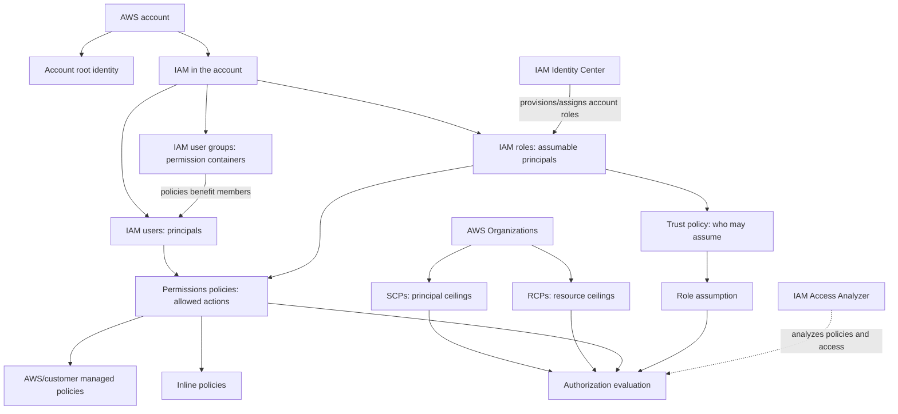
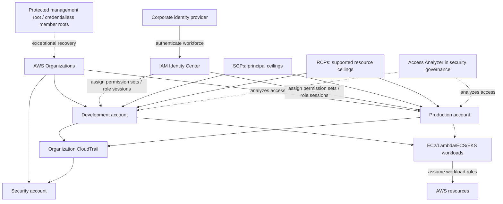

# AWS Identity and Access Management (IAM)

### Complete Learning Hub · Cloud Practitioner + Solutions Architect – Associate

**Learn how AWS authenticates principals, evaluates permissions, issues temporary credentials, governs multiple accounts, detects risky access, and protects the account root identity.**

> [!IMPORTANT]
> Modern human access normally starts with federation and AWS IAM Identity Center—not one IAM user per employee. Workloads normally use IAM roles and temporary credentials. Root credentials are reserved for documented exceptional tasks.

## Contents

1. [Module Overview](#1-module-overview)
2. [Learning Outcomes](#2-learning-outcomes)
3. [Ten-Lesson Navigation](#3-ten-lesson-navigation)
4. [Detailed Lesson Directory](#4-detailed-lesson-directory)
5. [Cloud Practitioner Learning Path](#5-cloud-practitioner-learning-path)
6. [Solutions Architect Learning Path](#6-solutions-architect-learning-path)
7. [Concept Dependency Map](#7-concept-dependency-map)
8. [IAM Comparison Center](#8-iam-comparison-center)
9. [Policy Evaluation Mental Model](#9-policy-evaluation-mental-model)
10. [IAM Decision Guide](#10-iam-decision-guide)
11. [Common IAM Misconceptions](#11-common-iam-misconceptions)
12. [Practice and Assessment Navigation](#12-practice-and-assessment-navigation)
13. [Learning Checkpoints](#13-learning-checkpoints)
14. [Real-World Reference Architecture](#14-real-world-reference-architecture)
15. [Exam Keyword Recognition](#15-exam-keyword-recognition)
16. [Quick Revision Sheet](#16-quick-revision-sheet)
17. [Recommended Study Workflow](#17-recommended-study-workflow)
18. [Sources and Certification Transparency](#18-sources-and-certification-transparency)

## 1. Module Overview

[AWS Identity and Access Management (IAM)](https://docs.aws.amazon.com/IAM/latest/UserGuide/introduction.html) helps control who is authenticated and what they are authorized to do with AWS resources. Authentication establishes a principal’s identity; authorization evaluates the request against every applicable permission and guardrail.

IAM is central, but it is not the whole access system. Real architectures combine:

- IAM users, groups, roles, policies, and AWS STS;
- IAM Identity Center or external federation for workforce access;
- resource-based policies and service-specific controls;
- AWS Organizations service control policies (SCPs) and resource control policies (RCPs);
- IAM Access Analyzer, CloudTrail, Config, and security services for evidence and governance; and
- protected or centrally removed root credentials for account ownership and recovery.

The ten lessons move from fundamentals to identities, policies, managed permission sets, access analysis, and root security. Together they teach recognition for CLF-C02 and architectural reasoning for SAA-C03 without treating either certification as a substitute for hands-on practice.

## 2. Learning Outcomes

After completing this module, you should be able to:

- distinguish identity, principal, credential, policy, permission, and session;
- choose among IAM users, user groups, roles, and Identity Center;
- explain trust policies versus permissions policies;
- reason about implicit deny, explicit allow, explicit deny, boundaries, session policies, SCPs, RCPs, and resource policies;
- design temporary-credential and cross-account access patterns;
- compare AWS managed, customer managed, and inline policies;
- evaluate `ReadOnlyAccess`, `AdministratorAccess`, and narrower alternatives;
- use Access Analyzer for external, internal, unused, and policy-development questions;
- protect root access and explain centralized member-account root management; and
- diagnose whether a problem concerns authentication, assumption, authorization, auditing, or governance.

## 3. Ten-Lesson Navigation

| # | Lesson | What it teaches | CCP | SAA | High-value exam concepts |
|---:|---|---|:---:|:---:|---|
| 1 | [IAM Overview](01-overview.md) | IAM vocabulary, policy language, authorization, federation, STS, and guardrails | Essential | Essential | Authentication vs authorization; policy evaluation; least privilege |
| 2 | [IAM Users](02-users.md) | Account-local identities, passwords, MFA, keys, lifecycle, and modern alternatives | Essential | Supporting | Long-term credentials; credential reports; federation-first workforce access |
| 3 | [IAM User Groups](03-groups.md) | Membership, shared identity policies, inherited permissions, and limitations | Essential | Supporting | Users can join multiple groups; groups are not principals; deny precedence |
| 4 | [IAM Roles](04-roles.md) | Trust, permissions, STS sessions, services, workloads, and cross-account access | Essential | Essential | Temporary credentials; `AssumeRole`; `PassRole`; confused deputy |
| 5 | [Customer Managed Policies](05-customer-managed-policies.md) | Reusable account policies, JSON, versions, rollback, boundaries, and lifecycle | Useful | Essential | Five saved versions; default version; reuse and blast radius |
| 6 | [Inline Policies](06-inline-policies.md) | Embedded one-to-one policies, beneficiary scope, replacement, and deletion coupling | Useful | Essential | No standalone ARN/versioning; parent lifecycle; effective permissions |
| 7 | [ReadOnlyAccess](07-read-only-access-policy.md) | AWS managed read access, content exposure, metadata, alternatives, and restrictions | Essential | Essential | Read is not harmless; `ViewOnlyAccess`; `SecurityAudit`; effective access |
| 8 | [AdministratorAccess](08-administrator-access-policy.md) | Broad administration, root distinction, guardrails, escalation, and safer delivery | Essential | Essential | `Allow */*`; not root; boundaries/SCPs/RCPs; privileged access |
| 9 | [IAM Access Analyzer](09-access-analyzer.md) | Three analyzer types, validation, custom checks, previews, generation, and findings | Useful | Essential | External vs internal vs unused; analysis is not enforcement |
| 10 | [AWS Account Root User](10-root-user.md) | Root-only tasks, MFA, credential removal, `AssumeRoot`, recovery, and monitoring | Essential | Essential | Root vs admin; member SCP/RCP effects; centralized privileged tasks |

## 4. Detailed Lesson Directory

### 01 — [IAM Overview](01-overview.md)

Start here. It establishes authentication and authorization, principals and credentials, policy structure, request evaluation, federation, Identity Center, temporary credentials, cross-account access, boundaries, SCPs, RCPs, and the architecture vocabulary used throughout the module.

### 02 — [IAM Users](02-users.md)

Learn when an account-local long-term identity is justified, how console passwords, MFA, access keys, credential reports, rotation, offboarding, and compromise response work, and why workforce federation is the modern default.

### 03 — [IAM User Groups](03-groups.md)

Study shared permissions for account-local IAM users, multiple-group membership, managed and inline group policies, explicit-deny conflicts, deletion effects, and the important distinction between IAM groups and Identity Center groups.

### 04 — [IAM Roles](04-roles.md)

Build the core architecture skill: separate trust from permissions, obtain temporary STS credentials, design same-account and cross-account assumption, configure service/workload roles, control `iam:PassRole`, and prevent confused deputies.

### 05 — [Customer Managed Policies](05-customer-managed-policies.md)

Learn reusable account-scoped policies, IAM JSON semantics, attachment impact, the five-version/default-version model, rollback, permissions-boundary use, least-privilege refinement, and safe lifecycle administration.

### 06 — [Inline Policies](06-inline-policies.md)

Understand policies embedded directly in one user, group, or role; distinguish owner from beneficiaries; compare them with managed policies; and reason about replacement, deletion coupling, IaC, auditability, and effective permissions.

### 07 — [ReadOnlyAccess](07-read-only-access-policy.md)

Replace the slogan “see everything, change nothing” with an exact-action model. Explore metadata versus data contents, S3/DynamoDB/KMS/log exposure, AWS-managed updates, `ViewOnlyAccess`, `SecurityAudit`, and narrower designs.

### 08 — [AdministratorAccess](08-administrator-access-policy.md)

Examine the exact `Allow */*` policy, why it is not root, how boundaries/session policies/SCPs/RCPs and resource/KMS policies constrain it, and how to design federated administration, delegated IAM, and monitored break-glass access.

### 09 — [IAM Access Analyzer](09-access-analyzer.md)

Separate external, internal, and unused analyzers from policy validation, custom checks, access previews, and CloudTrail-based policy generation. Learn zone-of-trust, Region, resource, lifecycle, pricing, and organization-scope distinctions.

### 10 — [AWS Account Root User](10-root-user.md)

Finish with the account ownership identity: root-only tasks, current MFA behavior, root key risk, SCP/RCP qualifications, management versus member accounts, centralized credential removal, five task policies, Regional `sts:AssumeRoot`, recovery, auditing, and incident response.

## 5. Cloud Practitioner Learning Path

CLF-C02 emphasizes service recognition, security best practices, shared responsibility, and choosing the appropriate basic capability—not implementing every advanced IAM mechanism.

### Recommended sequence

1. **Foundations:** [IAM Overview](01-overview.md) — memorize identity, authentication, authorization, least privilege, MFA, and explicit deny.
2. **Human identities:** [Users](02-users.md) and [Groups](03-groups.md) — understand credentials and shared permissions, while remembering Identity Center is preferred for workforce access.
3. **Temporary access:** [Roles](04-roles.md) — recognize workload, AWS service, and cross-account role use.
4. **Policy forms:** [Customer Managed](05-customer-managed-policies.md) and [Inline Policies](06-inline-policies.md) — focus on reusable versus embedded.
5. **Named AWS policies:** [ReadOnlyAccess](07-read-only-access-policy.md) and [AdministratorAccess](08-administrator-access-policy.md) — learn what names do and do not guarantee.
6. **Security analysis:** [Access Analyzer](09-access-analyzer.md) — recognize unintended external/unused access and policy checks.
7. **Account ownership:** [Root User](10-root-user.md) — protect root and use it only for documented tasks.

### Memorize versus understand

| Memorize | Understand conceptually | Usually defer until SAA study |
|---|---|---|
| Users, groups, roles, root | Authentication vs authorization | Same-account resource-principal nuances |
| MFA and least privilege | Temporary vs long-term credentials | Session policies, tags, and chaining |
| Managed vs inline | Why roles beat embedded workload keys | Detailed SCP/RCP intersections |
| Root minimum use | Why broad read/admin policies remain risky | `AssumeRoot` API mechanics and task policies |
| Access Analyzer purpose | Analysis vs enforcement vs audit | Type-specific analyzer APIs/pricing |

### CCP completion checklist

- [ ] I can distinguish user, group, role, and root.
- [ ] I know groups contain users but are not principals.
- [ ] I choose roles for AWS services, workloads, and cross-account temporary access.
- [ ] I can explain managed versus inline policies.
- [ ] I know explicit deny wins when applicable.
- [ ] I do not treat read-only access as harmless or AdministratorAccess as root.
- [ ] I recognize Identity Center for workforce access and Access Analyzer for access analysis.
- [ ] I protect root with MFA where credentials exist and avoid root keys/daily use.

Attempt each lesson’s practice questions after its summary and traps; defer the deepest implementation scenarios until the foundational distinctions are automatic.

## 6. Solutions Architect Learning Path

SAA-C03 expects secure architecture selection and trade-off reasoning. IAM is one part of the wider secure, resilient, performant, and cost-optimized design curriculum.

### Architecture progression

| Stage | Lessons | You should be able to answer… |
|---:|---|---|
| 1. Evaluation | [Overview](01-overview.md), [Users](02-users.md), [Groups](03-groups.md) | Which policy layers apply, and why did an apparent Allow still fail? |
| 2. Sessions and trust | [Roles](04-roles.md) | Who may assume the role, what may the session do, and how are credentials delivered? |
| 3. Policy ownership | [Customer managed](05-customer-managed-policies.md), [Inline](06-inline-policies.md) | Should permission be reusable/versioned or inseparable from one identity? |
| 4. Privilege selection | [ReadOnlyAccess](07-read-only-access-policy.md), [AdministratorAccess](08-administrator-access-policy.md) | What data/metadata is exposed, what guardrails remain, and what narrower design works? |
| 5. Analysis and governance | [Access Analyzer](09-access-analyzer.md), [Root User](10-root-user.md) | How do we detect exposure/unused access and govern exceptional ownership access across accounts? |

### SAA readiness checklist for IAM

- [ ] I can trace role assumption separately from post-assumption authorization.
- [ ] I can design EC2, Lambda, ECS/EKS, and cross-account role patterns without long-term keys.
- [ ] I distinguish trust, identity, resource, boundary, session, SCP, and RCP policies.
- [ ] I can explain same-account and cross-account resource-policy requirements without relying on one oversimplified formula.
- [ ] I can scope `iam:PassRole` and apply confused-deputy defenses.
- [ ] I can replace broad AWS managed policies with controlled, testable least privilege.
- [ ] I choose the correct Access Analyzer type/capability and know what it cannot prove.
- [ ] I can secure management/member roots, explain credential removal, and distinguish `AssumeRole` from `AssumeRoot`.
- [ ] I use CloudTrail evidence and a layered `AccessDenied` workflow.

## 7. Concept Dependency Map

The dashed Access Analyzer relationship is observational, not an inline enforcement step. Identity Center and Organizations integrate with IAM but remain distinct AWS services. Groups distribute permissions to IAM users; they do not authenticate, act as principals, or assume roles.

## 8. IAM Comparison Center

### Identities and permission container

| Concept | Authenticates/acts as principal? | Credentials | Primary use | Deep dive |
|---|:---:|---|---|---|
| IAM user | Yes | Potential long-term password/keys | Exceptional account-local identity | [Users](02-users.md) |
| IAM user group | No | None | Share identity policies among IAM users | [Groups](03-groups.md) |
| IAM role/session | Role is assumable; session makes requests | Temporary STS credentials | Workload, service, federation, cross-account | [Roles](04-roles.md) |
| Root user | Yes | Root credentials may exist | Ownership and documented exceptional tasks | [Root](10-root-user.md) |

### Policy ownership and lifecycle

| Policy form | Owner | Reuse | Version behavior | Best fit |
|---|---|---:|---|---|
| AWS managed | AWS | Many identities/accounts | AWS updates policy versions | Convenience baseline; treat as mutable dependency |
| Customer managed | Customer account | Many identities in one account | Up to five saved versions; one default | Reusable governed permissions |
| Inline | Exactly one user/group/role | No standalone reuse | Replaced in place; no managed-policy version IDs | Exceptional inseparable permission |

See [Customer Managed Policies](05-customer-managed-policies.md) and [Inline Policies](06-inline-policies.md).

### Trust versus permission

| Policy | Question answered | Grants service API actions after assumption? |
|---|---|:---:|
| Role trust policy | Who/what may assume this role, under what conditions? | No, it authorizes assumption |
| Permissions policy | What may the identity/session request? | Yes, subject to all other controls |

### Broad AWS managed policies

| Policy | Intent | Important caveat | Deep dive |
|---|---|---|---|
| `ReadOnlyAccess` | Broad read-oriented actions | Can expose data contents; policy combinations can add writes | [ReadOnlyAccess](07-read-only-access-policy.md) |
| `ViewOnlyAccess` | Broad console viewing/metadata | Not a universal “no data” guarantee; inspect actions | [ReadOnlyAccess](07-read-only-access-policy.md) |
| `SecurityAudit` | Security configuration/audit visibility | Not general business-data read or remediation | [ReadOnlyAccess](07-read-only-access-policy.md) |
| `PowerUserAccess` | Broad services with current IAM/Organizations/Account exclusions | Verify current version; not root or universal admin | [AdministratorAccess](08-administrator-access-policy.md) |
| `AdministratorAccess` | `Allow` all actions/resources | Boundaries, sessions, SCPs/RCPs, resource/KMS policies and root-only identity still matter | [AdministratorAccess](08-administrator-access-policy.md) |

### IAM group versus Identity Center group

| IAM user group | Identity Center group |
|---|---|
| Account-local collection of IAM users | Workforce-directory group used for account/application assignments |
| Receives IAM identity policies | Receives access through permission-set/account assignments |
| Cannot span accounts or nest | Designed for centralized workforce access; behavior depends on identity source |

### Role versus Identity Center permission set

| IAM role | Identity Center permission set |
|---|---|
| IAM resource with trust and permissions | Centrally managed permission template |
| Assumed by trusted principals/services | Provisioned into selected accounts as IAM roles and assigned to workforce users/groups |

### Analysis, audit, and simulation

| Tool | Best question | Does it enforce/fix? |
|---|---|:---:|
| IAM Access Analyzer | What external/internal/unused access or policy issue exists? | No |
| CloudTrail | What API activity was recorded? | No |
| IAM Policy Simulator | Would a supplied action/resource/context be allowed? | No |

See [IAM Access Analyzer](09-access-analyzer.md).

### Guardrails

| Guardrail | Limits | Grants permission? | Important scope |
|---|---|:---:|---|
| Permissions boundary | Maximum identity permissions for IAM user/role | No | One identity; cannot attach to root |
| Session policy | Maximum permissions for one session | No | Intersects role/user session permissions |
| SCP | Maximum permissions for member-account principals | No | Includes member root; excludes management principals and service-linked roles |
| RCP | Maximum access to supported member-account resources | No | Follows resource; management resources exempt |

### `AssumeRole` versus `AssumeRoot`

| Dimension | `AssumeRole` | `AssumeRoot` |
|---|---|---|
| Purpose | General temporary role session | Supported privileged member-account root task |
| Target | IAM role | Organizations member account root session |
| Authorization | Role trust + caller permission | Central root config + eligible caller + `sts:AssumeRoot` + task policy |
| Scope/duration | Role/session policy; configured limits | One of five task policies; maximum 900 seconds |
| Endpoint | STS endpoint behavior | Regional STS required; global unsupported |

## 9. Policy Evaluation Mental Model

1. A request starts implicitly denied.
2. AWS authenticates the principal and builds request context.
3. Applicable identity and resource policies can supply permissions.
4. Boundaries, session policies, SCPs, and RCPs set relevant maximums; none grants access.
5. Applicable explicit deny wins.
6. Cross-account access usually requires both the trusting/resource side and the caller’s side to authorize the path.
7. Same-account resource-principal grants and some service rules create important exceptions—do not force every request into one universal union/intersection formula.

**Worked example:** a role policy allows `s3:GetObject`, but an applicable SCP for the role’s member account denies `s3:GetObject`. The request is denied because the SCP caps the principal’s permissions. A bucket policy Allow does not make the SCP disappear.

Study the full model in [IAM Overview](01-overview.md) and role assumption/cross-account stages in [IAM Roles](04-roles.md).

## 10. IAM Decision Guide

| Requirement | Recommended capability | Why | Lesson |
|---|---|---|---|
| Employee accesses multiple accounts | IAM Identity Center + permission sets/roles | Central workforce identity and temporary sessions | [Overview](01-overview.md) |
| EC2 application reads S3 | EC2 role/instance profile | Rotated temporary workload credentials | [Roles](04-roles.md) |
| Account-local IAM users share permissions | IAM user group | Central policy assignment for users | [Groups](03-groups.md) |
| One identity needs inseparable permission | Inline policy, only with clear justification | One-to-one ownership and lifecycle | [Inline](06-inline-policies.md) |
| Several roles need reusable custom permission | Customer managed policy | Reuse, versioning, centralized update | [Customer managed](05-customer-managed-policies.md) |
| Application accesses another account | Cross-account role or appropriate resource policy | Explicit trust and temporary credentials | [Roles](04-roles.md) |
| Administrator needs broad read | Inspect `ReadOnlyAccess`, then narrow if possible | Managed baseline, but may expose contents | [ReadOnlyAccess](07-read-only-access-policy.md) |
| Auditor inspects security configuration | `SecurityAudit` or narrower audit role | Better intent fit than general read | [ReadOnlyAccess](07-read-only-access-policy.md) |
| Reviewer sees metadata without broad contents | `ViewOnlyAccess` or service-specific custom policy | Reduce data-content exposure | [ReadOnlyAccess](07-read-only-access-policy.md) |
| Find public/cross-account resource access | External access analyzer | Policy reasoning beyond trust boundary | [Access Analyzer](09-access-analyzer.md) |
| Find unused identities/permissions | Unused access analyzer | Uses last-accessed evidence | [Access Analyzer](09-access-analyzer.md) |
| Restrict member principals organization-wide | SCP | Central permissions ceiling | [Overview](01-overview.md) |
| Restrict supported member resources | RCP | Central resource permissions ceiling | [Overview](01-overview.md) |
| Developer passes Lambda execution role | Scoped `iam:PassRole` + service condition | Authorizes service role assignment | [Roles](04-roles.md) |
| Perform direct-root-only standalone task | Approved root procedure | Principal identity is required | [Root](10-root-user.md) |
| Credentialless member needs supported root task | Regional `AssumeRoot` + exact task policy | Short-lived, scoped, centrally audited | [Root](10-root-user.md) |

## 11. Common IAM Misconceptions

| Incorrect assumption | Correct explanation | Level | Deep dive |
|---|---|:---:|---|
| IAM users are the default for employees | Prefer federation and Identity Center temporary access; users are exceptions | CCP | [Users](02-users.md) |
| IAM groups are principals | Groups organize user permissions; they do not authenticate or make requests | CCP | [Groups](03-groups.md) |
| Groups can contain groups or roles | IAM user groups contain only IAM users and cannot nest | CCP | [Groups](03-groups.md) |
| A user can belong to only one group | A user can receive policy contributions from multiple groups | CCP | [Groups](03-groups.md) |
| A group Allow overrides any deny | Applicable explicit deny still wins | CCP/SAA | [Groups](03-groups.md) |
| Roles have permanent access keys | Role sessions use temporary STS credentials | CCP | [Roles](04-roles.md) |
| Trust and permissions policies do the same job | Trust authorizes assumption; permissions govern post-assumption actions | SAA | [Roles](04-roles.md) |
| `PassRole` means the caller assumes the role | It authorizes passing a role to a service; `AssumeRole` creates a caller session | SAA | [Roles](04-roles.md) |
| AWS managed policies are immutable | AWS can publish new default versions; customers do not edit them | SAA | [Customer managed](05-customer-managed-policies.md) |
| Inline means temporary | Inline means embedded in exactly one parent identity | CCP/SAA | [Inline](06-inline-policies.md) |
| `ReadOnlyAccess` guarantees no writes | It contributes allows; other policies can add writes, and “read” can expose data | CCP/SAA | [ReadOnlyAccess](07-read-only-access-policy.md) |
| `AdministratorAccess` bypasses every restriction | Boundaries, sessions, SCPs/RCPs, resource/KMS policies, and root-only identity still matter | CCP/SAA | [AdministratorAccess](08-administrator-access-policy.md) |
| Permissions boundaries grant permissions | Boundaries set a maximum; an Allow must come from a granting policy | SAA | [Overview](01-overview.md) |
| SCPs grant permissions | SCPs cap member-account principal permissions | SAA | [Overview](01-overview.md) |
| RCPs and SCPs restrict the same side | SCPs limit member principals; RCPs limit access to supported member resources | SAA | [Overview](01-overview.md) |
| Access Analyzer automatically fixes access | It analyzes and reports; customers change policies/credentials | CCP/SAA | [Access Analyzer](09-access-analyzer.md) |
| Root can never be restricted | Applicable SCPs affect member root and RCPs can affect supported member resources | SAA | [Root](10-root-user.md) |
| `AssumeRoot` is just `AssumeRole` | It is a centrally configured, task-scoped, maximum-15-minute member-root session | SAA | [Root](10-root-user.md) |

## 12. Practice and Assessment Navigation

Each lesson includes misconceptions, interview questions, original practice questions, scenario drills, and a revision section. Use the links below after studying the corresponding lesson.

| Lesson | Traps | Interviews | Practice | Scenarios |
|---|---|---|---|---|
| 01 Overview | [Traps](01-overview.md#exam-traps) | [Interviews](01-overview.md#interview-questions) | [Questions](01-overview.md#practice-questions) | [Scenarios](01-overview.md#scenario-drills) |
| 02 Users | [Traps](02-users.md#exam-traps-and-misconceptions) | [Interviews](02-users.md#technical-interview-questions) | [Questions](02-users.md#practice-questions) | [Scenarios](02-users.md#scenario-drills) |
| 03 Groups | [Traps](03-groups.md#exam-traps-and-misconceptions) | [Interviews](03-groups.md#technical-interview-questions) | [Questions](03-groups.md#practice-questions) | [Scenarios](03-groups.md#architecture-scenario-drills) |
| 04 Roles | [Traps](04-roles.md#exam-traps-and-misconceptions) | [Interviews](04-roles.md#technical-interview-questions) | [Questions](04-roles.md#practice-questions) | [Scenarios](04-roles.md#architecture-scenario-drills) |
| 05 Customer managed | [Traps](05-customer-managed-policies.md#exam-traps-and-misconceptions) | [Interviews](05-customer-managed-policies.md#technical-interview-questions) | [Questions](05-customer-managed-policies.md#practice-questions) | [Scenarios](05-customer-managed-policies.md#architecture-scenario-drills) |
| 06 Inline | [Traps](06-inline-policies.md#exam-traps-and-misconceptions) | [Interviews](06-inline-policies.md#technical-interview-questions) | [Questions](06-inline-policies.md#practice-questions) | [Scenarios](06-inline-policies.md#architecture-scenario-drills) |
| 07 ReadOnlyAccess | [Lesson assessments](07-read-only-access-policy.md) | [Lesson assessments](07-read-only-access-policy.md) | [Lesson assessments](07-read-only-access-policy.md) | [Lesson assessments](07-read-only-access-policy.md) |
| 08 AdministratorAccess | [Traps](08-administrator-access-policy.md#traps) | [Interviews](08-administrator-access-policy.md#interviews) | [Questions](08-administrator-access-policy.md#questions) | [Scenarios](08-administrator-access-policy.md#scenarios) |
| 09 Access Analyzer | [Traps](09-access-analyzer.md#15-common-exam-traps-and-misconceptions) | [Interviews](09-access-analyzer.md#16-technical-interview-questions) | [Questions](09-access-analyzer.md#17-practice-questions) | [Scenarios](09-access-analyzer.md#18-architecture-scenario-drills) |
| 10 Root User | [Traps](10-root-user.md#15-common-exam-traps-and-misconceptions) | [Interviews](10-root-user.md#16-technical-interview-questions) | [Questions](10-root-user.md#17-practice-questions) | [Scenarios](10-root-user.md#18-architecture-scenario-drills) |

### Assessment method

1. Study the definition, mechanism, and worked examples.
2. Read the lesson’s misconceptions without memorizing slogans alone.
3. Attempt questions before expanding answers.
4. State the controlling assumption and eliminate distractors aloud.
5. For every miss, classify the cause: vocabulary, scope, policy layer, identity type, Region, or evidence source.
6. Revisit the relevant mechanism and solve one architecture scenario.
7. Retest after a delay rather than immediately rereading the answer.

Use CCP-tagged fundamentals first. SAA learners should additionally complete the evaluation, cross-account, failure, and architecture scenarios.

## 13. Learning Checkpoints

### Checkpoint 1 — Identities

Can I explain [users](02-users.md), [groups](03-groups.md), [roles](04-roles.md), and [root](10-root-user.md) without calling a group a principal or an admin policy root?

### Checkpoint 2 — Policies

Can I distinguish AWS managed, [customer managed](05-customer-managed-policies.md), [inline](06-inline-policies.md), trust, identity, resource, session, boundary, SCP, and RCP policies?

### Checkpoint 3 — Authorization

Can I trace an applicable Allow and every relevant maximum/deny using [IAM Overview](01-overview.md), while qualifying resource-principal and cross-account behavior?

### Checkpoint 4 — Workload and delegated access

Can I select and secure roles for EC2, Lambda, containers, third parties, and cross-account access—and distinguish `PassRole` from assumption?

### Checkpoint 5 — Security and evidence

Can I explain least privilege, federation, broad managed-policy risks, [Access Analyzer](09-access-analyzer.md), CloudTrail, and root monitoring without confusing analysis with enforcement or audit?

### Checkpoint 6 — Architecture

Can I justify a multi-account workforce/workload design, explain SCP/RCP scope, protect root, and troubleshoot both failed assumption and post-assumption denial?

## 14. Real-World Reference Architecture

### How to read the architecture

- **Authentication:** workforce users authenticate to the corporate IdP and Identity Center—not to shared IAM users.
- **Role assumption:** account assignments provide temporary role sessions; workloads receive service-delivered role credentials.
- **Authorization:** role/identity and resource policies grant access; boundaries/session policies and applicable SCPs/RCPs limit it.
- **Governance:** Organizations separates workloads into accounts and applies ceilings. These policies do not grant permissions.
- **Auditing:** organization CloudTrail records activity; Access Analyzer separately reasons about supported external, internal, and unused access.
- **Root security:** management root is strongly protected; member root credentials can be removed centrally, with task-scoped recovery for supported operations.

Follow [Roles](04-roles.md) for trust and workload delivery, [Overview](01-overview.md) for evaluation, [Access Analyzer](09-access-analyzer.md) for analysis, and [Root User](10-root-user.md) for exceptional access.

## 15. Exam Keyword Recognition

Keywords are clues, not substitutes for checking scope, account, service, and policy context.

| If a question mentions… | Think about… | Level/caveat |
|---|---|---|
| Temporary AWS credentials | IAM role and STS | CCP/SAA; identify who assumes and how delivered |
| Cross-account access | Role trust + caller permission, or resource policy | SAA; both sides and guardrails matter |
| Reusable custom permission | Customer managed policy | CCP/SAA; account scoped and versioned |
| Embedded non-reusable permission | Inline policy | CCP/SAA; parent-coupled lifecycle |
| Explicit deny | Denial in any applicable policy | CCP/SAA; determine which policy applies |
| Workforce across accounts | IAM Identity Center | CCP/SAA; users are not IAM users |
| AWS service/workload access | Service or workload role | CCP/SAA; avoid embedded keys |
| Broad read access | `ReadOnlyAccess` | CCP; inspect data exposure and policy combinations |
| Security configuration audit | `SecurityAudit` | CCP/SAA; not general remediation |
| Metadata-oriented console view | `ViewOnlyAccess` | SAA; verify actual actions/data needs |
| Public or outside-organization sharing | External access analyzer | CCP/SAA; zone of trust and Region matter |
| Unused user/role permissions | Unused access analyzer | SAA; observation period is not proof of no need |
| Maximum for one IAM identity | Permissions boundary | SAA; does not grant |
| Maximum for member principals | SCP | SAA; management principals excluded |
| Maximum for supported member resources | RCP | SAA; follows resource and does not grant |
| Root-only operation | Root or supported centralized task | CCP/SAA; account type and task list matter |

## 16. Quick Revision Sheet

### Identity and credentials

| Concept | Fast mental model |
|---|---|
| IAM user | Account-local identity with potential long-term credentials; exception, not workforce default |
| IAM group | Permission container for IAM users; never a principal |
| IAM role | Assumable identity; active role session uses temporary STS credentials |
| Root | Exceptional account identity; minimum use, no routine administration |
| Identity Center | Central workforce identity/assignment service; provisions or assigns account roles |

### Policies and evaluation

| Concept | Fast mental model |
|---|---|
| Identity policy | Grants actions to user/group beneficiaries or role sessions |
| Resource policy | Grants through a resource-side principal statement; service/context nuances apply |
| Trust policy | Resource policy on a role controlling assumption |
| Customer managed | Reusable, account-scoped, customer-versioned |
| Inline | Embedded in one parent; no standalone ARN or native versions |
| Boundary/session/SCP/RCP | Maximums, never grants |
| Explicit deny | Wins when the policy and request are applicable |

### Architecture choices

| Need | Default direction |
|---|---|
| Human workforce | Identity Center/federation → temporary role |
| AWS workload | Service-delivered workload role credentials |
| Cross-account | Role or supported resource policy with both sides reviewed |
| Broad read/admin | Treat managed policy as a starting dependency, not least privilege |
| Discover access risk | Correct Access Analyzer type/capability |
| Actual recorded activity | CloudTrail |
| Exceptional ownership task | Protected root or supported task-scoped `AssumeRoot` |

**One-sentence model:** authenticate a principal, obtain temporary credentials where possible, grant only required actions, apply the relevant ceilings, evaluate resource/context rules, and audit what actually happened.

## 17. Recommended Study Workflow

1. Complete lessons 01–04 before memorizing named policies.
2. Draw the caller, credential source, target resource, and accounts for every scenario.
3. Label each policy as **grant**, **trust**, **maximum**, or **resource-side control**.
4. Predict the result before reading the worked answer.
5. Complete lessons 05–08 and replace broad-policy slogans with exact-action reasoning.
6. Complete lessons 09–10 and separate analysis, activity evidence, enforcement, and recovery.
7. Use the checkpoints and assessment table for closed-book review.
8. Recheck official documentation for mutable managed policies, service support, quotas, pricing, root tasks, and certification scope.

> [!TIP]
> When stuck, ask five questions: **Who is the principal? Which credentials are used? What grants? What limits or denies? What evidence proves the event occurred?**

## 18. Sources and Certification Transparency

These notes support study for **AWS Certified Cloud Practitioner (CLF-C02)** and **AWS Certified Solutions Architect – Associate (SAA-C03)**. They also include deeper operational material because secure architecture requires more than exam recognition.

This repository is an independent learning resource, not an official AWS publication and not endorsed by AWS. AWS services, managed policies, supported capabilities, pricing, quotas, root behavior, and certification objectives can change. Completing these notes does not guarantee a passing result.

Primary references checked on **2026-11-06**:

- [What is IAM?](https://docs.aws.amazon.com/IAM/latest/UserGuide/introduction.html)
- [IAM policy evaluation logic](https://docs.aws.amazon.com/IAM/latest/UserGuide/reference_policies_evaluation-logic.html)
- [What is IAM Identity Center?](https://docs.aws.amazon.com/singlesignon/latest/userguide/what-is.html)
- [What is AWS Organizations?](https://docs.aws.amazon.com/organizations/latest/userguide/orgs_introduction.html)
- [IAM Access Analyzer](https://docs.aws.amazon.com/IAM/latest/UserGuide/what-is-access-analyzer.html)
- [AWS account root user](https://docs.aws.amazon.com/IAM/latest/UserGuide/id_root-user.html)
- [CLF-C02 exam guide](https://docs.aws.amazon.com/aws-certification/latest/cloud-practitioner-02/cloud-practitioner-02.html)
- [SAA-C03 exam guide](https://docs.aws.amazon.com/aws-certification/latest/solutions-architect-associate-03/solutions-architect-associate-03.html)

Every detailed lesson contains its own topic-specific official references and checked date. Verify time-sensitive facts before applying them to production.

---

[Back to Identity, Governance, and Organizations](../README.md) · [Repository learning index](../../README.md) · [Start with Lesson 01 →](01-overview.md)
