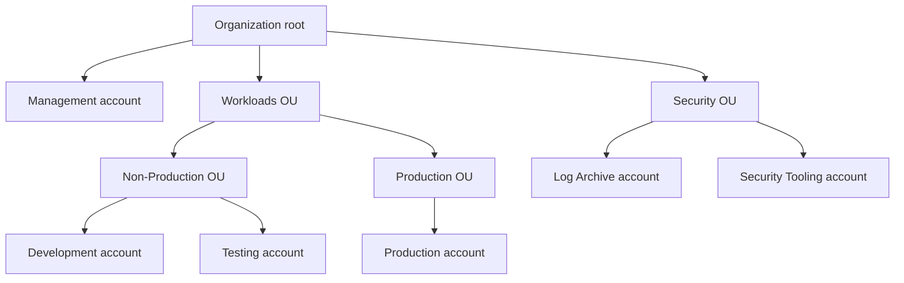
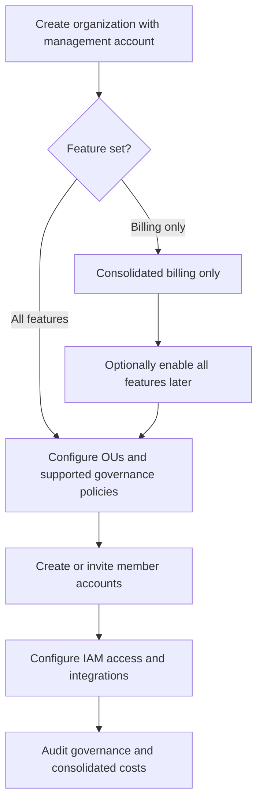
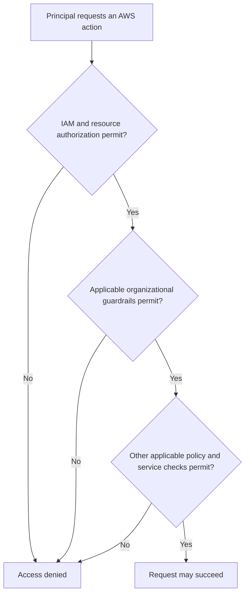
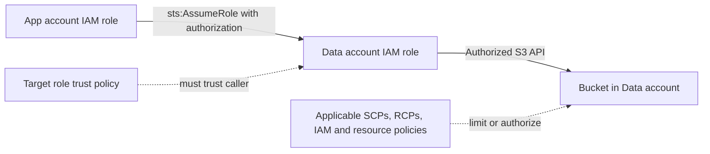
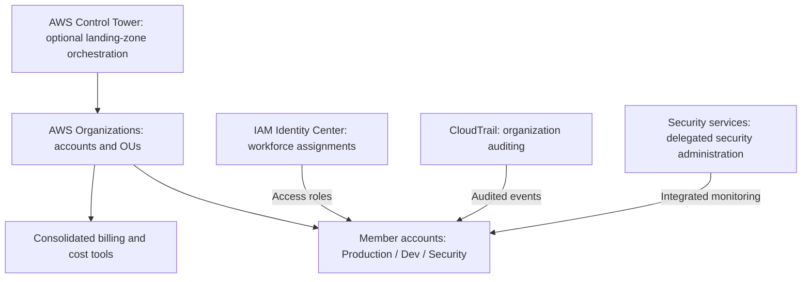
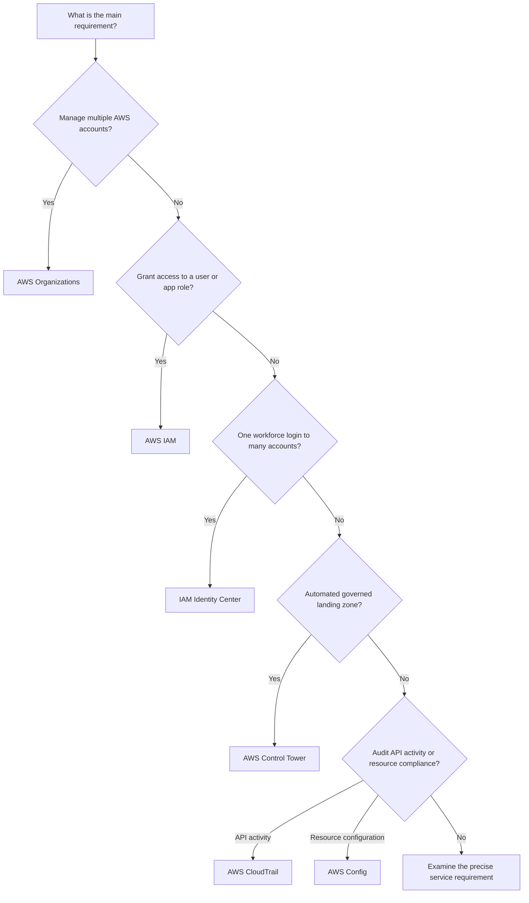

<div align="center">

# 🏢 AWS Organizations

### Complete GitHub Study Guide · Cloud Practitioner + Solutions Architect – Associate

[](https://aws.amazon.com/organizations/)
[](https://aws.amazon.com/certification/certified-cloud-practitioner/)
[](https://aws.amazon.com/certification/certified-solutions-architect-associate/)


**One sentence to remember:** AWS Organizations centrally structures, governs, and consolidates billing for multiple AWS accounts; its permission policies impose limits rather than replacing account-level IAM permissions.

[🟢 CCP essentials](#ccp-essentials) · [🔵 SAA architecture](#saa-deep-dive) · [⚔️ Comparisons](#service-comparisons) · [⚠️ Exam traps](#exam-traps) · [🧪 Practice](#practice-questions)

</div>

---

## 📚 Table of contents

1. [What is AWS Organizations?](#what-is-aws-organizations)
2. [What problem does it solve?](#what-problem-does-it-solve)
3. [Core concepts and hierarchy](#core-concepts-and-hierarchy)
4. [How it works](#how-it-works)
5. [Key features and policy types](#key-features-and-policy-types)
6. [Real-world use cases](#real-world-use-cases)
7. [🟢 CCP essentials](#ccp-essentials)
8. [🔵 SAA deep dive](#saa-deep-dive)
9. [⚔️ Service comparisons](#service-comparisons)
10. [Integration and architecture patterns](#integration-and-architecture-patterns)
11. [Security and shared responsibility](#security-and-shared-responsibility)
12. [Auditing and troubleshooting](#auditing-and-troubleshooting)
13. [Pricing and cost optimization](#pricing-and-cost-optimization)
14. [Practical configuration example](#practical-configuration-example)
15. [⚠️ Exam traps](#exam-traps)
16. [Interview questions](#interview-questions)
17. [🧪 Practice questions](#practice-questions)
18. [Scenario drills](#scenario-drills)
19. [Exam decision tree](#exam-decision-tree)
20. [Quick-revision cheat sheet](#quick-revision-cheat-sheet)
21. [Source corrections and updates](#source-corrections-and-updates)
22. [Official AWS references](#official-aws-references)
23. [Closing takeaway](#closing-takeaway)

---

<a id="what-is-aws-organizations"></a>
## 1. What is AWS Organizations?

**Simple definition:** AWS Organizations is a managed AWS service for centrally managing **multiple AWS accounts**. It provides a hierarchy of accounts, organization-wide governance policies, account lifecycle operations, and **consolidated billing**.

**Exam-ready definition:** It is a **global, account-management and governance service** that lets an organization use a management account to create or invite member accounts, place them in **organizational units (OUs)**, attach supported organization policies at the root/OU/account level, and consolidate their billing. For restrictions on IAM principals, its **service control policies (SCPs)** define the *maximum available permissions* in **member accounts**—they do **not** grant access.

### Neighborhood analogy

- **AWS account:** a house with its own locks, residents, and equipment.
- **IAM:** who inside a house has which keys and permissions.
- **AWS Organizations:** the neighborhood authority that groups houses, establishes shared rules, and collects bills centrally.
- **OU:** a district or neighborhood block, such as `Production` or `Security`.
- **SCP:** a neighborhood-wide rule such as “no one in this district may perform this category of operation,” regardless of their house keys.

**Where the analogy stops:** An AWS account is a real security, billing, and resource-ownership boundary—not merely a folder. Organizations doesn't automatically establish application connectivity, cross-account access, or identical IAM users in all accounts.

| At a glance | Correct mental model |
|---|---|
| Category | Multi-account governance and centralized account management |
| Scope | **Global service**; member-account workloads remain regional/global according to each AWS service |
| Main administrator | One **management account** per organization |
| Other accounts | **Member accounts** with separate resources and identities |
| Hierarchy | One organization root, optional nested OUs, accounts |
| Authorization guardrail | **SCP** limits member-account IAM principals; **RCP** limits access to supported resources in member accounts |
| Billing | Consolidated billing; management account is responsible for member-account charges |
| Typical complements | IAM, IAM Identity Center, Control Tower, CloudTrail, AWS Config, GuardDuty, AWS Backup |
| Direct Organizations service charge | **No additional charge**; related AWS services and workloads may cost money |

> [!IMPORTANT]
> **An AWS Organizations SCP is not an IAM policy that grants access.** A user needs the applicable IAM/resource-based authorization *and* must not be blocked by organization-level guardrails. [AWS: Service control policies](https://docs.aws.amazon.com/organizations/latest/userguide/orgs_manage_policies_scps.html).

---

<a id="what-problem-does-it-solve"></a>
## 2. What problem does it solve?

Consider a company running development, testing, production, security logging, and finance reporting in **one** AWS account. Teams may share the same IAM account boundary, see more resources than necessary, compete for account quotas, and make errors affecting unrelated workloads. Separating environments into accounts helps, but managing many standalone accounts manually becomes cumbersome.

| Without Organizations | With Organizations |
|---|---|
| Disconnected account administration | One account hierarchy and central account lifecycle |
| Scattered company-wide rules | Supported policies applied to groups of accounts |
| Each account billed independently | Consolidated billing and combined cost visibility |
| Difficult to consistently separate teams | OUs for production, non-production, security, finance, etc. |
| Repeated integrations per account | Supported organization-level integration and delegated administration |
| Separate manual cost analysis | Organization-level billing tools and cost allocation strategies |

**Primary use cases:** (1) manage many AWS accounts; (2) separate dev/test/prod; (3) enforce security guardrails; (4) centralize billing; (5) group accounts by department/business unit; and (6) operate a secure multi-account strategy at scale.

> [!TIP]
> **Choose the service by the unit being managed:** multiple AWS **accounts** → Organizations; an IAM **role/user** within an account → IAM; a **governed landing zone** with automated setup and detective/preventive controls → Control Tower.

---

<a id="core-concepts-and-hierarchy"></a>
## 3. Core concepts and hierarchy

| Term | Meaning | Key distinction |
|---|---|---|
| **Organization** | A collection of AWS accounts centrally governed under one management account | Not a VPC or an IAM user group |
| **Management account** | Account that creates/administers the organization and is responsible for consolidated billing | Formerly called **master account** in older material |
| **Member account** | An AWS account inside the organization | Retains its own IAM identities, resources and account boundary |
| **Organization root** | Top node of the *hierarchy* automatically created with the organization | **Not** the AWS **root user** credential |
| **Organizational unit (OU)** | Logical container of accounts and nested OUs | Policies apply to accounts beneath it according to policy rules |
| **Organization policy** | Governance document attached to a root, OU or account | Different policy types have different evaluation behavior |
| **SCP** | Service control policy; limits IAM principals in member accounts | Does not grant access, does not restrict management-account principals |
| **RCP** | Resource control policy; permission guardrail for supported resources in member accounts | Useful for resource-side restrictions, including external principals |
| **Delegated administrator** | Member account authorized to administer a supported integrated AWS service | **Not** a second Organizations management account |
| **Trusted access** | Enables a supported AWS service to integrate with the organization | Must be enabled/configured as required by that service |
| **Consolidated billing** | Centralized payment and usage aggregation across member accounts | Does not consolidate resources into one account |
| **Account invitation** | Request for an existing account to join | Existing account owner accepts/declines |

### The hierarchy: accounts are not OUs



*Illustrative account arrangement, not a mandated AWS OU design.* Every account occupies one location in the hierarchy (under the root or an OU). OUs can contain OUs; permissions and policies inherited by descendants depend on the **specific policy type**. The organization root is one hierarchy node, whereas each AWS account also has its own separate account root user.

**Important distinction:** Putting two AWS accounts in the same OU does **not** give their IAM roles cross-account access. That still requires suitable identity policies, resource policies or role trust relationships, and applicable guardrails.

[Official terminology and hierarchy](https://docs.aws.amazon.com/organizations/latest/userguide/orgs_getting-started_concepts.html)

---

<a id="how-it-works"></a>
## 4. How it works, step by step

1. Sign in to the AWS account that will become the **management account** and create an organization. The console currently defaults to **all features**, rather than consolidated-billing-only.
2. AWS creates the single **organization root** and places the management account in it.
3. **Create** new member accounts, or **invite** independently existing accounts. Invitations require acceptance; newly created accounts join automatically.
4. Create OUs such as `Security`, `Workloads`, `Non-Production`, and `Production`.
5. Move the relevant accounts into the OUs, then **enable/configure needed policy types** and attach appropriate policies at the root, OU or account level.
6. Configure IAM/IAM Identity Center access separately, enable integrations and (where supported) register a delegated administrator.
7. Use the management account's billing view for consolidated costs; audit policy and account changes with CloudTrail.
8. Test guardrails before applying them broadly. Moving an account to another OU can change which policies apply.



### Simple example

You manage `Development`, `Production`, `Security logging`, and `Finance` AWS accounts. The development OU has a policy preventing certain risky operations, while production uses a different guardrail. The management account receives the consolidated charges. IAM is still configured per account or via federated access through IAM Identity Center.

### More advanced example

An organization has a root-level SCP preventing selected member-account operations, a `Production` OU policy restricting workloads further, and an S3 resource-side guardrail implemented using a supported RCP. Engineers use IAM Identity Center to assume roles in individual accounts. CloudTrail organization trails and security services aggregate events centrally. **Each control solves a different problem**: identity permissions, principal-side limits, resource-side limits, access provisioning, or auditing.

> [!NOTE]
> An organization may use the **consolidated billing** feature set or **all features**. SCPs/RCPs need **all features**; turning them on and attaching policies is still an operational configuration task. Moving from billing-only to all features is a **one-way** switch. [AWS: feature sets](https://docs.aws.amazon.com/organizations/latest/userguide/orgs_manage_org_support-all-features.html).

---

<a id="key-features-and-policy-types"></a>
## 5. Key features and policy types

### 5.1 Core capabilities

| Feature | What it does | Example / exam significance |
|---|---|---|
| Central account management | Creates, invites, organizes, and removes eligible accounts | "Manage a fleet of accounts" |
| OUs | Group related accounts and apply controls by hierarchy | `Production` versus `Sandbox` restrictions |
| SCPs | Restrict maximum permissions available to IAM principals in member accounts | "Prevent account admins from using a prohibited API" |
| RCPs | Restrict maximum permissions to access supported resources in member accounts | "Restrict external access to resources centrally" |
| Other organization policies | Configure consistent backup, tagging and service settings according to policy type | "Standardize tags across accounts" |
| Consolidated billing | Consolidates charges and may share eligible discounts | "Central payer / combined usage" |
| Create / invite | Onboard accounts at scale | `CreateAccount` versus account invitation |
| Delegated administration | Let a member account administer a supported integrated service | Security tooling account runs supported security service |
| Trusted access | Enables approved AWS service integrations | Needed by many organizational security/management services |

### 5.2 The different kinds of organization policy

| Policy type | Main purpose | What it **doesn't** do |
|---|---|---|
| **Service control policy (SCP)** | Max permissions for **member-account IAM principals** | Doesn't grant IAM permission; doesn't constrain management-account principals |
| **Resource control policy (RCP)** | Max permissions for **supported member-account resources**, including protection against certain external requests | Doesn't grant resource/identity access; doesn't affect management-account resources |
| **Tag policy** | Standardize compliant tag keys, casing and values; supports enforcement/reporting for eligible cases | Basic tag-value compliance alone doesn't require all untagged resources to be tagged |
| **Backup policy** | Centrally define backup plans for supported resources/accounts | Doesn't create a reliable, verified restore plan by itself |
| **Declarative policies** | Centrally maintain supported AWS service configuration baselines | Are not identical to API-level SCP restrictions |
| **Additional specialized policies** | Other policy types exist for specific supported integrations | Don't assume every policy behaves like an SCP |

Official current catalog: [AWS Organizations policy types](https://docs.aws.amazon.com/organizations/latest/userguide/orgs_manage_policies.html). Not all policy types apply to all services, resource types, or feature sets.

### 5.3 SCPs are ceilings, not doors

For an action to succeed, the required permissions must exist **and** applicable guardrails must permit it. For a member-account role, think:

```text
Effective access depends on:
  - identity-based permissions and resource-based authorization,
  - applicable SCPs (principal-side organizational ceiling),
  - applicable RCPs (resource-side ceiling where supported),
  - and any applicable IAM permissions boundary, session policy,
    explicit deny, and service-specific authorization conditions.
```

An SCP `Allow` is a **permission allowance ceiling**, not an IAM permission grant. An **explicit Deny** in any applicable SCP wins over an `Allow` elsewhere. Under SCP **allowlist** evaluation, sufficient Allow statements must be present at **every level** on the account's path, from organization root to account. AWS attaches the managed **`FullAWSAccess` SCP** to new hierarchy nodes by default; it allows the guardrail layer to be permissive but never grants IAM access. Do not delete it carelessly. [AWS: SCP evaluation](https://docs.aws.amazon.com/organizations/latest/userguide/orgs_manage_policies_scps_evaluation.html).



*This is a teaching decision tree, not a complete IAM policy evaluation algorithm. Cross-account resource policies and all exceptional principal types require their own evaluation; SCPs do not directly govern principals outside the organization.*

### 5.4 SCP exceptions to remember

- SCPs govern principals in **member accounts**, including the **member-account root user**.
- SCPs **do not govern principals in the management account**.
- SCPs **do not restrict service-linked roles**.
- SCPs **do not directly restrict IAM principals from external accounts** that access your member-account resources through resource-based policies; consider RCPs and resource policies for the resource side.
- A member account acting as a **delegated administrator** remains subject to SCPs.

### 5.5 The new-organization default is date- and method-sensitive

**For organizations created through the AWS Organizations console after July 10, 2026**, AWS documents default security controls that enable SCPs and attach a root-level SCP denying member accounts `organizations:LeaveOrganization` and `account:CloseAccount`. This is **not automatically retroactive** and **is not automatically installed** when creating an organization through the CLI, SDK, or CloudFormation. [AWS: default security controls](https://docs.aws.amazon.com/organizations/latest/userguide/orgs_security_default_controls.html).

> [!WARNING]
> Don't assume a newly created organization, an older organization, a CLI-created organization and a billing-only organization have identical policy defaults. **Check the actual feature set and attached policies.**

---

<a id="real-world-use-cases"></a>
## 6. Real-world use cases and when to choose it

| Requirement | Choose Organizations? | Why / additional services |
|---|---|---|
| Centrally manage 20 team accounts | **Yes** | Account hierarchy, OUs and management account |
| Separate dev/test/prod by AWS account | **Yes** | Structure and guardrails; workload separation comes from distinct accounts |
| Prevent most engineers from launching workloads in prohibited regions | **Yes, with carefully designed SCPs** | Restrictions may need exemptions for global services |
| Aggregate member-account charges | **Yes** | Consolidated billing |
| Enforce shared security monitoring across accounts | **Yes, as a foundation** | Combine with CloudTrail, Config, GuardDuty, Security Hub, etc. |
| Give employees single sign-on into many accounts | **Complement, not sufficient alone** | IAM Identity Center and permission sets |
| Establish a standard landing zone with setup workflows | **Foundation, but usually Control Tower** | Control Tower uses Organizations and additional services |
| Change a single EC2 instance's security group | **No** | EC2/VPC security groups and IAM |
| Allow an application in Account A to read a bucket in Account B | **Not by itself** | IAM role trust/assumption, bucket policies, applicable SCPs/RCPs |
| Perform regional failover for a production application | **Not by itself** | Multi-Region application design and service-specific replication |

**Default architectural advice:** use separate AWS accounts as meaningful security/ownership/billing units, then use Organizations to establish centralized governance. For a very small single-account project with no account separation requirement, Organizations may add no immediate practical value.

---

<a id="ccp-essentials"></a>
## 7. 🟢 Cloud Practitioner (CCP) essentials


### 18 facts to know

1. AWS Organizations manages **multiple AWS accounts** centrally.
2. Its scope is **global**, rather than being an EC2-like regional workload service.
3. The **management account** administers the organization.
4. **Member accounts** remain separate AWS accounts with their own resources.
5. Every organization has one **organization root** (a hierarchy node).
6. **OUs** are logical groupings of accounts, and can be nested.
7. Different OUs can represent teams, departments, or environments.
8. **SCPs** are organizational **permission guardrails**.
9. SCPs **do not grant access**; IAM/resource policies still authorize.
10. SCPs constrain principals in member accounts, **including member-account root users**.
11. SCPs **do not apply to management-account users/roles**.
12. SCPs **do not restrict service-linked roles**.
13. The **explicit Deny** principle is critical for SCP-based governance.
14. **Consolidated billing** centralizes charges and cost views.
15. Eligible combined usage and savings/discount sharing can reduce costs.
16. AWS Organizations can **create new** or **invite existing** AWS accounts.
17. **AWS Control Tower** builds on Organizations to set up/govern a landing zone.
18. **AWS IAM Identity Center** adds centralized workforce sign-in across AWS accounts.

### CCP keyword bank

`Multi-account management` · `Management account` · `Member account` · `Global service` · `Organizational Unit (OU)` · `Organization root` · `SCP` · `Guardrails` · `Permissions ceiling` · `Consolidated billing` · `Combined usage` · `Volume discounts` · `Reserved Instance sharing` · `Savings Plans sharing` · `Account invitation` · `Governance` · `Policy inheritance` · `Centralized control` · `AWS Control Tower` · `IAM Identity Center`

### If the question says X → think Y

| Exam clue | First candidate | Why |
|---|---|---|
| "Centrally manage dozens of AWS accounts" | **Organizations** | Core account-management service |
| "Organize AWS accounts into departments" | **Organizational Units** | Hierarchical groups |
| "Restrict maximum permissions in member accounts" | **SCP** | Organization-wide principal-side guardrail |
| "One central payment for multiple accounts" | **Consolidated billing** | Organizations billing capability |
| "Set up a multi-account landing zone automatically" | **Control Tower** | Automated governance built on Organizations |
| "Grant a developer access to S3" | **IAM policy / role** | SCP cannot grant access |
| "Employees sign in once to several accounts" | **IAM Identity Center** | Central workforce access |
| "See account-level API changes" | **CloudTrail** | Audit records rather than governance hierarchy |

### 30-second CCP answer

AWS Organizations is a **global multi-account management service**. It groups AWS accounts into **organizational units**, applies **governance policies such as SCPs**, and provides **consolidated billing**. **SCPs limit permissions; IAM policies grant them.**

---
<a id="saa-deep-dive"></a>
## 8. 🔵 Solutions Architect – Associate (SAA) deep dive


At the SAA level, you must choose **the correct control at the correct layer**, understand *policy evaluation*, and design account separation, access, logging, and cost allocation appropriately.

### 8.1 Architecture boundaries: organization, account, OU, Region, AZ

| Layer | What it organizes or isolates | Mistake to avoid |
|---|---|---|
| **Organization** | Central governance of accounts | Does not run applications or replicate resources |
| **Account** | Separate identity, resource, service-quota, and billing-attribution scope | Two accounts do not automatically trust each other |
| **OU** | Logical grouping and policy application | Not a network boundary, not a region, not an account |
| **AWS Region** | Geographic placement of regional AWS services | Organizations is global; the app still needs regional design |
| **Availability Zone** | Isolated infrastructure within a Region | New AWS account does not create an independent AZ |
| **VPC** | Isolated virtual network within a Region | AWS Organizations does not connect VPCs |

**Well-Architected pattern:** Keep workloads out of the management account where practical. Place infrastructure and security tooling in dedicated member accounts; keep audit/log retention appropriately protected; use separate non-production and production accounts to reduce blast radius.

### 8.2 SCP evaluation, worked example

Assume an IAM role in a `Production` member account has `AdministratorAccess`. Its SCP path is:

```text
Organization root
  FullAWSAccess
  Deny ec2:TerminateInstances   <-- explicit deny
        |
        v
Production OU
  FullAWSAccess
        |
        v
Production account
  FullAWSAccess
  IAM role: AdministratorAccess
```

**Can the role terminate an EC2 instance?** **No.** The root-level SCP Deny blocks the action, even though the role has broad IAM privileges and every level has `FullAWSAccess`. If the role requests a different action that isn't blocked and all other authorization checks pass, it may be allowed.

**Allowlist variation:** If the root allows `ec2:*` but an intermediate OU allows only `s3:*`, then EC2 isn't allowed for the descendant account. A valid **Allow must cover the action at each relevant level**. At a single level, multiple SCP Allow statements may collectively allow actions; an explicit Deny wins. [SCP evaluation](https://docs.aws.amazon.com/organizations/latest/userguide/orgs_manage_policies_scps_evaluation.html).

> [!IMPORTANT]
> **`FullAWSAccess` ≠ `AdministratorAccess`.** `FullAWSAccess` is an **Organizations SCP** setting the upper boundary; `AdministratorAccess` is an **IAM managed policy** that can grant broad identity permissions. The two are not interchangeable.

### 8.3 SCP versus IAM permissions boundary versus RCP

| Control | Where enforced | Controls | Relevant exam clue |
|---|---|---|---|
| SCP | Root/OU/member account | Maximum actions **member-account principals** can perform | "All users/roles in selected accounts must not do X" |
| IAM identity policy | IAM principal | What identity is allowed/denied to do | "Grant the app role permission to read bucket" |
| IAM permissions boundary | IAM user/role | Upper permissions of that IAM identity | "Delegated role creator can't elevate a role beyond a ceiling" |
| IAM session policy | Assumed role/federated session | Restricts permissions of that session | "Restrict one temporary role session" |
| Resource policy | Supported AWS resource | Which principals may access resource, subject to conditions | "Bucket grants cross-account access" |
| RCP | Root/OU/member account resource side | Maximum access to **supported resources** in member accounts | "Restrict external identities accessing our resources" |

RCPs also **do not grant access**. Their coverage is limited to **supported AWS services/resources**, and they do not affect resources in the management account. See [AWS: RCPs](https://docs.aws.amazon.com/organizations/latest/userguide/orgs_manage_policies_rcps.html) and [SCP vs RCP](https://docs.aws.amazon.com/organizations/latest/userguide/orgs_manage_policies_authorization_policies.html).

### 8.4 Cross-account access: Organizations is not a trust policy

**Scenario:** An application role in `App` account needs to read an S3 bucket owned by `Data` account.

1. Design the appropriate **cross-account authorization** (for example, an IAM role in the data account that trusts the application account's role, plus `sts:AssumeRole` permissions for the caller).
2. Give the **target role** the needed bucket permissions; where necessary, configure bucket/KMS resource policies too.
3. Confirm neither side is blocked by applicable **SCPs**, **RCPs**, permissions boundaries, explicit denies, or other relevant controls.
4. Verify encryption, network, and service settings separately.



**Exam trap:** Merely inviting both accounts to AWS Organizations **does not** give the app access to the data bucket. For created accounts, Organizations may create a management-account access role, but **that is not universal trust among every member account**.

### 8.5 Allowlist vs denylist strategy

| Strategy | How it works | Advantages | Risk / caveat |
|---|---|---|---|
| **Denylist SCP** | Keep broad `FullAWSAccess`; add explicit `Deny` for prohibited actions | Easier to adopt and operate | New AWS capabilities may remain available unless denied |
| **Allowlist SCP** | Replace broad SCP allowances with explicit allowed actions/services at the relevant levels | More restrictive baseline | Easily causes outages; dependencies, APIs, and new services must be maintained |
| **Layered SCPs** | Root-wide mandatory deny + specific OU/account restrictions | Separates universal vs workload-specific guardrails | A lower OU cannot override a parent Deny |

**Do not casually deny all actions outside one Region using simple `aws:RequestedRegion` logic.** Global services and AWS APIs with cross-Region effects need careful exceptions and testing. SCP region conditions aren't equivalent to enforcing where all data is stored or processed. See [AWS: SCP examples](https://docs.aws.amazon.com/organizations/latest/userguide/orgs_manage_policies_scps_examples.html).

### 8.6 Service-linked roles and delegated admin

Some AWS services create **service-linked IAM roles** to perform authorized tasks in customer accounts. **SCPs don't restrict those service-linked roles**, so a blanket statement that “SCPs block every possible action in an account” is wrong. A **delegated administrator** is a chosen **member account** that can administer a **supported service** across the organization, reducing operational work in the management account. Delegation doesn't transfer ownership of the organization or eliminate the member account's SCP constraints.

### 8.7 SAA scenario 1 — Protect production from accidental deletion

**Requirement:** Teams need broad admin access for legitimate deployments, but the company wants to prohibit a particular destructive operation across production accounts.

**Design:** Group production accounts in a `Production` OU; attach a validated **SCP Deny** for the relevant API action to the OU; keep needed IAM permissions at the account level; test with representative roles and deployments. Use backups, resource protection, and change controls as additional measures.

**Why:** An account administrator cannot override an explicit SCP Deny by attaching `AdministratorAccess`.

**Pitfall:** A broad Deny can block automation and recovery tools; service-linked roles are an SCP exception. Test thoroughly instead of assuming all principals are uniformly affected.

### 8.8 SAA scenario 2 — Central logging across accounts

**Requirement:** Central security operations must see account activity for production, development, and security accounts.

**Design:** Use Organizations as the account foundation. Configure **AWS CloudTrail organization trails** (and other relevant organization-level security integrations), storing logs in a protected account/bucket with suitable access controls. A delegated administrator may manage organization trails where supported.

**Why:** An organization trail applies to the management and member accounts, including accounts added later. The mere existence of Organizations does **not** automatically create the trail. [CloudTrail organization trail](https://docs.aws.amazon.com/awscloudtrail/latest/userguide/creating-trail-organization.html).

**Pitfall:** A central audit account and protected log destination do not automatically guarantee every data event is captured; choose event types, retention, access and encryption deliberately.

### 8.9 SAA scenario 3 — Central workforce access with least privilege

**Requirement:** A team of developers needs read-only access to production and developer access to non-production, with a single login portal.

**Design:** Keep the accounts in Organizations; use an **IAM Identity Center organization instance** and **permission sets**. Assign different permission sets to each group/account combination. Keep IAM/SCP guardrails separate.

**Why:** IAM Identity Center creates/manages relevant account roles from permission sets and provisions account assignments. Organizations by itself manages accounts but does not provision that employee's SSO access. [IAM Identity Center permission sets](https://docs.aws.amazon.com/singlesignon/latest/userguide/permissionsetsconcept.html).

### 8.10 SAA scenario 4 — Resource-side access from outside the organization

**Requirement:** A company needs a consistent guardrail preventing disallowed external requests to supported sensitive resources in many accounts.

**Design:** Evaluate **RCPs** on the relevant hierarchy and resources, together with resource policies and service-specific controls. Keep SCPs for member-account principal-side limits.

**Why:** SCPs do **not** directly constrain external IAM principals, whereas RCPs can place ceilings on access to supported resources in member accounts.

**Pitfall:** RCP support is service/resource-specific. RCPs don't grant access, and they don't apply to resources in the management account.

### 8.11 SAA scenario 5 — Move a workload account to a stricter OU

**Requirement:** An account has passed testing and is promoted from `Sandbox` to `Production`.

**Design:** Move the account to the production OU after assessing the applicable SCPs and other inherited policies, account controls and integration effects. Test its CI/CD workflows, key services, cross-account roles, and monitoring.

**Why:** The account remains the same account, but its **effective governance context changes**.

**Pitfall:** An automated pipeline may stop working because the production OU Deny now applies—even though no IAM policy inside the account changed.

---

<a id="service-comparisons"></a>
## 9. ⚔️ Service comparisons

| Service / feature | Primary job | Operating scope | When to choose it / exam distinction |
|---|---|---|---|
| **AWS Organizations** | Hierarchy, governance policies, account lifecycle, billing | Multiple AWS accounts | Centrally manage accounts, OUs, SCPs, costs |
| **AWS IAM** | Identity and authorization | Mainly individual AWS account | Grant users, roles, and applications permissions |
| **AWS IAM Identity Center** | Workforce access, permission sets and SSO | Multiple accounts / applications | "One workforce sign-in" or "centralized assignments" |
| **AWS Control Tower** | Prescriptive landing zone and controls | Multi-account environment | "Automate setting up and governing a landing zone" |
| **AWS CloudTrail** | Audit API activity and selected events | Accounts / organization trails | "Who called this API, and when?" |
| **AWS Config** | Track resource configuration/compliance | Account/Region; cross-account aggregations | "Assess resource state vs rules" |
| **AWS Security Hub** | Centralized security findings and posture workflows | Supported accounts/Regions | "Aggregate and prioritize security findings" |
| **AWS GuardDuty** | Threat detection | Account/Region; delegated admin integrations | "Detect unusual or malicious activity" |
| **AWS Billing and Cost Management** | Billing reports, cost visibility and controls | Billing account / linked accounts | "Investigate spend or forecast costs" |
| **AWS Resource Access Manager (RAM)** | Share supported AWS resources across accounts | Cross-account resources | "Share a subnet or other supported resource" |

### 9.1 Organizations vs IAM

<details>
<summary><strong>Which one controls permissions?</strong></summary>

**Both participate, but at different layers.** IAM policies specify actual permissions for identities/resources. AWS Organizations SCPs restrict the maximum available permissions for member-account IAM principals; SCPs do not grant them. You typically need *both* layers in a multi-account enterprise. "Give a developer S3 read access" → IAM; "Disallow EC2 termination for principals in every production account" → Organizations SCP.

</details>

### 9.2 Organizations vs Control Tower

<details>
<summary><strong>Does Control Tower replace Organizations?</strong></summary>

**No.** Control Tower **orchestrates** Organizations, IAM Identity Center, account setup and other AWS capabilities to build/manage a governed landing zone. Organizations provides the foundational account hierarchy and governance policies. For account-only structuring/billing, Organizations can be sufficient; for repeatable landing-zone provisioning, controls, and management, consider Control Tower. Landing zone configurations and default OUs vary by Control Tower version; don't memorize one topology as universal. [AWS Control Tower overview](https://docs.aws.amazon.com/controltower/latest/userguide/what-is-control-tower.html).

</details>

### 9.3 Organizations vs IAM Identity Center

<details>
<summary><strong>Does placing everyone in the same organization provide single sign-on?</strong></summary>

**No.** Organizations manages the **accounts and hierarchy**. IAM Identity Center provides **workforce authentication/authorization assignments**, typically using permission sets and IAM roles in selected accounts. Account structure and workforce identity provisioning are complementary.

</details>

### 9.4 Organizations vs consolidated billing

<details>
<summary><strong>Are they two competing AWS services?</strong></summary>

**No.** Consolidated billing is a **feature of Organizations**. Billing-only organizations do not provide the advanced governance capabilities of the all-features set. All-features organizations also retain consolidated billing. Discount sharing depends on the billing product and sharing configuration, and invoices may be separated by seller of record. [AWS billing consolidation](https://docs.aws.amazon.com/awsaccountbilling/latest/aboutv2/consolidated-billing.html).

</details>

### 9.5 Organizations vs CloudTrail / AWS Config

<details>
<summary><strong>Is an SCP the same as an audit or compliance rule?</strong></summary>

No. An **SCP** constrains authorization; **CloudTrail** records supported account/API activities; **AWS Config** records/evaluates supported resource configuration. For example, Organizations may prevent a prohibited API action, while CloudTrail helps investigate attempted changes, and Config checks whether deployed resources meet a desired configuration. One doesn't replace all the others.

</details>

### 9.6 Organizations vs RAM

<details>
<summary><strong>Does grouping accounts share all resources?</strong></summary>

No. **RAM** provides supported cross-account resource sharing. Organizations can simplify approved sharing inside a trusted organizational scope, but you must configure the share and relevant network/resource permissions. An OU is not itself a shared subnet, filesystem or cross-account role.

</details>

---

<a id="integration-and-architecture-patterns"></a>
## 10. Integration and architecture patterns

### 10.1 Governed multi-account environment



The diagram shows a **control and governance architecture**, not network traffic flow. **AWS Organizations is not a proxy for requests between applications** and does not directly route or scale traffic.

### 10.2 Organization-wide auditing

Use an organization trail where needed. Member accounts can view a central organization trail but cannot modify/delete it; protected S3 log storage and access are configured separately. Enabling a trail is distinct from the default CloudTrail event history. [CloudTrail trails](https://docs.aws.amazon.com/awscloudtrail/latest/userguide/cloudtrail-trails.html).

### 10.3 Organization-wide security monitoring

With supported services, enable organization integration/trusted access, designate a dedicated **security tooling member account** as delegated admin, and configure how existing/new accounts are enrolled. Do **not** assume that simply inviting an account turns on every security service for free. Some integrations can automatically enroll new accounts **once configured** and incur charges.

### 10.4 Account lifecycle automation

Create accounts through Organizations APIs, manage their OU placement and policies, and integrate with your platform-account vending workflow. AWS Control Tower or other account-provisioning tools may automate additional baseline resources. **Newly created** member accounts and **invited** member accounts have different initial IAM-role behavior:

- Created via Organizations: a management-access IAM role named **`OrganizationAccountAccessRole`** is created by default (unless configured otherwise).
- Invited existing account: that role is **not** automatically created, although the required Organizations service-linked role is managed separately for all-features organizations.

[Official account-invitation behavior](https://docs.aws.amazon.com/organizations/latest/userguide/orgs_manage_accounts_invites.html).

### 10.5 Multi-account backups

**AWS Backup** can use supported Organizations backup policies and cross-account features. Validate policy applicability, backup service prerequisites, vault security, restore permissions and cross-account/cross-Region limitations. A backup policy is a management mechanism—not evidence that a recovery point exists or a restore has succeeded.

---

<a id="security-and-shared-responsibility"></a>
## 11. Security, permissions, compliance, and shared responsibility

| Responsibility | AWS | Customer / organization administrator |
|---|---|---|
| Organizations managed service infrastructure | Operates and secures underlying service | Selects organization feature set and account structure |
| IAM and governance | Implements policy engines | Authors, tests, attaches and reviews policies |
| Account onboarding | Provides account creation/invitation mechanisms | Verifies ownership, account contact and lifecycle processes |
| Logging | Offers CloudTrail events and supported integrations | Chooses organization trails, event coverage, destinations and retention |
| Budget / billing | Calculates eligible charges, discounts and bills | Configures cost attribution, budgets and reporting |
| Workload resilience | Provides region/AZ and service capabilities | Builds multi-AZ/multi-Region application availability and disaster recovery |
| Data protection | Provides encryption/security features in services | Chooses keys, IAM/resource policies, data boundaries, backups and monitoring |

### Practical security checklist

1. Protect the **management account** with strong authentication and a very small set of administrators; avoid ordinary application workloads there.
2. Create accounts for meaningful isolation boundaries, not simply a new OU for every application.
3. Design `Production`, `Sandbox`, and `Security` OUs with documented purposes.
4. Keep least-privilege IAM and Identity Center assignments separate from SCP governance.
5. Stage and test new SCPs in a limited OU before broad attachment.
6. Preserve a verified ability to operate, recover and troubleshoot member accounts.
7. Audit policy/account changes using CloudTrail and review effective account permissions.
8. Use delegated admins for supported security services, not broad permanent access to the management account.
9. Evaluate resource-side protection (resource policies and supported RCPs) for external access.
10. Follow your data residency, audit, encryption and retention requirements in **each relevant AWS service**; Organizations alone isn't a compliance certification.

> [!WARNING]
> **A "Deny" SCP can break production.** Before applying to the organization root, validate dependencies such as control planes, auto scaling, deployment automation and recovery operations. Not every principal type is governed by SCPs, and nothing about creating an OU encrypts workload data automatically.

---

<a id="auditing-and-troubleshooting"></a>
## 12. Observability, auditing, troubleshooting and failure behavior

**What you can observe:**

- **CloudTrail** records AWS Organizations API actions such as `CreateAccount`, `InviteAccountToOrganization`, `CreatePolicy`, and `AttachPolicy`, with identity/time/request information. For Organizations service API history, AWS documents viewing it in **US East (N. Virginia)**. This does not change the global scope of Organizations. [CloudTrail Organizations integration](https://docs.aws.amazon.com/organizations/latest/userguide/orgs_cloudtrail-integration.html).
- **Organization CloudTrail trail:** if configured, provides an ongoing event-log pattern spanning accounts; destination permissions and retention remain your responsibility.
- **IAM service last accessed data:** supports analysis before tightening SCPs, with the normal limitations of such data.
- **Billing tools / cost and usage reports:** central spend attribution and analysis; these are not authorization audit logs.

### Troubleshooting guide

| Symptom | Check first | Why |
|---|---|---|
| IAM admin gets `AccessDenied` | SCPs along root → OU → account path | IAM `AdministratorAccess` cannot override an SCP Deny |
| Access denied even though SCP contains Allow | Identity/resource policies; permissions boundaries, session policies, RCPs | SCP Allow alone isn't a grant |
| Member account unexpectedly loses EC2 access | OU move, altered ancestor SCP, missing Allow, or added Deny | OU inheritance changes effective limits |
| Can't use SCP governance | Organization's feature set; whether SCP type enabled | Billing-only mode doesn't include SCPs |
| Can't invite an account | Verified management account email, pending invitation, existing membership/partition | Invitations have prerequisites and require acceptance |
| Can't assume a management access role in invited account | Role may not have been created for invited member account | Created vs invited account behavior differs |
| Cross-account bucket read denied | Role trust, IAM/bucket/KMS policies, SCP/RCP and explicit denies | Organizations membership isn't permission |
| Policy attachment causes outage | Newly inherited Deny and service dependencies | SCPs affect account-wide IAM principals |
| Costs appear in unexpected place | Management payer / cost allocation / seller of record / sharing configuration | Bills do not automatically mirror OU hierarchy |
| Organization API change absent from CloudTrail view | Inspect US East (N. Virginia) event history for Organizations | Global-service event lookup placement matters |

**Failure/consistency cautions:** Organization policy changes and account lifecycle operations can involve propagation/async status. A `CreateAccount` API request is asynchronous; check its status before provisioning further resources. Don't equate an accepted command response with a fully provisioned, correctly governed account. For access problems, evaluate both the policies on the principal/account path and the resource-side controls.

---

<a id="pricing-and-cost-optimization"></a>
## 13. Pricing and cost optimization

**AWS Organizations itself is provided at no additional charge.** You pay for normal AWS resources and for optional integrated services as their pricing terms specify. The management account is generally responsible for charges accrued by its member accounts. [AWS Organizations pricing](https://docs.aws.amazon.com/organizations/latest/userguide/pricing.html).

### Billing advantages

- Central view of member-account spending and centralized payment.
- Combined eligible usage may qualify for **volume pricing**.
- **Reserved Instance and Savings Plans** discount sharing may improve utilization across linked accounts, subject to product rules and sharing configuration.
- Cost allocation tags, account structure, AWS Budgets and Cost Explorer can help analyze or control spend.

### Important nuance: invoices and OU costs

A useful CCP simplification is “one consolidated bill.” AWS currently documents that organizations spanning **multiple sellers of record** may receive a **separate bill per seller of record**. Furthermore, consolidated bills don't automatically reflect the logical OU tree: track by account, tags, cost categories and billing tools. [Consolidated billing documentation](https://docs.aws.amazon.com/awsaccountbilling/latest/aboutv2/consolidated-billing.html).

### How to estimate total costs (without made-up rates)

```text
Estimated monthly AWS cost =
    sum(all member accounts' service usage charges)
  + management account usage charges
  + charges from enabled integrated services
  - applicable credits and eligible discounts
  +/- adjustments, taxes and commercial conditions

AWS Organizations control-plane service fee = $0 additional
```

**Optimization:** right-size workloads in each account, review unused infrastructure, consider eligible long-term compute discounts, set budgets and cost-allocation labels, and do not assume every account receives the same discount treatment. There is no published percentage saving that Organizations **guarantees**.

---

<a id="practical-configuration-example"></a>
## 14. Practical configuration / AWS CLI example

These are **illustrative commands** for an authorized administrator, not commands to blindly run in production. Prerequisites: AWS CLI v2 configured, permissions for the specific Organizations actions, and an organization with **all features enabled** when working with SCPs. Commands that change account structure or attach policies are potentially disruptive.

### 14.1 Safe, read-only inspection

```bash
# Identify organization feature set (ALL vs CONSOLIDATED_BILLING).
aws organizations describe-organization

# Inspect the hierarchy root.
aws organizations list-roots

# Inspect member accounts.
aws organizations list-accounts

# Inspect SCPs attached to a known OU/account/root.
# Replace the target ID with a real ID from your own account.
aws organizations list-policies-for-target \
  --target-id "<TARGET_ID>" \
  --filter SERVICE_CONTROL_POLICY
```

### 14.2 Example SCP: restrict EC2 instance termination in a test OU

Create an example policy document named `deny-ec2-termination.json`:

```json
{
  "Version": "2012-10-17",
  "Statement": [
    {
      "Sid": "DenyInstanceTermination",
      "Effect": "Deny",
      "Action": "ec2:TerminateInstances",
      "Resource": "*"
    }
  ]
}
```

It **does not grant any IAM permission**. If attached to a sandbox OU, the SCP can block member-account IAM principals from terminating EC2 instances—even if IAM allows it. Existing `FullAWSAccess` SCPs should be left in place while piloting a **denylist-style** policy. **Do not apply the example to the root or production without approval, service dependency review and a rollback plan.**

```bash
# Create a policy in the organization's management account.
aws organizations create-policy \
  --name "DenyEC2TerminationSandbox" \
  --description "Training example: prevent EC2 termination in test OU" \
  --type SERVICE_CONTROL_POLICY \
  --content file://deny-ec2-termination.json

# OPTIONAL / DISRUPTIVE: Only after testing, policy review and approval.
# Replace IDs with the real policy and test OU identifiers.
aws organizations attach-policy \
  --policy-id "<POLICY_ID>" \
  --target-id "<SANDBOX_OU_ID>"

# Undo the example if the policy shouldn't apply.
aws organizations detach-policy \
  --policy-id "<POLICY_ID>" \
  --target-id "<SANDBOX_OU_ID>"
```

**How to validate:** use a test role with appropriate IAM permissions, evaluate with non-destructive analysis where possible, and inspect `AccessDenied` results and CloudTrail. Do not terminate a real production resource for testing. An SCP is effective only where all-features governance and the policy type are enabled.

### 14.3 Account creation concept

Creating a member account is a separate Organizations operation, commonly performed in an account-vending workflow via `CreateAccount` (asynchronous). The new account has its own billing identity/resource scope, and a default `OrganizationAccountAccessRole` may be created. Inviting a pre-existing account follows a **different process** and does **not** automatically create that IAM role. [AWS CLI create-account](https://docs.aws.amazon.com/cli/latest/reference/organizations/create-account.html).

---
<a id="exam-traps"></a>
## 15. ⚠️ Common exam traps and misconceptions

> [!IMPORTANT]
> The biggest conceptual distinction: **SCP = maximum permissions in member accounts; IAM = actual permission grants.** No SCP can make an otherwise unauthorized request succeed.

| # | ❌ Misconception | ✅ Correct interpretation | Level |
|---|---|---|---|
| 1 | Organizations is only for billing | It also manages accounts, OUs, supported policies, and integrations | CCP |
| 2 | Organizations is regional like EC2 | Organizations is **global**; workloads have their own service-specific scope | CCP |
| 3 | An OU is a separate AWS account | An OU is a **logical container**; accounts are separate AWS account resources/boundaries | CCP |
| 4 | OU membership automatically shares IAM users | Access is separately configured through IAM / IAM Identity Center | CCP |
| 5 | SCPs allow IAM users to act | SCPs **never grant permission** | CCP |
| 6 | IAM `AdministratorAccess` overrides an SCP | An applicable SCP explicit Deny still blocks that member-account principal | CCP/SAA |
| 7 | SCPs affect the management-account IAM principals | They affect **member-account** principals, not management-account principals | CCP/SAA |
| 8 | Member-account root users ignore SCPs | Member-account root users **are subject** to SCPs, with documented exceptions | CCP/SAA |
| 9 | SCPs block service-linked roles | Service-linked roles are an **exception** | SAA |
| 10 | Delegated admins can ignore SCPs | Delegated-admin member accounts remain subject to SCPs | SAA |
| 11 | SCPs directly restrict every external AWS principal | SCPs don't directly constrain principals outside the organization | SAA |
| 12 | RCPs grant access to a resource | RCPs are **resource-side permission ceilings**, not grants | SAA |
| 13 | RCPs affect management-account resources | They govern supported **member-account** resources only | SAA |
| 14 | Every Organizations policy behaves exactly like an SCP | Different **policy types** have different scope, defaults, and inheritance behavior | SAA |
| 15 | Putting accounts in an OU lets them access each other's S3 buckets | Cross-account identity/resource policies and other controls are still needed | CCP/SAA |
| 16 | OUs can be used to route traffic | Networking is configured separately with VPC and related services | CCP |
| 17 | A parent OU Deny can be undone by child OU Allow | An applicable **explicit Deny** wins | SAA |
| 18 | An SCP `Allow` at the account is sufficient by itself | Allow must cover the action at **all levels** on the path under allowlist evaluation | SAA |
| 19 | `FullAWSAccess` means every principal is an admin | It is an **SCP ceiling**; it gives no IAM authorization | SAA |
| 20 | Removing `FullAWSAccess` is always harmless | Missing sufficient SCP Allow at any level can block all API actions | SAA |
| 21 | Creating a billing-only organization enables SCPs | Governance policy features need **all features** and appropriate policy configuration | CCP/SAA |
| 22 | All organizations have identical default security SCPs | Defaults depend on **creation date, method, feature set and configuration** | SAA |
| 23 | AWS automatically invites every account owned by a company | Accounts must be created or explicitly invited and joined | CCP |
| 24 | New and invited accounts get the exact same access role | Created accounts get a default management access role; invited accounts do not automatically get it | SAA |
| 25 | New member accounts are automatically encrypted and backed up | Workload encryption, backup, security and service setup remain separate tasks | CCP/SAA |
| 26 | Organizations automatically provisions CloudTrail organization trails | You must **configure** a trail/integration to get that centralized logging behavior | SAA |
| 27 | "One bill" means invoices can never be split | Multiple **sellers of record** can result in separate bills within consolidated billing | SAA |
| 28 | Cost is automatically broken down by OU on the consolidated bill | Use cost allocation tags/accounts/cost tooling; the invoice doesn't mirror the OU hierarchy | SAA |
| 29 | Tag policies automatically forbid every untagged resource | Basic compliance rules alone don't enforce all missing tags | SAA |
| 30 | An Organizations SCP is a regulatory certification | SCP is a technical guardrail; compliance needs broader processes and evidence | CCP/SAA |
| 31 | Accounts in different Regions belong to different Organizations | Organizations is global and spans eligible accounts; regional resources stay in chosen Regions | CCP |
| 32 | Control Tower replaces Organizations | Control Tower **builds on and orchestrates** Organizations | CCP |

### Three traps that deserve extra attention

**(A) Why doesn't `FullAWSAccess` give full administrator permissions?** SCPs are evaluated as an upper bound. Having an SCP that permits an action only means that this particular guardrail isn't blocking it; the action also needs the required IAM/resource authorization. See [SCP evaluation](https://docs.aws.amazon.com/organizations/latest/userguide/orgs_manage_policies_scps_evaluation.html).

**(B) Why might an "admin" in a member account be denied but a service-linked role succeed?** Ordinary member-account IAM roles are affected by SCPs. Service-linked roles are a documented SCP exception. This isn't a license to use service-linked roles as a privilege-escalation workaround; instead, design and test service integrations appropriately. See [SCP limitations](https://docs.aws.amazon.com/organizations/latest/userguide/orgs_manage_policies_scps.html).

**(C) Why doesn't a resource policy plus SCP protect against every outside principal?** SCPs primarily impose limits on **principals belonging to your organization**. If access to a resource originates from an external account, your **resource policy** and potentially a supported **RCP** are relevant. See [authorization policies](https://docs.aws.amazon.com/organizations/latest/userguide/orgs_manage_policies_authorization_policies.html).

---

<a id="interview-questions"></a>
## 16. Interview questions and short answers

| Question | Good short answer |
|---|---|
| **1. What is AWS Organizations?** | A managed service to centrally structure, govern and consolidate billing for multiple AWS accounts. |
| **2. Why use multiple AWS accounts instead of one?** | Better separation of resources, identity/security boundaries, ownership, quotas and cost attribution. |
| **3. What is the difference between management and member accounts?** | The management account owns administration and billing relationships; members host their own resources and identities under governance. |
| **4. How do OUs work?** | OUs group accounts and can nest; supported policies apply to their descendants according to policy type. |
| **5. Can an SCP grant S3 access?** | No. SCPs only cap permissions; appropriate IAM/resource permissions must also grant S3 access. |
| **6. Does an SCP restrict root users?** | It restricts root users **in member accounts**, with documented exceptions; not management-account principals. |
| **7. SCP versus RCP?** | SCP is principally about identities in member accounts; RCP protects supported resources in member accounts, including certain external requests. |
| **8. How would you give employees one login for five accounts?** | Use IAM Identity Center organization-instance account assignments and permission sets, integrated with Organizations. |
| **9. What can go wrong when moving an account between OUs?** | New inherited SCPs/policies can restrict deployments, access and service operations. Test before the move. |
| **10. How would you audit policy changes?** | Use CloudTrail for Organizations API calls, inspect policy attachments, and use an organization trail where centrally configured. |
| **11. Why choose Control Tower over Organizations alone?** | Control Tower adds a prescriptive landing-zone setup and ongoing governance orchestration above the Organizations foundation. |
| **12. Can the management account delegate all its responsibility?** | It can delegate administration of **supported services**, not surrender the unique management-account responsibilities for the organization. |

---

<a id="practice-questions"></a>
## 17. 🧪 Original exam-style practice questions

**These 30 questions are original study exercises, not leaked or official AWS exam items.** They progress from CCP recognition to SAA reasoning. Expand each answer to see the rationale.

<details>
<summary><strong>Q1 · CCP — Which service centrally manages multiple AWS accounts?</strong></summary>

**Choices:** A. EC2 Auto Scaling · B. AWS Organizations · C. Amazon Route 53 · D. AWS CodeBuild

**Answer: B — AWS Organizations.** It manages accounts, OUs, supported governance and consolidated billing. Auto Scaling changes workload capacity; Route 53 manages DNS; CodeBuild builds software.

</details>

<details>
<summary><strong>Q2 · CCP — What is an organizational unit?</strong></summary>

**Choices:** A. A VPC subnet · B. A group of AWS accounts and possibly nested OUs · C. An IAM group · D. A billing invoice

**Answer: B.** An OU is a logical grouping in the Organizations hierarchy, not a subnet, IAM group or invoice.

</details>

<details>
<summary><strong>Q3 · CCP — Which statement about an SCP is correct?</strong></summary>

**Choices:** A. Grants S3 permissions · B. Defines a permission ceiling for member-account principals · C. Is a security group · D. Automatically encrypts data

**Answer: B.** SCPs constrain maximum permissions; IAM/resource policies grant permissions. Security groups filter network traffic; encryption is service-specific.

</details>

<details>
<summary><strong>Q4 · CCP — Who typically pays for member-account AWS charges?</strong></summary>

**Choices:** A. Every end user directly · B. Organization management account owner · C. AWS Support · D. IAM Identity Center

**Answer: B.** The management account is the consolidated payer, subject to the relevant billing arrangements; other answers aren't Organizations billing roles.

</details>

<details>
<summary><strong>Q5 · CCP — An organization needs one workforce portal to access multiple accounts. Choose the best service.</strong></summary>

**Choices:** A. IAM Identity Center · B. AWS Artifact · C. S3 Transfer Acceleration · D. Amazon Route 53

**Answer: A.** IAM Identity Center provides workforce sign-in and permission-set assignments. Organizations provides the account structure; other choices are unrelated.

</details>

<details>
<summary><strong>Q6 · CCP — What is the main difference between AWS Organizations and AWS Control Tower?</strong></summary>

**Answer:** Organizations supplies the **account-management and governance foundation**. Control Tower orchestrates a **governed landing zone** with additional setup and controls. Control Tower does not replace Organizations.

</details>

<details>
<summary><strong>Q7 · CCP — True or false: Each OU must be in a different AWS Region.</strong></summary>

**Answer: False.** OUs are global logical account groupings, not regional resources. Resources in the member accounts follow their own service/Region scope.

</details>

<details>
<summary><strong>Q8 · CCP — A company wants to centralize payment and combine eligible usage across accounts. Which feature?</strong></summary>

**Choices:** A. Route 53 health checks · B. Consolidated billing · C. EC2 placement groups · D. S3 bucket versioning

**Answer: B.** Consolidated billing is an AWS Organizations feature. The other options solve DNS, instance placement and object-versioning problems.

</details>

<details>
<summary><strong>Q9 · CCP — Can Organizations create a new member account?</strong></summary>

**Answer: Yes.** It can create accounts directly or invite existing accounts. Invited accounts must accept invitations; the account creation flow differs.

</details>

<details>
<summary><strong>Q10 · CCP — Does an SCP Deny apply to an ordinary IAM administrator in a member account?</strong></summary>

**Answer: Yes.** An applicable SCP Deny beats a broad IAM Allow such as `AdministratorAccess`. SCPs apply to member-account IAM principals, subject to documented exceptions.

</details>

<details>
<summary><strong>Q11 · CCP — Does the AWS Organizations service itself carry an extra service fee?</strong></summary>

**Answer: No additional Organizations fee.** AWS workloads and enabled services can still incur normal charges. "Organizations is free" must not be misread as "member-account resources are free."

</details>

<details>
<summary><strong>Q12 · CCP — A production account and a dev account are in the same OU. Can their users automatically access each other's S3 buckets?</strong></summary>

**Answer: No.** OU membership does not grant cross-account IAM/resource access. Explicit relevant permissions and trust are still required.

</details>

<details>
<summary><strong>Q13 · SAA — A role has `AdministratorAccess` but `ec2:TerminateInstances` is denied by its OU SCP. Can it terminate EC2?</strong></summary>

**Choices:** A. Yes, IAM wins · B. Yes, if same OU · C. No, the SCP Deny wins · D. Only if the instance is in another Region

**Answer: C.** An applicable explicit Deny at the SCP layer is decisive. Broad IAM permission cannot bypass it; the other choices do not change that.

</details>

<details>
<summary><strong>Q14 · SAA — The root SCP allows `s3:*`; a child OU SCP allows only `ec2:*`, and broad FullAWSAccess was removed at that OU. Can an ordinary role in its member account perform an S3 API?</strong></summary>

**Answer: No.** In an SCP allowlist approach, an Allow must cover the action at **each** hierarchy level. The OU provides no S3 allowance, so S3 is blocked regardless of IAM.

</details>

<details>
<summary><strong>Q15 · SAA — A root-level SCP explicitly denies an action. The child OU allows it. What happens?</strong></summary>

**Answer: Denied.** Lower-level SCP Allow statements cannot override an applicable ancestor Deny.

</details>

<details>
<summary><strong>Q16 · SAA — An SCP denies a service operation. Which identity class is generally outside the SCP's restriction?</strong></summary>

**Choices:** A. Ordinary member IAM role · B. Member root user · C. Member-account service-linked role · D. Delegated admin's regular IAM role

**Answer: C.** Service-linked roles are an SCP exception. Ordinary member principals—including the member root user and delegated-admin regular roles—remain subject to SCPs, with documented exceptions.

</details>

<details>
<summary><strong>Q17 · SAA — You must restrict external AWS identities from accessing supported member-account resources at scale. Choose a policy type.</strong></summary>

**Choices:** A. SCP alone · B. RCP where supported · C. IAM password policy · D. EC2 user data

**Answer: B.** A **resource control policy** is the organization-level resource-side guardrail for supported resources. SCPs do not directly restrict principals in external accounts; the other controls address different problems.

</details>

<details>
<summary><strong>Q18 · SAA — Does creating an organization automatically create a CloudTrail organization trail?</strong></summary>

**Answer: No.** CloudTrail may have account event history by default, but a central **organization trail** must be configured. Don't confuse the service integration capability with completed setup.

</details>

<details>
<summary><strong>Q19 · SAA — You invite an existing AWS account; can you assume `OrganizationAccountAccessRole` by default?</strong></summary>

**Answer: Not necessarily; by default no.** That IAM role is automatically created for accounts created through Organizations, not for accounts merely invited to join. You can create/authorize the role deliberately in the invited account.

</details>

<details>
<summary><strong>Q20 · SAA — A member-account admin cannot run an allowed IAM action even though the account-level SCP is FullAWSAccess. Name two places to inspect.</strong></summary>

**Answer:** Check **ancestor SCPs** for missing Allow or explicit Deny and then **identity/resource policies, RCPs, boundaries, session policies and explicit denies** as relevant. FullAWSAccess at one level doesn't override other boundaries.

</details>

<details>
<summary><strong>Q21 · SAA — You want to grant developers cross-account access to a data bucket. Is putting both accounts in the same OU sufficient?</strong></summary>

**Answer: No.** Use appropriate **role trust + `sts:AssumeRole` permissions**, or correctly configured cross-account resource policies, and inspect applicable SCP/RCP/KMS/service controls. OU membership doesn't establish IAM trust.

</details>

<details>
<summary><strong>Q22 · SAA — A security team wants centralized multi-account threat detection with minimal management-account use. Choose the better pattern.</strong></summary>

**Choices:** A. Run everything as the management root user · B. Use a dedicated member account as a supported delegated administrator · C. Put everyone in the same IAM group across accounts · D. Disable CloudTrail

**Answer: B.** Supported delegated administration reduces day-to-day work in the management account. The other choices harm security or misunderstand IAM scoping.

</details>

<details>
<summary><strong>Q23 · SAA — Account A moves from `Sandbox` OU to `Production` OU and its deployment pipeline suddenly gets denied. What's a likely explanation?</strong></summary>

**Answer:** The account now inherits a **different OU policy set** (for example, an SCP explicit Deny), even if the account's own IAM roles were not modified. Inspect the new ancestor path.

</details>

<details>
<summary><strong>Q24 · SAA — You only want combined billing; no SCP governance. Is a billing-only feature set possible?</strong></summary>

**Answer: Yes.** Organizations supports consolidated-billing-only and all-features modes. The console normally defaults to **all features** on new organization creation, and moving from billing-only to all features is one-way.

</details>

<details>
<summary><strong>Q25 · SAA — An organization was created using the CLI in August 2026. Can you assume the new console-created default leave/close deny is already installed?</strong></summary>

**Answer: No.** AWS documents the July 2026 default root SCP protection for **organizations created through the console** after the rollout date, not CLI/API/CloudFormation-created organizations. Verify and configure it where required.

</details>

<details>
<summary><strong>Q26 · SAA — What is the simplest safe test strategy for a high-impact SCP?</strong></summary>

**Answer:** Pilot in a dedicated test OU with a small set of representative member accounts and roles, verify required operations (including automation and recovery), and then roll out incrementally. Attaching at the root immediately can affect many workloads.

</details>

<details>
<summary><strong>Q27 · SAA — An organization uses a tag policy defining an allowed `CostCenter` value. Is every untagged EC2 instance automatically blocked?</strong></summary>

**Answer: No.** Basic tag-policy compliance doesn't itself prevent all untagged resources. Enforce missing tags using supported mechanisms such as carefully designed SCP conditions/other controls; check service support.

</details>

<details>
<summary><strong>Q28 · SAA — Does an SCP attached at the organization root block a user in the management account?</strong></summary>

**Answer: No, not via an SCP.** SCPs apply to **member-account principals**, not management-account users/roles. The management account needs its own strong controls and least-privilege administration.

</details>

<details>
<summary><strong>Q29 · SAA — You need one bill for linked accounts. Could AWS still issue multiple bills in some organizations?</strong></summary>

**Answer: Yes.** AWS documents that where member accounts span multiple **sellers of record**, consolidated billing can result in **one bill per seller of record**, rather than one invoice without exception.

</details>

<details>
<summary><strong>Q30 · SAA — A team claims that setting an SCP denying `ec2:RunInstances` creates a complete workload-security solution. What's missing?</strong></summary>

**Answer:** SCPs control selected authorization paths for member-account principals. They don't replace IAM least privilege, resource/network policies, threat detection, resource configuration, encryption, monitoring, backup, service-linked-role considerations, or incident response. Choose controls according to the actual threat and architecture requirements.

</details>

---

<a id="scenario-drills"></a>
## 18. Scenario drills: decide the service, then design it

| Scenario requirement | Recommended service/design | Why | Critical pitfall |
|---|---|---|---|
| 1. Company launches ten teams, each with separate prod/dev accounts | AWS Organizations + OUs; optionally Control Tower | Account separation and scalable governance | OUs are not a substitute for separate accounts |
| 2. Developers may deploy most resources but must not delete production EC2 | Tested SCP Deny on a production OU, plus IAM governance | Account-wide ceiling survives broad IAM grants | Test app automation and recovery operations |
| 3. Employees need centrally managed access to many accounts | IAM Identity Center organization instance + permission sets | Centralized workforce permissions | SCPs limit, but do not assign user access |
| 4. Security requires account-wide audit records | Organizations + CloudTrail organization trail and protected log storage | Cross-account audit visibility | Must create/configure the trail, retention and storage |
| 5. Security needs to restrict external requests to supported buckets/resources | RCP where supported, plus resource policies | Resource-side organizational guardrail | SCP alone does not directly govern external principals |
| 6. Finance wants to combine eligible discount usage | Consolidated billing + billing cost tools | Central payer and usage aggregation | Bills don't automatically use OU grouping |
| 7. App A must access data in App B's account | Cross-account IAM roles / resource policies + Organizations guardrail review | Account relationship alone isn't trust | Missing trust policy/KMS permissions causes failure |
| 8. Standardized multi-account landing zone is required | Control Tower on Organizations | Automated baseline and governance controls | Exact landing-zone configuration is version-dependent |

---

<a id="exam-decision-tree"></a>
## 19. Exam-question decision tree / keyword recognition



**After selecting Organizations**, examine the actual control being requested:

| Question clue | First service/policy to consider | Disambiguating clue |
|---|---|---|
| "Billing across accounts" | Organizations consolidated billing | Does it need governance too? |
| "Organize accounts by team/environment" | Organizations OUs | Are separate **accounts** already created? |
| "Maximum IAM action permissions in member accounts" | SCP | Is the principal in a member account or management account? |
| "Protect supported resources against external access" | RCP + resource policies | Are the resources supported and in member accounts? |
| "Standardize resource tags" | Tag policy | Does it need compliance reporting or hard tag-on-create controls? |
| "Common backup plans" | Organizations backup policy + AWS Backup | Is the backup service actually configured and tested? |
| "Organization-wide login portal" | IAM Identity Center | Is the need identity/access assignment rather than account structuring? |
| "Automatically create and govern a landing zone" | Control Tower | Does the requirement include account provisioning and controls? |
| "Observe changes across accounts" | CloudTrail / Config / security services | Is it API event audit, configuration compliance, or threats? |

**Discipline for exam scenarios:** Read whether the requirement says **restrict**, **grant**, **audit**, **aggregate bills**, **provision**, **share**, or **authenticate**. The verb often determines the correct AWS service—but confirm the principal, resource and scope before choosing.

---

<a id="quick-revision-cheat-sheet"></a>
## 20. 📌 Quick-revision cheat sheet

```text
AWS ORGANIZATIONS — CCP + SAA QUICK RECAP
==============================================================
WHAT:     Centrally manage/govern multiple AWS accounts.
SCOPE:    Global; member-account workloads retain own Regions.
STRUCTURE: Management account -> Organization root -> OUs ->
           Member accounts (accounts may also be directly in root).
BILLING:  Consolidated charges + eligible usage/discount sharing.

SCP:      Member-account IAM principal permissions CEILING.
          Does NOT grant access; DOES apply to member root user.
          Does NOT apply to management-account principals.
          Does NOT restrict service-linked roles.
          Deny anywhere wins; Allow needed at every hierarchy
          level under SCP allowlist evaluation.
RCP:      Permission ceiling on supported member-account RESOURCES;
          helps with external-principal resource access protection.
IAM:      Actual identity permission grants and role trust.

FEATURES: ALL = governance + billing; BILLING_ONLY = billing.
DEFAULTS: Be mindful of date/method; console-created organizations
          after July 10, 2026 get default leave/close SCP protections.

WORKS WITH: IAM Identity Center, Control Tower, CloudTrail,
            AWS Config, security services, AWS Backup.
COST:     No extra AWS Organizations service charge;
          workload/integrated service charges still apply.

THREE BIGGEST TRAPS:
1. SCP Allow != IAM permission grant.
2. SCPs do not govern management principals or service-linked roles.
3. An OU is NOT an AWS account or a network/security group.

KEYWORDS: OUs | SCP | RCP | Management Account | Member Account |
          Consolidated Billing | Delegated Admin | Governance
==============================================================
```

**Memory trick:** **IAM = keys to one house; Organizations = policies and accounting for the whole neighborhood.**

**One-sentence exam answer:** **AWS Organizations is a global service for managing, grouping, governing and consolidating billing across multiple AWS accounts, with SCPs limiting permissions in member accounts.**

---

<a id="source-corrections-and-updates"></a>
## 21. Source corrections and updates

This guide preserves and substantially expands the supplied core notes (definition, six use cases, management account, OUs, SCPs, billing, contrasts, common traps, exam keywords, and neighborhood analogy). The updates below draw on official AWS documentation rather than treating all notes as complete descriptions of today's product.

1. **"SCPs only restrict users and roles"** is essentially correct but needs precision: they cover **member-account root users** too, exclude **management-account principals** and **service-linked roles**, and have additional documented exceptions.
2. **"SCPs set permission boundaries"** describes the concept informally; an **SCP** and an **IAM permissions boundary** are two distinct technical policy mechanisms.
3. **"AWS Organizations offers one bill"** is a good CCP memory shortcut, but AWS documents **one bill per seller of record** if an organization spans multiple sellers of record.
4. **"Management account"** is the correct modern terminology; older slide decks may call it the **master account**.
5. **"Policies"** are broader than SCPs: AWS now documents **RCPs**, declarative policies, backup policies, tag policies, and specialized policy types, with distinct scopes and behaviors.
6. **New July 2026 console defaults:** organizations **created through the AWS Console after July 10, 2026** get an automatic root SCP denying member-account `LeaveOrganization` and `CloseAccount`. This doesn't retroactively install on older organizations or automatically apply to CLI/API/CloudFormation-created organizations.
7. **Cross-account access:** AWS Organizations membership does not itself give role assumptions, bucket permissions, application connectivity, network connectivity, or automatic SSO; these require complementary services/configuration.
8. **Created vs invited accounts:** automatic creation of the default `OrganizationAccountAccessRole` differs between those two paths.

---

<a id="official-aws-references"></a>
## 22. Official AWS references and currency note

**Reviewed: 2026-10-31.** Official AWS documentation was checked for the claims below. AWS can change policy coverage, defaults, service integrations, and billing details; re-check before production changes or an upcoming exam.

1. [AWS Organizations service overview](https://aws.amazon.com/organizations/) — capabilities and value proposition.
2. [AWS Organizations terminology and concepts](https://docs.aws.amazon.com/organizations/latest/userguide/orgs_getting-started_concepts.html) — management/member accounts, roots, OUs.
3. [Organization feature sets](https://docs.aws.amazon.com/organizations/latest/userguide/orgs_manage_org_support-all-features.html) — all features vs consolidated billing only.
4. [AWS Organizations policy types](https://docs.aws.amazon.com/organizations/latest/userguide/orgs_manage_policies.html) — SCPs, RCPs and declarative policy categories.
5. [Service control policies](https://docs.aws.amazon.com/organizations/latest/userguide/orgs_manage_policies_scps.html) — limits, management-account/service-linked-role exceptions.
6. [SCP evaluation logic](https://docs.aws.amazon.com/organizations/latest/userguide/orgs_manage_policies_scps_evaluation.html) — inheritance, allowlist/denylist, explicit Deny.
7. [Resource control policies](https://docs.aws.amazon.com/organizations/latest/userguide/orgs_manage_policies_rcps.html) — member-resource-side guardrails.
8. [Default security controls](https://docs.aws.amazon.com/organizations/latest/userguide/orgs_security_default_controls.html) — July 10, 2026 console-only defaults.
9. [Managing account invitations](https://docs.aws.amazon.com/organizations/latest/userguide/orgs_manage_accounts_invites.html) — joining, account-access-role differences.
10. [Consolidated billing](https://docs.aws.amazon.com/awsaccountbilling/latest/aboutv2/consolidated-billing.html) — central payer, usage aggregation, seller-of-record nuance.
11. [Organizations pricing](https://docs.aws.amazon.com/organizations/latest/userguide/pricing.html) — no additional Organizations service fee.
12. [CloudTrail and Organizations API events](https://docs.aws.amazon.com/organizations/latest/userguide/orgs_cloudtrail-integration.html) — audit events and where to look.
13. [CloudTrail organization trails](https://docs.aws.amazon.com/awscloudtrail/latest/userguide/creating-trail-organization.html) — cross-account auditing.
14. [IAM Identity Center permission sets](https://docs.aws.amazon.com/singlesignon/latest/userguide/permissionsetsconcept.html) — workforce access to member accounts.
15. [AWS Control Tower](https://docs.aws.amazon.com/controltower/latest/userguide/what-is-control-tower.html) — governed landing zones built on Organizations.

**Certification reference:** [AWS Certified Cloud Practitioner](https://aws.amazon.com/certification/certified-cloud-practitioner/) and [AWS Certified Solutions Architect – Associate](https://aws.amazon.com/certification/certified-solutions-architect-associate/). This guide is an original educational synthesis; its practice questions are not official exam questions, and topic coverage alone is not a guarantee of exam success.

---

<a id="closing-takeaway"></a>
## 23. Closing takeaway

<div align="center">


**CCP:** Recognize multi-account management, OUs, SCPs and consolidated billing.

**SAA:** Design the right account boundaries, authorization guardrails, cross-account access, audit integrations and policy inheritance—without confusing SCPs with IAM grants.

**AWS Organizations manages the neighborhood. IAM provides the keys.**

</div>
