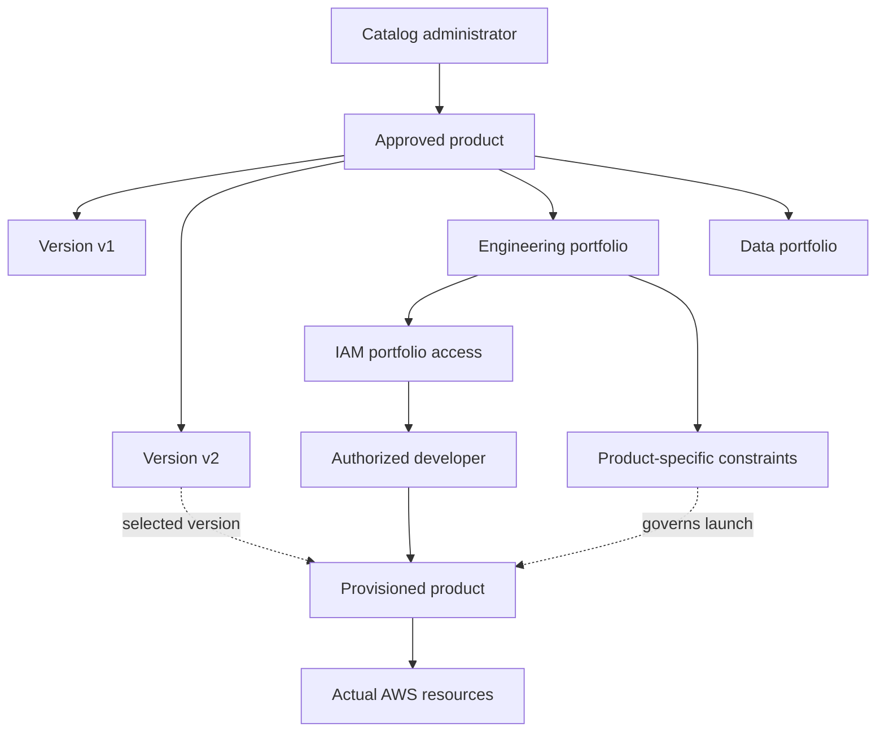
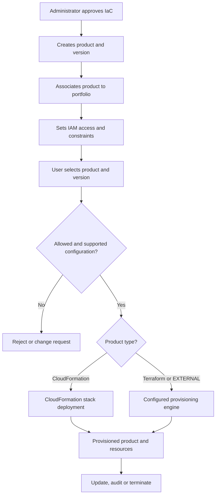
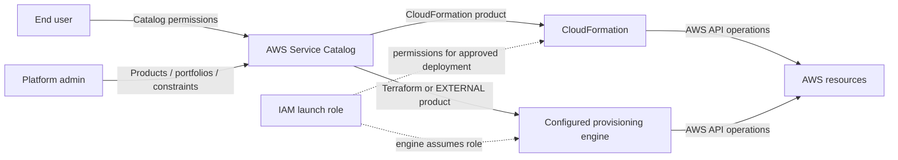
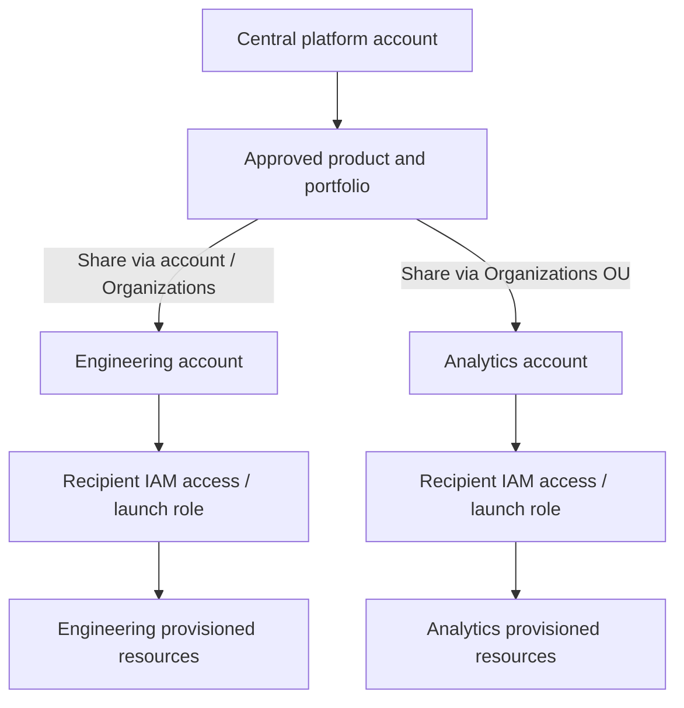
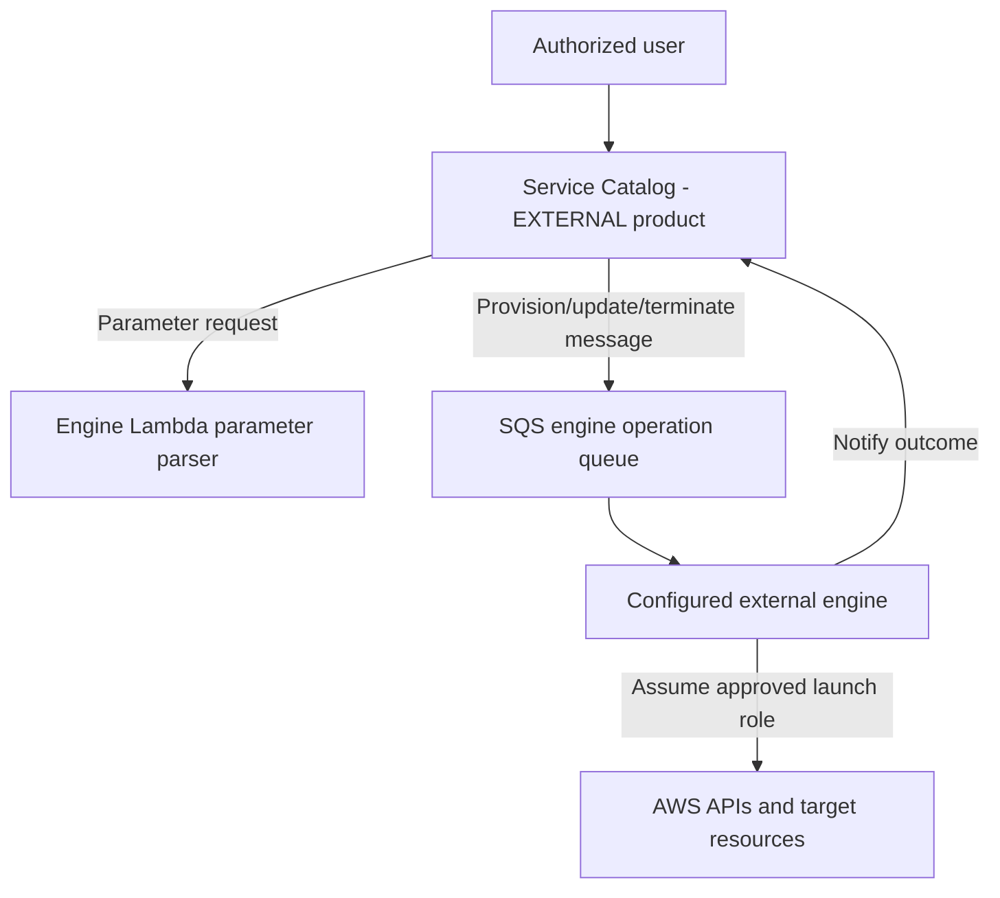
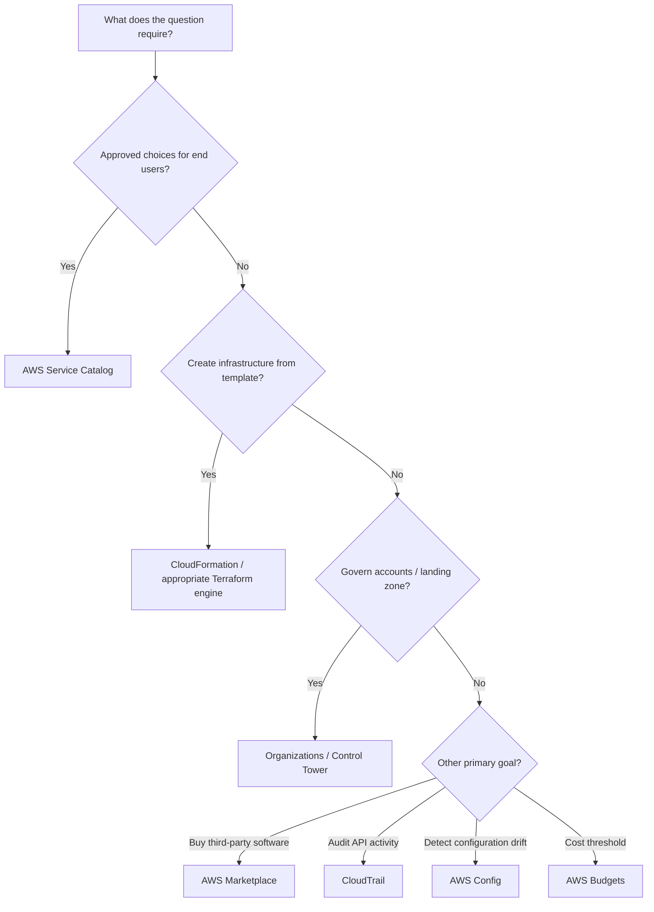

<div align="center">

# 🛍️ AWS Service Catalog

### Complete GitHub Study Guide · Cloud Practitioner + Solutions Architect – Associate

[](https://aws.amazon.com/servicecatalog/)
[](https://aws.amazon.com/certification/certified-cloud-practitioner/)
[](https://aws.amazon.com/certification/certified-solutions-architect-associate/)


**One sentence to remember:** AWS Service Catalog is a governed self-service storefront for **approved, versioned infrastructure products** that eligible users can provision without broad infrastructure-administration permissions.

[🟢 CCP essentials](#ccp-essentials) · [🔵 SAA architecture](#saa-deep-dive) · [⚔️ Comparisons](#service-comparisons) · [⚠️ Exam traps](#exam-traps) · [🧪 Practice](#practice-questions)

</div>

> [!NOTE]
> **Audience and scope.** Green = fundamental CLF-C02 recognition; blue = SAA-C03 architecture and troubleshooting. This is an independent, original study guide—not AWS exam content or a reproduction of copyrighted course slides. AWS feature availability and prices change; links and review date appear near the end.

## Table of contents

1. [What is AWS Service Catalog?](#what-is-aws-service-catalog)
2. [The problem it solves](#the-problem-it-solves)
3. [Core concepts and vocabulary](#core-concepts-and-vocabulary)
4. [End-to-end workflow](#end-to-end-workflow)
5. [Features, constraints and limits](#features-constraints-and-limits)
6. [Real-world use cases](#real-world-use-cases)
7. [🟢 CCP essentials](#ccp-essentials)
8. [🔵 SAA deep dive](#saa-deep-dive)
9. [⚔️ Service comparisons](#service-comparisons)
10. [Integration patterns](#integration-patterns)
11. [Security and shared responsibility](#security-and-shared-responsibility)
12. [Monitoring, audit and troubleshooting](#monitoring-audit-and-troubleshooting)
13. [Pricing and cost controls](#pricing-and-cost-controls)
14. [Practical CloudFormation walkthrough](#practical-cloudformation-walkthrough)
15. [⚠️ Exam traps](#exam-traps)
16. [Interview questions](#interview-questions)
17. [🧪 Practice questions](#practice-questions)
18. [Scenario drills](#scenario-drills)
19. [Exam decision tree](#exam-decision-tree)
20. [Quick-revision cheat sheet](#quick-revision-cheat-sheet)
21. [Official AWS references](#official-aws-references)
22. [Study takeaway](#study-takeaway)

---

## 1. What is AWS Service Catalog?
<a id="what-is-aws-service-catalog"></a>

**Simple definition:** AWS Service Catalog lets administrators package approved infrastructure into products, organize those products into portfolios, give selected users access, and control how the products are deployed.

**Precise definition:** It is an AWS management-and-governance service that provides a **catalog and provisioning lifecycle** for products based on supported infrastructure-as-code (IaC) types, including AWS CloudFormation and supported Terraform/external-engine integrations. It coordinates provisioning; the underlying engine creates the resources. [AWS overview](https://docs.aws.amazon.com/servicecatalog/latest/adminguide/what-is_concepts.html) · [Product types](https://docs.aws.amazon.com/servicecatalog/latest/adminguide/productmgmt-cloudresource.html)

### Analogy: your company's private cloud shop

Imagine an employer's approved IT storefront:

- The **cloud platform team** chooses which configurations are acceptable and publishes them as *products*.
- The **store shelves** are *portfolios* for engineering, finance and analytics.
- An employee receives the **right to browse and order** specific shelves via IAM and portfolio associations.
- The **checkout rules** are *constraints* such as allowed instance sizes or a controlled launch role.
- **Placing an order** launches a *provisioned product*: actual AWS resources.

**Limit of the analogy:** Service Catalog is not an e-commerce store, a cost-free vending machine, an automated compliance auditor, or a substitute for IAM. Its restrictions are only effective if users cannot bypass the catalog with other excessive privileges.

| At a glance | Answer |
|---|---|
| AWS category | Management & Governance |
| Main goal | Approved **self-service provisioning with governance** |
| Administrators manage | Products, versions, portfolios, sharing, constraints, access |
| End users do | Discover, launch, update, and terminate permitted products |
| Product building blocks | CloudFormation templates or supported Terraform/external IaC configurations |
| Example products | Preconfigured EC2 workspace; RDS setup; S3 storage pattern; multi-tier application |
| Underlying provisioning | CloudFormation for CloudFormation products; configured provisioning engine for Terraform/external products |
| Scope | Catalog resources are managed in specific AWS Regions; cross-account sharing is possible |
| Security | IAM plus portfolio access, IAM launch roles and constraints |
| Pricing | API-call based Service Catalog charges, plus underlying resource/engine costs; see [pricing](#pricing-and-cost-controls) |

> [!IMPORTANT]
> **Distinguish three objects:** `product` = approved blueprint; `portfolio` = collection and access boundary; `provisioned product` = a deployed instance of a blueprint. A single product may be associated with more than one portfolio, and many end users may provision their own instances.

---

## 2. The problem it solves
<a id="the-problem-it-solves"></a>

**Without a catalog:** A company with 500 developers gives each team broad AWS privileges, copies infrastructure templates between departments, and relies on manual reviews to prevent accidental public exposure or unapproved instance sizes. Configuration drift, inconsistent tagging, and duplicated support effort accumulate.

**With a catalog:** A central team approves a safe template, publishes a product version, restricts permitted parameters, adds a narrowly scoped launch role, and grants access to the intended teams. Developers provision consistently through a self-service workflow. The organization retains governance over the *approved route* while developers retain speed.

| Before | After adopting Service Catalog |
|---|---|
| Ticket to the infrastructure team for every environment | Approved environment launched through self-service |
| Uncontrolled template copies | Central, versioned product definitions |
| Broad end-user permission grants | End-user catalog permissions plus a controlled launch role |
| Ad-hoc instance size choices | CloudFormation template parameters and applicable template constraints |
| Inconsistent department access | Portfolios and IAM principal associations |
| Manual multi-account distribution | Portfolio sharing and/or StackSets where appropriate |

### Questions it answers—and those it does not

- **Who may deploy this approved architecture?** Service Catalog portfolio access and IAM.
- **Which inputs may they select?** Product parameters and supported constraints.
- **Which underlying API calls are made?** CloudFormation or a configured provisioning engine with suitable IAM permissions.
- **Is the deployed workload healthy, secure and compliant forever?** **Not automatically.** Use workload monitoring, AWS Config/Security Hub and your own operating controls.
- **Does it choose the optimal architecture for every user?** No: architects and administrators define and maintain the offerings.

---

## 3. Core concepts and vocabulary
<a id="core-concepts-and-vocabulary"></a>

| Term | Meaning | Example / exam clue |
|---|---|---|
| **Catalog administrator** | Creates and governs approved products | Central platform team |
| **End user** | Discovers and provisions accessible products | App developer |
| **Product** | Deployable IT service definition/blueprint | Approved Linux EC2 workspace |
| **Provisioning artifact** | Specific deployable **version** of a product | `v2` template |
| **Provisioned product** | An instantiated product and its managed lifecycle | Developer A's actual workspace |
| **Portfolio** | Collection of products with access and policy associations | `Engineering-Approved` |
| **Principal association** | IAM user/group/role granted access to a portfolio | `EngineeringDeveloperRole` |
| **Constraint** | Rule attached to a particular product-in-portfolio association | Launch role or permitted parameter values |
| **Launch constraint** | Role used by provisioning to create/update/terminate the product | `CatalogLaunchRole` |
| **Template constraint** | Restricts eligible CloudFormation template parameter choices | Only small EC2 instance types |
| **Notification constraint** | Publishes CloudFormation stack-related notifications using SNS | Ops notifications |
| **Stack Set constraint** | Defines permitted multi-account/multi-Region StackSets deployment | Enterprise baseline |
| **Tag Update constraint** | Controls updating tags on provisioned resources during updates | Managed tag propagation |
| **TagOption** | Administrator-managed selectable tag key/value template | `CostCenter=Dev` |
| **AutoTags** | Service Catalog tags identifying provisioned resource origin | Product/portfolio attribution |
| **Portfolio sharing** | Makes catalog offerings available to other AWS accounts | Hub-and-spoke governance |

[Concepts](https://docs.aws.amazon.com/servicecatalog/latest/adminguide/what-is_concepts.html) · [Constraints](https://docs.aws.amazon.com/servicecatalog/latest/adminguide/constraints.html) · [TagOptions](https://docs.aws.amazon.com/servicecatalog/latest/adminguide/tagoptions.html)

### Relationship diagram



**Important scope:** A product can be in multiple portfolios. A constraint on `Product A` inside `Portfolio X` is **not automatically the same constraint** as for `Product A` inside `Portfolio Y`.

### Supported product types: precise terminology

| Type | How it works | Special consideration |
|---|---|---|
| **CloudFormation** | AWS CloudFormation uses the versioned template to create/update/delete a stack | Supports CloudFormation-specific constraints |
| **Terraform Cloud** | Catalog controls access/versioning; integration uses a configured Terraform provisioning engine | Engine and launch-role setup required |
| **`EXTERNAL`** | Pluggable external engine; AWS documentation uses it for Terraform Community Edition | Engine handles parse/provision/update/terminate; launch role required |

> [!WARNING]
> The older **`TERRAFORM_OPEN_SOURCE` product type is not valid for creating new products**. AWS documents migration of existing products to **`EXTERNAL`** after the Terraform licensing change. Do not use outdated exam notes to assume all Terraform variants have CloudFormation's constraint features. [AWS migration guide](https://docs.aws.amazon.com/servicecatalog/latest/adminguide/update_terraform_open_source_to_external.html)

---

## 4. End-to-end workflow
<a id="end-to-end-workflow"></a>

1. **Design and approve:** The platform team selects an architecture and writes a CloudFormation template or appropriate Terraform configuration.
2. **Create a product:** It supplies a name, description, owner/support metadata and initial version (provisioning artifact).
3. **Create a portfolio:** For instance, `Developer Tools`, `Data Science`, or `Finance`.
4. **Associate product and portfolio:** A product can appear on multiple approved shelves.
5. **Configure guardrails:** Grant portfolio access; add launch constraints and other supported constraints to each relevant product association. For Terraform, set up the external/Terraform provisioning engine and required launch roles.
6. **Optionally share portfolios:** Across accounts or an AWS Organizations organization/OU, then set up recipient-side IAM access and roles as required.
7. **End user discovers:** The user sees only products for which access is granted and chooses an allowed version.
8. **End user provisions:** They enter allowed parameters and launch. Service Catalog invokes the provisioning mechanism, which creates resources.
9. **Operate and manage:** Users with sufficient permissions may inspect status, update an instance, move to a newer product version or terminate it. Administrators maintain versions and access.
10. **Audit and improve:** Review CloudTrail, CloudWatch metrics, underlying stack/engine events, costs and product-version lifecycle.



### Beginner example: standard Linux workstation

A company offers `Linux-Developer-Workspace v1`. The product contains an EC2 instance, an approved Amazon Machine Image (AMI), a security group allowing required connectivity, monitoring configuration and mandatory tags. Engineers can provision one workspace without designing those components themselves. **The permissions, costs, networking and security settings remain real obligations.**

### Nuanced example: one product, two portfolios

`Web-App-Base v3` appears in both `Engineering` and `Training`. The engineering portfolio allows the approved larger instance type; the training portfolio constrains the CloudFormation parameter to a small instance. If the administrator wants to enforce a launch role and limits in **both** portfolios, the relevant product/portfolio associations must each be configured. Portfolio membership alone does not enforce a global cross-portfolio constraint.

---

## 5. Features, constraints and limits
<a id="features-constraints-and-limits"></a>

| Feature | What it does | Typical use | Key nuance |
|---|---|---|---|
| Catalog products | Lists reviewed infrastructure solutions | Standard server images | Product is not the running server |
| Portfolios | Organize products by audience | Developers vs. finance | Product may belong to multiple portfolios |
| Product versions | Manage approved release choices | `v1`, `v2`, `v3` | New version **does not force-update** every deployed instance |
| Portfolio principal access | Controls who can browse/use products | Different business teams | IAM authorization remains necessary |
| Launch constraints | Supply provisioning role | Least-privilege end users | Per product-in-portfolio; not a blanket portfolio role |
| Template constraints | Limit CloudFormation parameter values | Small instance types only | Do **not** assume support for Terraform products |
| Notification constraints | Configure stack-related SNS notifications | Deployment alerts | Notifications must be configured |
| Stack Set constraints | Authorize deployment across accounts/Regions | Enterprise rollout | CloudFormation StackSets pattern, not general-purpose Terraform replication |
| Tag Update constraints | Govern tag updates on deployed resources | Standardized allocation tags | Behavior and product-type support have restrictions |
| TagOptions | Provide governed choices for tags | Cost center | Not identical to an AWS resource tag |
| Portfolio sharing | Share approved catalogs across accounts | Hub/spoke | Shared reference differs from copied catalog |
| Product budgets | Associate AWS Budgets with products/portfolios | Cost warnings | Budgeting is **monitoring**, not a universal deployment-deny mechanism |

[Constraints](https://docs.aws.amazon.com/servicecatalog/latest/adminguide/constraints.html) · [Budget associations](https://docs.aws.amazon.com/servicecatalog/latest/adminguide/catalogs_budgets.html)

### Constraints compared: which one solves what?

| Requirement | Mechanism | Reminder |
|---|---|---|
| Deploy with a predefined IAM role | **Launch** constraint | Role permissions + trust relationship required |
| Allow only approved parameter values | **Template** constraint | CloudFormation parameters; constraints are product/portfolio-scoped |
| Notify operations teams of stack events | **Notification** constraint | Uses Amazon SNS |
| Deploy the product to multiple accounts/Regions | **Stack Set** constraint | Uses CloudFormation StackSets |
| Control updates of tags on deployed product resources | **Tag Update** constraint | Not the same as allowed parameter values |

### Versions and lifecycle

- **Active:** Can be offered for launch.
- **Inactive:** Hidden from new version selection; already provisioned products are not removed.
- **Deleted:** Version removed; deletion cannot be undone.
- **Deprecated guidance:** Users cannot create new provisioned products from that version, while existing deployments have supported update paths. Guidance and status are separate properties.

For the exact lifecycle behavior, see [Managing Versions](https://docs.aws.amazon.com/servicecatalog/latest/adminguide/managing-versions.html).

### Terraform/external engine warnings

`EXTERNAL` is an integration contract, **not a magical built-in Terraform runner**. A configured engine is required. AWS documents a parser Lambda and SQS-based operation handling; the engine assumes the launch role and reports results back to Service Catalog. One external engine is supported per hub account. This changes the architecture and troubleshooting path compared with CloudFormation products. [External engines](https://docs.aws.amazon.com/servicecatalog/latest/adminguide/external-engine.html)

---

## 6. Real-world use cases
<a id="real-world-use-cases"></a>

| Requirement | Why Service Catalog fits | Important design work |
|---|---|---|
| Reusable developer environments | Approved EC2/network baseline | Secure AMI, ingress, patching and IAM |
| Standard RDS environment | Approved DB topology as a product | Backup, encryption, private subnets and DB costs |
| Sandbox creation by students | Self-service without broad admin rights | Small allowed configurations, account budgets and cleanup |
| Approved S3 data workspace | Standardized S3 policies/tags | Public access, encryption, lifecycle and access policy |
| Multi-account enterprise offerings | One centrally managed approved catalog | IAM principal mapping, roles, sharing and Region boundaries |
| Shared application stack | Same vetted pattern used repeatedly | Upgrades, operations and rollback behavior |

**When not to choose Service Catalog:** If a single infrastructure team simply needs to deploy a one-off stack, CloudFormation or Terraform directly may be enough. If the problem is application runtime deployment, use appropriate deployment tools; for continuous compliance detection, consider AWS Config; for multi-account landing-zone governance, consider Control Tower. It is possible to use these services **together**.

---

<a id="ccp-essentials"></a>
## 7. 🟢 Cloud Practitioner (CCP) essentials


### 16 foundation facts to memorize

1. **AWS Service Catalog = approved AWS products + self-service deployment + governance.**
2. It belongs to **Management & Governance**, not a compute or database engine.
3. A **product** describes a deployable IT solution; it can include multiple AWS resources.
4. A **portfolio** groups products and helps scope access.
5. **End users** consume approved offerings; **administrators** define and manage them.
6. **IAM** grants permissions; Service Catalog **does not replace IAM**.
7. A **launch constraint** lets a product be provisioned with an assigned role.
8. **Constraints** restrict deployment choices or behavior.
9. **CloudFormation** is a primary provisioning engine for CloudFormation products.
10. Terraform-based product options exist but require appropriate integrations/engines.
11. Products can have **multiple versions**.
12. **Provisioned product** means a deployed instance of a catalog product.
13. Portfolios can be **shared with other AWS accounts**.
14. **AWS Organizations** can help distribute portfolios at organization/OU scope.
15. **AWS Marketplace** is different: it offers third-party solutions; Service Catalog curates approved deployments (and can package Marketplace-based offerings).
16. The service provides governed provisioning, **not a guarantee of lasting compliance, zero costs or unlimited user privileges**.

### CCP keyword bank

`approved products` · `standardized IT services` · `self-service` · `governance` · `guardrails` · `curated catalog` · `portfolio` · `product` · `provisioned product` · `preapproved templates` · `limited choices` · `versioned offerings` · `central administrator` · `developer self-service` · `controlled provisioning` · `CloudFormation` · `IAM` · `multi-account catalog`

| If a question says... | Think... |
|---|---|
| “Developers choose only centrally approved infrastructure” | **AWS Service Catalog** |
| “Provide a self-service menu of standardized environments” | **AWS Service Catalog** |
| “Deploy infrastructure described in YAML/JSON templates” | **AWS CloudFormation** |
| “Set up and govern a multi-account landing zone” | **AWS Control Tower** |
| “Manage and consolidate AWS accounts” | **AWS Organizations** |
| “Buy third-party software listings” | **AWS Marketplace** |
| “Track operating cost against a limit” | **AWS Budgets** |

> [!TIP]
> **CCP exam cue:** If **approved + catalog + self-service + control** occur together, Service Catalog is likely the answer. If the focus shifts to *defining the template*, CloudFormation is the stronger answer.

### A typical CCP question

A company has many development teams. Management wants them to provision only preapproved cloud environments without submitting manual tickets. Which service best fits? **AWS Service Catalog**, because the requirement is **controlled self-service choice**.

**30-second CCP recap:** *Service Catalog lets a company publish approved deployable AWS solutions in portfolios. Authorized users launch and manage them through self-service, while the company controls access and provisioning rules.*

---

<a id="saa-deep-dive"></a>
## 8. 🔵 Solutions Architect – Associate (SAA) deep dive


> [!IMPORTANT]
> For SAA, answer **who can launch it, whose permissions actually provision it, where it deploys, which engine runs it, what happens on failures and updates, and how bypass is prevented**. Keywords alone are insufficient.

### 8.1 Control plane vs resource plane

**Catalog/control plane:** product listings, versions, portfolio and principal associations, constraints, governance, provisioned-product records. **Provisioning/resource plane:** CloudFormation or an external/Terraform engine invoking AWS APIs to create EC2, RDS, S3, VPC and other resources. Underlying services still have their own networking, resilience, backups, quotas and charges.



This diagram is conceptual: role assumption and execution context differ by engine, and the specific permissions and trust relationships must match the product type.

### 8.2 Identity, IAM and the launch-role boundary

**Access to a product and permission to create its resources are distinct concerns.** A principal needs IAM authorization for applicable Service Catalog actions and association/access to the portfolio. A *CloudFormation* product can be launched using end-user credentials **if there is no launch constraint** and the user has all necessary permissions; alternatively, a launch constraint supplies an IAM role that Service Catalog uses for provisioning. A Terraform product requires the appropriate configured launch role/engine. [Launch constraints](https://docs.aws.amazon.com/servicecatalog/latest/adminguide/constraints-launch.html)

- **Good:** Developer role can discover and provision catalog products; the vetted launch role can create only resources required by the product (where supported by service actions and resource-level permissions).
- **Bad:** Give developers broad `ec2:*`, `rds:*`, `cloudformation:*` and `iam:*` rights in addition to catalog access, then assume the catalog prevents them from deploying unapproved resources directly.
- **Bad:** Launch-role IAM policy permits creation but the trust policy does not allow the appropriate Service Catalog service/engine context to assume the role.
- **Important:** IAM `servicecatalog:ProvisionProduct`, `UpdateProvisionedProduct` and `TerminateProvisionedProduct` permissions belong to the **end-user principal**, not in the launch-role policy as a substitute for user authorization.
- **Cross-account:** Ensure required roles exist in the recipient account, especially when referencing a role by **name** in a shared portfolio; review `iam:PassRole` and `sts:AssumeRole` paths as appropriate.
- **Extra protection:** Scope launch-role trust with `aws:SourceAccount` and `aws:SourceArn` where supported to reduce confused-deputy risk. [AWS guidance](https://docs.aws.amazon.com/servicecatalog/latest/adminguide/constraints-launch.html).

### 8.3 Parameter controls are *not* general IAM policies

For CloudFormation products, parameters may permit `InstanceType`, `Environment`, `VpcId` or similar choices. Product templates can themselves define allowed values, and Service Catalog **template constraints** can further limit values for a particular product in a portfolio. A template constraint does not globally rewrite the CloudFormation template, replace IAM or restrict arbitrary direct EC2 requests outside the catalog. [Template constraints](https://docs.aws.amazon.com/servicecatalog/latest/adminguide/catalogs_constraints_template-constraints.html)

**Example:** A shared template allows `t3.micro` and `t3.small` for trainees, while engineers have access to a portfolio that permits a broader approved selection. The offering remains reusable without becoming two independent, drifting templates.

### 8.4 Region, availability and disaster recovery

- **Regional catalog:** Portfolios are shown in a selected Region; a portfolio shared to another account is not thereby replicated to every AWS Region. Design and manage distribution across required Regions explicitly. [Portfolios](https://docs.aws.amazon.com/servicecatalog/latest/adminguide/catalogs_portfolios.html)
- **Multi-account vs multi-Region:** A shared portfolio exposes offerings in other *accounts*. A Stack Set constraint is a CloudFormation approach to *deploying resources* to multiple accounts and Regions. These are different operations. [Sharing](https://docs.aws.amazon.com/servicecatalog/latest/adminguide/catalogs_portfolios_sharing.html) · [StackSets](https://docs.aws.amazon.com/servicecatalog/latest/adminguide/using-stacksets.html)
- **High availability:** Service Catalog does not automatically turn a one-AZ workload into Multi-AZ or enable cross-Region recovery. Those properties must be deliberately specified in the product and its supporting services.
- **Disaster recovery:** Plan recovery for provisioned resource data, application dependencies, state and operations separately from the catalog definition.

### 8.5 Cross-account hub-and-spoke architecture



A **shared-reference portfolio** remains linked to the original: published product changes can propagate to the shared view. The recipient cannot arbitrarily modify the original products/constraints; recipient administrators can grant local users access. By contrast, **deploying copies** with a separate distribution mechanism requires maintaining those copies. **Publishing a new version is not an automatic in-place upgrade of running products.** [Sharing a portfolio](https://docs.aws.amazon.com/servicecatalog/latest/adminguide/catalogs_portfolios_sharing_how-to-share.html)

**SAA design question:** Do you need a central *menu* in every account, or centralized *resource deployment* across multiple target accounts? Choose portfolio sharing for the first, StackSets-enabled provisioning for the second (when the CloudFormation product and permissions support it).

### 8.6 Terraform product architecture



This is the documented `EXTERNAL` engine pattern: a parse function supplies parameters, an operation queue delivers work, and the engine handles the IaC lifecycle and reports success/failure. Terraform Cloud uses its own documented provisioning-engine integration; **do not assume all Terraform integrations use an identical implementation**. Engine configuration, state handling and permissions are additional operational responsibilities. [AWS external-engine guide](https://docs.aws.amazon.com/servicecatalog/latest/adminguide/external-engine.html)

### 8.7 Updates, lifecycle and failure behavior

- **New catalog version:** Makes a new offering available to eligible end users; it **does not silently change all deployed stacks**.
- **Update provisioned product:** Initiates a managed product update; inspect CloudFormation stack events (CloudFormation type) or engine logs and operation status (Terraform/external type).
- **Partial failure:** Do not presume a failed operation means no resources were created or that cleanup was perfect. Examine status, underlying stack events, rollback and resources before retrying.
- **Remove access:** Prevents further actions governed by that access decision; do not assume it automatically terminates already deployed instances.
- **Delete catalog metadata:** Not the same operation as deleting provisioned AWS resources. Confirm dependencies and lifecycle before cleanup.

### 8.8 Five worked SAA scenarios

**Scenario 1 — Self-service with least privilege.** A developer needs a vetted EC2 environment but may not call EC2 directly. **Design:** CloudFormation product, engineering portfolio, IAM end-user access and a launch-role constraint. **Why:** The launch role—not unrestricted developer permissions—creates the approved infrastructure. **Pitfall:** Overly permissive end-user IAM allows bypass.

**Scenario 2 — Different policy for the same template.** Finance may deploy smaller DB instances; engineering has a wider approved range. **Design:** Same CloudFormation product, separate portfolios with distinct applicable template constraints. **Why:** Reuse with audience-specific inputs. **Pitfall:** Constraint attached to one product/portfolio pair is not global.

**Scenario 3 — Hundreds of member accounts.** The platform team wants each AWS account to present the same approved environment options. **Design:** Central product/portfolio with AWS Organizations sharing, recipient access associations and validated recipient launch-role setup. **Why:** A synchronized approved catalog. **Pitfall:** Sharing an offering does not by itself provision a running environment in every account.

**Scenario 4 — Multi-account resource rollout.** One team needs an approved CloudFormation-based monitoring baseline deployed across selected Regions and accounts. **Design:** Stack Set constraint with CloudFormation StackSets and required administration/execution permissions. **Why:** Controls actual target deployments rather than simply making a menu visible. **Pitfall:** Deployment permissions and supported target Regions must be configured; rollback/failure tolerance needs planning.

**Scenario 5 — Terraform existing workflow.** A company uses Terraform Community Edition and wants a governed storefront. **Design:** `EXTERNAL` product, configured compatible provisioning engine, launch roles, portfolio shares and tested lifecycle hooks. **Why:** Preserves central control while delegating provisioning. **Pitfall:** No configured engine or missing queue/parser permissions = provisioning failure; CloudFormation-only template constraints are not available by assumption.

### 8.9 Architecture decision checklist

Ask in order: (1) Is the requirement catalog discovery or infrastructure deployment? (2) Which IaC engine is used? (3) Which principals may browse and provision? (4) What permissions does the launch role need? (5) Are the values constrained at template/product level? (6) Single or multiple accounts/Regions? (7) What are update/rollback/cleanup responsibilities? (8) How will cost, audit and policy bypass be monitored?

---

<a id="service-comparisons"></a>
## 9. ⚔️ Service comparisons

| Service | Primary purpose | Difference from Service Catalog | Choose it when the question asks... |
|---|---|---|---|
| **AWS CloudFormation** | Define and operate stacks from templates | Creates/manages infrastructure; Catalog **curates access** to approved products | “Infrastructure as code; create/update a stack” |
| **AWS Organizations** | Organize multiple accounts and policies | Account/OU structure rather than deployable product choices | “Consolidated accounts; organization policies” |
| **AWS Control Tower** | Set up/govern landing zones | Account foundation and guardrails rather than end-user product menu | “Establish a governed multi-account environment” |
| **AWS Marketplace** | Discover/procure third-party solutions | Commercial software listings rather than organization-curated self-service catalog | “Find and subscribe to vendor software” |
| **AWS Systems Manager** | Manage and automate operations on resources | Operating/patching/automation vs catalog distribution | “Patch, inventory, remotely operate hosts” |
| **AWS Config** | Record/evaluate configuration compliance | Detect compliance drift; Catalog controls approved provisioning pathways | “Detect noncompliant deployed resources” |
| **AWS Budgets** | Track and alert on spend | Cost thresholds, not approved template selection | “Alert when actual/forecast cost crosses threshold” |
| **AWS CloudFormation StackSets** | Deploy stacks to many accounts/Regions | Distribution/stack provisioning engine; can work with Catalog constraints | “Deploy identical infrastructure to many targets” |
| **AWS Elastic Beanstalk** | Deploy and operate certain application stacks | Application platform vs centrally governed catalog of many product types | “Deploy my app with platform orchestration” |
| **AWS Service Catalog AppRegistry** | Group application resources and metadata | Application registry, not approved provisioning storefront | “Organize existing application resources” — check [maintenance-mode notice](https://docs.aws.amazon.com/servicecatalog/latest/arguide/app-registry-availability-change.html) |

> [!WARNING]
> **Marketplace nuance:** Service Catalog can offer products **based on AWS Marketplace solutions**. “Different purpose” does *not* mean “cannot work together.” [AWS product concepts](https://docs.aws.amazon.com/servicecatalog/latest/adminguide/what-is_concepts.html)

<details>
<summary><strong>Service Catalog vs CloudFormation — most common confusion</strong></summary>

**CloudFormation:** describes and deploys a stack via a template. **Service Catalog:** offers a controlled set of products—often built from CloudFormation templates—to authorized users. Use both when many developers must deploy only vetted templates. CloudFormation alone does not supply the same curated portfolio workflow.

</details>

<details>
<summary><strong>Service Catalog vs Control Tower / Organizations</strong></summary>

**Organizations** manages account structures and organization policies. **Control Tower** uses account/landing-zone governance patterns. **Service Catalog** exposes approved *deployable products* to users inside accounts. Organizations can distribute Catalog portfolios; they complement rather than replace each other.

</details>

<details>
<summary><strong>Service Catalog vs Marketplace</strong></summary>

**Marketplace** is a catalog for third-party software and services; **Service Catalog** is a controlled deployment catalog operated by an organization. You can incorporate approved Marketplace products into a managed Service Catalog offering.

</details>

<details>
<summary><strong>Service Catalog vs Config / Systems Manager</strong></summary>

**Service Catalog** governs a **provisioning pathway**. **AWS Config** tracks/evaluates resource configurations; **Systems Manager** helps operate resources. Neither is automatically replaced by Catalog-based provisioning, and changing a deployed resource outside Catalog can still introduce drift or policy violations.

</details>

<details>
<summary><strong>Portfolio sharing vs CloudFormation StackSets</strong></summary>

**Sharing** distributes the *catalog option* to other accounts. **StackSets** deploys *actual stacks* to multiple accounts and Regions. A Service Catalog Stack Set constraint ties a CloudFormation product to controlled multi-target stack provisioning.

</details>

---

## 10. Integration patterns
<a id="integration-patterns"></a>

| Works with | Why it matters | Watch out for |
|---|---|---|
| **IAM / IAM Identity Center** | Enterprise identities and effective AWS role permissions | IAM Identity Center does not eliminate required IAM role/policy evaluation |
| **AWS CloudFormation** | Default native infrastructure engine for CloudFormation products | Stack errors, service quotas and resource drift |
| **AWS Organizations** | Share portfolios across OUs/accounts | Destination-side access and roles |
| **CloudFormation StackSets** | Multi-account/multi-Region deployment | Separate StackSet permissions, target selection, failure tolerance |
| **Amazon SNS** | Notifications using a configured notification constraint | Notification setup and receiving subscriptions |
| **Amazon CloudWatch** | Provisioning metrics and alarms | Metrics do not replace inspecting actual CloudFormation stack events |
| **AWS CloudTrail** | Audit Service Catalog API calls | Ensure long-term retention configuration if required |
| **AWS Budgets / tags** | Cost allocation and thresholds | Tagging/cost allocation settings required; alerts are not hard enforcement |
| **Amazon S3** | Host template artifacts; may be a deployed resource | Bucket permissions and template access |
| **AWS Marketplace** | Package approved marketplace-based offerings | Procurement/licenses and resulting cost |
| **Terraform Cloud / EXTERNAL engines** | Govern non-CloudFormation IaC products | Engine, state, network and IAM responsibilities |

### Multi-account pattern selection

| Desired outcome | Good starting design |
|---|---|
| Give each account a consistent **menu** of products | Share a portfolio from hub to spokes |
| Keep a centrally managed reference up to date | Reference-based sharing via account or Organizations |
| Deploy CloudFormation resources to many targets | Stack Set constraint plus CloudFormation StackSets |
| Apply local custom portfolio rules | Deliberately configure product-in-portfolio constraints and permissions; do not assume imported recipients can edit originating constraints |

---

## 11. Security and shared responsibility
<a id="security-and-shared-responsibility"></a>

| AWS manages | Your organization still manages |
|---|---|
| Availability/operation of the managed Service Catalog service | Product templates and their security architecture |
| Service infrastructure and core platform APIs | IAM identities, portfolio access, launch-role trust/permission policies |
| Service Catalog control-plane functionality | Approved parameter ranges, versions and removal of obsolete offerings |
| Supported service integrations | Underlying EC2/RDS/S3/VPC security, encryption and networking settings |
| Managed service platform patching | Sensitive data handling, operational monitoring, budgets and deployed resource lifecycle |

**Least-privilege pattern:** End users have access to catalog discovery/provisioning functions only as needed. A narrowly scoped role is used to create approved infrastructure. IAM policies, service control policies (SCPs), resource policies and other applicable AWS authorization layers remain effective. A portfolio association is **not equivalent** to universal permission.

**Data security:** Service Catalog is not your application data store. Encrypt and protect the underlying S3 buckets, databases, disks and secrets per product design. Do not put passwords, tokens or private keys in a committed template or GitHub repository. Use purpose-built secret storage and appropriate IAM rights.

**Governance boundaries:** Review whether users can deploy directly via CloudFormation, EC2, RDS, other tools, or assume elevated roles. If they can, Catalog is no longer the only path to deploy infrastructure. Use organizational permission design and detective controls to address bypass.

**Shared portfolio boundary:** Recipient accounts need correct IAM access and launch roles. Consider trust-policy confused-deputy defenses and test all product versions in representative target accounts. [IAM integration](https://docs.aws.amazon.com/servicecatalog/latest/adminguide/controlling_access.html) · [Security recommendations](https://docs.aws.amazon.com/servicecatalog/latest/adminguide/security-best-practices.html)

---

## 12. Monitoring, audit and troubleshooting
<a id="monitoring-audit-and-troubleshooting"></a>

### Monitoring signals

| Source | What it tells you | Relevant details |
|---|---|---|
| **CloudTrail** | Who called Catalog APIs, when and from where | `ProvisionProduct`, `UpdateProvisionedProduct`, `TerminateProvisionedProduct` etc.; retain trails as needed |
| **CloudWatch metrics** | Aggregated launch and provisioning outcomes | Namespace `AWS/ServiceCatalog`; `ProvisionedProductLaunch`, `ProductProvisioningOperation` with success/failure dimensions |
| **CloudFormation events** | Detailed resource/stack failure reasons | CloudFormation products only |
| **External/Terraform engine telemetry** | Parser/queue/runner or Terraform errors | Engine-specific; external engine must report completion |
| **SNS notifications** | Stack events when notification constraint configured | Not automatic for every product |
| **AWS Budgets** | Current/forecast spend against thresholds | Correct product tags and cost allocation required |

[AWS CloudWatch metric reference](https://docs.aws.amazon.com/servicecatalog/latest/adminguide/cloudwatch-metrics.html) · [CloudTrail](https://docs.aws.amazon.com/servicecatalog/latest/adminguide/logging-using-cloudtrail.html)

### Troubleshooting checklist (quickest causes first)

1. **Wrong account or Region?** Check where the product/portfolio is actually defined and shared.
2. **Invisible product?** Verify product association, correct version status/guidance, IAM principal association, portfolio share/import and end-user IAM permissions.
3. **`AccessDenied`?** Separate *end-user Service Catalog permission*, *portfolio access*, *launch role's trust policy*, *launch role's resource permissions*, and any SCP/permission-boundary denial. Inspect the denied action in CloudTrail/underlying stack events.
4. **Launch role not found?** Verify required role exists in target account, its name/ARN selection, and source-account protections.
5. **Invalid parameter?** Inspect CloudFormation template parameter definitions and relevant template constraints; confirm the selected value and product version.
6. **CloudFormation fails?** Read stack events for denied actions, invalid AMI/Region features, quotas, security-group/network dependency issues, or naming collisions.
7. **Terraform/external fails?** Check engine setup, parameter parser, queue, launch-role trust/permissions, state/back-end setup and engine completion notification.
8. **Cross-account mismatch?** Check original vs imported portfolio and recipient principal/role mappings; distinguish sharing catalog from actual StackSets deployment.
9. **Wrong version after update?** Confirm which provisioning artifact the end user selected and whether a managed update was explicitly performed.
10. **Budget/monitoring missing?** Validate tagging, CloudWatch metric dimensions, cost allocation activation, CloudTrail trail retention and SNS subscriptions.
11. **Termination incomplete?** Inspect provisioned-product status, CloudFormation retained resources or external engine state and dependent resources before considering it cleaned up.

> [!TIP]
> **Timeout vs unauthorized:** A failure to provision is not necessarily a Service Catalog outage. Most actionable diagnostic clues are in IAM evaluation, CloudFormation stack events, external engine logs, quota limitations and the exact selected artifact.

---

## 13. Pricing and cost controls
<a id="pricing-and-cost-controls"></a>

As of the **2026-10-31 review**, official AWS pricing says Service Catalog has **1,000 API calls per account per Region per month** in its free tier. Service Catalog API calls beyond the allowance are billed according to published Region-specific rates. The pricing page provides an example using **$0.0007 per billable API call**, but this is *an example*, not a promise that every Region and every future period uses that price. **Resources provisioned by products are billed separately** (for example, EC2, EBS, RDS, S3, data transfer, or Terraform engine infrastructure). [AWS official pricing](https://aws.amazon.com/servicecatalog/pricing/)

**Estimate without inventing a fixed Region price:**

```text
Monthly Service Catalog bill
≈ max(0, eligible Service Catalog API calls − monthly free allowance)
  × applicable per-call rate(s)
+ provisioned infrastructure charges
+ optional supporting-service charges (engine, logging, monitoring, etc.)
```

**Do not confuse separate pricing categories:** AWS Service Catalog **AppRegistry** has its own free/charged action categories described on that pricing page; those are not interchangeable with ordinary Service Catalog provisioning usage. [AppRegistry availability notice](https://docs.aws.amazon.com/servicecatalog/latest/arguide/app-registry-availability-change.html) also states it stopped opening to new customers from **July 30, 2026**.

### Cost-control techniques

- Publish resource-efficient product templates and minimize idle resources.
- Restrict expensive CloudFormation parameter values where template constraints are supported.
- Apply consistent tagging/TagOptions and activate relevant cost allocation tags.
- Associate AWS Budgets where applicable; alerts can highlight overspend **but are not a universal stop switch**.
- Define lifecycle ownership so abandoned provisioned products are identified and terminated deliberately.
- Remember: a small fee for catalog API calls can coexist with large **underlying** EC2/RDS/other charges.

> [!WARNING]
> **Exam trap:** Service Catalog is not principally a billing service. AWS Budgets and cost tooling handle financial tracking; Service Catalog governs what approved solutions users can provision.

---

## 14. Practical CloudFormation walkthrough
<a id="practical-cloudformation-walkthrough"></a>

The example below is **original teaching material**, not an AWS production-ready blueprint. It creates an S3 bucket with versioning and a public-access block. **It creates billable resources if deployed**; test in a disposable account/Region and clean up deliberately. The AWS service must be available in the selected Region; no real credentials are placed in the file.

**Example product template: `approved-s3-workspace.yaml`**

```yaml
AWSTemplateFormatVersion: '2010-09-09'
Description: Small approved S3 workspace for Service Catalog training
Parameters:
  Environment:
    Type: String
    AllowedValues:
      - dev
      - test
    Default: dev
Resources:
  WorkspaceBucket:
    Type: AWS::S3::Bucket
    Properties:
      VersioningConfiguration:
        Status: Enabled
      PublicAccessBlockConfiguration:
        BlockPublicAcls: true
        IgnorePublicAcls: true
        BlockPublicPolicy: true
        RestrictPublicBuckets: true
      Tags:
        - Key: Environment
          Value: !Ref Environment
Outputs:
  BucketName:
    Description: Created bucket name
    Value: !Ref WorkspaceBucket
```

**Administrator setup (console workflow):**

1. Open **AWS Service Catalog → Portfolios** in an intended Region. Create `Approved-Storage`.
2. Create a **CloudFormation-type product** named `Approved S3 Workspace` and upload the YAML template as version `v1`.
3. Add the product to the portfolio, if not already associated.
4. Grant access to an appropriate **test** IAM principal and ensure it has the required Service Catalog permissions.
5. Configure a **launch constraint** pointing to an appropriately scoped/tested IAM role with trust for Service Catalog, CloudFormation access and relevant S3 permissions; the role must be able to read the template artifact. Do not copy broad AWS tutorial privileges to production without reviewing least privilege.
6. Log in as the test end user, open the product, choose `dev` or `test`, and launch.
7. Inspect the provisioned-product state and underlying CloudFormation stack; update/terminate through the supported lifecycle when finished. For S3, **empty the bucket and resolve retained/dependent resources as required before stack deletion**, since versioning can retain object versions and a non-empty bucket can block deletion.

**What this demonstrates:** A catalog product is not a different type of S3 bucket. It is a *governed way* to create and manage a bucket using a preapproved template. Parameters are validated by CloudFormation (`AllowedValues` here); a separate Service Catalog template constraint could narrow a more general template further.

[Official CloudFormation-product walkthrough](https://docs.aws.amazon.com/servicecatalog/latest/adminguide/getstarted-CFN.html) · [Launch-role requirements](https://docs.aws.amazon.com/servicecatalog/latest/adminguide/constraints-launch.html)

---
<a id="exam-traps"></a>
## 15. ⚠️ Common exam traps and misconceptions

These are **original teaching examples**, not claims about how often questions appear on real certification exams. Focus on the *mechanism* behind each distinction.

| ❌ Misconception | ✅ Correct interpretation and why | Level |
|---|---|---|
| 1. “Service Catalog itself is the IaC language.” | It catalogs approved products; CloudFormation or an integrated external engine defines/provisions infrastructure. | CCP |
| 2. “A product is a running EC2 instance.” | A product is the deployable blueprint; a **provisioned product** is its deployed instance. | CCP |
| 3. “A portfolio is a group of servers.” | A portfolio organizes product offerings and access. | CCP |
| 4. “All company employees see every product.” | Access is controlled by IAM and portfolio associations. | CCP |
| 5. “Service Catalog replaces IAM.” | It integrates with IAM; policy and role permissions remain essential. | CCP |
| 6. “Approved means free.” | Deployed resources and billable API calls can cost money. | CCP |
| 7. “Service Catalog is AWS Marketplace.” | Marketplace is a vendor offering/procurement channel; Catalog governs approved self-service choices, including possible Marketplace-based products. | CCP |
| 8. “CloudFormation and Catalog are alternatives in every architecture.” | They often **work together**: CloudFormation handles stacks and Catalog controls product offerings. | CCP |
| 9. “Creating a portfolio launches its products.” | The portfolio is a menu; deployment requires an authorized provisioning operation. | CCP |
| 10. “New catalog versions update all existing deployments.” | Publishing a version changes the offerings; deployed instances require managed lifecycle updates. | SAA |
| 11. “Disabling a product version deletes all running resources.” | Version state/guidance affects launch choices; existing deployments are not automatically destroyed. | SAA |
| 12. “A launch constraint is a role assigned to the portfolio as a whole.” | It applies to a **product/portfolio association** and must be configured accordingly. | SAA |
| 13. “Every CloudFormation product requires a launch constraint.” | Without one, end users may use their own permissions if sufficiently authorized; a launch role is the preferred least-privilege pattern. | SAA |
| 14. “The launch role alone gives users `ProvisionProduct` permission.” | End users still need appropriate Service Catalog permissions and portfolio access. | SAA |
| 15. “A user cannot bypass Service Catalog if they can use AWS directly.” | Broad direct provisioning rights can bypass curated choices; IAM/SCP architecture must close unintended routes. | SAA |
| 16. “A template constraint restricts all EC2 API calls.” | It restricts supported parameters of a particular CloudFormation product, not unrelated direct EC2 usage. | SAA |
| 17. “Template constraints automatically work for Terraform.” | AWS documents the CloudFormation feature and restrictions for Terraform product types; check type-specific support. | SAA |
| 18. “`TERRAFORM_OPEN_SOURCE` is still the correct new product type.” | New Terraform Community Edition products use `EXTERNAL`, with a configured provisioning engine. | SAA |
| 19. “`EXTERNAL` means Service Catalog runs Terraform without setup.” | External engine, parser, queues and permissions are configured separately. | SAA |
| 20. “Sharing a portfolio deploys resources into recipient accounts.” | It shares access to offerings; users must provision, or you must use a separate deployment mechanism. | SAA |
| 21. “Cross-account portfolio sharing means automatic cross-Region replication.” | Account access and Region placement are independent architectural decisions. | SAA |
| 22. “A recipient can freely rewrite the publisher's shared products.” | Reference sharing preserves centrally managed products/constraints; recipient administrators grant local access. | SAA |
| 23. “StackSets and portfolio sharing do the same thing.” | Sharing distributes catalog visibility; StackSets deploy stacks to accounts/Regions. | SAA |
| 24. “A Stack Set constraint makes any Terraform product deploy across Regions.” | Stack Set constraints are the documented CloudFormation StackSets workflow, not a universal Terraform feature. | SAA |
| 25. “Service Catalog guarantees Multi-AZ.” | Multi-AZ is a property of the underlying product architecture, not the catalog. | SAA |
| 26. “Catalog constraints prevent every later configuration change.” | Out-of-band changes may occur if other permissions allow them; combine provisioning controls with detective governance. | SAA |
| 27. “TagOptions are existing tags on every AWS resource.” | A TagOption is a Catalog-managed tagging **option**; actual resource tagging has service/product-type behavior and permissions. | SAA |
| 28. “CloudTrail shows the root cause of every provisioning resource failure.” | It audits API operations; use CloudFormation stack events or engine logs for detailed deployment failures. | SAA |
| 29. “Budgets automatically terminate products when spend is exceeded.” | Budgets report/alert and require suitable tagging; no universal automatic termination is implied. | CCP/SAA |
| 30. “Removing portfolio access automatically destroys provisioned products.” | Access control and resource termination are different lifecycle operations. | SAA |
| 31. “All failures are caused by Catalog permissions.” | Causes include IAM trust, template parameters, S3 template access, service quotas, engine configuration and dependency errors. | SAA |
| 32. “An inactive product version is always the same as deprecated guidance.” | Version status and user guidance are distinct controls with different launch/update semantics. | SAA |

### The three hardest mechanisms, explained

**Launch-role trust vs permission:** The role's trust policy determines *who may assume it*. Its permission policies determine *what operations it may perform after assumption*. End-user Service Catalog permissions determine *whether the user may request a launch*. You need the relevant parts of all three.

**Portfolio context matters:** Constraints are linked to how a product appears in a **particular portfolio**. A product associated with two portfolios should not be treated as one global, indivisible set of rules.

**Visibility is not deployment:** Sharing a portfolio makes a product accessible; an authorized provisioning request plus a working provisioning engine is still required. Cross-account deployment of stacks with StackSets is a separate pattern.

---

## 16. Interview questions and short answers
<a id="interview-questions"></a>

| Question | Strong concise answer |
|---|---|
| 1. What business problem does Service Catalog solve? | Approved, repeatable infrastructure provisioning by self-service users under central governance. |
| 2. What is a product versus a provisioned product? | A product is an approved definition; a provisioned product is an instantiated deployment of that definition. |
| 3. Why organize products into portfolios? | To group offerings by audience and associate access, tags and relevant constraints. |
| 4. Why use Service Catalog instead of just CloudFormation? | CloudFormation creates stacks; Catalog standardizes *which vetted stack definitions* end users can select and how they are allowed to launch them. |
| 5. What is a launch constraint? | A product-in-portfolio association specifying the IAM provisioning role for approved deployment actions. |
| 6. What stops a developer from bypassing the catalog? | Correct IAM/SCP and role designs; Catalog does not revoke unrelated direct infrastructure permissions. |
| 7. How would you offer the same product to two teams with different limits? | Associate it with separate portfolios and apply appropriate product-specific CloudFormation parameter constraints and IAM access per portfolio. |
| 8. How do you offer products in 100 AWS accounts? | Share a centrally managed portfolio by account or through Organizations, then validate recipient permissions and launch-role setup. |
| 9. How do StackSets differ from portfolio sharing? | StackSets deploy target stacks across accounts/Regions; sharing distributes visibility/access to product offerings. |
| 10. How does Terraform Community Edition work with Service Catalog? | Use `EXTERNAL` type and a configured compatible provisioning engine with required launch roles and lifecycle callbacks. |
| 11. What would you check for a failed provision? | Account/Region, portfolio/IAM access, role trust/permissions, parameter constraints, CloudFormation stack events or external-engine telemetry, quotas, template artifact access. |
| 12. How would you monitor and limit cost? | Cost-effective templates, allowed parameter values, tag allocation, product/portfolio budgets where supported, CloudWatch/CloudTrail and resource lifecycle cleanup. |

---

<a id="practice-questions"></a>
## 17. 🧪 Original exam-style practice questions

**How to use:** Answer before expanding the explanation. **All questions below are newly written educational practice**, not authentic, leaked or predicted AWS certification questions. CCP questions emphasize identification; SAA questions emphasize best design and failure analysis.

<details>
<summary><strong>Q1 · CCP · Which service fits an approved self-service menu?</strong></summary>

A company wants employees to launch preapproved AWS environments without waiting for the infrastructure team. Choose the **best** service:

- A. AWS Service Catalog
- B. AWS Config
- C. Amazon CloudWatch
- D. AWS Trusted Advisor

**Answer: A — AWS Service Catalog.** It publishes vetted products for controlled self-service deployment. Config evaluates configurations, CloudWatch monitors and Trusted Advisor makes recommendations; none primarily provides the approved product storefront.

</details>

<details>
<summary><strong>Q2 · CCP · What is a portfolio?</strong></summary>

- A. An EC2 Auto Scaling group
- B. A collection of approved products and associated governance information
- C. A list of public IP addresses
- D. A database of user passwords

**Answer: B.** A portfolio organizes product offerings and helps manage who may use them. The other options describe unrelated resource concepts.

</details>

<details>
<summary><strong>Q3 · CCP · Product versus provisioned product</strong></summary>

A developer launches `DevWebStack v2` and receives actual resources. What is the result called?

- A. A portfolio
- B. A region
- C. A provisioned product
- D. A Marketplace vendor

**Answer: C.** The template/version is the product definition; its launched instance is a provisioned product. The other terms do not represent a launched product instance.

</details>

<details>
<summary><strong>Q4 · CCP · Which service is most directly responsible for templates?</strong></summary>

A company wants to declare VPCs, subnets and instances in a YAML infrastructure template and deploy a stack. The primary provisioning service is:

- A. AWS CloudFormation
- B. AWS Service Catalog alone
- C. Amazon Route 53
- D. AWS Budgets

**Answer: A.** CloudFormation defines and manages stacks. Service Catalog can present vetted CloudFormation templates but does not replace the CloudFormation provisioning engine; Route 53 is DNS, Budgets tracks spending.

</details>

<details>
<summary><strong>Q5 · CCP · Main governance benefit</strong></summary>

True or false: Service Catalog improves consistency by allowing centrally approved infrastructure configurations to be deployed by authorized users.

**Answer: True.** That is its core governance/self-service value proposition. Actual compliance still depends on product design and identity controls.

</details>

<details>
<summary><strong>Q6 · CCP · Approved external software</strong></summary>

Which service is primarily for discovering and procuring third-party software solutions?

- A. AWS Marketplace
- B. AWS CloudTrail
- C. Amazon SQS
- D. AWS Service Catalog

**Answer: A.** Marketplace is the third-party procurement/catalog channel. Service Catalog curates organization-approved deployable IT products; it can include Marketplace-based products but serves a different core purpose.

</details>

<details>
<summary><strong>Q7 · CCP · Who maintains the approved list?</strong></summary>

In a typical Service Catalog arrangement, who creates and updates products and portfolios?

- A. Every anonymous internet visitor
- B. Catalog administrators
- C. Only AWS Support staff
- D. CloudFront edge locations

**Answer: B.** Internal catalog administrators own approved products and access design. AWS Support and CloudFront do not manage the company's approved offering decisions.

</details>

<details>
<summary><strong>Q8 · CCP · Where does IAM fit?</strong></summary>

A colleague says “Service Catalog means we no longer need IAM.” What is correct?

- A. Correct; Catalog replaces all policies
- B. Correct; portfolios are public by default
- C. Incorrect; IAM still controls identities, actions and roles
- D. Incorrect only for S3

**Answer: C.** IAM permissions remain necessary for catalog access and provisioning roles. The other answers incorrectly remove AWS authorization requirements.

</details>

<details>
<summary><strong>Q9 · CCP · Multi-account offering</strong></summary>

A large company wants approved product offerings accessible in member AWS accounts. What capability is relevant?

- A. Portfolio sharing
- B. Amazon EBS snapshots alone
- C. EC2 user data alone
- D. Route 53 health checks

**Answer: A.** Portfolios can be shared across accounts (including AWS Organizations structures). The other choices do not distribute curated catalog offerings.

</details>

<details>
<summary><strong>Q10 · CCP · Main difference from Control Tower</strong></summary>

A company asks to establish a governed multi-account landing zone. The **more directly appropriate** service is:

- A. AWS Control Tower
- B. AWS Service Catalog product-version metadata
- C. Amazon Athena
- D. Amazon SNS

**Answer: A.** Control Tower is focused on multi-account landing-zone governance; Service Catalog offers approved deployable resources within such environments. Athena queries data; SNS sends messages.

</details>

<details>
<summary><strong>Q11 · CCP · Is it a cost-free service?</strong></summary>

True or false: If an EC2 product is provisioned through Service Catalog, no infrastructure charges apply.

**Answer: False.** EC2 and other underlying resources incur their normal charges. Service Catalog also has API-based pricing beyond the stated free allowance.

</details>

<details>
<summary><strong>Q12 · CCP · Most revealing keywords</strong></summary>

A question emphasizes *preapproved products*, *self-service provisioning*, and *central governance*. The best recognition answer is:

- A. AWS Service Catalog
- B. AWS Database Migration Service
- C. Amazon EMR
- D. AWS CodeArtifact

**Answer: A.** The three cues together identify Catalog. DMS migrates databases, EMR runs data-processing frameworks and CodeArtifact stores software packages.

</details>

<details>
<summary><strong>Q13 · SAA · Developers must not have direct EC2 create rights</strong></summary>

Developers must deploy a standard EC2 workspace but should not call EC2 provisioning APIs directly. Best design?

- A. Give all developers AdministratorAccess
- B. Publish a CloudFormation product in a portfolio and attach an appropriately scoped launch-role constraint
- C. Give everyone the root credentials
- D. Disable all IAM policies

**Answer: B.** Developers obtain controlled catalog access while the launch role performs vetted creation. A and C defeat least privilege; D blocks necessary authorization.

</details>

<details>
<summary><strong>Q14 · SAA · Access but cannot launch</strong></summary>

A user can **see** a product but receives `AccessDenied` during launch. What is the **best next diagnostic step**?

- A. Assume Service Catalog has failed globally
- B. Inspect the user's provisioning authorization and launch-role trust/permissions, including applicable SCPs
- C. Delete all other products
- D. Increase EC2 instance size

**Answer: B.** Product discovery access is not equivalent to the authorization required to provision underlying resources. The other actions do not address the likely trust/permission boundary.

</details>

<details>
<summary><strong>Q15 · SAA · Restrict only a trainee portfolio</strong></summary>

A CloudFormation product is listed in trainee and engineering portfolios. Trainees should select only a small EC2 size. Best design?

- A. Attach an applicable template constraint to the product in the trainee portfolio
- B. Change every AWS account to deny all EC2 APIs
- C. Assume both portfolios have identical global constraints
- D. Use CloudTrail to reject the input

**Answer: A.** Template constraints restrict supported parameter values for a product/portfolio association. B disrupts unrelated workloads; C misunderstands constraint scope; D is an audit mechanism, not the parameter gate.

</details>

<details>
<summary><strong>Q16 · SAA · New version published</strong></summary>

A platform team publishes `WebStack v4`. What happens to existing provisioned products running v3?

- A. Every instance immediately switches to v4 automatically
- B. All v3 resources are automatically terminated
- C. Existing instances remain until managed update/lifecycle action is performed
- D. The underlying Region is deleted

**Answer: C.** Updating catalog offerings does not forcibly redeploy already-running products. A/B assume an automatic lifecycle change; D is unrelated.

</details>

<details>
<summary><strong>Q17 · SAA · Sharing is not provisioning</strong></summary>

A product portfolio is shared with 50 AWS accounts. How many accounts necessarily have *deployed* the product immediately as a result of the share?

- A. 50
- B. 25
- C. 1
- D. None necessarily

**Answer: D.** Sharing exposes approved offerings; it does not implicitly provision them. The other choices invent deployment actions.

</details>

<details>
<summary><strong>Q18 · SAA · Central rollout to many Regions</strong></summary>

A company wants an approved CloudFormation baseline deployed to selected accounts and Regions under controlled permissions. Which mechanism is most aligned?

- A. Service Catalog Stack Set constraint integrated with CloudFormation StackSets
- B. Service Catalog product description alone
- C. Route 53 alias record
- D. S3 Glacier retrieval

**Answer: A.** StackSets actually deploys stacks to multiple targets with defined permissions and controls. Descriptions, DNS records and archival retrieval do not.

</details>

<details>
<summary><strong>Q19 · SAA · Terraform Community Edition product type</strong></summary>

For a **new** Terraform Community Edition product in the current documented Service Catalog design, what type should be used?

- A. `TERRAFORM_OPEN_SOURCE` for all new products
- B. `EXTERNAL` with an appropriate provisioning engine
- C. `AWS::RDS::DBInstance`
- D. `CodePipeline`

**Answer: B.** AWS moved this integration to `EXTERNAL`. A refers to the legacy product type that AWS says is not valid for new products; C is a CloudFormation resource type; D is a different service.

</details>

<details>
<summary><strong>Q20 · SAA · Terraform engine missing</strong></summary>

A Terraform `EXTERNAL` product is visible, but provisioning never progresses because no external engine is configured. Correct response?

- A. Configure the compatible engine and its parser/operation/role integrations
- B. Expect Service Catalog to compile Terraform without any engine
- C. Change only the portfolio display name
- D. Disable CloudTrail

**Answer: A.** Service Catalog delegates external IaC lifecycle work to a configured engine. B invents built-in execution; C/D do not fix the execution pathway.

</details>

<details>
<summary><strong>Q21 · SAA · CloudFormation stack failure</strong></summary>

A CloudFormation-backed product launch fails after resources begin to create. Where is the **most specific** resource-level error likely found?

- A. CloudFormation stack events
- B. The badge color on GitHub
- C. A DNS TTL field
- D. The user's browser font settings

**Answer: A.** CloudFormation stack events typically identify resource operation failures, permission errors, quotas or rollback details. The distractors cannot explain stack creation failures.

</details>

<details>
<summary><strong>Q22 · SAA · Trust relationship vs permissions</strong></summary>

The launch role has the required EC2 permission actions, but Service Catalog cannot assume it. Which element should be inspected first?

- A. The role trust policy
- B. The application's favicon
- C. An S3 lifecycle transition date
- D. A CloudFront cache behavior

**Answer: A.** The trust relationship determines who may assume the role; permissions determine actions after assumption. B/C/D are irrelevant to role assumption.

</details>

<details>
<summary><strong>Q23 · SAA · Direct bypass</strong></summary>

The developer's IAM role permits unrestricted CloudFormation stack creation and direct EC2 launches. Does publishing a constrained Service Catalog product prevent those direct operations?

- A. Yes, automatically
- B. No; tighten identity/organization permissions to restrict non-catalog paths
- C. Yes, but only on Tuesdays
- D. Yes, if SNS is enabled

**Answer: B.** Service Catalog governs its provisioning pathway, not unrelated IAM-authorized API requests. A/D assume protection that does not exist; C is nonsensical.

</details>

<details>
<summary><strong>Q24 · SAA · Different constraint in second portfolio</strong></summary>

A product has a template constraint when offered in the Training portfolio. It is later added to Research. Which assumption is safe?

- A. The Training constraint necessarily applies to Research
- B. The Research association must be reviewed and constrained independently if needed
- C. The product cannot appear in two portfolios
- D. The original CloudFormation template is deleted

**Answer: B.** Constraint scope is product/portfolio-specific. A incorrectly assumes global inheritance; C and D contradict normal product reuse.

</details>

<details>
<summary><strong>Q25 · SAA · Regional boundary</strong></summary>

A portfolio appears in one Region and is shared into another AWS account. Does that alone automatically create copies of its catalog in every other Region?

- A. Yes
- B. No

**Answer: B.** Account sharing and multi-Region distribution are separate concerns. Catalog resources are managed in selected Regions; explicitly design any required multi-Region footprint.

</details>

<details>
<summary><strong>Q26 · SAA · Governance vs continuous compliance</strong></summary>

A privileged operator modifies a security group after its approved product launch. Which statement is best?

- A. Service Catalog guarantees an automatic rollback of any change
- B. Add detective configuration checks and correct IAM restrictions as part of governance
- C. The portfolio is now an Availability Zone
- D. All CloudTrail logging is disabled by the change

**Answer: B.** Provisioning guardrails do not replace continuous compliance or permission hygiene. A promises unsupported enforcement; C/D are unrelated.

</details>

<details>
<summary><strong>Q27 · SAA · AWS Budgets behavior</strong></summary>

A budget is linked to a Service Catalog product and exceeds its threshold. Is automatic termination of every instance guaranteed?

- A. Yes
- B. No, budgets principally track/alert; automatic actions need separate supported design

**Answer: B.** Do not equate a budget threshold with a global stop/terminate rule. Correct tag association and any desired follow-up automation need explicit configuration.

</details>

<details>
<summary><strong>Q28 · SAA · Audit requirements</strong></summary>

Auditors need a record of which principal invoked Service Catalog management and provisioning APIs. Best core source?

- A. AWS CloudTrail
- B. Amazon Route 53 Resolver only
- C. EC2 User Data
- D. An AMI ID

**Answer: A.** CloudTrail records Service Catalog API activity. The other choices do not provide this API auditing function.

</details>

<details>
<summary><strong>Q29 · SAA · Existing version becomes inactive</strong></summary>

An administrator marks an old product version **Inactive**. What is the correct expectation?

- A. Already provisioned products are automatically destroyed
- B. The version is hidden from new version-selection lists, without automatically affecting existing deployed products
- C. The IAM account is closed
- D. It becomes an EC2 Spot Instance

**Answer: B.** Version availability affects the catalog choice, not immediate destruction of provisioned resources. The other choices conflate unrelated operations.

</details>

<details>
<summary><strong>Q30 · SAA · Best comprehensive design</strong></summary>

A global company needs centrally approved CloudFormation developer environments offered in multiple AWS accounts, with no broad end-user EC2 permissions, cost tagging and deployment audit. Which architecture is best?

- A. Copy a wiki template and grant every developer AdministratorAccess
- B. Central Service Catalog portfolios shared to target accounts, recipient IAM access, tested launch roles, governed tags, CloudTrail/CloudWatch monitoring and an underlying CloudFormation product
- C. Give developers permanent root credentials
- D. Use AWS Marketplace subscriptions as the complete governance and logging solution

**Answer: B.** It combines approved catalog distribution, least privilege, controlled infrastructure deployment, metadata and observability. A/C defeat least privilege and consistency; D is a procurement service and does not by itself solve these controls.

</details>

---

## 18. Scenario drills
<a id="scenario-drills"></a>

| Requirement | Best service/design | Why | Hidden pitfall |
|---|---|---|---|
| 500 developers choose among three approved Linux environments | Service Catalog products + developer portfolio + launch roles | Repeatable, vetted self-service | Developer's direct EC2 rights could bypass menu |
| Security team needs to **detect** noncompliant S3 buckets after deployment | AWS Config rules and appropriate remediation; Catalog for approved new buckets | Preventive and detective controls have different roles | Catalog is not universal drift enforcement |
| One approved VPC baseline must be **deployed** to 20 accounts and two Regions | CloudFormation StackSets with appropriate Catalog Stack Set constraint if self-service approval workflow is needed | Multi-target resource deployment | Portfolio sharing alone only grants access |
| Developers in two departments need different size limits | Same CloudFormation product in two portfolios with separately scoped constraints | Reuse without divergent templates | Constraint doesn't transfer globally |
| Organization wants curated Terraform Community Edition environments | `EXTERNAL` product + configured provisioning engine + launch roles | Govern non-CloudFormation IaC | Parser/queue/engine configuration and monitoring required |
| Engineers need to **buy** third-party software | AWS Marketplace, optionally offered as a vetted Catalog product | Vendor discovery/procurement is the primary task | Marketplace listing is not the complete internal IAM policy |
| Cost owner wants warning if provisioned environments become expensive | Tagging + AWS Budgets + disciplined product design | Visibility and governance can complement each other | Alert is not an automatic hard cap |
| Team only wants to launch one YAML stack | AWS CloudFormation, optionally without Catalog | Direct IaC is sufficient when catalog governance is unnecessary | Extra product catalog workflow may add complexity |

### A reusable exam technique

For each scenario, underline **the verb**: *approve/offer*, *deploy*, *buy*, *monitor*, *audit*, *govern accounts*, or *run an application*. The verb often identifies the correct AWS service faster than the surrounding nouns.

---

## 19. Exam decision tree and keyword recognition
<a id="exam-decision-tree"></a>



| Requirement phrase | First choice | Disambiguating clue |
|---|---|---|
| Approved cloud products, self-service, guardrails | **Service Catalog** | A menu of reviewed deployment templates |
| Define, deploy, update stack from YAML | **CloudFormation** | Focus on the *engine and template*, not product discovery |
| Deploy to multiple accounts/Regions | **CloudFormation StackSets** | Actual stacks appear in multiple target accounts |
| Give many accounts the same approved product menu | **Service Catalog portfolio sharing** | Resources do **not** have to be instantiated immediately |
| Account organizational policies, consolidated accounts | **AWS Organizations** | Accounts, OUs and governance structure |
| Landing zone, governed multi-account setup | **AWS Control Tower** | Account baseline and ongoing landing-zone governance |
| Vendor listings, subscription, license | **AWS Marketplace** | Procurement rather than internal infrastructure menu |
| Patch hosts, automate operations | **Systems Manager** | Operating existing systems |
| Alert on spend forecast | **AWS Budgets** | Financial threshold rather than approved launch |
| Record API caller actions | **CloudTrail** | Audit event trail, not stack resource-level output |

> [!TIP]
> **SAA tie-breaker:** When a scenario contains both **CloudFormation** and **Service Catalog**, ask whether the requested value is *creating infrastructure* or *controlling which infrastructure users may choose and deploy*. When both are needed, they complement each other.

---

## 20. 📌 Quick-revision cheat sheet
<a id="quick-revision-cheat-sheet"></a>

```text
AWS SERVICE CATALOG — 30-SECOND RECAP

WHAT     : Company-approved self-service cloud products
WHO      : Administrators publish; authorized end users provision
PRODUCT  : Approved deployable blueprint (e.g., CloudFormation)
VERSION  : Provisioning artifact for that product
PORTFOLIO: Collection of products + access associations
DEPLOYED : Provisioned product (actual running AWS resources)
RULES    : Launch, template, notification, Stack Set, tag update
ROLE     : Launch constraint helps avoid broad end-user AWS privileges
ENGINES  : CloudFormation; Terraform Cloud; EXTERNAL engines
SHARING  : Accounts / AWS Organizations; sharing != launching
MONITOR  : CloudTrail, AWS/ServiceCatalog CloudWatch, stack/engine logs
COST     : Catalog API calls + provisioned infrastructure charges

TOP THREE TRAPS
1) Service Catalog != CloudFormation (catalog vs provisioning engine)
2) Product != provisioned product (blueprint vs deployed resources)
3) Portfolio sharing != stack deployment (access vs actual resources)

CCP:  APPROVED PRODUCTS + SELF-SERVICE + GOVERNANCE
SAA:  IAM + LAUNCH ROLE + CONSTRAINT SCOPE + ENGINE + REGION + LIFECYCLE
```

### Memory tricks

**Service Catalog = company-approved cloud shop.** *Users choose from an approved menu; administrators control the menu and the supported checkout process.*

- **CloudFormation = the builder.**
- **Service Catalog = the approved storefront.**
- **Portfolio = a shelf for a group of users.**
- **Product = a packaged blueprint.**
- **Provisioned product = the real thing delivered.**
- **Launch role = controlled authorization for the builder.**

**One-sentence exam answer:** *AWS Service Catalog allows organizations to centrally manage approved, versioned AWS products and let authorized users provision them through self-service with governance and access controls.*

---

## 21. Official AWS references and currency note
<a id="official-aws-references"></a>

**Reviewed: 2026-10-31.** The principal technical and pricing nuances in this document were checked against public AWS documentation available on that date. This does **not** mean every option exists in every Region or that pricing, limits and AWS certification blueprints cannot change later. Always confirm for your deployment Region and account.

1. [AWS Service Catalog overview and core concepts](https://docs.aws.amazon.com/servicecatalog/latest/adminguide/what-is_concepts.html) — products, portfolios, users and life cycle.
2. [AWS Service Catalog administrator guide](https://docs.aws.amazon.com/servicecatalog/latest/adminguide/) — product and governance overview.
3. [AWS Service Catalog launch constraints](https://docs.aws.amazon.com/servicecatalog/latest/adminguide/constraints-launch.html) — role permissions, trust and per-association scope.
4. [Template constraints](https://docs.aws.amazon.com/servicecatalog/latest/adminguide/catalogs_constraints_template-constraints.html) — CloudFormation parameter restrictions.
5. [Service Catalog constraints overview](https://docs.aws.amazon.com/servicecatalog/latest/adminguide/constraints.html) — launch/notification/Stack Set/tag update/template categories.
6. [Portfolio sharing with other accounts and Organizations](https://docs.aws.amazon.com/servicecatalog/latest/adminguide/catalogs_portfolios_sharing_how-to-share.html) — centralized distribution and recipient behavior.
7. [CloudFormation StackSets integration](https://docs.aws.amazon.com/servicecatalog/latest/adminguide/using-stacksets.html) — multi-target deployment.
8. [Product version management](https://docs.aws.amazon.com/servicecatalog/latest/adminguide/managing-versions.html) — active/inactive and version guidance.
9. [Terraform product setup](https://docs.aws.amazon.com/servicecatalog/latest/adminguide/getstarted-Terraform.html) — supported Terraform integrations and prerequisites.
10. [`EXTERNAL` provisioning engines](https://docs.aws.amazon.com/servicecatalog/latest/adminguide/external-engine.html) — parser/queue/engine lifecycle and limitations.
11. [Terraform Open Source → `EXTERNAL` migration](https://docs.aws.amazon.com/servicecatalog/latest/adminguide/update_terraform_open_source_to_external.html) — current naming and migration guidance.
12. [CloudWatch Service Catalog metrics](https://docs.aws.amazon.com/servicecatalog/latest/adminguide/cloudwatch-metrics.html) and [CloudTrail logging](https://docs.aws.amazon.com/servicecatalog/latest/adminguide/logging-using-cloudtrail.html) — operating evidence.
13. [AWS Service Catalog pricing](https://aws.amazon.com/servicecatalog/pricing/) — current API-call tiers, allowance and example calculations.
14. [AWS Service Catalog AppRegistry availability notice](https://docs.aws.amazon.com/servicecatalog/latest/arguide/app-registry-availability-change.html) — separate AppRegistry maintenance-mode status.
15. [AWS Certified Cloud Practitioner (CLF-C02)](https://aws.amazon.com/certification/certified-cloud-practitioner/) and [Solutions Architect – Associate (SAA-C03)](https://aws.amazon.com/certification/certified-solutions-architect-associate/) — certification entry points.

### Source corrections and updates

The original overview correctly emphasized **approved products, self-service, portfolios, governance, CloudFormation, Terraform support, multi-account use and distinctions from CloudFormation, Organizations, Control Tower, Marketplace and Systems Manager**. The expanded guide preserves these concepts and the 500-developer analogy, while adding the following significant clarifications:

- **Terraform product types:** Use the current `EXTERNAL` terminology for *new* Terraform Community Edition products, with an actual provisioning engine. The legacy Terraform Open Source type is not the default for creating new products.
- **Launch-role model:** A launch constraint is attached to a product **in a particular portfolio**; missing launch constraints and IAM authorizations have different effects depending on product type.
- **Pricing:** Do not assume the Service Catalog control plane itself is unconditionally free; AWS publishes API-call billing beyond a monthly free allowance, distinct from the charges for underlying infrastructure.
- **Marketplace:** Marketplace-based products may be offered through Service Catalog; their purposes differ but the services are not mutually exclusive.
- **Change management:** Sharing a portfolio, publishing a version, applying a constraint, modifying an existing deployment and deploying to multiple accounts/Regions are separate actions.
- **Operating responsibilities:** Catalog governance does not automatically provide secure templates, Multi-AZ deployments, compliance enforcement, zero-drift infrastructure, budgets or observability.

**Source note:** This is an independently rewritten study guide informed by the provided AWS Service Catalog overview and publicly available AWS documentation. It intentionally does not redistribute copyrighted course slide content.

---

<a id="study-takeaway"></a>
## 22. Study takeaway

<div align="center">


**CCP:** Recognize *approved products + self-service + governance*.

**SAA:** Reason about *portfolio scope + IAM/launch roles + engine behavior + account/Region targets + lifecycle and failure modes*.

**Users choose, but only from the approved menu—and only within the permissions you actually enforce.**

</div>
