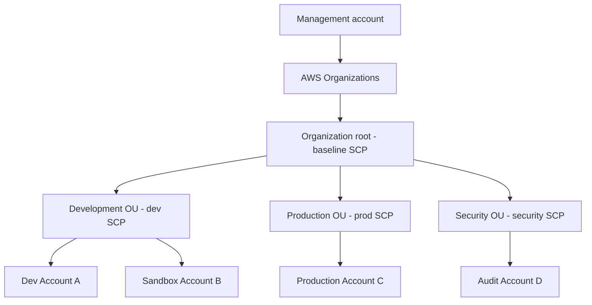
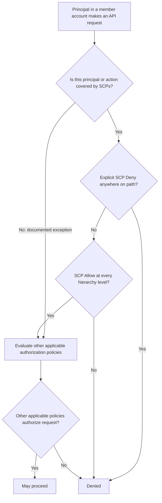
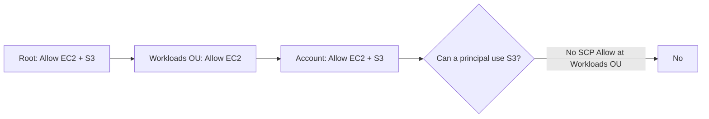
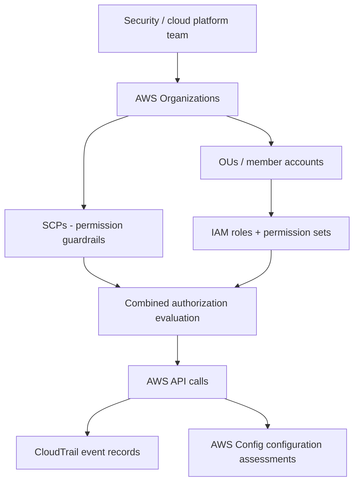
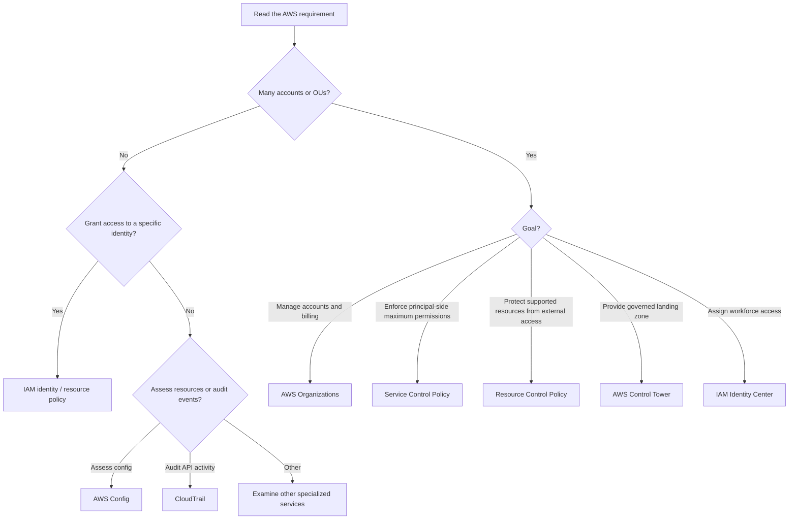

<div align="center">

# 🛡️ AWS Organizations — Service Control Policies (SCPs)

### Complete GitHub Study Guide · Cloud Practitioner + Solutions Architect – Associate

[](https://aws.amazon.com/organizations/)
[](https://aws.amazon.com/certification/certified-cloud-practitioner/)
[](https://aws.amazon.com/certification/certified-solutions-architect-associate/)


**One sentence to remember:** An **SCP** is a centrally administered **maximum-permissions guardrail for principals in AWS Organizations member accounts**; it never grants them access.

[🟢 CCP essentials](#ccp-essentials) · [🔵 SAA architecture](#saa-deep-dive) · [⚔️ Comparisons](#service-comparisons) · [⚠️ Exam traps](#exam-traps) · [🧪 Practice](#practice-questions)

</div>

> [!IMPORTANT]
> **Keep the relationship straight:** **Multi-account strategy** is an architectural approach; **AWS Organizations** is the service used to organize and govern accounts; **SCP** is an organization-level authorization policy type that constrains what principals in member accounts may do.
>
> **Memory line:** **IAM can grant; SCP can only constrain.** An SCP `Allow` is **not** an IAM permission grant.

**Documentation review:** 2026-10-31 · Based on the supplied `02-service-control-policies.md`, expanded and checked against official AWS documentation linked below. Exam examples in this guide are **original**, not official exam questions.

---

## 📚 Table of contents

1. [What is an SCP?](#what-is-an-scp)
2. [What problem does it solve?](#problem-it-solves)
3. [Core concepts and organization structure](#core-concepts)
4. [How SCPs work, step by step](#how-it-works)
5. [Key features and limitations](#key-features)
6. [Real-world use cases](#real-world-use-cases)
7. [🟢 CCP essentials](#ccp-essentials)
8. [🔵 SAA deep dive](#saa-deep-dive)
9. [⚔️ Service comparisons](#service-comparisons)
10. [Integration and architecture patterns](#integration-patterns)
11. [Security and shared responsibility](#security)
12. [Auditing and troubleshooting](#troubleshooting)
13. [Pricing and cost optimization](#pricing)
14. [Practical JSON / AWS CLI lab](#practical-lab)
15. [⚠️ Exam traps](#exam-traps)
16. [Interview questions](#interview-questions)
17. [🧪 Original practice questions](#practice-questions)
18. [Scenario drills](#scenario-drills)
19. [Exam decision tree](#decision-tree)
20. [Quick-revision cheat sheet](#cheat-sheet)
21. [Official AWS references and review note](#official-references)
22. [Closing takeaway](#closing-takeaway)

---

<a id="what-is-an-scp"></a>
## 1. 🧩 What is an SCP?

An **AWS Organizations Service Control Policy (SCP)** defines a **permission ceiling** for IAM principals in AWS **member accounts**. It limits which API actions those principals can be authorized to perform, independently of the permissions configured inside each account.

**Exam-ready definition:** An SCP is an **authorization policy in AWS Organizations**, attached to an **organization root**, **organizational unit (OU)**, or **member account**, that establishes the **maximum available permissions** for affected principals. It **does not grant permissions**. [AWS: SCP overview](https://docs.aws.amazon.com/organizations/latest/userguide/orgs_manage_policies_scps.html)

### The company rulebook analogy

Imagine a company with 50 offices (50 AWS accounts):

- **IAM policies** are the employee's access badge inside an office.
- **SCPs** are corporate rules that no office may override (for example, “Nobody may disable audit logging”).
- **AWS Organizations** is the head-office system organizing offices into groups and applying company-wide rules.

The analogy has a limit: an SCP is **not** a network firewall or a runtime monitoring agent, and it cannot restrict every possible AWS action or every principal (see exceptions).

| Fact | Correct interpretation |
|---|---|
| AWS service | AWS Organizations |
| Policy type | Service Control Policy (`SERVICE_CONTROL_POLICY`) |
| Primary purpose | Central maximum-permissions guardrail |
| Scope | Member-account principals subject to the organization hierarchy |
| Attach to | Root, OU, or individual account—not directly to an IAM user |
| Grants access? | **No** |
| Blocks access? | Yes: explicit `Deny` or missing required SCP `Allow` |
| Need IAM permission too? | **Yes**, or another applicable authorization grant |
| Prerequisite | Organization with **all features** enabled and SCP policy type enabled |
| Management account subject to SCPs? | **No** |
| Service-linked roles subject to SCPs? | **No** |
| Typical exam cue | “Restrict a service or API action across many AWS accounts” |

> [!WARNING]
> “The SCP allows S3” **does not** mean “the user can access S3.” The SCP only leaves room for an identity-based or other applicable policy to grant access.

---

<a id="problem-it-solves"></a>
## 2. 🎯 What problem does it solve?

**Without SCPs:** Every account administrator can configure broad IAM access. If the organization must forbid risky actions across dozens of accounts, repeating manual IAM restrictions is fragile.

**With SCPs:** A central team attaches a guardrail to the relevant root/OU/account. Even an account's `AdministratorAccess` identity policy cannot override that SCP restriction.

### Six representative problems

| Problem | What an SCP can do | Important caveat |
|---|---|---|
| A developer disables audit services | Deny selected CloudTrail / security-service API actions | Test service dependencies and service-linked-role exceptions |
| Teams launch in unapproved Regions | Deny applicable calls using `aws:RequestedRegion` | Global services and cross-Region effects require exceptions and validation |
| Sandbox accounts consume costly services | Deny selected services or provisioning actions | Not a spending cap; existing resources can still incur charges |
| A member account tries to leave the organization | Deny `organizations:LeaveOrganization` | Subject to documented SCP scope and exceptions |
| Staff bypass standardized governance | Place a restriction on their OU instead of per-user | It is not a replacement for IAM least privilege |
| Many development/production/security accounts need consistent controls | Apply shared baseline denies and OU-specific rules | Moving accounts between OUs changes inherited restrictions |

**When *not* to reach for an SCP first:** One user's S3 permission in a single account (IAM); monitoring the configuration of an existing resource (AWS Config); protecting a resource from external principals (consider resource policies and **RCPs**); an actual cost budget (AWS Budgets).

---

<a id="core-concepts"></a>
## 3. 🏗️ Core concepts and organization structure

| Term | Meaning |
|---|---|
| **Organization** | Group of AWS accounts centrally managed through AWS Organizations |
| **Management account** | Account that creates/manages the organization; **its principals are not constrained by SCPs** |
| **Member account** | An account belonging to the organization and generally subject to the SCP path |
| **Root (organization root)** | Top-level container for OUs/accounts—not the same as an account's **root user** |
| **Organizational Unit (OU)** | Logical container for accounts or nested OUs |
| **SCP** | Principal-side authorization guardrail inherited through the organization tree |
| **IAM policy** | A policy that may grant or deny actions for an IAM identity (or resource) |
| **`FullAWSAccess` SCP** | AWS-managed default SCP with `Allow *`; **does not grant IAM permissions** |
| **Explicit deny** | `Deny` that overrides any matching allow |
| **Implicit SCP deny** | A needed action lacks an SCP allow somewhere along the account's path |
| **Allow-list approach** | Replace broad SCP allows with intentionally narrower allowed actions |
| **Deny-list approach** | Keep broad SCP allows and add selected denials |
| **Service-linked role** | AWS service-owned role type **exempt from SCP restrictions** |
| **RCP** | Organizations **Resource Control Policy**: resource-side permissions guardrail |

### Example: one management account, several member accounts



The root in the diagram is the **organization root**, and policy inheritance flows down its OU/account hierarchy. The management account manages the structure but **is not itself restricted by those SCPs**. For a member account, consider the SCPs attached at **every** level on its path. [AWS: SCP evaluation](https://docs.aws.amazon.com/organizations/latest/userguide/orgs_manage_policies_scps_evaluation.html)

> [!TIP]
> A member account's **root user** can be restricted by an SCP. The **organization's management account** is exempt. These two uses of “root” are commonly confused.

---

<a id="how-it-works"></a>
## 4. 🔄 How SCPs work, step by step

1. **Establish AWS Organizations** with **all features enabled**. Consolidated-billing-only mode is insufficient for SCPs.
2. **Enable the SCP policy type**, if not already enabled, and check the default organization policies. AWS normally uses `FullAWSAccess` to provide the initial maximum-permissions baseline.
3. **Group member accounts in OUs** (Production, Development, Security, Sandbox), based on governance requirements rather than convenience alone.
4. **Draft a policy** that denies a narrow action, or design a full allow-list with the appropriate IAM actions and dependencies.
5. **Attach the policy** to the root, OU, or account. Attach at the narrowest sensible scope before broadening.
6. **Evaluate permission requests.** AWS considers applicable SCPs alongside identity/resource policies, permissions boundaries, session policies, RCPs, and other controls where relevant.
7. **Test representative roles and services**, inspect CloudTrail and access-denied details, then deploy in stages.

### Permission decision — simplified mental model



The last decision deliberately summarizes a **more complex IAM evaluation model**. A resource-based policy can sometimes grant access under conditions that differ from a simple identity-policy check; nothing in the diagram implies that SCPs *grant* access. [AWS: policy evaluation](https://docs.aws.amazon.com/IAM/latest/UserGuide/reference_policies_evaluation-logic.html)

### Beginner example: block deleting a CloudTrail trail

A development OU has an SCP that explicitly denies `cloudtrail:DeleteTrail`. A developer in a member account has `AdministratorAccess`. Their `DeleteTrail` request is denied **despite** that IAM policy. Other CloudTrail actions are not necessarily blocked by this specific statement.

### More nuanced example: layered policy path

- Organization root: `FullAWSAccess`.
- Workloads OU: `FullAWSAccess`.
- Sandbox OU: `FullAWSAccess` **plus** `Deny ec2:RunInstances`.
- Member account: `FullAWSAccess` and an IAM role with EC2 admin access.

**Result:** The role cannot launch EC2 instances because an SCP deny at the Sandbox OU applies to it. The parent-root and account-level allows do not cancel that deny.

---

<a id="key-features"></a>
## 5. ⚙️ Key features, defaults, and limits

| Feature | How it works | CCP vs SAA importance |
|---|---|---|
| Central administration | One organization controls many member-account guardrails | **CCP** recognize; **SAA** design |
| Root / OU / account attachment | Policies flow to accounts under the target | **CCP** attachment scope; **SAA** hierarchy evaluation |
| Explicit `Deny` | Overrides a matching allow at any level | **Both** |
| Explicit `Allow` | Establishes the *ceiling*, not an IAM grant | **Both** |
| Default `FullAWSAccess` | Broadly permits delegation unless other SCPs restrict it | **SAA** default behavior |
| Deny-list | Preserve `FullAWSAccess` and attach additional denies | **SAA** practical rollout |
| Allow-list | Replace broad allows at the intended level | **SAA** careful dependency design |
| JSON syntax | IAM-like `Version`, `Statement`, `Effect`, `Action`, `Resource`, etc. | **SAA** examples |
| Conditions | Can narrow applicability; `aws:RequestedRegion` is a common example | **SAA** nuance |
| Maximum policies per target | **10** SCPs directly attached per root, OU, or account (current AWS docs) | **SAA** limit awareness |
| Maximum policy size | **10,240 characters** per SCP (current AWS docs) | **SAA** sizing awareness |
| SCP-exempt service-linked roles | SCP restrictions do **not** affect service-linked roles | **SAA** troubleshooting |

**Policy syntax notes:** The AWS SCP syntax reference currently supports `Condition` in **both `Allow` and `Deny` statements**. For an **`Allow` statement**, `Resource` is limited to `"*"`; more specific resource ARNs can be used in applicable **`Deny` statements**. SCPs do **not** support `Principal`/`NotPrincipal` elements. [AWS: SCP syntax](https://docs.aws.amazon.com/organizations/latest/userguide/orgs_manage_policies_scps_syntax.html)

### Important exceptions (not an all-principals guarantee)

SCPs **do not** restrict:

- Actions performed by principals in the **Organizations management account**.
- Actions through **service-linked roles**.
- **Principals belonging to external AWS accounts**, solely because they interact with a resource in a member account. For resource-side protection, evaluate bucket/resource policies and **RCPs**.
- Certain special root-account tasks and AWS-related services documented in the official [exceptions list](https://docs.aws.amazon.com/organizations/latest/userguide/orgs_manage_policies_scps.html).

**Do not turn an SCP off casually:** disabling and later re-enabling the SCP policy type can discard previous attachments; the automatically reinstated default is not a recovery of your old policy assignments. [AWS: SCP overview](https://docs.aws.amazon.com/organizations/latest/userguide/orgs_manage_policies_scps.html)

---

<a id="real-world-use-cases"></a>
## 6. 🏢 Real-world use cases and when to choose it

| Situation | Reasonable SCP approach | Why it fits | Pitfall |
|---|---|---|---|
| 50 development accounts must not delete audit trails | Deny the relevant CloudTrail deletion/configuration actions on the Development OU | One central preventive rule | Choose complete action coverage; merely denying one deletion API is not comprehensive logging protection |
| Student sandbox should not create costly compute | Restrict EC2 launch or selected costly services | Limits accidental provisioning | Does not stop charges for already-running assets or noncovered services |
| EU-only operation requirement | Scoped Region condition with carefully designed global-service exceptions | Helps restrict request endpoints | `aws:RequestedRegion` does not universally guarantee data residency |
| Production admins should not alter selected organizational guardrails | Deny relevant action(s) in Production OU | Prevents accidental modification within member accounts | Management account and service-linked roles remain outside SCP scope |
| Organization needs standardized API governance | Root-level baseline deny + OU-specific restrictions | Consistent multi-account behavior | Root-level mistakes affect many accounts |
| Different teams need different services | Intentional service allow-list per OU | Constrains delegation across member accounts | Requires maintaining allows and every hierarchy level |
| Protect S3 resources from external vendors | **RCP + resource policy** rather than only SCP | Resource-side boundary applies to relevant external access | RCP support is service/resource-specific |
| Only one IAM role needs S3 read | **IAM** least-privilege policy (perhaps permissions boundary) | Identity-level authorization | SCP is too coarse for this as the primary tool |

**When to choose an SCP:** a member-account / OU / organization-level **preventive permissions boundary**. **When not to choose it:** authentication, a mandatory network firewall, resource configuration history, continuous monitoring, or an all-purpose billing control.

---

<a id="ccp-essentials"></a>
## 🟢 7. Cloud Practitioner (CCP) Essentials


### 17 fundamentals to memorize

1. **SCP = Service Control Policy.**
2. SCPs are part of **AWS Organizations**.
3. AWS Organizations implements **centralized multi-account governance**.
4. SCPs set **maximum available permissions**.
5. SCPs **do not grant access** to any AWS service.
6. Actual permissions come from applicable **IAM/resource-based authorization**.
7. SCPs act as a **guardrail** around member accounts.
8. You attach SCPs to the **root, OU, or account**.
9. An **OU** groups accounts and can contain nested OUs.
10. SCP rules **inherit** down the hierarchy.
11. Explicit **Deny** overrides a conflicting allow.
12. A root-level restriction can affect **all member accounts**.
13. A member account's **root user** can be constrained.
14. The **management account** is **not** constrained by SCPs.
15. SCPs are not identical to ordinary **IAM policies**.
16. SCPs require an organization with **all features**, not billing-only mode.
17. Use SCPs for **prevention across accounts**, not audit logs or billing estimates.

### Compact CCP keyword bank

`AWS Organizations` · `SCP` · `multi-account strategy` · `central governance` · `maximum permissions` · `permission ceiling` · `guardrail` · `preventive control` · `organizational unit` · `OU` · `root` · `member account` · `explicit deny` · `consolidated billing` · `IAM policy` · `does not grant` · `Region restriction` · `enterprise-wide policy`

### If the question says X → think Y

| Question wording | Likely best concept |
|---|---|
| Manage hundreds of AWS accounts | **AWS Organizations** |
| Set maximum permissions across member accounts | **SCP** |
| Group accounts by department or environment | **Organizational Unit** |
| Prevent account administrators from disabling a service | **SCP deny** |
| Give an employee S3 read permission | **IAM identity policy** |
| Enable single sign-on across accounts | **IAM Identity Center** |
| Inspect resource compliance status | **AWS Config** |
| Audit API activity | **AWS CloudTrail** |
| Unified billing for several accounts | **AWS Organizations consolidated billing** |
| Set a spending threshold / alert | **AWS Budgets** |

### CCP misconceptions

**❌** “An SCP `Allow` gives a developer permission.”  
**✅** It only permits a separate policy *to be able to grant* that action.

**❌** “An OU is another AWS account.”  
**✅** An OU is a **container** for accounts or other OUs.

**❌** “Every account, including the management account, is restricted.”  
**✅** SCPs constrain **member accounts**, not management-account principals.

**30-second CCP answer:** *An SCP is an AWS Organizations guardrail that defines the maximum permissions available to IAM principals in member accounts. It supports centralized governance across multiple AWS accounts and does not itself grant access.*

---

<a id="saa-deep-dive"></a>
## 🔵 8. Solutions Architect – Associate (SAA) Deep Dive


### 8.1 Policy evaluation: the precise core

For a subject **covered by SCPs**, you need:

1. An SCP **Allow** for the requested action at **every level** of its root → OU(s) → account path (possibly across multiple policies at each level).
2. **No matching SCP `Deny`** at any level on that path.
3. A separate **effective authorization grant**, after considering all relevant IAM/resource and other policies.

| IAM / other grant exists? | SCP permits it at every level? | Matching SCP deny? | SCP contribution to outcome |
|---|---|---|---|
| No | Yes | No | **No grant**: access still denied absent another valid authorization path |
| Yes | Yes | No | SCP does not block; other controls still evaluated |
| Yes | No | No | **Blocked** by implicit SCP denial |
| Yes | Yes | Yes | **Blocked** by explicit SCP denial |
| Yes | No | Yes | **Blocked** |

#### Multiple SCPs at one level

- **Allow statements** in different SCPs attached to the **same level** can collectively cover an action.
- But an allow at one level does **not** compensate for a missing allow at a **different** level.
- Any relevant **explicit deny anywhere** in the path blocks the action, even if another SCP or IAM policy allows it.



This example assumes broad `FullAWSAccess` at the Workloads OU **was replaced**, not left attached. Leaving `FullAWSAccess` alongside a narrow `Allow` SCP at that level would still provide a broader allow there. [AWS: SCP evaluation](https://docs.aws.amazon.com/organizations/latest/userguide/orgs_manage_policies_scps_evaluation.html)

### 8.2 Deny-list versus allow-list strategies

| Dimension | Deny-list approach | Allow-list approach |
|---|---|---|
| Baseline | Keep `FullAWSAccess` where needed | Replace broad allows at selected levels |
| Control style | Explicitly block forbidden actions | Explicitly enumerate permitted actions |
| New AWS APIs/services | Usually remain SCP-permitted unless denied | Usually SCP-blocked until included |
| Maintenance | Typically lower | Typically higher |
| Common use | General enterprise guardrails | Tightly restricted environments |
| Biggest risk | A new unwanted action may remain allowed | Missing dependency/API action may break workflows |

> [!WARNING]
> An `Allow`-only SCP attached **in addition to** `FullAWSAccess` normally does **not** narrow that level. To implement a true allow-list for an OU, first ensure a safe, replacement allow policy exists, then carefully remove the broader allow **at the intended level**. Do not remove the last SCP or remove `FullAWSAccess` casually.

### 8.3 Scope, principals, and cross-account role behavior

- **Member-account root users** are covered; “root is unrestricted” is false for them.
- **Management-account users and roles** are not covered.
- **Delegated-administrator member accounts** are still covered.
- **Service-linked roles** are exempt. Ordinary IAM service roles are **not** automatically exempt simply because a service uses them.
- For a **cross-account assumed role**, evaluate the role's owning account and its SCP hierarchy (plus relevant role permissions/trust and other policy controls). The originating user's permission to call `sts:AssumeRole` is separately evaluated.
- **External account principals** do not become governed by an SCP just because they access a resource hosted in your member account. A resource boundary / RCP may be relevant instead.

### 8.4 Region restrictions: avoid false guarantees

An SCP can use `aws:RequestedRegion` to restrict which **regional service endpoints** receive an API request. However:

- Global services (for example, IAM, Route 53, or CloudFront) may need carefully considered **`NotAction` exceptions**.
- Some services can perform **cross-Region operations** from an allowed endpoint.
- Restricting a request's Region does **not automatically prove that all data stays inside that Region**.
- Review deployment features, service-linked roles, AWS dependencies, and application recovery plans before applying at root level.

See [AWS SCP syntax / Region examples](https://docs.aws.amazon.com/organizations/latest/userguide/orgs_manage_policies_scps_syntax.html) and [AWS: region-deny patterns in Control Tower](https://docs.aws.amazon.com/controltower/latest/controlreference/primary-region-deny-policy.html).

### 8.5 JSON elements you should recognize

| Element | Role in an SCP | Caveat |
|---|---|---|
| `Version` | Policy language version, normally `2012-10-17` | Not a date of creation |
| `Statement` | One or more permission statements | JSON object or array |
| `Sid` | Optional statement identifier | Useful in reviews |
| `Effect` | `Allow` or `Deny` | SCP `Allow` is only a ceiling |
| `Action` | Included API operations | Wildcards need careful review |
| `NotAction` | Operations excluded from statement's action set | Easy to misunderstand with `Deny` |
| `Resource` / `NotResource` | Applicable resources | `Allow` statements require `"Resource":"*"` |
| `Condition` | Conditions for statement applicability | Supported in both Allow and Deny in current docs |
| `Principal` / `NotPrincipal` | **Not supported** in SCPs | Use supported conditions when appropriate |

### 8.6 SAA design scenarios (worked)

**Scenario A — Production account administrator tries to disable a logging control.**  
A `Deny` on the Production OU for the relevant CloudTrail action remains effective even when the member-account admin has `AdministratorAccess`. Design guardrails for all dangerous actions and test production dependencies, not just the easiest API call.

**Scenario B — Allow S3 and EC2 only in Sandbox.**  
Replacing `FullAWSAccess` at the Sandbox OU with a narrow allow-list can impose a service ceiling **if** each ancestor and the account still has appropriate allows. Retaining the broad OU `FullAWSAccess` defeats the intended OU-level allow-list. Existing IAM permissions still determine what users can actually do.

**Scenario C — Only EU Regions are approved.**  
A blanket `Deny` with `aws:RequestedRegion` is tempting but can break global endpoints or cross-Region features. Start with a tested policy template that accounts for the exact services in use, and validate residency separately.

**Scenario D — Vendor from another AWS organization writes to your S3 bucket.**  
An SCP on *your* account does not directly restrict that vendor's external principal. Evaluate S3 bucket policies, data-perimeter conditions, and **RCP** capability for resource-side restrictions.

**Scenario E — Security tooling operates via a service-linked role.**  
An SCP aimed at preventing human administrators from disabling monitoring may not constrain the AWS service's service-linked role. This exception is by design; use appropriate service-native safeguards and monitoring.

**Scenario F — Move an account from Dev to Production OU.**  
The effective SCP path changes. Preflight the account's IAM roles, automation, CI/CD and disaster-recovery operations against the Production OU's policies; a move may unexpectedly cause `AccessDenied`.

### 8.7 Security, availability, cost, performance: what applies?

SCPs operate in the **authorization/control plane**. They are not in the packet path, have no storage durability tier, no direct multi-AZ data replication setting, and do not themselves improve compute scalability. Their design can **indirectly affect availability** by accidentally denying failover, backups, deployment, or region-recovery actions. They can **indirectly affect costs** by blocking selected provisioning APIs, but they are not hard spend limits.

---

<a id="service-comparisons"></a>
## ⚔️ 9. Compare with similar or confusable AWS features

| Service / feature | Primary purpose | Scope | Key difference from SCP | Choose it when… |
|---|---|---|---|---|
| **AWS Organizations** | Manage organization structure and accounts | Organization | SCP is one of its policy types | Need multi-account administration or consolidated billing |
| **IAM identity policies** | Authorize identity actions | Users/groups/roles in an account | IAM can **grant**, SCP cannot | Assign a team's S3 or EC2 permissions |
| **IAM permissions boundary** | Cap permissions of a selected IAM user/role | Individual IAM principal | Narrower than an OU/account guardrail | Delegated admins can create roles but not exceed a ceiling |
| **AWS Organizations RCP** | Bound access to supported **resources** | Root/OU/account affecting resources | Resource-centric; can affect relevant external principal access | Protect org resources from external identities |
| **IAM Identity Center** | Workforce sign-in / multi-account permission sets | Users and accounts | Authentication/access assignment, not an SCP guardrail | Central employee SSO and account access |
| **AWS Control Tower** | Govern and establish a landing zone | Multi-account environment | Uses Organizations and preventive/detective/proactive controls | Want an opinionated governed multi-account setup |
| **AWS Config** | Assess and record resource configurations | Accounts/Regions | Primarily evaluates resource compliance; doesn't act as an SCP | Find configuration drift / noncompliance |
| **AWS CloudTrail** | Log supported API/account activity | Accounts/Regions / organization trails | Evidence of activity rather than permission guardrail | Investigate who performed an API call |
| **AWS Firewall Manager** | Centrally manage supported security policies | Org/multi-account resources | Network/application security policy manager, not principal permission ceiling | Deploy WAF/security-group/network-firewall policies at scale |
| **AWS Budgets** | Budget thresholds and alerts/actions | Billing/account | Financial control rather than universal authorization ceiling | Warn about or respond to spending thresholds |

<details>
<summary><strong>IAM identity policies versus SCPs — easiest exam trap</strong></summary>

IAM: “May this role call `s3:GetObject`?” SCP: “Is `s3:GetObject` even within this member account's allowed permission ceiling?” Both matter. An SCP `Allow` cannot fix an IAM `Deny` or a missing grant.

</details>

<details>
<summary><strong>SCP versus permissions boundary</strong></summary>

A permissions boundary is attached to an IAM user/role and limits permissions available to that entity. SCPs are attached to organizational containers/accounts and affect a broad set of member-account principals. Both are limits and neither grants by itself. Boundaries have their own nuances for resource-based grants and sessions, so use AWS IAM policy-evaluation documentation for exact scenarios.

</details>

<details>
<summary><strong>SCP versus RCP — the current two-sided governance model</strong></summary>

SCPs define **principal-side** organizational guardrails; RCPs define **resource-side** guardrails for supported resource types. A principal from a separate organization cannot be directly restricted by *your* SCP, but an RCP protecting *your resource* can be relevant to that external access. Service support and policy evaluation details must be checked. [AWS: SCP and RCP comparison](https://docs.aws.amazon.com/organizations/latest/userguide/orgs_manage_policies_authorization_policies.html)

</details>

<details>
<summary><strong>Organizations versus Control Tower</strong></summary>

Organizations provides the account/OU structure and organization policy types. Control Tower builds on it with an opinionated landing-zone setup and coordinated governance controls. Not every Control Tower control is an SCP, and users can operate Organizations without Control Tower.

</details>

<details>
<summary><strong>SCP versus Config, CloudTrail, and Firewall Manager</strong></summary>

**SCP:** authoritatively blocks covered permission requests. **Config:** records/evaluates configurations. **CloudTrail:** records supported API events. **Firewall Manager:** deploys and manages supported security policies across multiple accounts. They can complement each other; none replaces the others wholesale.

</details>

---

<a id="integration-patterns"></a>
## 10. 🔌 Integration and architecture patterns

### Centralized organizational governance



**Note:** The diagram shows complementary control and evidence flows, **not** that every AWS API request yields every CloudTrail/Config record. Coverage and service setup vary.

### Common integration patterns

1. **Organizations + IAM Identity Center:** workforce signs in via permission sets / roles; SCPs independently constrain roles in member accounts.
2. **Organizations + Control Tower:** landing-zone and control management; preventive controls may use organization-level policies, while other controls are detective or proactive.
3. **Organizations + CloudTrail organization trail:** centralized audit evidence; SCPs can help prevent member-account users from disabling specified logging actions, subject to service exceptions and complete coverage.
4. **Organizations + AWS Config / Security Hub:** configuration and security findings support guardrail assessment; SCPs do not automatically remediate every finding.
5. **Organizations + RCP + resource policies:** apply principal-side and resource-side controls for data-perimeter requirements where supported.
6. **AWS CloudFormation StackSets / account baselines:** deploy configuration to selected accounts/OUs; SCPs can still prevent covered operations used by those deployments.

---

<a id="security"></a>
## 11. 🔐 Security, compliance, and shared responsibility

| AWS responsibility | Your organization / security team's responsibility |
|---|---|
| Operate AWS Organizations service infrastructure and evaluate supported organization policies | Choose all-features mode, define OUs, author/test SCPs, enforce least-privilege IAM, monitor unintended impacts |
| Provide supported authorization-policy mechanisms | Protect management-account access and avoid production workloads there |
| Document policy capabilities and exceptions | Design external-principal / service-linked-role safeguards beyond SCPs |

**The security boundary is authorization, not encryption.** An SCP contains **no customer data** needing an SCP-specific encryption setting; it does not encrypt S3 objects, require TLS on all network traffic by itself, patch EC2, or automatically satisfy regulatory obligations. Combine SCPs with resource-specific encryption/transport policies, logging, IAM, and service security controls.

### Safe governance checklist

- [ ] Separate the management account from workload accounts.
- [ ] Enable MFA and appropriately restrict organization-admin access.
- [ ] Group accounts into purpose-driven OUs and document policy ownership.
- [ ] Prefer tested explicit denies for a first preventive baseline.
- [ ] Preserve necessary `Allow` at every root/OU/account level.
- [ ] Include service-linked-role, vendor/cross-account, and global-service assumptions in design reviews.
- [ ] Roll out to a test OU first; establish emergency recovery through the management account.
- [ ] Audit policy edits and correlate with member-account authorization failures.
- [ ] Review effects on backup, monitoring, failover, and deployment automation.

---

<a id="troubleshooting"></a>
## 12. 🔎 Observability, auditing, and troubleshooting

**SCPs don't produce a dedicated metrics stream for “every blocked operation.”** Use the supported service's access-denied response, CloudTrail event history/trails where events are logged, Organizations policy attachment details, IAM policy analysis/last-accessed data, and other auditing tools.

### Investigate `AccessDenied` in this order

1. **Identify the actual caller** (IAM role, assumed-role session, root user, service-linked role, external principal).
2. **Identify its owning account** and whether it is management or member.
3. **Inspect the target account's root → OU → account path** and every attached SCP along that path.
4. **Look for explicit `Deny`** on the requested `Action`/`Resource`/`Condition`.
5. **Check for missing SCP `Allow` at each level** if using an allow-list.
6. **Review IAM identity/resource permissions**, IAM permissions boundary, role session policies, trust policy, RCPs and any applicable other policy types.
7. **Validate condition-key context** (`aws:RequestedRegion`, principal ARN, requested resource, etc.).
8. **Inspect CloudTrail** where the service/API event is recorded, and IAM service-last-accessed data for scoping.
9. **Check for recent OU moves, policy changes or policy-type disable/reenable events.**
10. **Reproduce safely in a test account**; roll back a bad policy from an authorized organization-admin path.

Example diagnostic messages may distinguish **“with an explicit deny in a service control policy”** from **“because no service control policy allows”**. Format and coverage vary by service. [AWS: access-denied troubleshooting](https://docs.aws.amazon.com/IAM/latest/UserGuide/troubleshoot_access-denied.html)

| Symptom | Plausible cause | Next check |
|---|---|---|
| Admin role suddenly loses EC2 access | New OU/root deny or missing allow | New SCP attachments along path |
| Role has `AdministratorAccess` but cannot terminate EC2 | Explicit SCP deny | `ec2:TerminateInstances` matching statement |
| SCP region guardrail breaks DNS workflow | Global-service behavior not exempted | `NotAction`, AWS endpoint behavior, staged tests |
| Restriction did not stop AWS service automation | Service-linked role exception | Role type and service-native protections |
| External vendor can still reach a bucket | SCP does not bind their external principal | Bucket policy / RCP / external policy path |
| Action fails despite permissive SCP | IAM/resource/permission boundary/other denial | Full IAM policy evaluation |

---

<a id="pricing"></a>
## 13. 💰 Pricing and cost optimization

**AWS Organizations is offered at no additional charge**, including its SCP capability. Your organization's member accounts still incur normal charges from services they run; integrated services or supporting monitoring tools may have their own charges. [AWS: Organizations pricing](https://docs.aws.amazon.com/organizations/latest/userguide/pricing.html)

**Illustrative cost model (no fabricated prices):**

```text
Total organization cost ≈ sum of AWS resource/service charges across accounts
                        + any paid complementary governance/monitoring services
SCP policy feature surcharge in AWS Organizations = 0
```

**SCPs are not budgets.** A rule stopping `ec2:RunInstances` does not terminate existing instances, block all other spend, or impose a monthly dollar cap. Use **AWS Budgets**, **Cost Explorer**, account tagging, and cost monitoring for financial governance. Denying provisioning actions can complement cost controls.

---

<a id="practical-lab"></a>
## 14. 🧪 Practical JSON / AWS CLI example

> [!IMPORTANT]
> **Lab only.** Do this first in a non-production OU with a recovery plan. You need AWS Organizations with **all features**, SCPs enabled, and organization-management permissions. These commands do **not** grant IAM permissions and must not be run blindly in a production organization.

### 14.1 Example SCP: prevent trail deletion

Save the following as `deny-delete-cloudtrail.json`:

```json
{
  "Version": "2012-10-17",
  "Statement": [
    {
      "Sid": "DenyCloudTrailTrailDeletion",
      "Effect": "Deny",
      "Action": "cloudtrail:DeleteTrail",
      "Resource": "*"
    }
  ]
}
```

This intentionally **does not claim to protect all CloudTrail settings**. Other actions can alter or stop logging; this is a simple, single-action teaching example. Deny-list operation assumes that matching SCP Allows (for example `FullAWSAccess`) remain effective at every level.

### 14.2 Create and attach the SCP

```bash
# Run from an appropriately authorized AWS Organizations management context.
aws organizations create-policy \
  --content file://deny-delete-cloudtrail.json \
  --description "Lab: prevent trail deletion in test OU" \
  --name DenyCloudTrailDeleteLab \
  --type SERVICE_CONTROL_POLICY

# From the create-policy output, obtain the real PolicySummary.Id.
# Replace these placeholders with your actual AWS identifiers.
aws organizations attach-policy \
  --policy-id POLICY_ID \
  --target-id OU_ID

# Inspect direct SCP attachments to that OU.
aws organizations list-policies-for-target \
  --target-id OU_ID \
  --filter SERVICE_CONTROL_POLICY
```

**Safe test:** In a member account of the test OU, use a permitted test role and verify that a controlled attempt to delete a **disposable test trail** is rejected. Do not delete actual audit infrastructure. Also verify unrelated required deployment and monitoring actions still function.

### 14.3 Conceptual allow-list example (advanced, do not attach blindly)

```json
{
  "Version": "2012-10-17",
  "Statement": [
    {
      "Sid": "AllowSelectedServicesForDelegation",
      "Effect": "Allow",
      "Action": [
        "s3:*",
        "ec2:*",
        "cloudwatch:*"
      ],
      "Resource": "*"
    }
  ]
}
```

This **does not restrict anything** at an OU if a broad `FullAWSAccess` remains attached at that same OU. To make it a real allow-list, replace the broad OU allow **only after** designing necessary service dependencies and validating that ancestors/accounts have valid allows. Even with this SCP, an IAM user still needs an effective grant.

### 14.4 Cleanup and recovery

If policy testing succeeds, keep it only when approved. To undo the lab, detach the **lab policy** from the test OU using `aws organizations detach-policy --policy-id POLICY_ID --target-id OU_ID` (provided another required SCP remains attached), then delete the lab policy if unused. **Do not detach the only SCP** or remove essential `FullAWSAccess` policies inadvertently.

---
<a id="exam-traps"></a>
## ⚠️ 15. Common exam traps and misconceptions

| ❌ Misconception / tempting wrong answer | ✅ Correct interpretation | Level |
|---|---|---|
| 1. “SCP `Allow` gives S3 access.” | It only permits an eligible IAM/resource authorization to grant access. | CCP |
| 2. “Organizations and SCP mean the same thing.” | Organizations is the service; SCP is one policy type within it. | CCP |
| 3. “A multi-account strategy is an AWS service.” | It is a design approach; Organizations is the management service. | CCP |
| 4. “SCPs work only on IAM users.” | They affect covered IAM users **and roles**, and generally the member-account root user. | CCP/SAA |
| 5. “Root users ignore SCPs.” | **Member-account** root users are covered, with documented exceptions. | CCP/SAA |
| 6. “The management account is covered if an SCP is attached to the organization root.” | Management-account principals are **not** covered by SCPs. | SAA |
| 7. “Delegated administrator accounts are exempt.” | A delegated-admin account is still a **member** and subject to SCPs. | SAA |
| 8. “Service-linked roles obey SCP restrictions.” | They are exempt from SCP evaluation. | SAA |
| 9. “All roles assumed by AWS services are exempt.” | Ordinary IAM roles are not automatically exempt; the special exception is **service-linked roles**. | SAA |
| 10. “Attaching `Deny` to one OU affects every OU.” | It affects that OU's descendant accounts, not unrelated sibling OUs. | CCP/SAA |
| 11. “An account-level `Allow` overrides a root-level `Deny`.” | A matching explicit deny anywhere on the path wins. | SAA |
| 12. “An SCP allow at the root is sufficient.” | A covered action needs an SCP allow at **every** hierarchy level. | SAA |
| 13. “A narrow allow-list overrides `FullAWSAccess` at the same OU.” | Broad allows at the same level can keep additional actions within the SCP ceiling. | SAA |
| 14. “`FullAWSAccess` makes everyone an AWS administrator.” | It grants **no** IAM permission. | CCP/SAA |
| 15. “Only an SCP explicit deny can block an action.” | Missing SCP allow at one level creates an **implicit SCP deny**. | SAA |
| 16. “All organizations can use SCPs.” | They require **all features**, not consolidated billing-only mode. | SAA |
| 17. “SCPs are attached to an IAM group.” | They attach to an **organization root, OU, or account**. | CCP |
| 18. “SCPs replace IAM policies.” | IAM/resource authorization is still needed. | CCP |
| 19. “An SCP can directly restrict every vendor accessing our S3 bucket.” | SCPs constrain principals in your organization; consider **RCPs/resource policies** for resource-centric control. | SAA |
| 20. “SCP can directly control network packets.” | It limits **API authorization**, not packet-level traffic. | SAA |
| 21. “Denying operations outside one Region ensures all data stays in it.” | `aws:RequestedRegion` restricts request endpoints; cross-Region behavior and global services need separate assessment. | SAA |
| 22. “SCPs audit events like CloudTrail.” | They restrict permissions; CloudTrail records supported activity. | CCP |
| 23. “SCPs continuously assess config compliance like Config.” | Config assesses resource configurations; SCPs prevent covered actions. | CCP |
| 24. “An SCP makes a sandbox free.” | It is not a spending cap; existing usage can still cost money. | SAA |
| 25. “A permissions boundary and SCP are interchangeable.” | Boundary applies to a chosen IAM user/role; SCP applies through the organizational hierarchy. | SAA |
| 26. “SCPs support `Principal` for selecting one user.” | `Principal`/`NotPrincipal` are unsupported; supported conditions may sometimes be used instead. | SAA |
| 27. “SCP `Allow` can target a specific resource ARN.” | For an SCP **Allow** statement, `Resource` is `"*"`; relevant Deny statements can specify resources. | SAA |
| 28. “`Condition` only works in Deny SCP statements.” | Current AWS SCP syntax documentation supports conditions in **Allow and Deny**. | SAA |
| 29. “Disabling and reenabling the SCP policy type restores policy attachments.” | Previously attached policies are **not automatically reattached**. | SAA |
| 30. “Changing SCPs is always operationally harmless.” | A broad deny or missing allow can break backup, logging, deployments, and recovery. | SAA |
| 31. “Every AccessDenied error means an SCP denied access.” | IAM, resource policy, boundary, session policy, RCP, and other conditions can also deny it. | SAA |
| 32. “You can safely remove `FullAWSAccess` everywhere with no replacement.” | Without required SCP Allows, member principals can lose all AWS permissions. | SAA |
| 33. “An organization root and an AWS account root user are identical.” | The organization root is a *hierarchy container*; a root user belongs to one account. | CCP/SAA |
| 34. “SCP cost-control is equivalent to AWS Budgets.” | SCP limits selected API actions; Budgets controls spend visibility/threshold responses. | CCP/SAA |

### Three mechanisms behind the hardest traps

**Trap 12: allow at every level.** SCPs are a hierarchy of maximum-permission filters. The *narrowest* missing allow along the relevant path is enough to block an action; an `Allow` at a different level cannot fill the gap.

**Trap 13: broad allow at the same level.** Multiple SCPs may be attached at one level. Attaching a narrower `Allow` without replacing the broad allow does not magically reduce what that level permits.

**Trap 19: principal-side vs resource-side.** The principal's organization and the resource's organization are not interchangeable. Your SCP constrains *your covered principals*, not an external identity by merely protecting a resource they use.

---

<a id="interview-questions"></a>
## 🎤 16. Interview questions with concise answers

**1. What is an SCP?**  
A centrally managed AWS Organizations policy that caps permissions available to principals in member accounts; it cannot grant access.

**2. Why use an SCP if every account has IAM?**  
To enforce an organization-level ceiling independent of individual account administrators' IAM changes.

**3. SCP versus IAM identity policy?**  
IAM identity policies grant/deny permissions to selected identities; SCPs constrain what can be granted to covered member-account principals.

**4. How do you restrict dozens of development accounts with one policy?**  
Place them in a Development OU and attach an appropriately tested SCP to the OU.

**5. How does an explicit SCP Deny behave with AdministratorAccess?**  
The deny wins for affected principals; admin permissions do not bypass it.

**6. If the SCP explicitly Allows S3, why might the user still see AccessDenied?**  
There may be no IAM/resource grant, another SCP deny, no allow elsewhere on the path, or another policy/control that blocks the request.

**7. How do allow-lists differ from deny-lists?**  
Allow-list: deliberately narrow which actions are eligible at the SCP level; deny-list: retain broad eligibility and add explicit disallowed actions.

**8. Can SCPs restrict the organization's management account?**  
No. Put workloads in member accounts and protect management access with separate controls.

**9. How would you debug an SCP-related deployment failure?**  
Identify caller/account, inspect the entire policy path for explicit and implicit denies, then examine IAM and CloudTrail; test changes outside production.

**10. What happens to service-linked roles under SCPs?**  
They are exempt. You must design monitoring and service-native guardrails accordingly.

**11. How do SCPs interact with an external vendor's access to S3?**  
Your SCP does not directly cap the vendor's external principal. Use resource-side controls, including RCPs when supported.

**12. How do you prevent a Region SCP from breaking production?**  
Inventory APIs and dependencies, consider global endpoints and cross-Region behavior, stage it through a test OU, and verify both success paths and recovery paths.

---

<a id="practice-questions"></a>
## 🧪 17. Original practice questions

**Instructions:** Answer before opening each explanation. These questions are **original educational exercises**, not leaked or official AWS exam questions. CCP emphasizes recognition; SAA emphasizes evaluation and design.

<details>
<summary><strong>Q01 · CCP</strong> — Which AWS feature defines the maximum permissions available to principals in member accounts?</summary>

- A. Amazon CloudWatch
- B. Service control policies (SCPs)
- C. AWS Budgets
- D. Amazon Route 53

**Correct answer: B.** SCPs are centralized authorization guardrails within AWS Organizations.

**Why the other options are wrong:** CloudWatch observes metrics; Budgets tracks spend; Route 53 provides DNS.

</details>

<details>
<summary><strong>Q02 · CCP</strong> — A company wants to centrally organize and manage 40 AWS accounts. Which AWS service fits?</summary>

- A. AWS Organizations
- B. AWS IAM
- C. Amazon S3
- D. AWS CloudTrail

**Correct answer: A.** Organizations manages account hierarchy and consolidated billing; its SCPs add central permission limits.

**Why the other options are wrong:** IAM manages identities/permissions; S3 stores objects; CloudTrail records events.

</details>

<details>
<summary><strong>Q03 · CCP</strong> — An SCP contains an `Allow` for `s3:GetObject`. What happens by itself?</summary>

- A. Every user gains S3 read
- B. The bucket becomes public
- C. No permission is granted by the SCP itself
- D. The root account is disabled

**Correct answer: C.** An SCP Allow defines the outer limit; an effective IAM/resource-policy grant is still required.

**Why the other options are wrong:** A and B confuse permission limits with authorization/public exposure; D is unrelated.

</details>

<details>
<summary><strong>Q04 · CCP</strong> — What is an Organizational Unit (OU)?</summary>

- A. A network subnet
- B. A container that groups AWS accounts or child OUs
- C. An S3 bucket class
- D. An individual IAM user

**Correct answer: B.** OUs group accounts so inherited organization policies can be applied coherently.

**Why the other options are wrong:** Subnets belong to VPC; S3 buckets store objects; IAM users are identities.

</details>

<details>
<summary><strong>Q05 · CCP</strong> — Where may an SCP be attached?</summary>

- A. IAM group only
- B. EC2 instance only
- C. Organization root, OU, or account
- D. VPC route table

**Correct answer: C.** SCP attachment targets are hierarchy entities in AWS Organizations.

**Why the other options are wrong:** IAM groups, EC2 instances, and route tables are not SCP attachment targets.

</details>

<details>
<summary><strong>Q06 · CCP</strong> — An account admin has IAM `AdministratorAccess`. An applicable SCP explicitly denies `ec2:TerminateInstances`. What happens?</summary>

- A. IAM admin overrides SCP
- B. The action is denied
- C. The action is always allowed on weekends
- D. SCP grants a new role

**Correct answer: B.** For a covered member-account principal, matching explicit SCP Deny wins.

**Why the other options are wrong:** An IAM allow does not override an SCP deny; C and D invent behaviors.

</details>

<details>
<summary><strong>Q07 · CCP</strong> — Which service is primarily used to record supported API activity?</summary>

- A. AWS CloudTrail
- B. SCP
- C. AWS Budgets
- D. AWS Organizations OU

**Correct answer: A.** CloudTrail is an auditing/event-history service, whereas SCPs prevent specified actions.

**Why the other options are wrong:** SCPs are authorization controls; Budgets measures spend; OU is a hierarchy container.

</details>

<details>
<summary><strong>Q08 · CCP</strong> — A company needs central restrictions for all accounts in Development. Best place to attach the SCP?</summary>

- A. Every IAM user separately
- B. Development OU
- C. An S3 object
- D. A DNS hosted zone

**Correct answer: B.** OU-level attachment applies to descendants and avoids repeating per-user policy.

**Why the other options are wrong:** IAM-user attachment is not supported for SCPs, and S3/DNS are unrelated.

</details>

<details>
<summary><strong>Q09 · CCP</strong> — Which is the correct statement?</summary>

- A. IAM policies never grant access
- B. SCP grants all IAM permissions
- C. IAM can grant permissions; SCP limits available permissions
- D. An SCP is an EC2 security group

**Correct answer: C.** Identity authorization and maximum permission guardrails have distinct jobs.

**Why the other options are wrong:** A reverses IAM behavior, B reverses SCP behavior, D mixes policy with firewall.

</details>

<details>
<summary><strong>Q10 · CCP</strong> — An organization wants consolidated billing across accounts. Which service is the main choice?</summary>

- A. AWS Organizations
- B. AWS Shield
- C. AWS Direct Connect
- D. AWS Config

**Correct answer: A.** AWS Organizations provides consolidated billing and account management.

**Why the other options are wrong:** Shield protects against DDoS, Direct Connect is networking, Config assesses resource configuration.

</details>

<details>
<summary><strong>Q11 · CCP</strong> — Which account is not subject to SCP restrictions?</summary>

- A. Every member account
- B. The Organizations management account
- C. A sandbox member account
- D. A delegated-administrator member account

**Correct answer: B.** SCPs do not affect management-account principals; members, including delegated admins, are in scope.

**Why the other options are wrong:** A, C, and D are member accounts or claims about them.

</details>

<details>
<summary><strong>Q12 · CCP</strong> — A company needs a spending alert at $500 for a project. Which should it choose?</summary>

- A. SCP only
- B. AWS Budgets
- C. Route 53
- D. AWS Config aggregator

**Correct answer: B.** AWS Budgets is built for financial thresholds; an SCP is not a dollar-based budget.

**Why the other options are wrong:** SCP blocks API actions; Route 53 and Config are not budget alert services.

</details>

<details>
<summary><strong>Q13 · SAA</strong> — A root allows `s3:*`; a child OU has a custom allow-list of only `ec2:*` and no `FullAWSAccess`; the account allows both. IAM allows S3. Can the role access S3?</summary>

- A. Yes, root allowed
- B. Yes, IAM allowed
- C. No, the OU lacks an S3 Allow
- D. Yes, because S3 is global

**Correct answer: C.** An SCP Allow is required at every hierarchy level; the OU omitted it.

**Why the other options are wrong:** Root and IAM allows cannot substitute for the missing OU allow; D is false.

</details>

<details>
<summary><strong>Q14 · SAA</strong> — An OU has `FullAWSAccess` attached. You add a custom SCP containing only `Allow s3:*`. What is the likely effect at this OU?</summary>

- A. It automatically blocks EC2
- B. It generally does not narrow the OU because broad allow remains
- C. It grants S3 access to all users
- D. It disables inherited root rules

**Correct answer: B.** The broad `FullAWSAccess` still allows other actions at that level; the narrow Allow alone does not create a restriction.

**Why the other options are wrong:** A ignores the broad allow; C confuses ceiling and grant; D misunderstands hierarchy.

</details>

<details>
<summary><strong>Q15 · SAA</strong> — A root-level SCP denies `s3:DeleteBucket`. A child account SCP explicitly allows it. What is the outcome?</summary>

- A. Child allow overrides
- B. Only account root may delete
- C. Denied for covered member-account principals
- D. Allowed if CloudTrail is on

**Correct answer: C.** A matching explicit Deny anywhere along the path overrides matching Allows.

**Why the other options are wrong:** A contradicts explicit-deny evaluation; B and D introduce unrelated conditions.

</details>

<details>
<summary><strong>Q16 · SAA</strong> — Which principal is exempt from SCP restrictions?</summary>

- A. Normal IAM execution role
- B. IAM user in a member account
- C. Service-linked role
- D. Root user of a member account

**Correct answer: C.** AWS documents that service-linked roles are exempt from SCPs.

**Why the other options are wrong:** Normal IAM roles, users, and member root are generally subject to SCPs.

</details>

<details>
<summary><strong>Q17 · SAA</strong> — A resource in your member account is accessed by an external vendor role. Your OU SCP denies `s3:PutObject`. Is the external vendor role directly constrained by your SCP?</summary>

- A. Yes, because the bucket is yours
- B. No; evaluate resource policies and RCP controls instead
- C. Yes, SCP works on every principal worldwide
- D. Only with an S3 lifecycle rule

**Correct answer: B.** Your SCP constrains covered principals in your organization, not a principal owned by an external account.

**Why the other options are wrong:** A and C confuse resource ownership with principal scope; D governs object lifecycle.

</details>

<details>
<summary><strong>Q18 · SAA</strong> — Which prerequisite is essential to use SCPs?</summary>

- A. AWS Organizations with all features enabled
- B. At least three AWS Regions
- C. An EKS cluster
- D. A VPC in each account

**Correct answer: A.** SCPs require Organizations all-features mode and the SCP policy type enabled.

**Why the other options are wrong:** Other options are unrelated infrastructure requirements.

</details>

<details>
<summary><strong>Q19 · SAA</strong> — A user gets `AccessDenied` despite a permissive SCP. Which explanation is plausible?</summary>

- A. SCP Allow always grants
- B. Missing IAM grant or a separate policy restriction
- C. Every API requires a new SCP role
- D. Organizations denies only on weekends

**Correct answer: B.** SCP permissiveness does not replace IAM grants or other policy evaluation.

**Why the other options are wrong:** A, C and D are incorrect descriptions of AWS authorization.

</details>

<details>
<summary><strong>Q20 · SAA</strong> — Your security team wants to require covered AWS service API requests to target approved regional endpoints. Which is a suitable building block?</summary>

- A. `aws:RequestedRegion` conditions in a carefully tested SCP
- B. Enable S3 versioning
- C. Create more IAM users
- D. Set a Route 53 TTL

**Correct answer: A.** SCP conditions can limit request regions, but global services and cross-Region behavior need testing.

**Why the other options are wrong:** B, C and D do not impose an organization-wide regional API ceiling.

</details>

<details>
<summary><strong>Q21 · SAA</strong> — A developer OU is moved under a parent OU with a narrower allow-list. What should an architect expect?</summary>

- A. SCP evaluation path changes and some calls can fail
- B. The account gains full admin
- C. OU moves never affect permissions
- D. The member account becomes management account

**Correct answer: A.** Member accounts inherit the new ancestor path, potentially narrowing their maximum actions.

**Why the other options are wrong:** B–D are not implied by an OU move.

</details>

<details>
<summary><strong>Q22 · SAA</strong> — An SCP policy uses `Principal` to match an IAM role. Which statement is accurate?</summary>

- A. This is the usual SCP syntax
- B. `Principal` is unsupported in SCP statements
- C. SCP applies to only one user by default
- D. Principal is required for every SCP

**Correct answer: B.** SCP syntax does not support `Principal`/`NotPrincipal`; use supported fields/conditions where applicable.

**Why the other options are wrong:** A, C and D incorrectly describe SCP syntax and scope.

</details>

<details>
<summary><strong>Q23 · SAA</strong> — An SCP Allow statement sets `Resource` to one S3 bucket ARN. Is that an allowed SCP Allow pattern?</summary>

- A. Yes, for all resource ARNs
- B. No; SCP Allow uses `Resource: "*"`
- C. Yes, only in multi-Region mode
- D. Only if it also contains `Principal`

**Correct answer: B.** AWS documents that `Allow` statements can use only `*` for `Resource`; relevant Deny statements support specific ARNs.

**Why the other options are wrong:** A, C and D contradict or add unsupported requirements.

</details>

<details>
<summary><strong>Q24 · SAA</strong> — What should you do before removing `FullAWSAccess` from a production OU?</summary>

- A. Remove it first, add policies later
- B. Verify replacement allows and dependencies in a test OU
- C. Attach an empty Deny policy
- D. Disable CloudTrail

**Correct answer: B.** An allow-list needs deliberate coverage; missing Allow can block all production API calls.

**Why the other options are wrong:** A risks outages; C does not restore allows; D reduces auditability.

</details>

<details>
<summary><strong>Q25 · SAA</strong> — What is the relationship between IAM permissions boundaries and SCPs?</summary>

- A. Either one can grant full admin
- B. Both are permission limits at different scopes
- C. Boundaries are network routes
- D. SCP only applies to IAM groups

**Correct answer: B.** Permissions boundaries cap particular users/roles; SCPs cap member-account principals through the organization path.

**Why the other options are wrong:** A, C and D misunderstand the controls.

</details>

<details>
<summary><strong>Q26 · SAA</strong> — Your company wants to prevent outside principals from reading supported organizational resources. What Organizations policy type is specifically resource-centric?</summary>

- A. SCP
- B. RCP
- C. IAM group policy
- D. Tag policy

**Correct answer: B.** RCPs set resource-side guardrails and can constrain applicable external access to supported resources.

**Why the other options are wrong:** SCP is principal-centric; IAM group and tag policies have different roles.

</details>

<details>
<summary><strong>Q27 · SAA</strong> — SCP denies one expensive provisioning action. Is spending now capped at $100 per month?</summary>

- A. Yes, SCP tracks billing
- B. No; existing usage and other services may still incur charges
- C. Yes, if CloudWatch exists
- D. Yes, after one billing cycle

**Correct answer: B.** SCPs can block selected APIs but have no universal financial-cap semantics.

**Why the other options are wrong:** A, C and D invent a cost-enforcement feature.

</details>

<details>
<summary><strong>Q28 · SAA</strong> — An explicit SCP Deny limits `ec2:RunInstances` in the Sandbox OU. IAM policy allows RunInstances. Which control determines the result?</summary>

- A. SCP explicit Deny prevents it
- B. IAM Allow overrides it
- C. S3 bucket policy decides
- D. EC2 AMI user data overrides it

**Correct answer: A.** Explicit SCP Deny wins when it matches a covered principal/request.

**Why the other options are wrong:** B contradicts policy evaluation; C and D are unrelated.

</details>

<details>
<summary><strong>Q29 · SAA</strong> — Why might the same custom SCP block calls in one OU but not in a sibling OU?</summary>

- A. Only child descendants inherit the first OU’s policy
- B. Policies always inherit sideways
- C. Every SCP applies globally
- D. OU policies only affect IAM groups

**Correct answer: A.** Inheritance follows ancestor paths, not siblings, unless a shared ancestor attaches the policy.

**Why the other options are wrong:** B–D misunderstand organization structure.

</details>

<details>
<summary><strong>Q30 · SAA</strong> — What is a safe way to deploy a global organization guardrail?</summary>

- A. Attach to root immediately without testing
- B. Test with limited accounts/OU, assess dependencies, then broaden
- C. Disable existing logs
- D. Remove all SCP allows

**Correct answer: B.** AWS recommends testing before broad root-level rollout to avoid accidental account lockouts.

**Why the other options are wrong:** A, C and D create avoidable operational risk.

</details>

<details>
<summary><strong>Q31 · SAA</strong> — A normal role assumes an IAM role in a member account. Which SCP hierarchy constrains the assumed role’s AWS calls?</summary>

- A. Only the caller’s home OU
- B. The hierarchy of the account that owns the assumed role
- C. Neither account, because STS bypasses SCPs
- D. Every OU in the organization

**Correct answer: B.** The resulting role credentials represent a role belonging to the target account; its authorization is constrained by that account’s applicable SCP path.

**Why the other options are wrong:** A misses role-account context; C and D are false generalizations.

</details>

---

<a id="scenario-drills"></a>
## 🧠 18. Scenario drills: choose the right control

| Requirement | Recommended design | Why | Critical pitfall |
|---|---|---|---|
| **1. Restrict all student accounts from deleting audit trails.** | Put accounts in a Sandbox OU; test SCP denies for relevant CloudTrail deletion/configuration operations. | A centrally maintained preventive ceiling. | Blocking `DeleteTrail` alone does not cover all ways logging can be interrupted. |
| **2. Only Production may use a sensitive AWS service.** | Give Production its permitted service ceiling and restrict Development/Sandbox OUs using tested allow-list or deny-list SCPs. | Organization-scope separation of duties. | `FullAWSAccess` left at the same intended allow-list level can defeat a narrow Allow. |
| **3. Let a contractor read one S3 prefix.** | IAM role with least privilege and an appropriate bucket policy if necessary. | Fine-grained principal/resource authorization. | SCP cannot grant access or replace object-prefix IAM authorization. |
| **4. Stop external identities from accessing sensitive S3 resources.** | Resource policy and an RCP, where supported. | Protects the resource side of external access. | An SCP in the resource owner's account does not directly bind outside principals. |
| **5. Limit dev deployments to approved EU endpoints.** | Trial SCP with `aws:RequestedRegion` and service-specific global exceptions; confirm data-residency design separately. | Appropriate preventive request-endpoint constraint. | Global endpoints, Region opt-in, service dependencies, and cross-Region features. |
| **6. Central administrators need one way to maintain safe compliance settings.** | Organizations + OU SCPs, IAM Identity Center for workforce roles, Config / CloudTrail for assessment/evidence. | Separates access control, sign-in, and visibility. | One tool alone does not cover every governance need. |
| **7. Reduce accidental cloud costs to a target budget.** | AWS Budgets + cost monitoring; optionally limit known provisioning actions with SCPs. | Financial monitoring plus selected preventive controls. | SCPs cannot enforce an absolute dollar spend limit. |
| **8. After moving an account, deployment jobs fail with `AccessDenied`.** | Compare the old and new OU ancestry, inspect SCP Allows/Denies, verify IAM and service dependencies. | OU inheritance changes effective maximum permissions. | Assuming `AdministratorAccess` bypasses SCPs. |

### Walkthrough: a 50-account enterprise

A company owns **10 Production accounts, 25 Development accounts, 10 Sandbox accounts, and 5 Security accounts**. Its core requirement is to prevent developers from disabling audit services, avoid unsafe sandbox provisioning, and protect Security workloads.

1. Use **AWS Organizations** to manage the accounts.
2. Create **Production, Development, Sandbox, Security** OUs.
3. Establish a tested **baseline SCP** for member accounts, ideally with a safe rollout sequence.
4. Add **Development** restrictions on selected destructive audit actions; add **Sandbox** restrictions on costly or risky provisioning APIs.
5. Retain carefully reviewed **Security** OU exceptions needed for approved tools and incident response.
6. Use **IAM Identity Center / IAM roles** to grant real access, and **CloudTrail + Config** for relevant auditing and compliance evidence.
7. Test service-linked roles, emergency recovery, and external-principal access separately.

**What SCPs solve here:** central and consistent authorization guardrails. **What they do not solve:** every identity permission, vendor data-access policy, cost budget, or auditing requirement.

---

<a id="decision-tree"></a>
## 🌳 19. Exam-question decision tree and keyword recognition



| Trigger phrase | First thought | Disambiguating question |
|---|---|---|
| “Maximum available permissions” | **SCP** | Is it for members/accounts rather than one IAM role? |
| “Apply the same restriction to 30 AWS accounts” | **SCP + OU** | Prevent an action, not grant access? |
| “Explicitly deny a service to an entire department” | **SCP** | Is that department represented by an OU? |
| “Allow one analyst to download reports” | **IAM** | Does the requirement describe a specific identity/resource? |
| “Permission ceiling on a newly created IAM role” | **IAM permissions boundary** | One role versus an organization path? |
| “All employees use a single portal for AWS accounts” | **IAM Identity Center** | Is the problem sign-in and permission sets? |
| “Block third parties from accessing our AWS resources” | **RCP / resource policy** | Are the external principals outside the organization? |
| “Detect noncompliant encryption settings” | **AWS Config** | Is the objective evaluation/history rather than permission denial? |
| “Who deleted this resource?” | **CloudTrail** | Need event history and caller information? |
| “Prevent costly usage from exceeding a threshold” | **Budgets / cost tools** | Is it dollars rather than a selected API restriction? |

### Think SCP when… / choose something else when…

- **Choose SCP** when the requirement is to **centrally block or bound AWS API permissions for member-account principals**, often across OUs.
- **Choose IAM** when you need to **give access** to a particular user, role, or workload.
- **Choose a permissions boundary** when you need a **maximum IAM permission** for one specific identity, including delegation safeguards.
- **Choose RCP / a resource policy** when the central issue is **who may access organizational resources**, including external identities where supported.
- **Choose CloudTrail / Config** for **audit history and configuration assessment**, respectively—not as a replacement for preventative permission controls.

---

<a id="cheat-sheet"></a>
## 📌 20. Quick-revision cheat sheet

```text
AWS ORGANIZATIONS  = centrally manage AWS accounts
MULTI-ACCOUNT      = architectural strategy, not an individual AWS service
OU                 = container for accounts / child OUs
SCP                = principal-side maximum-permission guardrail
SCP ALLOW          = potential permission ceiling, NOT an actual grant
SCP DENY           = blocks a matching action for covered principals
IAM                = can grant permissions (subject to other controls)
DEFAULT            = FullAWSAccess broad SCP Allow where attached
SCP ATTACHMENTS    = organization root / OU / account
SCP EVALUATION     = Allow at every level + no Deny anywhere on path
REQUIREMENT        = Organizations all-features mode + SCP policy enabled
APPLIES TO         = member-account users, roles, generally member root
DOES NOT APPLY TO  = management-account principals, service-linked roles
EXTERNAL ACCESS    = external principal not controlled by your SCP alone
RESOURCE-SIDE      = consider RCP and resource policies
SIMILAR TOOLS      = IAM boundary (one role), Config (compliance),
                     CloudTrail (events), Control Tower (landing zone)
THREE BIG TRAPS    = SCP never grants; management account is exempt;
                     FullAWSAccess can defeat a narrow Allow at same level
```

> [!TIP]
> **Unofficial memory trick:** Think **“Security Ceiling Policy”** to remember what an SCP *does*—but **the actual AWS expansion is Service Control Policy**.
>
> **One-line exam answer:** “An SCP is an AWS Organizations authorization guardrail that limits maximum available permissions for principals in member AWS accounts without granting access.”

### Source corrections and updates

The original notes correctly emphasized the IAM-versus-SCP distinction, OU attachment, prevention, Region restrictions, and centralized governance. This version retains those ideas and clarifies several nuances:

1. **Explicitly stated exceptions:** management-account principals, service-linked roles, and external principals are not automatically restricted by an SCP attached to a member-account hierarchy.
2. **Completed the evaluation model:** a required `Allow` must exist at **every** level of the hierarchy; a `Deny` at **any** level wins. The first document's simple “IAM Allow and no SCP block” framing is useful for beginners, but incomplete for allow-list scenarios.
3. **Added the `FullAWSAccess` default trap:** attaching a narrow `Allow` alongside a broad same-level `Allow` does not normally create a restrictive allow-list.
4. **Clarified Region-policy limitations:** request-Region conditions are not sufficient on their own to promise data residency or flawless global-service behavior.
5. **Separated principal and resource guardrails:** added **RCPs**, which are a distinct AWS Organizations authorization policy type.
6. **Clarified terminology:** “Security Ceiling Policy” is a helpful **unofficial mnemonic**, not the meaning of SCP.
7. **Made examples safer:** a single `cloudtrail:DeleteTrail` denial is an illustrative preventive rule, not a comprehensive anti-tampering solution.

---

<a id="official-references"></a>
## 📖 21. Official AWS references and currency note

**Reviewed: 2026-10-31.** Sources are official AWS documentation as checked on this date. AWS behavior, quota values, policy syntax, pricing, and certification objectives may change; verify before production deployment. This README is a study aid, not a guarantee of any exam's exact questions.

1. [AWS Organizations — product overview](https://aws.amazon.com/organizations/) — account management and centralized governance.
2. [Service Control Policies — overview, effects, and exceptions](https://docs.aws.amazon.com/organizations/latest/userguide/orgs_manage_policies_scps.html) — official definition and scope.
3. [SCP evaluation — Allow, Deny, and inheritance](https://docs.aws.amazon.com/organizations/latest/userguide/orgs_manage_policies_scps_evaluation.html) — critical hierarchy behavior.
4. [SCP syntax](https://docs.aws.amazon.com/organizations/latest/userguide/orgs_manage_policies_scps_syntax.html) — supported fields and conditions.
5. [Service Control Policy examples](https://docs.aws.amazon.com/organizations/latest/userguide/orgs_manage_policies_scps_examples.html) — sample restrictions and caveats.
6. [SCP vs. Resource Control Policy (RCP)](https://docs.aws.amazon.com/organizations/latest/userguide/orgs_manage_policies_authorization_policies.html) — principal-centric versus resource-centric.
7. [AWS Organizations service quotas](https://docs.aws.amazon.com/organizations/latest/userguide/orgs_reference_limits.html) — policy length and attachment limits.
8. [AWS Organizations pricing](https://docs.aws.amazon.com/organizations/latest/userguide/pricing.html) — no additional charge for the Organizations service.
9. [AWS Organizations policy creation](https://docs.aws.amazon.com/organizations/latest/userguide/orgs_policies_create.html) — console/CLI workflows.
10. [IAM policy evaluation logic](https://docs.aws.amazon.com/IAM/latest/UserGuide/reference_policies_evaluation-logic.html) — interactions with IAM, boundaries and other policy types.
11. [IAM: troubleshoot AccessDenied](https://docs.aws.amazon.com/IAM/latest/UserGuide/troubleshoot_access-denied.html) — explicit and implicit denial diagnostics.
12. [Best practices for the management account](https://docs.aws.amazon.com/organizations/latest/userguide/orgs_best-practices_mgmt-acct.html) — protect and minimize use of management account.
13. [AWS Certified Cloud Practitioner](https://aws.amazon.com/certification/certified-cloud-practitioner/) — official certification entry point.
14. [AWS Certified Solutions Architect – Associate](https://aws.amazon.com/certification/certified-solutions-architect-associate/) — official certification entry point.

---

<a id="closing-takeaway"></a>
## ✅ 22. Closing study takeaway

<div align="center">


**CCP:** Recognize **AWS Organizations + SCP** when a question describes centralized maximum-permissions governance across AWS accounts.

**SAA:** Evaluate **every level of the SCP hierarchy**, separate **Allow** from **grant**, check **Deny** and exemptions, and design guardrails that do not break legitimate workloads.

**IAM gives access when effective policies permit it. SCP draws the ceiling.**

</div>
