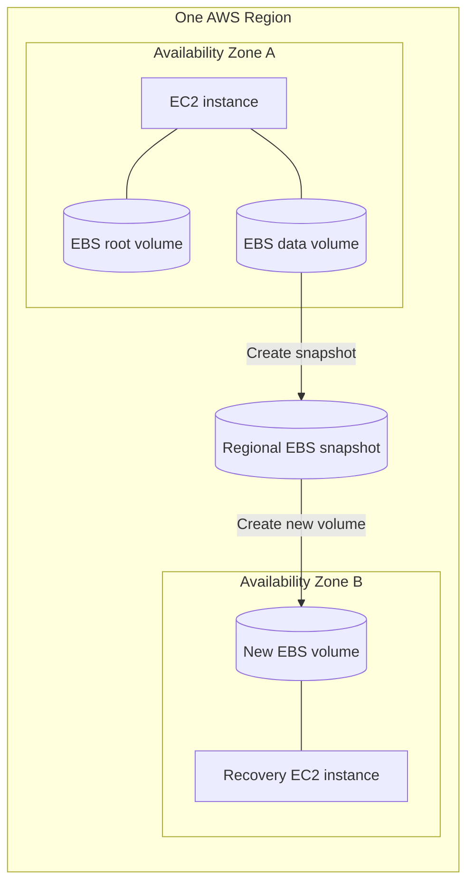
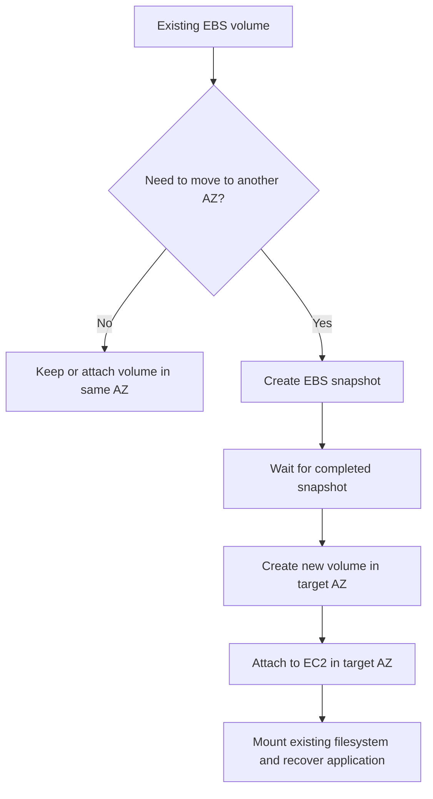
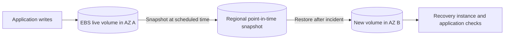
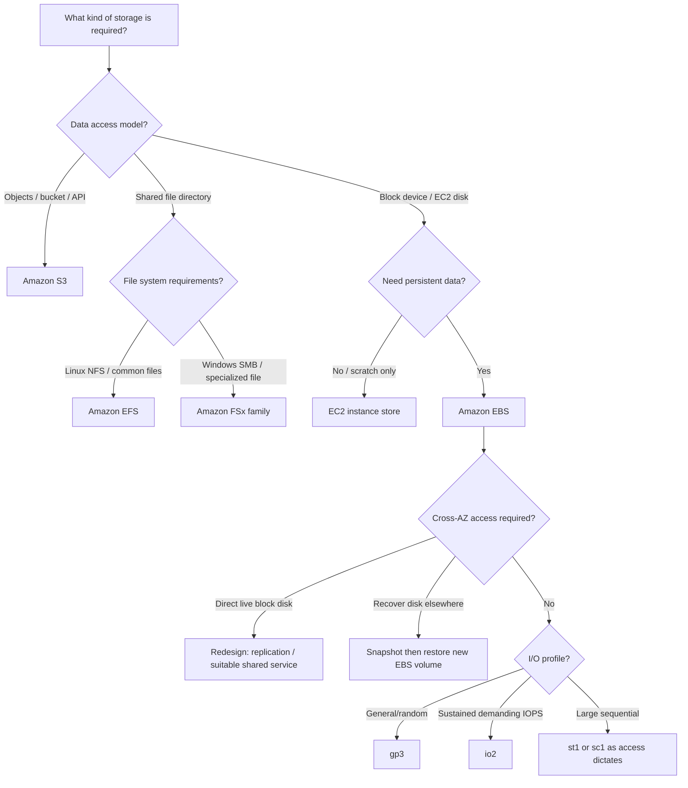

<div align="center">

# 💾 Amazon Elastic Block Store (Amazon EBS)

### Complete AWS study guide · Cloud Practitioner (CLF-C02) + Solutions Architect – Associate (SAA-C03)

[](https://aws.amazon.com/ebs/)
[](https://aws.amazon.com/certification/certified-cloud-practitioner/)
[](https://aws.amazon.com/certification/certified-solutions-architect-associate/)


**One sentence to remember:** EBS is durable **block-level storage for EC2**, normally attached to one instance in **one Availability Zone**, with independent volume lifecycle and optional snapshots for recovery.

[CCP essentials](#ccp-essentials) · [SAA architecture](#saa-deep-dive) · [Comparisons](#service-comparisons) · [Exam traps](#exam-traps) · [Practice questions](#practice-questions)

</div>

<!-- Source provenance is maintained in docs/reorganization/PHASE-4-CANONICAL-SOURCE-MAP.csv. -->
<!-- This guide is an original, expanded rewrite of the repository's EBS overview.
     AWS technical statements and current behavior are corroborated against the official references below.
     Do not reproduce or redistribute copyrighted course slides. -->

> [!IMPORTANT]
> **Exam distinction:** An **EBS volume** is the usable disk, restricted to one AZ. An **EBS snapshot** is a point-in-time backup stored by AWS in regional, multi-AZ-replicated infrastructure; restore it **as a new volume** in a chosen AZ. A snapshot is not a live disk and does not provide automatic application failover.

## Table of contents

1. [What is Amazon EBS?](#1-what-is-amazon-ebs)
2. [What problem does EBS solve?](#2-what-problem-does-ebs-solve)
3. [Core concepts and glossary](#3-core-concepts-and-glossary)
4. [How EBS works step by step](#4-how-ebs-works-step-by-step)
5. [Key capabilities and limits](#5-key-capabilities-and-limits)
6. [Use cases and selection guide](#6-use-cases-and-selection-guide)
7. [CCP essentials](#ccp-essentials)
8. [SAA deep dive](#saa-deep-dive)
9. [Service comparisons](#service-comparisons)
10. [Integration and architecture patterns](#10-integration-and-architecture-patterns)
11. [Security, IAM, KMS, and shared responsibility](#11-security-iam-kms-and-shared-responsibility)
12. [Monitoring, operations, and troubleshooting](#12-monitoring-operations-and-troubleshooting)
13. [Pricing and cost optimization](#13-pricing-and-cost-optimization)
14. [Hands-on configuration and CLI](#14-hands-on-configuration-and-cli)
15. [Exam traps and misconceptions](#exam-traps)
16. [Interview questions](#16-interview-questions)
17. [Practice questions](#practice-questions)
18. [Scenario drills](#18-scenario-drills)
19. [Exam decision tree](#19-exam-decision-tree)
20. [Quick-revision cheat sheet](#20-quick-revision-cheat-sheet)
21. [Official references and source corrections](#21-official-references-and-source-corrections)
22. [Closing takeaway](#22-closing-takeaway)

---

## 1. What is Amazon EBS?

**Beginner definition:** Amazon EBS (Elastic Block Store) gives an Amazon EC2 virtual machine a persistent, virtual hard disk. The disk can hold an operating system, application files, or a database.

**Precise definition:** Amazon EBS is a managed, network-attached **block-storage** service that exposes volumes as block devices to compatible Amazon EC2 instances. A standard volume belongs to a particular **Availability Zone (AZ)**, can outlive the instance using it, and can be protected with snapshots. AWS manages the storage infrastructure; you manage capacity, operating-system filesystems, access, encryption choices, and backups. [AWS: EBS volumes](https://docs.aws.amazon.com/ebs/latest/userguide/ebs-volumes.html)

### Real-world analogy

- **EC2** = the computer or rented server.
- **EBS volume** = a detachable hard disk connected to that computer.
- **Instance store** = a disk physically inside the rented machine that can lose its data when the machine stops or is replaced.
- **EBS snapshot** = a recoverable point-in-time image of an EBS disk.

The analogy is useful, **but not exact**: EBS is network-attached, not a physical USB device; snapshots are managed backups, not ordinary files you browse in your own S3 bucket.

| At a glance | What it means |
|---|---|
| AWS category | Block storage for EC2 |
| Core resource | Volume (`vol-...`) |
| Placement | AZ-scoped for ordinary regional EC2 deployments |
| Attachment | Normally one EC2 instance; restricted Multi-Attach exception |
| Persistence | Survives stop/start and reboot; termination outcome depends on `DeleteOnTermination` |
| Protection | Optional EBS snapshots, encryption, backup policies, retention controls |
| Performance choices | General Purpose SSD, Provisioned IOPS SSD, Throughput Optimized HDD, Cold HDD |
| Billing intuition | Provisioned capacity, and for some types provisioned performance, plus separately billable backup features |

> [!TIP]
> **Memory line:** **EBS = EC2 disk. EFS = shared file system. S3 = object storage. Instance store = disposable local disk.**

## 2. What problem does EBS solve?

A compute instance needs somewhere to store bytes that should **persist independently of compute lifecycle**. Without a persistent disk, replacing, stopping, or terminating an instance could destroy important state. EBS separates the lifecycle of storage from the lifetime of the machine running the workload.

| Without the right storage design | With EBS |
|---|---|
| Instance stops and application data must remain | EBS-backed data remains on the volume |
| Database needs random read/write I/O | Choose an SSD EBS type sized for IOPS, throughput, and latency |
| Server disk runs out of capacity | Increase supported EBS size, then extend the OS partition/filesystem |
| Need a recoverable point-in-time copy | Create a snapshot; automate its frequency and retention |
| Need to recover a volume in another AZ | Create a new EBS volume there from a regional snapshot |
| Need to replace the EC2 instance | Preserve/detach the volume and attach it to another compatible instance in the same AZ |

**Typical workloads:** EC2 boot disks; web-app state; transactional databases running **on EC2**; development environments; large sequential scan workloads; and application data requiring independent snapshot-based recovery.

**Important boundary:** EBS does **not** provide a managed database engine, native shared multi-AZ filesystem, globally accessible object store, or automatic cross-AZ disk replication.

## 3. Core concepts and glossary

| Term | Meaning | Exam relevance |
|---|---|---|
| **Block storage** | Read/write fixed-size addressable units; OS can partition, format, and mount them | Disk-level storage, not objects |
| **EBS volume** | Active block-storage resource attached to an EC2 instance | `vol-...` is the disk |
| **Root volume** | The boot volume with the operating system | Usually EBS-backed EC2 root disk |
| **Data volume** | Additional non-boot volume | App data, logs, databases |
| **AZ** | Physically isolated location within a Region | Volume and direct attachment must share AZ |
| **Volume type** | Performance and pricing class: `gp3`, `io2`, etc. | Match workload I/O pattern |
| **IOPS** | Input/output operations per second | Number of operations |
| **Throughput** | Data transferred per second, typically MiB/s | Sequential data movement |
| **Latency** | Time for an I/O operation to complete | Interactive database responsiveness |
| **Snapshot** | Point-in-time EBS backup | Create *new* volume from backup |
| **Multi-Attach** | Special `io1`/`io2` feature for coordinated concurrent access | Not a replacement for EFS |
| **Elastic Volumes** | Modify eligible volume capacity/type/performance in place | Grow and tune; cannot shrink size in place |
| **`DeleteOnTermination`** | Per-volume attachment flag governing deletion at instance termination | Verify per attachment, not per instance |
| **KMS key** | Key managed through AWS Key Management Service for encrypted EBS | Permissions and cross-account recovery |
| **AMI** | Launch image for an EC2 instance; EBS-backed AMIs reference snapshots | Image for launching instances, not a live volume |
| **Fast snapshot restore (FSR)** | Optional snapshot/AZ-specific initialization acceleration | Performance recovery feature with extra cost |

### Where the resources live



This diagram depicts **backup and restore**, not synchronous replication or automatic failover. AWS stores regional snapshot blocks in service-managed Amazon S3 infrastructure replicated across AZs; they are not ordinary objects in an S3 bucket you control. [AWS: EBS snapshots](https://docs.aws.amazon.com/ebs/latest/userguide/ebs-snapshots.html)

## 4. How EBS works step by step

### Normal volume lifecycle

1. Choose an **AWS Region and AZ** for the instance and its EBS volume.
2. Choose **volume type**, size, provisioned IOPS/throughput where applicable, and encryption/KMS settings.
3. Create the volume (or launch EC2 with an EBS-backed root volume).
4. Attach a data volume to an eligible EC2 instance **in the same AZ**.
5. In the OS, identify the block device; for a **new empty** data volume, create a filesystem and mount it. **Never format a restored volume containing important data.**
6. Read/write normally. AWS manages the infrastructure under the disk; the guest OS manages files and filesystems.
7. Monitor I/O and free filesystem space; resize or tune if necessary.
8. Schedule snapshots, test restores, and set the required retention policy.
9. Before deleting or terminating, inspect `DeleteOnTermination`, preserve needed disks, and remove unwanted volumes/snapshots to control costs.

> [!WARNING]
> **One disk, two layers:** Increasing EBS volume size does not automatically enlarge the operating system partition or filesystem. The OS may still show the old free space until those are extended. [AWS: Modify EBS volumes](https://docs.aws.amazon.com/ebs/latest/userguide/ebs-modify-volume.html)

### Example A — First EC2 website

An EC2 Linux instance boots from an EBS `gp3` root volume. If the instance stops and starts, its installed packages and web content on that EBS volume remain. If the instance **terminates**, the root volume is **often deleted**, because `DeleteOnTermination` is normally enabled for a root volume created at launch. Change the flag if the disk must survive termination.

### Example B — Recovering a database's disk after an AZ incident

A database on EC2 in AZ A uses an encrypted `io2` data volume. Scheduled EBS snapshots provide backups. If AZ A becomes unavailable, an operator restores the latest usable snapshot **to a new volume in AZ B** and attaches it to a compatible instance there. Database recovery and replay of any logs after the snapshot may still be needed. The recoverable state is limited by the backup and transaction-log strategy.



## 5. Key capabilities and limits

### Persistence, placement, and durability

- EBS volume data generally remains across **reboot**, **stop**, and **start** of an EBS-backed EC2 instance.
- An EBS volume is replicated **within its AZ** to tolerate failure of individual storage components. That is **not** multi-AZ storage. [AWS: EBS features](https://docs.aws.amazon.com/ebs/latest/userguide/EBSFeatures.html)
- A volume can be detached and reattached to another compatible instance **in the same AZ**; normally it must first be detached from the previous instance.
- One instance can have **multiple EBS volumes**, subject to instance-specific attachment limits.
- A volume that remains after instance termination continues to exist **and be billed** until deleted.

### EBS volume types — the critical table

| Type | Media / access pattern | When to select it | Boot volume? | Special detail |
|---|---|---|---|---|
| **`gp3`** | General Purpose SSD, mixed/random I/O | Default starting point for many applications, OS disks, dev/test, moderate databases | Yes | IOPS and throughput provisioned independently of size (within limits) |
| **`gp2`** | Older General Purpose SSD | Existing workloads using size-linked performance and burst behavior | Yes | Evaluate upgrade to `gp3` |
| **`io2` Block Express** | High-performance, high-durability SSD | Critical latency-sensitive databases and sustained high IOPS | Yes | Supports Multi-Attach; highly provisioned performance |
| **`io1`** | Provisioned IOPS SSD | Legacy/specific I/O-intensive workloads | Yes | Supports Multi-Attach with restrictions |
| **`st1`** | Throughput Optimized HDD | Large sequential data, log processing, big data | **No** | Not for low-latency random I/O |
| **`sc1`** | Cold HDD | Large, infrequently accessed sequential datasets | **No** | Low-cost HDD, not for boot or intensive small random I/O |
| **`standard`** | Previous-generation Magnetic | Older, infrequently accessed small datasets | Yes | Legacy option; generally avoid for new designs |

Source and changing technical limits: [AWS: EBS volume types](https://docs.aws.amazon.com/ebs/latest/userguide/ebs-volume-types.html). This table is a workload-selection aid, not a guarantee that a particular instance can reach every volume's maximum performance.

> [!TIP]
> **`gp3` baseline:** AWS documents **3,000 IOPS and 125 MiB/s** included in the base `gp3` provisioned performance. Higher provisioning can cost more and remains subject to volume and instance ceilings. `gp2` performance is more closely linked to size and credits. [AWS: EBS pricing](https://aws.amazon.com/ebs/pricing/)

### IOPS versus throughput versus latency

Consider two applications:

- **App A:** 8,000 small 8-KiB database operations per second. The bottleneck is often **IOPS and latency**, not huge bulk throughput.
- **App B:** Reads multi-gigabyte log files sequentially. The bottleneck is often **throughput in MiB/s**, not number of small operations.

Approximate relationship: **throughput (MiB/s) ≈ IOPS × average I/O size (MiB)**, subject to I/O-size behavior and performance limits. Instance-side EBS bandwidth, queue depth, and workload pattern matter too. Buying higher provisioned IOPS cannot fix every bottleneck.

### Snapshots, copies, and recovery

- A snapshot is a **point-in-time copy**. Standard EBS snapshots use **incremental** storage: subsequent snapshots store changed blocks, while each logical snapshot can independently restore its point-in-time state.
- AWS stores standard snapshots in service-managed **Amazon S3**, replicated across AZs **within the Region**. You do not browse them through the normal S3 console/API.
- Creating a snapshot does **not** require detaching the volume. For application consistency, pause writes or use application-aware backup procedures; a snapshot cannot capture data only held in memory or unflushed caches.
- A snapshot can be copied **to another Region** and, with correct permissions and KMS arrangements, **shared across accounts**. A cross-Region copy may initially be full; later copies can be incremental under documented conditions.
- **Snapshots are not automatic by default.** Configure a schedule with Amazon Data Lifecycle Manager or AWS Backup.
- **EBS Snapshot Archive** is for infrequently restored long-term backups: archived snapshots are stored as **full snapshots**, incur minimum-retention considerations, and must be restored to the standard tier before use. Restoration can take up to **72 hours**.
- **Fast Snapshot Restore** is optional per **snapshot and AZ**; it reduces first-read initialization delay but adds ongoing charges.
- **Recycle Bin** can retain deleted EBS snapshots (and supported resources, such as volumes) under configured retention rules; it is not a substitute for backup policy.

Sources: [Snapshots](https://docs.aws.amazon.com/ebs/latest/userguide/ebs-snapshots.html), [Create snapshots](https://docs.aws.amazon.com/ebs/latest/userguide/ebs-creating-snapshot.html), [Snapshot copies](https://docs.aws.amazon.com/ebs/latest/userguide/ebs-copy-snapshot.html), [Archive](https://docs.aws.amazon.com/ebs/latest/userguide/snapshot-archive.html), [Fast snapshot restore](https://docs.aws.amazon.com/ebs/latest/userguide/ebs-fast-snapshot-restore.html).

### Resize and performance tuning

**Elastic Volumes** supports increasing size, modifying eligible volume types, and changing performance, often while attached and without restarting compatible instances. You **cannot shrink a volume in place**. After growing it, extend the OS partition/filesystem as required. Some modifications are limited by type, instance generation, and current modification state. [AWS: Elastic Volumes](https://docs.aws.amazon.com/ebs/latest/userguide/ebs-modify-volume.html)

### Multi-Attach: the carefully constrained exception

EBS Multi-Attach supports certain `io1`/`io2` Provisioned IOPS SSD volumes, with **up to 16 supported Nitro-based EC2 instances in the same AZ**. All connected instances can have write access, so software needs **cluster-aware coordination / filesystem support** to avoid corruption; ordinary independent `ext4`/`XFS` mounts are not an appropriate shared-write design. It is **not** generic multi-AZ shared storage. [AWS: Multi-Attach](https://docs.aws.amazon.com/ebs/latest/userguide/ebs-volumes-multi.html)

## 6. Use cases and selection guide

| Requirement | EBS fit? | Recommended direction |
|---|---|---|
| Linux or Windows EC2 boot disk | **Yes** | `gp3` is a sensible general-purpose starting point |
| Database you administer **on EC2** | **Yes** | `gp3` or `io2` depending on sustained IOPS/latency/durability needs |
| Multiple independent disks on one instance | **Yes** | Separate root, logs, data volumes as useful |
| Backup/recover an EC2 disk | **Yes** | EBS snapshots, lifecycle policy, restoration tests |
| Shared writable POSIX directory across multiple AZs | **Usually no** | Amazon EFS or a suitable Amazon FSx offering |
| Windows SMB share | **No, not as shared-file service** | Amazon FSx for Windows File Server |
| Huge object collection, images, static site files | **No** | Amazon S3 |
| Temporary high-speed cache whose loss is fine | **Sometimes; often not best** | EC2 instance store when supported |
| Fully managed relational database | **EBS alone is insufficient** | Amazon RDS / Aurora, selected for database management needs |
| Shared-write clustered block device in one AZ | **Exceptionally** | `io1`/`io2` Multi-Attach with supported cluster tooling |
| Cross-AZ block device with simultaneous read/write | **No** | Redesign with application replication or an appropriate multi-AZ service |

---

<a id="ccp-essentials"></a>
## 🟢 7. Cloud Practitioner (CCP) essentials


### The 18 facts to remember

1. **EBS = Elastic Block Store**.
2. EBS is **block storage** for **EC2**.
3. Think **virtual hard disk**, not an S3 object bucket.
4. An EBS volume can contain an operating system, files, or a database.
5. It is **persistent** across normal EC2 stop/start and reboot.
6. **Termination is different:** `DeleteOnTermination` decides whether attached EBS volumes are preserved.
7. An EBS volume is **in one AZ** and attaches directly to EC2 **in that AZ**.
8. EBS is **replicated within one AZ**, not automatically across AZs.
9. One EC2 instance may attach **multiple** EBS volumes.
10. A volume usually attaches to **one** EC2 instance at a time.
11. A **snapshot** backs up a volume at a point in time.
12. Standard snapshots are **incremental** at the storage level.
13. A snapshot can restore **a new volume in another AZ** of the Region.
14. Snapshots can be **copied across Regions**, but copies must be requested/configured.
15. **`gp3`/`gp2` = general-purpose SSD**.
16. **`io2`/`io1` = Provisioned IOPS SSD**, **`st1`/`sc1` = HDD**.
17. **EFS** is for shared file access; **S3** is object storage; **instance store** is temporary local storage.
18. EBS supports **encryption and snapshot-based recovery**, but your backup and access controls are your responsibility.

### CCP keyword bank

`Elastic Block Store` · `persistent block storage` · `EC2 root volume` · `virtual hard drive` · `same Availability Zone` · `network-attached` · `database disk` · `snapshot` · `incremental backup` · `encrypted volume` · `boot disk` · `general purpose SSD` · `Provisioned IOPS` · `Throughput Optimized HDD` · `Cold HDD` · `DeleteOnTermination` · `detach and reattach` · `storage volume`

### Recognize the exam wording

| If a question says… | First think… | Check this caveat |
|---|---|---|
| “Persistent block storage attached to EC2” | **EBS** | EC2 and volume must be in same AZ |
| “Operating system disk for an EC2 VM” | **EBS root volume** | Some instance types can use instance-store roots; EBS is common |
| “Quick point-in-time backup of an EBS disk” | **EBS snapshot** | You must request/automate it |
| “Share files between many Linux instances” | **EFS** | EFS provides a filesystem, not a raw block disk |
| “Store static site objects or photos at scale” | **S3** | Access paradigm is object/API |
| “Discardable local scratch data” | **Instance store** | May be lost when stopped/terminated |
| “Heavy random I/O, critical DB on EC2” | **Provisioned IOPS SSD** | `io2` if requirements justify it |
| “Large sequential log analytics on attached disk” | **`st1`** | Not a boot disk |

> [!IMPORTANT]
> **30-second CCP answer:** Amazon EBS is persistent block storage for EC2. Its volumes act like disks, normally belong to one AZ, survive instance stop/start, and can be backed up with snapshots. Remember EBS versus EFS, S3, and instance store.

---

<a id="saa-deep-dive"></a>
## 🔵 8. Solutions Architect – Associate (SAA) deep dive


### Architecture decisions: ask these questions first

1. **Data model:** Does the workload need block, file, or object semantics?
2. **Placement:** Is one AZ enough? Would a failure require recovering in another AZ or Region?
3. **Performance:** Is I/O small and random or large and sequential? What are required IOPS, throughput, latency, and instance limits?
4. **Availability:** Must the app fail over automatically? EBS by itself does not implement this.
5. **Durability/recovery:** What are the acceptable recovery point objective (**RPO**) and recovery time objective (**RTO**)?
6. **Security:** Is encryption by default enabled? Who can use the KMS key and read snapshots?
7. **Lifecycle/cost:** What happens to the volume on termination? How many idle volumes, provisioned IOPS, and retained snapshots exist?

### 8.1 Availability and recovery boundaries

**Single AZ:** EBS automatically protects against certain storage-component failures **within** an AZ. A standard EBS volume does **not** span two AZs. For a regional AZ-level recovery plan, make snapshots, restore volumes in a surviving AZ, and recover compute/application state. This is a **backup and restore** pattern, not instant failover.

**Multi-Region:** Snapshots remain in their Region unless you request cross-Region copies or configure backup automation that does so. Restoring a disk in another Region requires the snapshot copy and a target-region instance. Region-specific KMS key access and network/application architecture must also be addressed.

**RPO/RTO:** Hourly snapshots without transaction-log backups generally cannot guarantee recovery to the last committed transaction; snapshot restore, volume initialization, filesystem checks, and application startup all contribute to RTO. A stringent RPO/RTO often calls for database replication or a managed Multi-AZ database solution rather than relying solely on EBS snapshots.

### 8.2 Deletion defaults: avoid the over-simple rule

The precise control is **`DeleteOnTermination` on each EBS attachment**. For a root volume attached at launch, the usual default is **delete**. The behavior for data volumes varies by **attachment timing and method** (and can be customized in AMI/launch configuration); do not assume that *every* non-root volume is always preserved. Always inspect the attachment before termination. [AWS: Preserve data on termination](https://docs.aws.amazon.com/AWSEC2/latest/UserGuide/preserving-volumes-on-termination.html)

| EC2 event | Expected EBS outcome | Important condition |
|---|---|---|
| Reboot | Volume/data remain | Reboot is not termination |
| Stop/start | EBS remains | Instance-store data does not share this guarantee |
| Terminate with `DeleteOnTermination=true` | Attached volume is deleted | Often root-at-launch default |
| Terminate with `DeleteOnTermination=false` | Volume is preserved and billable | You can attach it to compatible EC2 in its AZ |
| Detach an eligible data volume | Data remains on detached volume | Quiesce/flush writes and unmount first |
| Delete the EBS volume | Data becomes unavailable | Snapshot first, or rely on configured protection |

### 8.3 Picking the performance class

**Scenario 1 — Standard business app:** Moderate databases and web servers with variable load benefit from `gp3`: independent storage and baseline performance provisioning give flexible cost control.

**Scenario 2 — Heavy transaction database:** A mission-critical database on EC2 requiring sustained low latency and high IOPS may justify `io2`. Design around the *lower* effective limits of the volume and EC2 instance; do not assume a fast disk guarantees fast SQL queries.

**Scenario 3 — Batch scans:** A large, sequential log-processing job may justify `st1`, but not if it needs very low random I/O latency or a boot volume.

**Scenario 4 — Cold sequential workload:** `sc1` can reduce storage cost where data is read infrequently and access pattern is sequential; it is not equivalent to S3 Glacier archival storage.

**Scenario 5 — Shared writers:** A clustered application with supported fencing and a cluster-aware filesystem can consider Multi-Attach on `io2`/`io1`, but ordinary app servers sharing a directory across AZs should usually use EFS or suitable FSx, **not** EBS Multi-Attach.

### 8.4 Logical backup consistency

An EBS snapshot is a storage-level point-in-time capture. It does **not** inherently ensure a database has flushed all writes from memory to disk. For clean backups, use application-aware coordination (database checkpoint, filesystem freeze, appropriate VSS integrations, or pause writes). EBS **multi-volume snapshots** can coordinate a crash-consistent point in time across volumes attached to the same instance, yet application-consistency procedures may still be needed. [AWS: Create snapshots](https://docs.aws.amazon.com/ebs/latest/userguide/ebs-creating-snapshot.html)

### 8.5 Why snapshots do not equal continuous replication



Writes **after** the snapshot time are not included in that snapshot. Continuous application-level replication, database standby instances, and multi-AZ managed-service features solve a different problem.

### 8.6 Encryption/KMS and organizational boundaries

When EBS encryption is enabled, AWS encrypts data **at rest**, data **between the attached supported instance and volume**, and snapshots created from that encrypted volume. Encryption uses KMS keys: the AWS managed EBS key (`alias/aws/ebs`) is available, or you can use a customer managed symmetric key. **EBS encryption by default** is an account-and-Region setting you can enable; it does not retroactively encrypt existing volumes. A new volume from an encrypted snapshot remains encrypted.

To share encrypted snapshots cross-account, use an appropriate **customer managed KMS key** with both snapshot-sharing permission and KMS access in place; snapshots encrypted under the default AWS-managed `aws/ebs` key cannot be shared. See [EBS encryption](https://docs.aws.amazon.com/ebs/latest/userguide/ebs-encryption.html) and [snapshot sharing](https://docs.aws.amazon.com/ebs/latest/userguide/ebs-modifying-snapshot-permissions.html).

### 8.7 Disaster recovery design exercise

**Requirements:** Service must recover from an AZ failure, data loss no older than 15 minutes, and application must be available quickly.

**Design reasoning:** Snapshots every 24 hours do not meet a 15-minute RPO. Even 15-minute snapshots do not establish rapid failover because restoration, volume initial reads, and application recovery take time. Consider database replication/managed Multi-AZ, compatible clustering, transaction logs, and pre-provisioned failover infrastructure. Keep EBS snapshots for recovery from accidental deletion or corruption and as a separately tested backup layer.

> [!WARNING]
> **SAA trap:** “Highly durable in one AZ” is not the same as “highly available across AZs.” Architecture-level availability requires more than choosing EBS.

---

<a id="service-comparisons"></a>
## 9. Compare EBS with similar or confusing AWS services

| Service / feature | Storage or function | Main operating scope | When to prefer it over EBS |
|---|---|---|---|
| **Amazon EBS** | Block volume | An AZ | Persistent EC2 disk, root/data volume |
| **EC2 instance store** | Local ephemeral block device | Host/instance lifecycle | Disposable caches/scratch; avoid network storage for that data |
| **Amazon EFS** | Managed NFS file system | Regional multi-AZ access designs | Shared Linux file access from multiple EC2 instances |
| **Amazon S3** | Object storage via APIs | Regional service | Massive object sets, static assets, backups, data lakes |
| **Amazon FSx for Windows File Server** | Managed SMB file system | Configured deployment | Windows shared file storage and Windows protocol semantics |
| **Amazon FSx for Lustre** | Managed high-performance file system | Configured deployment | Parallel file I/O, HPC, ML data processing |
| **Amazon RDS** | Managed relational database service | Configured single/Multi-AZ deployment | AWS operates DB provisioning, patching/backup/failover features |
| **Amazon Aurora** | Managed cloud-native relational database | Regional cluster architecture | Need managed DB with distributed storage and DB-level HA features |
| **AWS Backup** | Centralized backup management | Policy/service scope | Centralized scheduled protection and retention across supported resources |
| **Amazon Data Lifecycle Manager** | Snapshot/AMI lifecycle automation | EBS/EC2 policy scope | Automate creation/retention of EBS snapshots and EBS-backed AMIs |

### Three differences that matter most

<details>
<summary><strong>EBS vs EFS — disk vs shared files</strong></summary>

EBS exposes a **block device**, commonly consumed by a single server. EFS exposes an **NFS file system**, with concurrent mounts from multiple instances and cross-AZ access patterns. If a question says “all web servers must read the same uploaded images from a shared POSIX directory,” prefer **EFS**. If it says “one EC2 instance needs a boot disk,” prefer **EBS**. EBS Multi-Attach is not a general substitute for EFS.

</details>

<details>
<summary><strong>EBS vs S3 — low-level blocks vs objects</strong></summary>

EBS is used through a guest OS as a disk; S3 stores objects addressed by bucket/key through an object-storage API. A photo library/static site archive normally belongs in S3. An EC2-based database's writable filesystem commonly belongs on EBS. An **EBS snapshot is stored internally using S3**, but you manage it through EBS/EC2 interfaces, not your own S3 objects.

</details>

<details>
<summary><strong>EBS vs instance store — persistent network volume vs ephemeral local device</strong></summary>

EBS generally survives EC2 stop/start; instance-store data is lost on stop, terminate, or underlying host failure (but normally survives an ordinary reboot). Instance store may excel for temporary, high-speed scratch work where data loss is acceptable or data can be rebuilt. Do not use instance store as the only copy of critical state.

</details>

<details>
<summary><strong>EBS vs RDS/Aurora — storage service vs database service</strong></summary>

EBS stores blocks for a database engine **you manage on EC2**. RDS and Aurora are managed relational database offerings that assume database operational responsibilities. A request for automated DB patching, backups, or managed failover usually points to a database service, not simply a larger EBS volume. Aurora's distributed storage architecture is not an ordinary user-managed EBS volume.

</details>

<details>
<summary><strong>EBS snapshot vs AMI vs AWS Backup</strong></summary>

An **EBS snapshot** restores the contents of an individual volume; an **EBS-backed AMI** supplies launch configuration and references EBS snapshots to create new EC2 instances; **AWS Backup** orchestrates protection policies for supported resources. They complement one another and answer different question wording.

</details>

## 10. Integration and architecture patterns

### EC2 + EBS: boot plus data

Attach separate volumes for the OS and database/application data when independent sizing, snapshot schedules, access controls, and deletion behavior are useful. Use consistent tags (application, environment, owner, recovery class) for maintenance and backup policies.

### Auto Scaling Groups + EBS

An Auto Scaling Group can replace EC2 instances. That is **compute replacement**, not automatic preservation/re-attachment of the exact application data volume. Store durable shared session state or data in an appropriate managed database/file/object system, or explicitly design volume persistence and attachment automation. Treat EC2 root volumes in ephemeral fleets as rebuildable.

### AMIs + EBS snapshots

An EBS-backed Amazon Machine Image (AMI) uses snapshots of EBS volumes to launch future EC2 instances with a known operating system and software configuration. An AMI **is not the same as an active running volume**, and starting an instance from it creates new volumes.

### Data Lifecycle Manager + AWS Backup

- **Amazon Data Lifecycle Manager:** EBS-focused policy automation for snapshots and EBS-backed AMIs; target resources using policies/tags as supported.
- **AWS Backup:** Centralized backup plans, retention, and additional controls for supported AWS resources, including EBS; choose when organization-wide backup governance is the requirement.
- **Amazon CloudWatch:** Performance metrics/alarms for volume behavior.
- **AWS CloudTrail:** API-level auditing of operations such as create, attach, modify, copy, and delete, subject to event support and logging configuration.
- **AWS KMS:** Key control and permissions for encrypted storage and snapshots.

Source: [AWS: Data Lifecycle Manager](https://docs.aws.amazon.com/ebs/latest/userguide/dlm-elements.html).

## 11. Security, IAM, KMS, and shared responsibility

| Responsibility | AWS manages | Customer manages |
|---|---|---|
| Storage hardware and underlying replication | Yes, within advertised EBS architecture | Choose AZ and design higher-level redundancy |
| Guest OS filesystem and data | No | Formatting, mounts, permissions, patching, consistency |
| Who may create/attach/delete volumes | Enforcement platform | IAM roles and policies, least privilege |
| Encryption infrastructure | AWS EBS/KMS service infrastructure | Enable appropriate encryption, select keys, grant access |
| Backup schedule and recovery testing | Provides snapshot/backup capabilities | Create policies and verify restore outcome |
| Cost | Pricing/billing platform | Size volumes, monitor waste, clean up unused resources |

### Permissions: what actually authorizes an operation?

Common EC2 API actions used with EBS include `ec2:CreateVolume`, `ec2:AttachVolume`, `ec2:DetachVolume`, `ec2:ModifyVolume`, `ec2:CreateSnapshot`, `ec2:CopySnapshot`, `ec2:DeleteSnapshot`, `ec2:DeleteVolume`, and read-only `ec2:DescribeVolumes`. Grant only the actions and permitted resources/tags the operator or service requires, considering supported IAM conditions. For encrypted volumes, appropriate **KMS permissions** also matter. Avoid embedding broad `*` actions or permanent access keys in scripts.

### Encryption and safe sharing checklist

- Prefer enabling **EBS encryption by default** in applicable account/Regions, with appropriate key strategy; verify the regional setting.
- Remember that EBS encryption is transparent to the guest OS but **does not replace OS-level access controls** or secure application design.
- Encrypted snapshots remain encrypted; you cannot simply switch an existing encrypted volume to unencrypted in place.
- To change encryption state/key, use a supported **snapshot-copy/new-volume** migration workflow, not a non-existent “toggle encryption” operation.
- Restrict snapshot sharing, especially public sharing. Consider enabling **Block public access for EBS snapshots**.
- Cross-account sharing of encrypted snapshots requires **customer-managed KMS** key authorization as well as snapshot permissions.
- Consider snapshot retention protections such as Snapshot Lock / Recycle Bin where recovery or compliance requirements justify them.

Sources: [AWS EBS encryption](https://docs.aws.amazon.com/ebs/latest/userguide/ebs-encryption.html), [Sharing snapshots](https://docs.aws.amazon.com/ebs/latest/userguide/ebs-modifying-snapshot-permissions.html).

## 12. Monitoring, operations, and troubleshooting

### What to watch

| CloudWatch / diagnostic signal | Why it helps | Action to consider |
|---|---|---|
| `VolumeReadOps`, `VolumeWriteOps` | Read/write request counts | Derive approximate IOPS over the period |
| `VolumeReadBytes`, `VolumeWriteBytes` | Volume data movement | Understand throughput and I/O size |
| `VolumeQueueLength` | Outstanding I/O requests | Correlate with latency and saturation |
| `BurstBalance` | Burst credits for `gp2`, `st1`, `sc1` | Check for depleted credits, re-size or change class |
| `VolumeStalledIOCheck` | Impaired volume I/O condition | Investigate EBS health and recovery |
| Instance EBS bandwidth / Nitro statistics | Instance-side bottlenecks | Size the instance as well as the EBS volume |
| OS free-space and filesystem usage | Remaining usable disk capacity | Use OS tooling / CloudWatch Agent; EBS volume metrics alone don't show filesystem free space |

CloudWatch's EBS volume metrics are published for attached volumes; metric availability can vary with volume and instance type. Read the exact supported metric semantics rather than assuming that all stats exist for every combination. [AWS: EBS CloudWatch metrics](https://docs.aws.amazon.com/ebs/latest/userguide/using_cloudwatch_ebs.html)

### Troubleshooting checklist (in useful order)

1. **Wrong AZ?** Verify both the instance and volume are in the same Availability Zone.
2. **Wrong state?** A normal volume must generally be `available` to attach; `in-use` means already attached (outside supported Multi-Attach).
3. **Attachment limit?** Verify the EC2 instance's volume attachment quota and supported devices.
4. **IAM/KMS error?** Check allowed EC2 API actions, relevant resource conditions, and KMS key use permissions.
5. **Device not visible?** Check EC2 attachment status, Nitro NVMe device naming, OS disk discovery, and drivers.
6. **Volume present, mount absent?** Check partition, filesystem, mount point, fstab, and whether you accidentally tried to format existing data.
7. **Disk still “small” after EBS expansion?** Extend the OS partition and filesystem.
8. **Slow I/O?** Measure IOPS, bytes, latency, queue length, burst balance, and instance-side bandwidth limits.
9. **No recent backup?** Verify lifecycle-policy scope, tags, permissions, scheduling, and snapshot completion.
10. **Restore fails?** Check snapshot state, target Region/AZ, correct key access, snapshot sharing, archival state, and filesystem/database consistency.
11. **Unexpected EBS charges?** Look for detached/forgotten volumes, oversized capacity, additional provisioned IOPS/throughput, unnecessary snapshots, and FSR enabled in multiple AZs.

> [!TIP]
> **CloudWatch vs CloudTrail:** CloudWatch answers **“How is the disk behaving?”**; CloudTrail helps answer **“Who called the EBS API and when?”** OS free disk space needs guest-level telemetry.

## 13. Pricing and cost optimization

AWS EBS generally bills for **provisioned storage capacity**, not only for bytes of user files actually present. A volume may incur costs even when detached or its EC2 instance has stopped. For applicable types (`gp3`, `io1`, `io2`), additional provisioned IOPS and/or throughput affect billing. Snapshots, archived snapshots, snapshot copies/transfers, and optional Fast Snapshot Restore have their own pricing dimensions. [AWS: EBS pricing](https://aws.amazon.com/ebs/pricing/)

### Estimation without inventing a Region price

```text
Approximate EBS-related cost =
  provisioned volume capacity × regional type rate × time fraction
+ extra provisioned IOPS × applicable regional rate × time fraction
+ extra provisioned throughput × applicable regional rate × time fraction
+ billable snapshot standard/archive storage, copies and restores
+ optional Fast Snapshot Restore and relevant data transfer
+ taxes or other applicable charges
```

**Illustration (units, not a price quote):** Two 100-GiB volumes provisioned for a full month create **200 GiB-months** of capacity charges even if one volume has no attached instance. Actual prices depend on the Region, volume type, and billing rules. Consult [AWS Pricing Calculator](https://calculator.aws/) rather than treating any example rate as universal.

### Optimization decisions

- Begin with `gp3` when it satisfies performance and durability requirements; consider migrating existing `gp2` volumes after checking workload performance.
- Right-size storage **and** IOPS/throughput. More capacity alone does not solve all bottlenecks.
- Delete unused **available** volumes only after checking that their data is no longer needed and retention policy is satisfied.
- Apply snapshot retention deliberately; standard snapshot blocks are incremental, but long retention and copies still cost money.
- Use Snapshot Archive selectively for infrequent, long-term restores; it is **full** snapshot storage and has restore/minimum-duration trade-offs.
- Disable FSR when no longer needed; it is billed by snapshot/AZ.
- Use tags, AWS Budgets, Cost Explorer, and cost allocation reports to reveal idle storage spending.

## 14. Hands-on configuration and CLI

### Safe console workflow for a new data disk

1. In **EC2 → Elastic Block Store → Volumes**, create a `gp3` data volume in your instance's **exact AZ**.
2. Select capacity/performance and encryption/KMS key appropriate to your data.
3. Attach the new volume to the EC2 instance in that AZ.
4. Within Linux/Windows, inspect block devices, **format only if the volume is empty**, mount, and verify the filesystem.
5. Take a snapshot, check its completion, and test restoration to a **separate new volume**.
6. Configure backups and alarms, then clean up lab resources to avoid ongoing charges.

### AWS CLI examples (illustrative, with explicit placeholders)

Prerequisites: AWS CLI configured with appropriate role/session, correct Region, and least-privilege EC2/KMS permissions. All commands below are **examples**; creating resources can incur charges. Replace bracketed placeholders with real resource values. Use a test account and verify the AZ.

```bash
# 1) Inspect the existing instance to confirm its AZ.
aws ec2 describe-instances \
  --instance-ids <INSTANCE_ID> \
  --region <REGION> \
  --query 'Reservations[].Instances[].Placement.AvailabilityZone'

# 2) Create an encrypted general-purpose EBS data volume in THAT AZ.
aws ec2 create-volume \
  --availability-zone <AZ_NAME> \
  --size 20 \
  --volume-type gp3 \
  --encrypted \
  --region <REGION>

# 3) Use the returned VolumeId after the volume becomes available.
aws ec2 attach-volume \
  --volume-id <VOLUME_ID> \
  --instance-id <INSTANCE_ID> \
  --device /dev/sdf \
  --region <REGION>

# 4) Inspect, back up, and check the snapshot's progress.
aws ec2 describe-volumes --volume-ids <VOLUME_ID> --region <REGION>
aws ec2 create-snapshot \
  --volume-id <VOLUME_ID> \
  --description 'EBS lab point-in-time backup' \
  --region <REGION>
aws ec2 describe-snapshots --snapshot-ids <SNAPSHOT_ID> --region <REGION>
```

> [!WARNING]
> On **Nitro-based** EC2, the Linux device path visible inside the OS may differ from `/dev/sdf` (often it appears as an NVMe device). Inspect it before writing. Never format a disk from a snapshot containing data. Backups of actively written databases require application-consistency planning. Test commands are not production-ready infrastructure automation.

---
<a id="exam-traps"></a>
## 15. Common exam traps and misconceptions

**Read the condition in the question.** Words such as “automatically,” “across AZs,” “shared,” “persistent,” and “restore immediately” often change the answer.

| # | Incorrect assumption | Correct interpretation | Level |
|---:|---|---|---|
| 1 | EBS is object storage like S3. | EBS is **block storage** that an OS can mount as a disk. | CCP |
| 2 | EBS data disappears whenever EC2 stops. | EBS persists across normal stop/start; **instance store** generally does not. | CCP |
| 3 | EBS automatically survives every EC2 termination. | Check per-attachment **`DeleteOnTermination`**. | CCP/SAA |
| 4 | Root and data volumes always have the same deletion default. | Defaults depend on root/data, when attached, and attachment method. | SAA |
| 5 | An EBS volume belongs to an AWS Region but is usable in all AZs. | A normal EBS volume is attached in **one AZ** only. | CCP |
| 6 | You can attach an EBS volume directly to an EC2 instance in another AZ. | Restore a **new** volume from a snapshot in the destination AZ. | CCP/SAA |
| 7 | EBS's internal replication makes it multi-AZ. | EBS volume replication is **within the AZ**. | SAA |
| 8 | Every EBS volume can be attached to many EC2 instances. | Normally **one**; restricted `io1`/`io2` Multi-Attach is an exception. | SAA |
| 9 | Multi-Attach works across AZs. | Multi-Attach instances must share the volume's **AZ**. | SAA |
| 10 | Multi-Attach makes an ordinary filesystem safe for concurrent writes. | Use compatible **cluster-aware coordination/filesystem**. | SAA |
| 11 | EBS is the preferred shared folder for a fleet in several AZs. | **EFS** or suitable FSx is normally better for shared files. | CCP/SAA |
| 12 | S3 is mounted like a standard raw disk by default. | S3 is an **object API**; it is not equivalent to block storage. | CCP |
| 13 | A snapshot is a usable disk attached to EC2. | A snapshot is a **backup** used to create a new volume. | CCP |
| 14 | You can browse EBS snapshots in your own S3 bucket. | AWS stores snapshots in **service-managed S3** inaccessible through your S3 console/API. | SAA |
| 15 | An EBS snapshot must be taken after detaching the disk. | Snapshots can be made while attached; **application consistency** still matters. | CCP/SAA |
| 16 | Every snapshot always re-stores every block and costs a full copy. | **Standard** EBS snapshots store changed blocks incrementally. | SAA |
| 17 | Deleting one incremental snapshot deletes all later restore points. | AWS preserves blocks referenced by other surviving snapshots. | SAA |
| 18 | EBS snapshots happen automatically for all volumes. | Configure snapshot/backup scheduling with **DLM/AWS Backup**. | CCP/SAA |
| 19 | Snapshots continuously protect writes after their creation time. | Snapshot RPO is limited to the captured point in time. | SAA |
| 20 | Copying snapshots across Regions is always automatically incremental. | Initial copies may be full; later copies can be incremental **under conditions**. | SAA |
| 21 | An archived snapshot is instantly usable. | Restore from **archive to standard** first; it can take considerable time. | SAA |
| 22 | Snapshot Archive is always smaller because all snapshots are incremental. | Archived snapshots are converted to **full snapshots**. | SAA |
| 23 | Fast Snapshot Restore is enabled by default and free. | It is **optional, per snapshot/AZ**, and billed while enabled. | SAA |
| 24 | Every new EBS volume is necessarily encrypted without configuration. | EBS encryption depends on account/Region **encryption-by-default** and creation/snapshot choices. | SAA |
| 25 | You can turn encryption off for an existing encrypted volume. | Encryption cannot simply be removed in place; use a supported migration workflow. | SAA |
| 26 | A snapshot encrypted under `aws/ebs` can be shared to any account. | Encrypted snapshot sharing requires an appropriate **customer managed KMS key** and permissions. | SAA |
| 27 | `st1` or `sc1` is appropriate for an EC2 boot disk. | HDD `st1` and `sc1` **do not support boot volumes**. | CCP/SAA |
| 28 | IOPS and throughput measure exactly the same performance. | IOPS is operations/second; throughput is **bytes/second**; latency also matters. | CCP/SAA |
| 29 | Growing a volume automatically increases free space reported by the OS. | Extend the **partition/filesystem** after a compatible resize. | SAA |
| 30 | EBS volumes can be shrunk in place to reduce spending. | EBS supports **growing**, not shrinking, volume size in place. | SAA |
| 31 | An unattached EBS volume has no cost. | Provisioned capacity is billed even when **available/detached**. | CCP/SAA |
| 32 | High provisioned IOPS guarantees high application performance. | EC2 EBS bandwidth, I/O pattern, latency, filesystem, and the application may bottleneck. | SAA |
| 33 | Backing up a database's EBS disk is the same as managing the database. | EBS provides storage; **RDS/Aurora** supply managed database services. | CCP/SAA |
| 34 | CloudWatch EBS metrics tell you exactly how much guest filesystem space is free. | Guest free-space monitoring requires **OS-level** metrics or agent. | SAA |
| 35 | Restoring EBS to AZ B means an application automatically fails over there. | You still need **compute, networking, mount, DB recovery, and failover orchestration**. | SAA |

### Mechanisms behind five particularly tricky traps

- **#4 — Termination default:** AWS documents different defaults for **root-at-launch**, **data-at-launch via console**, **data-at-launch via CLI**, and attachments after launch. Prefer inspecting `DeleteOnTermination` rather than repeating “all data volumes survive.” [AWS documentation](https://docs.aws.amazon.com/AWSEC2/latest/UserGuide/preserving-volumes-on-termination.html)
- **#10 — Shared writers:** Multi-Attach supplies a common block device, not a distributed lock manager or coherency layer for ordinary filesystems. Two writers can corrupt filesystem metadata without cluster coordination. [AWS documentation](https://docs.aws.amazon.com/ebs/latest/userguide/ebs-volumes-multi.html)
- **#16–17 — Incremental snapshots:** Logical snapshots provide their own recovery point even if physical blocks are shared. Deleting a snapshot frees only uniquely unreferenced data. [AWS documentation](https://docs.aws.amazon.com/ebs/latest/userguide/ebs-snapshots.html)
- **#19 — RPO:** A weekly snapshot may protect against old corruption but cannot recover writes committed **after** the snapshot. Database logs/replication are separate designs.
- **#32 — Performance ceilings:** Total disk performance depends on both the provisioned EBS volume and the bandwidth/IOPS available on the chosen EC2 instance. Right-sizing only the volume may achieve nothing.

## 16. Interview questions

| Question | Short but technically useful answer |
|---|---|
| **1. What is EBS, and why would you use it?** | Durable block storage for EC2, useful for root disks, application files, and databases running on instances. |
| **2. What does persistence mean in EBS?** | Data survives EC2 reboot/stop-start; it is not a promise of automatic preservation when `DeleteOnTermination` requests deletion or when a user deletes the volume. |
| **3. Why must EC2 and its EBS volume be in the same AZ?** | Ordinary regional EBS volumes are AZ-scoped block resources; direct attachment is limited to instances in their AZ. |
| **4. What is an EBS snapshot?** | A managed, point-in-time block backup; standard snapshots are incremental and can restore a new EBS volume. |
| **5. How do you recover an EBS disk in another AZ or Region?** | Create/obtain a completed snapshot; choose a destination AZ for a new volume, or copy the snapshot to the destination Region first. Then attach and recover the application. |
| **6. How do you choose `gp3` versus `io2`?** | Start with `gp3` for balanced workloads; consider `io2` for sustained, very high IOPS, lower latency, and demanding durability requirements after testing actual performance needs. |
| **7. Why does increasing EBS disk size not always fix a “disk full” error?** | The OS partition and filesystem may still have the old size; expand them separately. Also verify inodes and application-level constraints. |
| **8. Can several EC2 instances attach the same EBS volume?** | Limited Multi-Attach for compatible `io1`/`io2` volumes and Nitro instances in the same AZ; concurrent writers need cluster-aware coordination. |
| **9. How would you prevent EBS data leakage?** | Use least-privilege IAM, encryption and appropriate KMS keys, restrictive snapshot sharing/Block Public Access, monitoring, tags, and tested retention policies. |
| **10. How would you troubleshoot a slow EC2 database disk?** | Measure EBS read/write IOPS, bytes, latency, queue, credits where applicable, EC2 EBS bandwidth, OS disk health, and database access patterns; then tune the bottleneck. |
| **11. When would you use EFS rather than EBS?** | When many instances need a shared filesystem, particularly across AZs; EBS is a block disk and is normally instance-oriented. |
| **12. What is the biggest HA mistake with EBS?** | Mistaking one-AZ EBS durability or snapshot backups for multi-AZ, automatically failing-over application availability. |

---

<a id="practice-questions"></a>
## 17. Original exam-style practice questions

These **30 original practice questions** are learning drills, **not** official AWS exam items. Expand each answer to see the reasoning and why an attractive wrong choice fails.

### CCP questions — recognition and fundamentals

<details><summary><strong>Q1 · CCP — Which service is a virtual persistent disk for EC2?</strong></summary>

**Question:** A company wants persistent block-level storage for the boot disk of an EC2 instance. Choose one: **A. Amazon EBS · B. Amazon EFS · C. Amazon S3 · D. AWS Backup**.

**Answer: A — Amazon EBS.** It presents block storage as an EC2 disk. **B** is shared file storage, **C** object storage, and **D** manages backups instead of providing a boot block device.

</details>

<details><summary><strong>Q2 · CCP — What survives a normal EC2 stop and start?</strong></summary>

**Question:** An EBS-backed EC2 server is stopped overnight and started again. What normally happens to data on its EBS volume? **A. Deleted · B. Persists · C. Copied to EFS automatically · D. Archived automatically**.

**Answer: B — Persists.** EBS persists independently of instance running state. The other behaviors require unrelated features or actions. Termination is different: inspect `DeleteOnTermination`.

</details>

<details><summary><strong>Q3 · CCP — Disk backup terminology</strong></summary>

**Question:** What is the AWS term for a point-in-time backup of an EBS volume? **A. Security group · B. Snapshot · C. Hosted zone · D. Placement group**.

**Answer: B — Snapshot.** Snapshots capture block data for restoring a new volume. The other choices describe networking or compute placement, not backups.

</details>

<details><summary><strong>Q4 · CCP — Shared files between several Linux servers</strong></summary>

**Question:** Several EC2 servers must mount the same shared folder concurrently. Choose the most natural service: **A. EBS · B. EFS · C. EC2 instance store · D. EBS snapshot**.

**Answer: B — Amazon EFS.** It provides a shared managed file system. **EBS** is normally a single-instance disk; **instance store** is local to a host; **snapshots** are not live mounts.

</details>

<details><summary><strong>Q5 · CCP — Disposable local cache</strong></summary>

**Question:** A workload needs low-latency temporary scratch data, easily regenerated if the instance stops. Which storage is an appropriate choice? **A. Instance store · B. EBS snapshot · C. S3 Glacier Flexible Retrieval · D. EFS**.

**Answer: A — Instance store**, assuming the EC2 type offers it. It is local and ephemeral. The others are backup, archive, or persistent shared-file solutions.

</details>

<details><summary><strong>Q6 · CCP — EBS location</strong></summary>

**Question:** An EBS volume is created in `eu-west-1a`. Which instance can directly attach it? **A. An instance in `eu-west-1b` · B. Any instance worldwide · C. A compatible instance in `eu-west-1a` · D. Only instances in a different Region**.

**Answer: C.** Direct attachment requires the same Availability Zone. A snapshot-based restore is needed for a different AZ.

</details>

<details><summary><strong>Q7 · CCP — Basic volume-type recognition</strong></summary>

**Question:** Which EBS type is a general-purpose SSD option for standard EC2 application disks? **A. `gp3` · B. `st1` · C. `sc1` · D. EFS-IA**.

**Answer: A — `gp3`.** `st1` and `sc1` are HDD types with different workload patterns; EFS-IA is part of a file-storage service.

</details>

<details><summary><strong>Q8 · CCP — Large sequential disk scans</strong></summary>

**Question:** A job processes large log files sequentially on an attached non-boot disk and prioritizes HDD throughput over random IOPS. What is a fitting EBS class? **A. `st1` · B. `sc1` for all random transactions · C. `gp3` is always prohibited · D. EBS has no HDD volumes**.

**Answer: A — `st1`.** Throughput Optimized HDD targets large sequential workloads. **B** misstates `sc1`; **C** is too absolute; **D** is false.

</details>

<details><summary><strong>Q9 · CCP — Does an EBS snapshot have to be detached?</strong></summary>

**Question:** Can an EBS snapshot be requested while its volume is attached to EC2? **A. No · B. Yes, but application consistency may need coordination · C. Only if using S3 website hosting · D. Only if encryption is disabled**.

**Answer: B.** Snapshot creation supports attached volumes, but flushing or quiescing writes may be important. The other restrictions are fabricated.

</details>

<details><summary><strong>Q10 · CCP — Image files for a public website</strong></summary>

**Question:** A team has millions of independent photos served to website users, with no requirement to expose a raw disk. Choose the best starting service: **A. EBS · B. S3 · C. Instance store · D. EBS Multi-Attach**.

**Answer: B — Amazon S3.** Object storage matches massive collections and API access. EBS is designed as an EC2 block device, not a public object repository.

</details>

<details><summary><strong>Q11 · CCP — Which component stores the operating system?</strong></summary>

**Question:** In a typical EBS-backed EC2 instance, which resource holds the OS filesystem? **A. Its EBS root volume · B. CloudWatch alarm · C. Security group · D. Route 53 record**.

**Answer: A.** The EBS root volume provides the boot disk. The other options are monitoring, firewall, and DNS constructs.

</details>

<details><summary><strong>Q12 · CCP — Database service versus storage</strong></summary>

**Question:** A company asks AWS to manage a relational database engine's routine operations rather than installing the engine on EC2. Select the better answer: **A. EBS only · B. Amazon RDS · C. EBS snapshot · D. EC2 instance store**.

**Answer: B — Amazon RDS.** EBS stores blocks for self-managed software. RDS is the managed database service; the distractors do not manage the DB engine.

</details>

### SAA questions — design, operations, and trade-offs

<details><summary><strong>Q13 · SAA — Restore from AZ A to AZ B</strong></summary>

**Question:** A completed snapshot of an EBS volume exists in `us-east-1`. How do you make its data usable by an EC2 instance in another AZ of the same Region? **A. Attach the old volume cross-AZ · B. Create a new volume from the snapshot in the target AZ · C. Convert the snapshot into a security group · D. Attach the snapshot directly**.

**Answer: B.** Standard snapshots support creating a **new** EBS volume in the chosen AZ. **A** violates EBS attachment scope; **D** confuses backup with disk; **C** is unrelated.

</details>

<details><summary><strong>Q14 · SAA — Multi-Attach prerequisites</strong></summary>

**Question:** Two compatible Nitro-based EC2 instances in the same AZ must coordinate access to a single block device. Which configuration can support that design? **A. Any `gp3` volume with two mounts · B. An appropriate `io2` Multi-Attach volume plus cluster-aware software · C. A shared root `st1` volume · D. S3 versioning**.

**Answer: B.** Multi-Attach is supported for suitable Provisioned IOPS SSD types with clustered application coordination. **A** lacks Multi-Attach support, **C** uses a non-boot HDD and ignores sharing constraints, **D** is unrelated.

</details>

<details><summary><strong>Q15 · SAA — Database loses writes after restoring a snapshot</strong></summary>

**Question:** An EBS snapshot was taken at 09:00; a database committed more transactions until 09:40. A failure at 09:41 forces restoration only from that snapshot. What is a key risk? **A. Snapshot includes all transactions to 09:40 · B. Recovery loses transactions after 09:00 unless separately recoverable · C. Snapshot cannot restore across AZs · D. EBS cannot contain a database**.

**Answer: B.** A snapshot is a point-in-time capture. **A** assumes continuous replication; **C** conflicts with regional snapshot recovery; **D** is false.

</details>

<details><summary><strong>Q16 · SAA — Termination retains critical data</strong></summary>

**Question:** A critical EBS data volume must survive instance termination. What should an architect verify before termination? **A. `DeleteOnTermination=false` for the intended attachment · B. Only that the security group allows port 443 · C. That `gp3` is replaced with `st1` · D. That a Route 53 TTL is low**.

**Answer: A.** The per-attachment deletion flag determines preservation. The other settings do not control EBS lifecycle.

</details>

<details><summary><strong>Q17 · SAA — Resize did not change Linux free space</strong></summary>

**Question:** A 100-GiB EBS volume is enlarged to 200 GiB, but `df -h` reports the old usable size. What is the next likely operation? **A. Extend filesystem (and partition if needed) · B. Reboot the AWS Region · C. Convert to EFS · D. Delete all snapshots**.

**Answer: A.** The EBS layer grew but the guest OS's filesystem may not have. The other actions are inappropriate or destructive.

</details>

<details><summary><strong>Q18 · SAA — Cheapest path for balanced I/O</strong></summary>

**Question:** An older workload uses `gp2` and needs predictable general-purpose performance, without a new I/O-intensive enterprise DB requirement. What should be considered first? **A. Evaluate `gp3` migration using workload metrics · B. Always use `io2` maximum IOPS · C. Move immediately to `sc1` regardless of I/O pattern · D. Use only instance store**.

**Answer: A.** `gp3` often provides a favorable price/performance tradeoff for general workloads. **B** overprovisions, **C** mismatches random I/O, and **D** changes persistence behavior.

</details>

<details><summary><strong>Q19 · SAA — Cross-account encrypted snapshot sharing</strong></summary>

**Question:** An encrypted EBS snapshot must be shared privately with another AWS account. The snapshot currently uses the default AWS-managed `aws/ebs` key. What is the appropriate direction? **A. Share it unchanged and omit permissions · B. Create an encrypted copy using a customer-managed KMS key and grant required access · C. Make the KMS key public on GitHub · D. Disable encryption in place**.

**Answer: B.** Encrypted snapshot sharing needs a sharable customer-managed KMS key and both snapshot/KMS permissions. **A** will not work for `aws/ebs`, **C** is unsafe, and **D** is not a supported in-place operation.

</details>

<details><summary><strong>Q20 · SAA — Fast recovery from snapshots</strong></summary>

**Question:** A system frequently creates new volumes from the same snapshot and must avoid first-read initialization delays. Which EBS feature is directly relevant? **A. Fast Snapshot Restore · B. VPC Flow Logs · C. EBS Snapshot Archive · D. Amazon Route 53**.

**Answer: A — Fast Snapshot Restore**, configured for the specific snapshot/AZ at extra cost. **C** slows retrieval compared with standard snapshots; **B/D** solve unrelated problems.

</details>

<details><summary><strong>Q21 · SAA — Choosing storage for a Multi-AZ fleet</strong></summary>

**Question:** A web fleet in three AZs needs the same simultaneously writable Linux file directory. Choose the best first service: **A. One EBS volume spanning three AZs · B. Amazon EFS · C. One instance-store disk · D. Snapshot Archive**.

**Answer: B.** EFS supplies shared file storage with regional access patterns. EBS volumes are AZ-scoped and Multi-Attach does not cross AZs.

</details>

<details><summary><strong>Q22 · SAA — Why an EBS volume appears slow</strong></summary>

**Question:** A `gp3` volume is provisioned for high throughput, but a small EC2 instance cannot achieve it. The most likely missing check is: **A. EC2 instance EBS bandwidth/IOPS limits · B. S3 object key naming · C. DNS TTL · D. SQS visibility timeout**.

**Answer: A.** Effective throughput also depends on the attached instance's limits and the workload. The other choices do not set EBS performance ceilings.

</details>

<details><summary><strong>Q23 · SAA — Data stored only in unflushed memory</strong></summary>

**Question:** An application has unsaved in-memory buffers when an attached-volume snapshot is requested. Which statement is correct? **A. The snapshot guarantees every RAM buffer is on disk · B. You should coordinate writes/flushing for application consistency · C. Snapshots only run after terminating EC2 · D. Copying the snapshot to another Region flushes the application**.

**Answer: B.** Snapshot capture sees storage state, not unflushed application memory. **A/C/D** incorrectly claim application integration.

</details>

<details><summary><strong>Q24 · SAA — Archived backup access</strong></summary>

**Question:** A snapshot was moved to EBS Snapshot Archive for long-term retention. How do you create a volume from it? **A. Attach it directly while archived · B. Restore the archived snapshot to standard tier and then create the volume · C. Give it an S3 object key · D. Convert it to an EFS mount target**.

**Answer: B.** Archived snapshots must first be restored to the normal snapshot tier. **A** ignores retrieval workflow; **C/D** misuse unrelated abstractions.

</details>

<details><summary><strong>Q25 · SAA — A copied snapshot's storage cost</strong></summary>

**Question:** An architect claims every cross-Region snapshot copy is incremental and never incurs full-copy transfer/storage. What is accurate? **A. Always true · B. First copy may be full; subsequent copies can be incremental if documented conditions are met · C. Every copy has zero transfer cost · D. Snapshots cannot cross Regions**.

**Answer: B.** Cross-Region or cross-account copy incrementality is conditional. **A/C** overpromise; **D** is false.

</details>

<details><summary><strong>Q26 · SAA — Controlling snapshot growth</strong></summary>

**Question:** A large fleet needs scheduled EBS backups and automated retention, without manually running commands per volume. What is a suitable mechanism? **A. Amazon Data Lifecycle Manager or AWS Backup · B. Security groups · C. EBS Multi-Attach · D. EC2 instance store**.

**Answer: A.** Both support applicable scheduled EBS protection workflows. The distractors do not schedule backups.

</details>

<details><summary><strong>Q27 · SAA — One AZ recovery plan</strong></summary>

**Question:** A production architecture has a single EC2 instance and EBS volume in one AZ, plus daily snapshots. The requirement changes to automatic fast recovery after complete AZ outage. Which statement is best? **A. Daily snapshots alone already guarantee that · B. Add an appropriate multi-AZ application/database architecture; snapshots remain a backup layer · C. Increase EBS volume capacity only · D. Enable one more security group**.

**Answer: B.** Backup/restore does not equal automatic availability; RPO/RTO requirements drive replication or managed HA. The other options fail to address AZ outage.

</details>

<details><summary><strong>Q28 · SAA — Tracing EBS operations</strong></summary>

**Question:** Security staff need to investigate who requested deletion of an EBS snapshot, while the SRE team needs disk read/write rate. Which combination is appropriate? **A. CloudTrail for API activity; CloudWatch for operational metrics · B. Route 53 for both · C. EFS only · D. S3 static website logs for both**.

**Answer: A.** CloudTrail provides API activity evidence and CloudWatch monitors EBS performance. **B/C/D** are unrelated to these primary goals.

</details>

<details><summary><strong>Q29 · SAA — EBS versus DB managed failover</strong></summary>

**Question:** A small team wants a relational DB with AWS-managed backups, patching, and Multi-AZ failover; they do not want to administer the database on EC2. What is the better service-level choice? **A. Amazon RDS with appropriate configuration · B. Just an EBS `io2` volume · C. Only EBS Multi-Attach · D. EBS Snapshot Archive**.

**Answer: A.** RDS is a managed relational database service; the required availability features must be configured. EBS options are raw storage building blocks, not database operations/failover management.

</details>

<details><summary><strong>Q30 · SAA — EBS encryption defaults and existing disks</strong></summary>

**Question:** An account enables EBS encryption by default in one Region. What happens to an existing unencrypted EBS volume in that Region? **A. It becomes encrypted instantly · B. It remains as it is; the setting affects eligible new volumes/snapshot copies · C. It is deleted · D. It becomes a Multi-Attach volume**.

**Answer: B.** EBS encryption-by-default is not retroactive. Encrypt the legacy data via a supported snapshot/new-volume process. **A/C/D** misstate the feature.

</details>

---

## 18. Scenario drills

Use this table for rapid SAA-style decision practice. Each scenario distinguishes **which service** to choose from **how to design the complete solution**.

| Requirement / failure scenario | Recommended service or design | Why | Critical caveat |
|---|---|---|---|
| One EC2 server needs a 100-GiB persistent boot/data disk | EBS `gp3` | General-purpose SSD block storage | Choose correct AZ and termination behavior |
| Finance DB on EC2 has sustained heavy random I/O and strict latency | EBS `io2` after performance sizing | Provisioned IOPS and low latency | Instance-side limits, DB tuning, and recovery still matter |
| Log analytics reads terabytes sequentially on a worker's non-boot disk | EBS `st1` | HDD optimized for sequential throughput | Poor fit for low-latency random operations |
| Data must be recovered on an EC2 server in a second AZ after failure | Snapshot → new EBS volume in target AZ | Regional snapshot restore supports new AZ placement | RPO/RTO depend on backup age and restoration workflow |
| Live application must tolerate AZ failure with minimal downtime | Application/database-level Multi-AZ architecture **plus** backups | EBS by itself is not a multi-AZ live block volume | Do not confuse backup with availability |
| Multiple Linux application servers across AZs need a shared directory | Amazon EFS | Shared file semantics and multi-instance access | EBS Multi-Attach only offers same-AZ block access |
| Two Nitro database nodes in one AZ need cluster-managed shared blocks | Compatible `io2` Multi-Attach | Special supported block-storage feature | Use cluster-aware filesystem/fencing; ensure OS support |
| Backup policy requires daily copies and retention across teams | AWS Backup or EBS-focused DLM | Centralized or EBS-specific lifecycle automation | Verify policy selection, tags, key access, restore drills |
| Important encrypted snapshot must be used in another account | Share/copy snapshot with customer-managed KMS authorization | Enables cross-account recovery | Default `aws/ebs` encrypted snapshots cannot be shared |
| Team wants cheapest storage for seldom-read raw video objects | Amazon S3 storage class matched to access pattern | Object-centric archive, not EC2 disk | EBS `sc1` is still an attached block volume, not object archive |

### Worked scenario — “Can one volume be moved from AZ A to AZ B?”

**Short answer:** No direct cross-AZ attachment. **Workflow:** take a usable snapshot from the AZ A volume → wait for snapshot completion → create a new volume in AZ B from that snapshot → attach to an EC2 instance in AZ B → mount and validate the application. If the question instead says “must fail over in seconds without losing recent writes,” this process is generally insufficient on its own.

<a id="19-exam-decision-tree"></a>
## 19. Exam-question decision tree



### Three details that override simple keywords

1. **“Persistent”** may identify EBS *or* several other AWS storage services; read the required **access model** before picking one.
2. **“Many EC2 instances”** does not automatically exclude EBS: qualified Multi-Attach exists. But for shared directories across AZs, **EFS/FSx** is usually the relevant answer.
3. **“Backup is available”** does not imply automatic failover or zero data loss; ask for RPO, RTO, and recovery procedure.

## 20. Quick-revision cheat sheet

```text
AMAZON EBS — CCP + SAA 30-SECOND REVIEW

DEFINITION    Persistent block storage for EC2: think virtual hard disk.
LOCATION      Volume = one Availability Zone. Instance attachment = same AZ.
DURABILITY    Volume replicated within AZ; not a live multi-AZ disk.
LIFECYCLE     Stop/start: survives. Termination: inspect DeleteOnTermination.
ROOT VOLUME   Commonly EBS-backed; root-at-launch usually deletes on termination.
SNAPSHOTS     Point-in-time, regional, standard tier incremental.
RECOVERY      Snapshot -> new volume in another AZ; copy snapshot across Regions.
AUTOMATION    Data Lifecycle Manager / AWS Backup (configure explicitly).
ENCRYPTION    KMS; optional encryption-by-default per account/Region.
PERFORMANCE   gp3 general SSD; io2 high IOPS; st1 sequential HDD; sc1 cold HDD.
METRICS       IOPS = operations/sec; throughput = bytes/sec; latency = time/op.
RESIZE        Grow in place where supported, then extend OS filesystem; no shrink.
MULTI-ATTACH  Restricted io1/io2 + supported instances in one AZ; clustered software.
COST          Provisioned GB + applicable IOPS/throughput + snapshots/options.
ALTERNATIVES  EFS shared files | S3 objects | instance store temporary local disk.
TOP TRAPS     EBS != multi-AZ | snapshot != live disk | terminate != always preserve.
```

**Final memory trick:** **EBS is the disk, EC2 is the computer, and a snapshot is the recovery image.** A backup lets you rebuild a disk elsewhere, but it does not magically move the live disk or fail over the whole application.

## 21. Official references and source corrections

**Documentation review:** 2026-11-05. Technical points below were checked against the linked AWS documentation. Regional pricing, quotas, and service behavior can change; recheck them at implementation or exam time. The guide intentionally avoids claiming official exam-question frequencies or guaranteed appearance.

### High-value AWS references

1. [Amazon EBS overview and volume behavior](https://docs.aws.amazon.com/ebs/latest/userguide/ebs-volumes.html)
2. [EBS features and AZ-local replication](https://docs.aws.amazon.com/ebs/latest/userguide/EBSFeatures.html)
3. [EBS volume types and performance characteristics](https://docs.aws.amazon.com/ebs/latest/userguide/ebs-volume-types.html)
4. [EBS snapshots, incrementality, and regional recovery](https://docs.aws.amazon.com/ebs/latest/userguide/ebs-snapshots.html)
5. [Create snapshots and coordinate writes](https://docs.aws.amazon.com/ebs/latest/userguide/ebs-creating-snapshot.html)
6. [Copy snapshots and cross-Region/cross-account conditions](https://docs.aws.amazon.com/ebs/latest/userguide/ebs-copy-snapshot.html)
7. [Preserving EBS data when an EC2 instance terminates](https://docs.aws.amazon.com/AWSEC2/latest/UserGuide/preserving-volumes-on-termination.html)
8. [Modify volume capacity, type, and performance](https://docs.aws.amazon.com/ebs/latest/userguide/ebs-modify-volume.html)
9. [EBS Multi-Attach restrictions](https://docs.aws.amazon.com/ebs/latest/userguide/ebs-volumes-multi.html)
10. [EBS encryption and KMS integration](https://docs.aws.amazon.com/ebs/latest/userguide/ebs-encryption.html)
11. [EBS snapshot sharing permissions](https://docs.aws.amazon.com/ebs/latest/userguide/ebs-modifying-snapshot-permissions.html)
12. [CloudWatch metrics for EBS](https://docs.aws.amazon.com/ebs/latest/userguide/using_cloudwatch_ebs.html)
13. [Data Lifecycle Manager policies](https://docs.aws.amazon.com/ebs/latest/userguide/dlm-elements.html)
14. [EBS Snapshot Archive](https://docs.aws.amazon.com/ebs/latest/userguide/snapshot-archive.html)
15. [Amazon EBS pricing, including gp3 performance billing](https://aws.amazon.com/ebs/pricing/)

### Corrections and improvements to the original repository overview

The original `01-overview.md` correctly introduced EBS as a persistent EC2 block disk, explained stop/start persistence, covered EBS/EFS/S3/instance-store comparisons, listed volume classes, and introduced snapshots, encryption, resizing, and Multi-Attach. This revision **preserves those distinct ideas** and improves precision:

| Original simplification or rough note | Improved formulation |
|---|---|
| “Durable storage for one EC2 instance at a time” | **Normally one**, with explicitly limited Multi-Attach using qualified `io1`/`io2` configurations. |
| “Backup snapshot stored in S3” | Snapshot data is stored in **AWS-managed S3 infrastructure**, not an ordinary S3 bucket accessible through your account. |
| “Copy across AZs” | A **regional snapshot** can be used to create a **new volume in another AZ**; it is not a cross-AZ volume attachment or necessarily a snapshot copy operation. |
| “If terminated, volume may be deleted” | Explain **per-attachment `DeleteOnTermination`** and the attachment-method-dependent defaults. |
| “General Purpose SSD / Provisioned IOPS SSD” | Name `gp3`, `gp2`, `io2`, `io1`, `st1`, and `sc1`, their workload fits, and HDD boot restrictions. |
| “Snapshot is incremental” | Standard tier is incremental; **archive tier stores full snapshots** and requires a restore workflow. |
| “EBS can be resized” | State that volume size can **grow but not shrink in place**, and OS filesystem expansion is separate. |
| “EBS encryption supported” | Explain **optional regional encryption-by-default**, KMS access, and cross-account snapshot limitations. |
| Broken phrases such as `gp3gp2`, `io1io2` | Corrected into meaningful type distinctions. |
| Repeated paragraphs in “Additional Distinct Source Material” | Consolidated into a coherent, nonduplicative structure with CCP and SAA depth separated. |

**Provenance:** The repository's canonical source-map comment is retained near the top of this file. This is an original educational rewrite; no copyrighted slide text/images have been reproduced. Official references are cited for behavior and current nuance rather than treating secondary course slides as normative AWS documentation.

## 22. Closing takeaway

<div align="center">


**For CCP:** Recognize EBS as persistent block storage for EC2, and distinguish it from EFS, S3, and instance store.

**For SAA:** Design around the AZ boundary, deletion settings, performance, KMS access, snapshot recovery, backup consistency, cost, and realistic RPO/RTO.

**One-sentence exam answer:** *Amazon EBS provides persistent, AZ-scoped block volumes for EC2, with configurable performance, encryption, and snapshot-based recovery.*

</div>
