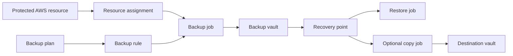
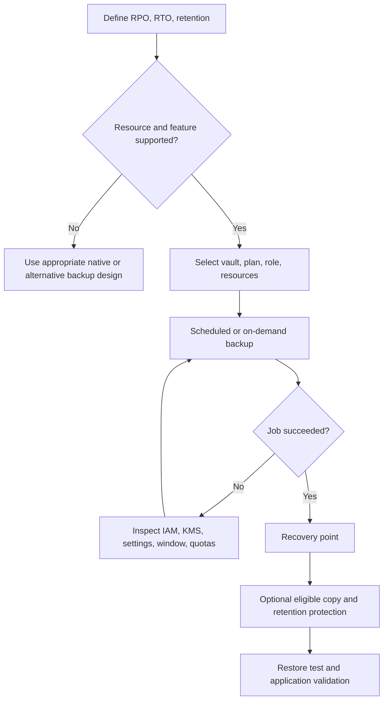
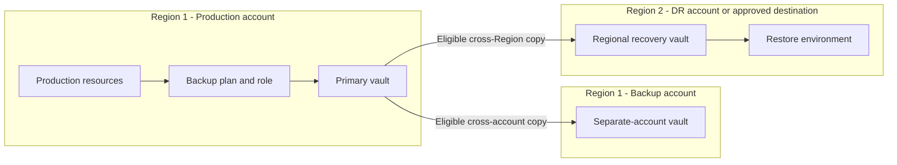
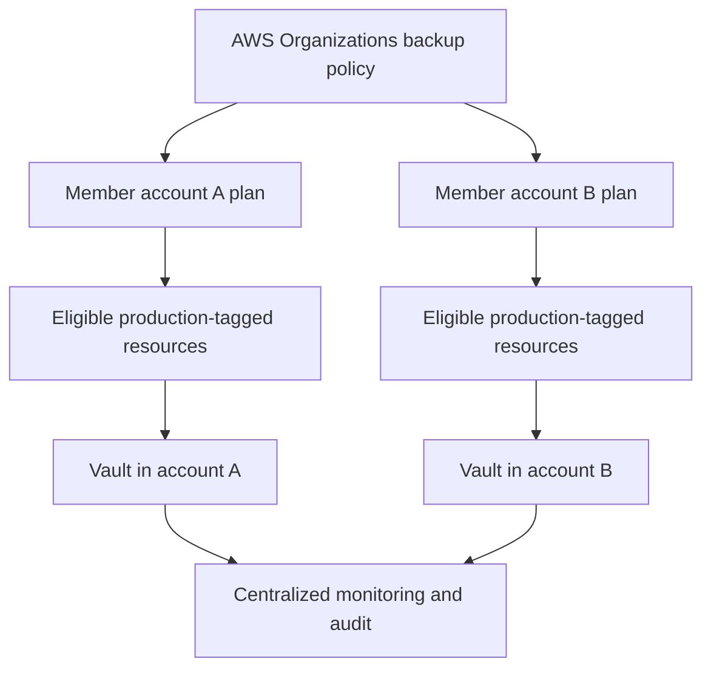
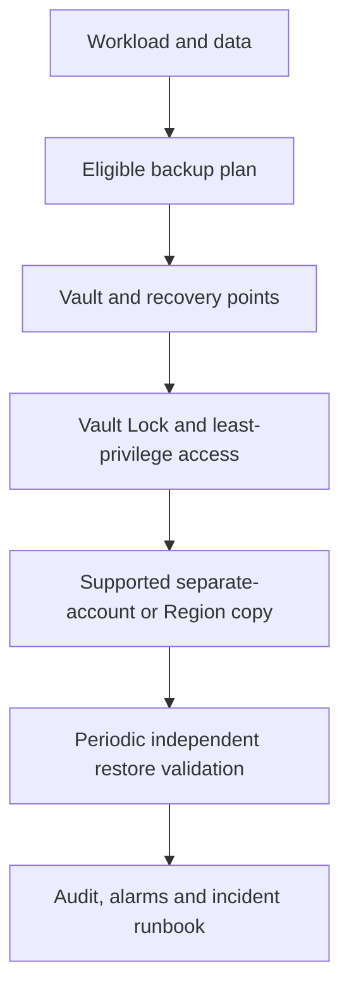
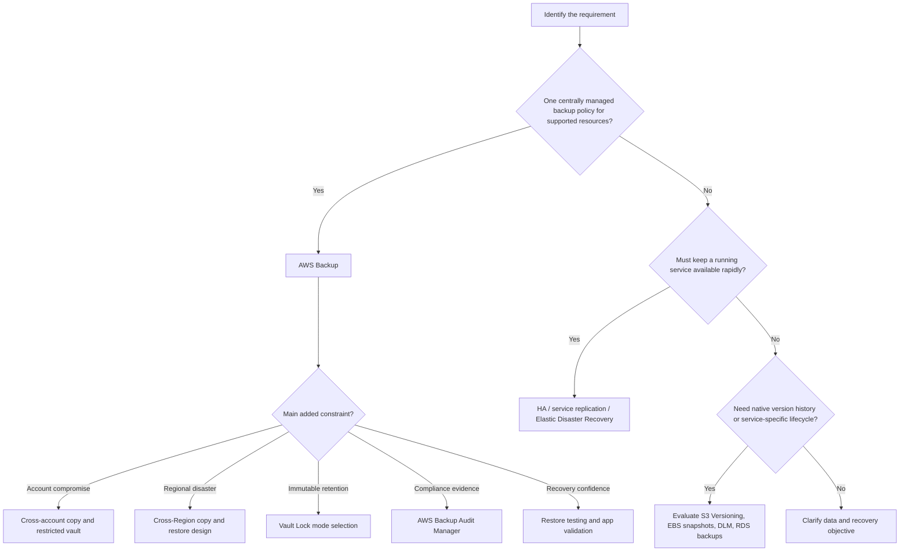

<div align="center">

# AWS Backup — Complete CCP + SAA Study Guide

### Cloud Practitioner (CLF-C02) and Solutions Architect – Associate (SAA-C03)

[](https://aws.amazon.com/backup/)
[](https://aws.amazon.com/certification/certified-cloud-practitioner/)
[](https://aws.amazon.com/certification/certified-solutions-architect-associate/)


**One sentence to remember:** AWS Backup centrally *orchestrates, monitors, retains, and governs* backups of supported resources; protecting the backups and being able to **restore the application** still requires deliberate design.

[CCP essentials](#ccp-essentials) · [SAA deep dive](#saa-deep-dive) · [Service comparisons](#service-comparisons) · [Exam traps](#exam-traps) · [Practice questions](#practice-questions)

</div>

---

> [!IMPORTANT]
> **Read this first:** AWS Backup is **not** an automatic, universal backup of every resource in your account. You must select supported resources, configure schedules and permissions, verify jobs, and exercise the restore process. Feature availability varies by **resource type and Region**. Check the [official feature matrix](https://docs.aws.amazon.com/aws-backup/latest/devguide/backup-feature-availability.html) before designing a solution.

## Table of contents

1. [What is AWS Backup?](#1-what-is-aws-backup)
2. [The problem it solves](#2-the-problem-it-solves)
3. [Core concepts and terminology](#3-core-concepts-and-terminology)
4. [How AWS Backup works](#4-how-aws-backup-works)
5. [Capabilities and important limitations](#5-capabilities-and-important-limitations)
6. [When to choose AWS Backup](#6-when-to-choose-aws-backup)
7. [Cloud Practitioner (CCP) essentials](#ccp-essentials)
8. [Solutions Architect (SAA) deep dive](#saa-deep-dive)
9. [Service comparisons](#service-comparisons)
10. [Integrations and architecture patterns](#10-integrations-and-architecture-patterns)
11. [Security, encryption, and shared responsibility](#11-security-encryption-and-shared-responsibility)
12. [Monitoring and troubleshooting](#12-monitoring-and-troubleshooting)
13. [Pricing and cost optimization](#13-pricing-and-cost-optimization)
14. [Practical setup and AWS CLI](#14-practical-setup-and-aws-cli)
15. [Exam traps and misconceptions](#exam-traps)
16. [Interview questions](#16-interview-questions)
17. [Original exam-style practice questions](#practice-questions)
18. [Scenario drills](#18-scenario-drills)
19. [Exam decision tree](#19-exam-decision-tree)
20. [Quick-revision cheat sheet](#20-quick-revision-cheat-sheet)
21. [Official AWS references and review note](#21-official-aws-references-and-review-note)
22. [Final takeaway](#22-final-takeaway)

---

## 1. What is AWS Backup?

**Beginner definition:** AWS Backup is a managed AWS service that lets you specify **what to back up, when, how long to keep it, where to copy it, and how to monitor and restore it** for supported AWS services.

**Exam-ready definition:** AWS Backup provides centralized, policy-based data protection across supported AWS services, accounts, and Regions, using backup plans, resource selections, backup vaults, recovery points, IAM permissions, reporting, and supported copy/restore workflows. It coordinates service-specific backup mechanisms; the exact storage, encryption, restore, and copy behavior depends on the resource type.

### A real-world analogy

Imagine a company with multiple departments storing important records. Instead of every department setting its own calendar reminders, a **central records office** issues schedules (backup plans), identifies which departments participate (resource assignments), retains protected copies (recovery points in vaults), restricts destruction (Vault Lock), and runs recovery drills (restore testing).

The analogy has one important limit: **central management does not mean every AWS backup is physically stored in one universally accessible place**, nor that every AWS resource supports the same operations.

| At a glance | AWS Backup |
|---|---|
| AWS service category | Storage / data protection / backup and recovery |
| Management model | Fully managed control plane; customer configures data-protection policy |
| Main objects | Backup plan, rule, selection/assignment, vault, recovery point, job |
| Scope | Supports selected resource types; AWS accounts and Regions where features are offered |
| Backups | Scheduled or on demand; periodic snapshots and, for certain types, continuous backup/PITR |
| Protection | Vault access policies, IAM, KMS, Vault Lock, cross-account/cross-Region copies |
| Audit | Jobs, EventBridge, CloudWatch, CloudTrail, AWS Backup Audit Manager |
| Restore | Service-specific restore job and metadata; restore testing for supported resource types |
| Does **not** guarantee | Coverage of every resource, zero data loss, instant failover, or application-level recovery |

**Memory model:** `Select resources → Define policy → Back up to vault → Protect/copy → Monitor → Test restore → Recover.`

## 2. The problem it solves

### Without centralized backup management

A team may manage EBS snapshots, RDS backups, EFS backups, and other service-specific mechanisms separately. That creates inconsistent schedules, missing tags, different retention rules, and fragmented reporting. Operators may discover too late that a backup failed, a copied recovery point was never created, or the available recovery point cannot restore a working application.

### With AWS Backup

The team can apply consistent plans to eligible workloads, define vault and copy destinations, protect recovery points, monitor outcomes, and audit compliance from one service. Centralization **reduces operational complexity**; it does not eliminate the need to understand each service's recovery behavior.

Common use cases:

1. Apply daily backups and retention to tagged production EBS, EFS, RDS, and other supported resources.
2. Manage backup policies across AWS Organizations member accounts or organizational units (OUs).
3. Copy critical recovery points to a **separate backup account**, subject to supported resource features and KMS permissions.
4. Copy recovery points to a **second Region** for regional disaster-recovery planning.
5. Apply Vault Lock to prevent premature deletion of retained backups.
6. Produce audit evidence, monitor failed jobs, and schedule restore tests.

> [!TIP]
> **Recognize the exam wording:** “centralize backups across multiple AWS services” is a stronger AWS Backup cue than “keep a continuously available second production database,” which points toward replication or a highly available database architecture.

## 3. Core concepts and terminology

| Concept | Meaning | Common mistake |
|---|---|---|
| **Backup plan** | Policy describing one or more backup rules | A plan alone does not select a workload |
| **Backup rule** | Schedule, start/completion windows, destination vault, lifecycle, and optional copy actions | Start window is not the same as guaranteed completion time |
| **Resource assignment / selection** | Defines which resources are protected, using ARNs, types, tags, or conditions, as supported | Tags help only if the intended resources actually match and are eligible |
| **Backup vault** | AWS Backup container that groups recovery points with access and encryption settings | Not a generic S3 bucket the user can browse |
| **Recovery point** | One restorable backup/version of a supported resource | A recovery point does not promise an application-consistent restore |
| **Backup job** | Operation that creates a recovery point | Job start and job success are distinct states |
| **Copy job** | Creates another recovery point in a supported destination vault | Not necessarily continuous replication |
| **Restore job** | Recreates supported resource data from a recovery point | Often requires a new resource and correct restore metadata |
| **Lifecycle / retention** | When a backup expires, and when eligible backups move to cold storage | Cold storage is **not** available for every resource type |
| **IAM service role** | Role AWS Backup assumes to operate on protected services | A plan cannot override missing IAM/KMS permissions |
| **Backup vault access policy** | Resource-based policy that governs supported AWS Backup operations | Cannot replace KMS policies or underlying source-service permissions |
| **Vault Lock** | Write-once, read-many (WORM) enforcement of retention in governance/compliance mode | Compliance mode can become impossible to change after grace period |
| **Continuous backup/PITR** | Restore to a chosen time within a supported rolling recovery window | Available only for certain resource types, not all copies |
| **Audit Manager** | Controls, compliance evaluation, and reports of backup activity | Evidence of backup policy does not prove application correctness |
| **Restore testing** | Periodic automated restore exercises for supported types | A completed infrastructure restore does not test every application workflow |
| **Logically air-gapped vault** | Specialized secondary vault with built-in compliance-mode Vault Lock and enhanced sharing/recovery capabilities | “Logically air-gapped” does not mean physically offline |
| **RPO** | Recovery point objective: maximum acceptable data loss, expressed as time | A backup every 24 hours cannot inherently meet a 5-minute RPO |
| **RTO** | Recovery time objective: target time to restore useful service | Backup frequency alone does not determine recovery time |

### Relationship between the components



A resource assignment connects the **plan** to actual eligible resources. A plan can contain multiple rules, and different rules can use different vaults, schedules, and retention settings. Read [AWS backup plans](https://docs.aws.amazon.com/aws-backup/latest/devguide/about-backup-plans.html) and [resource assignments](https://docs.aws.amazon.com/aws-backup/latest/devguide/assigning-resources.html).

## 4. How AWS Backup works

### Step-by-step workflow

1. **Choose a protection objective.** Decide required RPO, RTO, retention, data residency, account isolation, and restore validation.
2. **Check support and opt-in settings.** Check the [feature-availability matrix](https://docs.aws.amazon.com/aws-backup/latest/devguide/backup-feature-availability.html); turn on the applicable service/resource settings in each relevant Region.
3. **Create/configure a backup vault.** Decide whether to use a standard or specialized vault, choose permitted KMS settings, and define least-privilege access.
4. **Create a backup plan.** Add backup rules with schedule, start window, lifecycle, vault, and any supported copy actions.
5. **Assign resources.** Select eligible resources by resource ARN/type/tag/conditions; provide an appropriate IAM role.
6. **Run jobs.** AWS Backup invokes the supported service's backup mechanism. Successful completion creates a recovery point.
7. **Govern and observe.** Use IAM/KMS, vault policy, Vault Lock, job reporting and alerts. Verify copy jobs separately from source backups.
8. **Restore and validate.** Choose a recovery point, supply resource-specific restore metadata, restore to a suitable environment, and test application behavior.



### Beginner example: a production EBS volume

A company tags a supported EBS volume `Backup=Daily`. A plan selects that tag, schedules periodic backups, stores recovery points in an appropriate vault, and retains them for an approved period. When the instance's volume is lost or corrupted, an operator can recover from a suitable recovery point and restore/reconnect data through the appropriate service workflow. **The backup does not automatically reconfigure every application dependency.**

### More advanced example: multi-account application

Production resources run in **Account A**. A plan creates primary backups and, for supported types, copies them into a tightly controlled vault in **Account B**. Critical recovery points are also copied to a second Region when required. Operators monitor backup *and copy* jobs, use IAM/KMS guardrails, and run periodic restore tests. A stolen workload-account credential should not automatically give deletion rights in the backup account.

### Defaults and prerequisites worth knowing

- A newly created plan does not inherently protect every resource: check selection, Region/service opt-in, supported types, and execution permissions.
- The default service role `AWSBackupDefaultServiceRole` can be created through console workflows; custom roles may be used. A service-linked role, `AWSServiceRoleForBackup`, is a **different IAM object**.
- Periodic backups can be incremental for supported resource types, but **not every resource supports incremental backups**.
- Backups scheduled during service maintenance/backup windows can experience conflicts; plan and monitor accordingly.
- “Backup succeeded” and “copy succeeded” are separate checks, and neither replaces restore validation.

## 5. Capabilities and important limitations

| Capability | What it does | Key condition / exam relevance |
|---|---|---|
| Central backup plans | Applies schedules and retention | Applies to assigned, eligible, supported resources |
| Tag-based selection | Protects resources matching defined conditions | Tag drift and unsupported/opted-out services can cause gaps |
| On-demand backup | Starts a backup outside a recurring plan | Requires compatible resource and permissions |
| Incremental backups | Stores changed data after initial full backup | **Only** for supporting resource types; check feature matrix |
| Continuous backup/PITR | Restores supported data to a selected time | Supported workloads only; rolling window **up to 35 days** |
| Cross-account copy | Isolates supported recovery points in another account | Organization, destination vault access, and compatible keys required |
| Cross-Region copy | Provides separate-Region recovery point copies | Not equivalent to instant failover; data transfer/storage charges apply |
| Vault access policies | Restricts supported AWS Backup vault operations | Underlying service APIs and KMS must also be considered |
| Vault Lock | Prevents early deletion and enforces retention | Governance vs compliance modes have different reversibility |
| Cold lifecycle | Moves eligible retained backups to lower-cost tiers | Supported resources only; **minimum 90 days in cold storage** |
| Restore testing | Schedules restores and records results/timing | Supported resource types; validate app functionality separately |
| AWS Backup Audit Manager | Audits backup controls and emits reports | Configure frameworks and reporting; not automatic proof of recovery |
| Logically air-gapped vault | Additional recovery-point isolation and access paths | Built-in compliance-mode lock; supported resource/Region limitations |
| Backup search/index | Searches supported indexed EBS/S3 backups for items | Index creation, permissions, limitations and extra cost apply |
| Malware scanning | Integrates with GuardDuty to scan eligible backups | Explicit setup, supported resource types, extra roles, costs and scan gaps |

**Continuous vs periodic:** A snapshot captures state at its scheduled point. Continuous backup uses a full baseline and subsequent changes/logs to support point-in-time restore for **eligible** services. Copying continuous recovery points normally results in a **snapshot-style destination copy**, not a second continuously rewinding recovery point. See [PITR](https://docs.aws.amazon.com/aws-backup/latest/devguide/point-in-time-recovery.html) and [copying continuous backups](https://docs.aws.amazon.com/aws-backup/latest/devguide/point-in-time-recovery-copying.html).

### Important advanced distinctions

**Standard vs logically air-gapped vault.** A standard vault collects recovery points and can apply optional Vault Lock. A logically air-gapped vault is a specialized secondary vault with compliance-mode Vault Lock and additional cross-account recovery/sharing features; it is **not** a disconnected tape vault. AWS RAM sharing and optional multi-party approval have distinct setups and restrictions. [Official guide](https://docs.aws.amazon.com/aws-backup/latest/devguide/logicallyairgappedvault.html).

**Malware scanning.** AWS Backup can integrate with **Amazon GuardDuty Malware Protection** for automatic or on-demand scans of supported recovery points. A completed scan with `NO_THREATS_FOUND` does not prove the backup is free of every possible threat; coverage and scanner limitations apply. This is an **advanced capability**, not an assumption for basic CCP questions. [Official guide](https://docs.aws.amazon.com/aws-backup/latest/devguide/malware-protection.html).

**Search and item recovery.** For supported EBS/S3 backups, create a **backup index** and then search file/object metadata; an operator may restore selected items instead of a complete recovery point. Indexes and search jobs have additional charges and feature restrictions. [Official guide](https://docs.aws.amazon.com/aws-backup/latest/devguide/backup-search.html).

## 6. When to choose AWS Backup

| Requirement | Choose AWS Backup? | Reason |
|---|---|---|
| One policy for many supported services | **Yes** | Central selection, retention, monitoring and governance |
| Apply backup plans across many AWS accounts | **Yes** | AWS Organizations integration, with prerequisites |
| Recover after accidental deletion or ransomware | **Yes, with safeguards** | Independently retained and protected recovery points help |
| Restore in another Region | **Yes, for eligible resources** | Scheduled/on-demand copies, restore runbooks and permissions |
| Meet audit evidence requirements | **Yes, as a component** | Audit Manager; complement with real restore validation |
| Meet a 5-minute RTO for a production database | **Not by backups alone** | Consider database high availability/replication and tested failover |
| Ensure every AWS service is backed up | **No** | AWS Backup resource/feature support is selective |
| Archive arbitrary files without recovery-point lifecycle | **Usually not** | Evaluate S3 storage classes and lifecycle |
| Replicate active application traffic globally | **No** | Evaluate architecture, routing and service-specific replication |
| Protect SaaS data outside AWS supported integrations | **Not automatically** | Confirm supported third-party application or a separate strategy |

---

<a id="ccp-essentials"></a>
## 7. Cloud Practitioner (CCP) essentials


**Exam goal:** recognize the service and its principal purpose. Deep IAM/KMS mechanics and specialized vault features belong primarily to SAA/advanced architecture discussions.

### Sixteen foundational facts

1. AWS Backup is a **centralized managed backup service**.
2. It helps protect data for **multiple supported AWS services**.
3. Backup plans describe **schedules and retention**.
4. Resource assignments determine **which resources are backed up**.
5. Backups are represented as **recovery points**.
6. Recovery points are organized into **backup vaults**.
7. AWS Backup can create **scheduled or on-demand** backups.
8. It supports **centralized monitoring of backup jobs**.
9. It can support **cross-Region copies** for disaster-recovery designs.
10. It can support **cross-account copies** for isolation.
11. **Vault Lock** helps prevent early deletion of backups.
12. **Audit Manager** helps evaluate backup compliance and report evidence.
13. **Restore testing** helps check that recovery points can be restored.
14. Backup frequency influences **RPO**; restoration procedures influence **RTO**.
15. **Replication and backup are different**; one does not replace the other.
16. Coverage and advanced features depend on **service/resource/Region support**.

### High-value keyword bank

`centralized backup` · `backup plan` · `scheduled backups` · `backup vault` · `recovery point` · `retention policy` · `tag-based protection` · `multiple AWS services` · `cross-account copies` · `cross-Region copies` · `Vault Lock` · `restore testing` · `backup compliance` · `Audit Manager` · `disaster recovery` · `RPO / RTO`

### When a question says X, think Y

| Exam wording | Think | Caution |
|---|---|---|
| “Manage backups of multiple AWS services centrally” | **AWS Backup** | Check supported services |
| “Set an organization-wide backup schedule” | **AWS Backup + AWS Organizations** | Needs policy, roles, targets, and setup |
| “Keep copies in a different AWS account” | **AWS Backup cross-account copy** | Requires permissions and supported encryption |
| “Prevent authorized users deleting retained backups early” | **Vault Lock** | Compare governance/compliance |
| “Generate backup-compliance evidence” | **AWS Backup Audit Manager** | Not AWS Artifact |
| “Recover from a stored backup” | **AWS Backup restore** | Restore not necessarily instant |
| “Keep a live, continuously available database replica” | **Service-specific HA/replication** | Not simply AWS Backup |
| “Keep data in cheap archival object storage” | **S3 storage classes/lifecycle** | Not automatically a backup strategy |

> [!TIP]
> **30-second CCP answer:** “AWS Backup centrally manages backup policies for supported AWS resources. You configure plans, resource assignments, retention, and vaults; AWS Backup runs and monitors jobs, supports eligible cross-account/Region copies, and helps with restore testing and compliance.”

---

<a id="saa-deep-dive"></a>
## 8. Solutions Architect – Associate (SAA) deep dive


**Exam goal:** choose a design that meets **RPO, RTO, security, durability, compliance, cost, and operational requirements**. “Use AWS Backup” is the beginning of an architectural answer, not necessarily the end.

### Design dimensions and trade-offs

| Dimension | Architecture reasoning |
|---|---|
| **RPO** | Choose frequency and eligible PITR to bound acceptable data loss. Check actual job/copy completion and restore-point age. |
| **RTO** | Consider restore duration, data size, application rebuild, dependency order, network, permissions, validation and cutover. |
| **Availability** | Backup is for recovery; multi-AZ HA and replication handle running-service continuity. |
| **Durability** | Retention, independent copies, access controls and tested restores help against loss/corruption; don't assume identical underlying backup behavior across resources. |
| **Region failure** | Prefer eligible cross-Region recovery copies when a single Region is an unacceptable failure domain. |
| **Account compromise** | Add independent backup account, limited administrative access, dedicated encryption permissions and deletion protections. |
| **Encryption** | Verify whether each resource type's recovery point is encrypted by the vault or retains source-resource encryption. |
| **Compliance** | Define retention and WORM requirements before using compliance-mode Vault Lock; audit actual coverage and reporting. |
| **Consistency** | Decide whether application-consistent database/quiesced procedures are needed; service-level snapshots can be crash-consistent. |
| **Cost** | Balance cadence, incremental support, retained copies, cold-storage eligibility, restore tests, storage and transfer charges. |
| **Operational continuity** | Measure failed/late backups, unsuccessful copies, missing tagged resources, stale recovery points and test results. |

### Backup cadence and RPO: worked example

A team requires **at most four hours of data loss**. A once-daily periodic snapshot might lose up to roughly 24 hours of changes before a failure, so it cannot meet that requirement by cadence alone. A four-hour schedule might satisfy the *nominal* cadence but only if backups finish successfully and remain recoverable; deployment delays, job failures and additional copies introduce further risk. For eligible resources, PITR could provide a finer recovery point granularity. Do not claim a guaranteed RPO from a configured rule without validating it.

### Recovery time: why RTO is different

Even if a recovery point exists from one minute before failure, restoring 30 TB of state, launching replacement compute, applying IAM/security groups, rebuilding indexes, changing endpoints, validating data and redirecting users may take much longer. **Recovery point freshness is not recovery speed.**

### Five SAA design scenarios

**Scenario A — Production-account compromise.** A company fears that an attacker with administrator access to the application account will delete its backups. Use a **separate backup account** with supported cross-account copies, restrictive destination-vault policy, appropriately shareable KMS keys and additional retention protection. Validate recovery access from a trusted account. **Pitfall:** a backup copy is not isolated if the same compromised principal can administer or delete everything in the destination account.

**Scenario B — Regional outage.** A regulated workload needs recoverability when its AWS Region is unavailable. Add **cross-Region copies** of supported recovery points and build a documented restore procedure in the secondary Region. Provision/recreate required IAM, networking, compute and configuration in advance as appropriate. **Pitfall:** cross-Region backups do not automatically redirect traffic or guarantee rapid failover.

**Scenario C — Strict retention obligation.** A company must keep its backups unmodifiable for a prescribed legal period. Evaluate **Vault Lock compliance mode**, a defensible retention schedule, lifecycle restrictions and a carefully tested grace period. **Pitfall:** after the cooling-off period, lock changes and early deletion become prohibited, which can cause long-lived costs if retention is set incorrectly.

**Scenario D — Recover a deleted file quickly.** A large data backup exists, but teams frequently need just one object/file. Where eligible, consider **backup search and indexes** for S3/EBS recovery points to locate and selectively restore items. **Pitfall:** indexes are separate resources with support limits and costs; not every vault/recovery point can be indexed.

**Scenario E — Disaster recovery readiness.** A team reports 100% successful backup jobs but has never completed a restore. Add **scheduled restore testing**, isolated test infrastructure, application checks and measured restore durations; alert on job failures. **Pitfall:** AWS Backup restore-test success is not identical to an end-to-end business-service recovery test.

### Regional and multi-account boundary diagram



This is an **illustrative control/data-flow design**. Every copy path needs applicable resource support, vault access, account/Organization configuration and KMS authorization; not every source can copy to every destination. Multi-Region recovery requires separate service and application planning.

### Important design defaults vs explicit choices

| Behavior | Default / condition | Explicit architectural action |
|---|---|---|
| Eligible backup protection | Not “all resources everywhere” by default | Configure plan assignment, opt-in, and Region |
| Copies | Not implicit in every plan | Specify eligible cross-account/Region copy action |
| Vault Lock | Optional on standard vaults | Choose mode/retention with deliberate approval |
| Restore validation | No proof from backup success alone | Schedule tests and business validation |
| Continuous backup | Service- and rule-dependent | Enable PITR only where supported/needed |
| Cold storage | Resource-dependent | Set compatible lifecycle and minimum stay |
| Cross-account encryption | AWS-managed keys may block some copies | Review resource-management model and customer-managed key policy |
| Backup audit | Requires framework/report configuration | Enable relevant controls, reports and reporting bucket |
| Backup malware scanning | Not inherent to all backups | Configure GuardDuty integration, roles and scan mode |

---

<a id="service-comparisons"></a>
## 9. Service comparisons

### AWS Backup versus confusable services and features

| Service or feature | Primary purpose | Most important difference | When to choose it / exam cue |
|---|---|---|---|
| **AWS Backup** | Central policy-driven backup and restore | Multiple supported resource types, centralized rules and governance | “One backup policy across multiple services/accounts” |
| **Amazon EBS snapshots** | Point-in-time block-volume recovery | Native EBS snapshot operation, without a broad cross-service backup management policy | “Take or restore a snapshot of an EBS volume” |
| **Amazon Data Lifecycle Manager** | Automate lifecycles for supported EBS snapshots / EBS-backed AMIs | EBS-centric lifecycle orchestration, not the same cross-service governance scope | “Automate EBS snapshots/AMI creation and retention” |
| **Amazon RDS automated backups** | Service-native database backup and PITR | Database-specific backup/restore mechanism and controls | “Restore RDS database to a previous point in time” |
| **Amazon S3 Versioning** | Retain multiple versions of S3 objects | Same-bucket version history is **not** independent backup isolation | “Recover accidentally overwritten or deleted object version” |
| **Amazon S3 Replication** | Asynchronously replicate eligible objects | A replication destination can also receive unwanted changes/deletions depending on configuration | “Copy objects to another bucket or Region for ongoing data distribution” |
| **AWS Elastic Disaster Recovery (DRS)** | Continuous block-level replication and failover-focused recovery | Designed for low-RPO, low-RTO server recovery, not broadly for retained backup governance | “Recover servers quickly following outage / run failover” |
| **AWS Storage Gateway** | Connect on-premises environments to AWS storage | Hybrid storage access; some modes integrate with backups | “On-premises application needs AWS-backed file, volume, or tape interface” |
| **AWS Backup Audit Manager** | Assess backup compliance | A **feature of AWS Backup**; not an alternative backup engine | “Assess backup-control compliance and produce reports” |
| **AWS Config** | Record/evaluate resource configuration compliance | Config tracking does not create full recoverable data backups | “Evaluate configuration drift or resource compliance” |
| **AWS Artifact** | Obtain AWS compliance reports/agreements | AWS-provided documents, **not** proof your own backups meet policy | “Download AWS SOC/ISO/PCI documentation or manage agreements” |
| **AWS CloudTrail** | Log API activity | Records who called what, not the source data itself | “Audit deletion/change operations on backup resources” |

> [!WARNING]
> **Three different design objectives:** High availability keeps service running, replication maintains another copy that may be rapidly accessible, and retained backup provides a recovery history. They are complementary, not synonyms.

### Detailed tricky comparisons

<details>
<summary><strong>1. AWS Backup vs service-native backups and snapshots</strong></summary>

AWS Backup is the orchestration and governance layer for **supported** resources. EBS snapshots and RDS backup mechanisms are service-specific. AWS Backup often coordinates the native backup capabilities rather than replacing their underlying mechanics. Choose native tooling where only that service's features are required; choose AWS Backup for consistent plans, vault governance, cross-service reporting and supported copies. Check feature equivalence rather than assuming all operations are identical.

</details>

<details>
<summary><strong>2. AWS Backup vs replication (S3/RDS/other services)</strong></summary>

Replication can improve availability or regional readiness, but can propagate unwanted application changes, corrupted data, or deletions depending on configuration. Retained recovery points let you return to an earlier state. Replication also may deliver much faster recovery in designs that have a pre-provisioned standby. For many critical applications **use both**.

</details>

<details>
<summary><strong>3. AWS Backup vs AWS Elastic Disaster Recovery</strong></summary>

AWS Elastic Disaster Recovery emphasizes ongoing server replication and orchestrated recovery with aggressive recovery-time/recovery-point targets when configured and tested. AWS Backup emphasizes scheduled or continuous backups **where supported**, retention, isolation, compliance and selective restoration. If a question explicitly requires quick re-hosting/failover of servers, evaluate DRS instead of assuming periodic backups meet the objective.

</details>

<details>
<summary><strong>4. AWS Backup Audit Manager vs AWS Config vs AWS Artifact</strong></summary>

**Audit Manager** checks backup-related controls and creates evidence; **Config** evaluates recorded AWS resource configuration states/rules; **Artifact** provides AWS's own compliance documents and agreements. For “show that our RDS resources are covered by appropriate backup policies,” AWS Backup Audit Manager is the closest service. For “download AWS's SOC report,” AWS Artifact is the match.

</details>

<details>
<summary><strong>5. Vault Lock vs S3 Object Lock</strong></summary>

AWS Backup **Vault Lock** protects recovery points in backup vaults. S3 **Object Lock** applies WORM controls to eligible S3 object versions. They operate on different resources and should not be treated as interchangeable, even when both support retention-oriented compliance designs.

</details>

<details>
<summary><strong>6. Standard vault vs logically air-gapped vault</strong></summary>

A standard vault can use explicit access policies, KMS settings, and optional Vault Lock. A logically air-gapped vault is a specialized, secondary vault with built-in compliance-mode locking and additional cross-account restore access/sharing options. It is **logical isolation**, not physical disconnection. Evaluate available features and pricing before choosing it.

</details>

## 10. Integrations and architecture patterns

| Integration | Practical role | Design note |
|---|---|---|
| **AWS Organizations** | Organization-wide backup policies, delegated administration, multi-account features | Enable required service access and create correct vaults/roles per account |
| **IAM** | Identity policies, service roles, trust and authorized backup operations | Both operator permissions and assumed backup-role permissions matter |
| **AWS KMS** | Encryption, decrypt and cross-account key grants/policies | Source and destination encryption behaviors depend on resource type |
| **Amazon CloudWatch** | Metrics, alarms, dashboards | Track failures and stale recovery points, not only job counts |
| **Amazon EventBridge** | React to backup/copy/restore job-state changes | Event notifications are not a replacement for periodic reconciliation |
| **Amazon SNS** | Notifications | Can publish suitable operational alerts |
| **AWS CloudTrail** | Records API calls and identities | Investigate policy changes, deletion attempts, and backup actions |
| **Amazon S3** | Backup source, audit-report destination, and separate storage service | S3 bucket backups and Audit Manager reports are different objects |
| **Amazon GuardDuty** | Supported backup malware scans | Optional integration with extra scan roles/permissions and charges |
| **AWS RAM** | Sharing of eligible logically air-gapped vault resources | Not a general substitute for standard cross-account copy permissions |

### Pattern A — Tag-driven organization-wide protection



**Guardrails:** An Organizations backup policy can select by **resource types and tags**, not by individual resource ARN. If precise individual selection is required, use a local backup-plan resource assignment. Make sure member accounts have suitable roles/vaults and the required service opt-ins. See [managing backups across accounts](https://docs.aws.amazon.com/aws-backup/latest/devguide/manage-cross-account.html).

### Pattern B — Separate backup-account isolation

Create a destination vault in the security/backup account. Grant supported `backup:CopyIntoBackupVault` authorization from eligible source account(s), enable cross-account copy in the organization as applicable, verify IAM role authorization, and use compatible KMS keys. Copying is **not** equivalent to opening arbitrary cross-account restore/delete APIs. An operator typically restores by first copying recovery points into the intended recovery account as required by the documented workflow. [Cross-account backup guide](https://docs.aws.amazon.com/aws-backup/latest/devguide/create-cross-account-backup.html).

### Pattern C — Application-aware recoverability

1. Recover supporting network/IAM/KMS prerequisites.
2. Restore data volumes, file systems, databases and any required secrets/configuration through their respective processes.
3. Rebuild or launch compute, services and dependencies.
4. Validate data integrity and application correctness.
5. Change routing/endpoints only after readiness checks pass.
6. Measure actual elapsed recovery time and compare it with the RTO.

A crash-consistent infrastructure recovery point may require database replay or application repair. AWS Backup cannot automatically promise consistency across an arbitrary collection of services in a distributed application.

## 11. Security, encryption, and shared responsibility

### Who manages what?

| AWS responsibility (security **of** the cloud) | Customer responsibility (security **in** the cloud) |
|---|---|
| Operate and secure AWS Backup's managed infrastructure and service | Define protection objectives, policy scope, and schedules |
| Operate the managed backup control-plane service | Choose vaults, access policies, IAM roles, permissions and KMS keys |
| Implement documented service capabilities | Protect destination accounts and recovery procedures |
| Provide supported telemetry and operational APIs | Monitor failures, handle exceptions, test restores, satisfy retention rules |

### Encryption is a resource-type decision

**Do not memorize “all recovery points always use the backup vault's KMS key.”** AWS documents a meaningful distinction:

- **Fully AWS Backup-managed resource types:** backup recovery points can use independent encryption controlled through the backup-vault key.
- **Resource types not fully managed by AWS Backup:** recovery points can instead inherit their encryption behavior from the underlying resource/service.
- **Cross-account copies:** AWS managed keys cannot satisfy all cross-account key-sharing requirements. Some source/resource combinations require **customer managed KMS keys** and correct key policies. Copies must be checked against the [encryption matrix](https://docs.aws.amazon.com/aws-backup/latest/devguide/encryption.html).
- **Restores:** the ability to see a recovery point does not mean the restore role can decrypt or reconstruct it. Test the required KMS access.

### IAM and KMS checklist

1. **Operators** need permissions to create/edit plans, select resources, view jobs and initiate approved restores.
2. **Execution roles** need permissions in source services and `backup` operations appropriate to selected resources.
3. **Trust policies** must permit AWS Backup to assume the role where required.
4. **KMS key policy/grants** must allow required encryption and decryption paths; broad IAM `Allow` alone may not suffice.
5. **Destination vault access** must permit the supported copy operation without unnecessarily allowing destructive access.
6. **Underlying service APIs** may provide an alternative path to manipulate some snapshots; secure them separately.
7. **Source/destination accounts** should have distinct least-privilege administrative access and recovery procedures.
8. **Recovery roles** should be exercised, not merely inspected in JSON.

> [!WARNING]
> **Source-service bypass trap:** A vault access policy restricts AWS Backup API operations; for some snapshot types, underlying EBS/RDS service APIs also matter. Protect all relevant paths, not only `backup:DeleteRecoveryPoint`. [AWS vault policy documentation](https://docs.aws.amazon.com/aws-backup/latest/devguide/create-a-vault-access-policy.html).

### Vault Lock: governance vs compliance

| Feature | Governance mode | Compliance mode |
|---|---|---|
| Purpose | Restrict deletion or changes to privileged administrators | Enforce stronger immutable retention |
| Can privileged user remove the lock? | **Yes**, if appropriately authorized | **Only during the grace period** |
| Behavior after grace period | Not applicable in the same way | Lock configuration becomes immutable |
| Risk | Excessively powerful roles may still remove controls | Incorrect indefinite retention can produce unavoidable long-term costs |
| Best use | Administrative governance and controlled exceptions | Verified WORM retention requirements |

For compliance mode, the grace period must be **at least three days**. After it expires, neither an account root user nor AWS can bypass the locked retention configuration; recovery points remain until eligible lifecycle expiration. Vault Lock protects retention, but does not fix missing backups, compromised keys, incorrect RPO, or failed restores. [Vault Lock guide](https://docs.aws.amazon.com/aws-backup/latest/devguide/vault-lock.html).

### Defense-in-depth blueprint



Never treat **one** control as sufficient. A locked vault cannot recover data that was never backed up, and a cross-account copy cannot be restored without suitable roles, encryption permissions, network environment and a runbook.

## 12. Monitoring and troubleshooting

### Observability: which service answers which question?

| Question | Tool | What to check |
|---|---|---|
| Did backups, copies and restores complete? | **AWS Backup jobs dashboard** | Completed/failed/expired jobs, messages, destination |
| Are backup job failures increasing? | **Amazon CloudWatch** | Backup-related job metrics and alarm thresholds |
| Should a failure start incident automation? | **Amazon EventBridge** | `aws.backup` events and correct event patterns |
| Who changed the plan or deleted a recovery point? | **AWS CloudTrail** | Principal, timestamp, API action and Region |
| Do resources satisfy required backup controls? | **AWS Backup Audit Manager** | Framework controls and compliance reports |
| Did ransomware scanning indicate an issue? | **GuardDuty / AWS Backup scan results** | Scan status, supported coverage and findings |

For example, you can monitor CloudWatch metric `NumberOfBackupJobsFailed`; AWS Backup's EventBridge events include backup job states such as `FAILED` and `COMPLETED`. EventBridge events can be best-effort; combine event-driven alerts with scheduled dashboards/report reconciliation. [Monitoring guide](https://docs.aws.amazon.com/aws-backup/latest/devguide/monitoring.html), [CloudWatch metrics](https://docs.aws.amazon.com/aws-backup/latest/devguide/cloudwatch.html), [EventBridge events](https://docs.aws.amazon.com/aws-backup/latest/devguide/eventbridge.html).

### Troubleshooting checklist (in a practical order)

1. **Wrong account or Region?** Verify you're looking where the resource, plan, vault and jobs exist.
2. **Resource is missing?** Check AWS Backup support, regional availability and service opt-in settings.
3. **Assignment mismatch?** Check exact tags, resource type selection, exclusion conditions and plan association.
4. **No backup started?** Check rule schedule, start window, overlapping rules, job status and maintenance windows.
5. **Access denied?** Inspect execution role trust, attached permissions, source-service API access and organization controls.
6. **KMS denied?** Confirm key eligibility, role permissions, key policy/grants, source/destination account and Region.
7. **Copy failed?** Confirm supported copy feature, cross-account toggle/Organizations membership, destination access and key compatibility.
8. **Vault operation denied?** Check explicit policy denies, Vault Lock mode and retention restrictions.
9. **Recovery point expired unexpectedly?** Review plan lifecycle, copied-point retention and any expired/failed lifecycle jobs.
10. **Restore failed?** Examine restore metadata, target subnet/VPC, resource limits, service dependencies and restore-role permissions.
11. **Restore succeeds but application fails?** Validate consistency, schemas, app configuration, network, endpoints and dependent resources.
12. **Restore-testing resource lingers?** Check cleanup status and tags; test cleanup can take time, and changing identifying tags may interfere.

### Failure modes and expected responses

| Symptom | Likely causes | Recommended response |
|---|---|---|
| No recovery point for yesterday | Failed/expired job, wrong schedule, service not opted in | Fix eligibility and permissions, run a verified backup, alert on missing points |
| Source backup completed but destination empty | Copy job failed, unsupported operation, wrong vault | Inspect copy job and supported resource/Region paths |
| Copy fails only for encrypted resources | Incompatible AWS managed key or missing KMS grants | Review encryption matrix, use required customer-managed key |
| Retention change rejected | Vault Lock or retention boundaries | Inspect lock configuration; do not bypass compliance controls |
| Automated restore test fails | Missing role permissions or invalid restore metadata | Use job details, isolate test dependencies and rerun after correction |
| Restore completes but website remains unavailable | Application/network/DNS/database dependency not recovered | Run application-level validation and cutover procedure |

> [!TIP]
> **SAA troubleshooting rule:** Diagnose the **resource**, **control plane**, **execution role**, **KMS key**, **destination**, and **recovery procedure** separately. “AWS Backup issue” is too vague to be useful.

## 13. Pricing and cost optimization

AWS Backup is usage-priced. The exact rate depends on the AWS Region, resource type, storage class, data volume and operations. Do not assume all backup bytes are billed at the same rate or that every resource receives the same free-tier treatment.

| Cost driver | What drives it | Optimization lever / trade-off |
|---|---|---|
| Warm backup storage | Retained recovery-point data | Remove stale/unneeded points by compliant lifecycle; use incremental support |
| Cold backup storage | Eligible recovery points in cold tier | Long-term savings vs minimum stay/retrieval considerations |
| Restores | Restored data/restore activity, depending on resource | Right-size exercise scope without skipping critical tests |
| Copy operations | Copied data and destination recovery-point storage | Copy only required protection tiers, not every disposable resource |
| Cross-Region data transfer | Data copied between AWS Regions | Copy policy by recovery need; source Region transfer can be billed |
| Restore testing | Automated restore testing plus underlying restore charges | Choose sensible cadence and resource scope |
| Backup search/index | Index creation, index storage and searches | Index only data that benefits from searchable recovery |
| Malware protection | GuardDuty scans for eligible backups | Scope and scan mode based on threat model and costs |
| AWS KMS | Eligible key, cryptographic operation and other costs | Include key usage in broader cost model |
| Retention mistakes | Recovery points kept longer than intended | Review compliance-mode Vault Lock before irreversible change |

### Cost estimation (not a price quote)

```text
Estimated monthly backup-related cost ≈
  warm recovery-point GB-month × applicable warm rate
+ eligible cold GB-month × applicable cold rate
+ restore usage × resource-specific restore rate
+ copy and cross-Region data transfer
+ restore testing, search/index, malware scanning (if enabled)
+ any separately billed KMS or dependent-service charges
```

**Two architectural trade-offs:** (a) More frequent recovery points can improve recovery granularity but may increase usage and operational burden; incremental behavior is resource-specific. (b) Copying backups to another Region increases resilience but also adds transfer, destination storage and recovery-testing costs. A copy in the **same Region** is not the same geographic isolation as a cross-Region copy.

The AWS Backup pricing page includes different resource groups and charge categories. Calculate with the actual resource type, Region, usage, and current [official pricing](https://aws.amazon.com/backup/pricing/). No fixed prices are hard-coded here because they change and vary by configuration.

## 14. Practical setup and AWS CLI

The following is a **safe educational workflow**. It uses the AWS Console for new configuration, then read-only AWS CLI commands for inspection. It does **not** grant wide access, create indefinite-retention locks, or assume a particular account/Region/resource type.

### Console workflow (educational)

1. Select the intended **AWS Region** and confirm the resource type is supported and opted in.
2. Open **AWS Backup → Backup vaults**, and create/select a standard vault; review key and access choices.
3. Open **Backup plans → Create backup plan**, choose a name and configure an appropriate rule: schedule, time window, lifecycle, and destination vault.
4. Assign an eligible test resource or narrow test tag; choose a suitable default or custom **execution role**.
5. Verify that the resource appears in **Protected resources** and that the correct plan is associated.
6. Verify the next backup job completes and creates a **recovery point** in the intended vault.
7. Perform a controlled restore into a **nonproduction** test target. Document metadata, permissions and time to usable service.
8. Review and delete **test resources** according to your normal cost and retention controls; never delete protected production backups as an experiment.

### Read-only CLI inspection

Prerequisites: AWS CLI v2, a valid IAM/Identity Center credential profile or another supported identity, correct Region, and read permissions for AWS Backup. Replace example arguments with **real resource identifiers from your own account**.

```bash
# List configured backup plans in the selected Region.
aws backup list-backup-plans --region eu-west-1

# List vaults in that Region.
aws backup list-backup-vaults --region eu-west-1

# Inspect recovery points in an existing vault (replace the name).
aws backup list-recovery-points-by-backup-vault \
  --region eu-west-1 \
  --backup-vault-name YOUR_EXISTING_VAULT_NAME

# Inspect an existing backup job (replace the job identifier).
aws backup describe-backup-job \
  --region eu-west-1 \
  --backup-job-id YOUR_EXISTING_BACKUP_JOB_ID
```

These commands **read state only**. They may fail without the correct profile or permissions. Do not copy credentials into scripts or GitHub. For actual automation, prefer reviewed Infrastructure as Code and service-specific IAM/KMS policies over broad wildcard administrative access.

---

<a id="exam-traps"></a>
## 15. Common exam traps and misconceptions

| Misconception | Correct interpretation | Level |
|---|---|---|
| “AWS Backup protects every resource in an account automatically.” | Select eligible resource types, assignments and opt-in settings. | CCP |
| “A backup plan directly identifies all resources by itself.” | Plan rules and **resource assignments** are separate concepts. | CCP |
| “Every AWS service is supported.” | Feature support is selective and Region/resource-specific. | CCP |
| “A recovery point is a running standby.” | It is a recoverable backup, not an automatically running system. | CCP |
| “AWS Backup and S3 Replication do the same thing.” | Backup retains recovery history; replication moves eligible live changes. | CCP |
| “An EBS snapshot and AWS Backup are completely unrelated.” | AWS Backup can orchestrate supported service-native backup mechanisms. | CCP |
| “Vault means an ordinary customer-managed S3 bucket.” | AWS Backup vault is a service-managed recovery-point container. | CCP |
| “Backup = high availability.” | HA and backup address different failure/recovery objectives. | CCP |
| “Daily backup guarantees no more than one hour of data loss.” | Daily periodic points can be roughly a day apart, plus job failures/delay. | SAA |
| “A successful backup guarantees an app can recover.” | Restore permissions, data consistency, infrastructure and tests also matter. | CCP/SAA |
| “Cross-account copy happens just by creating another account.” | Requires supported type, setup, permissions, destination policy and compatible keys. | SAA |
| “Cross-Region copy automatically redirects application traffic.” | Restoration and failover/cutover are separately designed. | SAA |
| “Every backup is encrypted only with the vault's KMS key.” | Encryption source varies between fully and not-fully AWS Backup-managed resources. | SAA |
| “AWS managed keys always work for cross-account copy.” | Some resource types require a shareable customer-managed key. | SAA |
| “Vault access policy governs every EBS/RDS API.” | Underlying service APIs may need independent controls. | SAA |
| “Vault Lock is merely an IAM deny that root can remove.” | Compliance mode becomes immutable after its grace period. | SAA |
| “Governance Vault Lock is never removable.” | Appropriately privileged principals can remove governance-mode locks. | SAA |
| “Compliance Vault Lock is easy to undo later.” | After grace time, its lock cannot be removed or changed. | SAA |
| “Retention is unimportant if a vault is locked.” | Lock preserves configured lifecycle; bad retention can create irreversible costs. | SAA |
| “Cold storage exists for every AWS Backup resource.” | Availability and lifecycle depend on the underlying resource. | SAA |
| “Cold-tier backups can always be copied anywhere.” | Copying cold/archive-tier recovery points is restricted. | SAA |
| “Any continuous backup copy retains destination PITR.” | Cross-account/Region continuous-backup copies generally become snapshot-style copies. | SAA |
| “Every resource supports continuous PITR.” | PITR is resource-specific; check support and window limits. | SAA |
| “PITR can rewind indefinitely.” | The AWS Backup continuous recovery window is limited (up to 35 days). | SAA |
| “Organizations backup policies target individual ARNs.” | Organization policies target types/tags; local assignments handle individual ARNs. | SAA |
| “Audit Manager itself performs backups.” | It evaluates and reports backup controls, not the data-protection job. | CCP/SAA |
| “AWS Artifact proves our workload is backed up.” | Artifact supplies AWS documents/agreements, not customer backup proof. | CCP |
| “CloudTrail is the backup store.” | CloudTrail logs API activity, not recovery-point contents. | CCP |
| “Restore testing always validates a functioning user-facing application.” | It validates supported restore jobs; app checks may need custom validation. | SAA |
| “Logically air-gapped means physically disconnected and universally shareable.” | It is specialized logical isolation with documented sharing and feature limits. | SAA |
| “Backup search works automatically for all backups.” | Supported recovery points need indexes; some vault/tier types are excluded. | SAA |
| “Malware scanning happens for every backup by default.” | GuardDuty integration needs explicit setup; scanning has eligibility and cost limits. | SAA |
| “Backup jobs always fail if some objects are skipped.” | Status and item-level behavior may differ; inspect detailed job/resource results. | SAA |

**Hardest trap explained — encryption:** A standard destination-vault KMS key is **not** a universal override for all backup source encryption. When a resource type is not fully managed by AWS Backup, underlying snapshot-encryption behavior and shareable key policy can determine whether copying/restore succeeds. Design from the [official encryption table](https://docs.aws.amazon.com/aws-backup/latest/devguide/encryption.html), not from a generic rule.

**Second hardest trap — recovery:** If a question emphasizes “almost no downtime,” “instant failover,” or “active standby,” backups alone are unlikely to satisfy the requirement. Ask what is being minimized: **data loss, outage duration, breach blast radius, or retention violations**. They imply different designs.

## 16. Interview questions

**1. What is AWS Backup in one sentence?**  
A centralized managed service for orchestrating and governing backups and restores of supported AWS resources under defined policies.

**2. What is the difference between a backup plan and a resource assignment?**  
A plan defines **when/how** to back up; the assignment defines **which eligible resources** are covered and supplies the execution role.

**3. What is a recovery point?**  
A specific recoverable backup/version of an AWS resource, organized in a backup vault and subject to service-specific restore behavior.

**4. What is the difference between RPO and RTO?**  
RPO is acceptable data loss measured in time; RTO is the target time to resume useful service after a disruption.

**5. Why is replication not a substitute for backup?**  
Replication may carry accidental deletions and corruption forward. Retained recovery points allow earlier-state recovery.

**6. How would you isolate backups from an attacker with access to the production AWS account?**  
Use a separate backup account, eligible cross-account copies, least-privilege destination access, compatible KMS keys, retention protection and tested recovery roles.

**7. What is the difference between Vault Lock governance and compliance modes?**  
Authorized users can remove governance-mode controls; compliance-mode locking becomes immutable after its defined grace period.

**8. What can go wrong with cross-account copies of encrypted data?**  
The resource may not support the copy path, the destination vault policy may reject it, or source/destination KMS keys/roles may not permit the operation. AWS managed keys are unsuitable in some cross-account cases.

**9. How do you verify that AWS Backup is actually protecting a workload?**  
Confirm resource selection and opt-in, check backup and copy jobs, inspect resulting recovery points, and perform documented restore testing plus application validation.

**10. How do you troubleshoot a backup job that fails to start?**  
Check account/Region, schedule/start window, assignment, resource feature support, service opt-in, IAM trust and policy, KMS permissions, and operational messages.

**11. When do you choose AWS Elastic Disaster Recovery instead of AWS Backup?**  
When the dominant requirement is quickly recovering running servers through continuous replication and failover workflows, rather than retained cross-service backup governance.

**12. How should you design a backup strategy for a regulated multi-account application?**  
Map RPO/RTO and retention per data type, choose supported recovery mechanisms, centralize policies, isolate copies, enforce minimum access and locking requirements, monitor evidence, and repeatedly test full service recovery.

---

<a id="practice-questions"></a>
## 17. Original exam-style practice questions

All questions below are **original learning exercises**, not real or leaked AWS certification questions. Open a question to reveal the answer and the reasoning. Difficulty progresses from foundational recognition to architecture and failure analysis.

### CCP — service recognition and core concepts

<details>
<summary><strong>Q1 · CCP · Multiple choice — centralized protection</strong></summary>

A company wants one service to manage recurring backups of multiple supported AWS services. Which is the **best** choice?

A. AWS Artifact  
B. AWS Backup  
C. Amazon CloudFront  
D. AWS CloudTrail

**Correct: B — AWS Backup.** It centralizes backup policy, recovery points, and monitoring. CloudTrail records API activity; Artifact provides AWS compliance documentation; CloudFront distributes content.

</details>

<details>
<summary><strong>Q2 · CCP · Recall — backup schedules</strong></summary>

Which AWS Backup component contains the rules that define backup scheduling and lifecycle retention?

**Answer: Backup plan** (specifically, its backup rules). A vault stores/organizes recovery points; a resource assignment determines coverage.

</details>

<details>
<summary><strong>Q3 · CCP · Multiple choice — resource selection</strong></summary>

A team created a backup plan but no resources have been protected. What is an essential next step?

A. Enable CloudFront  
B. Create a resource assignment that selects eligible resources  
C. Remove IAM permissions  
D. Purchase a Reserved Instance

**Correct: B.** A plan must be associated with supported resources, and the relevant execution permissions and opt-in settings must be correct. The other options do not attach resources to a backup plan.

</details>

<details>
<summary><strong>Q4 · CCP · Recall — recovery point</strong></summary>

What is a recovery point?

**Answer:** A restorable backup/version of a protected resource. It is not, merely by existing, a live replica or running application.

</details>

<details>
<summary><strong>Q5 · CCP · Multiple choice — compliance reports</strong></summary>

Which feature is designed to assess backup compliance and produce backup-control reports?

A. AWS Backup Audit Manager  
B. Amazon Route 53  
C. AWS Artifact  
D. Elastic Load Balancing

**Correct: A.** Audit Manager evaluates backup-related controls. Artifact provides AWS-authored compliance artifacts; DNS and load balancers do not audit backups.

</details>

<details>
<summary><strong>Q6 · CCP · Short answer — vault</strong></summary>

What is the purpose of a backup vault?

**Answer:** It is a container in AWS Backup that groups recovery points and supplies related access/encryption settings. It is not simply an ordinary user-managed S3 bucket.

</details>

<details>
<summary><strong>Q7 · CCP · Multiple choice — retention protection</strong></summary>

Which AWS Backup capability helps prevent retained recovery points from being deleted early?

A. CloudWatch Logs  
B. AWS Backup Vault Lock  
C. AWS Pricing Calculator  
D. Amazon S3 Transfer Acceleration

**Correct: B.** Vault Lock enforces retention-oriented deletion controls. The others monitor logs, estimate cost, or accelerate transfers.

</details>

<details>
<summary><strong>Q8 · CCP · Concept — copies</strong></summary>

Why might an organization copy backups to another AWS Region?

**Answer:** To have recovery points outside the source Region's failure domain, when supported and properly configured. It does **not** automatically create a hot standby or fail traffic over.

</details>

<details>
<summary><strong>Q9 · CCP · Multiple choice — alternative service</strong></summary>

A customer specifically needs to download AWS's own SOC compliance report. Which service is most appropriate?

A. AWS Backup Audit Manager  
B. AWS Artifact  
C. Amazon EBS  
D. AWS Backup Vault Lock

**Correct: B.** AWS Artifact supplies AWS compliance reports/agreements. Audit Manager evaluates customer backup controls; EBS and Vault Lock address different needs.

</details>

<details>
<summary><strong>Q10 · CCP · Reasoning — backup vs replication</strong></summary>

True or false: “An actively replicated database always eliminates the need for retained backups.”

**Answer: False.** Replication improves continuity but can propagate application errors or unwanted changes. Historical backups remain important for earlier-state recovery.

</details>

### SAA — scenario reasoning and design trade-offs

<details>
<summary><strong>Q11 · SAA · RPO decision</strong></summary>

A workload permits only 15 minutes of data loss, but a team currently creates one periodic backup each day. Is the requirement met?

**Answer: No.** Daily periodic recovery points are not sufficient to guarantee a 15-minute RPO. Evaluate a suitable, supported PITR design or higher-frequency/native recovery mechanism, and measure actual recoverable point freshness. A configured cadence alone is not a guarantee.

</details>

<details>
<summary><strong>Q12 · SAA · Cross-account isolation</strong></summary>

An attacker might obtain administrator privileges in a production AWS account. Which architecture best reduces the attacker’s ability to delete retained backups?

A. Keep all copies in the same account with broadly shared administrator access  
B. Use supported cross-account copies to an independently controlled backup account  
C. Disable CloudTrail  
D. Change the EC2 instance type

**Correct: B.** Separate account security boundaries and vault permissions reduce blast radius. A keeps privileges shared; C removes audit visibility; D has no meaningful backup isolation benefit.

</details>

<details>
<summary><strong>Q13 · SAA · Copy-job failure</strong></summary>

A backup job succeeds but its cross-account copy fails. Which area should you investigate first?

**Answer:** Whether the resource/copy feature is supported, cross-account backup is enabled and permitted, the destination vault accepts `backup:CopyIntoBackupVault`, and source/destination IAM/KMS policies support the copy. Backup success does not imply copy success.

</details>

<details>
<summary><strong>Q14 · SAA · Encryption trap</strong></summary>

True or false: “Choosing a new KMS key for the AWS Backup destination vault guarantees that all cross-account encrypted snapshot copies will succeed.”

**Answer: False.** Fully managed and non-fully managed resource types have different encryption behavior. A source encrypted with an AWS managed key may require a shareable customer-managed key strategy for eligible cross-account copies.

</details>

<details>
<summary><strong>Q15 · SAA · Compliance-mode retention</strong></summary>

A company sets Vault Lock compliance mode, the grace period expires, and an administrator discovers a recovery point with indefinite retention. Can the root user simply remove the lock to delete it?

**Answer: No.** The compliance-mode lock is immutable after grace time. Incorrect retention can cause recovery points to be retained indefinitely. Review retention and approvals *before* committing.

</details>

<details>
<summary><strong>Q16 · SAA · Governance mode</strong></summary>

A team needs strong protection against ordinary accidental deletion while preserving authorized administrative ability to change the policy. Which Vault Lock mode is a better fit?

A. Governance mode  
B. Compliance mode with expired grace period  
C. Neither; only route tables manage deletion  
D. CloudFront caching

**Correct: A.** Authorized administrators can remove/change governance-mode protection. B is intentionally immutable; C and D do not address backup-retention governance.

</details>

<details>
<summary><strong>Q17 · SAA · Regional recovery</strong></summary>

A workload must recover when its primary AWS Region is unavailable. A company creates backups in a vault **in the primary Region only**. What key requirement is still missing?

**Answer:** A supported, verified recovery copy or other recovery data path in another Region, plus a runbook/infrastructure plan to restore there. Regional copies and actual application cutover must both be designed.

</details>

<details>
<summary><strong>Q18 · SAA · High availability versus backup</strong></summary>

An online application must resume in seconds after a single instance fails. What is usually more appropriate than relying on a restore from nightly backup?

**Answer:** Architect a highly available workload using redundant healthy compute/service components, such as multiple AZs, appropriate load balancing and automated replacement where supported. Nightly backup protects historical data but not a seconds-level service-continuity objective.

</details>

<details>
<summary><strong>Q19 · SAA · Organization-wide assignments</strong></summary>

A security team wants to target all EBS volumes with a required tag across an OU using AWS Organizations backup policies. Is that supported in principle? Can the same policy target a hand-picked list of individual EBS ARNs?

**Answer:** Tag/type-based selections are supported in the policy model; individual resource ARNs are **not** the appropriate selection mode for Organizations backup policies. Use a local backup-plan assignment for individual resources. Also configure the needed roles/vaults in member accounts.

</details>

<details>
<summary><strong>Q20 · SAA · Backup-to-cold lifecycle</strong></summary>

A team wants every recovery point to transition to cold storage after one day, then delete the point after 30 days. Is this universally valid?

**Answer: No.** Cold transitions are resource-specific, and backups transitioned to cold storage must remain there for **at least 90 days**. The proposed deletion schedule is incompatible with that requirement.

</details>

<details>
<summary><strong>Q21 · SAA · PITR copy semantics</strong></summary>

An eligible production resource has continuous backup enabled. After a cross-Region copy, can the destination recovery point automatically rewind to every second in the source's PITR window?

**Answer: Generally no.** AWS Backup copies of continuous backups are typically **snapshot-style recovery points**; destination PITR continuity should not be assumed. Verify supported resource behavior.

</details>

<details>
<summary><strong>Q22 · SAA · Restore-testing limitation</strong></summary>

AWS Backup restore testing successfully recreates an EBS volume. Can the business immediately conclude the complete customer-facing application will work after a disaster?

**Answer: No.** The test demonstrates a supported restore operation and its duration, not necessarily application configuration, database correctness, DNS, integration, or end-user availability. Add end-to-end recovery validation.

</details>

<details>
<summary><strong>Q23 · SAA · Access-denied investigation</strong></summary>

A restore job fails even though a user has permission to view the recovery point. What important permission boundary may still be missing?

**Answer:** The restore execution role's resource-service actions or AWS KMS decrypt/grant permissions, along with target-resource settings. Read-only visibility is not authority to reconstruct encrypted resources.

</details>

<details>
<summary><strong>Q24 · SAA · Audit objective</strong></summary>

A company must demonstrate that tagged resources are covered by backup controls and produce scheduled evidence. Which AWS Backup feature should be configured?

**Answer: AWS Backup Audit Manager** with relevant framework controls/report plans. It complements—not replaces—jobs, copies, monitoring, and real restore tests.

</details>

<details>
<summary><strong>Q25 · SAA · Application recovery consistency</strong></summary>

An application writes orders across an RDS database and an EFS file system. Independent backups complete at different moments. What architectural risk remains?

**Answer:** Cross-resource **application consistency**. Even if both backups are individually valid, the restored database and files may not represent one transactionally consistent application state. Design workload-aware recovery, coordinated procedures, reconciliation, and tests.

</details>

<details>
<summary><strong>Q26 · SAA · Locate a single deleted file</strong></summary>

A company needs to identify which eligible EBS snapshot contains a particular file without manually restoring all snapshots. Which advanced AWS Backup capability can help?

A. Backup search with a corresponding backup index  
B. CloudFront Functions  
C. AWS Artifact  
D. Auto Scaling groups

**Correct: A.** For supported indexed EBS recovery points, AWS Backup search can locate file metadata. B, C and D do not search EBS backup contents; indexing has restrictions and extra charges.

</details>

<details>
<summary><strong>Q27 · SAA · Malware recovery posture</strong></summary>

A company worries that its latest backups may contain malicious files. It wants to identify candidate clean restore points. Which design best addresses the threat?

**Answer:** Where supported, use **AWS Backup + Amazon GuardDuty Malware Protection** to scan eligible recovery points, combine findings with independent recovery validation and restore from an appropriately verified point. A negative scan is not an absolute guarantee of safety.

</details>

<details>
<summary><strong>Q28 · SAA · Logically air-gapped vault</strong></summary>

A security architect wants a specialized secondary recovery vault with built-in compliance-oriented retention protection and supported separate-account restore access. What AWS Backup capability is relevant?

**Answer:** A **logically air-gapped vault**, with its built-in compliance-mode Vault Lock and documented AWS RAM/optional multi-party approval capabilities. Review supported resource/Region, IAM/KMS and sharing limits; this is **not** physical offline storage.

</details>

<details>
<summary><strong>Q29 · SAA · RTO versus RPO</strong></summary>

A team has backups every five minutes and assumes a ten-minute RTO. What critical step is missing?

**Answer:** Measure and optimize the **full recovery operation** (restore, infrastructure, dependencies, integrity checks and cutover). A five-minute backup cadence addresses a potential RPO but does not demonstrate a ten-minute RTO.

</details>

<details>
<summary><strong>Q30 · SAA · Operational observability</strong></summary>

A production account's backup job completed, but a Region-copy job silently failed. A report shows only backup-job success. What monitoring improvement is required?

**Answer:** Independently track **copy jobs**, destination recovery points and recovery-point freshness; alarm on failures, and periodically reconcile actual coverage. CloudWatch, EventBridge, AWS Backup job dashboards and Audit Manager can contribute.

</details>

---

## 18. Scenario drills

| Requirement | Recommended service / architecture | Reasoning | Pitfall to avoid |
|---|---|---|---|
| Financial records must remain undeletable for a prescribed retention period | AWS Backup with **carefully reviewed compliance-mode Vault Lock** for supported types | Enforces WORM-style lifecycle controls | Over-retention can become immutable and expensive |
| Backups must survive credentials stolen from the production account | **Cross-account copies** to a separate, limited-access backup account | Reduces compromised-account blast radius | Shared admins/keys may recreate the same failure domain |
| Users need near-zero downtime during an AZ failure | Multi-AZ HA/replication **plus** AWS Backup for history | HA addresses outage; backups address historical recovery | Backup alone is not seconds-level failover |
| An OU needs standardized tagged-resource backups | AWS Organizations backup policies plus AWS Backup | Broad multi-account governance | Tags/roles/vaults/opt-in must actually exist |
| Team must prove recoverability every quarter | Restore-testing plan plus application validation | Tests actual restoration, captures timing/evidence | Infrastructure-only test doesn't prove all workflows |
| A company needs a regional disaster-recovery copy | Supported AWS Backup **cross-Region copy** and DR restore runbook | Regional recovery-point separation | No automatic endpoint failover |
| A user needs a single object from a large backup | Eligible AWS Backup S3 indexing/search and targeted restore | Avoids full restore solely for item discovery | Indexing costs, vault and resource limits |
| Incident responders want to detect malware in recovery points | GuardDuty Malware Protection integration on eligible AWS Backup resources | Can surface suspicious backup data before restore | Negative findings are not universal proof of cleanliness |

## 19. Exam decision tree



### Recognition matrix

| Keyword | Think of | Disambiguating question |
|---|---|---|
| **Central policy**, **many services** | AWS Backup | Are the resource types supported? |
| **Same-account snapshots only** | Native snapshot / AWS Backup | Is centralized governance required? |
| **Across accounts** | Cross-account copy | Are Organizations setup, vault policy and KMS compatible? |
| **Across Regions** | Cross-Region copy | Is a runnable failover environment needed too? |
| **Rollback to precise time** | PITR | Does that resource support continuous backup? |
| **Recover in seconds** | HA/replication/DRS | Is the question about RTO rather than backup retention? |
| **Retention must be immutable** | Vault Lock compliance mode | Has the irreversible grace-period decision been reviewed? |
| **Compliance evidence** | AWS Backup Audit Manager | Or is the question about AWS's own compliance documents (Artifact)? |
| **Single file in backup** | Backup indexing/search | Is the resource and vault eligible for indexing? |
| **Ransomware-safe restore** | Isolated locked backups and malware scanning where supported | Are credentials, permissions, scan limitations and actual restores tested? |

### A dependable exam-solving sequence

1. Underline **what must survive**: deletion, application corruption, failed AZ, Region failure, compromised account, or legal retention issue.
2. Underline **what is measured**: RPO, RTO, policy coverage, audit evidence, or cost.
3. Identify whether you need **history** (backup), **continuity** (HA/replication), or both.
4. Identify **where** copies must live: account, AZ, Region, or logically separated vault.
5. Check **which resource type** is involved and whether the needed AWS Backup feature applies.
6. Eliminate answers missing **role/key access, restore testing, or lifecycle requirements**.

## 20. Quick-revision cheat sheet

```text
AWS BACKUP — 30-SECOND REVIEW

WHAT:        Managed, centralized protection of SUPPORTED AWS resources.
PLAN:        Backup rules = schedule, window, vault, retention, optional copies.
ASSIGNMENT:  Select eligible resources by ARN/type/tag/conditions as supported.
VAULT:       Recovery-point container with access/encryption configuration.
RECOVERY:    Backup point -> service-specific restore; test end-to-end.
CROSS-ACC:   Isolation; Organizations, IAM, destination policy, KMS matter.
CROSS-REG:   Geographic recovery-point copy; NOT automatic app failover.
PITR:        Only eligible resources; rolling point-in-time window <= 35 days.
LIFECYCLE:  Warm/cold eligibility varies; cold stay >= 90 days.
VAULT LOCK:  Governance removable by authorized admins; compliance becomes
             immutable after its grace period.
AIR-GAP:     Logically isolated secondary vault; NOT disconnected physical media.
AUDIT:       Audit Manager = backup controls/evidence; Artifact = AWS reports.
MONITOR:     AWS Backup jobs + CloudWatch + EventBridge + CloudTrail.
SECURITY:    IAM execution roles, vault policies AND resource-specific KMS rules.
COST:        Storage, restores, copies, Region transfer, testing, other options.

BIGGEST 3 TRAPS:
1. Backup does not replace HA or replication.
2. All services/features do NOT have identical backup/encryption behavior.
3. A successful job does NOT prove an application can recover.

CCP: Recognize centralized backup policy and vault/recovery-point concepts.
SAA: Design for RPO/RTO, account/Region isolation, IAM/KMS, retention and tests.
```

**Memory trick:** Think of AWS Backup as a **central recovery-policy office**. It tells eligible services when and how to keep recovery records, protects selected records, and checks the process—but your team still must prove it can reconstruct a functioning organization from those records.

## 21. Official AWS references and review note

**Documentation review:** 2026-11-03. The statements about services, Vault Lock, PITR, cross-account copy, audit, restore testing, encryption, cold lifecycle, indexing, and malware scanning were checked against the official AWS documentation linked below. Availability, quotas, regional restrictions and prices can change; confirm them again when implementing a design.

### Core guides

1. [AWS Backup: service overview](https://docs.aws.amazon.com/aws-backup/latest/devguide/whatisbackup.html)
2. [Backup plans](https://docs.aws.amazon.com/aws-backup/latest/devguide/about-backup-plans.html) and [resource assignments](https://docs.aws.amazon.com/aws-backup/latest/devguide/assigning-resources.html)
3. [Resource and Region feature availability matrix](https://docs.aws.amazon.com/aws-backup/latest/devguide/backup-feature-availability.html)
4. [Continuous backups and PITR](https://docs.aws.amazon.com/aws-backup/latest/devguide/point-in-time-recovery.html) and [copy limitations](https://docs.aws.amazon.com/aws-backup/latest/devguide/point-in-time-recovery-copying.html)
5. [Cross-account backup](https://docs.aws.amazon.com/aws-backup/latest/devguide/create-cross-account-backup.html) and [cross-Region backup](https://docs.aws.amazon.com/aws-backup/latest/devguide/cross-region-backup.html)
6. [Encryption of AWS Backup recovery points](https://docs.aws.amazon.com/aws-backup/latest/devguide/encryption.html)
7. [AWS Backup Vault Lock](https://docs.aws.amazon.com/aws-backup/latest/devguide/vault-lock.html) and [backup vault access policies](https://docs.aws.amazon.com/aws-backup/latest/devguide/create-a-vault-access-policy.html)
8. [Logically air-gapped vaults](https://docs.aws.amazon.com/aws-backup/latest/devguide/logicallyairgappedvault.html)
9. [Restore testing](https://docs.aws.amazon.com/aws-backup/latest/devguide/restore-testing.html)
10. [AWS Backup Audit Manager frameworks](https://docs.aws.amazon.com/aws-backup/latest/devguide/working-with-audit-frameworks.html) and [audit reports](https://docs.aws.amazon.com/aws-backup/latest/devguide/working-with-audit-reports.html)
11. [AWS Backup monitoring](https://docs.aws.amazon.com/aws-backup/latest/devguide/monitoring.html) and [EventBridge events](https://docs.aws.amazon.com/aws-backup/latest/devguide/eventbridge.html)
12. [AWS Organizations integration](https://docs.aws.amazon.com/aws-backup/latest/devguide/manage-cross-account.html) and [IAM service roles](https://docs.aws.amazon.com/aws-backup/latest/devguide/iam-service-roles.html)
13. [Backup index and search](https://docs.aws.amazon.com/aws-backup/latest/devguide/backup-search.html)
14. [Malware protection integration](https://docs.aws.amazon.com/aws-backup/latest/devguide/malware-protection.html)
15. [Official AWS Backup pricing](https://aws.amazon.com/backup/pricing/)

### Certification scope

- [CLF-C02 exam guide](https://docs.aws.amazon.com/aws-certification/latest/cloud-practitioner-02/)
- [SAA-C03 exam guide](https://docs.aws.amazon.com/aws-certification/latest/solutions-architect-associate-03.html)

### Source corrections and updates

The earlier `01-overview` correctly covered backup plans, assignments, vaults, copies, retention protection, restore testing, and the backup-versus-replication distinction. This edition **preserves those ideas** and clarifies several points:

- Corrected the **CPP** badge typo to **CCP**, and standardized the SAA badge color to the requested `#2374D9`.
- Qualified blanket vault-encryption language: **fully managed** vs **not fully managed** AWS Backup resources can have different encryption behavior.
- Explicitly stated that cross-account/Region operations require supported types, permissions, compatible keys, and separately verified **copy jobs**.
- Added important current features (PITR, logically air-gapped vaults, indexed backup search and GuardDuty malware scanning) without treating them as universal or mandatory CCP concepts.
- Distinguished restore-job completion from **application-level** recoverability and included an RPO/RTO design approach.
- Preserved the original source's focus on actual recovery, role responsibilities, lifecycle costs, and immutable-retention caution.

**Attribution:** This document is an original study guide built from an earlier AWS Backup overview and official AWS documentation. It does not reproduce the copyrighted AWS training slides bundled elsewhere in the study materials.

## 22. Final takeaway

<div align="center">


**CCP:** Know what AWS Backup is and recognize plans, vaults, retention, copies, and compliance.  
**SAA:** Choose a supported backup architecture that can **actually meet RPO/RTO**, survive the right failure domain, enforce authorized access and retention, and pass real recovery tests.

</div>
