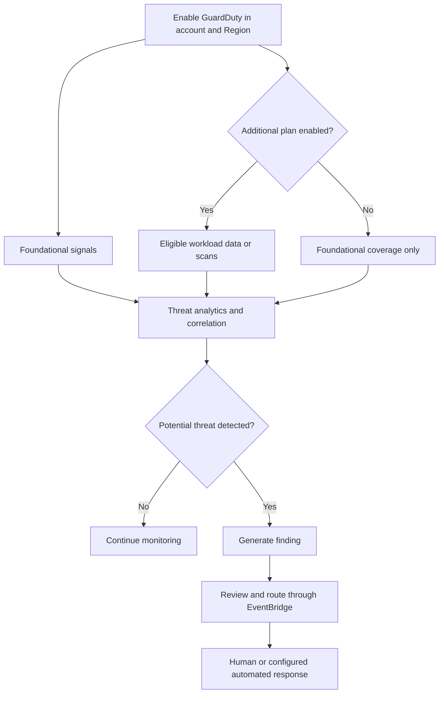
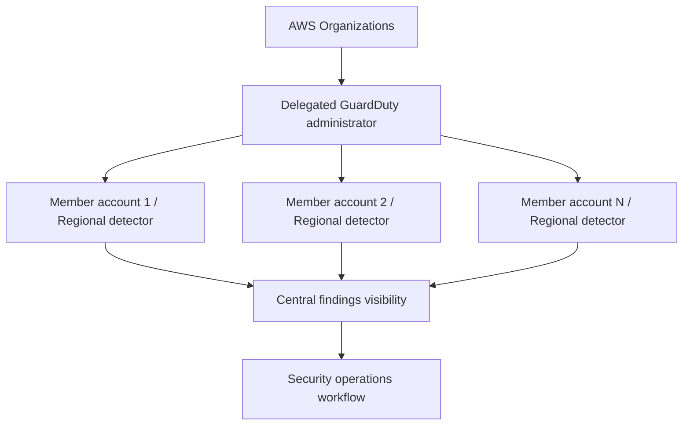
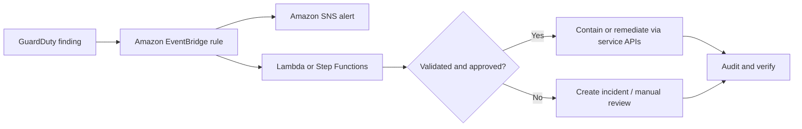
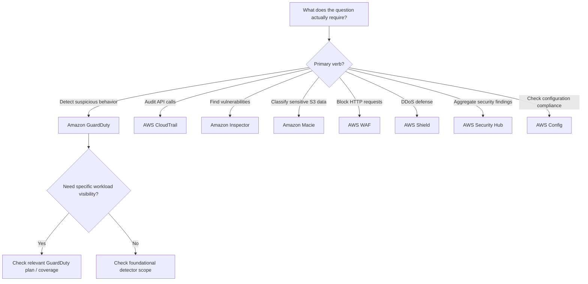

<div align="center">

# 🛡️ Amazon GuardDuty

### Complete GitHub Study Guide · AWS Cloud Practitioner + Solutions Architect – Associate

[](https://aws.amazon.com/guardduty/)
[](https://aws.amazon.com/certification/certified-cloud-practitioner/)
[](https://aws.amazon.com/certification/certified-solutions-architect-associate/)


**One sentence to remember:** **GuardDuty analyzes AWS activity and supported workload signals to identify potential threats and produce actionable security findings; detection is not the same as prevention or remediation.**

[🟢 CCP essentials](#ccp-essentials) · [🔵 SAA architecture](#saa-deep-dive) · [⚔️ Comparisons](#service-comparisons) · [⚠️ Exam traps](#exam-traps) · [🧠 Practice](#practice-questions)

</div>

---

> [!IMPORTANT]
> **Scope and currency (reviewed October 31, 2026):** This is an original study guide based on a short supplied GuardDuty overview and the AWS documentation listed below. CCP and SAA labels describe **study depth**, not guaranteed question frequency or an AWS-certified checklist. Some capabilities (notably **AI Protection**, **Malware Protection for AWS Backup**, and **GuardDuty Investigation (Preview)**) go beyond routine CCP/SAA service-recognition expectations. Availability, defaults, pricing, and preview status can change; check the current console and [Region/feature support](https://docs.aws.amazon.com/guardduty/latest/ug/what-is-guardduty.html) before production deployment.

## 📚 Table of contents

1. [What is Amazon GuardDuty?](#what-is-guardduty)
2. [What problem does it solve?](#problem)
3. [Core concepts and terminology](#core-concepts)
4. [How GuardDuty works, step by step](#how-it-works)
5. [Capabilities and protection plans](#protection-plans)
6. [Real-world use cases and choice criteria](#use-cases)
7. [🟢 CCP essentials](#ccp-essentials)
8. [🔵 SAA deep dive](#saa-deep-dive)
9. [⚔️ Service comparisons](#service-comparisons)
10. [Integration and architecture patterns](#architecture-patterns)
11. [Security, IAM and shared responsibility](#security)
12. [Monitoring, investigation and troubleshooting](#operations)
13. [Pricing and optimization](#pricing)
14. [Practical CLI walkthrough](#practical)
15. [⚠️ Exam traps](#exam-traps)
16. [Interview questions](#interview-questions)
17. [🧪 Original practice questions](#practice-questions)
18. [Scenario drills](#scenario-drills)
19. [Exam decision tree](#decision-tree)
20. [📌 Revision cheat sheet](#cheat-sheet)
21. [Official AWS references](#references)
22. [Final study takeaway](#takeaway)

---

<a id="what-is-guardduty"></a>
## 1. What is Amazon GuardDuty?

**Simple definition:** Amazon GuardDuty is AWS's managed **threat detection** service. It examines selected AWS activity and security-related signals to spot potentially malicious or unusual behavior, then creates **findings** for investigation.

**More precise:** In each AWS Region where GuardDuty is enabled, it evaluates foundational signals (CloudTrail **management events**, VPC network-flow metadata and eligible Route 53 Resolver DNS queries). Additional **protection plans**, when enabled, extend visibility to supported services and workloads—for example S3 object-level activity, EKS audit logs, workload runtime events, database logins and Lambda network activity. Detection uses threat intelligence, behavioral/anomaly analysis and other techniques. See [AWS overview](https://docs.aws.amazon.com/guardduty/latest/ug/what-is-guardduty.html) and [foundational sources](https://docs.aws.amazon.com/guardduty/latest/ug/guardduty_data-sources.html).

**Real-world analogy:** GuardDuty is a **smart security alarm** in a building. It observes access logs, movement and suspicious patterns, then calls attention to a possible break-in. **It is not the door lock, the firewall, the forensic investigator, or the response team.** A configured alarm workflow *can* contact a response team or trigger automated action.

| At a glance | Exam-ready answer |
|---|---|
| Service family | Security, identity and compliance — threat detection |
| Primary job | Detect possible compromise / malicious behavior and create findings |
| Operating scope | **Regional**, per account (one GuardDuty detector per account per Region) |
| Starting coverage | Foundational AWS signals are analyzed once GuardDuty is enabled |
| Added depth | Feature-specific protection plans and, for certain workloads, agents or scan permissions |
| Notification/output | Structured findings in the console/API; EventBridge and other integrations |
| Response | Human or customer-configured automated remediation; **no general-purpose automatic blocking** |
| Pricing | Usage-based; a qualifying initial **30-day trial** for GuardDuty, with exceptions for certain scans |

**Memory model:** **Signals → detection → finding → investigation → response.**

---

<a id="problem"></a>
## 2. What problem does GuardDuty solve?

Without a threat detection layer, a security team must piece together individual API events, flow records and other telemetry, develop its own threat models, manage rules and identify suspicious patterns. GuardDuty **reduces that detection burden** by analyzing supported signals and producing findings. It does **not** replace durable log retention, correct IAM permissions, network filtering or an incident-response plan.

| Threat/problem | Example | What GuardDuty can contribute |
|---|---|---|
| Compromised IAM credentials | Unexpected API calls from an unfamiliar location | Unusual access or API-activity finding |
| Malicious EC2 network activity | Instance communicates with known malicious infrastructure | Network-based threat finding |
| Unauthorized S3 data access | Anomalous bulk reads or destructive object operations | S3 Protection finding, if covered/enabled |
| EKS control-plane abuse | Suspicious Kubernetes API behavior | EKS audit-log detection, if enabled |
| Compromised workload runtime | Suspicious process execution or file access | Runtime Monitoring, if supported and agent coverage is present |
| Suspicious database login | Abnormal authentication behavior on supported database engines | RDS Protection finding, if enabled |
| Malware in storage/backup | Malware in supported EBS volumes, S3 uploads or backups | Relevant malware scan, if configured/supported |

> [!TIP]
> **Exam cue:** “Identify **suspicious**, **malicious** or **anomalous behavior** across AWS accounts” strongly suggests GuardDuty. “Find **software vulnerabilities**” suggests Inspector instead.

---

<a id="core-concepts"></a>
## 3. Core concepts and components

| Term | Meaning | Do not confuse with |
|---|---|---|
| **Detector** | Regional GuardDuty configuration resource; identified by a `detectorId` | A single EC2 agent or firewall appliance |
| **Foundational sources** | AWS activity streams used automatically after activation | A CloudTrail trail or customer-created VPC Flow Logs subscription |
| **Protection plan / feature** | Additional source-specific threat detection capability | Universal enablement of every AWS workload |
| **Finding** | Structured potential-threat alert, including type, severity, resource, account/Region, timestamps and evidence/context | A proven breach or a firewall deny rule |
| **Finding type** | Classification such as an EC2, IAM, S3 or Kubernetes threat family | A guarantee the event was malicious |
| **Severity** | AWS-assigned priority indicator, **Low / Medium / High / Critical** | An estimate of financial damage |
| **Administrator account** | Central GuardDuty account associated with multiple member accounts | An account that automatically blocks every finding |
| **Member account** | AWS account whose findings and configuration may be managed through GuardDuty administration | An unmonitored account by definition |
| **Threat intelligence** | Known suspicious IPs, domains or other threat indicators | A list of all possible attackers |
| **Extended Threat Detection** | Correlates multiple suspicious signals into multi-stage **attack sequence** findings; automatically available with GuardDuty | Merely treating every single event as independent |
| **Suppression rule** | Automatically archives matching findings to limit noise (with important export implications) | Fixing underlying risk |
| **EventBridge** | Receives finding events and can route them to notification/response targets | GuardDuty itself performing remediation |

**What is inside a finding?** A typical finding identifies *what happened*, the potentially affected *resource*, the *actor/network context* when available, *severity*, *when* the activity occurred, and a suggested investigation/remediation path. More detail is available in the [concepts guide](https://docs.aws.amazon.com/guardduty/latest/ug/guardduty_concepts.html).

### Foundational data is not the same as customer-created logs

When GuardDuty is enabled, it obtains its own managed data streams for supported foundational detections. You **do not need to create a CloudTrail trail**, manually enable VPC Flow Logs, or separately enable Route 53 Resolver query logging **just for GuardDuty's foundational analysis**. If you need those raw records for audit, troubleshooting or retention, you configure the logging services **separately**. DNS coverage has a condition: GuardDuty's foundational DNS visibility uses supported AWS-provided DNS resolver data, not arbitrary custom/external DNS resolvers. [AWS foundational data-source documentation](https://docs.aws.amazon.com/guardduty/latest/ug/guardduty_data-sources.html).

---

<a id="how-it-works"></a>
## 4. How GuardDuty works — step by step

1. **Select a Region and account.** GuardDuty is Regional; activating it in one Region is not equivalent to full organizational, multi-Region coverage.
2. **Enable a detector.** GuardDuty begins examining available foundational signals in that account/Region.
3. **Review initial feature settings.** Some optional protections can be enabled by default at *first* activation; other features—such as Runtime Monitoring and certain malware-scanning modes—require explicit configuration. Existing detectors do not necessarily auto-enable newly launched capabilities. See [trial/defaults table](https://docs.aws.amazon.com/guardduty/latest/ug/guardduty-pricing.html).
4. **Configure workload-specific protections.** For runtime telemetry, ensure supported resources and the correct security agent are covered. For relevant malware scans, configure scan scope and IAM access as directed in the service guide.
5. **GuardDuty analyzes observed events.** Detection can use threat intelligence, ML/behavioral models and sequence correlation.
6. **A potential threat produces a finding.** Read type, resource, severity, scope and evidence; a finding is a lead, not proof.
7. **Route and investigate findings.** Use GuardDuty, EventBridge, Security Hub, Detective or your SIEM/ticketing tools.
8. **Contain, recover and learn.** Use approved remediation playbooks, least-privilege IAM actions and incident records; verify that the detected behavior stops.



**Beginner example:** An IAM principal starts making unexpectedly unusual API calls. GuardDuty might create an anomalous activity finding. The analyst checks whether the action is part of an authorized deployment and investigates the principal, time and source before acting.

**More nuanced example:** Several individually subtle signals across an account may form a coordinated attack pattern. **Extended Threat Detection** can correlate them into an **attack-sequence finding**. A critical classification calls for urgent review, but still warrants evidence-based investigation. [Extended capability](https://docs.aws.amazon.com/guardduty/latest/ug/what-is-guardduty.html).

---

<a id="protection-plans"></a>
## 5. Key capabilities and protection plans

The exact configuration shown in the console depends on date, Region, account history and the enabled features. **Foundational detection is inherent to enabled GuardDuty.** Additional plans are independently manageable; do not assume universal workload coverage.

| Coverage | What it analyzes / scans | Key qualification |
|---|---|---|
| **Foundational** | CloudTrail management events, supported VPC flow metadata, AWS Resolver DNS queries | Starts after GuardDuty activation; cannot turn off just foundational coverage while leaving GuardDuty enabled |
| **Extended Threat Detection** | Correlated multi-stage activity | Automatically enabled with GuardDuty; sequence findings are not all single-event alerts |
| **S3 Protection** | CloudTrail **S3 data events**, e.g., unusual object operations | Different from scanning S3 object **contents** for malware |
| **EKS Protection (audit logs)** | Kubernetes/EKS audit API activity | Not equivalent to inspecting processes running in a pod |
| **Runtime Monitoring** | OS/process/file/network signals for supported EKS, ECS/Fargate and EC2 resources | Requires suitable GuardDuty security-agent coverage; EKS clusters **running on Fargate** are not supported by this runtime feature |
| **RDS Protection** | Supported database login behavior | Not universal SQL query auditing across every database engine |
| **Lambda Protection** | Network activity associated with Lambda functions | Not a substitute for application-level code/security testing |
| **Malware Protection for EC2** | Supported EBS volume scans, including finding-triggered and on-demand options | Not a blanket antivirus agent for every disk/file |
| **Malware Protection for S3** | Scans eligible newly uploaded S3 objects (and available on-demand scans) | Can be used **independently of full GuardDuty**; optional object tags can support access controls |
| **Malware Protection for AWS Backup** | Supported backup resources/recovery points | Separate backup-malware workflow; can operate independently in supported situations |
| **AI Protection** | CloudTrail activity involving supported Amazon Bedrock, Bedrock AgentCore and SageMaker AI workloads | Must be enabled; regional/feature limits. Advanced/current-awareness, **not core CCP memorization** |
| **GuardDuty Investigation (Preview)** | AI-assisted finding/account investigation and recommendations | **Preview**, regional limits, human review necessary; **not autonomous remediation** |

See [protection-plan guide](https://docs.aws.amazon.com/guardduty/latest/ug/what-is-guardduty.html), [Runtime Monitoring](https://docs.aws.amazon.com/guardduty/latest/ug/runtime-monitoring.html), [S3 malware capabilities](https://docs.aws.amazon.com/guardduty/latest/ug/s3-malware-protection-capability.html), [AI Protection](https://docs.aws.amazon.com/guardduty/latest/ug/ai-protection.html) and [AWS Backup malware](https://docs.aws.amazon.com/guardduty/latest/ug/malware-protection-backup.html).

> [!WARNING]
> **Important difference: S3 Protection ≠ Malware Protection for S3.** The former analyzes **S3 API/data-access behavior**; the latter scans **object content** for potential malware. One does not silently provide the other's function.

### Threat lists, trusted lists and suppression are not interchangeable

- **Threat entity/IP lists** can supply additional known-malicious indicators for GuardDuty findings. The newer **entity-list** approach supports IP addresses, domain names and SHA-256 hashes; legacy-style **IP lists** handle IP addresses only.
- **Trusted entity/IP lists** can **prevent matching findings from being generated** for trusted indicators within documented coverage. Their scope and precedence matter; putting a malicious address on a trusted list can hide a legitimate threat.
- **Suppression rules** work differently: they **auto-archive findings that GuardDuty still generates**, and suppress their normal downstream delivery.
- In multi-account setups, an administrator manages supported lists centrally. Never mark broad untrusted ranges as trusted merely to reduce noise. See [AWS list customization](https://docs.aws.amazon.com/guardduty/latest/ug/guardduty_upload-lists.html) and [suppression rules](https://docs.aws.amazon.com/guardduty/latest/ug/findings_suppression-rule.html).

### Agentless malware scans vs runtime agents

**GuardDuty-initiated Malware Protection for EC2** runs eligible **agentless EBS scans** when supported triggering findings occur; **on-demand EC2 scans** can be invoked without waiting for such a finding. Both differ from **Runtime Monitoring**, which requires an agent to observe supported processes/file/network activity. GuardDuty-initiated scans do **not** scan every instance continuously. [AWS malware scan comparison](https://docs.aws.amazon.com/guardduty/latest/ug/malware-protection.html).

### First-activation defaults vs separately configured protections

AWS's [GuardDuty pricing/user-guide table](https://docs.aws.amazon.com/guardduty/latest/ug/guardduty-pricing.html) identifies **S3 Protection, EKS Protection, RDS Protection, Lambda Protection and GuardDuty-initiated EC2 malware scanning** as enabled by default on eligible *new* GuardDuty activations (subject to Region support and account/console choices). **Runtime Monitoring, on-demand EC2 malware scanning, Malware Protection for S3 and Malware Protection for AWS Backup** are not automatically enabled in that table. Some options, notably **AI Protection**, have separate setup and may not be reflected in every summary table. **Existing accounts**, AWS Organizations settings, later-launched plans and opt-outs change the answer: inspect actual feature status instead of memorizing one universal default list.

### GuardDuty finding severity

| Level | AWS numeric value | General response priority |
|---|---:|---|
| Low | 1.0–3.9 | Review and contextualize |
| Medium | 4.0–6.9 | Investigate suspicious deviation |
| High | 7.0–8.9 | Prompt investigation and containment as justified |
| Critical | 9.0–10.0 | Urgent potential multi-stage or serious compromise |

Ranges from [AWS severity documentation](https://docs.aws.amazon.com/guardduty/latest/ug/guardduty_findings-severity.html). Severity helps prioritize; **a low-severity finding is not proof of safety** and a high-severity finding is not a substitute for analysis.

---

<a id="use-cases"></a>
## 6. Real-world use cases — when to choose it

| Requirement | Choose GuardDuty? | Better or complementary choice |
|---|---|---|
| Detect potentially compromised credentials / malicious AWS API usage | **Yes** | CloudTrail for the underlying API record; IAM controls for containment |
| Detect suspicious instance communication with known malicious hosts | **Yes** | Security groups/NACL/Network Firewall for traffic controls |
| Detect suspicious access or exfiltration patterns in S3 | **Yes, with S3 Protection as appropriate** | Macie for sensitive-data classification, bucket policy for access controls |
| Detect a vulnerable dependency inside EC2/container software | **No, not its primary purpose** | Amazon Inspector |
| Automatically deny a malicious HTTP request | **No, not GuardDuty alone** | AWS WAF |
| Protect against DDoS attacks | **No, not its primary purpose** | AWS Shield and architecture protections |
| Continuously evaluate configuration against controls | **No, different question** | AWS Config / Security Hub CSPM |
| Centralize findings across many security products | **Complementary producer** | AWS Security Hub |
| Scan new user-uploaded S3 files for malware | **Yes, specific malware plan** | Malware Protection for S3 plus quarantine/access pattern |
| Investigate how a finding relates to other AWS evidence | **Partly** | Amazon Detective / supported GuardDuty investigation features |

**Do not choose GuardDuty as the only layer** when you need access prevention, packet filtering, configuration enforcement, vulnerability patching, full log archival, or guaranteed incident response. Use defense in depth.

---

<a id="ccp-essentials"></a>
## 7. 🟢 AWS Certified Cloud Practitioner (CCP) essentials


### 17 foundational facts to remember

1. GuardDuty is a **managed threat detection** service.
2. It looks for **suspicious/anomalous/malicious activity** in supported AWS signals.
3. It uses **threat intelligence** and **machine learning/behavioral analysis**.
4. Its output is a **security finding**.
5. A finding has a **type**, affected resource/context and **severity**.
6. GuardDuty is **Regional**, not one universal global switch.
7. It analyzes foundational sources once enabled.
8. Foundational sources include **CloudTrail management events**, **VPC flow data** and eligible **DNS queries**.
9. You **do not need your own VPC Flow Logs or CloudTrail trail** to make foundational analysis work.
10. GuardDuty does **not normally block traffic itself**.
11. Remediation is performed by people or configured workflows using other services.
12. **Inspector** is primarily about vulnerabilities/exposure, not behavioral threat detection.
13. **CloudTrail** records AWS API activity; GuardDuty **evaluates** activity for threats.
14. **Macie** discovers/classifies sensitive S3 data; GuardDuty looks for threats and can provide separate S3 malware scans.
15. **Security Hub** centralizes/normalizes security findings and posture information; GuardDuty is one finding producer.
16. **WAF** filters application web requests; **Shield** addresses DDoS protection.
17. GuardDuty supports **multi-account administration** and **usage-based pricing**.

### High-value keyword bank

`threat detection` · `continuous monitoring` · `suspicious activity` · `anomaly` · `machine learning` · `threat intelligence` · `compromised credentials` · `malicious IP` · `cryptomining` · `unauthorized API calls` · `data exfiltration` · `security findings` · `severity` · `EventBridge` · `AWS Organizations` · `Regional` · `managed detection` · `not a firewall`

### When the exam says X → think Y

| Question wording | Strong first candidate | Reason |
|---|---|---|
| “Identify unusual API calls” | **GuardDuty** | Threat-detection analysis |
| “Record who called an API and when” | **CloudTrail** | Activity/audit record |
| “Find software CVEs and package vulnerabilities” | **Inspector** | Workload vulnerability scanning |
| “Detect sensitive personal data in S3” | **Macie** | Sensitive-data discovery |
| “Consolidate security findings from several AWS services” | **Security Hub** | Centralized security visibility |
| “Block malicious web requests to an ALB/CloudFront app” | **AWS WAF** | Application-layer request filtering |
| “Protect application from DDoS attacks” | **AWS Shield** | DDoS defense |
| “Check resource configuration against rules” | **AWS Config** | Configuration/compliance evaluation |
| “Notify when a GuardDuty finding arrives” | **EventBridge + SNS** | Routing + notification |

> [!NOTE]
> **Common CCP pitfall:** GuardDuty is **software/service**, not a human AWS support team. The name “GuardDuty” is a memory aid, not an implication that AWS staff personally inspect every incident.

**30-second CCP answer:** *Amazon GuardDuty is a fully managed, Regional AWS threat detection service that continuously evaluates supported account and workload activity, uses threat intelligence and anomaly detection, and creates security findings when it discovers potential threats. It complements logging, firewalls, vulnerability scanners and response tools.*

---

<a id="saa-deep-dive"></a>
## 8. 🔵 AWS Solutions Architect – Associate (SAA) deep dive


### Design axes architects should evaluate

| Design dimension | SAA reasoning |
|---|---|
| **Regional reach** | Enable across **every relevant supported Region**, including Regions your organization does not normally use, to detect suspicious activity there; verify opt-in Regions/permissions |
| **Account coverage** | Prefer AWS Organizations and a **delegated GuardDuty administrator** for organization-wide visibility; apply and audit `ALL`/`NEW`/`NONE` preferences per Region |
| **Coverage depth** | Fundamental network/API signals are not a substitute for S3 data events, EKS audit, runtime, RDS or Lambda plans; review supported workloads |
| **Detection vs control** | GuardDuty **reports** potential threats; WAF/SG/NACL/Firewall Manager/IAM/service-specific controls **enforce** policy |
| **High availability** | Managed service does not imply your EventBridge targets, notification recipients or response automation are fault tolerant; design and test those |
| **Automation safety** | Match finding type/resource/criticality, enrich evidence, include exceptions and approval gates before disruptive containment |
| **Data access** | A GuardDuty finding is not a full audit log or all contents of examined source telemetry; configure CloudTrail/S3/VPC log retention separately where required |
| **Cost** | Evaluate foundational volume and enabled plans; reduce unnecessary extra coverage while keeping required detection depth |
| **Cross-account evidence** | Delegated admin can see centrally managed findings; member-account resources and access policies still determine what an investigation/automation can read or modify |
| **Operational posture** | Route alerts, triage, investigate, suppress true expected behavior carefully, export findings for long retention and validate coverage continuously |

### SAA architecture scenario 1 — coverage across 70 accounts

**Requirement:** An enterprise uses AWS Organizations and 70 accounts in multiple Regions. Security staff want one operational view of GuardDuty findings.

**Design:** Designate a dedicated security account as the **GuardDuty delegated administrator**. Configure organization membership and appropriate per-Region auto-enable settings. Review account/Region coverage and relevant protection-plan settings. Route findings to the security workflow.

**Trap:** Creating an administrator in one Region **does not enable GuardDuty in every Region**. `NEW` affects new accounts only; `ALL` is the broader setting and is subject to actual organization/Region configuration. [AWS organization administration](https://docs.aws.amazon.com/guardduty/latest/ug/set-guardduty-auto-enable-preferences.html).

### SAA architecture scenario 2 — automatic containment of an EC2 instance

**Requirement:** The security team wants a dangerous EC2 threat to initiate incident handling without waiting for someone to read the console.

**Design:** GuardDuty finding → EventBridge rule → Lambda/Step Functions or other response workflow. Validate the finding and affected resource, capture context, then execute a **carefully approved** containment action (such as applying a restrictive security group when appropriate). Notify the owner and record changes.

**Trap:** GuardDuty does **not** itself replace your response mechanism. An overbroad rule that isolates every medium-severity finding may unnecessarily disrupt production.

### SAA architecture scenario 3 — uploads to S3 need malware protection

**Requirement:** Users upload files to S3; unscanned malicious files must not be distributed to downstream consumers.

**Design:** Configure **Malware Protection for S3** for intended buckets/prefixes; use scan results (for example optional object tags and EventBridge events) and **customer-defined access/quarantine controls** to prevent distribution before an acceptable scan result.

**Trap:** S3 Protection (API anomaly detection) is **not content malware scanning**. A positive malware scan result alone is not a guarantee that the object is automatically inaccessible; access policy/workflow design matters. [S3 malware capabilities](https://docs.aws.amazon.com/guardduty/latest/ug/s3-malware-protection-capability.html).

### SAA architecture scenario 4 — a compromised container executes commands

**Requirement:** EKS pods are suspected of running suspicious processes and reaching command-and-control domains.

**Design:** Evaluate **Runtime Monitoring** for supported resources and ensure GuardDuty agent deployment/health. Use EKS audit-log protection for complementary Kubernetes API visibility and other telemetry for incident investigation.

**Trap:** EKS **audit logs** show Kubernetes API behavior, not every in-container process. Runtime Monitoring has supported-platform limits, including **no support for EKS clusters running on AWS Fargate** in the referenced guide. [Runtime Monitoring](https://docs.aws.amazon.com/guardduty/latest/ug/runtime-monitoring.html).

### SAA architecture scenario 5 — no suspicious S3 findings despite large data read

**Requirement:** The team expects GuardDuty to detect suspicious S3 object access, but cannot find the corresponding alert.

**Design:** Check account/Region GuardDuty detector, **S3 Protection** status, bucket/account association, whether behavior matches a supported detection, and whether findings were archived/suppressed. Compare with raw CloudTrail S3 data events if separately configured for audit.

**Trap:** “No finding” is **not proof that no exfiltration occurred**. Detection is probabilistic/rule-driven and depends on enabled coverage; GuardDuty does not guarantee an alert for every hostile act.

### GuardDuty placement: control plane vs data plane

- **Control-plane visibility:** CloudTrail **management events** can expose suspicious AWS configuration and API changes (for example unexpected access-policy changes).
- **Data-plane visibility:** S3 object API activity requires **S3 Protection** (where enabled); instance **network flows** provide metadata about communication, not application payloads.
- **Workload runtime visibility:** Supported process/file events require **Runtime Monitoring** and its prerequisites; normal VPC flow metadata is not an OS process trace.
- **Application enforcement:** WAF, IAM, resource policies and network controls operate elsewhere; **GuardDuty is a detector, not an inline proxy**.

> [!IMPORTANT]
> **Default vs explicit:** Enabling GuardDuty does not automatically make your *response workflow* exist, your findings persist indefinitely, your EKS runtime agent healthy, or every account/Region covered. Always verify these separately.

---

<a id="service-comparisons"></a>
## 9. ⚔️ Confusable AWS services: comparison matrix

| Service | Main purpose | Choose it when the key requirement is… | GuardDuty relationship |
|---|---|---|---|
| **Amazon GuardDuty** | Threat detection | Detect suspicious AWS behavior / potential compromise | Subject of this guide |
| **Amazon Inspector** | Vulnerability/exposure management | Find software vulnerabilities in supported EC2/ECR/Lambda workloads | Complements; doesn't do GuardDuty's general behavior detection |
| **AWS Security Hub** | Security posture / finding aggregation and workflows | Centralize security findings and view security posture | GuardDuty produces findings that can feed it |
| **Amazon Macie** | S3 sensitive-data discovery | Discover/classify sensitive data in S3 | Different detection question |
| **AWS CloudTrail** | AWS API auditing and event history | Find who made which API call, when and where | Source of some monitored activity; retains logs separately if configured |
| **AWS Config** | Resource configuration history and compliance rules | Check whether resources match expected configuration | Complements threat detection |
| **AWS WAF** | Web request inspection/filtering | Allow, count, challenge or block matching HTTP(S) requests | Enforcement complement |
| **AWS Shield** | DDoS protection | Defend against volumetric/network/application DDoS attacks | Different protection objective |
| **Amazon Detective** | Security investigation and correlation | Investigate related entities/behaviors behind a finding | Can enrich GuardDuty investigation |
| **AWS Network Firewall** | VPC network inspection/enforcement | Filter or inspect VPC traffic at network level | Can enforce controls separately |
| **AWS Firewall Manager** | Central security-policy administration | Apply supported WAF/Shield/SG/Network Firewall policies across accounts | Policy orchestration, not threat detection |
| **Amazon Security Lake** | Central security data lake | Aggregate/normalize security logs/findings for analytics | Can ingest findings; not a drop-in detector |

### Top confusion pairs

<details>
<summary><strong>GuardDuty vs Inspector — threats versus vulnerabilities</strong></summary>

- **GuardDuty:** “Is something suspicious/malicious happening?” Behavioral detections, malicious connections and possible account compromise.
- **Inspector:** “What known weaknesses/exposures exist in supported workloads?” Software package CVEs and related exposure assessment.
- **Together:** Inspector helps prioritize preventive fixes; GuardDuty helps detect potentially active attacks. A vulnerable application can exist without a GuardDuty finding, and a compromised identity can produce a GuardDuty finding without an Inspector CVE.

</details>

<details>
<summary><strong>GuardDuty vs CloudTrail — analysis versus event record</strong></summary>

- **CloudTrail:** API-event history/audit service, including user/role, event name, time and source when recorded.
- **GuardDuty:** analyzes an independent stream of supported management events, alongside other signals, for threats; outputs **findings** rather than a raw log of every API operation.
- **Together:** Use GuardDuty to raise suspicion and CloudTrail to investigate/retain traceable API evidence. A CloudTrail trail is **not required** for basic GuardDuty detection.

</details>

<details>
<summary><strong>GuardDuty vs Security Hub — finding producer versus centralized visibility</strong></summary>

- **GuardDuty** performs threat detection and generates findings.
- **Security Hub** aggregates, correlates/prioritizes and exposes security findings and security posture information from services, according to its enabled capabilities.
- **Together:** Security Hub can consume GuardDuty findings. Security Hub enablement is not a substitute for checking that GuardDuty detectors and plans are actually enabled.

</details>

<details>
<summary><strong>GuardDuty vs Macie — suspicious S3 access versus sensitive data</strong></summary>

- **GuardDuty S3 Protection** looks for suspicious S3 **operations** and access patterns.
- **Macie** discovers and classifies **sensitive data** in S3.
- **GuardDuty Malware Protection for S3** scans eligible object **contents for malware**, a third distinct purpose.
- **Together:** A bucket may contain sensitive data (Macie), be accessed unusually (GuardDuty S3 Protection), and receive malware-laden uploads (Malware Protection for S3).

</details>

<details>
<summary><strong>GuardDuty vs WAF, Shield, Network Firewall and Firewall Manager</strong></summary>

- **GuardDuty:** observes supported signals and **detects** threats.
- **WAF:** filters supported web-application requests.
- **Shield:** DDoS protection.
- **Network Firewall:** VPC network traffic inspection/enforcement.
- **Firewall Manager:** central policy management for supported protection services across accounts.
- **Together:** GuardDuty alerts can feed a **separate** response playbook that changes a suitable enforcement layer; no automatic blocking relationship should be assumed.

</details>

---

<a id="architecture-patterns"></a>
## 10. Integrations and architecture patterns

### Pattern A — centralized multi-account monitoring



The administrator handles supported multi-account configuration and finding visibility. **Repeat Region-level configuration** in supported Regions and separately validate plan/agent coverage. See [organization settings](https://docs.aws.amazon.com/guardduty/latest/ug/set-guardduty-auto-enable-preferences.html).

### Pattern B — detection to response



EventBridge is the **event router**; SNS is a **notification** target; Lambda/Step Functions can orchestrate remediations **you configure**. Automation requires permissions, safeguards and testing. See [processing findings with EventBridge](https://docs.aws.amazon.com/guardduty/latest/ug/guardduty_findings_eventbridge.html).

### Pattern C — findings for investigation and retention

**GuardDuty → EventBridge/Security Hub → security team, SIEM or incident workflow.** For longer retention, configure **GuardDuty findings export to S3** with the correct S3 bucket and KMS permissions. GuardDuty's native findings have **90-day retention**; separately configured CloudTrail/VPC Flow Logs/other logs supply independent raw evidence. See [finding export](https://docs.aws.amazon.com/guardduty/latest/ug/guardduty_exportfindings.html).

---

<a id="security"></a>
## 11. Security, IAM, compliance and shared responsibility

| Responsibility | AWS | Your organization |
|---|---|---|
| Operate the managed GuardDuty detection service | ✅ | — |
| Decide account/Region coverage, plans and organizational settings | — | ✅ |
| Secure IAM identities and roles used to manage GuardDuty | Shared platform capabilities | ✅ policy design, least privilege and audits |
| Deploy/maintain required runtime-agent and scanning prerequisites | AWS features/tools | ✅ supported resource coverage and configuration |
| Interpret findings and investigate potential incidents | Threat context/recommendations | ✅ incident process and final decisions |
| Quarantine, revoke credentials, restore workloads or block traffic | AWS provides APIs/services | ✅ configure or perform actions |
| Preserve evidence and meet your organization's compliance obligations | AWS platform security | ✅ logging, retention, encryption, access controls |

**Least privilege:** Give analysts read-only access where practical; restrict enable/disable, suppression, archive, export and organization-wide changes to authorized roles. A delegated administrator is a privileged security-management role, not permission to bypass account-specific resource security boundaries.

**Data visibility:** GuardDuty does not provide every raw telemetry record in its findings. Configure supporting audit sources and retention for forensics and compliance. Do not assume that a GuardDuty finding, Security Hub or an object malware scan proves overall regulatory compliance.

**Encryption and data access:** For export to S3, use the appropriate **bucket policy and AWS KMS key policy**, plus intended retention and least-privilege reader roles; misconfigured permissions can cause export failures. For Malware Protection for S3, provide its required scan role and define downstream access/quarantine logic. [Export prerequisites](https://docs.aws.amazon.com/guardduty/latest/ug/guardduty_exportfindings.html).

**Shared-responsibility sentence:** AWS operates the threat-detection infrastructure; **you remain responsible for choosing coverage, reviewing the findings, enforcing controls and responding to threats**.

---

<a id="operations"></a>
## 12. Observability, auditing, troubleshooting and failure behavior

### Operational visibility

- **GuardDuty console/API:** Findings, detector/features, member-account status, cost/usage views and sample findings.
- **Amazon EventBridge:** Routes finding events to alerting and workflow targets. **Automatically suppressed/archived** findings are not delivered through the normal EventBridge flow (unlike an initial finding manually archived later); test filtering carefully. [Suppression details](https://docs.aws.amazon.com/guardduty/latest/ug/findings_suppression-rule.html).
- **Amazon CloudWatch:** GuardDuty publishes supported **usage metrics** (including `AWS/GuardDuty` metrics); customer-configured alarms can watch operational or usage conditions. Do not assume every threat finding automatically becomes a CloudWatch metric. [Usage metrics](https://docs.aws.amazon.com/guardduty/latest/ug/monitoring_costs.html).
- **AWS CloudTrail:** Records **GuardDuty API actions** to audit configuration changes, subject to CloudTrail history/trail choices. [GuardDuty API logging](https://docs.aws.amazon.com/guardduty/latest/ug/logging-using-cloudtrail.html).
- **Amazon S3 (optional export):** Archive findings beyond GuardDuty's **90-day** native retention. Verify encryption and permissions. [Export guide](https://docs.aws.amazon.com/guardduty/latest/ug/guardduty_exportfindings.html).

### New versus updated finding notifications

GuardDuty sends **new unique findings** to EventBridge in **near real time**. Repeated occurrences can be aggregated; updates are sent on a separate schedule, **six hours by default**, with supported **15-minute** or **one-hour** alternatives for updated occurrences. Do not confuse “continuous threat detection” with a guarantee that every repeated event produces a fresh instant email. [AWS EventBridge notification behavior](https://docs.aws.amazon.com/guardduty/latest/ug/guardduty_findings_eventbridge.html).

### Triage a finding in a sensible order

1. Confirm **account**, **Region**, finding type, severity, affected resource and first/last seen times.
2. Validate whether the activity is expected (recent deployment, penetration test, partner integration or known IP).
3. Review current permissions, network exposure and other relevant evidence from CloudTrail, app logs, EKS logs, etc., **as separately available**.
4. Determine blast radius and identity/resource ownership; decide whether to restrict network access or credentials.
5. Preserve evidence and follow your incident-response procedure; avoid destructive action that removes forensic context.
6. Apply remediation, confirm service health, and check whether suspicious activity stops.
7. If confirmed benign, use **narrow** filters/suppression only after review; avoid globally hiding valuable findings.

### If expected findings never appear

| Symptom | First checks |
|---|---|
| No findings at all | Detector **enabled** in expected account and **Region**? No real suspicious behavior might simply mean no findings. Generate **sample findings** to validate event routing. |
| Missing S3-specific alerts | S3 Protection enabled/supported? Correct bucket/account/Region? Relevant behavior and finding type? |
| Missing runtime process alerts | Runtime Monitoring enabled? Supported platform? Agent installed and healthy? |
| Finding exists but email did not arrive | EventBridge event pattern, rule target, SNS subscription/verification, Lambda permissions and target failures |
| Security Hub lacks finding | Integration and Region/account scope; suppressed/archive status; pipeline configuration |
| Export to S3 fails | Bucket existence/policy, KMS key policy, Regional configuration and permissions |
| Organization account missing | Delegated-admin relationship, `ALL` vs `NEW` preference, opt-in Region, membership and feature status |

**Failure model:** A detection stream and an alert/response workflow are separate. The latter can fail even while GuardDuty findings continue to be generated. Likewise, loss of runtime-agent coverage affects runtime visibility but does not mean foundational analysis must stop. Use independent configuration/health checks.

---

<a id="pricing"></a>
## 13. Pricing and cost optimization

GuardDuty uses **usage-based pricing**; the bill depends on Region and analyzed events, log volume, feature-specific units such as runtime monitored compute, and scanned data where applicable. On-demand scans may have different billing rules. **No fixed universal monthly price exists.** [AWS GuardDuty pricing](https://aws.amazon.com/guardduty/pricing/).

| Cost component | Typical driver | Cost-control consideration |
|---|---|---|
| Foundational detection | CloudTrail management events, VPC-flow and DNS activity volumes | Estimate workload-generated volume; foundational detection is part of enabled GuardDuty |
| S3 / EKS / RDS / Lambda / AI protections | Relevant eligible events/logs under enabled features | Check which protection depth you require |
| Runtime Monitoring | Monitored eligible workloads and runtime usage | Avoid unnecessary agent/plan scope; verify workload support |
| EC2 / S3 / backup malware scanning | Scans and processed data according to feature | Scan intended resources and understand triggered vs on-demand options |
| Downstream operations | EventBridge targets, Lambda, SNS, S3 storage, KMS, SIEM etc. | Budget these **separately** from GuardDuty |

**Trial caveat:** AWS documents a **30-day GuardDuty trial** per eligible new account/Region and certain protection plans. **Malware Protection for S3** has a separate free-tier approach rather than that 30-day trial; on-demand EC2 malware scans also differ. Do not treat “GuardDuty is free” as universally true. [Trial/default details](https://docs.aws.amazon.com/guardduty/latest/ug/guardduty-pricing.html).

**Safe estimation formula (no invented prices):**

```text
Monthly estimate = Σ (eligible analyzed usage by feature × its current Regional rate)
                 + eligible scan charges
                 + downstream EventBridge/Lambda/SNS/S3/KMS/other charges
                 − applicable trial/free-tier allowances
```

Use the GuardDuty **Usage** view, CloudWatch `AWS/GuardDuty` usage metrics, [official pricing](https://aws.amazon.com/guardduty/pricing/) and [AWS Pricing Calculator](https://calculator.aws/) for actual planning. **Do not disable essential detection solely to minimize cost.**

---

<a id="practical"></a>
## 14. Practical configuration / CLI example

**Prerequisites:** AWS CLI v2 installed and configured with permission to inspect/create GuardDuty detectors in the chosen Region, an authorized AWS account, and awareness that **enabling GuardDuty can incur charges** after applicable trials. Commands below are *illustrative*; running `create-detector` on a Region that already has a detector will fail rather than create another.

```bash
# Select a real AWS Region for your authorized account.
REGION="eu-west-1"

# Inspect whether a detector already exists in that Region.
aws guardduty list-detectors --region "$REGION"

# Only if none exists: enable GuardDuty in that Region.
# NOTE: eligible optional protection plans may also turn on by default.
aws guardduty create-detector --enable --region "$REGION"

# List again and obtain the returned detector ID.
aws guardduty list-detectors --region "$REGION"

# Substitute the actual detector ID from YOUR output.
DETECTOR_ID="YOUR_EXISTING_DETECTOR_ID"

# Generate test/sample findings (not real attacks).
aws guardduty create-sample-findings \
  --detector-id "$DETECTOR_ID" \
  --region "$REGION"

# Inspect current detector configuration and feature status.
aws guardduty get-detector \
  --detector-id "$DETECTOR_ID" \
  --region "$REGION"
```

Sample findings are **simulated**, useful for testing filters and event handling; do not treat them as genuine incidents. A create-detector request may enable eligible optional features unless you explicitly configure them, so **review your costs and current feature statuses immediately**. Syntax/source: [AWS CLI create-detector](https://docs.aws.amazon.com/cli/latest/reference/guardduty/create-detector.html), [sample findings](https://docs.aws.amazon.com/cli/latest/reference/guardduty/create-sample-findings.html), [GuardDuty setup](https://docs.aws.amazon.com/guardduty/latest/ug/guardduty_settingup.html).

---

<a id="exam-traps"></a>
## 15. ⚠️ Common exam traps and misconceptions

**Read these as distinctions, not as claims about what AWS will definitely ask.**

| # | ❌ Misconception | ✅ Correct interpretation | Level |
|---:|---|---|---|
| 1 | GuardDuty is a firewall. | It **detects** threats; controls like WAF/network firewalls **enforce** traffic policy. | CCP |
| 2 | A GuardDuty finding proves an attack occurred. | It flags **potential** malicious/suspicious activity that needs validation. | CCP |
| 3 | GuardDuty is a human security support team. | It is an **AWS managed service**, not a staffed response plan. | CCP |
| 4 | GuardDuty is global for every AWS account. | It is **Regional** and configured per account/Region. | CCP/SAA |
| 5 | I must enable VPC Flow Logs first. | Foundational network-flow analysis uses a **managed independent stream**; separate VPC Flow Logs are for your own logs. | CCP/SAA |
| 6 | I must create a CloudTrail trail before detection. | Foundational **management-event** analysis does not require your own trail. | CCP/SAA |
| 7 | GuardDuty does everything CloudTrail does. | CloudTrail supplies audit events; GuardDuty produces **derived threat findings**. | CCP |
| 8 | GuardDuty checks CVEs in packages like Inspector. | **Inspector** handles that vulnerability/exposure use case. | CCP |
| 9 | Security Hub detects all threats itself. | Security Hub can aggregate/correlate security findings; GuardDuty produces dedicated behavioral threat detections. | CCP |
| 10 | Macie and GuardDuty do the same S3 job. | **Macie** discovers sensitive data; GuardDuty **S3 Protection** detects suspicious activity; separate **Malware Protection** scans content. | CCP/SAA |
| 11 | Shield detects compromised IAM keys. | **Shield** centers on DDoS protection; GuardDuty handles suspicious credential-related activity. | CCP |
| 12 | AWS WAF analyzes all AWS API management activity. | WAF is for supported **web requests**; GuardDuty analyzes supported AWS activity signals. | CCP |
| 13 | S3 Protection scans uploaded object bytes for viruses. | It analyzes **S3 API/data events**; Malware Protection for S3 scans eligible **contents**. | SAA |
| 14 | EKS audit logs show every process in a pod. | EKS audit logs show **Kubernetes API activity**; process-level visibility comes from supported Runtime Monitoring. | SAA |
| 15 | EKS Runtime Monitoring automatically supports every EKS-on-Fargate setup. | GuardDuty's referenced runtime plan **does not support EKS clusters running on Fargate**; verify scope. | SAA |
| 16 | Runtime Monitoring requires no prerequisite for workload visibility. | Supported **GuardDuty security agent** and platform configuration matter. | SAA |
| 17 | RDS Protection sees every SQL query on every engine. | Its documented scope includes **supported login activity/engines**; it is not a universal SQL audit system. | SAA |
| 18 | Lambda Protection detects source-code CVEs. | It targets suspicious **network activity**; use other tools for code/package vulnerability analysis. | SAA |
| 19 | Every optional plan is always off initially. | Some are enabled on **new** activations by default; review the date/Region-specific defaults and opt-outs. | SAA |
| 20 | Every future GuardDuty feature switches on for existing users. | Existing accounts may need to **enable new plans**; verify actual feature state. | SAA |
| 21 | Initial GuardDuty trial makes all scans free. | Trial eligibility differs; e.g., **S3 malware** and **on-demand EC2 malware** billing/trials differ. | SAA |
| 22 | If GuardDuty found it, AWS will quarantine the resource. | **Response is your responsibility** unless a separately supported/actioned workflow is configured. | CCP/SAA |
| 23 | An EventBridge rule exists automatically with a GuardDuty detector. | You must **configure** routing/targets if you want those custom notifications/actions. | SAA |
| 24 | All suppressed findings still reach EventBridge/Security Hub. | **Suppression-rule auto-archived** findings are not delivered normally; careless suppression hides important alerts. | SAA |
| 25 | Native findings stay forever. | GuardDuty retains findings for **90 days**; export to S3 for extended retention. | SAA |
| 26 | A single `NEW` auto-enable setting covers every old organization account. | `NEW` applies to **new members**; compare `ALL` and existing account configuration. | SAA |
| 27 | Setting a delegated administrator once covers all Regions. | Administrator designations and **detector/feature configuration remain Regional considerations**. | SAA |
| 28 | GuardDuty sees DNS queries from every resolver used by EC2. | Foundational DNS analysis depends on **supported AWS resolver streams**, not arbitrary external resolvers. | SAA |
| 29 | No finding means the workload is secure. | Detection is scoped and not infallible; **missing alerts are not assurance of no compromise**. | CCP/SAA |
| 30 | GuardDuty automatically stores the original audit logs indefinitely. | It analyzes managed streams; separately configure **CloudTrail/VPC logs** when you need raw audit retention. | SAA |
| 31 | GuardDuty is a replacement for IAM policies and least privilege. | Prevention and access-control hygiene remain necessary; GuardDuty is **detective**. | CCP/SAA |
| 32 | Object scanning by itself blocks consumers from reading infected uploads. | Use returned **scan status/tags/events plus customer-defined quarantine/access controls**. | SAA |

### Why three particularly tricky traps occur

**Trap 5/6 — log ownership:** GuardDuty analyzes **its own managed streams**; it does not magically create the customer-accessible log archives you would use for an audit. Therefore “enable CloudTrail logging for compliance” and “enable GuardDuty for detection” are two different configuration requirements.

**Trap 19/20 — protection-plan defaults:** The same question can have different answers depending on **first-time versus existing detector**, which **plan**, and **supported Region**. If a scenario demands guaranteed coverage, explicitly verify and set the feature state rather than relying on a default.

**Trap 24 — suppression:** A narrow suppression rule helps reduce false-positive noise, but a broad one can prevent important findings from reaching your response systems. Review its scope, owner and expiry/reassessment criteria. See [AWS suppression rules](https://docs.aws.amazon.com/guardduty/latest/ug/findings_suppression-rule.html).

---

<a id="interview-questions"></a>
## 16. Interview questions and short answers

1. **What does GuardDuty do?** Continuously evaluates supported AWS activity for potential security threats and creates findings.
2. **What is the difference between a detection and a prevention control?** A detection identifies a potentially harmful condition; a prevention control, such as a policy/firewall rule, attempts to stop or restrict it.
3. **Which foundational signals does GuardDuty use?** AWS CloudTrail management events, VPC network-flow metadata and supported AWS Resolver DNS query data.
4. **Do I need a CloudTrail trail or VPC Flow Logs?** Not for GuardDuty's basic managed streams; yes if you independently need customer-managed logs for investigation or retention.
5. **How is GuardDuty different from Inspector?** GuardDuty finds suspicious behavior; Inspector finds software vulnerabilities and related exposure in supported resources.
6. **What happens when GuardDuty finds malicious activity?** It creates a finding. Humans or deliberately configured integrations decide whether/how to investigate and remediate.
7. **Why enable GuardDuty in unused Regions?** To improve visibility into unexpected malicious deployment or activity in Regions not ordinarily used by the organization.
8. **How would you deploy it across dozens of AWS accounts?** Use AWS Organizations with a dedicated delegated administrator; set/audit member auto-enablement and plan coverage per Region.
9. **How would you automate incident response?** EventBridge rule → constrained Lambda/Step Functions workflow → validation/approval → safe containment, notification and audit.
10. **Why might a Kubernetes compromise have no relevant GuardDuty finding?** Missing or unsupported feature coverage, agent issues, Region/account misconfiguration, suppression, or activity not detected by existing models/rules.
11. **How is S3 Protection different from Malware Protection for S3?** The former assesses **access/API behavior**; the latter scans **eligible file contents** for malware.
12. **How do you preserve and investigate historical findings?** Configure export to S3 (including KMS/bucket permissions) and retain suitable CloudTrail/other telemetry independently; GuardDuty native findings have a 90-day lifecycle.

---

<a id="practice-questions"></a>
## 17. 🧪 Original exam-style practice questions

**30 original questions (15 CCP + 15 SAA)** with gradually increasing difficulty. These are **not official AWS exam questions**. Expand each answer to see the reasoning, including why tempting alternatives fail.

<details>
<summary><strong>Q1 · CCP</strong> — Which AWS service is primarily designed to detect suspicious behavior and potential threats in AWS accounts?</summary>

- A. Amazon Inspector
- B. Amazon GuardDuty
- C. AWS Artifact
- D. AWS CodeBuild

**Answer: B — Amazon GuardDuty.** GuardDuty analyzes supported signals for suspicious behavior and generates security findings.

**Why alternatives/assumptions fail:** Inspector checks vulnerabilities/exposure; Artifact offers compliance reports/agreements; CodeBuild builds software.

</details>

<details>
<summary><strong>Q2 · CCP</strong> — What is the primary output of GuardDuty when it identifies a possible threat?</summary>

- A. A security finding
- B. An automatic patch
- C. A mandatory account suspension
- D. A new security group

**Answer: A — A security finding.** A finding describes a potentially suspicious activity, resource and severity.

**Why alternatives/assumptions fail:** Patching, suspension and changes to security groups are not GuardDuty's standard automatic finding outputs.

</details>

<details>
<summary><strong>Q3 · CCP</strong> — Which phrase is the strongest GuardDuty keyword?</summary>

- A. Vulnerability package scan
- B. Continuous threat detection
- C. Web request caching
- D. Reserved capacity

**Answer: B — Continuous threat detection.** Continuous analysis of threat signals is its core purpose.

**Why alternatives/assumptions fail:** Inspector handles supported vulnerability scans; CloudFront caches content; EC2 capacity reservation solves another problem.

</details>

<details>
<summary><strong>Q4 · CCP</strong> — True or false: GuardDuty is an AWS Support engineer manually watching your account.</summary>

**Answer: False.** GuardDuty is a managed software/security service.

**Why alternatives/assumptions fail:** The name may suggest a human guard, but findings are produced by AWS threat-detection systems.

</details>

<details>
<summary><strong>Q5 · CCP</strong> — A company needs a history of which IAM role invoked an AWS API. Which service best fits the audit requirement?</summary>

- A. AWS CloudTrail
- B. Amazon GuardDuty
- C. AWS Shield
- D. Amazon Macie

**Answer: A — AWS CloudTrail.** CloudTrail is the standard source for recording AWS API events.

**Why alternatives/assumptions fail:** GuardDuty may analyze supported events, but a detection finding is not a full API event history; Shield is DDoS protection and Macie focuses on sensitive S3 data.

</details>

<details>
<summary><strong>Q6 · CCP</strong> — A company wants to identify known software vulnerabilities in EC2 applications. Choose the best service.</summary>

- A. AWS WAF
- B. Amazon Inspector
- C. Amazon GuardDuty
- D. Amazon Route 53

**Answer: B — Amazon Inspector.** Inspector assesses supported workloads for vulnerabilities and exposure.

**Why alternatives/assumptions fail:** WAF filters web traffic, GuardDuty detects threat activity, and Route 53 provides DNS.

</details>

<details>
<summary><strong>Q7 · CCP</strong> — What technique does GuardDuty use to identify suspicious activity?</summary>

- A. Threat intelligence and behavioral/ML detection
- B. DNS domain registration only
- C. Manual software patch installation
- D. Compiling application code

**Answer: A — Threat intelligence and behavioral/ML detection.** Threat indicators and learned patterns help identify potentially malicious behavior.

**Why alternatives/assumptions fail:** Domain registration, patching and compilation are not its threat-analysis function.

</details>

<details>
<summary><strong>Q8 · CCP</strong> — A security team wants to discover sensitive customer data stored inside Amazon S3 objects. Which service fits?</summary>

- A. Amazon Macie
- B. AWS Shield
- C. AWS Lambda
- D. Amazon GuardDuty S3 Protection

**Answer: A — Amazon Macie.** Macie discovers and classifies sensitive data within S3.

**Why alternatives/assumptions fail:** GuardDuty S3 Protection analyzes suspicious object-level activity rather than classifying sensitive document contents.

</details>

<details>
<summary><strong>Q9 · CCP</strong> — True or false: A GuardDuty finding means the suspicious activity has definitely been confirmed as a breach.</summary>

**Answer: False.** Findings are potential security issues requiring contextual investigation.

**Why alternatives/assumptions fail:** Threat detectors can produce false positives and do not prove compromise by themselves.

</details>

<details>
<summary><strong>Q10 · CCP</strong> — What AWS service is most directly responsible for blocking unwanted HTTP requests to a supported web application?</summary>

- A. Amazon GuardDuty
- B. AWS WAF
- C. Amazon Macie
- D. AWS CloudTrail

**Answer: B — AWS WAF.** WAF can filter and block matching web requests.

**Why alternatives/assumptions fail:** GuardDuty detects threats, Macie classifies sensitive S3 data, and CloudTrail records API activity.

</details>

<details>
<summary><strong>Q11 · CCP</strong> — Which AWS service primarily provides DDoS protection?</summary>

- A. AWS Shield
- B. Amazon GuardDuty
- C. AWS Config
- D. Amazon Inspector

**Answer: A — AWS Shield.** Shield is AWS's DDoS-protection service.

**Why alternatives/assumptions fail:** GuardDuty is primarily detection, Config evaluates configurations, and Inspector assesses vulnerabilities.

</details>

<details>
<summary><strong>Q12 · CCP</strong> — Which statement best describes GuardDuty findings and AWS Security Hub?</summary>

- A. They are mutually exclusive
- B. GuardDuty can produce findings that Security Hub centralizes
- C. Security Hub is required to activate all GuardDuty detectors
- D. GuardDuty is the same thing as Security Hub

**Answer: B.** GuardDuty acts as a security finding producer; Security Hub can centralize/aggregate findings.

**Why alternatives/assumptions fail:** The services are complementary; Security Hub is not the same detector and is not required for foundational GuardDuty activation.

</details>

<details>
<summary><strong>Q13 · CCP</strong> — What is the most accurate description of GuardDuty's main responsibility after finding a threat?</summary>

- A. Detect and present a finding for follow-up
- B. Guarantee the attack is blocked
- C. Delete every suspicious EC2 instance
- D. Automatically rewrite all IAM policies

**Answer: A.** GuardDuty primarily detects potential threats; remediation is separate.

**Why alternatives/assumptions fail:** Any automated containment needs suitable explicitly configured workflows and controls.

</details>

<details>
<summary><strong>Q14 · CCP</strong> — A company wants to identify suspicious AWS API use with minimal infrastructure management. Which is the most direct service?</summary>

- A. Amazon GuardDuty
- B. Amazon EFS
- C. AWS CodeArtifact
- D. Elastic Load Balancing

**Answer: A.** Managed threat detection from supported management-event signals is a GuardDuty use case.

**Why alternatives/assumptions fail:** EFS is storage, CodeArtifact is package repository management, and ELB distributes traffic.

</details>

<details>
<summary><strong>Q15 · CCP</strong> — What is a good memory trick for GuardDuty?</summary>

**Answer: “Guard on duty” = observes threats and raises an alarm.** The analogy captures continuous monitoring and findings.

**Why alternatives/assumptions fail:** A guard alarm does not replace access locks, patrols or incident response; similarly GuardDuty does not replace IAM/firewalls/remediation.

</details>

<details>
<summary><strong>Q16 · SAA</strong> — GuardDuty is enabled in eu-west-1 only. A threat actor uses an AWS account in a different supported Region. What should the architect check?</summary>

- A. Whether GuardDuty is enabled in that other Region
- B. Whether S3 bucket names are globally unique
- C. Whether CloudFront uses the nearest edge
- D. Whether CloudWatch logs are in the default namespace

**Answer: A.** GuardDuty coverage is Regional, so enabled detectors and features must be reviewed separately in each intended Region.

**Why alternatives/assumptions fail:** The other choices are unrelated to GuardDuty Regional detection coverage.

</details>

<details>
<summary><strong>Q17 · SAA</strong> — Your team wants GuardDuty foundational monitoring but does not have a customer-configured CloudTrail trail or VPC Flow Logs. What is correct?</summary>

- A. GuardDuty cannot run
- B. Basic GuardDuty can analyze its independent managed streams
- C. Only Inspector can analyze AWS API management events
- D. You must install an EC2 agent for all foundational monitoring

**Answer: B.** GuardDuty obtains managed foundational streams without requiring customer-created trails/flow-log subscriptions.

**Why alternatives/assumptions fail:** Customer logs help investigations; runtime agents apply to optional runtime visibility, not all foundational detection.

</details>

<details>
<summary><strong>Q18 · SAA</strong> — An organization has 60 accounts. The admin chooses auto-enable `NEW`. What is the key limitation?</summary>

- A. It automatically includes all past accounts
- B. It applies to new members; older accounts require review/coverage decisions
- C. It disables findings in all Regions
- D. It allows GuardDuty only on EC2

**Answer: B.** `NEW` is not the same as `ALL`; existing accounts are not automatically covered by that selection alone.

**Why alternatives/assumptions fail:** The other choices misstate organization settings.

</details>

<details>
<summary><strong>Q19 · SAA</strong> — A company must scan newly uploaded S3 objects for potential malware before exposing them to customers. Which design fits?</summary>

- A. GuardDuty S3 Protection only
- B. Malware Protection for S3 plus scan-result-based access workflow
- C. Route 53 health checks
- D. Macie alone

**Answer: B.** The specialized S3 malware plan scans eligible object contents; access gating needs an intentional policy/workflow.

**Why alternatives/assumptions fail:** S3 Protection tracks anomalous access behavior, Macie classifies sensitive data, and Route 53 is DNS.

</details>

<details>
<summary><strong>Q20 · SAA</strong> — A suspicious process executes inside a supported EC2 workload. Which GuardDuty capability adds process-level visibility?</summary>

- A. Runtime Monitoring with supported agent coverage
- B. CloudTrail management events alone
- C. WAF rate-based rules
- D. AWS Artifact reports

**Answer: A.** Runtime Monitoring analyzes supported OS/process/file/network telemetry with a security agent.

**Why alternatives/assumptions fail:** CloudTrail management events do not report all OS processes; WAF and Artifact solve unrelated problems.

</details>

<details>
<summary><strong>Q21 · SAA</strong> — A detection workflow should isolate a compromised EC2 instance only after validation. Which architecture is appropriate?</summary>

- A. GuardDuty finding → EventBridge → reviewed Lambda/Step Functions action
- B. GuardDuty finding → automatic unconditional IAM policy rewrite
- C. CloudFront → S3 static site
- D. Macie → Reserved Instance

**Answer: A.** EventBridge and customer-defined workflows can conditionally remediate based on type, evidence and safeguards.

**Why alternatives/assumptions fail:** The unconditional rewrite is unsafe/not a built-in service guarantee; the remaining choices do not remediate incidents.

</details>

<details>
<summary><strong>Q22 · SAA</strong> — An organization requires a two-year history of GuardDuty findings. What should it configure?</summary>

- A. Native GuardDuty console retention only
- B. Export findings to S3 with required bucket/KMS permissions and retention settings
- C. An ALB target group
- D. EC2 Spot Instances

**Answer: B.** GuardDuty native findings are retained for 90 days; use appropriate S3 export for longer history.

**Why alternatives/assumptions fail:** ALB and Spot do not store threat findings; native retention alone does not meet two years.

</details>

<details>
<summary><strong>Q23 · SAA</strong> — GuardDuty produces a finding, but the company receives no SNS alert. Where should investigation begin?</summary>

- A. EventBridge rule/target, SNS subscription and permissions
- B. S3 object version IDs only
- C. Availability Zone name suffixes only
- D. Route 53 registrar transfer

**Answer: A.** Detection and downstream event delivery are separate pipelines that must be configured and tested.

**Why alternatives/assumptions fail:** The other concepts do not explain a missing GuardDuty-to-SNS notification.

</details>

<details>
<summary><strong>Q24 · SAA</strong> — A suppression rule matches an important GuardDuty finding. What risk results?</summary>

- A. It may be auto-archived and not forwarded through normal EventBridge/Security Hub flows
- B. The finding always gets emailed to all account users
- C. GuardDuty automatically blocks the attack
- D. The EC2 instance is always terminated

**Answer: A.** GuardDuty suppression reduces noisy alerts but can also hide critical detections from downstream workflows.

**Why alternatives/assumptions fail:** Suppression is not guaranteed alerting or containment.

</details>

<details>
<summary><strong>Q25 · SAA</strong> — A team uses EKS audit logs and assumes they see every suspicious shell command executed in containers. What is missing?</summary>

- A. Runtime Monitoring coverage for eligible workloads
- B. An S3 lifecycle policy
- C. A CloudFront origin access control
- D. An AWS Billing alarm

**Answer: A.** Kubernetes audit logs center on control-plane API activity; runtime process inspection is a distinct GuardDuty capability with requirements/limits.

**Why alternatives/assumptions fail:** Storage/CDN/billing options do not provide process-level evidence.

</details>

<details>
<summary><strong>Q26 · SAA</strong> — GuardDuty shows no DNS-based detection for an EC2 instance configured to use an external DNS resolver. Which statement matters?</summary>

- A. Foundational GuardDuty DNS visibility is based on supported AWS resolver data
- B. GuardDuty automatically parses every external resolver's logs
- C. DNS never matters for malware detection
- D. Inspector is a domain registrar

**Answer: A.** GuardDuty cannot necessarily see DNS queries routed through arbitrary external resolvers.

**Why alternatives/assumptions fail:** The other answers make incorrect generalizations or confuse services.

</details>

<details>
<summary><strong>Q27 · SAA</strong> — A team wants to detect anomalous object API reads but not scan object content for malware. Which option fits best?</summary>

- A. S3 Protection
- B. Malware Protection for S3 only
- C. AWS Shield Advanced only
- D. S3 Transfer Acceleration

**Answer: A.** S3 Protection examines CloudTrail S3 data-event behavior associated with suspicious access/exfiltration.

**Why alternatives/assumptions fail:** Malware scanning tests content; Shield targets DDoS; Transfer Acceleration speeds transfers.

</details>

<details>
<summary><strong>Q28 · SAA</strong> — A newly created GuardDuty detector enabled several optional plans unexpectedly. What best explains this?</summary>

- A. Eligible first-activation protection plans can default to enabled
- B. Every AWS service automatically turns on GuardDuty runtime agents
- C. DNS entries trigger detector creation
- D. No GuardDuty features can ever be disabled

**Answer: A.** On eligible initial activation, AWS may enable several optional plans by default, depending on Region and settings.

**Why alternatives/assumptions fail:** This does not mean every runtime agent or plan automatically exists or that plans cannot be controlled.

</details>

<details>
<summary><strong>Q29 · SAA</strong> — An analyst wants to know what known CVEs are present in ECR images and whether EC2 exhibits suspicious network communication. What should they select?</summary>

- A. Inspector for vulnerabilities + GuardDuty for suspicious behavior
- B. GuardDuty alone for both CVE inventory and threat behavior
- C. WAF alone for both
- D. Route 53 alone for both

**Answer: A.** The services solve distinct but complementary parts of the security problem.

**Why alternatives/assumptions fail:** GuardDuty is not a comprehensive package CVE scanner; WAF and Route 53 do not supply those two detection functions.

</details>

<details>
<summary><strong>Q30 · SAA</strong> — A team enables GuardDuty on supported accounts, but needs to know whether GuardDuty responded to a real attack and stopped it. Which reasoning is sound?</summary>

- A. Use findings as evidence to investigate, then verify independent response/control actions
- B. Assume every finding proves the attack was blocked
- C. Assume the absence of findings proves no breach occurred
- D. Disable all logging because findings exist

**Answer: A.** Findings indicate potential threats; control enforcement, response and verification remain separate responsibilities.

**Why alternatives/assumptions fail:** The other answers confuse detection, certainty and audit evidence.

</details>

---

<a id="scenario-drills"></a>
## 18. Real-world scenario drills

| Requirement | Recommended AWS service/design | Why | Critical pitfall |
|---|---|---|---|
| An IAM role suddenly performs unexpected security-sensitive API calls | **GuardDuty** foundational detection + CloudTrail review + IAM incident response | Behavioral detection plus precise API audit evidence | A finding does not revoke credentials or prove theft on its own |
| Security team needs coverage in multiple accounts/Regions | **AWS Organizations + GuardDuty delegated admin**; audit Regional settings and enabled plans | Centralizes supported GuardDuty administration and findings | `NEW` does not automatically backfill all existing accounts; Region settings differ |
| Web server has known package vulnerabilities and may be contacting a malicious endpoint | **Inspector + GuardDuty** | Two different concerns: exposure and potentially active malicious behavior | Neither is a universal, automatic patching/traffic blocking solution |
| Application must reject malicious HTTP request patterns | **AWS WAF** (GuardDuty may complement detection) | Inline application request filtering | GuardDuty is not the WAF request rule engine |
| Enterprise stores regulated/sensitive records in S3 and wants unusual access alerts | **Macie + GuardDuty S3 Protection + IAM/bucket policies** | Classification, threat detection and access prevention are separate | Do not confuse sensitive-data classification with object API anomaly detection |
| Customers upload files and infected files must remain inaccessible | **Malware Protection for S3 + controlled access/quarantine workflow** | Specialized content malware analysis; access decision based on status | Scan results do not automatically replace your access policy |
| Kubernetes pod has suspicious processes; the audit stream shows only API actions | **Runtime Monitoring** (if supported/agent healthy) + **EKS Protection** | Runtime and Kubernetes API signals complement each other | Validate supported resource types and agent coverage |
| Need two years of security findings and raw API audit evidence | **GuardDuty export → S3**; **CloudTrail log archival → S3** as separately configured | Retains derived detections and underlying audit records | Native GuardDuty finding history is 90 days |
| Alert arrives but remediation could interrupt production | **EventBridge → approval-aware response workflow** | Enables validation and human control before high-impact actions | An unconditional auto-isolation rule can cause outages |
| Need to review potentially malicious database login patterns | **RDS Protection** for supported engines | Database login anomaly visibility | Not a universal SQL audit or a database firewall |

### A useful way to reason about security architectures

1. **Identify the verb:** Detect? Block? Audit? Classify? Scan? Investigate? Remediate?
2. **Identify the resource:** IAM principal, EC2, EKS, S3 object, web request, database, backup, AI workload?
3. **Identify the signal required:** API management event, S3 **data event**, flow metadata, Kubernetes audit, runtime process/file activity or content scan?
4. **Identify the scope:** One Region, many accounts, supported workload/engine, existing feature and agent status?
5. **Separate output from action:** A **finding** is not a patch, an access-deny policy or incident containment.

---

<a id="decision-tree"></a>
## 19. Exam question decision tree and keyword recognition



| Keyword or clue | Initial choice | Disambiguating clue that changes the answer |
|---|---|---|
| `suspicious API calls` / `credential misuse` | GuardDuty | If asking for the **raw record of who called which API**, choose CloudTrail |
| `threat intelligence` / `malicious domains` | GuardDuty | If asking to **filter traffic**, choose a suitable network/WAF enforcement control |
| `S3 anomalous object reads` | GuardDuty **S3 Protection** | If asking to **identify personal data**, Macie; if to **scan file bytes**, Malware Protection for S3 |
| `container process execution` | GuardDuty **Runtime Monitoring** | If asking about **Kubernetes API access**, EKS audit-log protection |
| `database login anomalies` | GuardDuty **RDS Protection** | If asking to store/query full database audit logs, use supported database-specific logging |
| `central findings dashboard` | Security Hub | If asking for the **service detecting anomalous behavior**, GuardDuty |
| `security findings → SNS alert` | GuardDuty + EventBridge + SNS | If it says **automatically isolate**, add an authorized responder with correct permissions |
| `malicious web request` | WAF | If it says **detect suspicious AWS account behavior**, GuardDuty |
| `vulnerable OS packages` | Inspector | If it says **known malware-related activity**, GuardDuty may be relevant |
| `all accounts in all Regions` | GuardDuty with Organizations and per-Region setup | Verify Region/service availability, existing-account status and auto-enable settings |

**Exam selection rule:** Never decide solely from a service name or one keyword. Translate the requirement into **function + evidence/data source + scope + required outcome** first.

---

<a id="cheat-sheet"></a>
## 20. 📌 Quick-revision cheat sheet

```text
AMAZON GUARDDUTY — 30-SECOND CCP + SAA REVIEW

WHAT:     Managed, Regional threat-detection service.
SIGNALS:  CloudTrail management events + VPC flow metadata + AWS DNS
          resolver activity (foundational, when GuardDuty enabled).
EXTRA:    Enabled plans expand S3 API, EKS audit, runtime, RDS, Lambda,
          malware scanning, backup and supported AI-workload detection.
OUTPUT:   Structured findings: type, severity, resource, time, evidence.
LEVELS:   Low 1.0–3.9 | Medium 4.0–6.9 | High 7.0–8.9 |
          Critical 9.0–10.0.
ACTION:   Review finding → EventBridge/Security Hub/analyst → response.
REGIONS:  Enable and audit each intended Region/account; Organizations
          delegated admin helps centralize multi-account coverage.
COST:     Usage-based; 30-day trial applies to eligible first activations,
          but not all scan modes. Verify Region and plan prices.
NOT:      Firewall, DDoS shield, CVE scanner, sensitive-data classifier,
          universal audit log store or automatic incident responder.

CLOSEST CONFUSIONS
  Inspector = vulnerabilities          CloudTrail = API records
  Macie = sensitive S3 data           Security Hub = findings center
  WAF = filter web traffic            Shield = DDoS defense
  Config = configuration compliance   Detective = investigation

3 BIGGEST TRAPS
  1) DETECT ≠ BLOCK/REMEDIATE.
  2) FOUNDATIONAL SOURCES ≠ ALL WORKLOAD COVERAGE.
  3) REGIONAL DETECTOR ≠ AUTOMATIC ALL-REGION/ALL-ACCOUNT SETUP.

EXAM ANSWER: GuardDuty detects potential malicious or anomalous AWS
activity and generates security findings for investigation/response.
```

> [!TIP]
> **Memory trick: “Guard on Duty.”** A guard watches for trouble, raises an alarm and gives you details. A guard alarm does **not** automatically fix a compromised server. **The difference between detection, protection, audit and response is the central exam distinction.**

---

<a id="references"></a>
## 21. Official AWS references and currency note

The following are **public AWS sources**, reviewed for this guide on **2026-10-31**. URLs lead to living documentation; re-check before applying any configuration. This README summarizes concepts in original language rather than reproducing proprietary course slides.

| Official resource | Why it matters |
|---|---|
| [Amazon GuardDuty — overview and features](https://docs.aws.amazon.com/guardduty/latest/ug/what-is-guardduty.html) | Service capabilities; current protection plans and Extended Threat Detection |
| [GuardDuty — getting started](https://docs.aws.amazon.com/guardduty/latest/ug/guardduty_settingup.html) | First activation, Region-specific setup, independent signal streams |
| [GuardDuty — foundational data sources](https://docs.aws.amazon.com/guardduty/latest/ug/guardduty_data-sources.html) | What telemetry is available by default and key DNS/log limitations |
| [GuardDuty — pricing and activation/trials](https://docs.aws.amazon.com/guardduty/latest/ug/guardduty-pricing.html) | Protection-plan default states and trial exceptions |
| [Amazon GuardDuty — public pricing](https://aws.amazon.com/guardduty/pricing/) | Region/usage-dependent billing |
| [GuardDuty — concepts and terminology](https://docs.aws.amazon.com/guardduty/latest/ug/guardduty_concepts.html) | Detector IDs, accounts, findings and attack sequences |
| [GuardDuty — finding severity](https://docs.aws.amazon.com/guardduty/latest/ug/guardduty_findings-severity.html) | Low/Medium/High/Critical thresholds |
| [GuardDuty — Organizations auto-enable](https://docs.aws.amazon.com/guardduty/latest/ug/set-guardduty-auto-enable-preferences.html) | `ALL`, `NEW`, `NONE`, Regional behavior and caveats |
| [GuardDuty — Runtime Monitoring](https://docs.aws.amazon.com/guardduty/latest/ug/runtime-monitoring.html) | Supported platforms, agent and EKS/Fargate limitation |
| [GuardDuty — S3 malware capabilities](https://docs.aws.amazon.com/guardduty/latest/ug/s3-malware-protection-capability.html) | Malware scanning versus object-access detection; tags and events |
| [GuardDuty — EventBridge findings](https://docs.aws.amazon.com/guardduty/latest/ug/guardduty_findings_eventbridge.html) | Integrating detections into response pipelines |
| [GuardDuty — findings suppression](https://docs.aws.amazon.com/guardduty/latest/ug/findings_suppression-rule.html) | Auto-archive and downstream delivery nuances |
| [GuardDuty — finding export to S3](https://docs.aws.amazon.com/guardduty/latest/ug/guardduty_exportfindings.html) | 90-day retention, bucket and KMS export setup |
| [AWS CLI — create-detector](https://docs.aws.amazon.com/cli/latest/reference/guardduty/create-detector.html) | Verified CLI activation command and API feature defaults |
| [GuardDuty — AI Protection](https://docs.aws.amazon.com/guardduty/latest/ug/ai-protection.html) | Advanced newer detection for supported Bedrock/AgentCore/SageMaker AI use cases |
| [GuardDuty — Malware Protection for AWS Backup](https://docs.aws.amazon.com/guardduty/latest/ug/malware-protection-backup.html) | Supported backup scan modes; advanced/current feature |
| [GuardDuty Investigation (Preview)](https://docs.aws.amazon.com/guardduty/latest/ug/guardduty-investigation.html) | AI-assisted investigation; preview restrictions and human oversight |
| [CLF-C02 certification home](https://aws.amazon.com/certification/certified-cloud-practitioner/) and [SAA-C03 certification home](https://aws.amazon.com/certification/certified-solutions-architect-associate/) | Official exam pages / authoritative exam-guide access |

### Source corrections and clarifications

The original uploaded `01-overview(6).md` correctly characterized GuardDuty as **threat detection**, listed key suspicious activities and contrasted it with Inspector, Security Hub, Macie, Shield, WAF and CloudTrail. This expanded guide retains those distinctions and adds the important nuances below:

- **“GuardDuty does not fix problems by itself”** remains the right high-level CCP takeaway, but requires nuance: separately configured **EventBridge/response workflows** can act on detections, and GuardDuty also has specific **malware-scanning** and **investigation** features. None of these makes it a generic firewall or guarantees automatic cleanup.
- **“Protects S3”** is not a single feature. **S3 API activity threat detection** differs from **S3 object malware scanning**; sensitive-data discovery is a third question (Macie).
- **“Monitors AWS environments”** needs a scope qualifier: enable it **per AWS Region/account**, and explicitly review available protection plans, workload/agent coverage, Region support and organizations settings.
- **“CloudTrail vs GuardDuty”** needs the log-stream qualifier: GuardDuty does **not require** your own CloudTrail trail for foundational management-event detection; you still need separately configured logs for some auditing and forensics.
- The original short description did not cover **retention**, **suppression**, **cost exceptions**, **extended multi-stage detections** or **newer optional protections**. Those are added as sourced expansions, not claims from the original file.

> [!NOTE]
> **Exam scope and verification limits:** This guide was fact-checked against publicly available AWS pages on the review date; it does **not** assert that every feature discussed appears in the CLF-C02 or SAA-C03 exams. New capabilities, preview services, platform support, plan defaults and billing are especially changeable. Use official exam guides for actual scope; use the relevant service pages for production decisions.

---

<a id="takeaway"></a>
## 22. Final study takeaway

<div align="center">


### 🛡️ Amazon GuardDuty = **Detect the threat. Raise a finding. Enable a deliberate response.**

**CCP:** Recognize **what GuardDuty does** and distinguish it from logging, vulnerability assessment, DDoS protection, WAF and compliance services.

**SAA:** Decide **where to enable it, which plans cover which signals, how to centralize findings, what happens when coverage fails, and how to respond safely**.

</div>
