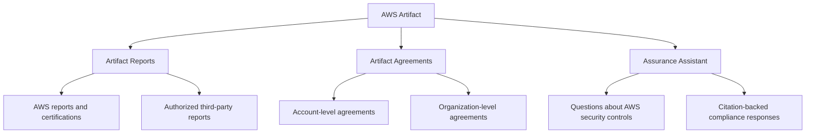
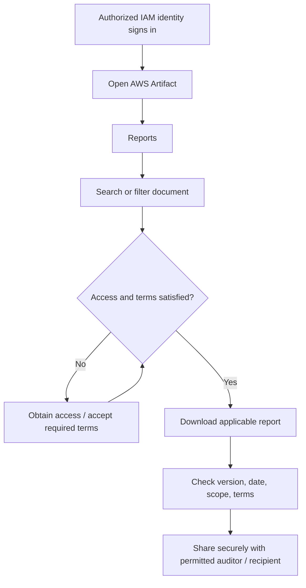
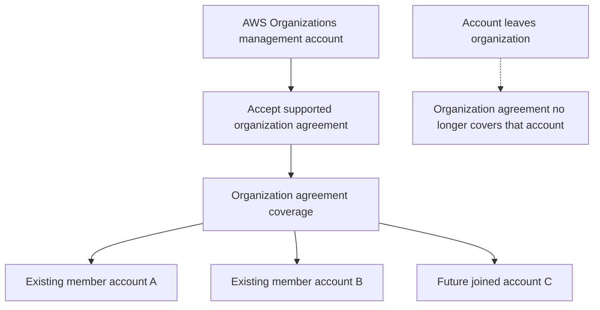
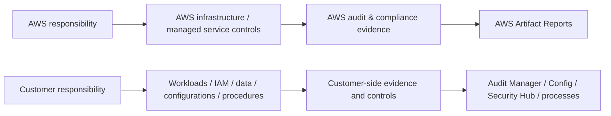
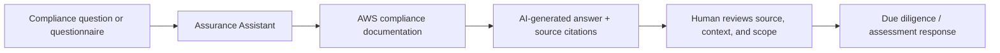
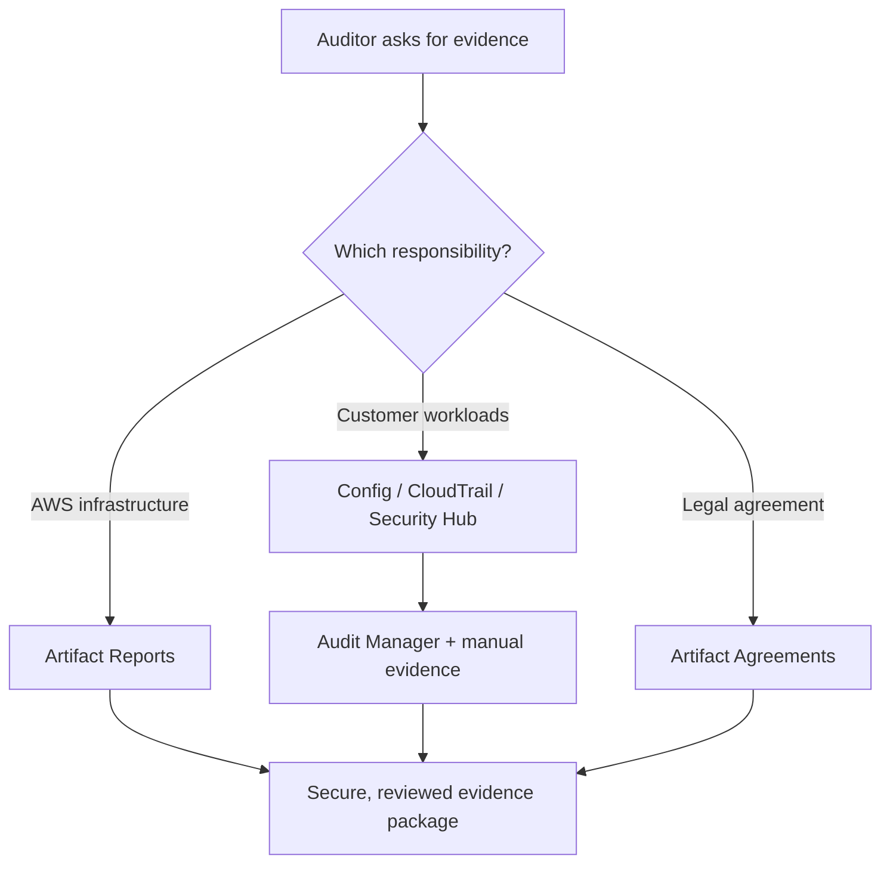

<div align="center">

# 🏛️ AWS Artifact

### Complete GitHub Study Guide · AWS Cloud Practitioner + Solutions Architect – Associate

[](https://aws.amazon.com/artifact/)
[](https://aws.amazon.com/certification/certified-cloud-practitioner/)
[](https://aws.amazon.com/certification/certified-solutions-architect-associate/)
[](https://docs.aws.amazon.com/artifact/latest/ug/)
[](#official-aws-references)

**One sentence to remember:** **AWS Artifact** is AWS's self-service portal for **AWS compliance reports and certifications**, **certain AWS agreements**, and **AI-assisted answers to AWS compliance questions**.

[🟢 CCP essentials](#ccp-essentials) · [🔵 SAA architecture](#saa-deep-dive) · [⚔️ Comparisons](#service-comparisons) · [⚠️ Exam traps](#exam-traps) · [🧪 Practice questions](#practice-questions)

</div>

---

> [!IMPORTANT]
> **Artifact provides AWS's compliance evidence. It does not scan your VPC, automatically collect evidence about your own workloads, or certify your application as compliant.**
>
> **AWS Artifact ≠ AWS Audit Manager ≠ AWS Config ≠ AWS CodeArtifact.**

> [!NOTE]
> **About this guide:** The foundational definitions, use cases, comparisons, and exam ideas come from the original `01-overview.md`. Expanded architecture, IAM, agreement, report-sharing, and 2026 features are checked against **official AWS sources** linked at the end. This is an independent set of study notes, not an AWS-issued certification guide or legal advice.

## 📚 Table of contents

1. [What is AWS Artifact?](#1-what-is-aws-artifact)
2. [Why does AWS Artifact exist?](#2-why-does-aws-artifact-exist)
3. [The three capabilities of AWS Artifact](#3-the-three-capabilities-of-aws-artifact)
4. [Understanding compliance documents](#4-understanding-compliance-documents)
5. [How AWS Artifact Reports work](#5-how-aws-artifact-reports-work)
6. [How AWS Artifact Agreements work](#6-how-aws-artifact-agreements-work)
7. [Shared responsibility and compliance](#7-shared-responsibility-and-compliance)
8. [🟢 CCP essentials](#ccp-essentials)
9. [🔵 SAA deep dive](#saa-deep-dive)
10. [IAM permissions and secure document sharing](#10-iam-permissions-and-secure-document-sharing)
11. [Assurance Assistant — 2026 feature](#11-assurance-assistant--2026-feature)
12. [Notifications and report updates](#12-notifications-and-report-updates)
13. [Third-party compliance reports](#13-third-party-compliance-reports)
14. [Real-world audit workflow](#14-real-world-audit-workflow)
15. [⚔️ Compare with similar AWS services](#service-comparisons)
16. [⚠️ Common exam traps](#exam-traps)
17. [Pricing, security, and operational responsibility](#17-pricing-security-and-operational-responsibility)
18. [🧪 Exam-style practice questions](#practice-questions)
19. [Architecture and decision scenarios](#19-architecture-and-decision-scenarios)
20. [Quick-revision cheat sheet](#20-quick-revision-cheat-sheet)
21. [Official AWS references](#official-aws-references)

---

## 1. What is AWS Artifact?

**AWS Artifact** provides **on-demand access** to documentation about AWS's security and compliance posture, and lets customers **review and manage supported agreements with AWS**. It also includes **Assurance Assistant**, which helps answer questions about AWS compliance documentation.

### In simple English

Think of a company that rents office space in a professionally managed building:

- The **building owner** maintains the physical infrastructure.
- Your company must still **secure its own office and operations**.
- When an auditor asks how secure the building's infrastructure is, you request the **building owner's audit and certification documents**.

**AWS Artifact = the document desk where AWS provides that evidence.**

| Question | Short answer |
|---|---|
| What is it? | Self-service **security and compliance document/agreements portal** |
| What does it provide? | AWS audit reports, certifications, certain agreements, third-party reports, compliance assistance |
| Where is it accessed? | AWS Management Console / supported APIs for relevant functions |
| Who uses it? | Customers, compliance teams, auditors, security and procurement teams |
| Is it a scanner? | **No** |
| Does it automatically make my workload compliant? | **No** |
| Main cost | **No additional charge** for AWS Artifact documents and agreements |
| Most important CCP phrase | **On-demand access to AWS compliance reports and agreements** |

### Three terms not to mix up

- **Compliance report:** Evidence from an audit or assessment of AWS's relevant controls.
- **Certification:** Attestation that specified standards or requirements have been assessed within a defined scope.
- **Agreement:** Contractual/legal terms accepted between a customer and AWS (where available in Artifact).

**A report or certificate is not the same as an agreement.**

---

## 2. Why does AWS Artifact exist?

Suppose your organization runs a payment-processing application on AWS. Its auditor requests evidence about AWS infrastructure controls and asks whether AWS has relevant PCI-related documentation.

Without a self-service portal, you might need to request documentation individually. With Artifact, authorized staff can access available reports directly, subject to any applicable terms.

### Problems it helps solve

1. **Evidence retrieval:** Locate AWS audit reports without opening a routine support request.
2. **Due diligence:** Review AWS compliance documentation before moving workloads.
3. **Audit support:** Give authorized auditors appropriate AWS-side evidence.
4. **Contract administration:** Review and accept certain AWS agreements.
5. **Multi-account consistency:** Manage eligible organization-level agreements.
6. **Questionnaire completion:** Use the newer Assurance Assistant capability for questions about AWS controls.

### What it is NOT designed to solve

- Testing whether **your own** S3 bucket blocks public access.
- Detecting unauthorized API calls or resource changes.
- Automatically collecting **your company's** compliance evidence.
- Enforcing encryption, patching, firewall rules, or IAM least privilege.
- Guaranteeing an application satisfies HIPAA, PCI DSS, GDPR, or ISO requirements.

For those tasks, use other tools and operational processes; see the [service comparison matrix](#service-comparisons).

---

## 3. The three capabilities of AWS Artifact



| Capability | What it does | Exam clue |
|---|---|---|
| **AWS Artifact Reports** | Download available AWS security/compliance documents and authorized vendor reports | `SOC`, `ISO`, `PCI`, `audit report` |
| **AWS Artifact Agreements** | Review, accept, track, and manage supported AWS agreements | `BAA`, `contract`, `organization agreement` |
| **Assurance Assistant** | Generate sourced AI responses to questions about AWS security/compliance controls | `vendor due diligence questionnaire`, `AWS compliance Q&A` |

> [!TIP]
> **CCP priority:** Understand **Reports** and **Agreements** first. **SAA priority:** Add account-vs-organization scope, permission design, and the shared responsibility boundary. Assurance Assistant is a useful current feature but should not crowd out the two classic exam concepts.

---

## 4. Understanding compliance documents

The names look similar, but the exam may identify a required document by its abbreviation.

| Document / term | Plain-English meaning | Why it matters |
|---|---|---|
| **SOC 1** | Reports on controls relevant to customers' financial reporting | Financial reporting and internal-control reviews |
| **SOC 2** | Report on a service organization's controls against relevant trust services criteria | Security/control assurance and vendor reviews |
| **SOC 3** | General-use report related to trust services criteria | Higher-level public-facing assurance |
| **ISO certification** | Certification within the scope of a relevant ISO standard, such as ISO/IEC 27001 | Security management and procurement requirements |
| **PCI DSS** | Payment Card Industry Data Security Standard | Payment-card environment controls |
| **C5** | German Cloud Computing Compliance Criteria Catalogue | Cloud controls / German regulatory and procurement contexts |
| **FedRAMP** | U.S. federal cloud authorization framework | Federal workloads; check the specific authorized scope and package access |
| **BAA** | Business Associate Addendum | Legal agreement relevant to certain HIPAA-related deployments |
| **Audit artifact** | Evidence presented to support an audit assertion | Proof/documentation, **not** automatic customer compliance |

### SOC report: what does “SOC” mean?

**System and Organization Controls.** The number indicates the particular reporting purpose. **SOC 1, SOC 2, and SOC 3 are not three levels of the same certificate**.

### ISO certificate: what does it prove?

It supports a statement about a **specified certified scope**, not every possible AWS product, Region, workload configuration, or customer process.

### PCI DSS: what does it prove?

AWS PCI-related documents can support the **AWS portion** of your payment environment's assessment. Your application architecture, cardholder-data flows, access control, operations, and other customer responsibilities still require their own assessment.

> [!WARNING]
> **Exam trap:** “AWS has a certification” does not mean “everything I deploy on AWS is automatically certified/compliant.” Always distinguish the **AWS-infrastructure scope** from the **customer-workload scope**.

---

## 5. How AWS Artifact Reports work

### 5.1 Typical download workflow



**Step-by-step:**

1. Sign in with an appropriately authorized AWS identity.
2. Open [AWS Artifact in the console](https://console.aws.amazon.com/artifact/).
3. Choose **View reports** or **Reports**.
4. Browse **AWS reports** (or an authorized **Third-party reports** tab).
5. Search for the relevant report, such as SOC, ISO, PCI, or C5.
6. Check report **title, scope, date, and version**.
7. Review and accept any required **terms and conditions**.
8. Download the report and inspect any relevant attachments.
9. Share only with recipients authorized by the document's terms, using a secure method.

### 5.2 Important facts

- **Some reports have previous versions** available from their details pages. These can matter when an auditor asks for a specific reporting period.
- **Some reports have restricted availability** or require explicit access/terms acceptance.
- A downloaded report can contain a **unique, traceable watermark** associated with the download.
- AWS Artifact reports are **not interchangeable with an operational security dashboard**.
- Reports may contain **PDF attachments**; check them where relevant.

### 5.3 Confidentiality: a major real-world and interview point

> [!CAUTION]
> **Do not upload confidential Artifact reports into a public GitHub repository or send them indiscriminately.** Check the exact document's terms and conditions. AWS advises secure sharing rather than email attachments or public uploads. Customer sharing may be permitted for particular reports **only when their terms allow it**.

**Good:** A security officer retrieves the current AWS SOC report and makes it available securely to an authorized auditor.

**Bad:** A developer commits the full confidential report to a public repository simply because it was downloadable from Artifact.

### 5.4 “Download report” versus “accept agreement”

These are separate actions. **Accepting the terms to download a report does not mean you accepted a BAA or another AWS service agreement.**

---

## 6. How AWS Artifact Agreements work

Artifact Agreements supports **eligible agreements between AWS and its customers**. One important example is the **Business Associate Addendum (BAA)** in applicable HIPAA contexts.

### 6.1 Account agreement

An authorized principal reviews and accepts a supported agreement **for one AWS account**.

### 6.2 Organization agreement

An authorized principal in the **AWS Organizations management account** can accept certain supported agreements on behalf of **all existing and future accounts** in the organization.



| Scope | Who can accept? | Which accounts are covered? |
|---|---|---|
| **Account agreement** | Identity with appropriate account permissions | That account |
| **Organization agreement** | Authorized identity in the **management account** | Existing and future organization accounts, per applicable terms |

### 6.3 Requirements for organization agreements

- Use **AWS Organizations with all features enabled**, not consolidated billing features only.
- Work from the **management account** with correct Artifact permissions to **accept or terminate** an organization agreement.
- Artifact can use an AWS-managed **service-linked role** for organization integration.
- Review with **legal, privacy, and compliance stakeholders** before accepting an agreement.
- Verify actual agreement status and any special eligibility conditions.

### 6.4 Lifecycle and changed membership

- You can **review the status** of supported accepted agreements in Artifact.
- Eligible agreements can be **terminated** or reactivated using supported procedures.
- If an account **leaves the organization**, do **not** assume the organization's agreement continues covering it.
- Termination can affect business/legal eligibility: treat the action carefully.

### 6.5 Important BAA distinction

**BAA accepted ≠ HIPAA-compliant application.** The BAA can be one necessary contractual element. Customers still need to handle the rest of their own HIPAA responsibilities and use appropriate AWS services/configurations.

> [!IMPORTANT]
> **A legal agreement is not a technical security control.** Artifact can help establish contractual coverage; it does not encrypt patient data, configure access controls, or certify your software.

---

## 7. Shared responsibility and compliance

**AWS security/compliance evidence covers AWS's responsibilities. Your organization remains responsible for security and compliance in its own workloads.**



| AWS side (examples) | Customer side (examples) |
|---|---|
| Security **of** AWS infrastructure | Security **in** the cloud / customer configurations |
| Physical facility controls | IAM identities and least privilege |
| Infrastructure operations within AWS's responsibility | S3 permissions and encryption choices |
| Relevant AWS-managed control evidence | Application vulnerabilities and patching responsibility |
| AWS service compliance documentation | Your organization’s policies and audit evidence |

### Example: S3 payment records

Suppose a payment company stores sensitive data in Amazon S3:

- **AWS Artifact**: helps retrieve available AWS-side PCI documentation.
- **AWS Config**: can evaluate supported S3 configuration rules.
- **AWS Security Hub**: can identify relevant security control findings.
- **AWS CloudTrail**: records applicable account API events.
- **AWS Audit Manager**: can assemble evidence relevant to a defined customer audit assessment.
- **Customer**: must design, test, operate, and validate its application controls.

**Key principle:** Access to an audit report is **evidence**, not an automatic security enforcement action.

---

<a id="ccp-essentials"></a>
## 🟢 Cloud Practitioner (CCP) essentials


**Exam goal:** Recognize AWS Artifact as the portal for **AWS compliance documents and agreements**.

### 8.1 The 12 facts you must know

1. **AWS Artifact** is an AWS **security and compliance documentation portal**.
2. It provides **on-demand** AWS compliance documentation.
3. Common documents include **SOC, ISO, and PCI** material.
4. It offers **AWS Artifact Reports**.
5. It offers **AWS Artifact Agreements**.
6. Some eligible agreements, such as a **BAA**, may be available for review/acceptance.
7. It can help **auditors and compliance teams** obtain AWS-side evidence.
8. Artifact reports and agreements are provided **at no additional charge**.
9. **Artifact is not a monitoring or scanning service**.
10. **Artifact does not make your resources compliant automatically**.
11. **AWS Audit Manager** assists with collecting **your** audit evidence; Artifact delivers **AWS** documentation.
12. **AWS CodeArtifact** is a software package repository, **not** a compliance-report portal.

### 8.2 CCP trigger keywords

`AWS compliance reports` · `SOC report` · `ISO certification` · `PCI documentation` · `audit documentation` · `self-service compliance portal` · `AWS agreement` · `Business Associate Addendum (BAA)` · `evidence from AWS` · `on-demand report access`

### 8.3 CCP decision table

| The question emphasizes… | Choose… |
|---|---|
| Download an **AWS SOC report** for an auditor | **AWS Artifact** |
| Retrieve AWS **ISO/PCI documentation** | **AWS Artifact** |
| Review/accept supported agreement with AWS | **AWS Artifact Agreements** |
| Automatically gather evidence of **your own AWS usage** | **AWS Audit Manager** |
| Track S3, EC2, and security-group configuration changes | **AWS Config** |
| Aggregate security findings and security posture checks | **AWS Security Hub** |
| Record who made an API call in AWS | **AWS CloudTrail** |
| Store Python/npm/Maven dependencies | **AWS CodeArtifact** |

> [!TIP]
> **CCP memory formula:** **Artifact = AWS audit papers + eligible agreements**. If the scenario shifts to *your own infrastructure configuration or collected assessment evidence*, choose a different service.

---

<a id="saa-deep-dive"></a>
## 🔵 Solutions Architect – Associate (SAA) deep dive


**Exam goal:** Choose correct **account scope**, **organizational agreement design**, **IAM access model**, and **evidence source** in multi-account architectures.

### 9.1 Centralized agreement management architecture

For a company with 50 AWS accounts:

1. Set up **AWS Organizations** using **all features**.
2. Confirm its management-account identity has agreement-management permissions.
3. Review the relevant agreement with the company's legal/compliance team.
4. Accept an eligible **organization agreement** in AWS Artifact.
5. Verify covered accounts and record the agreement status.
6. Onboard future organization accounts while preserving agreed requirements.
7. Review contractual effects if accounts leave the organization.

**Why it matters:** You avoid unnecessary account-by-account acceptance where a valid organization-wide agreement is available.

> [!WARNING]
> A member-account administrator is **not equivalent** to the Organizations management-account administrator for accepting/terminating organization agreements.

### 9.2 Compliance evidence architecture

A company needs evidence for a security audit. The architect must distinguish **which side of the shared responsibility model** each requirement concerns.

| Auditor request | Best initial source |
|---|---|
| “Show AWS infrastructure control reports.” | **Artifact** |
| “Prove your S3 buckets are configured according to policy.” | **AWS Config** + customer processes |
| “Show security findings across AWS accounts.” | **Security Hub** |
| “Show a history of AWS API activity.” | **CloudTrail** |
| “Assemble assessment evidence for our organization's controls.” | **Audit Manager** and manual evidence where necessary |
| “Show the accepted legal agreement with AWS.” | **Artifact Agreements** |

### 9.3 Access control, least privilege, and separation of duties

A well-designed architecture separates three roles:

- **Report reviewer:** Can list/view/download reports.
- **Agreement viewer:** Can inspect accepted agreements; does not accept new ones.
- **Agreement administrator:** Can accept/terminate permitted agreements, after appropriate authorization and legal review.

Avoid granting agreement-changing permissions to everyone who merely needs to read a SOC report.

### 9.4 Security of downloaded evidence

Treat a confidential report as a **sensitive information asset**:

- Restrict who can download and receive it.
- Read and follow the document-specific disclosure terms.
- Use approved secure document-sharing channels.
- Avoid public repositories, chat channels, or unapproved uploads.
- Select the proper report **version and period** for an assessment.
- Apply internal retention, access review, and disposal practices.

### 9.5 Compliance is an ongoing process

An audit document is a **point-in-time or period-specific** statement with a defined scope. AWS Artifact does **not** continuously validate every customer application. Customers still need monitoring, change control, data governance, and evidence management.

### 9.6 The SAA architecture memory model

```text
AWS ARTIFACT       -> obtain AWS-side evidence / manage eligible agreements
AWS ORGANIZATIONS  -> establish organization/account structure
IAM                -> decide which people/roles may view or accept
AWS CONFIG         -> evaluate supported resource configurations
SECURITY HUB       -> central security findings and posture checks
CLOUDTRAIL         -> AWS API activity records
AWS AUDIT MANAGER  -> collect/manage evidence for customer's audit assessment
```

---
## 10. IAM permissions and secure document sharing

**IAM determines who can use AWS Artifact.** Access to reports is different from the power to legally accept agreements.

### 10.1 AWS managed IAM policies

| Policy | Purpose | What to remember |
|---|---|---|
| `AWSArtifactReportsReadOnlyAccess` | List, view, and download reports | **Reports** access, not broad agreement administration |
| `AWSArtifactAgreementsReadOnlyAccess` | View agreement information and accepted agreements | **Read-only** agreement access |
| `AWSArtifactAgreementsFullAccess` | List, download, accept, and terminate supported agreements | **Sensitive administrative privilege** |
| `AWSArtifactComplianceInquiriesReadOnlyAccess` | View/export Assurance Assistant compliance inquiries | Read-only compliance inquiry capability |
| `AWSArtifactComplianceInquiriesFullAccess` | Create/view/export inquiries and provide feedback | Assurance Assistant authoring capability |

These are AWS-managed policies; organizations may prefer narrower **customer-managed IAM policies** when specific report series or duties should be restricted.

### 10.2 IAM example: report reader

Attach the relevant AWS-managed policy to an authorized **role** in your access-management process. An example identity policy that delegates read-only report access is:

```json
{
  "Version": "2012-10-17",
  "Statement": [
    {
      "Effect": "Allow",
      "Action": [
        "artifact:ListReports",
        "artifact:GetReportMetadata",
        "artifact:GetReport",
        "artifact:GetTermForReport",
        "artifact:ListReportVersions"
      ],
      "Resource": "*"
    }
  ]
}
```

> [!NOTE]
> This is an **illustrative report-read policy**, adapted from AWS's current IAM examples. It does **not** grant permission to accept agreements. Consider the AWS-managed read-only policy or finer controls for production. Always check the [latest example IAM policies](https://docs.aws.amazon.com/artifact/latest/ug/example-iam-policies.html).

### 10.3 Fine-grained report access

AWS Artifact supports IAM condition keys for selecting report categories or series, including:

- `artifact:ReportCategory`
- `artifact:ReportSeries`

**Use case:** An auditor should download selected SOC, PCI, and ISO reports but not all available report types.

**Exam insight:** You can use **IAM and supported Artifact permissions** to limit who downloads reports. You do **not** need to give an auditor permission to modify EC2 or S3 just to read AWS Artifact documents.

### 10.4 Access to organization agreements

- **Reading** an agreement and **accepting/terminating** it are separate privileges.
- Accepting/terminating **organization agreements** requires the **management account** and appropriate permissions.
- Account/organization administrators may have different allowable actions based on account membership and role.
- AWS Artifact uses the `AWSServiceRoleForArtifact` service-linked role for relevant AWS Organizations integration.

### 10.5 Common authorization mistakes

| Symptom | Likely cause | First check |
|---|---|---|
| Cannot see/download report | IAM permission or report access/terms | Report-read policy, report eligibility, T&Cs |
| Can view agreements but cannot accept | Read-only IAM permissions | Agreement administration permissions |
| Cannot accept organization agreement | Wrong account / Organizations prerequisites | **Management account** and **all features** |
| Auditor requests report but receives a public link | Unsafe sharing workflow | Report's disclosure terms and secure delivery |
| IAM policy exists, still cannot access resource | Other applicable permission/condition restrictions | Effective permissions and explicit denies |

---

## 11. Assurance Assistant — 2026 feature

> [!NOTE]
> **Current AWS feature, added July 2026:** AWS Artifact includes **Assurance Assistant**, which uses AI to produce **citation-backed responses** to questions about AWS security controls and compliance documentation. This capability was **not present in the uploaded original overview**.

### What it does

- Answers questions about **AWS services' security and compliance controls**.
- Helps with **vendor due diligence** and compliance questionnaires.
- Uses AWS compliance documentation as source material and **provides citations**.
- Supports a **single-question** workflow and a **questionnaire** workflow.
- Allows review and export of relevant responses.
- Is available in the Artifact console at **no additional charge**.

### Simple workflow



### Example

A procurement department asks: “What AWS controls and evidence relate to data-center physical security?”

Assurance Assistant can help formulate a sourced response **about AWS's controls**. The team should still review the citations and ensure the answer is applicable to the relevant scope and time period.

### Critical limitations

- **It is not a compliance auditor or certification authority.**
- It does **not** verify that the customer's application is configured securely.
- Answers are AI-generated and require **human review**.
- Responses to customer-specific implementation questions are generally outside this tool's intended scope.
- Supported formats and features can change; check the current user guide.

> [!TIP]
> **Exam differentiation:** **Artifact Reports** = original AWS documents. **Assurance Assistant** = generated, **cited answers about AWS controls**. **Audit Manager** = evidence workflow for **your own audit assessments**.

**Official feature release:** [AWS announcement, July 1, 2026](https://aws.amazon.com/about-aws/whats-new/2026/07/aws-artifact-assurance-assistant/).

---

## 12. Notifications and report updates

AWS compliance reports and agreements can change. Artifact supports **notification configuration** for relevant updates.

### Why this matters

- A security team needs to know when a new report is published.
- A compliance team needs awareness of changes to agreements.
- An auditor wants to retrieve the **correct report version** for a given audit period.

### How AWS Artifact notifications work

1. Configure the required **AWS User Notifications** notification hub(s).
2. Open notification settings from the Artifact console.
3. Choose events for **reports**, **agreements**, or selected report categories/series.
4. Configure recipients and complete required email verification.
5. Review notices and evaluate whether they affect your audit process.

> [!NOTE]
> Artifact notification setup uses **AWS User Notifications**. Availability and exact setup may vary by AWS partition. A notification that a report changed **does not mean your application became noncompliant**.

### Historical versions vs. current reports

A new report may cover a different period from the previous report. For an audit, choose the correct version and date rather than automatically using the newest file without checking its scope.

---

## 13. Third-party compliance reports

AWS Artifact is not restricted to **AWS-authored** reports.

It also supports applicable compliance reports from **independent software vendors (ISVs)** that sell through AWS Marketplace, in connection with **AWS Marketplace Vendor Insights**.

### Example

A company purchases a security tool through AWS Marketplace and needs to review the **vendor's** SOC report as part of third-party risk management.

- **AWS report:** Evidence about **AWS** controls.
- **ISV report:** Evidence about the **vendor's** controls.

**They are not interchangeable.**

### Access caveat

Not every customer can download every ISV report. Access to specific third-party reports can depend on being granted access through **AWS Marketplace Vendor Insights**. Their disclosure conditions may be different from AWS's own reports.

> [!WARNING]
> A third-party vendor running on AWS is **not automatically certified simply because AWS has a certificate**. Evaluate the vendor's own controls, boundaries, and audit reports.

---

## 14. Real-world audit workflow

### Scenario: Financial-services application preparing for a security assessment

The company operates an application on AWS and needs evidence for a customer audit.

**Auditor requests:**

- AWS infrastructure SOC documentation.
- A review of relevant AWS certification scope.
- The company's own controls for S3 encryption and public-access restrictions.
- Evidence of recent identity and access changes.
- A review of the company's AWS service agreements.

### Appropriate response

| Requirement | Action / service | Why |
|---|---|---|
| AWS infrastructure SOC report | **Artifact Reports** | Obtain AWS-side audit evidence |
| Relevant AWS certificates | **Artifact Reports** | Verify the applicable certified scope |
| S3 configuration evidence | **AWS Config**, processes, Audit Manager | Customer-side evidence |
| Identity/API change trail | **AWS CloudTrail**, other applicable records | Customer account activity evidence |
| Evidence package preparation | **AWS Audit Manager** and manual materials | Organize assessment evidence |
| Accepted AWS agreement | **Artifact Agreements** | Review contractual status |
| Explain AWS control questions | **Assurance Assistant**, with verification | Sourced AWS-side due diligence answers |

### The full picture



**Final audit lesson:** A reliable evidence package typically combines **AWS-produced documents** with **customer-produced operational evidence**.

---

<a id="service-comparisons"></a>
## ⚔️ Compare with similar AWS services

### 15.1 At-a-glance comparison

| AWS service | Main purpose | Best exam keyword |
|---|---|---|
| **AWS Artifact** | AWS reports, certifications, agreements | `AWS SOC/ISO/PCI report` |
| **AWS Audit Manager** | Collect/review/manage evidence for customer audit assessments | `automated evidence collection` |
| **AWS Config** | Track/evaluate resource configurations | `configuration compliance` |
| **AWS Security Hub** | Centralize security findings and security posture checks | `security findings` |
| **AWS CloudTrail** | Record AWS account/API activity | `who called an AWS API` |
| **Amazon CloudWatch** | Metrics, alarms, logs, operational visibility | `metrics and monitoring` |
| **Amazon GuardDuty** | Threat detection using multiple AWS data sources | `suspicious activity/threat findings` |
| **Amazon Inspector** | Vulnerability management and workload scanning | `software vulnerabilities` |
| **AWS IAM** | Access-control permissions and identities | `who may download report` |
| **AWS Organizations** | Central administration of multiple AWS accounts | `organization/account hierarchy` |
| **AWS CodeArtifact** | Managed software package repository | `npm/PyPI/Maven dependencies` |
| **AWS Marketplace Vendor Insights** | Third-party vendor risk/compliance information | `ISV risk assessment` |

### 15.2 Artifact vs. Audit Manager — the most important comparison

| Question | AWS Artifact | AWS Audit Manager |
|---|---|---|
| Whose evidence? | Primarily **AWS** infrastructure and service control evidence | Evidence about **the customer's AWS usage** |
| Automatically collect customer resource evidence? | **No** | **Yes**, for supported controls/sources |
| Download AWS SOC reports? | **Yes** | Not its primary function |
| Build assessment frameworks and evidence packages? | No | **Yes** |
| Accept AWS agreements? | **Yes**, supported agreements | No |
| Main user | Compliance officer, auditor, procurement team | Audit owner, compliance manager, assessor |

**Memory:** **Artifact gives you AWS's papers; Audit Manager organizes evidence for your audit.**

### 15.3 Artifact vs. Config

<details>
<summary><strong>Click to compare: Artifact vs. AWS Config</strong></summary>

- **Artifact:** Downloads AWS-published compliance documentation.
- **Config:** Records supported resource configurations and evaluates rules, such as whether an S3 bucket has approved settings.
- **Exam trap:** Artifact cannot answer “Which of my security groups allow port 22 from `0.0.0.0/0`?” by scanning your account.

</details>

### 15.4 Artifact vs. Security Hub

<details>
<summary><strong>Click to compare: Artifact vs. AWS Security Hub</strong></summary>

- **Artifact:** Compliance documents and agreements.
- **Security Hub:** Security findings and posture checks aggregated across enabled AWS integrations.
- **Exam trap:** A **SOC report** is not a Security Hub **finding**.

</details>

### 15.5 Artifact vs. CloudTrail

<details>
<summary><strong>Click to compare: Artifact vs. AWS CloudTrail</strong></summary>

- **Artifact:** AWS-issued documents and agreements.
- **CloudTrail:** Records applicable AWS API/account activity events.
- **Exam trap:** “Who deleted my S3 bucket?” points to CloudTrail, not Artifact.

</details>

### 15.6 Artifact vs. AWS Organizations

<details>
<summary><strong>Click to compare: Artifact vs. AWS Organizations</strong></summary>

- **Organizations:** Structures and administers multiple AWS accounts.
- **Artifact Agreements:** Can manage eligible **organization-wide contractual agreements** using that account structure.
- **Exam trap:** AWS Organizations itself is not where you download AWS SOC reports.

</details>

### 15.7 Artifact vs. AWS IAM

<details>
<summary><strong>Click to compare: Artifact vs. AWS IAM</strong></summary>

- **IAM:** Grants or denies access to the Artifact service/API operations.
- **Artifact:** Holds the applicable reports and agreements.
- **Exam trap:** Having IAM access does not mean the user should accept legal agreements or redistribute a confidential report.

</details>

### 15.8 Artifact vs. CodeArtifact — name trap

<details>
<summary><strong>Click to compare: Artifact vs. CodeArtifact</strong></summary>

- **AWS Artifact:** Compliance and audit documentation; agreements.
- **AWS CodeArtifact:** Software artifact/package repository (for example, package dependencies).
- **Exam trap:** `audit report` and `package repository` lead to **different AWS services**.

</details>

### 15.9 Artifact vs. Marketplace Vendor Insights

<details>
<summary><strong>Click to compare: Artifact vs. AWS Marketplace Vendor Insights</strong></summary>

- **Vendor Insights:** Helps discover and assess third-party vendor security/compliance information.
- **Artifact Third-party reports:** Can provide downloadable reports from vendors for which access has been granted.
- **Exam trap:** An AWS SOC report is not a substitute for an ISV's own report.

</details>

### 15.10 Artifact vs. Amazon S3

<details>
<summary><strong>Click to compare: Artifact vs. Amazon S3</strong></summary>

- **Artifact:** A purpose-built source for AWS-provided audit reports and agreements.
- **S3:** General-purpose object storage.
- **Exam trap:** Artifact is not your organization's generic document storage platform.

</details>

---

<a id="exam-traps"></a>
## ⚠️ Common exam traps and misconceptions

| ❌ Misconception | ✅ Correct interpretation |
|---|---|
| 1. “Artifact audits my VPC.” | It provides **documents and agreements**, not workload scans. |
| 2. “Artifact proves my app complies with every regulation.” | It provides **AWS-side evidence**, not end-to-end customer compliance. |
| 3. “Artifact and Audit Manager are the same.” | Artifact = AWS documentation; Audit Manager = customer audit evidence workflows. |
| 4. “Artifact tracks S3 configuration changes.” | **AWS Config** evaluates supported resource configurations. |
| 5. “Artifact detects active cyber threats.” | Think **GuardDuty/Security Hub** and relevant detection services. |
| 6. “Artifact stores npm packages.” | That is **AWS CodeArtifact**. |
| 7. “All Artifact reports are public.” | Access and **disclosure terms** vary. |
| 8. “Downloading means I can publish it anywhere.” | Check report terms; confidential downloads require restricted sharing. |
| 9. “SOC 1/2/3 are three levels of the same certificate.” | They have **different reporting purposes**. |
| 10. “AWS's ISO certificate applies to all customer code.” | Certification scope does not automatically extend to customer workloads. |
| 11. “A BAA makes an app HIPAA compliant.” | An agreement does **not** replace security/compliance work. |
| 12. “An AWS PCI report proves the customer's app is PCI compliant.” | Customer-side assessment is still required. |
| 13. “A legal agreement is the same as a compliance report.” | **Agreement ≠ audit evidence report.** |
| 14. “Accepting download T&Cs accepts a BAA.” | These are separate workflows. |
| 15. “Artifact costs the same as Audit Manager.” | Artifact is provided without additional charge; Audit Manager has its own pricing. |
| 16. “Every user who can download reports can accept agreements.” | IAM permissions can and should separate these actions. |
| 17. “A member-account admin can accept org agreements for everyone.” | Organization agreements require authorized access from the **management account**. |
| 18. “Consolidated billing-only Organizations is sufficient.” | Artifact organization agreements require **all features** enabled. |
| 19. “An organization agreement covers only existing accounts.” | Supported org agreements can cover **existing and future** member accounts. |
| 20. “An account leaving the org keeps the org agreement automatically.” | An exited account is no longer covered by the organization's agreement. |
| 21. “The newest report is always the right one for an audit.” | Check the **reporting period, scope, and version**. |
| 22. “Artifact only has AWS reports.” | It can include **authorized third-party/ISV reports**. |
| 23. “Every Marketplace vendor report is accessible to everyone.” | Specific third-party access may require **Vendor Insights authorization**. |
| 24. “Artifact is just a file portal and has no other features.” | It also handles agreements, notifications, and **Assurance Assistant**. |
| 25. “Assurance Assistant verifies the customer's architecture.” | It answers questions about **AWS controls**; it does not audit workloads. |
| 26. “An AI-generated compliance answer requires no verification.” | Review its **citations, date, and scope**. |
| 27. “The Artifact report watermark can be ignored.” | Downloads can have a **traceable watermark**; handle responsibly. |
| 28. “You must always open a support ticket for SOC/ISO reports.” | Artifact supports **self-service access** to available reports. |
| 29. “AWS Organizations replaces Artifact.” | Organizations manages accounts; Artifact manages reports/agreements. |
| 30. “CloudTrail replaces Artifact.” | CloudTrail records AWS account activity, not AWS-issued compliance reports. |

### Six interview-style clarifications

**Q: Is AWS Artifact a monitoring service?**  
**A:** No. It is chiefly a **compliance documentation and agreement service**.

**Q: What is the difference between Artifact and Audit Manager?**  
**A:** Artifact provides **AWS's evidence**; Audit Manager helps collect and organize **customer-side audit evidence**.

**Q: Can Artifact help with a HIPAA BAA?**  
**A:** Yes, for supported BAA agreements and eligible account/organization scope, but **accepting a BAA is not sufficient for HIPAA compliance**.

**Q: Can we share SOC reports publicly?**  
**A:** Do not assume so. Review the document's **terms**, and handle confidential downloads via approved secure sharing.

**Q: Does an organization agreement automatically cover new accounts?**  
**A:** For supported org agreements, **existing and subsequent member accounts** are covered, subject to the agreement and organization requirements.

**Q: Is AWS Artifact a global or regional service?**  
**A:** It is a broadly accessible AWS console service, **not a regional workload scanner**. Features and AWS partitions can have different availability requirements; don't assume the AWS Artifact compliance documentation applies identically to every service/Region without checking scope.

---

## 17. Pricing, security, and operational responsibility

### Pricing

- **AWS Artifact documents and agreements are available at no additional charge.**
- **Assurance Assistant** is currently available at **no additional charge** through Artifact.
- Separate services you may use in the same audit workflow (such as **Audit Manager**, third-party storage, or other AWS services) can have **their own charges**.

> [!IMPORTANT]
> Do not confuse **free access to AWS compliance documents** with “the AWS application architecture or audit project has no cost.”

### Shared responsibilities for documents

| AWS responsibilities | Customer responsibilities |
|---|---|
| Operate AWS Artifact and protect reports while hosted by AWS | Protect reports after download |
| Supply available AWS-side audit documentation | Verify relevant version, date, and service scope |
| Make supported agreements available via Artifact | Review legal terms and manage appropriate acceptance |
| Operate access-controlled service infrastructure | Assign least-privilege IAM permissions |
| Publish changes/updates to supported materials | Handle retention, permitted sharing, and audit readiness |

### When should you use it?

**Good fit:** You need official documentation about AWS's security and compliance posture or supported agreements.

**Poor fit:** You need a managed service to perform continuous scanning, auto-remediation, or vulnerability assessments of your applications.

---
<a id="practice-questions"></a>
## 🧪 Exam-style practice questions

> **Instructions:** Attempt the question before expanding the answer. These are **original study questions**, not official or leaked AWS certification questions.

### 🟢 CCP questions (Q1–Q15)

<details>
<summary><strong>Q1 · CCP:</strong> An auditor requests AWS SOC 2 documentation for the cloud infrastructure used by a company. Which service should the company use?</summary>

**Answer: AWS Artifact.** Its Reports section provides applicable AWS audit and compliance documents on demand.
</details>

<details>
<summary><strong>Q2 · CCP:</strong> Which AWS service is designed to manage certain AWS agreements such as a BAA?</summary>

**Answer: AWS Artifact Agreements.** It supports agreement review, acceptance, and status management for eligible account and organization agreements.
</details>

<details>
<summary><strong>Q3 · CCP:</strong> A team must automatically collect compliance evidence about its own AWS resources. Which service is the stronger fit?</summary>

**Answer: AWS Audit Manager.** Artifact supplies AWS-side documents; Audit Manager helps gather and organize customer audit evidence.
</details>

<details>
<summary><strong>Q4 · CCP:</strong> Does downloading an AWS ISO certificate automatically make a custom application ISO certified?</summary>

**Answer: No.** AWS certification scope and the customer's application/security responsibilities are distinct.
</details>

<details>
<summary><strong>Q5 · CCP:</strong> Which service monitors changes to security-group or S3 configurations for compliance purposes?</summary>

**Answer: AWS Config.** Artifact does not evaluate live resource settings.
</details>

<details>
<summary><strong>Q6 · CCP:</strong> What is the principal purpose of AWS CodeArtifact?</summary>

**Answer:** Hosting and managing software package dependencies, not compliance reports.
</details>

<details>
<summary><strong>Q7 · CCP:</strong> What is the general price of access to AWS Artifact reports and agreements?</summary>

**Answer: No additional charge.** Other services used in an audit workflow can have charges.
</details>

<details>
<summary><strong>Q8 · CCP:</strong> Which AWS service records AWS API account activity?</summary>

**Answer: AWS CloudTrail.** Artifact provides audit documentation, not the account's event history.
</details>

<details>
<summary><strong>Q9 · CCP:</strong> A company needs to retrieve AWS PCI DSS-related documentation. What should it think of first?</summary>

**Answer: AWS Artifact Reports.** Verify the report's date, scope, and applicable terms.
</details>

<details>
<summary><strong>Q10 · CCP:</strong> Which service aggregates security findings across AWS security tools?</summary>

**Answer: AWS Security Hub.** A security finding is not the same thing as an AWS compliance report.
</details>

<details>
<summary><strong>Q11 · CCP:</strong> True or false: AWS Artifact performs automatic vulnerability scans of EC2 instances.</summary>

**Answer: False.** Think of services such as Amazon Inspector for supported vulnerability assessment capabilities.
</details>

<details>
<summary><strong>Q12 · CCP:</strong> Which service would you select for on-demand access to AWS's own compliance reports?</summary>

**Answer: AWS Artifact.** The clue is **AWS's own** documentation.
</details>

<details>
<summary><strong>Q13 · CCP:</strong> An organization wants evidence that a specific AWS service is within an ISO certification's scope. What should it check?</summary>

**Answer:** Relevant AWS compliance documentation and the **specific certification/service scope** in Artifact or current AWS compliance references.
</details>

<details>
<summary><strong>Q14 · CCP:</strong> Is a BAA the same thing as a SOC 2 report?</summary>

**Answer: No.** A BAA is an agreement; a SOC 2 report provides audit evidence about a specified control scope.
</details>

<details>
<summary><strong>Q15 · CCP:</strong> Which two classic features define AWS Artifact in an exam answer?</summary>

**Answer: AWS Artifact Reports and AWS Artifact Agreements.**
</details>

### 🔵 SAA questions (Q16–Q30)

<details>
<summary><strong>Q16 · SAA:</strong> A company needs a supported AWS agreement to apply to all 40 accounts and future accounts in its AWS Organization. Which approach is most appropriate?</summary>

**Answer:** Accept the eligible agreement as an **organization agreement** from the Organizations **management account**, using required permissions and **all features**.
</details>

<details>
<summary><strong>Q17 · SAA:</strong> An organization has only consolidated billing features enabled. What must be addressed before managing organization-level Artifact agreements?</summary>

**Answer:** Enable AWS Organizations **all features**, following the required migration/approval process.
</details>

<details>
<summary><strong>Q18 · SAA:</strong> An IAM role can list AWS Artifact reports but not accept an agreement. Is this inherently an error?</summary>

**Answer: No.** Report-reading and agreement-acceptance permissions are separate by design; this may be good least privilege.
</details>

<details>
<summary><strong>Q19 · SAA:</strong> The audit team needs report read access without agreement-modification access. Name a relevant managed IAM policy.</summary>

**Answer:** `AWSArtifactReportsReadOnlyAccess`.
</details>

<details>
<summary><strong>Q20 · SAA:</strong> A company removes a member account from an AWS Organization. Does the organization-level Artifact agreement necessarily continue covering that account?</summary>

**Answer: No.** The account is no longer covered by the organization's agreement simply through prior membership; review its own agreement requirements.
</details>

<details>
<summary><strong>Q21 · SAA:</strong> An auditor requests AWS controls for a previous audit period, not the newest period. What should the team do?</summary>

**Answer:** Look for the correct **historical report version**, verify its dates/scope, and follow permitted-sharing terms.
</details>

<details>
<summary><strong>Q22 · SAA:</strong> A developer uploads a downloaded AWS SOC report to public GitHub. What is the problem?</summary>

**Answer:** This may breach the report's **confidentiality and sharing conditions**. Downloaded reports may have traceable watermarks and must be handled securely.
</details>

<details>
<summary><strong>Q23 · SAA:</strong> The company needs to prove its S3 buckets comply with a specific security rule and also provide AWS's SOC report. Which tools are appropriate?</summary>

**Answer:** **AWS Config** (supported S3 configuration checks and customer evidence) plus **AWS Artifact** (AWS SOC report). They cover different responsibilities.
</details>

<details>
<summary><strong>Q24 · SAA:</strong> A compliance engineer sees an AWS Marketplace vendor report in Artifact but cannot access it. What should be checked?</summary>

**Answer:** Whether the organization has been granted access to the vendor's report through **AWS Marketplace Vendor Insights**, along with IAM permissions/terms.
</details>

<details>
<summary><strong>Q25 · SAA:</strong> Which IAM role separation is best for an auditor and an agreement administrator?</summary>

**Answer:** Give the auditor only needed **read-only report access**; restrict **agreement acceptance/termination** to designated authorized administrators.
</details>

<details>
<summary><strong>Q26 · SAA:</strong> A healthcare company accepts a BAA and then makes its patient-data S3 buckets public. Is that safe/compliant because of the BAA?</summary>

**Answer: No.** A BAA is a legal agreement and does not replace the customer's technical/security obligations.
</details>

<details>
<summary><strong>Q27 · SAA:</strong> An organization wants email notifications when new AWS compliance reports become available. What should it configure?</summary>

**Answer:** **AWS Artifact notifications**, using the required **AWS User Notifications** hub and verified recipients.
</details>

<details>
<summary><strong>Q28 · SAA:</strong> A procurement officer has a questionnaire asking about AWS physical security controls. What current Artifact capability can help draft sourced answers?</summary>

**Answer: Assurance Assistant.** Its generated citations should be reviewed; it does not assess the customer's workload.
</details>

<details>
<summary><strong>Q29 · SAA:</strong> Which AWS service helps prepare an assessment report combining customer configuration evidence, activity evidence, and manual audit evidence?</summary>

**Answer: AWS Audit Manager.** Artifact alone does not assemble those customer assessment workflows.
</details>

<details>
<summary><strong>Q30 · SAA:</strong> A team has AWS Artifact Reports access and an accepted BAA. What else is needed to establish its application's compliance?</summary>

**Answer:** Appropriate **customer-side controls and evidence**: architecture, access controls, data protection, operations, monitoring, policies, and any required independent or organizational assessments. Artifact documents alone are insufficient.
</details>

---

## 19. Architecture and decision scenarios

### Scenario A — External audit of cloud provider controls

**Requirement:** An auditor requests proof that AWS has undergone a SOC audit.

**Choose:** **AWS Artifact Reports**.

**Not:** Audit Manager (unless collecting evidence about the company's own workloads).

**Why:** The request concerns **AWS's control environment**, not your EC2 configuration.

### Scenario B — Multi-account contractual coverage

**Requirement:** The company wants an eligible BAA to cover accounts across its AWS Organization.

**Choose:** **AWS Artifact organization agreement**, after legal review and required Organizations setup.

**Not:** Accepting individual agreements in 40 accounts if an eligible org-wide agreement meets the requirement.

**Why:** Organization agreements can cover **current and future** member accounts.

### Scenario C — PCI readiness of a payment workload

**Requirement:** The company needs evidence for both its payment application and AWS infrastructure.

**Choose:** A **combination** of Artifact (AWS-side documentation) and customer evidence sources, which may include Config, CloudTrail, Security Hub, Audit Manager, and manual processes.

**Not:** Artifact alone.

**Why:** Shared responsibility splits the control ownership and required evidence.

### Scenario D — Confidential report access

**Requirement:** External auditors ask for an AWS report; developers suggest publishing it on the company website.

**Choose:** Authorized download plus **document-specific terms review and secure sharing**.

**Not:** Public posting by default.

**Why:** AWS Artifact documentation may carry restricted sharing terms and traceable watermarks.

### Scenario E — Security posture change

**Requirement:** A security team wants to know whether an AWS account's S3 resources violate configuration rules.

**Choose:** **AWS Config** and, if appropriate, Security Hub for relevant findings.

**Not:** AWS Artifact.

**Why:** Artifact delivers documents rather than scanning customer configurations.

### Scenario F — Vendor due diligence questionnaire

**Requirement:** Procurement must answer questions about AWS security controls with documented evidence.

**Choose:** **Assurance Assistant** for citation-backed starting answers, followed by human verification and/or the relevant primary AWS Artifact reports.

**Not:** Treating AI-generated answers as an independent certification decision.

**Why:** The assistant helps with AWS-side documentation; final judgments require review and proper scope.

---

## 20. Quick-revision cheat sheet

### 20.1 The 30-second summary

```text
AWS ARTIFACT = AWS COMPLIANCE DOCUMENTS + AGREEMENTS

REPORTS         -> AWS SOC / ISO / PCI / other compliance evidence
AGREEMENTS      -> eligible legal/contractual agreements (e.g., BAA)
ASSURANCE AI    -> cited answers about AWS compliance controls (2026)
AUDITORS        -> use AWS-side reports as relevant audit artifacts
COST            -> Artifact reports/agreements: no additional charge
SECURITY        -> IAM permissions + confidential report sharing terms
ORG SCOPE       -> AWS Organizations + all features + management account
KEY LIMITATION  -> does NOT assess/configure my application
NOT AUDIT MGR   -> Audit Manager gathers customer audit evidence
NOT CONFIG      -> Config evaluates customer resource configurations
NOT CLOUDTRAIL  -> CloudTrail records account/API activity
NOT CODEARTIFACT-> CodeArtifact stores software packages
```

### 20.2 Keywords that almost certainly point to Artifact

**Strong clues:**

`AWS SOC report` · `ISO certificate` · `PCI documentation` · `compliance report download` · `auditor requests AWS evidence` · `AWS Artifact Reports` · `Business Associate Addendum` · `AWS agreement acceptance` · `AWS Artifact Agreements`

**Clues that point elsewhere:**

- `automatically collect my company's audit evidence` → **AWS Audit Manager**
- `evaluate an S3 bucket's configuration` → **AWS Config**
- `central view of security findings` → **AWS Security Hub**
- `record who made an API call` → **AWS CloudTrail**
- `identify suspicious API activity` → **Amazon GuardDuty**
- `scan for software vulnerabilities` → **Amazon Inspector**
- `host npm or Maven packages` → **AWS CodeArtifact**
- `manage multiple AWS accounts` → **AWS Organizations**
- `AI answers about AWS compliance controls` → **Artifact Assurance Assistant**

### 20.3 Five golden rules

1. **AWS Artifact gives you AWS-side compliance documents.**
2. **AWS Audit Manager helps collect evidence about your own environment.**
3. **AWS Artifact Agreements are legal workflows, not technical security controls.**
4. **Multi-account agreements require the right AWS Organizations account and setup.**
5. **Compliance reports are not blanket proof that every customer workload is compliant.**

### 20.4 Memory analogy

> **AWS Artifact** = AWS's official **audit filing cabinet and agreement desk**.  
> **AWS Audit Manager** = organizer for **your company's audit evidence**.  
> **AWS Config** = inspector of **resource configurations**.  
> **AWS Security Hub** = **security findings dashboard**.  
> **AWS CloudTrail** = **API activity journal**.  
> **AWS CodeArtifact** = **software package warehouse**.

### 20.5 Short exam answer

**AWS Artifact is a self-service AWS portal that provides on-demand AWS compliance reports and certifications and supports management of certain AWS customer agreements, while customers remain responsible for demonstrating their own workloads' compliance.**

---

<a id="official-aws-references"></a>
## Official AWS references

**Documentation review: 31 October 2026.** AWS features, compliance scopes, and pricing can change; use these primary sources for production/legal decisions.

1. [AWS Artifact — service overview](https://docs.aws.amazon.com/artifact/latest/ug/what-is-aws-artifact.html)
2. [AWS Artifact — product page](https://aws.amazon.com/artifact/)
3. [AWS Artifact — FAQ](https://aws.amazon.com/artifact/faq/)
4. [Downloading reports in AWS Artifact](https://docs.aws.amazon.com/artifact/latest/ug/downloading-documents.html)
5. [Getting started with Artifact](https://docs.aws.amazon.com/artifact/latest/ug/getting-started.html)
6. [Managing agreements in AWS Artifact](https://docs.aws.amazon.com/artifact/latest/ug/managing-agreements.html)
7. [Accepting agreements for your AWS account](https://docs.aws.amazon.com/artifact/latest/ug/accept-single-agreement.html)
8. [Accepting agreements for your AWS Organization](https://docs.aws.amazon.com/artifact/latest/ug/accept-org-agreement.html)
9. [Terminating organization agreements](https://docs.aws.amazon.com/artifact/latest/ug/terminate-org-agreement.html)
10. [IAM access in AWS Artifact](https://docs.aws.amazon.com/artifact/latest/ug/security-iam.html)
11. [AWS Artifact managed IAM policies](https://docs.aws.amazon.com/artifact/latest/ug/security-iam-awsmanpol.html)
12. [AWS Artifact example IAM policies](https://docs.aws.amazon.com/artifact/latest/ug/example-iam-policies.html)
13. [IAM condition keys for AWS Artifact reports](https://docs.aws.amazon.com/artifact/latest/ug/using-condition-keys.html)
14. [Artifact service-linked role](https://docs.aws.amazon.com/artifact/latest/ug/using-service-linked-roles.html)
15. [Assurance Assistant — User Guide](https://docs.aws.amazon.com/artifact/latest/ug/managing-compliance-inquiries.html)
16. [Assurance Assistant — AWS announcement (July 1, 2026)](https://aws.amazon.com/about-aws/whats-new/2026/07/aws-artifact-assurance-assistant/)
17. [Configuring Artifact notifications](https://docs.aws.amazon.com/artifact/latest/ug/managing-notifications.html)
18. [AWS Artifact documentation history](https://docs.aws.amazon.com/artifact/latest/ug/doc-history.html)
19. [AWS Shared Responsibility Model](https://aws.amazon.com/compliance/shared-responsibility-model/)
20. [AWS Audit Manager — what is it?](https://docs.aws.amazon.com/audit-manager/latest/userguide/what-is.html)
21. [AWS Audit Manager FAQ](https://aws.amazon.com/audit-manager/faqs/)

---

<div align="center">

**Study outcome: Identify AWS's compliance documentation service for CCP; distinguish legal, audit, account, and security-control responsibilities for SAA.**

[](#ccp-essentials)
[](#saa-deep-dive)

</div>
