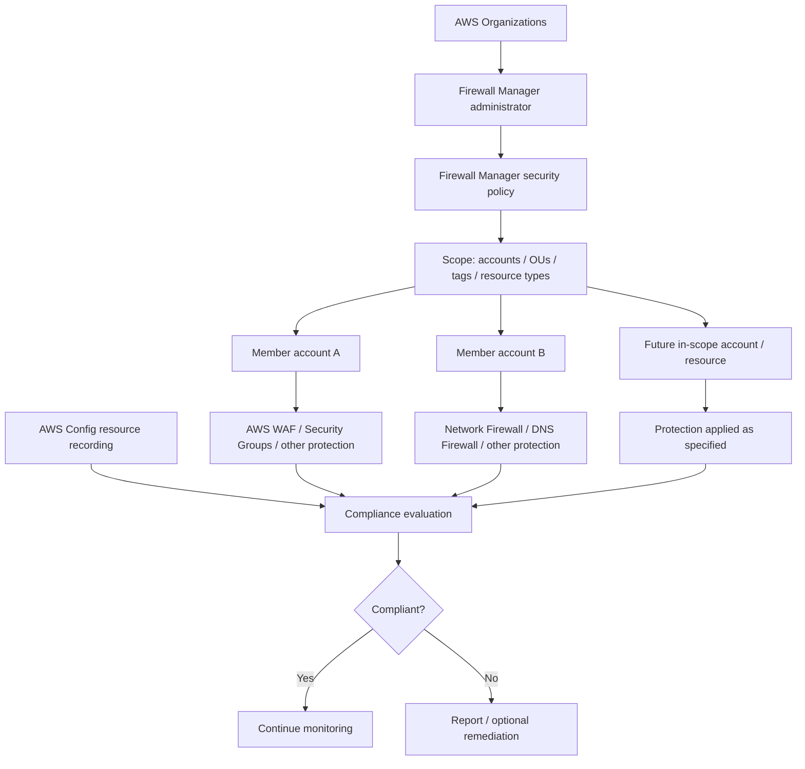
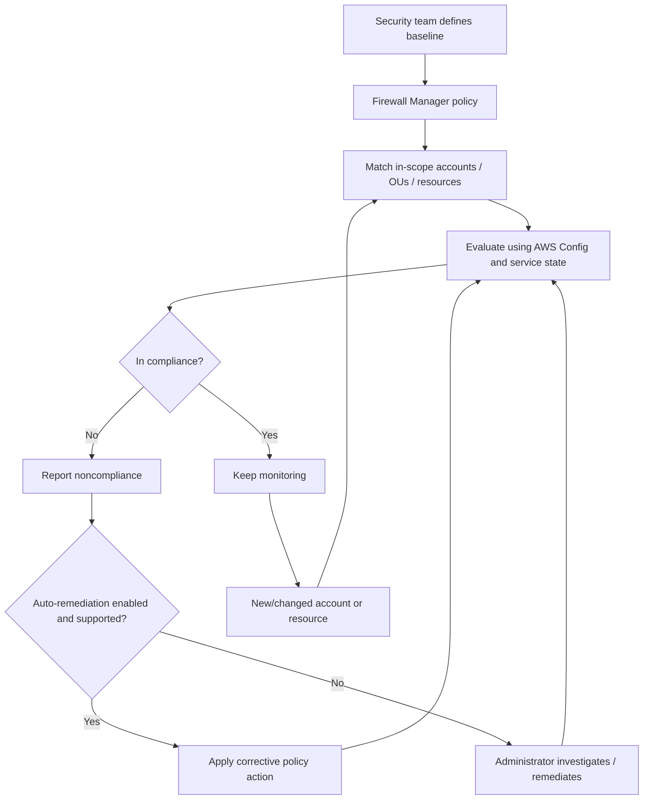
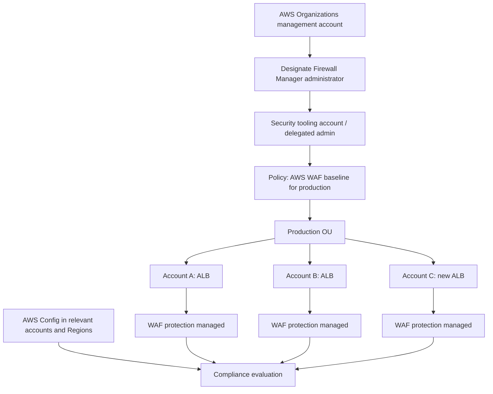

<div align="center">

# 🛡️ AWS Firewall Manager

### Complete GitHub Study Guide · AWS Certified Cloud Practitioner + Solutions Architect – Associate

[](https://aws.amazon.com/firewall-manager/)
[](https://aws.amazon.com/certification/certified-cloud-practitioner/)
[](https://aws.amazon.com/certification/certified-solutions-architect-associate/)
[](https://docs.aws.amazon.com/waf/latest/developerguide/fms-chapter.html)
[](#official-aws-references)

**One sentence to remember:** **AWS Firewall Manager** centrally **defines, deploys, monitors, and (optionally) remediates security protections** across **AWS Organizations accounts and resources**; it **does not inspect packets itself**.

[🟢 CCP essentials](#-cloud-practitioner-ccp-essentials) · [🔵 SAA architecture](#-solutions-architect-associate-saa-deep-dive) · [⚔️ Comparisons](#-compare-with-similar-aws-services) · [⚠️ Exam traps](#-common-exam-traps-and-misconceptions) · [🧪 Practice](#-exam-style-practice-questions)

</div>

---

## 📚 Table of contents

1. [What is AWS Firewall Manager?](#1-what-is-aws-firewall-manager)
2. [What problem does it solve?](#2-what-problem-does-it-solve)
3. [Core concepts and components](#3-core-concepts-and-components)
4. [Requirements and setup](#4-requirements-and-setup)
5. [Supported security policy types](#5-supported-security-policy-types)
6. [How Firewall Manager works](#6-how-firewall-manager-works)
7. [🟢 Cloud Practitioner (CCP) essentials](#-cloud-practitioner-ccp-essentials)
8. [🔵 Solutions Architect – Associate (SAA) deep dive](#-solutions-architect-associate-saa-deep-dive)
9. [⚔️ Compare with similar AWS services](#-compare-with-similar-aws-services)
10. [⚠️ Common exam traps and misconceptions](#-common-exam-traps-and-misconceptions)
11. [💰 Pricing and shared responsibility](#-pricing-and-shared-responsibility)
12. [🧪 Exam-style practice questions](#-exam-style-practice-questions)
13. [📌 Quick-revision cheat sheet](#-quick-revision-cheat-sheet)
14. [Official AWS references](#official-aws-references)

---

## 1. What is AWS Firewall Manager?

> [!IMPORTANT]
> **AWS Firewall Manager is a security management service for centrally configuring and enforcing supported firewall and protection policies across accounts and resources in an AWS Organizations organization.** It continuously evaluates which resources are covered and whether they comply with defined policies.

### In plain English: the security headquarters

Imagine a company with **30 branches**. Each branch needs similar security checkpoints.

- **AWS Firewall Manager** = headquarters that decides **which security rules every branch must follow**.
- **AWS WAF / Network Firewall / Security Groups / DNS Firewall** = the actual **guards and checkpoints** enforcing those rules.
- **AWS Organizations** = the directory that groups the branches (AWS accounts and OUs).
- **AWS Config** = the recordkeeping service that tracks configurations for compliance evaluation.

**Firewall Manager manages the protection; it is not the protection engine.**

| Attribute | Exam-ready answer |
|---|---|
| Service category | Centralized security policy management and compliance |
| Primary scope | **Multiple AWS accounts and resources** within AWS Organizations |
| Operates on | Supported protection policies, rather than individual packets |
| Central authority | Firewall Manager administrator / delegated administrator |
| Scope options | Organization, accounts, OUs, resource types, selected tags |
| Enforcement | Audit/report noncompliance; optionally **auto-remediate** |
| New resources | In-scope accounts/resources are evaluated as they appear |
| Key dependencies | **AWS Organizations** and **AWS Config** |
| Related protections | AWS WAF, Shield Advanced, Security Groups, NACLs, Network Firewall, DNS Firewall, supported third-party firewalls |
| Multi-Region | Generally **separate policy per Region**; CloudFront WAF has a **Global** policy scope |

> [!NOTE]
> An organization can use AWS WAF or AWS Network Firewall **without** Firewall Manager. Firewall Manager becomes especially valuable when security must stay **consistent across many accounts and resources**.

## 2. What problem does it solve?

Without centralized management, each team might configure security differently:

- Account A enables AWS WAF; Account B forgets.
- A new Application Load Balancer is launched without the required WAF protections.
- A developer changes a Security Group to allow public SSH access.
- Different teams maintain incompatible Network Firewall policies.
- Administrators cannot easily identify **which accounts or resources are out of compliance**.

**Firewall Manager helps solve security-policy drift** by applying organization-wide standards and continuously assessing in-scope resources.

### Real-world example

A company has **20 AWS accounts**, each containing web applications behind Application Load Balancers. The security team requires an approved **AWS WAF managed rule group** on every in-scope ALB.

1. Set up **AWS Organizations** and a Firewall Manager administrator.
2. Create **one Firewall Manager AWS WAF policy** for the selected Region and accounts/OUs.
3. Specify required rule groups and which ALB resources are in scope.
4. Firewall Manager manages the applicable **WAF web ACL protections** across accounts.
5. A new matching ALB can be assessed and protected automatically according to the policy.
6. Out-of-policy resources appear as **noncompliant**; supported remediation can be enabled.

**This is a management workflow, not a packet-inspection workflow.**

### Common use cases

- **Standardize AWS WAF** protections for many web applications.
- Apply **Shield Advanced** coverage consistently across eligible resources.
- Audit/remediate overly permissive **Security Groups** at scale.
- Distribute standard **Security Group rules** to workloads.
- Enforce baseline **Network ACLs** for selected subnets.
- Deploy/manage **AWS Network Firewall** protections for multiple VPCs.
- Apply **Route 53 Resolver DNS Firewall** rule groups across VPCs.
- Centrally govern supported **third-party network firewalls**.
- Detect **security drift**, identify gaps, and optionally correct them.

## 3. Core concepts and components

| Concept | Meaning | Exam cue |
|---|---|---|
| **AWS Organizations** | Groups accounts into an organization, with OUs and a management account | Multi-account scope |
| **Organizational Unit (OU)** | Logical group of accounts inside an organization | Target a department/environment |
| **Firewall Manager administrator** | Account authorized to create and manage Firewall Manager policies | Central security account |
| **Delegated administrator** | Member account authorized through Organizations to administer the service | Separate security from billing/management |
| **Firewall Manager security policy** | Organization-wide specification of protection type, scope, and enforcement | Central policy definition |
| **Policy scope** | Accounts/OUs, resource types and resource tags to include/exclude | Which resources are governed? |
| **In-scope resource** | Resource matching the policy's scope | Protection applies if supported and prerequisites met |
| **Compliance status** | Whether managed resources conform to the policy | Detect drift / gaps |
| **Automatic remediation** | Optional action to address supported violations | Not always on by default |
| **AWS Config** | Tracks supported resource configurations for compliance | Essential prerequisite |
| **AWS RAM** | Resource sharing used for relevant Network Firewall / DNS Firewall policies | Policy-specific prerequisite |
| **Underlying firewall service** | AWS WAF, Network Firewall, etc., implementing actual protection | Manager ≠ packet filter |

### 🧩 High-level relationship



> **Memory trick:** **Organizations** decides *who belongs*; **Firewall Manager** decides *which security baseline applies*; **underlying services** enforce the protections; **Config** supplies configuration records for compliance monitoring.

## 4. Requirements and setup

### 4.1 Required foundations

| Requirement | Why it matters | Required? |
|---|---|---|
| **AWS Organizations** | Provides the organization of accounts to govern | **Yes** |
| **Organizations: all features enabled** | Needed for Firewall Manager operation | **Yes** |
| **Firewall Manager administrator** | Creates and manages centralized policies | **Yes** |
| **AWS Config enabled** | Records supported resources for continuous compliance checks | **Yes** |
| **AWS Config continuous recording** | Firewall Manager requires continuous configuration-change recording for protected resources | **Yes, for covered resources** |
| **AWS Config in each relevant account/Region** | Tracks resources where policy enforcement is needed | **Yes, as applicable** |
| **AWS RAM organization sharing** | Shares rule groups for Network Firewall and DNS Firewall policies | **Yes for those types** |
| **AWS Marketplace subscription** | Prerequisite for supported third-party firewall policies | **If using those providers** |
| **Shield Advanced subscription** | Needed for Firewall Manager Shield Advanced protection policies | **If using Shield Advanced policy** |

> [!WARNING]
> **AWS Config is not optional.** Enabling AWS Organizations alone is insufficient. Missing resource recording, wrong recording frequency, or a disabled Region can prevent meaningful compliance evaluation.

### 4.2 Administrator account vs. member account

- The **AWS Organizations management account** establishes Firewall Manager administration.
- A dedicated **member account**, often a **Security Tooling** account, can be designated as a Firewall Manager administrator.
- Administrator permissions can be **full** or **restricted** by accounts/OUs, Regions, and policy types.
- Member accounts hold the protected workload resources. They should not be confused with the centrally authorized administrator account.
- **Least privilege** still matters: do not grant full administrative scope without a reason.

### 4.3 Simplified setup workflow

1. Create/join an AWS Organization and enable **all features**.
2. Select and designate the **Firewall Manager administrator account**.
3. Enable **AWS Config** in the applicable member accounts and Regions with required resource types and **continuous** recording.
4. Enable **AWS RAM sharing with the organization** if managing Network Firewall or DNS Firewall policies.
5. Prepare service-specific prerequisites (rule groups, web ACL rules, subscriptions, etc.).
6. Create a **Firewall Manager security policy**.
7. Define **accounts/OUs**, **resource types**, **tags**, and **Region**.
8. Start in **audit/report-only** mode when practical; inspect noncompliance.
9. Enable **automatic remediation** if appropriate, then monitor its effects.

> [!TIP]
> **CCP focus:** Remember **AWS Organizations + centralized security policies**. **SAA focus:** Add **AWS Config, scope, Region, delegated administrator, policy types, and remediation**.

## 5. Supported security policy types

> [!IMPORTANT]
> These are **Firewall Manager policy types**. The actual security controls still belong to the underlying services. A Firewall Manager policy is **not** the same as an IAM policy, a WAF web ACL, or an AWS Network Firewall firewall policy.

### At-a-glance matrix

| Firewall Manager policy type | Underlying protection | Central management use case |
|---|---|---|
| **AWS WAF** | Web ACL / WAF rule groups | Standard web-app protections |
| **AWS Shield Advanced** | DDoS protection | Apply/manage eligible Advanced protections |
| **VPC Security Groups** | Stateful SG rules | Standardize and audit resource-level access |
| **VPC Network ACLs** | Stateless subnet ACL rules | Enforce a baseline subnet rule set |
| **AWS Network Firewall** | Managed network traffic inspection | Deploy/standardize VPC firewalls |
| **Route 53 Resolver DNS Firewall** | DNS query filtering | Apply DNS rule groups to VPCs |
| **Supported third-party firewalls** | Partner cloud firewall products | Centralize selected vendor firewall deployments |

### 5.1 AWS WAF policies

**Use for:** Large-scale enforcement of **HTTP/HTTPS application protection** on supported resource types.

- Define **AWS WAF rule groups** in the Firewall Manager policy.
- A policy can include **first** and **last** rule groups to create an organization-wide baseline.
- Individual accounts can have permitted rules/rule groups **between** those central sets.
- Firewall Manager can create/manage **web ACLs** and their resource associations according to selected configuration.
- Applicable resources include supported regional applications (such as ALBs) and global **CloudFront distributions**.
- The **CloudFront** case is configured using **Global** scope; regional WAF resources require appropriate regional policies.

**Exam keyword:** `Company wants the same WAF rule groups on ALBs / CloudFront distributions across accounts` → **Firewall Manager + AWS WAF**.

> [!WARNING]
> **AWS WAF** inspects and handles HTTP(S) requests. **Firewall Manager** manages where approved WAF protections are deployed. Firewall Manager does **not** replace WAF's web ACL/rule engine.

### 5.2 AWS Shield Advanced policies

**Use for:** Organization-wide management of **Shield Advanced** coverage on supported eligible resources.

- Associate selected in-scope resources with **Shield Advanced** protection.
- Help manage and expand the relevant Shield Advanced coverage as eligible resources/accounts are added.
- Support centralized visibility of relevant DDoS protection posture.
- **Shield Standard** is an underlying default protection for eligible AWS services; it is **not** the same as buying or managing Shield Advanced.

**Exam keyword:** `Centralized Shield Advanced management for eligible resources across accounts` → **Firewall Manager**.

### 5.3 VPC Security Group policies

Firewall Manager has **three distinct Security Group policy patterns**:

| Pattern | What it does | Example |
|---|---|---|
| **Common Security Groups** | Replicates a centrally defined SG baseline and associates it with in-scope resources | Apply approved access rules everywhere |
| **Content Audit** | Identifies/remediates rules inconsistent with a security baseline | Detect overly broad `0.0.0.0/0` SSH access |
| **Usage Audit** | Identifies unused or redundant Security Groups and can clean them up | Reduce SG sprawl |

**Common policy:** Define a **primary Security Group** in the administrator account. Firewall Manager manages **replica Security Groups** in applicable VPCs and their associations.

**Content audit:** Evaluates the **rules** in in-scope Security Groups. With remediation configured, it can update/remove noncompliant rules.

**Usage audit:** Finds **unused** or **redundant** Security Groups and can consolidate/remove them subject to settings and restrictions.

> [!NOTE]
> **Firewall Manager does not turn Security Groups into stateless firewalls.** Security Groups remain **stateful** and use **allow rules**; Firewall Manager governs their configurations.

### 5.4 VPC Network ACL policies

**Use for:** Enforcing a shared **stateless subnet-level** network filtering baseline.

- Centrally define **first** and **last** inbound/outbound NACL rules.
- Allow appropriately managed local rules between required central rules.
- Audit and, if enabled, remediate noncompliant network ACL configurations.
- Because NACLs are stateless, inbound and outbound directions must still be considered.

**Exam keyword:** `Enforce organizational subnet ACL baseline` → **Firewall Manager NACL policy**.

### 5.5 AWS Network Firewall policies

**Use for:** Managing actual **AWS Network Firewall** deployments consistently across VPCs/accounts.

Supported management models include:

1. **Distributed** — Deploy/maintain Network Firewall resources for the relevant in-scope VPCs.
2. **Centralized** — Manage a Network Firewall deployment in an **inspection VPC** for a centralized design.
3. **Import existing firewalls** — Bring eligible existing firewalls under a policy using **resource sets**.

The policy references relevant **Network Firewall rule groups**, with stateless/stateful behavior defined in the underlying firewall policy.

> [!CAUTION]
> **Firewall Manager policy ≠ Network Firewall routing.** A firewall can exist without all intended traffic flowing through it. For distributed deployments, Firewall Manager offers route monitoring capabilities, but you must verify the supported routing model and correctly steer traffic through firewall endpoints. Centralized deployments have their own routing responsibilities.

**Exam keyword:** `Same managed Network Firewall rule groups across 15 VPCs in different accounts` → **Firewall Manager + Network Firewall**.

### 5.6 Route 53 Resolver DNS Firewall policies

**Use for:** Applying centrally governed **DNS Firewall rule group associations** to VPCs.

- Define the approved DNS Firewall rule groups.
- Create the organization-wide policy and target the relevant VPCs.
- Control DNS query filtering through **Route 53 Resolver DNS Firewall**.
- Enable **AWS RAM resource sharing with Organizations** for this policy type.

**Exam keyword:** `Apply the same malicious-domain DNS rules across many VPCs` → **Firewall Manager + Resolver DNS Firewall**.

### 5.7 Supported third-party firewall policies

Firewall Manager also supports select third-party security integrations, subject to service and subscription availability, including:

- **Palo Alto Networks Cloud NGFW**.
- **Fortinet FortiGate Cloud Native Firewall (CNF)**.

These integrations are **not** AWS Network Firewall and typically have **separate AWS Marketplace/partner charges and prerequisites**.

## 6. How Firewall Manager works

### 6.1 The continuous governance loop



### 6.2 Scope is the first decision

A policy can target:

- **All organization accounts**.
- **Specific included accounts or Organizational Units (OUs)**.
- **All except specified accounts/OUs**.
- **Supported resource types** (e.g., ALBs for a WAF policy, VPCs for a Network Firewall policy).
- **Resources matching tags** or **excluding matching tags**, depending on policy settings.

**Example:** `OU = Production` + `Resource type = ALB` + `Tag = SecurityTier:Critical` identifies a narrower class of web workloads to protect.

> [!WARNING]
> A resource **outside the policy scope** is not necessarily considered a policy violation. Always verify the **account/OU**, **Region**, **resource type**, and **tag criteria** before assuming a missing control means remediation failed.

### 6.3 Automatic coverage of newly created resources

Firewall Manager continually evaluates **newly created accounts and resources that match the policy**.

- A new matching **ALB** can receive the relevant managed AWS WAF policy coverage.
- A new in-scope **account** can be included without manually repeating the same central policy creation.
- A new matching **VPC** can enter the protection workflow for a relevant Network Firewall/DNS Firewall policy.

**But:** This depends on correct prerequisites, scope, supported resource types, and specific policy/remediation configuration.

### 6.4 Audit versus auto-remediation

| Mode | What happens | When to choose |
|---|---|---|
| **Report/audit noncompliance** | Identify policy violations without modifying the resource automatically | Assess impact before rollout |
| **Auto-remediation** | Correct supported violations according to policy settings | Enforce approved baseline continuously |

**Recommended rollout:** Set scope → evaluate violations → test in a small OU/account set → validate applications → enable controlled auto-remediation → monitor results.

### 6.5 Where do security events and compliance signals go?

| AWS service | What it contributes |
|---|---|
| **AWS Config** | Configuration change recording / compliance visibility required by Firewall Manager |
| **Firewall Manager policy console** | Policy and resource compliance status |
| **AWS Security Hub CSPM** | Receives eligible Firewall Manager findings for centralized security posture review |
| **AWS CloudTrail** | Records supported administrative/API activity |
| **AWS WAF logs / Network Firewall logs** | **Actual traffic/security logs** produced by the underlying protection service |
| **Amazon CloudWatch** | Metrics, logs and alarms for applicable underlying service workflows |

> **Key distinction:** **A policy compliance finding is not the same thing as a network packet log.** Firewall Manager evaluates configurations; the underlying services produce traffic-related events.

---

## 🟢 Cloud Practitioner (CCP) essentials


**Your goal:** Recognize **centralized, multi-account security policy management** and distinguish it from the actual protection services.

### Ten facts to memorize

1. **AWS Firewall Manager = centralized firewall/security policy management**.
2. It works across **multiple AWS accounts** in **AWS Organizations**.
3. It can centrally manage **AWS WAF** protections.
4. It can centrally manage **AWS Shield Advanced** protections.
5. It can govern **VPC Security Groups and Network ACLs**.
6. It can manage **AWS Network Firewall** and **Route 53 Resolver DNS Firewall** policies.
7. It can protect **new in-scope accounts/resources** as they are added.
8. It provides **policy compliance monitoring** and supported **automatic remediation**.
9. **AWS Config** is an important prerequisite for monitoring compliance.
10. It **does not itself** inspect HTTP requests, block individual network packets, or serve as a DDoS mitigation engine.

### CCP exam keywords

`centralized firewall management` · `multi-account security` · `AWS Organizations` · `security policy enforcement` · `consistent rules` · `AWS WAF across accounts` · `Shield Advanced policy` · `new resources automatically protected` · `compliance monitoring` · `automatic remediation`

> [!TIP]
> If the question stresses **"across all AWS accounts"**, **"organization-wide"**, **"centrally enforce"**, or **"automatically apply security rules to new resources"**, think **AWS Firewall Manager** before choosing a specific firewall.

### CCP service-selection shortcuts

| Question emphasizes… | Think first of… |
|---|---|
| Stop SQL injection/XSS in HTTP requests | **AWS WAF** |
| Mitigate DDoS attacks | **AWS Shield** |
| Enforce the same AWS WAF setup across 50 AWS accounts | **AWS Firewall Manager** |
| Stateful allow-only ingress/egress on an EC2 ENI | **Security Group** |
| Stateless subnet allow/deny rules | **Network ACL** |
| Inspect routed VPC network traffic with IDS/IPS | **AWS Network Firewall** |
| Block selected DNS queries through VPC Resolver | **Route 53 Resolver DNS Firewall** |
| Centralize monitoring and governance of several of the above protections | **AWS Firewall Manager** |

### A one-sentence CCP answer

> **AWS Firewall Manager is a centralized security management service that helps configure, deploy, and enforce supported firewall and security policies across multiple AWS accounts and resources in AWS Organizations.**

---

## 🔵 Solutions Architect – Associate (SAA) deep dive


**Your goal:** Design the **organization-wide governance workflow**, set the correct **scope/prerequisites**, and understand what Firewall Manager does—and does **not**—configure for each protected service.

### 8.1 Multi-account design with delegated administration



**Design points:**

- Separate the **security governance account** from application workload accounts.
- Use **restricted administrator scopes** when teams should govern only certain OUs, Regions, or policy types.
- Keep **AWS Config recording** aligned with protected resource types and locations.
- Apply **least privilege** and avoid unnecessary auto-remediation in critical workloads without testing.

### 8.2 Policy scope, resource tags and OU targeting

**Scenario:** Production workloads need a mandatory WAF baseline, while development resources should not be changed.

Possible design:

1. Target the **Production OU** or an explicit account list.
2. Select **AWS WAF** policy and supported application resource types.
3. Use relevant tags if only a subset of production resources needs the policy.
4. Use **report-only** rollout to validate actual inclusion/exclusion.
5. Enable remediation according to the operational requirement.

**Important SAA trap:** `Account exists in organization` **does not imply** `every resource in account is covered by every policy`.

### 8.3 Firewall Manager policy vs. AWS Network Firewall firewall policy

| Item | AWS Firewall Manager security policy | AWS Network Firewall firewall policy |
|---|---|---|
| Service | AWS Firewall Manager | AWS Network Firewall |
| Purpose | **Where/how to govern protections** across accounts/VPCs | **How to filter inspected traffic** |
| Scope | Accounts, OUs, resources, Regions | Firewall deployment / traffic-processing behavior |
| Contains | Policy scope, enforcement settings, applicable protection definition | Stateless and stateful rule groups/default actions |
| Inspects packets? | **No** | **Yes**, when traffic traverses the firewall endpoint |

> **Exam trick:** Both AWS services use the word **policy**. They mean **different layers** of the system.

### 8.4 Network Firewall deployment: distributed vs centralized

| Model | Firewall Manager role | Architecture responsibility |
|---|---|---|
| **Distributed** | Manage firewall resources in selected VPCs | Correct VPC route tables, endpoints/AZs, symmetric flows |
| **Centralized** | Manage firewall in an inspection VPC | Hub-and-spoke/TGW routing, centralized flow symmetry |
| **Import existing** | Manage eligible pre-existing Network Firewalls | Resource sets and existing design review |

**Crucial nuance:** Even with managed firewall deployment, **traffic inspection depends on correct routing**. Do not assume every VPC flow will automatically traverse the firewall.

For distributed policies, Firewall Manager can **monitor route compliance** for supported designs. **Do not assume it automatically fixes all application subnet routes**. In a centralized model, validate Transit Gateway/inspection-VPC routing separately.

### 8.5 AWS WAF rollout and rule-order governance

A common architectural goal is to keep mandatory organization protections while still allowing app teams some flexibility.

- **First rule groups**: centrally mandated rule groups evaluated before locally managed groups.
- **Middle**: local, permitted WAF rules/rule groups managed in the member account.
- **Last rule groups**: centrally mandated rule groups after the local portion.
- Rule priorities, terminating actions, and web ACL defaults still affect the real WAF behavior.

**Do not assume all WAF rules run** after a terminating WAF action; WAF evaluation semantics still apply.

### 8.6 Security Group policy trade-offs

**Common policies** are useful for establishing a baseline, but they can affect workload connectivity if the expected network accesses are not accounted for.

**Content audit** is useful when developers occasionally create unsafe ingress/egress rules and compliance needs continuous validation.

**Usage audit** is useful for cleaning up unused/redundant groups. Test exclusions and understand the effects of deleting/consolidating groups before enabling remediation.

### 8.7 Regional versus global policy design

- For **regional resources**, a Firewall Manager policy typically applies **within a single AWS Region**.
- For **Amazon CloudFront distributions** protected through WAF, use the appropriate **Global** policy scope.
- For applications in **multiple AWS Regions**, plan the required **separate regional policies**.
- Be careful with **Regions disabled by default**: administrative access and prerequisites may need explicit setup.

**Trap:** A Firewall Manager policy created for `eu-west-1` is **not automatically** a blanket policy for resources in `eu-central-1`.

### 8.8 Monitoring and incident response

| Requirement | Best service/control |
|---|---|
| Find resources missing the expected security policy | **Firewall Manager compliance** |
| See configuration changes over time | **AWS Config** |
| See a consolidated set of supported security posture findings | **AWS Security Hub CSPM** |
| Audit changes to Firewall Manager policy/API configuration | **AWS CloudTrail** |
| Inspect blocked web requests | **AWS WAF logs** |
| Inspect stateful network traffic events | **AWS Network Firewall logs** |
| Understand which accounts/OUs are in scope | **Firewall Manager policy scope + AWS Organizations** |

### 8.9 Troubleshooting checklist

If a new resource is not receiving the expected centrally managed protection, check:

1. Is the account in the correct **AWS Organization/OU**?
2. Is the policy's **account include/exclude scope** correct?
3. Is the resource type supported and selected?
4. Does the resource match the **tag filter**, if any?
5. Is the resource in the **correct Region**, or is a Global WAF policy needed?
6. Is **AWS Config** recording the required types **continuously** in the correct account/Region?
7. Is the **Firewall Manager administrator** properly designated and authorized?
8. Are **policy-specific prerequisites** met: Shield Advanced, AWS RAM, firewall rule groups, partner subscription?
9. Is the policy **report-only** or set to **auto-remediate**?
10. What do the **compliance findings and policy details** say?
11. For Network Firewall: are **firewall endpoints and actual routes** correctly configured?
12. Has a policy-scope change caused a protection to be **out of scope**, with a specific cleanup setting?

### 8.10 Critical architectural trade-offs

- **Central governance vs local autonomy**: organization-wide required rules should coexist with permitted app-team customization.
- **Security vs availability**: remediation can unexpectedly alter SG/NACL rules, WAF associations, and traffic reachability.
- **Broad coverage vs cost**: narrower tags/OUs may reduce overdeployment but can create uncovered resources.
- **One Region vs global presence**: per-Region policy planning adds management and cost complexity.
- **Monitoring vs enforcement**: detecting drift is not identical to automatically fixing it.
- **Managed protection vs routing**: centrally created Network Firewall endpoints may still require routing work.

> [!TIP]
> **SAA exam cue:** Scenario words such as **"Production OU"**, **"delegated administrator"**, **"newly created accounts"**, **"AWS Config compliance"**, **"auto-remediation"**, **"CloudFront global policy"**, and **"multi-account WAF baseline"** usually test Firewall Manager architecture.

---

## ⚔️ Compare with similar AWS services

### At-a-glance service-selection matrix

| Service | Main purpose | Does it inspect/block traffic directly? | Strongest exam clue |
|---|---|---|---|
| **AWS Firewall Manager** | **Central security-policy governance** | **No** | Policies across **accounts/OUs/resources** |
| **AWS Network Firewall** | Managed inspection of **routed VPC traffic** | **Yes** | Stateful/stateless IDS/IPS, endpoints, routes |
| **AWS WAF** | Protect **HTTP/HTTPS web applications** | **Yes, web requests** | SQL injection, XSS, bots, rate-based rules |
| **AWS Shield** | **DDoS protection** | Mitigates DDoS | DDoS resilience; Shield Advanced |
| **Security Groups** | Stateful resource/ENI rules | **Yes, allow-only network access** | EC2/RDS ENI traffic |
| **Network ACLs** | Stateless subnet rules | **Yes, allow/deny filtering** | Subnet boundary, ordered rules |
| **Route 53 Resolver DNS Firewall** | Filter **DNS queries** | **Yes, DNS requests** | Block malicious domain resolution |
| **AWS Organizations** | Account/OU organization and governance | **No** | Multi-account organization structure |
| **AWS Config** | Resource configuration history/compliance | **No** | Track config changes / evaluate rules |
| **AWS Security Hub CSPM** | Aggregate/prioritize posture findings | **No** | Centralized security findings |
| **Amazon GuardDuty** | Threat detection and findings | **No inline inspection** | Suspicious activity / detection |
| **Gateway Load Balancer** | Scale/routinely insert network appliances | **No native policy engine** | Third-party security virtual appliances |

### Most easily confused pairs

<details>
<summary><strong>Firewall Manager vs. AWS Network Firewall</strong></summary>

**Firewall Manager:** Defines and manages centrally enforced security policies across accounts and resources.

**Network Firewall:** Applies configured stateless/stateful rules to **actual network traffic routed through firewall endpoints**.

**Choose Firewall Manager** for **organizational standardization**. **Choose Network Firewall** for **inspection of network traffic**. Use **both together** for standardized inspection across multiple accounts/VPCs.
</details>

<details>
<summary><strong>Firewall Manager vs. AWS WAF</strong></summary>

**WAF:** Protects supported application endpoints from malicious HTTP/HTTPS requests.

**Firewall Manager:** Coordinates approved WAF protections across many web resources/accounts.

**Choose WAF** for a single web application's SQL injection defense. **Choose Firewall Manager + WAF** to require that protection throughout the organization.
</details>

<details>
<summary><strong>Firewall Manager vs. AWS Shield</strong></summary>

**Shield:** Provides DDoS protection; **Shield Advanced** provides additional paid protection features.

**Firewall Manager:** Helps manage **Shield Advanced policies** across eligible organization resources. It is not itself a DDoS mitigation service.
</details>

<details>
<summary><strong>Firewall Manager vs. AWS Organizations</strong></summary>

**Organizations:** Creates the hierarchy of AWS accounts/OUs and provides features such as Service Control Policies (SCPs).

**Firewall Manager:** Uses that account hierarchy to govern **supported firewall/security policies**. An **SCP is not a packet filter** and does not replace a WAF or Network Firewall rule group.
</details>

<details>
<summary><strong>Firewall Manager vs. AWS Config</strong></summary>

**AWS Config:** Records/evaluates resource configuration information.

**Firewall Manager:** Defines the centrally enforced protection and evaluates its compliance using AWS Config and relevant service state.

**AWS Config is a prerequisite—not a replacement—for Firewall Manager's policy orchestration.**
</details>

<details>
<summary><strong>Firewall Manager vs. Security Hub CSPM</strong></summary>

**Security Hub CSPM:** Aggregates and prioritizes posture/security findings, including eligible Firewall Manager findings.

**Firewall Manager:** Applies/monitors supported security-policy baselines and can take remediation actions.

**Finding aggregation is not the same as policy enforcement.**
</details>

<details>
<summary><strong>Firewall Manager vs. Security Groups / NACLs</strong></summary>

**Security Groups:** Stateful allow-only network filtering attached to applicable ENIs/resources.

**NACLs:** Stateless, numbered allow/deny rules at subnet boundaries.

**Firewall Manager:** Can apply/audit **policies for those controls** across many accounts/resources. It does not itself become an SG or NACL.
</details>

---

## ⚠️ Common exam traps and misconceptions

| ❌ Misconception | ✅ Correct fact |
|---|---|
| “Firewall Manager is a firewall that inspects traffic.” | It **manages protections/policies**; underlying services perform filtering/mitigation. |
| “Firewall Manager and Network Firewall are the same service.” | Manager = **governance**; Network Firewall = **inspection**. |
| “I need Firewall Manager to use AWS WAF for one app.” | WAF works on its own; Manager is useful for **centralized governance**. |
| “It works independently of AWS Organizations.” | **AWS Organizations** is required for Firewall Manager's multi-account model. |
| “AWS Organizations with consolidated billing only is sufficient.” | Organizations must have **all features** enabled. |
| “AWS Config is optional.” | **AWS Config** and required continuous resource recording are key prerequisites. |
| “The organization management account must manage everything directly.” | You can designate Firewall Manager **administrator/delegated accounts**. |
| “All accounts/resources automatically match every policy.” | **Scope controls** account/OU/resource/tag/Region inclusion. |
| “A new resource is always protected, regardless of policy settings.” | It must be **in scope** and satisfy service prerequisites and policy behavior. |
| “Audit mode automatically fixes misconfigurations.” | Reporting and **auto-remediation** are distinct. |
| “Auto-remediation is safe in every case.” | Changes may affect application connectivity and require testing. |
| “Firewall Manager only handles AWS WAF.” | It covers **multiple supported policy types**. |
| “Firewall Manager does not support NACL policies.” | **VPC network ACL policies** are supported. |
| “Shield Standard policy = Shield Advanced policy.” | Firewall Manager's Shield policy support concerns **Shield Advanced**. |
| “A single regional policy protects resources in every Region.” | Generally **separate policies per Region**; CloudFront WAF has Global scope. |
| “Managing Network Firewall means all traffic is inspected.” | Traffic still needs **correct endpoint routing and flow symmetry**. |
| “Network Firewall and DNS Firewall policies require no sharing setup.” | **AWS RAM organization sharing** is required for those policy types. |
| “Firewall Manager decides if HTTP requests contain SQL injection.” | **AWS WAF rule engine** performs web-request inspection. |
| “The Firewall Manager policy is an IAM or SCP policy.” | They are different policy types with different effects. |
| “Firewall Manager and AWS Config always have the same purpose.” | Config records/evaluates configurations; Manager orchestrates policies/remediation. |
| “There are no additional costs because the service is managed.” | Manager policies and underlying services/Config can have separate charges. |
| “Deleting a policy always removes every deployed protection automatically.” | Cleanup/out-of-scope behavior **depends on settings and policy type**. |
| “Firewall Manager is best for a single small AWS account.” | It is most valuable for **multi-account** governance; single-account costs may outweigh benefits. |

### Common interview questions

**Q: Is AWS Firewall Manager stateful or stateless?**  
A: **Neither description fits the management service.** It does **not** filter packets; it can centrally manage **stateful Security Groups** and **stateful/stateless Network Firewall** protections.

**Q: Does Firewall Manager directly block malicious traffic?**  
A: **No.** It configures/manages protections. The underlying WAF, Network Firewall, SG, NACL, DNS Firewall, or Shield component enforces its respective protection.

**Q: Can Firewall Manager automatically protect new accounts?**  
A: **Yes, for in-scope accounts and supported resources**, with prerequisites and policy settings correctly configured.

**Q: Is AWS Config necessary?**  
A: **Yes.** It records required configuration information for Firewall Manager policy compliance monitoring.

**Q: What's the role of the delegated administrator?**  
A: It is an authorized member account used to centrally administer policies rather than performing all management from the AWS Organizations management account.

**Q: Can I use one Firewall Manager policy for WAF and Network Firewall?**  
A: **No.** A policy has a **specific protection type**. Create separate policies for separate protection types.

**Q: How does Firewall Manager deal with insecure Security Groups?**  
A: Via **common**, **content audit**, and **usage audit** security group policies, with configured compliance/remediation behavior.

**Q: Does it manage network routes for a Network Firewall deployment?**  
A: It can create/manage certain firewall resources and support route monitoring in eligible designs, but **you must validate actual traffic routing**. It is not a universal automatic VPC route designer.

---

## 💰 Pricing and shared responsibility

### Pricing factors

AWS Firewall Manager costs may include:

- A **monthly policy fee per Region**, depending on policy type and pricing conditions.
- Charges for the **underlying service**: e.g., WAF web ACLs/rules/requests, Network Firewall endpoints/traffic, DNS Firewall, Shield Advanced, or third-party services.
- **AWS Config** configuration recording and rule evaluation charges.
- Additional observability, logging, or data-transfer costs where applicable.

> [!IMPORTANT]
> The AWS pricing page illustrates common Firewall Manager policies at **$100 per policy per month per Region**, but **pricing varies by policy type/Region and can have exceptions**. Certain Firewall Manager charges are included for eligible **Shield Advanced customers**. **Do not treat $100 as a universal flat fee or claim all services are free.** Check current regional pricing before deployment.

### Example (illustrative, not a quote)

Suppose a company creates **one regional AWS WAF Firewall Manager policy** covering **10 accounts**.

- The **Firewall Manager policy** may have a monthly management charge.
- The WAF web ACLs/rules and request processing may be charged by AWS WAF.
- The Config recording and compliance evaluation may be charged by AWS Config.

**One central policy does not mean one single all-inclusive security bill.**

### Shared responsibility

| AWS manages | You / your organization manage |
|---|---|
| Firewall Manager service infrastructure | Selecting the right policy types and targets |
| Service integration and supported orchestration | Configuring AWS Organizations, AWS Config, administrator access |
| Supported compliance/workflow mechanisms | Policy scope, exceptions and rule groups |
| Underlying managed service operations per service model | Safe auto-remediation decisions, testing, change control |
| | Correct Network Firewall routing where applicable |
| | Logs, alerts, governance, compliance and spending |

---

## 🧪 Exam-style practice questions

> **How to use:** Try each scenario before opening the answer. These are **original practice questions**, **not actual or leaked AWS exam questions**.

<details>
<summary><strong>Q1 · CCP:</strong> An enterprise wants to deploy and enforce consistent firewall policies across dozens of AWS accounts. Which service fits best?</summary>

**Answer: AWS Firewall Manager.** The requirement is centrally governing protections across AWS Organizations accounts.
</details>

<details>
<summary><strong>Q2 · CCP:</strong> A web application must block SQL injection attempts. Which service performs the request inspection?</summary>

**Answer: AWS WAF.** Firewall Manager can manage WAF protections across accounts, but WAF itself evaluates HTTP requests.
</details>

<details>
<summary><strong>Q3 · CCP:</strong> Which service is primarily used for DDoS protection?</summary>

**Answer: AWS Shield.** Firewall Manager can centrally administer relevant **Shield Advanced** policies; it is not itself DDoS mitigation.
</details>

<details>
<summary><strong>Q4 · CCP:</strong> Which AWS service helps enforce approved WAF policies on newly created in-scope resources across accounts?</summary>

**Answer: AWS Firewall Manager.** It continuously evaluates newly added accounts/resources against scope.
</details>

<details>
<summary><strong>Q5 · CCP:</strong> Is Firewall Manager a stateful network packet inspector?</summary>

**Answer: No.** Firewall Manager is a **policy management** service. Network Firewall supports stateful and stateless inspection.
</details>

<details>
<summary><strong>Q6 · CCP:</strong> Which AWS organizational service is a prerequisite for Firewall Manager?</summary>

**Answer: AWS Organizations** (with all features enabled).
</details>

<details>
<summary><strong>Q7 · CCP:</strong> A single EC2 instance needs restricted inbound TCP port 22 access. What control is usually sufficient?</summary>

**Answer: Security Group.** It provides resource/ENI-level stateful access control; no organization-wide Manager is necessary.
</details>

<details>
<summary><strong>Q8 · SAA:</strong> Firewall Manager is enabled but cannot reliably evaluate policy compliance in member accounts. Which prerequisite should be checked?</summary>

**Answer: AWS Config.** Ensure correct resource types and **continuous recording** in the relevant accounts and Regions.
</details>

<details>
<summary><strong>Q9 · SAA:</strong> Production workloads live in one OU. How can a security team target only those accounts with a Firewall Manager policy?</summary>

**Answer:** Include the **Production OU** in the **policy account scope**, with correct resource types/Regions/tags as appropriate.
</details>

<details>
<summary><strong>Q10 · SAA:</strong> How do you limit the Firewall Manager administrator to certain OUs and policy types?</summary>

**Answer:** Assign a **restricted administrator scope**, rather than unrestricted full administration.
</details>

<details>
<summary><strong>Q11 · SAA:</strong> A team wants to centrally enforce AWS WAF rule groups but permit application teams to add custom groups. What design supports this?</summary>

**Answer:** Firewall Manager **WAF first and last rule groups**, with permitted account-owned rules in the middle.
</details>

<details>
<summary><strong>Q12 · SAA:</strong> A security team wants to detect Security Groups with unsafe ingress rules. Which policy family applies?</summary>

**Answer: Firewall Manager Security Group content audit policy.** It evaluates rules against defined allowed/denied patterns.
</details>

<details>
<summary><strong>Q13 · SAA:</strong> Which policy helps consolidate redundant and clean up unused Security Groups?</summary>

**Answer: Security Group usage audit policy.** Cleanup is conditional on supported settings and auto-remediation.
</details>

<details>
<summary><strong>Q14 · SAA:</strong> Multiple VPCs need identical AWS Network Firewall protection. Does Firewall Manager directly inspect their packets?</summary>

**Answer: No.** It **manages Network Firewall deployments/policies**, while the Network Firewall engines inspect traffic routed through endpoints.
</details>

<details>
<summary><strong>Q15 · SAA:</strong> Firewall Manager deployed Network Firewall endpoints, but outbound traffic still bypasses them. What likely remains wrong?</summary>

**Answer: Routing.** VPC/inspection network route tables must steer relevant outbound and return flows through the correct inspection path.
</details>

<details>
<summary><strong>Q16 · SAA:</strong> What AWS service must have organization sharing enabled for Firewall Manager Network Firewall and DNS Firewall policies?</summary>

**Answer: AWS Resource Access Manager (AWS RAM).** Enable resource sharing with AWS Organizations.
</details>

<details>
<summary><strong>Q17 · SAA:</strong> A regional Firewall Manager policy is defined in eu-west-1. Does it automatically protect ALBs in eu-central-1?</summary>

**Answer: No.** Plan a separate **regional policy** for the second Region.
</details>

<details>
<summary><strong>Q18 · SAA:</strong> Which location type is used for a Firewall Manager WAF policy protecting CloudFront distributions?</summary>

**Answer: Global scope** for CloudFront WAF protections.
</details>

<details>
<summary><strong>Q19 · SAA:</strong> A new ALB gets no WAF coverage even though its account belongs to the organization. Name two checks.</summary>

**Answer:** Verify **policy scope** (OU/account, tags, resource type, Region) and **AWS Config/prerequisites**. Check remediation and compliance findings as well.
</details>

<details>
<summary><strong>Q20 · SAA:</strong> The security team wants to preview policy compliance problems without changing live resources. Which mode?</summary>

**Answer: Audit/report-only / non-auto-remediation mode.** Review violations before enabling remediation.
</details>

<details>
<summary><strong>Q21 · SAA:</strong> The organization wants centrally controlled stateless subnet-level network ACL baselines. Which Firewall Manager policy type?</summary>

**Answer: VPC Network ACL policy.** NACLs remain stateless; Firewall Manager coordinates the baseline.
</details>

<details>
<summary><strong>Q22 · SAA:</strong> An organization needs to filter DNS queries in many VPCs using approved domain rules. What combination?</summary>

**Answer: Firewall Manager + Route 53 Resolver DNS Firewall.** Firewall Manager centralizes the policy; DNS Firewall filters queries.
</details>

<details>
<summary><strong>Q23 · SAA:</strong> Which service provides configuration history, and which centrally enforces security policies?</summary>

**Answer:** **AWS Config** provides configuration recording/evaluation; **AWS Firewall Manager** provides security-policy management and supported remediation.
</details>

<details>
<summary><strong>Q24 · SAA:</strong> Where can eligible Firewall Manager security posture findings be centralized?</summary>

**Answer: AWS Security Hub CSPM.** It integrates with Firewall Manager findings for monitored policies/resources.
</details>

<details>
<summary><strong>Q25 · CCP/SAA:</strong> Are Firewall Manager policy fees always the only charges for protecting 20 accounts?</summary>

**Answer: No.** Underlying WAF/Network Firewall/DNS Firewall/Shield/partner services, AWS Config, and other usage can contribute costs.
</details>

### Five quick scenario drills

| Scenario | Best approach | Why |
|---|---|---|
| Stop SQL injection on one ALB application | **AWS WAF** | Direct web request filtering |
| Require standard WAF groups on ALBs in many accounts | **Firewall Manager + AWS WAF** | Centralized web protection |
| Inspect VPC egress to malicious destinations | **AWS Network Firewall + correct routing** | Actual packet/flow inspection |
| Standardize that Network Firewall protection across many VPCs | **Firewall Manager + Network Firewall** | Central governance + enforcement service |
| Find and correct overly permissive Security Groups at scale | **Firewall Manager Security Group content audit** | Organization-wide compliance/remediation |

---

## 📌 Quick-revision cheat sheet

### In 30 seconds

```text
FIREWALL MANAGER = CENTRALIZED SECURITY POLICY GOVERNANCE

MAIN PURPOSE?    Consistent protections across AWS accounts/resources
FOUNDATION?      AWS Organizations + administrator + AWS Config
TARGETS?         Accounts, OUs, resource types, tags, Regions
POLICY TYPES?    WAF, Shield Advanced, Security Groups, NACLs,
                 Network Firewall, DNS Firewall, third-party
COMPLIANCE?      Report violations; optionally auto-remediate
NEW ACCOUNTS?    Automatically evaluate in-scope new resources
IMPORTANT?       Manager does NOT inspect packets or HTTP requests
NOT NETWORK FW?  Network Firewall performs actual network inspection
NOT WAF?         WAF inspects malicious HTTP/HTTPS requests
NOT SHIELD?      Shield mitigates DDoS
NOT CONFIG?      Config records resource configurations
SAA TRAP?        Network Firewall endpoints still require good routing
COST?            Manager + underlying protections + AWS Config
```

### Strong keywords that point to Firewall Manager

**Strong signals:** `organization-wide firewall policies` · `centrally manage AWS WAF` · `multi-account` · `AWS Organizations` · `consistent security rules` · `all new accounts` · `policy compliance` · `auto-remediation` · `security group audit` · `OU targeting` · `govern multiple VPC firewalls`

**Signals pointing elsewhere:**

- `SQL injection` / `XSS` / `HTTP request inspection` → **AWS WAF**.
- `DDoS mitigation` → **AWS Shield**.
- `Inspect routed VPC traffic` / `IDS/IPS` → **AWS Network Firewall**.
- `Allow SSH to one EC2 resource` → **Security Group**.
- `Subnet allow-and-deny rules` → **Network ACL**.
- `DNS query filtering` → **Route 53 Resolver DNS Firewall**.
- `Record resource configuration changes` → **AWS Config**.
- `Aggregate security findings` → **AWS Security Hub CSPM**.

### Final memory trick

> **Security Group** = bodyguard at a resource.  
> **NACL** = gate on a subnet boundary.  
> **WAF** = specialist filtering web requests.  
> **Shield** = DDoS response team.  
> **Network Firewall** = checkpoint inspecting traffic on a routed network highway.  
> **Firewall Manager** = **headquarters setting the rules for the guards across all branches**.

---

## Official AWS references

**Source and accuracy note:** This is an **independently written study guide** based on AWS documentation and styled after the provided AWS Network Firewall README. Reviewed **31 October 2026**. Features, supported resource types, pricing, and exam outlines can change. The AWS documentation takes precedence over simplified exam analogies.

1. [AWS Firewall Manager overview / Developer Guide](https://docs.aws.amazon.com/waf/latest/developerguide/fms-chapter.html)
2. [AWS Firewall Manager prerequisites](https://docs.aws.amazon.com/waf/latest/developerguide/fms-prereq.html)
3. [Joining/configuring AWS Organizations](https://docs.aws.amazon.com/waf/latest/developerguide/join-aws-orgs.html)
4. [Creating Firewall Manager administrators](https://docs.aws.amazon.com/waf/latest/developerguide/fms-creating-administrators.html)
5. [Enabling AWS Config](https://docs.aws.amazon.com/waf/latest/developerguide/enable-config.html)
6. [Using Firewall Manager policy types](https://docs.aws.amazon.com/waf/latest/developerguide/working-with-policies.html)
7. [Policy scope: accounts, OUs and tags](https://docs.aws.amazon.com/waf/latest/developerguide/policy-scope.html)
8. [AWS WAF policies with Firewall Manager](https://docs.aws.amazon.com/waf/latest/developerguide/waf-policies.html)
9. [Security Group common policies](https://docs.aws.amazon.com/waf/latest/developerguide/security-group-policies-common.html)
10. [Security Group content audit policies](https://docs.aws.amazon.com/waf/latest/developerguide/security-group-policies-audit.html)
11. [Security Group usage audit policies](https://docs.aws.amazon.com/waf/latest/developerguide/security-group-policies-usage.html)
12. [VPC Network ACL policies](https://docs.aws.amazon.com/waf/latest/developerguide/getting-started-fms-network-acl.html)
13. [AWS Network Firewall policies with Firewall Manager](https://docs.aws.amazon.com/waf/latest/developerguide/network-firewall-policies.html)
14. [Network Firewall route-table management considerations](https://docs.aws.amazon.com/waf/latest/developerguide/fms-manage-vpc-route-tables.html)
15. [DNS Firewall policies](https://docs.aws.amazon.com/waf/latest/developerguide/getting-started-fms-dns-firewall.html)
16. [AWS RAM sharing for Network/DNS Firewall](https://docs.aws.amazon.com/waf/latest/developerguide/resource-sharing.html)
17. [Firewall Manager compliance](https://docs.aws.amazon.com/waf/latest/developerguide/fms-compliance.html)
18. [Security Hub CSPM integration](https://docs.aws.amazon.com/waf/latest/developerguide/fms-findings.html)
19. [Firewall Manager pricing](https://aws.amazon.com/firewall-manager/pricing/)
20. [AWS Firewall Manager product page](https://aws.amazon.com/firewall-manager/)

---

<div align="center">

**Study outcome:** Recognize **centralized security management** for CCP. Design **cross-account policy enforcement and compliant protection coverage** for SAA.

[](#-cloud-practitioner-ccp-essentials)
[](#-solutions-architect-associate-saa-deep-dive)

</div>
