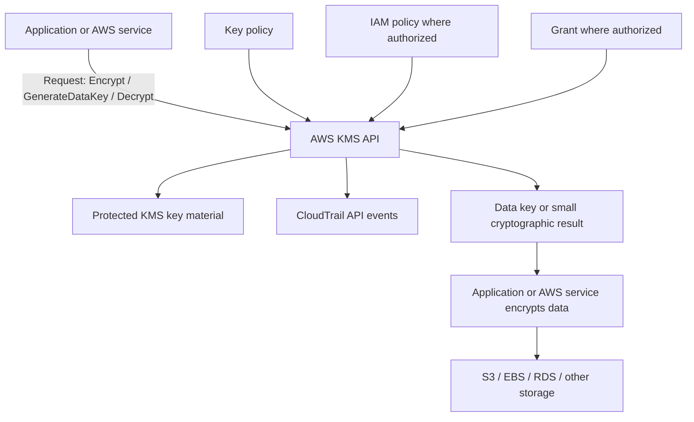
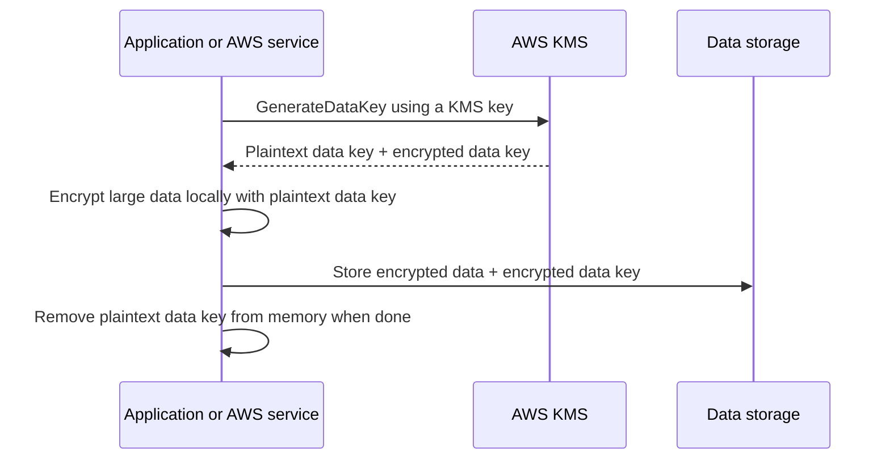
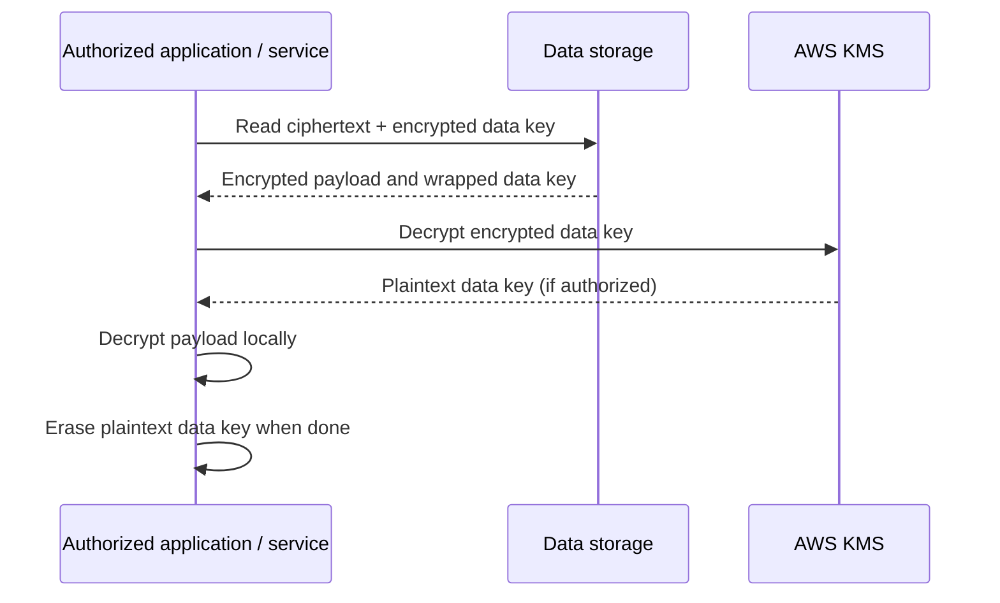
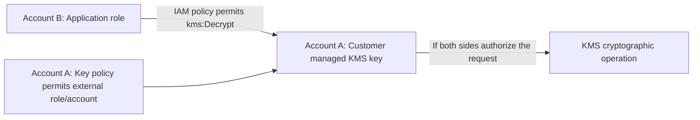
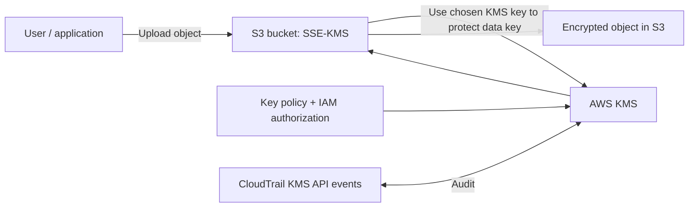
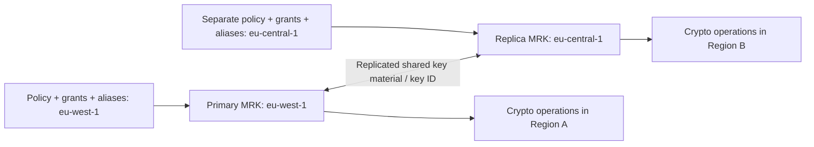
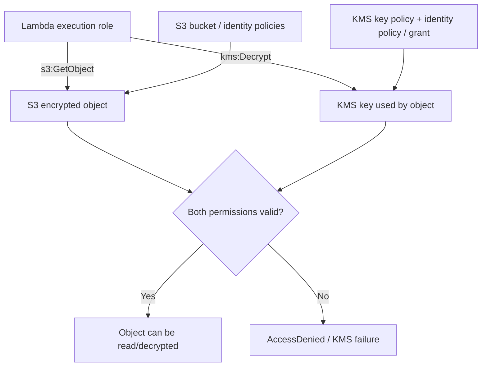

<!-- Source provenance is maintained in docs/reorganization/PHASE-4-CANONICAL-SOURCE-MAP.csv. -->

<div align="center">

# 🔐 AWS Key Management Service (AWS KMS)

### Complete GitHub Study Guide · AWS Cloud Practitioner + Solutions Architect – Associate

[](https://aws.amazon.com/kms/)
[](https://aws.amazon.com/certification/certified-cloud-practitioner/)
[](https://aws.amazon.com/certification/certified-solutions-architect-associate/)
[](https://docs.aws.amazon.com/kms/latest/developerguide/)
[](#official-aws-references)

**One sentence to remember:** **AWS KMS** is a managed service for **creating, controlling, using, rotating, and auditing cryptographic keys** that protect data in AWS services and applications.

[🟢 CCP essentials](#-cloud-practitioner-ccp-essentials) · [🔵 SAA architecture](#saa) · [⚔️ Comparisons](#-compare-with-similar-aws-services) · [⚠️ Exam traps](#-common-exam-traps-and-misconceptions) · [🧠 Practice](#-exam-style-practice-questions)

</div>

---

## 📚 Table of contents

1. [What is AWS KMS?](#1-what-is-aws-kms)
2. [Why do we need a key management service?](#2-why-do-we-need-a-key-management-service)
3. [Core KMS vocabulary and components](#3-core-kms-vocabulary-and-components)
4. [Customer managed vs. AWS managed vs. AWS owned keys](#4-customer-managed-vs-aws-managed-vs-aws-owned-keys)
5. [Symmetric, asymmetric, and HMAC keys](#5-symmetric-asymmetric-and-hmac-keys)
6. [Envelope encryption: how KMS protects data](#6-envelope-encryption-how-kms-protects-data)
7. [Key policies, IAM, grants, and access control](#7-key-policies-iam-grants-and-access-control)
8. [KMS integration with other AWS services](#8-kms-integration-with-other-aws-services)
9. [Key lifecycle, rotation, disabling, and deletion](#9-key-lifecycle-rotation-disabling-and-deletion)
10. [Regional behavior and multi-Region keys](#10-regional-behavior-and-multi-region-keys)
11. [🟢 Cloud Practitioner (CCP) essentials](#-cloud-practitioner-ccp-essentials)
12. [🔵 Solutions Architect – Associate (SAA) deep dive](#saa)
13. [⚔️ Compare with similar AWS services](#-compare-with-similar-aws-services)
14. [⚠️ Common exam traps and misconceptions](#-common-exam-traps-and-misconceptions)
15. [💰 Pricing and shared responsibility](#-pricing-and-shared-responsibility)
16. [🧪 Exam-style practice questions](#-exam-style-practice-questions)
17. [📌 Quick-revision cheat sheet](#-quick-revision-cheat-sheet)
18. [Official AWS references](#official-aws-references)

---

## 1. What is AWS KMS?

> [!IMPORTANT]
> **AWS Key Management Service (KMS)** helps you **create and control cryptographic keys**. AWS services and your own applications can use these keys for encryption and other cryptographic operations. **KMS is not a file-storage service, database, password vault, or general certificate manager.**

### Plain-English definition

Imagine your data is stored in a locked safe:

- **Amazon S3 / Amazon EBS / Amazon RDS** = the **safe** containing your data.
- **Encryption** = the **lock** preventing unauthorized access.
- **Data key** = the key that actually encrypts a large file or dataset.
- **KMS key** = a protected key that commonly **encrypts (wraps) the data key**, while controlling who may use it.
- **KMS key policy** = the permission rules for use and administration of that KMS key.
- **AWS CloudTrail** = the audit record for KMS API activity, subject to your trail configuration.

**Memory trick:** **KMS = Keeper / Manager of the Keys**, not keeper of the files.

| Attribute | Exam-ready answer |
|---|---|
| Full name | **AWS Key Management Service** |
| Main purpose | Managed **cryptographic key lifecycle and access control** |
| Common use case | **Encryption at rest** in S3, EBS, RDS and other AWS services |
| KMS key types by ownership | **Customer managed**, **AWS managed**, **AWS owned** |
| Cryptography | **Symmetric encryption**, **asymmetric encryption/signing**, **HMAC** and other supported key usages |
| Scope | Primarily **Regional**; explicitly created **multi-Region** keys are available |
| Authorization | **Key policies** are foundational; IAM policies and grants can also apply |
| Audit | **AWS CloudTrail** logs KMS API activity; configure retention and exclusions appropriately |
| Protection | Standard AWS KMS key material is protected in **AWS-managed HSMs** |
| Not a replacement for | **Secrets Manager**, **ACM**, **CloudHSM**, or S3/EBS/RDS storage |

## 2. Why do we need a key management service?

Encryption alone is not enough. Organizations need to know:

1. **Where** encryption keys live.
2. **Who** may encrypt/decrypt with them.
3. **Who** may administer or delete them.
4. **How** keys are rotated and retired.
5. **Which** key protected a resource.
6. **Whether** key usage is auditable.

Without centralized controls, developers might hardcode keys in source code or scatter secrets across servers. With KMS, applications and integrated services invoke a controlled key service instead.

### Typical scenarios

| Requirement | Why KMS helps |
|---|---|
| Encrypt S3 objects with a controlled key | S3 **SSE-KMS** with a customer managed key |
| Encrypt EBS volumes | EBS integration with KMS |
| Encrypt an RDS database | RDS storage encryption with a KMS key |
| Protect application secrets at rest | Secrets Manager commonly uses KMS to encrypt stored secrets |
| Separate key administrators from data users | **Key policy + IAM** design |
| Prove key-use activity for audits | **CloudTrail** records API use |
| Share KMS-encrypted data with another AWS account | **Customer managed key** with correct cross-account permissions |
| Keep related key material in two Regions | **Multi-Region KMS keys**, with explicit replication |
| Use a hardware-backed managed key service | Standard KMS integration with AWS-managed HSMs |

> [!NOTE]
> KMS does **not** automatically encrypt all of your AWS resources. Choose an appropriate service-side encryption option or integrate the KMS API into an application. Some services, such as S3, already encrypt data by default without requiring you to select SSE-KMS.

## 3. Core KMS vocabulary and components

| Term | Explanation | Exam clue |
|---|---|---|
| **KMS key** | Logical key resource and protected cryptographic key material/metadata | The centrally managed root of an encryption design |
| **Key ID** | Identifier for a specific KMS key | Not the same as an alias |
| **Key ARN** | ARN including Region, account and key ID | Useful for cross-account access |
| **Alias** | Friendly, mutable reference such as `alias/finance-data` | Can be repointed to a different key |
| **Key policy** | Resource policy attached to exactly one KMS key | **Primary access-control mechanism** |
| **IAM policy** | Identity policy; works for KMS only when authorization permits it | `kms:Decrypt` by itself might not suffice |
| **Grant** | Delegation of particular KMS key operations to a principal | Often used by integrated AWS services |
| **Data key** | Cryptographic key used outside KMS to encrypt actual data | **Envelope encryption** |
| **Encrypted data key** | A data key encrypted ('wrapped') under a KMS key | Store beside ciphertext |
| **Key material** | The cryptographic bytes associated with a key | Rotation changes material, not necessarily key ID |
| **Key rotation** | Change active cryptographic material or replace key | Old ciphertext remains decryptable if old material remains available |
| **Encryption context** | Nonsecret authenticated key-value metadata | Must match on decryption; appears in CloudTrail |
| **AWS CloudTrail** | Records API calls to KMS | Auditing, investigations, compliance |
| **Multi-Region key** | Related keys in Regions that share key ID and key material | Separate Regional policies and management |

### How the pieces fit together



> **Critical distinction:** The AWS service or client often performs **bulk encryption with a data key**; KMS manages the key used to protect that data key. The KMS `Encrypt` API itself can directly encrypt **small payloads up to 4,096 bytes**.

## 4. Customer managed vs. AWS managed vs. AWS owned keys

These ownership categories are **extremely important for CCP** and continue to matter for SAA.

| Feature | **Customer managed key** | **AWS managed key** | **AWS owned key** |
|---|---|---|---|
| Key exists in your account | **Yes** | **Yes** | **No**; in AWS service-owned account |
| Who creates/manages it | **You**, using AWS KMS | AWS service / KMS | AWS service |
| Key policy visible | **Yes, editable** | Generally **visible, not editable** | **No** |
| Custom key permissions | **Yes** | **No** | **No** |
| Lifecycle controls | **Enable/disable, rotation options, deletion** | AWS controls | AWS controls |
| Audit KMS use in your account | **Yes**, via CloudTrail | **Yes**, via CloudTrail | No customer-visible per-key events |
| Key storage charge | **Yes** | **No** | **No** |
| KMS API usage charges | Typically yes, subject to pricing/free tier | May apply | Not billed to customer |
| Example | `alias/customer-finance` | `alias/aws/s3` | Service-internal encryption key |
| Best reason to choose | **Control / sharing / compliance** | **Simple KMS integration** | **Convenient default service encryption** |

> [!TIP]
> **Exam shortcut:** **“Custom key permissions, cross-account use, choose rotation, disable, schedule deletion” → Customer managed KMS key.**

### 4.1 Customer managed keys

You create/manage these in your AWS account and Region. Typical controls:

- Define and edit a **key policy**.
- Create **IAM permissions** and **grants**.
- Enable or disable the key.
- Add **aliases** and tags.
- Choose eligible **automatic** or **on-demand** key-material rotation.
- **Schedule deletion** (with a mandatory waiting period).
- Create **multi-Region** primary and replica keys where supported.

**Example:** A company needs its auditors to review key usage and only a billing service to decrypt finance data. Choose a **customer managed key** and design separate permissions.

### 4.2 AWS managed keys

- Exist in **your** AWS account and are managed for a supported AWS service.
- Common service aliases: `alias/aws/s3`, `alias/aws/ebs`, `alias/aws/rds`.
- **You cannot edit their key policy, disable them, or schedule deletion** as with customer managed keys.
- AWS KMS **automatically rotates** their key material approximately **once per year**.
- **No monthly storage fee**, although API use may incur charges.
- **Not suitable for cross-account sharing** of resources encrypted under these keys.

### 4.3 AWS owned keys

- Owned/managed **inside an AWS service's account**, not yours.
- Key policy and KMS usage events are **not directly visible to you**.
- No KMS storage/usage charge billed to you for these keys.
- Useful for **transparent encryption performed by the service**.

> [!WARNING]
> **“AWS managed key” and “AWS owned key” are different terms.** The first exists in your account; the second is controlled in an AWS service account. Also, **SSE-S3** refers to *S3-managed encryption*, not the same thing as selecting the AWS KMS managed key `alias/aws/s3` for **SSE-KMS**.

## 5. Symmetric, asymmetric, and HMAC keys

### 5.1 Symmetric encryption keys

- **Same secret key material** is used for encryption and decryption.
- Commonly **AES-256** KMS keys for integration with S3, EBS, RDS and other AWS services.
- Key material in a normal symmetric KMS key is **not exported in plaintext**.
- Typically used to protect **data keys** under envelope encryption.

**Scenario:** Encrypt an EBS volume → select a suitable **symmetric encryption KMS key**.

### 5.2 Asymmetric keys

- Include **public and private** key material.
- Used for eligible **public-key encryption/decryption**, **digital signing/verification**, and supported key-agreement algorithms.
- The **public key can be exported**; the private key material remains protected by KMS.
- Different algorithms/key usages support different operations.
- **Not the general-purpose choice for S3/EBS/RDS SSE-KMS storage encryption**.

**Scenario:** A service needs to generate digital signatures centrally → consider an **asymmetric KMS key with `SIGN_VERIFY`**.

### 5.3 HMAC keys

- Symmetric KMS keys designed for **message authentication codes**.
- Operations: **`GenerateMac` / `VerifyMac`**.
- Used to check message **integrity/authenticity**, **not** to encrypt file contents.

| Goal | Key / operation to think of |
|---|---|
| S3, EBS, RDS data encryption | **Symmetric encryption key** |
| Encrypt a small secret with KMS API | `Encrypt` with suitable symmetric/asymmetric key |
| Create a data key for a large payload | `GenerateDataKey` (symmetric encryption KMS key) |
| Digital signature | **Asymmetric** `Sign` / `Verify` |
| Message authentication code | **HMAC** `GenerateMac` / `VerifyMac` |
| Cross-Region compatible encrypted application data | Related **multi-Region keys**, where supported |

> [!NOTE]
> KMS key **type**, **key usage**, and **key origin** are separate properties. For example, a *customer managed* key may be *symmetric*, *single-Region*, and have AWS-generated or imported key material.

## 6. Envelope encryption: how KMS protects data

**Envelope encryption** is one of the highest-value concepts to understand for **both CCP and SAA**.

### 6.1 Why not encrypt a 50-GB file directly with KMS?

The KMS `Encrypt` API supports only small plaintext payloads (up to **4 KiB / 4,096 bytes**). Applications use a **data key** and local/service-side cryptography for large content. KMS protects that data key.

### 6.2 Encryption flow



### 6.3 Decryption flow



**What KMS stores:** Its **KMS key material**, metadata, and policies.  
**What your storage/service keeps:** The **actual encrypted file** and often the **encrypted data key**.  
**What KMS does not persist for your application:** Each generated **data key** and your **bulk ciphertext**.

### 6.4 Why envelope encryption matters

1. **Performance:** A local data key encrypts large volumes of data without sending every byte to KMS.
2. **Security:** The data key is stored in encrypted form; its plaintext use is temporary.
3. **Authorization:** Decrypting a wrapped data key normally requires permission to use the KMS key.
4. **Service integration:** S3, EBS, RDS and other services commonly use this design internally.

### 6.5 Encryption context (SAA)

An **encryption context** is optional, **non-secret key–value metadata** used as **additional authenticated data** with symmetric KMS cryptographic operations.

```text
Example encryption context:
  Application = Invoicing
  Environment = Production

Decrypt must provide the same context values to succeed.
```

- The context must be an **exact match**, including case, for decryption.
- It can be used with **condition keys** in IAM/key policies or constraints in grants.
- **Do not put passwords or personally sensitive values in the context**: it is **not secret** and can appear in **CloudTrail**.

> [!WARNING]
> **KMS key rotation ≠ re-encrypting all existing data.** Automatic/on-demand rotation changes the active key material for *future* encryption. Historical key material is retained as required so ciphertext encrypted with previous versions remains decryptable (provided the key stays usable).

---
## 7. Key policies, IAM, grants, and access control

### 7.1 The rule that trips up many SAA candidates

> [!IMPORTANT]
> **Every KMS key has a key policy.** A separate IAM policy that allows `kms:Decrypt` **does not automatically authorize use of that KMS key**. The key policy must directly allow the caller, or permit the account to delegate permissions through IAM, or access must be otherwise validly granted.

There are three main mechanisms:

| Mechanism | Attached to / used by | Purpose | Typical scenario |
|---|---|---|---|
| **KMS key policy** | Specific **KMS key** | Primary resource-level permissions | Define who may use/administer a finance key |
| **IAM identity policy** | IAM role/user | Grants/denies KMS API actions when allowed by key policy | Application role needs `kms:Decrypt` |
| **KMS grant** | A KMS key, referencing a grantee | Delegate limited key operations, often temporarily | AWS service using an encrypted EBS volume |

**Additional control:** KMS can use **VPC endpoint policies**, service control policies (SCPs), and conditions such as `kms:ViaService` and `kms:EncryptionContext:*` where applicable. An **explicit deny** in applicable authorization policies defeats an allow.

### 7.2 Two separate roles: key administrator vs. key user

- **Key administrator:** manages key policies, aliases, enabling/disabling, grants, and/or deletion **as explicitly allowed**.
- **Key user:** performs cryptographic actions such as `Encrypt`, `Decrypt`, or `GenerateDataKey` **as explicitly allowed**.
- **Separation of duties:** an administrator **does not automatically** get permission to decrypt data merely because they can manage some key settings; check the actual policies, including whether they can modify access.

### 7.3 Simple policy example: IAM delegation + application use

The following is a **conceptual learning example**, **not a production-ready policy**. Account IDs and role names are fictitious.

**KMS key policy** allowing the account to use IAM policies for the key:

```json
{
  "Version": "2012-10-17",
  "Statement": [
    {
      "Sid": "EnableIAMPoliciesForAccount",
      "Effect": "Allow",
      "Principal": { "AWS": "arn:aws:iam::111122223333:root" },
      "Action": "kms:*",
      "Resource": "*"
    }
  ]
}
```

This familiar AWS account-root **principal** in a *key policy* represents **account-level delegation for IAM policies**, not a recommendation to use the root account for daily cryptographic operations.

**Application role IAM permissions** (used in addition to the preceding key-policy authorization):

```json
{
  "Version": "2012-10-17",
  "Statement": [
    {
      "Sid": "UseOnlyFinanceKmsKey",
      "Effect": "Allow",
      "Action": [
        "kms:Encrypt",
        "kms:Decrypt",
        "kms:GenerateDataKey",
        "kms:DescribeKey"
      ],
      "Resource": "arn:aws:kms:eu-west-1:111122223333:key/EXAMPLE-KEY-ID"
    }
  ]
}
```

**Production improvement:** Narrow the actions to the precise workload, add context/service restrictions where appropriate, protect key-policy modification rights, and test both key-level and service-level permissions.

### 7.4 Permissions for common KMS operations

| API action | Enables | SAA exam association |
|---|---|---|
| `kms:Encrypt` | Encrypt small plaintext directly with an eligible KMS key | Direct encryption |
| `kms:Decrypt` | Decrypt supported KMS ciphertext / wrapped data keys | Read encrypted material |
| `kms:GenerateDataKey` | Receive data key material and an encrypted copy | **Envelope encryption** |
| `kms:ReEncryptFrom`, `kms:ReEncryptTo` | Re-encrypt supported ciphertext from/to keys | Key changes, protected migration |
| `kms:DescribeKey` | Read KMS key metadata | Service integration and troubleshooting |
| `kms:CreateGrant` | Delegate selected operations | EBS and other service integrations |
| `kms:PutKeyPolicy` | Change a key policy | **Sensitive administrator permission** |
| `kms:DisableKey` | Make a key unusable for cryptographic operations | Availability impact |
| `kms:ScheduleKeyDeletion` | Start deletion waiting period | **Irreversible data-access risk** |

> [!TIP]
> If an SAA question says **"The IAM role has `kms:Decrypt` but still gets AccessDenied"**, check the **key policy**, any **explicit denies**, **grant conditions**, **Region/account**, and the relevant service's own resource permissions.

### 7.5 Cross-account KMS access

A role in **Account B** may use a customer managed key in **Account A** only when correctly authorized:

1. **Account A:** The key policy permits the external account/role to use supported cryptographic operations.
2. **Account B:** The caller's IAM policy allows the corresponding operations on that **key ARN**.
3. The relevant **service permissions** (e.g., S3 object access) and any grants/conditions must also work.



**Notable limitation:** Cross-account KMS authorization applies only to a specified set of operations (primarily cryptographic and some grant/description operations). It does **not** mean external roles can freely perform all key administration. See [AWS cross-account access rules](https://docs.aws.amazon.com/kms/latest/developerguide/key-policy-modifying-external-accounts.html).

### 7.6 Grants: important in integrated services

A grant authorizes a grantee to perform specific KMS operations **without editing the key policy every time**. AWS services frequently use grants so they can use a key on behalf of a workload for the life of a resource or operation.

**Example:** An encrypted EBS volume is attached to EC2. AWS uses its integration/grant mechanisms to enable the necessary cryptographic use of the volume's KMS key.

> [!WARNING]
> **KMS access and access to encrypted data are different.** A principal might have permission to read an S3 object but lack the KMS decrypt permission, or have KMS decrypt permission but lack `s3:GetObject`. Both layers must allow the action.

## 8. KMS integration with other AWS services

### 8.1 The S3 encryption options you must not confuse

| S3 encryption option | Meaning | KMS involved? | Main clue |
|---|---|---|---|
| **SSE-S3** | Server-side encryption with S3-managed keys | **No customer-selected KMS key** | **Default encryption for new S3 uploads** |
| **SSE-KMS** | S3 server-side encryption with a KMS key | **Yes** | Key-policy control, KMS auditability, API charges |
| **DSSE-KMS** | Dual-layer server-side encryption using KMS keys | **Yes** | Extra layer of cryptographic protection |
| **SSE-C** | Server-side encryption using a key supplied with the request | **Not KMS key management** | Customer supplies encryption key to S3 per request |
| **Client-side encryption** | Encrypt before uploading to S3 | **Optional**, for key wrapping/data keys | Client handles encryption |

> [!IMPORTANT]
> **Amazon S3 encrypts all new objects by default with SSE-S3.** This does **not** mean every S3 object is automatically using a customer managed KMS key. Choose **SSE-KMS** when you need its additional KMS controls.

### 8.2 Example: storing an invoice using S3 SSE-KMS



**What must be allowed?**

- **Upload:** Authorized S3 access and the KMS permissions required by the request, often `kms:GenerateDataKey`.
- **Download:** Authorized `s3:GetObject` **and** needed `kms:Decrypt` permission.
- **Cross-account S3 sharing:** Use an appropriate **customer managed KMS key**; an AWS managed SSE-KMS key such as `aws/s3` cannot provide the required cross-account sharing.

### 8.3 S3 Bucket Keys: a cost optimization

For **SSE-KMS** workloads with many objects, **S3 Bucket Keys** can greatly reduce S3 → KMS API requests (AWS advertises up to **99% reduction** in related KMS request costs, depending on the workload).

**Remember:** An **S3 Bucket Key** is **not** a customer managed KMS key category; it is an S3 optimization for SSE-KMS.

### 8.4 Other integrations

| AWS service | KMS's typical role | Gotcha |
|---|---|---|
| **Amazon EBS** | Encrypt EBS volumes and snapshots via KMS integration | Loss of KMS key availability can block volume access/creation |
| **Amazon RDS / Aurora** | Encrypt data at rest, backups and snapshots | Key selection/changes can require creating/restoring or migrating resources, depending on service |
| **AWS Secrets Manager** | Encrypt secret values **at rest** | Secrets Manager stores/rotates the **secrets**, KMS manages encryption keys |
| **AWS Systems Manager Parameter Store** | Encrypt **SecureString** parameters | Parameter Store stores parameters; KMS supports encryption |
| **Amazon EFS** | Encrypt file system data at rest | Encryption choice is made when creating the file system |
| **Amazon SNS / SQS** | Server-side encryption for topics and queues | Publisher/consumer principals may require KMS permissions |
| **AWS Lambda** | Protect certain environment variables and supported deployment assets | Lambda environment-variable encryption is not the same as encrypting arbitrary application data |
| **Amazon CloudWatch Logs** | Encrypt supported log groups using KMS key configuration | Key-policy conditions for log-service usage matter |
| **AWS Backup** | Use KMS with supported backup and vault encryption configurations | Encryption behavior depends on the source resource/backup type |

**Core memory:** *The AWS service stores or processes the data. KMS manages the cryptographic key used by the supported integration.*

## 9. Key lifecycle, rotation, disabling, and deletion

### 9.1 Key states that can change application behavior

| State / action | Meaning | Impact |
|---|---|---|
| **Enabled** | Key can be used if authorized | Normal operation |
| **Disabled** | Key exists but cannot perform cryptographic operations | New use/decryption requests fail; can be re-enabled |
| **Pending deletion** | Key has been scheduled for deletion | Crypto operations unavailable; cancellation possible during waiting period |
| **Deleted** | KMS key removed after the waiting period | Typically **irreversible loss** of access to data protected only by it |
| **Pending import / expired imported material** | Required imported material absent | Key may be unusable until correct material is reimported |

### 9.2 Rotation: not always "every 365 days"

| Key category | Rotation behavior |
|---|---|
| **AWS managed key** | **Automatically every year**; customer cannot change settings |
| **AWS owned key** | AWS service controls its rotation strategy |
| **Customer managed symmetric key, AWS-generated material** | **Optional automatic rotation**; default **365 days**, configurable **90–2,560 days** |
| **Same eligible customer managed key** | **On-demand rotation** available |
| **Customer managed symmetric key, imported material** | **No automatic rotation**; **on-demand rotation** supported with additional imported material/prerequisites |
| **Asymmetric or HMAC KMS key** | **Manual rotation** by creating/replacing key |
| **KMS key in a custom key store** | **Manual rotation**, not normal automatic/on-demand rotation |

**What happens when AWS rotates eligible key material?**

1. KMS uses **new material** for future encryption.
2. The key **ID, ARN, policies, and aliases remain the same** for material rotation.
3. Earlier key material is retained as needed to decrypt existing ciphertext.
4. Existing encrypted files are **not automatically rewritten or re-encrypted**.
5. **Pricing can increase after the first and second rotation**. See the pricing section.

> [!NOTE]
> *Manual rotation* usually means creating a **new KMS key** and moving workloads to it. Keep the **old key available** until data that depends on it is no longer needed or has been safely re-encrypted. Repointing an alias alone **does not re-encrypt old ciphertext**.

### 9.3 On-demand vs. automatic rotation

- **Automatic:** KMS follows the key's eligible configured period.
- **On-demand:** An authorized person invokes `RotateKeyOnDemand`; for imported symmetric key material, prepare and import the replacement material first.
- **Manual:** Create a different KMS key; change clients/service settings, and explicitly plan migration/decryption of historical data.

### 9.4 Deletion is not the same as disabling

- **Disable:** Reversible; decryption fails while disabled but the key can be enabled again.
- **Schedule deletion:** For **customer managed keys**, choose a **7–30 day** waiting period (**30 days by default**).
- **During pending deletion:** Key cannot perform crypto operations. You may **cancel deletion** before it completes.
- **After deletion:** The original key/material is gone; data dependent on that key may be **unrecoverable**.

> [!CAUTION]
> **SAA availability trap:** If a company deletes the only KMS key needed to decrypt critical backups, having copies of the encrypted backups **does not make the data recoverable**. Manage deletion permissions, monitor key-use history and test recovery before deleting keys.

### 9.5 Imported key material / BYOK

- **BYOK (Bring Your Own Key)** can mean importing your own cryptographic material into a KMS key when supported.
- Imported key material has special lifecycle/expiration risks and must be handled carefully.
- **An imported KMS key is not the same as an external key store (XKS)**: imported material is used inside AWS KMS; XKS performs protected operations using a separate external key-management system.

## 10. Regional behavior and multi-Region keys

### 10.1 Default: AWS KMS is Regional

- KMS keys normally exist in **one AWS Region**.
- You cannot assume a normal **single-Region key** will decrypt data in another Region.
- Keys, aliases, key policies, and related service encryption settings are subject to Regional/account scope.
- For many AWS services, *cross-Region replication* **decrypts/re-encrypts with a destination Region KMS key** rather than using an identical shared key transparently.

### 10.2 Multi-Region KMS keys (MRKs)

A set of **related multi-Region KMS keys** contains a **primary** and selected **replicas** that share key material and key ID (`mrk-…`), enabling compatible cryptographic operations in multiple Regions.



**Essential rules:**

1. **Multi-Region is chosen at key creation**; you cannot convert a single-Region key later.
2. You must **explicitly replicate** the primary key into supported Regions in the same AWS partition.
3. Shared material/ID **does not imply shared access policies**: aliases, grants, policies and enabled state are managed **independently** in each Region.
4. You may have **one related key per Region** in a given set.
5. A multi-Region key is **not a globally available single endpoint**; each Region has its own key resource.
6. **AWS managed keys** are single-Region, not multi-Region keys.
7. S3 and other managed services may still handle cross-Region replication using **service-specific decrypt/re-encrypt workflows**, even if related MRKs exist.
8. **Each primary and replica** may incur a monthly KMS key charge.

**Good use case:** A distributed **client-side encryption** application needs to decrypt compatible ciphertext in Region B using a related regional replica, without sending every cryptographic request back to Region A.

> [!WARNING]
> **Multi-Region KMS keys ≠ automatic data replication** and **≠ shared policies**. KMS helps with key-material interoperability; your application or storage service is responsible for moving data.

---
## 🟢 Cloud Practitioner (CCP) essentials


**Your goal:** Recognize **when to choose KMS**, understand key ownership, know that KMS manages **keys rather than stored data**, and distinguish it from Secrets Manager, CloudHSM and ACM.

### CCP facts to memorize

1. **KMS = Key Management Service**, a managed security service.
2. Its main role is **creating, protecting, controlling and auditing cryptographic keys**.
3. It is commonly used for **encryption at rest** with **S3, EBS, RDS**, etc.
4. **Customer managed keys** provide the most customer control of KMS key policies and lifecycle.
5. **AWS managed keys** are controlled by AWS services, typically with aliases such as `aws/s3`.
6. **AWS owned keys** are controlled by AWS service accounts and not visible as key resources in your account.
7. **KMS + CloudTrail** provides an audit trail of KMS API activity, assuming events are retained and not excluded from the chosen trail.
8. KMS normally uses **Regional keys**; **multi-Region keys** are an explicit feature.
9. **Symmetric encryption** is the common choice for integrated AWS storage encryption.
10. **Envelope encryption:** data key encrypts data; KMS key encrypts the data key.
11. **Secrets Manager** stores and rotates secrets; **KMS** manages the encryption keys that can protect them at rest.
12. **CloudHSM** provides customer-controlled dedicated HSM infrastructure; **standard KMS** is the simpler managed service.
13. **ACM** manages TLS certificates; **KMS** is not a general TLS certificate service.
14. **S3 already encrypts new objects by default with SSE-S3**; SSE-KMS is an additional choice.
15. KMS keys are sensitive dependencies: **disabling or deleting** one can prevent data decryption.

### CCP keywords

`managed encryption keys` · `data encryption at rest` · `centralized key management` · `customer managed key` · `AWS managed key` · `AWS owned key` · `KMS key policy` · `AWS CloudTrail` · `key rotation` · `SSE-KMS` · `S3 EBS RDS encryption` · `envelope encryption` · `HSM-backed key protection` · `symmetric encryption`

### CCP recognition matrix

| If the exam question says… | Think first of… |
|---|---|
| Centrally **manage encryption keys** | **AWS KMS** |
| Encrypt S3/EBS/RDS data with a **controllable encryption key** | **KMS customer managed key** |
| Store or rotate **database credentials / API secrets** | **AWS Secrets Manager** |
| Basic configuration parameters / `SecureString` | **SSM Parameter Store**, possibly using KMS |
| **Dedicated single-tenant HSMs**, more direct cryptographic control | **AWS CloudHSM** |
| Provision and manage **HTTPS/TLS certificates** | **AWS Certificate Manager (ACM)** |
| Audit **KMS API calls** | **AWS CloudTrail** |
| Define **who can perform AWS API actions** | **AWS IAM** (and KMS key policies for KMS keys) |
| Protect data **in transit** via HTTPS | **TLS/ACM** as relevant, not KMS alone |
| Choose default S3 encryption without custom key control | **SSE-S3**, not necessarily KMS |

> [!TIP]
> **Most important CCP sentence:** **KMS manages encryption keys; the underlying AWS service stores the encrypted data.**

---

<a id="saa"></a>

## 🔵 Solutions Architect – Associate (SAA) deep dive


**Your goal:** Design architectures that are **secure, recoverable, correctly authorized, cost-aware, and available across accounts and Regions**.

### 12.1 Architecture decision: AWS managed or customer managed?

| Requirement | Usually choose | Why |
|---|---|---|
| EBS encryption with minimal administrative overhead | **Supported default/AWS managed key** | Simple managed integration |
| Cross-account access to a KMS-encrypted S3 object | **Customer managed key** | Can configure cross-account key policy |
| Custom decrypt permissions for a workload | **Customer managed key** | Key policy + IAM/grants |
| Ability to disable a particular encryption key | **Customer managed key** | Customer lifecycle control |
| Separate administrators and cryptographic users | **Customer managed key** | Fine-grained least privilege |
| Client-side cross-Region cryptographic interoperability | **Multi-Region customer managed key** | Shared key material across related regional keys |
| Customer-managed HSM cluster with KMS-compatible APIs | **KMS CloudHSM custom key store** | Integration + customer-managed cryptographic material location |
| Keys must stay outside AWS | **KMS external key store (XKS)**, only if necessary | Higher operational/availability complexity |

> [!NOTE]
> Not every AWS service supports every KMS key type or custom key store feature. Always check service-specific integration requirements before deploying.

### 12.2 A key policy can block an otherwise authorized application

**Architecture example:** A Lambda application reads an SSE-KMS encrypted S3 object.



**Debugging order:**

1. Does the role have `s3:GetObject` (and does the bucket policy permit the action)?
2. Does the role have the relevant `kms:Decrypt` authority?
3. Does the **KMS key policy** permit that role directly, or validly enable IAM delegation?
4. Is the object actually encrypted with the **expected key ARN**?
5. Do **conditions**, permission boundaries, SCPs, explicit denies, or grants prevent access?
6. Is the **KMS key enabled** and in the **right Region/account**?

### 12.3 Cross-account S3 with SSE-KMS

**Scenario:** A data analytics team in Account B needs to read invoices stored in Account A.

**Correct design:**

- Use a **customer managed key** in an appropriate account/Region.
- Account A's **S3 bucket/object permissions** authorize the reader.
- The **KMS key policy** authorizes supported use by Account B's role/account.
- Account B's **IAM role permissions** include necessary KMS actions on the **key ARN**.
- Confirm service-specific encryption/ownership requirements.

**Wrong answer:** "Keep the AWS managed `alias/aws/s3` key and just add cross-account permissions to it." You **cannot edit** the AWS managed key policy in the needed way.

### 12.4 S3 replication and Regional KMS dependencies

For SSE-KMS objects replicated from one Region to another:

- Replication needs the required permissions on **source** and **destination** encryption keys.
- Destination objects use an appropriate **destination Region KMS key**.
- Don't assume the destination can use the same single-Region key.
- Even when using related **multi-Region keys**, **S3 replication still has its own decrypt/re-encrypt process**.

**Exam clue:** `encrypted cross-Region replication` → check **replication IAM permissions** and the **destination KMS key**.

### 12.5 EBS/RDS encrypted backups and snapshots

- An **encrypted snapshot is still dependent on its encryption key**.
- Sharing/copying snapshots across accounts and Regions can require **customer managed KMS keys** and special service workflows.
- Changing an RDS database's encryption key generally requires an **appropriate snapshot/copy/restore or migration approach**, not just editing the KMS ARN on a running database.
- Encrypting an EBS snapshot does **not** prove an application can recover it if the KMS key is deleted.

### 12.6 Encryption at rest vs. encryption in transit

| Protection goal | Normal choices | What KMS contributes |
|---|---|---|
| S3 object **at rest** | SSE-S3, SSE-KMS, DSSE-KMS | Key control for KMS-based options |
| EBS volume **at rest** | EBS encryption | Protects key hierarchy via integration |
| App/browser **in transit** | HTTPS/TLS, load balancer, ACM | **Not automatically a TLS certificate solution** |
| Client-side data encryption | AWS Encryption SDK + KMS key | Data-key protection / key management |
| Password storage and rotation | Secrets Manager | May encrypt the stored secret at rest |

### 12.7 Encryption context, encryption SDK, and data keys

When an application uses KMS directly:

- Use **`GenerateDataKey` + authenticated encryption** for bulk data; don't try to `Encrypt` multi-MB plaintext directly with KMS.
- Use the **AWS Encryption SDK** where suitable to avoid implementing complex envelope-encryption logic yourself.
- Treat **plaintext data keys** as secrets and minimize time in memory.
- Use **encryption context** to bind ciphertext to metadata and, when appropriate, constrain key use.
- Avoid putting secrets in encryption context because it is **not encrypted** and can appear in CloudTrail.
- Verify caching decisions against **data sensitivity, cost, reuse limits, and threat model**.

### 12.8 Separating key administrator permissions

A secure team can separate:

- **Key admins:** change policy/lifecycle **without automatic business-data access**.
- **Workload roles:** use `Encrypt`, `Decrypt`, `GenerateDataKey` only with the needed key/context.
- **Auditors:** inspect CloudTrail, rotation status, and key configuration with read-only permissions.

**Important:** A principal allowed to `kms:PutKeyPolicy` may be able to change who can use the key. Design administrator roles carefully; simply omitting `kms:Decrypt` is not sufficient if admins can grant themselves access.

### 12.9 Multi-Region is a design choice, not the default

For most service-side encryption, Regional KMS keys are appropriate. Multi-Region keys are particularly relevant when **application-level cryptography** needs related key material in different Regions.

| Option | Strength | Constraint |
|---|---|---|
| **Separate single-Region keys** | Simpler isolation, normal service patterns | Re-encryption/key handling across Regions |
| **Multi-Region KMS key set** | Interoperable crypto among related regional keys | Must replicate and manage separate permissions |
| **One Region only** | Fewer moving parts | KMS calls and workload are dependent on that Region |

### 12.10 KMS availability and disaster recovery

**Encryption is a dependency for availability.** A strong design should:

1. Protect **key policy and deletion permissions**.
2. Keep KMS keys **enabled**, unless intentionally restricting access.
3. Avoid deleting keys that still protect **snapshots, archives, databases, or backups**.
4. Understand dependencies on **external keys/custom key stores** if chosen.
5. Plan **Regional disaster recovery** alongside data replication and KMS authorization.
6. Test restoration with the **actual target account/role**, not just an administrator.

### 12.11 Observability: CloudTrail and alarms

| Tool | What to inspect |
|---|---|
| **CloudTrail** | `CreateKey`, `Decrypt`, `GenerateDataKey`, `PutKeyPolicy`, `DisableKey`, `ScheduleKeyDeletion` and other API events |
| **CloudWatch / EventBridge** | Alerts or rules on sensitive key-management events |
| **AWS Config / Security Hub** | Applicable configuration and compliance findings |
| **CloudTrail Lake / analysis tools** | Historical KMS API investigations (when collected/retained) |

**Nuance:** KMS API events are captured by CloudTrail, but a trail **can be configured to exclude KMS events**. CloudTrail also does **not** expose plaintext cryptographic material in ordinary event logs.

### 12.12 Advanced: custom key stores (CloudHSM and XKS)

| KMS key-store model | Where crypto material/operations reside | Responsibility / trade-off |
|---|---|---|
| **Standard AWS KMS** | AWS-managed KMS HSM infrastructure | Easiest integration and operation |
| **KMS AWS CloudHSM custom key store** | Customer-managed **CloudHSM cluster** | More direct HSM control; higher ops/cost and dependence on cluster health |
| **KMS external key store (XKS)** | Customer/third-party **external key manager** | Key material outside AWS; highest operational and connectivity sensitivity |

**Don't confuse:** Using **CloudHSM directly** to run cryptographic applications is different from using **KMS with a CloudHSM custom key store**. A custom key store gives KMS APIs while moving where key material/cryptographic operations live.

> [!WARNING]
> **XKS is not automatically more secure or available.** An outage of your external key manager/proxy can prevent dependent AWS encryption/decryption operations.

### 12.13 A complete SAA architecture checklist

- [ ] **At rest or in transit?** Pick the right protection technology.
- [ ] **Managed key or customer key?** Check required lifecycle/access control.
- [ ] **Which AWS account/Region owns the key?** Use a precise ARN.
- [ ] **Key policy?** Ensure intended principals / IAM delegation.
- [ ] **IAM policy and service resource policy?** Authorization on both layers.
- [ ] **Cross-account?** Configure both key-side and caller-side permissions.
- [ ] **Service integration?** Verify `GenerateDataKey`, `Decrypt`, grants, and service constraints.
- [ ] **Backup/recovery?** Retain every key needed to restore historical ciphertext.
- [ ] **Key rotation?** Understand material rotation vs. key replacement.
- [ ] **Cross-Region?** Plan destination key and permissions.
- [ ] **CloudTrail?** Ensure appropriate events and retention.
- [ ] **Cost?** Include key-months, operations, and rotation charges.

---

## ⚔️ Compare with similar AWS services

### At-a-glance comparison

| Service | Main job | Exam clue | Relationship to KMS |
|---|---|---|---|
| **AWS KMS** | Manage cryptographic keys / API operations | Encryption keys, key policies, rotation | **Central subject** |
| **AWS CloudHSM** | Dedicated HSMs controlled by customer | Single-tenant HSM / specialized cryptography | Can back a KMS custom key store |
| **AWS Secrets Manager** | Store, retrieve and rotate secrets | DB password, API token, credentials | Uses KMS for encryption at rest |
| **SSM Parameter Store** | Store configuration and parameters | `SecureString`, application parameters | Can use KMS for encrypted parameters |
| **AWS Certificate Manager** | Provision/manage TLS certificates | HTTPS certs, ALB, CloudFront | Different purpose; not a KMS key manager substitute |
| **AWS IAM** | AWS API authorization | Roles, policies, least privilege | IAM works with KMS key policies |
| **AWS CloudTrail** | Log AWS API activity | Who called `kms:Decrypt`? | Audits key API operations |
| **Amazon S3** | Object storage | Bucket/object storage | SSE-KMS integration |
| **Amazon EBS** | Block storage | EC2 volume encryption | KMS key for volume/snapshot encryption |
| **AWS Encryption SDK** | Library for client-side envelope encryption | Encrypt application payloads | Commonly uses KMS keyring/key providers |

<details>
<summary><strong>🔐 KMS vs. AWS CloudHSM</strong></summary>

**KMS:** AWS-operated managed key service with easy integration and standard AWS KMS APIs.

**CloudHSM:** Customer-managed **dedicated HSM instances** for greater control of hardware-backed cryptographic workflows. AWS still operates the underlying physical infrastructure; you control HSM configuration/users/keys according to the service model.

**Choose KMS** for normal AWS-integrated encryption. **Choose CloudHSM** when a specialized requirement calls for dedicated HSM control/algorithms/interfaces. **KMS custom key stores** can combine KMS integration with a CloudHSM-backed key store.
</details>

<details>
<summary><strong>🔑 KMS vs. AWS Secrets Manager</strong></summary>

**KMS:** Manages encryption **keys** and performs controlled cryptographic operations.

**Secrets Manager:** Stores, retrieves and **rotates secret values** such as database passwords and API credentials. It commonly uses KMS to encrypt these secrets at rest.

**Trap:** KMS can encrypt a short password via its API, but that does **not make KMS a managed password vault** with secret versions, rotation workflows, or application retrieval features.
</details>

<details>
<summary><strong>🧰 KMS vs. Systems Manager Parameter Store</strong></summary>

**Parameter Store:** Stores configuration parameters; `SecureString` uses KMS-based encryption. Parameter Store is often sufficient for application parameters and simpler secret-management needs.

**Secrets Manager:** More purpose-built for managed secrets and rotation.

**KMS:** Protects the underlying encryption keys, rather than acting as either application's parameter or secret database.
</details>

<details>
<summary><strong>🌐 KMS vs. AWS Certificate Manager (ACM)</strong></summary>

**ACM:** Manages certificates used for **TLS/HTTPS communication** on compatible AWS services.

**KMS:** Controls cryptographic keys used for data-protection workloads; does **not** replace ACM's certificate issuance/renewal and TLS service integrations.

**Mnemonic:** **Data at rest with controlled encryption key → KMS**; **web TLS certificate → ACM**.
</details>

<details>
<summary><strong>🧾 KMS vs. IAM vs. CloudTrail</strong></summary>

**IAM:** Defines who may perform AWS operations. **KMS key policies** add key-specific authorization. **CloudTrail:** records API calls for auditing. **KMS:** holds/protects key material and enables key-related cryptographic operations.

All three are often needed **together**.
</details>

<details>
<summary><strong>📦 SSE-S3 vs. SSE-KMS</strong></summary>

**SSE-S3:** S3-managed server-side encryption; already the default for new S3 objects.

**SSE-KMS:** Server-side encryption with a KMS key. Choose for KMS key control, auditing, and supported cross-account patterns when using a customer managed key. Adds KMS-specific permissions and possible request/key charges.
</details>

---

## ⚠️ Common exam traps and misconceptions

| ❌ Misconception | ✅ Correct understanding |
|---|---|
| "KMS stores my documents." | KMS manages **keys**; S3/EBS/RDS store the data. |
| "KMS automatically encrypts every AWS resource." | Resource/service integration and encryption configuration determine coverage. |
| "All KMS keys are customer managed." | Ownership types: **customer managed, AWS managed, AWS owned**. |
| "AWS managed and AWS owned keys are the same." | AWS managed exists in **your account**; AWS owned exists in an **AWS service account**. |
| "SSE-S3 uses a customer managed KMS key." | SSE-S3 is **S3-managed**, not customer-selected SSE-KMS. |
| "S3 is unencrypted by default unless I enable KMS." | All new S3 objects use **SSE-S3 by default**. |
| "Customer managed keys are free." | Monthly KMS key and possible operation/rotation costs apply. |
| "All KMS API calls are free." | Request fees may apply and free-tier exclusions exist. |
| "A key with `kms:Decrypt` in IAM always works." | **Key policy** (or applicable grant) and other controls must also authorize use. |
| "Every administrator can decrypt business data by default." | Admin and key-user permissions can be separated. |
| "The KMS key's alias is its permanent identity." | An alias can be **repointed** to another key. |
| "Rotating a key means encrypting all old objects again." | **Material rotation does not rewrite historical ciphertext**. |
| "Automatic rotation is always fixed at 365 days." | Eligible customer managed keys support **90–2,560 day** configurable periods. |
| "Every key type supports automatic rotation." | Auto rotation is restricted to supported **symmetric AWS-generated** material. |
| "Imported symmetric key material can never rotate in place." | Supported imported symmetric keys can use **on-demand rotation** with prerequisites. |
| "Changing an alias re-encrypts existing data." | Alias change only changes which key future alias-based calls reference. |
| "A single-Region KMS key works transparently in every Region." | KMS key use is generally **Regional**. |
| "Multi-Region keys are global keys with one policy." | Related regional keys **share material/ID**, but **not** policies/grants/aliases. |
| "Creating a multi-Region key copies my files." | Key replication **does not replicate data**. |
| "Every S3 replica uses the same material without re-encryption." | S3 replication has **service-specific decrypt/re-encrypt** behavior. |
| "Cross-account SSE-KMS works with `alias/aws/s3`." | Use a **customer managed key** for supported cross-account sharing. |
| "If I can read an S3 object, I can always decrypt it." | Need both **S3 permissions** and applicable **KMS permissions**. |
| "KMS directly encrypts a huge file via `Encrypt`." | Direct `Encrypt` supports **up to 4,096 plaintext bytes**; use envelope encryption for large data. |
| "The encrypted data key is the same thing as the KMS key." | Data key encrypts bulk data; **KMS key protects the data key**. |
| "Encryption context is a secret place for passwords." | Context is **non-secret** and can appear in CloudTrail. |
| "Disabling or deleting a key is harmless because data is still stored." | Data may become **undecryptable**. |
| "All KMS key deletions are instant." | Customer managed key deletion requires **7–30 day** waiting period. |
| "A deleted KMS key can always be restored from CloudTrail." | CloudTrail is an **audit service**, not a cryptographic key backup. |
| "KMS and Secrets Manager are interchangeable." | KMS manages keys; Secrets Manager manages secret **values and rotation**. |
| "KMS is the service for HTTPS certificates." | **ACM** manages TLS certificates. |
| "CloudHSM and KMS provide identical operating models." | CloudHSM means more direct HSM control and operational responsibility. |
| "CloudTrail records KMS plaintext keys/ciphertext." | Sensitive plaintext fields are omitted; CloudTrail records API activity. |
| "CloudTrail always retains KMS activity indefinitely." | Trails/events have **configuration, exclusions and retention** considerations. |

### Interview / exam questions worth being able to answer

**Q: Does KMS encrypt data directly?**  
A: KMS supports **direct encryption of small payloads**; large data usually uses **envelope encryption** with a data key.

**Q: What's the difference between a KMS key and a data key?**  
A: A **KMS key** is a managed protected key used to secure other keys or perform crypto operations. A **data key** performs bulk encryption outside KMS.

**Q: Can an IAM policy override a key policy?**  
A: No. An IAM allow is not enough when the key policy has not enabled the required authorization; explicit denies are respected.

**Q: Is the KMS key global?**  
A: Standard keys are Regional; explicitly configured **multi-Region keys** share material across related regional keys with independent permissions.

**Q: What if my KMS key is deleted?**  
A: Data only decryptable with that key may be lost permanently; do not confuse encrypted backups with recoverable backups.

**Q: Does rotating a KMS key delete old cryptographic material?**  
A: Normal supported key-material rotation **retains previous material** so historical ciphertext can still be decrypted.

**Q: Is a KMS key policy always required?**  
A: **Yes.** Every KMS key has exactly one key policy.

---
## 💰 Pricing and shared responsibility

### 15.1 KMS pricing factors (verify against your Region/current offer)

AWS's published KMS pricing describes these major dimensions:

| Component | Pricing idea | What to remember |
|---|---|---|
| **Customer managed KMS key** | **$1 per key per month**, prorated hourly | A persistent key costs money even if little used |
| **Key-material rotation** | First **and** second automatic/on-demand rotations each add **$1 per month** (prorated); capped after second | A twice-rotated key can cost **$3/month in key-storage fees** |
| **Multi-Region keys** | **Each primary and replica key** counts separately | More Regions = more keys to pay for |
| **AWS managed keys** | **No key-storage charge** | API operations can still be billed |
| **AWS owned keys** | No customer KMS key/usage charge | Service-owned, service-controlled |
| **KMS requests** | Varies by operation; 20,000 eligible requests/month free tier | Some asymmetric operations are excluded |
| **CloudHSM / external key store** | KMS fees **plus** external infrastructure and service fees | More operational responsibility and cost |
| **CloudTrail / storage** | Subject to CloudTrail/logging costs | Auditing and retention should be budgeted |

**Example — illustrative monthly key-storage fees only:**

```text
One unrotated customer managed key        = $1/month
Same key after first rotation             = $2/month
Same key after second rotation            = $3/month
Later rotations of that key               = still $3/month (key-storage fee)

Two separate unrotated regional KMS keys  = 2 × $1 = $2/month

API requests, encryption service fees and other resources = extra as applicable
```

> [!WARNING]
> The **old rule "a customer managed KMS key always costs only $1/month" is incomplete**. Modern KMS pricing charges extra for its first two automatic/on-demand **material rotations**. Consult the official pricing page when estimating costs.

**Cost optimization idea:** For high-volume **S3 SSE-KMS** use, consider **S3 Bucket Keys** to reduce repeated KMS API calls. Verify that performance/security behavior and service support meet your requirements.

### 15.2 Shared responsibility model

| AWS manages for standard KMS | Customer manages |
|---|---|
| Service infrastructure and AWS-managed HSM operations | Key **policies**, IAM permissions and grants |
| Underlying service physical security and normal service availability | Selecting the right KMS key/account/Region |
| Protected operation of standard KMS key material | Which resources actually use the key |
| Service API and supported integrations | Safe **rotation**, disabling, deletion and recovery plans |
| Normal service maintenance | CloudTrail/monitoring configuration and retention |
| | Cross-account permissions and least-privilege design |
| | Additional HSM/proxy/key infrastructure for **custom key stores** |

> [!TIP]
> **Cloud encryption success = encrypt the data + keep keys safe + preserve permissions + keep historical keys recoverable.**

---

## 🧪 Exam-style practice questions

> **Study method:** Answer before expanding the result. The following are **original educational questions**, not actual AWS certification exam questions.

<details>
<summary><strong>Q1 · CCP:</strong> Which AWS service centrally creates and controls encryption keys?</summary>

**Answer: AWS KMS.** It manages key resources and cryptographic operations used by AWS services/applications.
</details>

<details>
<summary><strong>Q2 · CCP:</strong> Does AWS KMS store all S3 documents encrypted under its keys?</summary>

**Answer: No.** S3 stores objects. KMS manages keys and performs key-related crypto operations.
</details>

<details>
<summary><strong>Q3 · CCP:</strong> A company wants custom key-access rules and the ability to disable an encryption key. Which KMS key category?</summary>

**Answer: Customer managed key.** It gives the customer control over key policies and lifecycle.
</details>

<details>
<summary><strong>Q4 · CCP:</strong> Where can you find a record of KMS API calls?</summary>

**Answer: AWS CloudTrail.** KMS calls are captured as API events; configure trail/event retention and avoid unwanted KMS exclusions.
</details>

<details>
<summary><strong>Q5 · CCP:</strong> Which AWS service stores and rotates database credentials?</summary>

**Answer: AWS Secrets Manager.** It can use KMS for encryption at rest, but KMS itself is not the secrets vault.
</details>

<details>
<summary><strong>Q6 · CCP:</strong> What is the default encryption option for new objects in Amazon S3?</summary>

**Answer: SSE-S3.** Default S3-managed encryption is distinct from manually choosing SSE-KMS.
</details>

<details>
<summary><strong>Q7 · CCP:</strong> Which service is more direct for managing TLS certificates on an ALB?</summary>

**Answer: AWS Certificate Manager (ACM).** KMS manages keys for supported cryptographic workloads, not ALB TLS certificate lifecycle.
</details>

<details>
<summary><strong>Q8 · CCP:</strong> What is the difference between an AWS owned and AWS managed key?</summary>

**Answer:** AWS **managed** keys exist in your account and are service-managed. AWS **owned** keys exist in AWS service-owned accounts and are not directly manageable or auditable by the customer.
</details>

<details>
<summary><strong>Q9 · CCP:</strong> What kind of cryptography is typical for S3 SSE-KMS and EBS?</summary>

**Answer: Symmetric encryption KMS keys.** These are widely used by AWS-integrated encryption-at-rest services.
</details>

<details>
<summary><strong>Q10 · CCP:</strong> An organization needs dedicated single-tenant HSMs and direct HSM control. KMS or CloudHSM?</summary>

**Answer: AWS CloudHSM** (or a KMS CloudHSM custom key store where KMS APIs are required). Standard KMS is simpler and more fully managed.
</details>

<details>
<summary><strong>Q11 · CCP/SAA:</strong> A workload encrypts a large file using a temporary data key and encrypts that data key under KMS. What is this?</summary>

**Answer: Envelope encryption.** The data key encrypts bulk data; the KMS key protects the data key.
</details>

<details>
<summary><strong>Q12 · SAA:</strong> The EC2 role has an IAM allow for `kms:Decrypt`, but a customer managed key's policy doesn't authorize the role or IAM delegation. Will decrypt work?</summary>

**Answer: No.** The KMS key policy is foundational; an IAM allow alone does not override it.
</details>

<details>
<summary><strong>Q13 · SAA:</strong> A user can `s3:GetObject`, but cannot read an SSE-KMS object. What extra permission is likely missing?</summary>

**Answer: `kms:Decrypt`** on the key used by the object, plus correct key-policy authorization and no applicable denies.
</details>

<details>
<summary><strong>Q14 · SAA:</strong> Account B needs S3 objects encrypted in Account A with SSE-KMS. Can Account A use `alias/aws/s3` and simply edit its key policy?</summary>

**Answer: No.** Choose a **customer managed KMS key** and configure cross-account key policy, caller IAM and S3 access.
</details>

<details>
<summary><strong>Q15 · SAA:</strong> Which additional KMS mechanism commonly delegates limited cryptographic operations to integrated AWS services?</summary>

**Answer: KMS grants.** Grants allow specified key operations for a grantee without constantly editing the key policy.
</details>

<details>
<summary><strong>Q16 · SAA:</strong> Can the direct KMS `Encrypt` API encrypt a 100 MB object in one request?</summary>

**Answer: No.** Direct `Encrypt` accepts up to **4,096 bytes**; use data keys/envelope encryption for bulk data.
</details>

<details>
<summary><strong>Q17 · SAA:</strong> A team rotates an eligible symmetric KMS key's material. Must it re-encrypt every old S3 object immediately?</summary>

**Answer: No.** Historical material is retained for decryption; rotation affects the active material for new cryptographic operations, not stored objects automatically.
</details>

<details>
<summary><strong>Q18 · SAA:</strong> Can an eligible customer managed symmetric KMS key automatically rotate every 180 days?</summary>

**Answer: Yes.** Eligible keys with AWS-generated symmetric encryption material support custom automatic periods from **90 to 2,560 days**.
</details>

<details>
<summary><strong>Q19 · SAA:</strong> Are all imported-material KMS keys eligible for automatic rotation?</summary>

**Answer: No.** Imported material is not eligible for normal automatic rotation. Supported **symmetric imported keys can support on-demand rotation** with the proper material workflow.
</details>

<details>
<summary><strong>Q20 · SAA:</strong> Does moving `alias/production` to a new KMS key automatically re-encrypt previously stored ciphertext?</summary>

**Answer: No.** An alias changes a reference; old ciphertext remains bound to the key that protected it and must be handled appropriately.
</details>

<details>
<summary><strong>Q21 · SAA:</strong> An administrator schedules deletion of the only key protecting a database backup. What is the major danger?</summary>

**Answer: The backup may become undecryptable.** A copy of encrypted data without its required key is not necessarily recoverable.
</details>

<details>
<summary><strong>Q22 · SAA:</strong> What is the waiting period for scheduling customer managed KMS key deletion?</summary>

**Answer: 7–30 days**, with **30 days default**. During this window deletion can be canceled.
</details>

<details>
<summary><strong>Q23 · SAA:</strong> Can you take a normal single-Region KMS key and convert it directly to multi-Region?</summary>

**Answer: No.** Multi-Region capability must be chosen when the key is created.
</details>

<details>
<summary><strong>Q24 · SAA:</strong> Which properties are independent for related multi-Region keys: key material or key policy?</summary>

**Answer: Key policy.** Related MRKs share key ID and material, but permissions, grants and aliases are independently managed in each Region.
</details>

<details>
<summary><strong>Q25 · SAA:</strong> Will replicating an MRK from eu-west-1 to eu-central-1 replicate the S3 objects protected by it?</summary>

**Answer: No.** KMS replicates related key material, not application objects or database content.
</details>

<details>
<summary><strong>Q26 · SAA:</strong> An application includes `SecretPassword=hello123` in the encryption context. What is wrong?</summary>

**Answer:** Encryption context is **not secret** and may appear in **CloudTrail**. Use non-sensitive metadata instead.
</details>

<details>
<summary><strong>Q27 · SAA:</strong> What KMS action is often useful for a service encrypting a large resource using a newly generated data key?</summary>

**Answer: `kms:GenerateDataKey`.** It provides a plaintext data key (as applicable) and encrypted copy for envelope encryption.
</details>

<details>
<summary><strong>Q28 · SAA:</strong> Which API can re-encrypt supported KMS ciphertext from a source key to a destination key?</summary>

**Answer: `ReEncrypt`.** Proper authorization is needed for both source and destination, and service-level data handling is still your responsibility.
</details>

<details>
<summary><strong>Q29 · CCP/SAA:</strong> Is a customer managed key's cost always exactly $1/month, no matter how often it has rotated?</summary>

**Answer: No.** Published pricing adds **$1/month** after each of the first **two** automatic/on-demand rotations, with that key-storage increase capped after the second.
</details>

<details>
<summary><strong>Q30 · SAA:</strong> A company insists that cryptographic key material must remain outside AWS. Which advanced integration fits the requirement?</summary>

**Answer: AWS KMS external key store (XKS)**, if the requirement genuinely warrants the extra risk/cost and supported services/operations. A standard KMS key or simple imported material doesn't meet the same outside-AWS residency requirement.
</details>

### Five architecture scenario drills

| Scenario | Best initial solution | Reason |
|---|---|---|
| Enforce custom key control for financial invoices in S3 | **SSE-KMS + customer managed KMS key** | Custom key policies and auditability |
| Read cross-account SSE-KMS invoices | **Customer managed key + KMS key policy + caller IAM + S3 permissions** | Both access layers must authorize |
| Reduce heavy SSE-KMS API request costs | **S3 Bucket Keys** | Reduces calls from S3 to KMS |
| Encrypt application data in several AWS Regions with compatible key material | **Related multi-Region KMS keys** | Regional crypto interoperability; independent management |
| Guard critical encrypted backups against accidental key loss | **Restrict key deletion, retain historical keys, monitor and test restore** | Encryption-key availability determines recoverability |

---

## 📌 Quick-revision cheat sheet

### Read this in 30 seconds

```text
AWS KMS = MANAGED CRYPTOGRAPHIC KEY MANAGEMENT

WHAT?       Create / control / use / rotate / audit KMS keys
DATA?       Actual files live in S3, EBS, RDS, etc.
MAIN GOAL?  Encryption at rest + controlled key usage
KEY TYPES?  Customer managed / AWS managed / AWS owned
CRYPTO?     Symmetric (common storage), asymmetric, HMAC
ENVELOPE?   Data key encrypts data; KMS key encrypts data key
ACCESS?     Key policy first; IAM policies + grants can apply
AUDIT?      CloudTrail KMS API events
SCOPE?      Regional by default; explicit related multi-Region keys
ROTATION?   Eligible CMK: auto 90-2560 days or on-demand
            AWS managed: rotated by AWS every year
DELETION?   Customer key 7-30 day waiting period
S3?         SSE-S3 = default; SSE-KMS = KMS key control
CROSS ACCT? Customer managed key + key policy + IAM + service access
PRICING?    Key monthly charge + requests + potential rotation surcharge
NOT KMS?    Secret rotation -> Secrets Manager
            TLS certificates -> ACM
            Dedicated HSM control -> CloudHSM
```

### 🟢 CCP trigger keywords

**Strong KMS signals:** `encryption key management` · `managed encryption` · `KMS keys` · `key rotation` · `SSE-KMS` · `AWS CloudTrail audit` · `customer managed key` · `encryption at rest` · `S3/EBS/RDS encryption`

### 🔵 SAA trigger keywords

**Architecture signals:** `kms:Decrypt AccessDenied` · `key policy vs IAM` · `cross-account encrypted S3` · `multi-Region KMS key` · `encryption context` · `GenerateDataKey` · `envelope encryption` · `KMS grant` · `key deletion recovery risk` · `S3 Bucket Keys` · `source/destination Region KMS keys` · `CloudHSM custom key store` · `XKS`

### Final memory analogy

> **S3/EBS/RDS** = the **safe** that stores your data.  
> **Data key** = the small physical **key that locks the contents**.  
> **KMS key** = the **master-controlled lockbox** that protects the data key.  
> **KMS key policy / IAM / grant** = rules for **who may open the lockbox**.  
> **CloudTrail** = the **security logbook**.  
> **Secrets Manager** = the **secure cabinet for passwords and tokens**.  
> **ACM** = the **certificate office for HTTPS**.  
> **CloudHSM** = the **dedicated cryptographic vault you operate**.

---

## Official AWS references

**Source foundation:** Expanded and reorganized from the supplied `01-overview.md`. Technical details below were independently checked against official AWS documentation on **31 October 2026**. The original source contained older simplifications around rotation, ownership, and costs; this guide reflects current documented behavior rather than repeating those unqualified statements.

1. [AWS KMS — Developer Guide](https://docs.aws.amazon.com/kms/latest/developerguide/)
2. [AWS KMS keys — ownership models and concepts](https://docs.aws.amazon.com/kms/latest/developerguide/concepts.html)
3. [AWS KMS — Pricing](https://aws.amazon.com/kms/pricing/)
4. [Key policies in AWS KMS](https://docs.aws.amazon.com/kms/latest/developerguide/key-policies.html)
5. [Using IAM policies with AWS KMS](https://docs.aws.amazon.com/kms/latest/developerguide/iam-policies.html)
6. [Cross-account access to KMS keys](https://docs.aws.amazon.com/kms/latest/developerguide/key-policy-modifying-external-accounts.html)
7. [KMS key access and grants](https://docs.aws.amazon.com/kms/latest/developerguide/control-access.html)
8. [Generate data keys and envelope encryption](https://docs.aws.amazon.com/kms/latest/developerguide/data-keys.html)
9. [AWS KMS Encrypt API — payload size](https://docs.aws.amazon.com/kms/latest/APIReference/API_Encrypt.html)
10. [Encryption context](https://docs.aws.amazon.com/kms/latest/developerguide/encrypt_context.html)
11. [Enable automatic key rotation](https://docs.aws.amazon.com/kms/latest/developerguide/rotating-keys-enable.html)
12. [On-demand rotation](https://docs.aws.amazon.com/kms/latest/developerguide/rotating-keys-on-demand.html)
13. [Manual key rotation](https://docs.aws.amazon.com/kms/latest/developerguide/rotate-keys-manually.html)
14. [Delete an AWS KMS key](https://docs.aws.amazon.com/kms/latest/developerguide/deleting-keys.html)
15. [Multi-Region KMS keys](https://docs.aws.amazon.com/kms/latest/developerguide/multi-region-keys-overview.html)
16. [How multi-Region keys work](https://docs.aws.amazon.com/kms/latest/developerguide/mrk-how-it-works.html)
17. [KMS key custom key stores, CloudHSM and XKS](https://docs.aws.amazon.com/kms/latest/developerguide/key-store-overview.html)
18. [CloudTrail logging of AWS KMS operations](https://docs.aws.amazon.com/kms/latest/developerguide/logging-using-cloudtrail.html)
19. [Amazon S3 SSE-KMS](https://docs.aws.amazon.com/AmazonS3/latest/userguide/UsingKMSEncryption.html)
20. [Amazon S3 default encryption](https://docs.aws.amazon.com/AmazonS3/latest/userguide/default-bucket-encryption.html)
21. [AWS KMS aliases](https://docs.aws.amazon.com/kms/latest/developerguide/kms-alias.html)
22. [Imported key material considerations](https://docs.aws.amazon.com/kms/latest/developerguide/importing-keys-considerations.html)

> [!NOTE]
> Key pricing, cryptographic support, Regional availability, and exam scopes can change. For production implementation, verify the linked current documentation and your service's own KMS integration guide.

---

<div align="center">

**Study outcome:** For **CCP**, recognize when the answer is KMS. For **SAA**, understand **key ownership + permissions + encryption flow + cross-account/Region behavior + recovery + cost**.

[](#-cloud-practitioner-ccp-essentials)
[](#saa)

</div>
