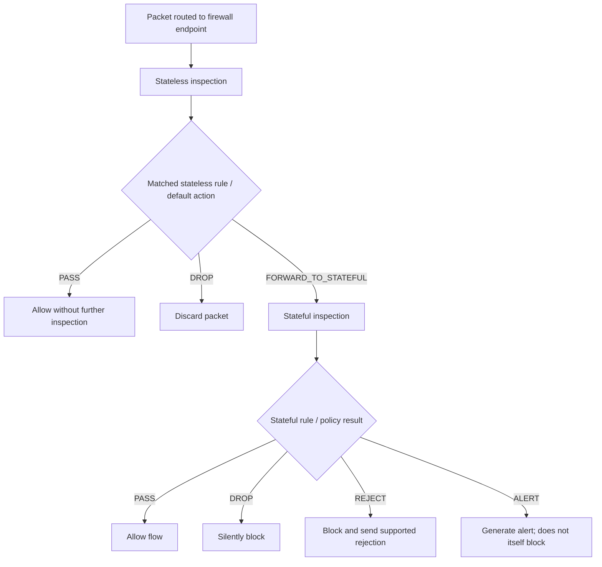
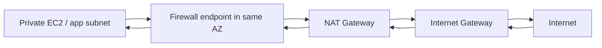
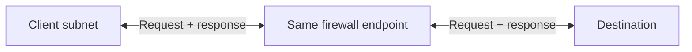

<div align="center">

# 🛡️ AWS Network Firewall

### Complete GitHub Study Guide · Cloud Practitioner + Solutions Architect – Associate

[](https://aws.amazon.com/network-firewall/)
[](https://aws.amazon.com/certification/certified-cloud-practitioner/)
[](https://aws.amazon.com/certification/certified-solutions-architect-associate/)
[](https://docs.aws.amazon.com/network-firewall/latest/developerguide/)
[](#official-aws-references)

**One sentence to remember:** AWS Network Firewall is a managed, in-line network security service that inspects **traffic routed through its firewall endpoints** according to **stateless and stateful rules**.

[🟢 CCP essentials](#-cloud-practitioner-ccp-essentials) · [🔵 SAA architecture](#-solutions-architect-associate-saa-deep-dive) · [⚔️ Comparisons](#-compare-with-similar-aws-security-services) · [⚠️ Exam traps](#-common-exam-traps-and-misconceptions) · [🧠 Practice](#-exam-style-practice-questions)

</div>

---

## 📚 Table of contents

1. [What is AWS Network Firewall?](#1-what-is-aws-network-firewall)
2. [What problem does it solve?](#2-what-problem-does-it-solve)
3. [Core concepts and components](#3-core-concepts-and-components)
4. [How traffic inspection works](#4-how-traffic-inspection-works)
5. [Features and use cases](#5-features-and-use-cases)
6. [🟢 Cloud Practitioner (CCP) essentials](#-cloud-practitioner-ccp-essentials)
7. [🔵 Solutions Architect – Associate (SAA) deep dive](#-solutions-architect-associate-saa-deep-dive)
8. [⚔️ Compare with similar AWS security services](#-compare-with-similar-aws-security-services)
9. [⚠️ Common exam traps and misconceptions](#-common-exam-traps-and-misconceptions)
10. [💰 Pricing and shared responsibility](#-pricing-and-shared-responsibility)
11. [🧪 Exam-style practice questions](#-exam-style-practice-questions)
12. [📌 Quick-revision cheat sheet](#-quick-revision-cheat-sheet)
13. [Official AWS references](#official-aws-references)

---

## 1. What is AWS Network Firewall?

> [!IMPORTANT]
> **AWS Network Firewall is a managed, stateful network firewall and intrusion detection/prevention service for AWS networks.** It can inspect, allow, drop, reject, and/or alert on traffic according to configured rules **when that traffic traverses the firewall**.

Think of a **highway inspection checkpoint**:

- **VPC route tables** determine which cars (packets) pass through the checkpoint.
- **Firewall endpoints** are the checkpoints.
- **Firewall policies and rule groups** tell officers which traffic to allow, block, or flag.
- **Logs and metrics** record useful security and operational activity.

The checkpoint **does not see cars that take another road**. Likewise, creating a Network Firewall does **not** automatically secure or inspect every packet in a VPC.

| Attribute | Exam-ready answer |
|---|---|
| Service category | Managed network security / firewall / IDS / IPS |
| Main protection scope | Routed network traffic in AWS VPC and supported centralized network architectures |
| Traffic direction | Inbound, outbound, and routed east–west traffic |
| Inspection engines | **Stateless** and **stateful** |
| Application awareness | Can inspect selected Layer 7 protocol information; not a replacement for AWS WAF |
| Deployment | VPC firewall endpoints in selected AZs; also supports direct Transit Gateway firewall attachment |
| Essential dependency | **Correct routing and security policy** |
| Operating model | AWS operates the firewall infrastructure; you configure coverage and rules |

## 2. What problem does it solve?

Basic VPC controls alone may not satisfy an organization that needs **centralized, consistent, advanced traffic inspection**.

**Example:** Private EC2 instances need outbound internet access to download security updates. The organization wants to **block known malicious destinations**, allow approved services, and inspect/log connections. Security groups and NACLs can permit or deny IP/port combinations, but Network Firewall adds centrally managed, connection-aware rules and deeper inspection.

**Typical use cases:**

- **Outbound (egress) inspection:** restrict what workloads can contact on the internet.
- **Inbound (ingress) inspection:** inspect traffic on routed paths to public-facing applications.
- **Lateral/east–west inspection:** examine traffic between appropriately routed VPCs or network segments.
- **Hybrid network inspection:** inspect supported traffic routed via VPN, Direct Connect, and Transit Gateway designs.
- **Threat prevention:** use Suricata-compatible signatures or supported managed rule groups.
- **Policy enforcement:** apply consistent organizational network security policies.
- **Centralized logging and visibility:** capture flow/alert/TLS inspection events (as configured).

> [!NOTE]
> Network Firewall is **not** automatically inserted into VPN or Direct Connect traffic. The architecture must deliberately route that traffic through an inspection path.

## 3. Core concepts and components

| Component | Meaning | Remember |
|---|---|---|
| **Firewall** | Network Firewall resource associated with a primary VPC (or supported Transit Gateway attachment) | The deployed security service |
| **Firewall endpoint** | The network target traffic traverses to be inspected | **Routing is essential** |
| **Firewall subnet** | Dedicated subnet used for a primary endpoint in a VPC AZ | Keep application workloads out of this subnet |
| **Firewall policy** | Connects rule groups and configures engine behavior/default actions | The central decision configuration |
| **Stateless rule group** | Matches packets independently using network header properties | Simple, packet-by-packet filtering |
| **Stateful rule group** | Evaluates packet flows and can inspect deeper protocol details | Connection-aware security |
| **Rule action** | Pass, drop, forward, reject, or alert (depends on engine) | Engines have **different** action sets |
| **Logging configuration** | Configures delivery of flow, alert and optional TLS logs | **Not enabled just by creating a firewall** |
| **CloudWatch metrics** | Operational counters such as received, passed and dropped packets | Health monitoring / alarms |
| **VPC route tables** | Direct selected traffic through firewall endpoints | Wrong route = bypass |

### 🧩 Resource relationship

```mermaid
flowchart TD
    F[Network Firewall resource] --> E[Firewall endpoint(s) / TGW attachment]
    F --> P[Firewall policy]
    P --> S[Stateless rule groups]
    P --> T[Stateful rule groups]
    P --> D[Default actions]
    R[VPC / TGW routing] --> E
    E --> I[Traffic inspected]
    S --> I
    T --> I
    I --> L[Logs and CloudWatch metrics]
```

### Firewall policy vs. rule group

A **rule group** contains reusable rules. A **firewall policy** determines which rule groups a firewall uses and how the two inspection engines behave. The **firewall** is the deployed resource using that policy.

> **Memory trick:** **Rules** = instructions; **policy** = instruction book; **firewall endpoint** = checkpoint; **route table** = road sign.

## 4. How traffic inspection works

### 4.1 Packet-processing overview



**Important subtlety:** The **stateless engine runs first**. If it **passes** a packet directly, that packet does **not** proceed to stateful inspection. To use the stateful engine, stateless processing must **forward** the packet to it. If a packet matches no stateless rule, the policy's **stateless default action** decides what happens.

### 4.2 Stateless inspection

Stateless rules inspect packets independently, typically using:

- Source and destination **IP address**
- Source and destination **port**
- **Protocol** (for example, TCP or UDP)
- Other supported packet header criteria

| Stateless action | Effect |
|---|---|
| `PASS` | Permit packet; stop further firewall inspection of it |
| `DROP` | Discard packet |
| `FORWARD_TO_STATEFUL` | Send packet to the stateful inspection engine |

Custom stateless actions can also publish **CloudWatch metrics**. Stateful rules are not the only form of monitoring.

**Example:** Drop packets from a disallowed source IP range before forwarding other packets to stateful rules.

### 4.3 Stateful inspection

Stateful rules evaluate packets in the **context of a connection or flow**. The stateful engine tracks connections and can inspect more sophisticated protocol indicators.

| Stateful action | Meaning |
|---|---|
| `PASS` | Allow matching traffic |
| `DROP` | Silently block matching traffic |
| `REJECT` | Block and send an appropriate protocol rejection where supported |
| `ALERT` | Generate an alert and allow traffic unless another rule blocks it |

The stateful engine supports **Suricata-compatible rule syntax** and common managed rule group scenarios. It can apply protocol-aware controls, domain rules, and intrusion detection/prevention signatures.

**IDS vs. IPS:**

- **IDS (intrusion detection)** = observe suspicious traffic and **alert**.
- **IPS (intrusion prevention)** = actively **block or reject** suspicious traffic.
- AWS Network Firewall can perform **both**, depending on the rules and policies used.

### 4.4 Rule order and default actions — a real SAA trap

Stateful evaluation has two modes:

| Mode | Evaluation idea | Risk |
|---|---|---|
| **Action order** | Engine groups by action: `PASS` before `DROP`, `REJECT`, then `ALERT` | A broad PASS rule can override the intended effect of a narrower DROP rule |
| **Strict order** | Evaluate rule groups by configured priority and rules in specified order | Must explicitly design sensible default actions |

With **action order**, the stateful default action is **pass**. With **strict order**, you can configure stateful defaults such as **Drop established** (choose defaults carefully so application-layer handshakes can complete enough for inspection).

> [!WARNING]
> **Do not assume “DENY always wins.”** Firewall rules are **not IAM policy statements**. Their evaluation order matters. Also, a stateless `PASS` can bypass the stateful engine entirely.

### 4.5 Domain filtering and encrypted traffic

Network Firewall can use domain lists for:

- **HTTP:** inspect the `Host` header.
- **HTTPS:** inspect the TLS **SNI (Server Name Indication)** value.

**Without TLS decryption, domain inspection is not equivalent to reading the entire encrypted HTTPS request.** It cannot simply see every encrypted URL path, request body, or application payload.

**Optional TLS inspection** can decrypt, inspect, and re-encrypt supported TLS traffic, with an appropriate **TLS inspection configuration and ACM certificates**. That capability adds setup, compatibility, privacy and pricing considerations.

> [!IMPORTANT]
> **Domain list filtering ≠ DNS request filtering.** Network Firewall's HTTP/HTTPS domain rules use protocol indicators such as **Host** and **SNI**, whereas **Route 53 Resolver DNS Firewall** filters DNS queries through VPC Resolver. They protect **different paths**.

## 5. Features and use cases

| Feature | What it gives you | Example |
|---|---|---|
| Fully managed firewall | No self-hosted firewall appliance fleet | Enterprise VPC inspection |
| Stateless + stateful inspection | Packet filtering and connection-aware policies | Reject unwanted TCP flows |
| Suricata-compatible rules | Advanced signature-based matching | Detect or drop selected threats |
| Domain filtering | Rules using HTTP Host / TLS SNI | Block access to a disallowed domain |
| TLS inspection (optional) | Decrypt/re-encrypt eligible TLS flows for deeper inspection | Inspect selected encrypted outbound traffic |
| Flow logs | Records of traffic processed by the stateful engine | Investigate traffic trends |
| Alert logs | Records from matching alert-generating actions | Security investigation |
| TLS logs | Events relating to configured TLS inspection | Investigate TLS failures |
| CloudWatch metrics | Monitoring and alarms | Rising dropped-packet count |
| Multi-AZ deployment | Endpoint presence in multiple AZs | Resilient VPC security design |
| Managed scaling | AWS scales firewall infrastructure | Accommodate changing traffic loads |
| Managed rules / threat defense options | Supported prebuilt protection | Reduce custom signature maintenance |
| Centralized networking | Shared or centralized inspection designs | Inspect inter-VPC and on-prem network paths |

---

## 🟢 Cloud Practitioner (CCP) essentials


**Your goal:** Identify **what the service does**, **what it protects**, and **which similarly named services it is NOT**.

### CCP facts to memorize

1. AWS Network Firewall is **managed** by AWS.
2. It inspects **network traffic routed through its endpoints**.
3. It supports **stateful and stateless** inspection.
4. It supports **network threat detection and prevention**, with configurable allow/block/alert behavior.
5. It can inspect **inbound, outbound, and appropriately routed east–west traffic**.
6. It can perform **domain filtering**, but this does **not** make it identical to Route 53 DNS Firewall.
7. **Security Groups** = stateful, resource/ENI-level traffic control; **NACLs** = stateless, subnet-level filtering.
8. **AWS WAF** = HTTP/HTTPS application request protection (for example SQL injection and XSS).
9. **AWS Shield** = DDoS protection; **AWS Firewall Manager** = centralized management of security policies.
10. **Route tables are mandatory** for steering traffic into a VPC firewall inspection path.

### CCP exam keywords

`managed network firewall` · `VPC traffic inspection` · `intrusion prevention` · `stateful inspection` · `stateless rules` · `egress filtering` · `centralized network security` · `malicious destinations` · `firewall endpoint` · `VPC routing`

> [!TIP]
> In a **CCP scenario**, select **AWS Network Firewall** when an organization needs **managed, advanced inspection/filtering of network traffic inside AWS**, rather than only protecting individual EC2 interfaces or filtering web requests at a supported application endpoint.

### CCP decision shortcuts

| Question emphasizes… | Think first of… |
|---|---|
| Basic inbound SSH access to **one EC2 instance** | **Security Group** |
| Subnet-level stateless allow and deny rules | **Network ACL** |
| Managed, deeper **routed VPC traffic inspection** | **AWS Network Firewall** |
| SQL injection / cross-site scripting / malicious HTTP requests | **AWS WAF** |
| Distributed denial-of-service attacks | **AWS Shield** |
| Same security rules across many AWS accounts | **AWS Firewall Manager** |
| Blocking DNS queries for malicious domains via VPC Resolver | **Route 53 Resolver DNS Firewall** |

---

## 🔵 Solutions Architect – Associate (SAA) deep dive


**Your goal:** Understand **how to place the firewall into a working architecture**, avoid routing mistakes, and evaluate **availability, inspection scope, logging, and cost**.

### 7.1 Where the firewall lives

For a **VPC-deployed firewall**, create a **dedicated firewall subnet in each relevant Availability Zone**. AWS provisions the **primary firewall endpoint** for that AZ. Route the relevant traffic through these endpoints.

- The firewall cannot inspect application traffic that originates from or is destined to resources **in its own firewall subnet**.
- Keep firewall subnets dedicated to the firewall.
- Deploy coverage in the AZs that host protected traffic.
- **More endpoints** and correct route tables are needed for resilient multi-AZ inspection.
- A newer option supports **secondary endpoints / VPC endpoint associations** for additional VPCs; this does not remove the need to plan traffic paths.
- AWS also supports **direct firewall attachments to Transit Gateway**, simplifying some centralized inspection architectures (see [7.4](#74-centralized-inspection-and-transit-gateway)).

### 7.2 Egress architecture: private workload to internet



**Conceptual route:** `Private subnet → Network Firewall endpoint → NAT Gateway → Internet Gateway → Internet`, with the **return path** designed to pass through the **same firewall endpoint**.

**What each component does:**

- **Network Firewall:** inspect traffic under your rules.
- **NAT Gateway:** allow IPv4 internet egress from private resources without providing unsolicited inbound access to them.
- **Internet Gateway:** connect the VPC to the internet.
- **Route tables:** make this path actually happen.

> [!WARNING]
> The diagram is **conceptual**, not a complete route-table configuration. Real deployment must account for subnet routes, NAT placement, destination CIDRs, return traffic, and AZ-specific paths. A NAT Gateway is **not itself a firewall/IPS**.

### 7.3 Ingress architecture: public traffic to an application

**Conceptual design:** `Internet → Internet Gateway → Firewall endpoint → public-facing target`, with **symmetric return routing** back through the firewall.

**Key architecture rule:** Ingress inspection often requires changes to **internet gateway ingress route tables** as well as **subnet route tables**. Merely attaching a firewall to the VPC is insufficient.

For a web application, use **WAF at a supported HTTP(S) entry point** when the requirement specifically concerns web attacks. Network Firewall and WAF may be used **together** if both network-level and web-layer security are required.

### 7.4 Centralized inspection and Transit Gateway

Two broad patterns:

| Pattern | How it works | Design consideration |
|---|---|---|
| **Distributed inspection** | Each protected VPC has its own inspection deployment | Independent VPC-level placement |
| **Centralized inspection VPC** | Traffic from multiple networks is routed through a shared inspection VPC | Transit Gateway routing / return-path symmetry / management |
| **Transit Gateway-attached Network Firewall** | Network Firewall can be attached directly as a **network function attachment** to Transit Gateway | Can avoid building a separate inspection VPC for this pattern; still requires correct Transit Gateway routing |

**North–south traffic:** Internet/on-premises ↔ AWS workloads.  
**East–west traffic:** Workload ↔ workload or VPC ↔ VPC, when deliberately routed through inspection infrastructure.

**VPN / Direct Connect:** They establish network connectivity, **not automatic firewall inspection**. Combine with an appropriate routed inspection architecture.

### 7.5 Symmetric routing is critical

For **stateful inspection**, both directions of the connection must traverse the **same firewall endpoint**. If a request goes through endpoint A and the response returns through endpoint B (or bypasses inspection), session tracking can fail.



**Avoid:** `Request → firewall endpoint A` but `Response → firewall endpoint B`.

With **Transit Gateway** designs, verify attachment routing and **appliance-mode** requirements when applicable. Multi-AZ security is not simply “create two endpoints and forget routing.”

### 7.6 Why an ordinary VPC route is not enough

- Route tables must point traffic toward the **Network Firewall endpoint** or supported inspection attachment.
- A VPC's local routing and subnet behavior may prevent certain traffic (such as communication inside the **same subnet**) from being inspected using this approach.
- **VPC peering** is not a supported Network Firewall architecture for inline inspection.
- Check both **forward and return** routes.
- Validate that the policy inspects, rather than unintentionally passes, the intended traffic.

### 7.7 Monitoring and troubleshooting

| Facility | Best use |
|---|---|
| **Network Firewall flow logs** | Observe flows reaching **stateful inspection** |
| **Network Firewall alert logs** | Investigate matching DROP/REJECT/ALERT actions, subject to configuration |
| **Network Firewall TLS logs** | Troubleshoot optional TLS inspection |
| **CloudWatch `AWS/NetworkFirewall` metrics** | Monitor received, passed, dropped and rejected packets, TLS counters, etc. |
| **Amazon S3** | Store firewall logs for longer-term investigation / analytics |
| **CloudWatch Logs** | Search and operationally analyze log events |
| **Amazon Data Firehose** | Deliver streams to supported downstream analytics destinations |
| **VPC Flow Logs** | Complementary flow-level visibility at VPC/subnet/ENI scope; **not the same** as Network Firewall alert logs |

**Troubleshooting checklist:**

1. Is the firewall endpoint **ready** in the correct AZ?
2. Are **route tables** sending the intended traffic through it?
3. Is the **return route symmetric**?
4. Does the **stateless policy forward** traffic to stateful rules when required?
5. What is the **stateful rule evaluation order and default action**?
6. Are **Security Groups / NACLs / NAT / DNS** also configured correctly?
7. Is logging **enabled**, and did you choose the log type relevant to the event?
8. Are CloudWatch **`DroppedPackets`, `ReceivedPackets`, `PassedPackets`** or other useful metrics changing?

### 7.8 SAA architecture trade-offs

- **Security vs cost:** Per-endpoint hourly costs + data inspection costs; additional costs may apply to advanced TLS inspection and logging.
- **Availability vs simplicity:** Protect relevant AZs and build symmetric routes, not a single failure-prone inspection path.
- **Visibility vs privacy:** TLS interception needs certificate management and organizational/legal approval.
- **Managed convenience vs flexibility:** Network Firewall reduces appliance management, while third-party appliances behind **Gateway Load Balancer** may provide vendor-specific features.
- **Centralized vs distributed:** Centralization can simplify policy consistency but can make routing, cross-AZ movement, and fault domains more complex.

> [!TIP]
> **SAA exam cue:** If an architecture question mentions **inspection VPC, Transit Gateway, dedicated firewall subnets, multi-AZ endpoints, asymmetric routing, NAT Gateway, or routing tables**, it is testing **design**, not just recognition of the Network Firewall service name.

---

## ⚔️ Compare with similar AWS security services

### At-a-glance matrix

| Service | Primary scope | Stateful? | Key exam clue |
|---|---|---|---|
| **Security Groups** | ENI/resource traffic access | **Yes** | Allow rules for an EC2, RDS, etc. |
| **Network ACLs** | Subnet boundary filtering | **No** | Ordered allow **and** deny rules |
| **AWS Network Firewall** | Deliberately routed network paths | **Both engines** | Managed inspection / IPS / VPC traffic path |
| **AWS WAF** | HTTP/HTTPS web requests on supported resources | Application request rules | SQL injection, XSS, bot/rate protection |
| **AWS Shield** | DDoS protection | Not the right comparison | Mitigate distributed denial-of-service |
| **AWS Firewall Manager** | Central security-policy management | N/A | Multi-account rule enforcement |
| **Route 53 Resolver DNS Firewall** | DNS queries through VPC Resolver | DNS-rule-based | Restrict domain resolution / DNS exfiltration |
| **Gateway Load Balancer** | Deployment/scaling of virtual appliances | Appliance-dependent | Third-party firewalls, network virtual appliances |
| **Amazon GuardDuty** | Threat detection from AWS data sources | No inline filtering | Detect suspicious activity; findings |
| **Amazon Inspector** | Vulnerability / exposure management | No inline filtering | Scan workloads for software vulnerabilities |

### Most confusing pairs

<details>
<summary><strong>Network Firewall vs. Security Groups</strong></summary>

**Security Groups:** resource/ENI level, stateful, **allow-only** rules; return traffic for permitted flows is automatically allowed.

**Network Firewall:** explicitly routed path, **stateless and stateful** engines, supports more advanced network inspection and explicit blocking actions.

**Pick Security Groups** for ordinary access restrictions to EC2/RDS. **Pick Network Firewall** for centralized, deep inspection of routed traffic. Often use **both**.
</details>

<details>
<summary><strong>Network Firewall vs. Network ACLs</strong></summary>

**NACLs:** subnet-level, stateless, numbered rules with **ALLOW/DENY**, and separate handling of inbound and outbound packets.

**Network Firewall:** advanced managed inspection with connection state, protocols, signatures, alerts and a routing-based deployment.

**Pick NACL** for basic subnet allow/deny controls. **Pick Network Firewall** for deeper managed inspection. Often use **both**.
</details>

<details>
<summary><strong>Network Firewall vs. AWS WAF</strong></summary>

**AWS WAF:** designed for **HTTP/HTTPS web request** attacks (for example SQL injection, XSS, suspicious request rates) on supported AWS resource types such as CloudFront, ALB and API Gateway REST APIs.

**Network Firewall:** designed for **network traffic paths**, including outbound and non-web traffic. It *can* inspect some application-layer data, but does not replace WAF's web-app-specific controls.

**Keyword:** `SQL injection` → **WAF**. `Inspect VPC egress traffic` → **Network Firewall**.
</details>

<details>
<summary><strong>Network Firewall vs. AWS Shield</strong></summary>

**AWS Shield:** focuses on **DDoS protection** (Shield Standard and optional Shield Advanced).

**Network Firewall:** evaluates traffic against configurable security rules and signatures. It is **not** an equivalent replacement for Shield's DDoS protection features.
</details>

<details>
<summary><strong>Network Firewall vs. AWS Firewall Manager</strong></summary>

**AWS Network Firewall** performs the traffic inspection.

**AWS Firewall Manager** lets an organization centrally **manage and enforce** supported protections, including Network Firewall policies, across multiple AWS accounts and resources.

**Memory trick:** **Manager = policy manager**; **Network Firewall = traffic inspector**.
</details>

<details>
<summary><strong>Network Firewall vs. Gateway Load Balancer</strong></summary>

**Gateway Load Balancer (GWLB)** helps distribute traffic across a scalable fleet of third-party virtual network appliances.

**Network Firewall** is AWS's **managed firewall/inspection service**; you do not run your own third-party firewall appliances to use it.
</details>

<details>
<summary><strong>Network Firewall vs. Route 53 Resolver DNS Firewall</strong></summary>

**Resolver DNS Firewall:** controls **DNS queries** using the VPC's Route 53 Resolver.

**Network Firewall:** inspects **routed traffic**, including domain matching based on HTTP Host and TLS SNI. Its standard domain lists are **not DNS query filters**. The two services can complement each other.
</details>

---

## ⚠️ Common exam traps and misconceptions

| ❌ Misconception | ✅ Correct fact |
|---|---|
| “Creating Network Firewall automatically protects the entire VPC.” | Only properly **routed** traffic reaches its endpoints. |
| “A firewall endpoint is enough; no routes need changes.” | **Route tables** (sometimes IGW ingress routing) must send traffic through inspection. |
| “It is only for inbound internet traffic.” | It can inspect **inbound, outbound and routed east–west** paths. |
| “It only works at L3/L4.” | It can also inspect selected **application-layer** indicators / signatures. |
| “It is exactly AWS WAF.” | WAF targets **web requests**; Network Firewall targets **routed network traffic**. |
| “Stateless PASS still goes through stateful rules.” | Stateless `PASS` **bypasses** further inspection. Use `FORWARD_TO_STATEFUL`. |
| “Stateful rules always evaluate top to bottom.” | **Action order** and **strict order** behave differently. |
| “A DROP rule always beats a PASS rule.” | Not necessarily; **rule evaluation order** matters. |
| “Stateful is always deny-by-default.” | Defaults depend on **policy/order/settings**; do not assume an implicit deny. |
| “Alert means block.” | `ALERT` alone **does not block**. IPS requires a blocking action. |
| “HTTPS filtering always sees URL paths and request bodies.” | Without **TLS decryption**, encrypted payload remains opaque. |
| “Network Firewall domain filtering is a DNS firewall.” | HTTP Host/TLS SNI matching differs from **Resolver DNS Firewall**. |
| “A NAT Gateway can replace a network firewall.” | NAT translates addresses; **not** an IPS. |
| “Multi-AZ automatically means symmetric routing.” | Both directions of a stateful flow must use the **same firewall endpoint**. |
| “Firewall logs appear automatically.” | Configure the firewall's **logging destination and types**. |
| “Flow logs and alert logs are identical.” | Flow logs describe traffic; alert logs cover configured alerting actions. |
| “It is free because it is fully managed.” | Endpoint-hours and traffic-processing charges apply; other features may add cost. |
| “VPN or Direct Connect traffic is automatically inspected.” | It must be **routed** through a supported inspection architecture. |
| “The whole VPC is protected from same-subnet traffic.” | Same-subnet and firewall-subnet traffic has **inspection scope limitations**. |
| “AWS Firewall Manager inspects packets.” | Firewall Manager manages supported security **policies**; Network Firewall inspects. |

### Common interview questions

**Q: Is AWS Network Firewall stateful or stateless?**  
A: **Both.** Stateless inspection evaluates packets individually; stateful inspection understands flows and can apply more advanced rules.

**Q: Do I need to change VPC routes?**  
A: **Yes.** Traffic must be directed through the firewall endpoint; carefully plan the reverse path.

**Q: Can it stop an attack, or does it only detect attacks?**  
A: It can **detect** via alerts and **prevent** via drop/reject rules.

**Q: Is it the right tool to block SQL injection to an ALB-hosted application?**  
A: Usually **AWS WAF** is the more direct fit for that application-layer requirement.

**Q: Does it replace Security Groups?**  
A: **No.** Security Groups still enforce resource-level access controls; they complement Network Firewall.

**Q: Can it inspect private subnet egress through a NAT Gateway?**  
A: **Yes, if routing sends that traffic through the firewall and preserves symmetric return traffic.**

**Q: Can it inspect traffic across multiple VPCs?**  
A: **Yes**, through supported centralized routing designs, VPC endpoint associations, or supported Transit Gateway attachment patterns.

**Q: Can it inspect encrypted HTTPS?**  
A: Without decryption it can match certain metadata (such as TLS SNI). **Deep decrypted inspection requires optional TLS inspection configuration**, appropriate certificates and compatible traffic.

---

## 💰 Pricing and shared responsibility

### Pricing factors

Network Firewall pricing commonly includes:

- **Hourly cost per firewall endpoint** (per Region / Availability Zone, as applicable).
- **Traffic processing per GB** through the firewall.
- **Additional advanced TLS inspection** charges when enabled.
- Additional charges for certain **managed threat-protection features**, **log ingestion/storage/queries**, and potentially **cross-AZ traffic**.
- Specific **NAT Gateway pricing offsets** may apply when eligibility conditions are met; **do not assume** they always apply.

> [!IMPORTANT]
> **No single fixed monthly price.** Estimate endpoint-hours, processed traffic and optional features from the **current pricing page** before deploying a production design.

### Shared responsibility

| AWS manages | You manage |
|---|---|
| Managed firewall service infrastructure | Correct firewall policies and rule groups |
| Service infrastructure scaling/availability capabilities | Deployment across required AZs |
| Underlying service operational maintenance | VPC / TGW / IGW routing and return-path symmetry |
| Underlying infrastructure security | Logging destinations, access, retention and alerting |
| | Testing allowed/blocked paths and changes |
| | TLS inspection trust/certificates and governance, if used |

---

## 🧪 Exam-style practice questions

> **How to use:** Try each question before opening its answer. These are **original study questions**, not official AWS exam items.

<details>
<summary><strong>Q1 · CCP:</strong> A company needs managed inspection of inbound and outbound network traffic in its VPC. What should it use?</summary>

**Answer: AWS Network Firewall.** It inspects traffic steered through its firewall endpoints according to its policy.
</details>

<details>
<summary><strong>Q2 · CCP:</strong> Which service should filter malicious HTTP requests containing SQL injection?</summary>

**Answer: AWS WAF.** The requirement is web-request-specific, not general routed network inspection.
</details>

<details>
<summary><strong>Q3 · CCP:</strong> Which service uses stateless subnet-level allow and deny rules?</summary>

**Answer: Network ACLs (NACLs).**
</details>

<details>
<summary><strong>Q4 · CCP:</strong> Which service provides centralized security-policy management across AWS accounts?</summary>

**Answer: AWS Firewall Manager.** The managed policy service and the inline inspection service are different.
</details>

<details>
<summary><strong>Q5 · CCP:</strong> Is Network Firewall exclusively an intrusion detection system?</summary>

**Answer: No.** It supports both intrusion **detection** (alerts) and **prevention** (drop/reject actions).
</details>

<details>
<summary><strong>Q6 · CCP:</strong> Does Network Firewall replace AWS Shield for DDoS attacks?</summary>

**Answer: No.** Shield is purpose-built for DDoS protection; Network Firewall is for rules-based traffic inspection.
</details>

<details>
<summary><strong>Q7 · SAA:</strong> You created a Network Firewall but packets are not being inspected. What configuration do you check first?</summary>

**Answer: Route tables and inspection paths.** Confirm that both relevant directions go through the firewall endpoint.
</details>

<details>
<summary><strong>Q8 · SAA:</strong> The stateless rule engine uses `PASS` on all traffic. Will stateful malware signatures inspect it?</summary>

**Answer: No.** `PASS` permits packets without forwarding them to stateful inspection. Use `FORWARD_TO_STATEFUL` for that traffic.
</details>

<details>
<summary><strong>Q9 · SAA:</strong> Request traffic uses firewall endpoint A, but return traffic uses endpoint B. What is wrong?</summary>

**Answer: Asymmetric routing.** Stateful inspection requires both directions of a flow to use the same endpoint.
</details>

<details>
<summary><strong>Q10 · SAA:</strong> A team wants to inspect HTTPS request bodies. Are TLS SNI domain rules sufficient?</summary>

**Answer: No.** SNI matches hostname information; inspecting encrypted application payload needs a supported TLS inspection/decryption configuration.
</details>

<details>
<summary><strong>Q11 · SAA:</strong> What is the difference between an `ALERT` and a `DROP` action?</summary>

**Answer:** `ALERT` generates a security alert without inherently blocking; `DROP` blocks the matching traffic.
</details>

<details>
<summary><strong>Q12 · SAA:</strong> You need to inspect outbound traffic from private EC2 instances using a NAT Gateway. What must you design?</summary>

**Answer:** An egress inspection route through Network Firewall endpoints, NAT Gateway, and IGW, including **symmetric return routing** and valid security policy.
</details>

<details>
<summary><strong>Q13 · SAA:</strong> Several VPCs need common inspection. Name two approaches.</summary>

**Answer:** A **centralized inspection VPC** using appropriate network routing, or a supported **Transit Gateway-attached Network Firewall**. Endpoint association patterns can also apply.
</details>

<details>
<summary><strong>Q14 · SAA:</strong> Which log type helps investigate traffic matching configured blocking/alert rules?</summary>

**Answer: Network Firewall alert logs.** Logging must be enabled; also check policy defaults and alert settings.
</details>

<details>
<summary><strong>Q15 · SAA:</strong> A policy uses action order with a broad stateful PASS rule and narrow DROP rule. What could happen?</summary>

**Answer:** `PASS` rules may take precedence under **action-order** evaluation. Consider **strict order** and appropriate default actions to make intent explicit.
</details>

<details>
<summary><strong>Q16 · CCP/SAA:</strong> Need to block outbound DNS queries to disallowed domains via Route 53 Resolver. Which service is most direct?</summary>

**Answer: Route 53 Resolver DNS Firewall.** Network Firewall's standard Host/SNI domain matching is not the same as VPC Resolver DNS-query filtering.
</details>

<details>
<summary><strong>Q17 · SAA:</strong> Why place firewall endpoints in more than one Availability Zone?</summary>

**Answer:** To support **high availability and AZ-local inspection paths**. Correct per-AZ routing and symmetry still matter.
</details>

<details>
<summary><strong>Q18 · SAA:</strong> A company wants vendor-specific firewall virtual appliances rather than the AWS-managed firewall. Which AWS networking service helps scale those appliances?</summary>

**Answer: Gateway Load Balancer.** It distributes traffic to supported appliance fleets.
</details>

<details>
<summary><strong>Q19 · SAA:</strong> Will traffic between two instances in the same firewall subnet necessarily be inspected?</summary>

**Answer: No.** Network Firewall cannot protect workloads in its own firewall subnet. Keep firewall subnets dedicated to firewall endpoints.
</details>

<details>
<summary><strong>Q20 · SAA:</strong> What are the two largest baseline Network Firewall cost drivers?</summary>

**Answer:** **Endpoint-hours** and **GB of traffic processed**, with optional feature/logging and network transfer charges possible.
</details>

### Five short scenario drills

| Scenario | Best initial service/approach | Why |
|---|---|---|
| Protect ALB application from HTTP request exploits | **AWS WAF** | Layer-7 web threats |
| Allow DB connections only from an application tier | **Security Group** | Resource-level access rules |
| Block traffic to suspicious external destinations from many private subnets | **AWS Network Firewall + routing** | Centralized network egress control |
| Standardize firewall policies in dozens of AWS accounts | **AWS Firewall Manager + Network Firewall** | Central policy management + actual inspection |
| Inspect VPC-to-VPC traffic at a shared network hub | **Network Firewall + appropriate Transit Gateway architecture** | Routed east–west security inspection |

---

## 📌 Quick-revision cheat sheet

### In 30 seconds

```text
NETWORK FIREWALL = MANAGED NETWORK TRAFFIC INSPECTION

WHERE?      In a routed VPC / supported centralized network path
HOW?        Firewall endpoint(s) + policy + rules + route tables
ENGINES?    Stateless first -> optionally forward to stateful
ACTIONS?    Allow / drop / reject / alert (engine-specific)
USE CASES?  Ingress, egress, inter-network, IDS / IPS
CRITICAL?   Correct routing + same-endpoint return path
NOT WAF?    WAF = HTTP/HTTPS application-request protection
NOT SG?     SG = stateful resource/ENI-level allow rules
NOT NACL?   NACL = stateless subnet-level allow/deny rules
NOT SHIELD? Shield = DDoS protection
NOT FWM?    Firewall Manager = policy management
```

### Keywords that point to Network Firewall

**Strong signals:** `VPC traffic inspection` · `advanced network firewall` · `managed IDS/IPS` · `outbound filtering` · `centralized egress controls` · `Suricata-compatible rules` · `firewall endpoint` · `symmetric routing` · `inspection VPC`

**Signals for something else:**

- `SQL injection` / `XSS` / `HTTP request rules` → **AWS WAF**
- `DDoS protection` → **AWS Shield**
- `Resource/ENI-level allow rules` → **Security Groups**
- `Subnet-level allow/deny` → **NACLs**
- `DNS requests through Route 53 Resolver` → **Route 53 Resolver DNS Firewall**
- `Across AWS Organizations accounts` → **AWS Firewall Manager**
- `Third-party virtual security appliances` → **Gateway Load Balancer**

### Final memory trick

> **Security Group** = bodyguard at a resource.  
> **NACL** = gate on a subnet boundary.  
> **WAF** = specialist checking web requests.  
> **Shield** = DDoS response team.  
> **Network Firewall** = managed inspection checkpoint on a **routed network highway**.  
> **Firewall Manager** = administrator standardizing the checkpoints' policies.

---

## Official AWS references

**Expanded beyond the original supplied notes with official AWS documentation (reviewed 31 October 2026).** AWS evolves its features, pricing and exam blueprints; use these links to verify production-specific details.

1. [AWS Network Firewall — Developer Guide](https://docs.aws.amazon.com/network-firewall/latest/developerguide/)
2. [How AWS Network Firewall filters traffic](https://docs.aws.amazon.com/network-firewall/latest/developerguide/firewall-policy-processing.html)
3. [Firewall components and endpoints](https://docs.aws.amazon.com/network-firewall/latest/developerguide/firewall-components.html)
4. [AWS Network Firewall example architectures and routing](https://docs.aws.amazon.com/network-firewall/latest/developerguide/architectures.html)
5. [Stateless and stateful rule actions](https://docs.aws.amazon.com/network-firewall/latest/developerguide/rule-action.html)
6. [Stateful evaluation order](https://docs.aws.amazon.com/network-firewall/latest/developerguide/suricata-rule-evaluation-order.html)
7. [Stateful domain list rule groups](https://docs.aws.amazon.com/network-firewall/latest/developerguide/stateful-rule-groups-domain-names.html)
8. [TLS inspection considerations](https://docs.aws.amazon.com/network-firewall/latest/developerguide/tls-inspection-considerations.html)
9. [Network Firewall logging](https://docs.aws.amazon.com/network-firewall/latest/developerguide/firewall-logging.html)
10. [CloudWatch monitoring for Network Firewall](https://docs.aws.amazon.com/network-firewall/latest/developerguide/monitoring-cloudwatch.html)
11. [Transit Gateway-attached firewalls](https://docs.aws.amazon.com/network-firewall/latest/developerguide/tgw-firewall.html)
12. [AWS Network Firewall pricing](https://aws.amazon.com/network-firewall/pricing/)
13. [AWS WAF / Shield / Firewall Manager overview](https://docs.aws.amazon.com/waf/latest/developerguide/what-is-aws-waf.html)
14. [Route 53 Resolver DNS Firewall](https://docs.aws.amazon.com/Route53/latest/DeveloperGuide/resolver-dns-firewall.html)

---

<div align="center">

**Study outcome:** Recognize the right service for CCP. Design the right inspection path for SAA.

[](#-cloud-practitioner-ccp-essentials)
[](#-solutions-architect-associate-saa-deep-dive)

</div>
