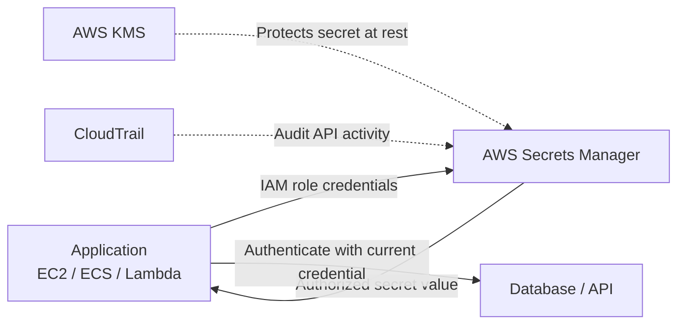
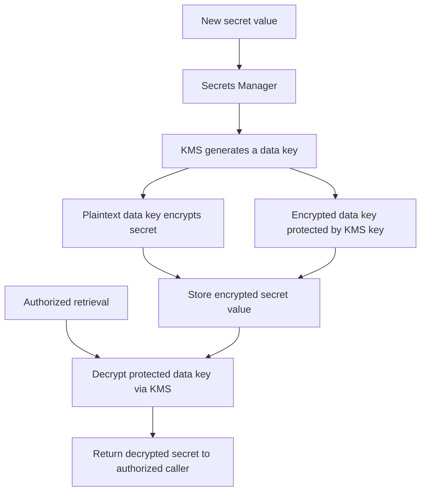
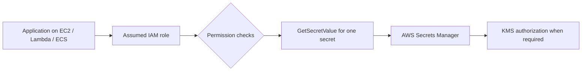
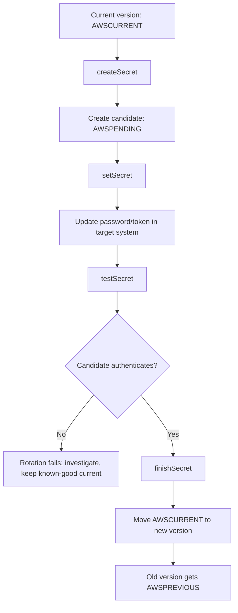
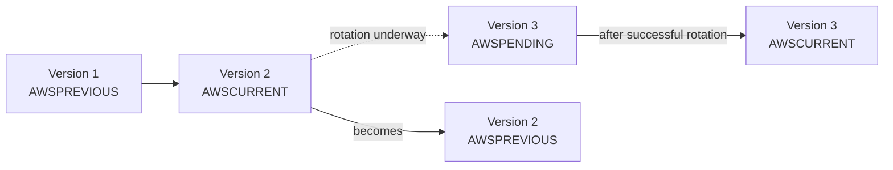
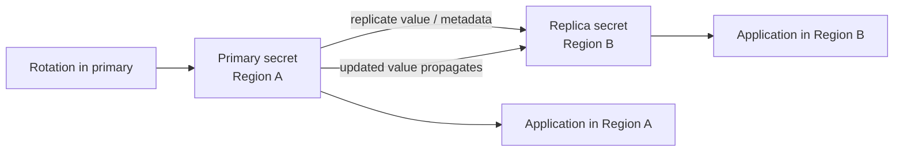
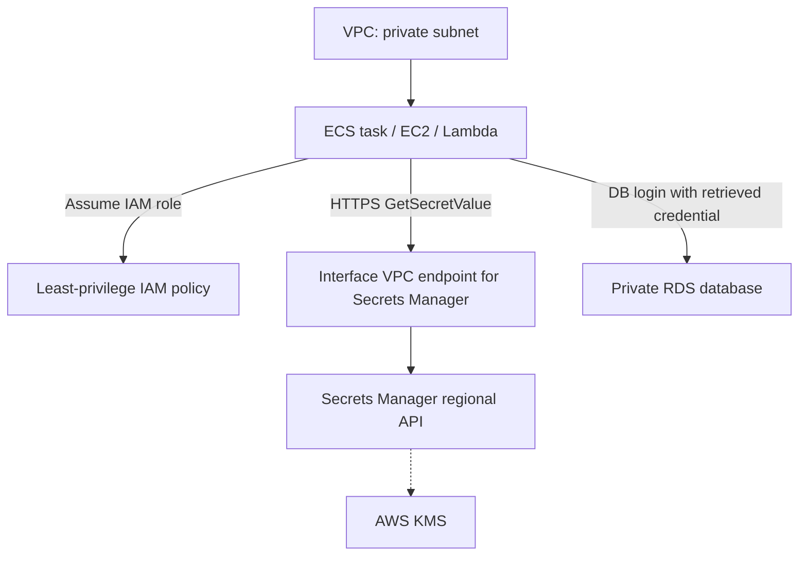

<div align="center">

# 🔐 AWS Secrets Manager

### Complete GitHub Study Guide · Cloud Practitioner + Solutions Architect – Associate

[](https://aws.amazon.com/secrets-manager/)
[](https://aws.amazon.com/certification/certified-cloud-practitioner/)
[](https://aws.amazon.com/certification/certified-solutions-architect-associate/)
[](https://docs.aws.amazon.com/secretsmanager/latest/userguide/)
[](#official-aws-references)

**One sentence to remember:** AWS Secrets Manager is a **managed secret vault** that securely stores, retrieves, versions, replicates, and (when configured) rotates sensitive credentials such as **database passwords, API keys, and tokens**.

**🟢 CCP:** *Know what service to choose.* · **🔵 SAA:** *Know how to secure, integrate, rotate, and operate it.*

[CCP essentials](#ccp-essentials) · [SAA architecture](#saa-architecture) · [Service comparisons](#service-comparisons) · [Exam traps](#exam-traps) · [Practice questions](#practice-questions)

</div>

---

## 📚 Table of contents

1. [Definition and mental model](#definition)
2. [What problem does it solve?](#problem)
3. [What is stored in a secret?](#anatomy)
4. [Encryption and AWS KMS](#encryption)
5. [Access control and permissions](#access-control)
6. [Application retrieval and caching](#retrieval)
7. [Automatic rotation in depth](#rotation)
8. [Secret versions and lifecycle](#lifecycle)
9. [Multi-Region replication](#replication)
10. [Integrations with AWS services](#integrations)
11. [🟢 Cloud Practitioner (CCP) essentials](#ccp-essentials)
12. [🔵 Solutions Architect – Associate (SAA) architecture](#saa-architecture)
13. [⚔️ Compare with similar AWS services](#service-comparisons)
14. [⚠️ Common exam traps and misconceptions](#exam-traps)
15. [💰 Pricing and shared responsibility](#pricing)
16. [🛠️ Practical CLI, SDK, and operations](#hands-on)
17. [🔎 Troubleshooting guide](#troubleshooting)
18. [💬 Common interview questions](#interview)
19. [🧪 Exam-style practice questions](#practice-questions)
20. [📌 Quick-revision cheat sheet](#cheat-sheet)
21. [Official AWS references](#official-aws-references)

---

<a id="definition"></a>
## 1. What is AWS Secrets Manager?

> [!IMPORTANT]
> **AWS Secrets Manager** is a managed AWS security service for storing and managing **secret values**. Applications and authorized users retrieve secrets using the AWS API/SDK, while Secrets Manager provides **encryption, access control, version management, auditing, optional scheduled rotation, and cross-Region replication**.

### Plain-English analogy: a secure company vault

Imagine a company with hundreds of applications:

- Every application needs passwords or API tokens to access other systems.
- Leaving those credentials in source code is risky.
- Changing hundreds of passwords by hand is error-prone.
- The company wants to know **who requested which secret**.

Secrets Manager acts as a **central vault**. Applications receive access only to the relevant vault compartments, and configured rotation can replace credentials in both the vault **and the system that validates them**.

| Property | Exam-ready description |
|---|---|
| Category | Managed secret and credential management |
| Stores | Passwords, API keys, access tokens, connection credentials, text/binary secret values |
| Main feature | **Automatic secret rotation** where configured and supported |
| Security | Encrypts secret values using **AWS KMS**; IAM and resource-based permissions |
| Retrieval | AWS SDK, CLI, API; integrations with other AWS services |
| Version management | `AWSCURRENT`, `AWSPREVIOUS`, `AWSPENDING` staging labels |
| Scope | Regional service with optional **cross-Region secret replication** |
| Observability | AWS CloudTrail, Amazon CloudWatch, Amazon EventBridge |
| Pricing model | Stored secrets and API calls; additional dependent-service costs |

**Secret examples:** database user/password, third-party service API token, webhook credential, OAuth client secret, SSH private key (when appropriate for your workflow), application-to-application credentials.

**Not its purpose:** general file storage, authentication of human end users, managing the cryptographic key lifecycle itself, or issuing standard public HTTPS certificates.

<a id="problem"></a>
## 2. What problem does it solve?

### The old approach: hardcoded credentials

```text
Application source code / config file
    DB_USER=app_user
    DB_PASSWORD=<hardcoded-password>       ← bad pattern
    THIRD_PARTY_API_KEY=<hardcoded-token>  ← bad pattern
```

Problems include accidental Git commits, leaked backups, duplicated copies, manual password changes, uncertain audit trails, and slow credential revocation.

### The recommended approach



- **Application:** authenticates to AWS using an IAM role, then requests the secret.
- **Secrets Manager:** checks permissions, retrieves/decrypts the secret, and returns it over a protected API connection.
- **Target:** database or API that checks the credential; Secrets Manager is not the target system.
- **Rotation:** updates both the stored secret and the target credential, using the appropriate mechanism.

> [!WARNING]
> Putting a password in Secrets Manager does **not** automatically remove every old copy from Git, logs, container images, build artifacts, or environment variables. Exposed credentials may still need to be **revoked/rotated** and historical copies addressed.

### Common use cases

1. **RDS/Aurora/Redshift/DocumentDB credentials** — protect application and administrator database passwords.
2. **Third-party API credentials** — store tokens for payment, messaging, CI/CD, or SaaS integrations.
3. **Scheduled credential rotation** — lower the lifetime of compromised long-lived credentials.
4. **Centralized access control** — assign access to selected IAM roles instead of embedding passwords.
5. **Multi-Region applications** — replicate secret values to supported Regions.
6. **Audit and operational monitoring** — observe access operations and changes using AWS monitoring tools.
7. **Private application infrastructure** — access Secrets Manager through an interface VPC endpoint powered by AWS PrivateLink.
8. **Cross-account application access** — share a secret with explicit resource, identity, and KMS permissions.

<a id="anatomy"></a>
## 3. What is stored in a secret?

A Secrets Manager secret is **more than just a password**.

| Part | Explanation |
|---|---|
| Secret name | Human-readable identifier, e.g., `prod/payments/database` |
| Secret ARN | AWS resource identifier with a generated suffix, often important in permissions |
| Secret value | Sensitive string or binary payload; **up to 65,536 bytes** |
| Secret versions | Encrypted values representing updates/rotations |
| Staging labels | Pointers to active, previous, and pending versions |
| Encryption key reference | AWS KMS key used to protect the secret |
| Tags | Classification, environment, ownership, access-control conditions |
| Resource policy | Optional permissions policy attached to this secret |
| Rotation configuration | Schedule, function or managed rotation settings |
| Replication information | Primary and replica Region relationships |

### A typical JSON secret (illustrative — no real credentials)

```json
{
  "username": "app_user",
  "password": "<secret-value-managed-outside-source-code>",
  "engine": "postgres",
  "host": "example.cluster-xxxxxxxx.eu-west-1.rds.amazonaws.com",
  "port": 5432,
  "dbname": "appdb"
}
```

The value can be plain text or JSON. **Rotation templates may require specific JSON fields**, so don't arbitrarily rename fields on a secret wired to an AWS rotation template.

### Metadata versus the actual secret value

- `DescribeSecret` provides **metadata** without retrieving the secret value.
- `GetSecretValue` retrieves the **sensitive value** (with the corresponding permissions).
- `BatchGetSecretValue` retrieves multiple secrets where authorized.
- A `GetSecretValue` response returns `SecretString` or `SecretBinary` and version metadata.

> [!TIP]
> **SAA distinction:** Listing or describing a secret is not the same as permission to read its password. `secretsmanager:DescribeSecret` and `secretsmanager:GetSecretValue` are different actions.

<a id="encryption"></a>
## 4. Encryption and AWS KMS

### 4.1 How Secrets Manager encrypts stored values

Secrets Manager uses **envelope encryption** with AWS Key Management Service (KMS).



**Important:** The KMS key generally protects a **data key**, which is used to encrypt the secret value; the secret is not simply stored as plaintext inside KMS.

### 4.2 Which KMS key should you use?

| Choice | Typical use | Extra consideration |
|---|---|---|
| AWS managed KMS key `aws/secretsmanager` | Default, straightforward same-account use | Limited control over key policy; **not suitable for cross-account secret access** |
| Customer managed KMS key | Custom key policy, cross-account access, tailored governance | Separate KMS key and API costs may apply; plan key permissions |

**Pick a customer managed KMS key** if the exam mentions:

- Different AWS account needs to read the secret.
- Explicit control over KMS key policy or use restrictions.
- A custom encryption key and audit/isolation requirements.

### 4.3 KMS key rotation is NOT secret rotation

| Rotation | What changes? | What does not change automatically? |
|---|---|---|
| **KMS key material rotation** | Cryptographic material used to protect stored data keys | The **database password/API token** remains the same |
| **Secrets Manager secret rotation** | The stored credential and, when correctly configured, the credential at the target system | The AWS KMS key may remain unchanged |

> [!IMPORTANT]
> **Most common trap:** Rotating an encryption key does **not** change a compromised database password. Use **Secrets Manager rotation** for the password itself.

### 4.4 Encryption in transit and at rest

- **At rest:** secret values are protected through KMS envelope encryption.
- **In transit:** calls to Secrets Manager use HTTPS/TLS.
- **In memory and logs:** your application's handling still matters; never print retrieved passwords or accidentally attach them to errors/traces.

<a id="access-control"></a>
## 5. Access control and permissions

Secrets Manager uses AWS authorization mechanisms; it is **not an alternative to IAM**.

### 5.1 The three permissions to keep straight

| Control | Attached to | Typical purpose |
|---|---|---|
| **Identity-based IAM policy** | IAM user/role | What the caller may do, e.g., `GetSecretValue` |
| **Secrets Manager resource-based policy** | Secret | Who can access this secret, including cross-account principals |
| **KMS key policy / relevant KMS permissions** | Encryption key / principal | Whether required KMS cryptographic operations are authorized |

For a workload in the **same account**, the relevant IAM and KMS permissions must permit access, subject to other policies and explicit denies. A resource policy is **not always required**.

For a workload in a **different AWS account**, typically **all three** matter: caller IAM policy + secret resource policy + customer managed KMS key authorization. <strong>Do not use `aws/secretsmanager` for this cross-account scenario.</strong>

### 5.2 The IAM role pattern



**Good design:** Assign the EC2 instance profile, Lambda execution role, or ECS task role a **least-privilege** policy that permits reading **only the required secrets**.

Do **not** embed a long-lived IAM access key in the application simply to call Secrets Manager.

### 5.3 Illustrative least-privilege IAM policy

```json
{
  "Version": "2012-10-17",
  "Statement": [
    {
      "Sid": "ReadOnlyOneApplicationSecret",
      "Effect": "Allow",
      "Action": "secretsmanager:GetSecretValue",
      "Resource": "arn:aws:secretsmanager:eu-west-1:111122223333:secret:prod/app/db-??????"
    }
  ]
}
```

**Notes:** This policy uses a **fictional account and secret name**. The `??????` represents the six-character ARN suffix in a name-based ARN matching pattern. In production, use the exact ARN when available, verify key permissions, and avoid overly broad grants.

### 5.4 Cross-account access example (conceptual)

```text
Account A: Secrets Manager secret + customer managed KMS key
  - Secret resource policy authorizes Account B principal
  - KMS key policy allows needed cryptographic use by that principal

Account B: EC2 / ECS / Lambda IAM role
  - Identity policy allows secretsmanager:GetSecretValue on secret ARN
  - Additional KMS permissions where required

Result: authorized caller can retrieve secret; an IAM allow alone is insufficient.
```

### 5.5 Resource-policy safety

- Use `BlockPublicPolicy` when setting secret policies via supported APIs to prevent broadly accessible resource policies.
- Review resource policies and permissions using **IAM Access Analyzer**.
- Apply **least privilege** and prevent unintended administrators from editing resource policies.
- **Explicit Deny** and organizational guardrails (e.g., applicable SCPs) can stop requests even if another policy allows them.
- Consider conditions for source VPC endpoints (`aws:SourceVpce`) when appropriate; test carefully to avoid breaking AWS service workflows.

### 5.6 Advanced: VPC endpoint policy

An **interface VPC endpoint** can also have an **endpoint policy** controlling which calls pass through the endpoint. It adds a layer of control, **not** a replacement for IAM, secret resource policies, or KMS policies.

<a id="retrieval"></a>
## 6. Application retrieval and caching

### 6.1 How applications retrieve secrets

1. Application obtains **temporary AWS credentials** via an IAM role.
2. Application calls `GetSecretValue` (or authorized batch retrieval).
3. Secrets Manager evaluates permissions and decrypts the stored value.
4. Application uses the secret to connect to the database/API.
5. Application **refreshes its cached value** after a suitable interval or credential failure.

### 6.2 Why AWS recommends client-side caching

Calling the API on **every SQL query or HTTP request** adds overhead and API costs.

**Better approach:** Fetch once and use a **secure in-process cache** with an appropriate refresh/expiration policy. AWS provides supported caching libraries for common languages and JDBC scenarios.

| Without caching | With caching |
|---|---|
| Repeated Secrets Manager API calls | Fewer calls |
| More latency in hot path | Lower latency |
| Higher request-based costs | Lower API costs |
| New value usually fetched immediately | Must manage cache refresh on rotation |

> [!WARNING]
> **Caching is a trade-off.** A long cache lifetime may continue using outdated credentials after rotation. Consider TTL, retries after authentication failures, and secure in-memory handling.

### 6.3 What happens after rotation?

- A fresh `GetSecretValue` call normally gets **`AWSCURRENT`**.
- An application holding an **old cached value** does **not** automatically receive the new credential.
- Implement refresh/retry logic or use managed integration behavior appropriate to the compute platform.

### 6.4 Do not leak secrets during retrieval

Avoid logging:

- `SecretString` or `SecretBinary` content.
- Raw CLI results from `get-secret-value` in CI logs.
- Password-bearing request headers or full connection strings.
- Secret values in exception messages, shell history, or metrics labels.

<a id="rotation"></a>
## 7. Automatic secret rotation in depth

> [!IMPORTANT]
> **Rotation means changing credentials in TWO places:** the value saved in Secrets Manager **and** the credential accepted by the actual database, API, or target system. Updating only the secret string can **break** the application.

### 7.1 The three useful rotation models

| Model | Who performs target update? | Lambda function in your account? | Typical example |
|---|---|---|---|
| **Managed rotation** | Supported AWS service | **No** | RDS/Aurora master-user credentials, supported Redshift/DocumentDB credentials |
| **Lambda rotation** | Customer-configured Lambda function | **Yes** | Application DB user, custom service, API credential |
| **Managed external secrets rotation** | Supported Secrets Manager integration partner | **No custom rotation Lambda** | Supported third-party SaaS integration (availability varies) |

**Do not assume every stored API key rotates automatically.** The target must support changing it, and rotation must be configured using a supported method.

### 7.2 Standard Lambda rotation flow: four steps



**Step 1 — `createSecret`:** create a candidate secret version labeled `AWSPENDING`.

**Step 2 — `setSecret`:** update the **actual** database/service credential to the pending value.

**Step 3 — `testSecret`:** verify the candidate works with the target.

**Step 4 — `finishSecret`:** move `AWSCURRENT` to the new version; previous version becomes `AWSPREVIOUS`.

**SAA points:** The rotation Lambda requires both permission to access the secret and network/authentication access to the target. Rotation should be **idempotent**, and it must **not log passwords**.

### 7.3 Two database rotation strategies

| Strategy | Description | Main consideration |
|---|---|---|
| **Single-user rotation** | Changes the existing user's password | Simpler; short window where new connections may see a mismatch during transition |
| **Alternating-users rotation** | Switches between two users/credentials | Can reduce connection disruption; more complex and needs suitable database privileges |

A connection already established with the database may remain open when a password rotates; **new connections** using old credentials can fail.

### 7.4 Schedule and rotation windows

- Configure a `rate()` or `cron()` expression with a **rotation window**.
- AWS documents that rotations can occur **as frequently as every four hours** where supported.
- Rotation schedules use **UTC**.
- The service runs rotation **within** the configured window, not necessarily at the exact start instant.
- For Lambda-based rotation, an appropriate rotation Lambda must be set up and granted target access.
- Changing a schedule can optionally trigger immediate rotation; read the relevant API settings.

Example (illustrative schedule):

```text
rate(30 days)   # Rotate on a 30-day cadence
rate(4 hours)   # Minimum documented scheduled interval
```

### 7.5 Managed rotation vs Lambda rotation: exam traps

**Incorrect:** “Secrets Manager always uses Lambda to rotate RDS passwords.”  
**Correct:** Supported **managed credentials** can use **managed rotation without Lambda**. Custom/non-managed secrets often require a Lambda rotation function or supported partner integration.

**Incorrect:** “Turning on rotation automatically updates every application.”  
**Correct:** Client applications must refresh values or restart/redeploy if their integration only reads a secret at startup.

**Incorrect:** “All secrets are rotated by default.”  
**Correct:** A stored secret is not proof that the **target credential** has been changed; rotation must be supported and appropriately enabled.

### 7.6 Rotation failures: what should you check?

1. Is the required rotation type configured for the secret?
2. Does the function/service have the right **IAM** and **KMS** permissions?
3. Can the rotation function reach the **database/service**?
4. Is the **target** able to change the password/API token?
5. Is the `AWSPENDING` version stuck from a failed rotation?
6. Does `AWSCURRENT` still work with the target?
7. Are the Lambda steps correctly implemented and **idempotent**?
8. Did the application cache/retain an old password after a successful rotation?
9. Are CloudWatch logs and relevant CloudTrail/EventBridge records available?

<a id="lifecycle"></a>
## 8. Secret versions and lifecycle

### 8.1 Staging labels: memorize these

| Label | Meaning | Exam keyword |
|---|---|---|
| **`AWSCURRENT`** | The currently active version; default retrieval | **Current** |
| **`AWSPREVIOUS`** | Previous version after rotation/update | **Previous / recovery reference** |
| **`AWSPENDING`** | Candidate version during rotation | **Pending rotation** |



A version may have more than one label. Staging labels are pointers, not different storage services. A secret can have **custom staging labels** as well.

### 8.2 Reading a specific version

- Without an explicit version selector, retrieval uses **`AWSCURRENT`**.
- Authorized callers can request a different version or label (e.g. `AWSPREVIOUS`).
- The presence of an older version does **not** guarantee the old credential still works in the database.

### 8.3 Update versus rotation

- **Update a secret:** changes the stored secret value and creates a new version.
- **Rotate a secret:** coordinates the stored secret change with the **target system's credential** change.

> [!WARNING]
> Manually editing only the stored password can cause application outages if the actual database password remains unchanged.

### 8.4 Deletion and recovery

- Normally, deleting a primary secret means **scheduling deletion** with a **7–30 day recovery window**.
- During the scheduled-deletion period, the secret is **inaccessible**.
- It can usually be **restored before permanent deletion**.
- A force-delete API option exists, but **immediate irreversible deletion is dangerous** and should not be routine.
- For a replicated secret, remove/delete replicas before deleting the primary; replica removal has different behavior.

### 8.5 Operational rules

- Avoid constantly rewriting secret values: each update creates a version and can consume quotas.
- Use tags and naming conventions for lifecycle ownership (`dev/`, `staging/`, `prod/`).
- Monitor old, unused, overly-permissive, and unrotated secrets.
- Avoid naming/ARN assumptions that can break cross-account resource policies.

<a id="replication"></a>
## 9. Multi-Region replication

Secrets Manager is **Regional**, but can replicate selected secrets to other AWS Regions.



### Key facts

- Cross-Region replication creates a **replica secret linked to a primary**.
- **Rotation is configured on the primary**; updated values propagate to its replicas.
- Replicas have **Region-specific ARNs and encryption configuration**.
- Replication is useful for multi-Region applications, latency, and recovery patterns.
- You can **promote a replica** to a standalone secret when needed.
- Replication does not automatically migrate your **database** or replace an AWS disaster-recovery plan.
- **Replica secrets can incur their own Secrets Manager charges.**

### Exam distinction: Secrets Manager replicas vs KMS multi-Region keys

| Topic | Secrets Manager replication | KMS multi-Region keys |
|---|---|---|
| What is copied/related? | **Secret value and metadata** | Related **cryptographic key material** |
| Main use case | Make credentials available in different Regions | Cryptographic operations with related keys across Regions |
| Does it update actual DB credentials? | Primary rotation can update target and then propagate stored value | **No** |
| Are these the same feature? | **No** | **No** |

> [!IMPORTANT]
> A secret replicated to Region B may still contain the **Region A database hostname**. Replication does not automatically rewrite connection details for a Region B database. Plan Region-specific endpoints and credentials explicitly.

<a id="integrations"></a>
## 10. Integrations with AWS services

| Service / platform | Typical integration | Architectural consideration |
|---|---|---|
| **Amazon RDS / Aurora** | Database credentials; supported managed rotation of master credentials | Least-privilege app DB users vs master credentials |
| **Amazon Redshift / DocumentDB** | Database/admin credentials and supported managed rotation | Confirm the particular managed credential integration |
| **AWS Lambda** | Retrieve secret using execution role and SDK/caching | Function memory, caching, invocation overhead |
| **Amazon ECS / Fargate** | Inject secret into container or retrieve dynamically | Injected environment values **don't auto-update after rotation** |
| **Amazon EKS** | Integrate application or mounted secrets via supported components | Refresh behavior depends on integration design |
| **Amazon EC2** | Read from SDK using instance profile role | Don't put AWS access keys in user data or source code |
| **AWS CloudFormation** | Dynamic references to secrets | Dynamic references do **not** imply automatic refresh of already deployed resources |
| **AWS KMS** | Protect stored secret values with encryption | KMS manages encryption keys; Secrets Manager manages credentials |
| **AWS CloudTrail** | Audit secret operations | Secret payloads should not be put into logs |
| **Amazon EventBridge** | React to rotation/updates | `Secret Label Updated` event when `AWSCURRENT` moves |
| **AWS PrivateLink** | Private API access through interface VPC endpoint | Endpoint networking and policies still matter |

### Important integration gotchas

**ECS environment-variable injection:** the injected value is captured when the task starts. After secret rotation, the running container won't automatically see the updated secret; launch a new task or use code that fetches the current secret dynamically.

**CloudFormation dynamic references:** a secret changing does not mean CloudFormation always updates every dependent resource automatically. Resource update behavior and secret refresh must be designed.

**RDS IAM database authentication:** is a distinct approach that can avoid storing static application DB passwords for supported database engines/configurations. Secrets Manager remains useful when password-based database authentication is required.

---

<a id="ccp-essentials"></a>
## 🟢 Cloud Practitioner (CCP) essentials


**Your goal:** quickly identify the service, its primary use case, and the closest alternatives.

### 11.1 CCP facts to memorize

1. **Secrets Manager** securely stores **passwords, database credentials, API keys, tokens**.
2. It helps avoid **hardcoded secrets** in applications.
3. **Automatic secret rotation** is its standout exam keyword.
4. Secrets are protected at rest by **AWS KMS**.
5. **IAM policies** control which roles/users may retrieve a secret.
6. **Resource-based policies** can authorize access, especially across accounts.
7. **CloudTrail** supports auditing Secrets Manager API activity.
8. **Parameter Store** can store configuration and secure values, but lacks native automatic rotation for its stored parameters.
9. **KMS** manages cryptographic keys; **Secrets Manager** stores the actual password/token.
10. **Cognito** authenticates application end users; Secrets Manager is a backend credential vault.
11. Secrets Manager is **Regional**; cross-Region replication is optional.
12. Integrates with **RDS, Aurora, ECS, Lambda**, and other services.
13. Versions distinguish `AWSCURRENT`, `AWSPREVIOUS`, and `AWSPENDING`.
14. You pay for **secrets stored** and **API calls** (plus dependent services).
15. Rotation must update the credential in the **target** system, not only in storage.

### 11.2 CCP exam keywords

`secure storage of credentials` · `API keys` · `database passwords` · `access tokens` · `secret vault` · `automatic secret rotation` · `avoid hardcoded passwords` · `encrypted using KMS` · `retrieve secrets through SDK` · `centralized credential management`

### 11.3 CCP decision shortcuts

| If the question says… | Choose first… |
|---|---|
| Store and automatically rotate database credentials | **AWS Secrets Manager** |
| Store application configuration such as timeout, feature values, non-secret settings | **SSM Parameter Store** (or AppConfig depending on deployment needs) |
| Manage cryptographic encryption keys | **AWS KMS** |
| Use dedicated hardware security modules with greater HSM control | **AWS CloudHSM** |
| Manage TLS certificates for HTTPS | **AWS Certificate Manager (ACM)** |
| Allow users to log in to your web/mobile app | **Amazon Cognito** |
| Authorize an EC2/Lambda role to call AWS APIs | **AWS IAM** |
| Record API access and administrative events | **AWS CloudTrail** |

> [!TIP]
> **CCP formula:** `Sensitive credential + secure vault + automatic rotation` → **AWS Secrets Manager**.

---

<a id="saa-architecture"></a>
## 🔵 Solutions Architect – Associate (SAA) architecture


**Your goal:** design a safe retrieval path, understand permissions, minimize downtime during rotation, and choose appropriate network/Region patterns.

### 12.1 Pattern A — Private application reading a database secret



**Checklist:**

- IAM role can read exactly the required secret.
- If a customer managed KMS key is used, applicable key permissions are allowed.
- Interface VPC endpoint (PrivateLink) can keep Secrets Manager traffic private.
- DNS, endpoint security group on **TCP 443**, and endpoint policy allow access.
- Application can reach its database through correct Security Groups and routing.
- Application handles cached credentials and rotation gracefully.

> [!WARNING]
> A Secrets Manager interface endpoint does **not** automatically grant network access to your RDS database. The two paths require their own networking and permissions.

### 12.2 Pattern B — Rotating database credentials

**Scenario:** An application uses a database account. The company wants scheduled password rotation without manual edits.

**Design:** Secrets Manager + supported rotation method, secure access to database, application refresh/retry strategy.

- Prefer **managed rotation** for eligible service-managed credentials.
- Use **Lambda rotation** for application DB users or other cases requiring a custom rotation function.
- Choose **single-user** versus **alternating-users** rotation for appropriate continuity needs.
- Ensure the rotation mechanism changes both the **secret** and **target database password**.
- Test connection failures around the rotation window and cache expiry.

### 12.3 Pattern C — Cross-account centralized secrets

**Scenario:** Security account holds credentials; application account must retrieve one of them.

**Design:**

1. Store the secret in the owner account.
2. Encrypt with a **customer managed KMS key**, not the default AWS managed key.
3. Add a secret **resource policy** granting the intended external role appropriate permissions.
4. Add corresponding **identity-based permissions** in the application account.
5. Allow relevant **KMS key operations** to the external role.
6. Test explicit denies, SCPs, VPC endpoint restrictions, and network availability.

**Exam answer:** cross-account requires authorization at **more than one layer**.

### 12.4 Pattern D — Multi-Region deployment

**Scenario:** Active/passive or multi-Region application needs locally retrievable secrets.

- Replicate secret to required Region(s).
- Consider a KMS key in each Region and local permission setup.
- Rotate in the **primary** and propagate values to replicas.
- Make sure the endpoint, hostname, and target service remain valid after failover.
- Promote a replica where that fits the recovery process.
- Don't confuse secret replication with replication of the database itself.

### 12.5 Pattern E — High-throughput application

**Scenario:** A fleet performs thousands of database operations per second and needs credentials.

- Retrieve the secret once per suitable cache lifetime, **not per database query**.
- Refresh/retry when cached credentials expire or authentication fails.
- Choose a caching solution appropriate to the application framework.
- Avoid logging cached credentials.
- Plan API quota behavior, cold starts, and cross-Region latency.

### 12.6 Pattern F — ECS secrets after rotation

**Scenario:** ECS injects a Secrets Manager secret into a container's environment. Secret rotates later.

**Fact:** Already running containers generally **do not receive the new environment variable automatically**.

**Solutions:**

- Force a new ECS service deployment / replace tasks to inject the new value.
- Or have application code retrieve/cache the current secret dynamically.
- Re-test authentication and recovery for credentials that rotate.

### 12.7 Pattern G — Private rotation Lambda

**Scenario:** Rotation Lambda sits in a VPC with a private database.

**Check both paths:**

```text
Rotation Lambda → Database                 (network + credentials)
Rotation Lambda → Secrets Manager API     (network + IAM + KMS)
```

Use a Secrets Manager interface VPC endpoint or suitable connectivity, and configure the Lambda's security groups, subnet access, and IAM permissions.

### 12.8 SAA architecture checklist

| Requirement | Architectural decision |
|---|---|
| Secret only for one role | IAM least privilege on `GetSecretValue` |
| Secret shared across AWS accounts | Resource policy + identity policy + customer managed KMS key |
| Strict private networking | PrivateLink interface endpoint with correct policy and SGs |
| Regular DB rotation | Managed/Lambda strategy + retries + operational monitoring |
| Fast repeated retrieval | Client-side caching with refresh rules |
| Multi-Region resilience | Replica secrets plus actual workload failover design |
| Rotation notifications | EventBridge events / CloudWatch operational monitoring |
| Prevent accidental data exposure | Avoid secret in code, user data, logs, build outputs |
| Reduce blast radius | Separate secrets/roles/environments; tag controls |
| Enforce governance | Resource policies, KMS permissions, appropriate guardrails |

---

<a id="service-comparisons"></a>
## ⚔️ Compare with similar AWS services

### 13.1 One-table service selector

| Service | Main purpose | Best exam keyword |
|---|---|---|
| **AWS Secrets Manager** | Store, retrieve, version, and rotate secrets | **Automatic credential rotation** |
| **SSM Parameter Store** | Hierarchical application configuration and secure parameters | **Configuration values / SecureString** |
| **AWS KMS** | Generate/control encryption keys and cryptographic operations | **Encryption key management** |
| **AWS CloudHSM** | Dedicated HSM control for specialized crypto needs | **Dedicated HSM** |
| **AWS Certificate Manager** | Manage public/private TLS certificates for supported resources | **HTTPS certificates** |
| **AWS IAM** | AWS principal authentication and authorization | **Roles, policies, permissions** |
| **Amazon Cognito** | Application user sign-up/sign-in and identities | **End-user login** |
| **AWS CloudTrail** | Record API activity and account events | **Who called the API?** |
| **AWS Systems Manager AppConfig** | Deploy/validate/roll back application configuration | **Controlled config deployments** |
| **RDS IAM database authentication** | DB authentication through IAM-based mechanisms | **Avoid static DB password for supported DB** |

### 13.2 Secrets Manager vs Parameter Store

| Feature | Secrets Manager | Systems Manager Parameter Store |
|---|---|---|
| Stores secrets | ✅ | ✅ with `SecureString` |
| Stores ordinary configuration | Possible, but often not cost-effective | ✅ Common use case |
| Native scheduled secret rotation | ✅ With supported configuration | ❌ No native rotation of the parameter value |
| KMS integration | ✅ | ✅ For `SecureString` |
| Versioning | ✅ Secret versions/staging labels | ✅ Parameter versions |
| Typical pricing | Per secret + API usage | Standard parameter use can be lower-cost; advanced/throughput options can cost more |
| Exam cue | Passwords/tokens + automatic rotation | App config + parameter hierarchy |

> [!NOTE]
> Parameter Store can reference a Secrets Manager secret. It is incorrect to say Parameter Store can **never** be involved with a rotated secret; it simply lacks Secrets Manager's own native credential-rotation service for values held directly as parameters.

### 13.3 Secrets Manager vs KMS

**Secrets Manager** = stores the **password or API token**.  
**KMS** = manages the **cryptographic key** protecting encrypted secret values.

**Analogy:** Secrets Manager is the **locked vault**; KMS manages the **key for the vault's encryption**. They complement each other.

### 13.4 Secrets Manager vs IAM

**IAM:** allows an EC2/Lambda/ECS role to call `GetSecretValue`.  
**Secrets Manager:** stores and returns the authorized **application credential**.

The IAM role is **not the database password**. The service may use that AWS role permission to retrieve a *separate* database password.

### 13.5 Secrets Manager vs Cognito

**Cognito:** sign-in/identity for web and mobile **end users**.  
**Secrets Manager:** backend secrets for services connecting to databases, APIs, and other systems.

### 13.6 Secrets Manager vs ACM

**ACM:** manages supported TLS certificates, often for HTTPS endpoints.  
**Secrets Manager:** manages credentials and other secret values. Storing a PEM key as a secret does not turn Secrets Manager into a replacement for ACM's certificate lifecycle integrations.

### 13.7 Secrets Manager vs CloudHSM

**CloudHSM:** dedicated hardware security modules, greater direct HSM control, different operational responsibility.  
**Secrets Manager:** managed secure credential storage and rotation; uses KMS for at-rest encryption.

---

<a id="exam-traps"></a>
## ⚠️ Common exam traps and misconceptions

| ❌ Misconception | ✅ Correct understanding |
|---|---|
| 1. “KMS and Secrets Manager are the same.” | **KMS** handles encryption keys; **Secrets Manager** handles passwords/tokens. |
| 2. “Storing a secret automatically changes the DB password.” | Rotation/target synchronization must be configured. |
| 3. “A secret is always rotated by default.” | Rotation depends on secret type, configuration, and integration. |
| 4. “All rotation requires Lambda.” | Supported managed rotation and managed external integrations can be **Lambda-free**. |
| 5. “No rotation needs Lambda.” | Many custom credentials still use a **Lambda rotation function**. |
| 6. “Rotation just changes the secret string.” | Must update actual target credentials too. |
| 7. “Rotation never affects availability.” | Bad timing, retries, or stale caches can break new logins. |
| 8. “Every application auto-refreshes after rotation.” | Caches and startup-injected values may remain stale. |
| 9. “`AWSPENDING` is the active secret.” | **`AWSCURRENT`** is the default active version. |
| 10. “`AWSPREVIOUS` always works.” | Older stored password might already be invalid at target. |
| 11. “`DescribeSecret` returns the plaintext password.” | Metadata only; use `GetSecretValue` for the value. |
| 12. “Anyone with an IAM `Allow` can read any secret.” | Resource/KMS policies, explicit denies and guardrails still apply. |
| 13. “An IAM allow is enough for cross-account access.” | Needs secret **resource** policy and appropriate **KMS** authorization. |
| 14. “Default `aws/secretsmanager` works for cross-account readers.” | Use a **customer managed KMS key**. |
| 15. “KMS key rotation also rotates DB credentials.” | Different operations. |
| 16. “Secrets Manager is global.” | It is **Regional**; replication is optional. |
| 17. “Replicating a secret also replicates the database.” | It replicates secret data/metadata, not the database. |
| 18. “Replica secret rotation runs independently by default.” | Linked replicas receive updates from the **primary**. |
| 19. “Multi-Region KMS keys and secret replicas are identical.” | Different resources and different replication purposes. |
| 20. “All API-key providers support automatic rotation.” | Target/partner support and correct implementation matter. |
| 21. “CloudTrail stores secret payloads.” | Audit operations; do **not** assume plaintext secret values appear in events. |
| 22. “An interface endpoint makes IAM irrelevant.” | Network path ≠ authorization. |
| 23. “Private subnet needs NAT to reach Secrets Manager.” | An **interface endpoint** can provide private access without NAT/IGW. |
| 24. “Endpoint security group is irrelevant.” | The endpoint ENI/security group must permit API traffic. |
| 25. “Every `GetSecretValue` call is free.” | API request pricing applies. |
| 26. “Caching is always unsafe.” | AWS recommends appropriately managed client-side caching for latency and cost. |
| 27. “Caching guarantees latest credential.” | Cache refresh must account for rotation. |
| 28. “Parameter Store can't store secrets.” | `SecureString` can store encrypted values. |
| 29. “Parameter Store natively rotates stored passwords.” | It does **not** provide Secrets Manager's native rotation service. |
| 30. “Secrets Manager manages end-user identities.” | That's the domain of services such as **Cognito**. |
| 31. “Secrets Manager is an HTTPS certificate manager.” | **ACM** is the exam answer for supported TLS certificate lifecycle. |
| 32. “Deleting a secret is always instantaneous.” | Default behavior uses a **recovery window**; special force delete exists. |
| 33. “Secrets Manager removes compromised tokens from Git history.” | You still must revoke/rotate exposed credentials and remediate exposure. |
| 34. “Secrets Manager prevents app code from logging passwords.” | Application developers must avoid logging retrieved values. |
| 35. “ECS env var injections change immediately on rotation.” | Existing tasks usually need replacement or dynamic retrieval. |
| 36. “Resource policy alone fully secures cross-account KMS access.” | KMS key authorization is a separate requirement. |
| 37. “An AWS managed key gives custom key-policy control.” | Customer managed KMS keys offer more control. |
| 38. “CloudWatch and CloudTrail do exactly the same job.” | CloudTrail records API activity; CloudWatch handles monitoring/logs/alarms. |
| 39. “Secret replication is instantaneous global consistency.” | Replication is a managed propagation process; don't assume zero lag. |
| 40. “Secrets Manager is free because it is managed.” | Stored secret and API-use charges can apply. |

---

<a id="pricing"></a>
## 💰 Pricing and shared responsibility

### 15.1 Pricing factors

Secrets Manager costs generally include:

- **Stored secrets** — recurring per-secret charges (including replicas where applicable).
- **API requests** — calls for retrieval and secret management.
- **Rotation Lambda** — Lambda charges if Lambda-based rotation is used.
- **Customer managed KMS keys** — applicable AWS KMS charges, if configured.
- **Interface VPC endpoint** — endpoint-hour/data-processing charges when PrivateLink is used.
- **Logs and monitoring** — CloudWatch, CloudTrail storage/additional copies and other associated costs as configured.

**Illustrative public US pricing example:** AWS's pricing page lists approximately **$0.40 per secret/month** and **$0.05 per 10,000 API calls** in its published example. **Not a universal rate**: validate the current pricing and Region for your deployment.

### 15.2 Why caching matters financially

A service making a fresh Secrets Manager call on each request can accumulate substantial API use. With well-designed caching, most application requests use the local cached secret, while your app refreshes as needed.

### 15.3 Shared responsibility

| AWS manages | Customer manages |
|---|---|
| Secrets Manager infrastructure and availability | Which passwords/tokens are placed in the service |
| Service-side storage encryption mechanisms | IAM permissions, resource policies, KMS choices |
| Managed service APIs | Correct integration with consuming applications |
| Infrastructure for supported managed rotation | Rotation schedule, strategy and target compatibility |
| Underlying service operations | Lambda logic and dependencies for customer-managed rotation |
| Regional service capabilities | Data governance, Region placement, replication plan |
| | Safe application logging, caching, incident response and recovery |

---

<a id="hands-on"></a>
## 🛠️ Practical CLI, SDK, and operations

> [!CAUTION]
> **Never use real passwords in README examples, terminal screenshots, shared notebooks, chat messages, CI logs, or committed files.** The commands below use invented names; review IAM permissions and your AWS Region before running them.

### 16.1 Describe a secret without printing its value

```bash
aws secretsmanager describe-secret \
  --secret-id prod/app/db \
  --query '{Name:Name,ARN:ARN,RotationEnabled:RotationEnabled,LastRotatedDate:LastRotatedDate}'
```

`DescribeSecret` returns metadata, **not** the underlying password.

### 16.2 Inspect version stages safely

```bash
aws secretsmanager describe-secret \
  --secret-id prod/app/db \
  --query 'VersionIdsToStages'
```

This shows the staging-label mapping without printing secret values.

### 16.3 Get a secret using Python (pattern)

```python
import json
import boto3

client = boto3.client("secretsmanager", region_name="eu-west-1")

# Uses the workload's IAM role / normal AWS credential provider chain.
response = client.get_secret_value(SecretId="prod/app/db")
secret = json.loads(response["SecretString"])

# Pass to a database connector; do not print or log secret values.
username = secret["username"]
password = secret["password"]
```

For frequent calls, use **client-side caching** instead of repeating `get_secret_value` on each request. The snippet is a learning example, **not** a production database client or complete retry/cache implementation.

### 16.4 Why the AWS CLI can be dangerous for secrets

The following API returns sensitive content:

```text
aws secretsmanager get-secret-value --secret-id prod/app/db
```

If you execute it, its output can contain the plaintext secret and may be captured in terminal logs, screen recordings, shell pipelines, or CI logs. Avoid using it casually; use least-privileged SDK integration for applications.

### 16.5 Simple operational checklist

- [ ] Workload uses an IAM role, not hardcoded AWS credentials.
- [ ] Caller can read only the required secret ARNs.
- [ ] KMS key permissions are correct where applicable.
- [ ] Secret does not appear in repositories, logs, or infrastructure user data.
- [ ] Rotation updates the external target and has been tested.
- [ ] App refreshes credentials when necessary.
- [ ] Private endpoint/network access is tested if required.
- [ ] Rotation/failed-access events are monitored.
- [ ] Cross-Region replicas and failover behavior are tested if used.
- [ ] Secret ownership and deletion/recovery policy are documented.

---

<a id="troubleshooting"></a>
## 🔎 Troubleshooting guide

| Symptom | Likely cause | Check first |
|---|---|---|
| `AccessDeniedException` on `GetSecretValue` | IAM/resource policy/KMS deny | Workload role + secret ARN + relevant KMS permissions |
| Lambda can't fetch secret from private subnet | No Secrets Manager connectivity | Interface endpoint, NAT if used, DNS, port 443 |
| Lambda rotation can't update DB | Network or DB permission problem | DB SGs, rotation Lambda role, connection/authentication |
| Database logins fail just after rotation | Stale app cache / rotation strategy issue | Refresh credential, retry behavior, rotation logs |
| Rotation stuck with `AWSPENDING` | Failed/incomplete rotation | Lambda steps, version stages, logs |
| Other account can see ARN but can't decrypt secret | Default AWS-managed KMS key / missing grants | CMK + resource policy + caller IAM policy |
| Expected updated secret not visible in second Region | Replication propagation/configuration | Primary/replica status and Region endpoint |
| High API bills | Application fetches every request | Client-side caching and refresh policy |
| ECS task still has old password | Startup-time injection | Replace task / force deployment or dynamic fetch |
| Secret scheduled for deletion not readable | Deletion recovery period | Restore if still eligible and approved |
| Access from VPC endpoint denied | Endpoint policy or SG/condition restriction | VPCE policy, source endpoint conditions, IAM |
| Old version exists but target rejects it | Target password already changed | Coordinate supported rollback, don't assume AWSPREVIOUS works |

### Step-by-step debugging order

1. **Identity:** which IAM role is calling?
2. **Region and identifier:** correct secret name/ARN, including ARN suffix?
3. **Authorization:** IAM, resource policy, applicable KMS permissions?
4. **Network:** service endpoint reachable; DNS, VPC endpoint, security groups?
5. **Version:** `AWSCURRENT` points to the expected active version?
6. **Rotation:** did target and secret update together?
7. **Application:** stale cache, startup injection, or missing retry?
8. **Observability:** check relevant CloudTrail events, Lambda logs, EventBridge notifications, CloudWatch monitoring.

---

<a id="interview"></a>
## 💬 Common interview questions

<details>
<summary><strong>1. What is AWS Secrets Manager?</strong></summary>

A managed security service for storing, retrieving, versioning, auditing, and rotating sensitive application credentials.
</details>

<details>
<summary><strong>2. How is Secrets Manager different from KMS?</strong></summary>

Secrets Manager stores the password/token. KMS manages the encryption key used to protect it.
</details>

<details>
<summary><strong>3. What is its most important AWS CCP keyword?</strong></summary>

**Automatic secret rotation**, together with secure storage of database credentials/API keys.
</details>

<details>
<summary><strong>4. How does an app retrieve a secret?</strong></summary>

It uses authorized AWS credentials, commonly from an IAM role, to call `GetSecretValue` using the SDK/API.
</details>

<details>
<summary><strong>5. Why are role credentials preferable to hardcoded AWS keys?</strong></summary>

They support temporary credential delivery and IAM-based least privilege without embedding long-lived AWS keys into source code.
</details>

<details>
<summary><strong>6. What are the three staging labels?</strong></summary>

`AWSCURRENT`, `AWSPREVIOUS`, `AWSPENDING`.
</details>

<details>
<summary><strong>7. Does rotation always require Lambda?</strong></summary>

No. Supported AWS service-managed and partner-managed rotation can be Lambda-free; many custom secrets use Lambda.
</details>

<details>
<summary><strong>8. What must rotation update besides the secret?</strong></summary>

The credential in the target database, external API, or service that actually authenticates the client.
</details>

<details>
<summary><strong>9. Why might rotation break applications?</strong></summary>

Stale credentials cached in memory or injected at startup, network access problems, invalid target update, or unsuccessful rotation steps.
</details>

<details>
<summary><strong>10. What is cross-account secret sharing?</strong></summary>

A role in account B reads a secret in account A through caller IAM authorization, a secret resource policy, and correct customer managed KMS key permissions.
</details>

<details>
<summary><strong>11. Can Secrets Manager work without a NAT Gateway?</strong></summary>

Yes. A private application can reach the Secrets Manager API through an interface VPC endpoint (AWS PrivateLink) without NAT/IGW.
</details>

<details>
<summary><strong>12. How do you reduce API latency and cost?</strong></summary>

Use appropriately configured client-side caching; refresh credentials after rotation or failures.
</details>

<details>
<summary><strong>13. Can a secret be used across multiple Regions?</strong></summary>

Yes, via supported multi-Region secret replication or a deliberate cross-Region API call; design endpoint and target access carefully.
</details>

<details>
<summary><strong>14. How do Secrets Manager and Parameter Store differ?</strong></summary>

Both can store sensitive values, but Secrets Manager specializes in credential lifecycle and native rotation; Parameter Store is typically used for hierarchical configuration and SecureString values.
</details>

<details>
<summary><strong>15. What's the minimum recovery period for normal deletion?</strong></summary>

At least **7 days** for a primary secret scheduled for deletion (normally configurable up to **30 days**), unless special deletion behavior applies.
</details>

---

<a id="practice-questions"></a>
## 🧪 Exam-style practice questions

> **How to use:** Answer first, then expand. These are **original practice questions**, not official AWS exam questions.

### 🟢 CCP — Service recognition and key facts

<details>
<summary><strong>Q1 · CCP:</strong> A company needs a managed place to store and automatically rotate RDS credentials. Best service?</summary>

**Answer: AWS Secrets Manager.** Its standout feature is secure credential storage and rotation.
</details>

<details>
<summary><strong>Q2 · CCP:</strong> An app needs a non-sensitive configuration timeout. Best first choice?</summary>

**Answer: Systems Manager Parameter Store** for simple configuration storage; consider AppConfig if controlled configuration deployment is central.
</details>

<details>
<summary><strong>Q3 · CCP:</strong> Which service manages the encryption keys used by Secrets Manager?</summary>

**Answer: AWS KMS.** It handles encryption keys, not database credentials.
</details>

<details>
<summary><strong>Q4 · CCP:</strong> Which service is most strongly associated with backend API tokens and password rotation?</summary>

**Answer: AWS Secrets Manager.**
</details>

<details>
<summary><strong>Q5 · CCP:</strong> Which service logs Secrets Manager API calls for auditing?</summary>

**Answer: AWS CloudTrail.** Avoid confusing auditing operations with revealing the actual secret values.
</details>

<details>
<summary><strong>Q6 · CCP:</strong> Is a secret value normally stored as plaintext at rest?</summary>

**Answer: No.** Secrets Manager encrypts stored secret values using AWS KMS envelope encryption.
</details>

<details>
<summary><strong>Q7 · CCP:</strong> What service authenticates your mobile app's end users?</summary>

**Answer: Amazon Cognito** (for user authentication), not Secrets Manager.
</details>

<details>
<summary><strong>Q8 · CCP:</strong> What service typically manages TLS certificates attached to an Application Load Balancer?</summary>

**Answer: AWS Certificate Manager (ACM).**
</details>

<details>
<summary><strong>Q9 · CCP:</strong> Is Secrets Manager a global service?</summary>

**Answer: No.** It is Regional, with optional cross-Region replication.
</details>

<details>
<summary><strong>Q10 · CCP:</strong> What is a simple reason to choose Secrets Manager over hardcoded passwords?</summary>

**Answer:** Centralized secure storage, IAM-controlled retrieval, auditing and configured rotation, instead of embedding sensitive values in source code.
</details>

<details>
<summary><strong>Q11 · CCP:</strong> Can SSM Parameter Store hold encrypted strings?</summary>

**Answer: Yes.** `SecureString` supports protected parameter values; Secrets Manager is more specialized for native rotation.
</details>

<details>
<summary><strong>Q12 · CCP:</strong> Does using Secrets Manager eliminate the need for IAM?</summary>

**Answer: No.** IAM roles/policies control who may call Secrets Manager APIs.
</details>

### 🔵 SAA — Design, permissions, rotation, reliability

<details>
<summary><strong>Q13 · SAA:</strong> A Lambda function needs a secret from another AWS account. Why does its IAM allow fail?</summary>

**Answer:** Cross-account retrieval also needs a secret **resource-based policy** and proper **customer managed KMS key** authorization, subject to applicable denies.
</details>

<details>
<summary><strong>Q14 · SAA:</strong> What key type is needed for Secrets Manager cross-account access?</summary>

**Answer:** A **customer managed KMS key** with appropriate permissions, not the AWS managed `aws/secretsmanager` key.
</details>

<details>
<summary><strong>Q15 · SAA:</strong> What's returned by default in `GetSecretValue`?</summary>

**Answer:** The secret version marked **`AWSCURRENT`**.
</details>

<details>
<summary><strong>Q16 · SAA:</strong> What's the meaning of `AWSPENDING`?</summary>

**Answer:** A candidate version during rotation; not necessarily the value applications should currently use.
</details>

<details>
<summary><strong>Q17 · SAA:</strong> A secret was changed but DB logins fail. What might be missing?</summary>

**Answer:** The **target DB password wasn't updated** to match the new secret, or applications are using stale credentials.
</details>

<details>
<summary><strong>Q18 · SAA:</strong> A rotation Lambda can call Secrets Manager but cannot connect to the DB. What to check?</summary>

**Answer:** Database network connectivity, subnet routes, Security Groups, database authentication, and Lambda execution-role permissions as relevant.
</details>

<details>
<summary><strong>Q19 · SAA:</strong> Private subnets have no NAT/IGW. How can they call Secrets Manager privately?</summary>

**Answer:** An **interface VPC endpoint** for Secrets Manager using **AWS PrivateLink**, with appropriate SG, DNS and policies.
</details>

<details>
<summary><strong>Q20 · SAA:</strong> An ECS task injected a secret at startup. Does the env var change as soon as rotation completes?</summary>

**Answer: No.** Replace/redeploy tasks or use dynamic retrieval and refresh.
</details>

<details>
<summary><strong>Q21 · SAA:</strong> One app requests its DB secret on every SQL query. Best optimization?</summary>

**Answer:** **Client-side caching**, with controlled refresh/retry after rotation.
</details>

<details>
<summary><strong>Q22 · SAA:</strong> Which event type can signal that the current version label moved?</summary>

**Answer:** An EventBridge **`Secret Label Updated`** event for **`AWSCURRENT`**.
</details>

<details>
<summary><strong>Q23 · SAA:</strong> You rotate the AWS KMS key protecting a database password. Did the database password change?</summary>

**Answer: No.** KMS key-material rotation and credential rotation are different.
</details>

<details>
<summary><strong>Q24 · SAA:</strong> Which rotation model may avoid a customer Lambda for RDS-managed master-user credentials?</summary>

**Answer:** Supported **managed rotation** for service-managed credentials.
</details>

<details>
<summary><strong>Q25 · SAA:</strong> A custom API-key provider is not a supported managed integration. Can Secrets Manager rotate it with no integration work?</summary>

**Answer: No.** Use a compatible **Lambda rotation implementation** or another supported rotation method that can actually update the target.
</details>

<details>
<summary><strong>Q26 · SAA:</strong> A replicated secret in Region B still points to a Region A database. Why?</summary>

**Answer:** Secret replication copies stored values/metadata; it does **not** rewrite DB connection information or replicate the database.
</details>

<details>
<summary><strong>Q27 · SAA:</strong> Where does normal rotation occur for a primary secret with linked replicas?</summary>

**Answer:** In the **primary Region**, with updated secret values propagated to the linked replicas.
</details>

<details>
<summary><strong>Q28 · SAA:</strong> A secret is scheduled for deletion. Can apps continue to retrieve it until the final date?</summary>

**Answer: No.** Scheduled-for-deletion secrets are inaccessible; recovery can be possible before the end of the window.
</details>

<details>
<summary><strong>Q29 · SAA:</strong> How can you keep an application from retrieving other teams' secrets?</summary>

**Answer:** IAM least privilege scoped to specific secret ARNs, with additional resource/KMS policies and organizational guardrails as appropriate.
</details>

<details>
<summary><strong>Q30 · SAA:</strong> Which are the four Lambda rotation steps?</summary>

**Answer:** `createSecret` → `setSecret` → `testSecret` → `finishSecret`.
</details>

<details>
<summary><strong>Q31 · SAA:</strong> Single-user rotation occasionally rejects new database connections. What architecture could help?</summary>

**Answer:** Appropriate client retries and, where supported and justified, **alternating-users rotation**.
</details>

<details>
<summary><strong>Q32 · SAA:</strong> A security team wants to prevent public secret resource policies. Which API option helps?</summary>

**Answer:** `BlockPublicPolicy` with `PutResourcePolicy`, plus careful review and IAM Access Analyzer.
</details>

<details>
<summary><strong>Q33 · SAA:</strong> A workload can fetch a secret but fails after cache expiry. What's a likely explanation?</summary>

**Answer:** Credential rotation and stale cache handling, or changed IAM/KMS/network policies. Investigate refresh and authorization paths.
</details>

<details>
<summary><strong>Q34 · SAA:</strong> You must fetch sensitive credentials in EC2 without persistent IAM access keys. What pattern?</summary>

**Answer:** EC2 **instance profile IAM role** + Secrets Manager SDK retrieval.
</details>

<details>
<summary><strong>Q35 · SAA:</strong> Which charging dimensions are most directly associated with Secrets Manager?</summary>

**Answer:** **Secret storage** and **API calls**, plus dependent features/services when used.
</details>

### Five architecture scenario drills

| Scenario | Recommended approach | Why |
|---|---|---|
| Secure credentials for one EC2 application | Instance profile + Secrets Manager | No hardcoded secrets; IAM-controlled retrieval |
| Database password changes on a schedule | Secrets Manager rotation | Changes credential, not just KMS key |
| Private ECS workloads without NAT | Secrets Manager interface VPC endpoint | Private AWS API connectivity |
| Application in another AWS account needs one secret | Resource policy + caller IAM + customer managed KMS key | Cross-account permission layers |
| Multi-Region failover app needs credentials | Secrets Manager replication + tested target/failover design | Replica storage is not database recovery |

---

<a id="cheat-sheet"></a>
## 📌 Quick-revision cheat sheet

### In 30 seconds

```text
AWS SECRETS MANAGER = SECURE CREDENTIAL VAULT + OPTIONAL ROTATION

STORES?        Passwords / database credentials / API tokens
ENCRYPTION?    AWS KMS envelope encryption
AUTHORIZATION? IAM + resource policies + applicable KMS permissions
RETRIEVE?      GetSecretValue / SDK / cache
VERSION?       AWSCURRENT / AWSPREVIOUS / AWSPENDING
ROTATE?        Update BOTH stored secret AND actual target credential
ROTATION?      Managed service / Lambda / supported managed external
REGION?        Regional; optional primary-to-replica propagation
PRIVATE API?   Interface VPC endpoint (AWS PrivateLink)
AUDIT?         CloudTrail; monitor with CloudWatch/EventBridge
COST?          Per secret + API calls + possible dependent-service costs

NOT KMS?       KMS manages cryptographic keys
NOT PARAMETER? Parameter Store is mainly for configuration/SecureString
NOT ACM?       ACM manages HTTPS/TLS certificates
NOT COGNITO?   Cognito authenticates application end users
```

### CCP keywords — memorize first

`secret vault` · `database password` · `API key` · `sensitive credentials` · `automatic rotation` · `hardcoded secrets` · `KMS encryption` · `IAM role` · `CloudTrail`

### SAA keywords — memorize next

`AWSCURRENT` · `AWSPENDING` · `AWSPREVIOUS` · `Lambda rotation` · `managed rotation` · `cross-account resource policy` · `customer managed KMS key` · `client-side caching` · `VPC interface endpoint` · `multi-Region replication` · `alternating users` · `EventBridge rotation event`

### Final memory trick

> **IAM** = *Who is allowed to open the vault?*  
> **Secrets Manager** = *Where is the database password/API token kept, and how is it rotated?*  
> **KMS** = *Which encryption key protects the stored secret?*  
> **Parameter Store** = *Where do I keep application settings and optionally SecureString values?*  
> **ACM** = *Who manages the HTTPS certificate?*

> [!TIP]
> For CCP, identify **Secrets Manager** from **credentials + managed rotation**. For SAA, reason about **IAM/KMS permissions, target credential updates, app refresh, private connectivity, and cross-Region behavior**.

---

<a id="official-aws-references"></a>
## Official AWS references

**Content expanded from the supplied overview and checked against official AWS documentation on 31 October 2026.** AWS may update features, regional availability, pricing, and exam blueprints. Verify production-specific behavior in the linked documentation.

1. [AWS Secrets Manager — User Guide](https://docs.aws.amazon.com/secretsmanager/latest/userguide/)
2. [What's in a secret? Versions and staging labels](https://docs.aws.amazon.com/secretsmanager/latest/userguide/whats-in-a-secret.html)
3. [Rotate AWS Secrets Manager secrets](https://docs.aws.amazon.com/secretsmanager/latest/userguide/rotating-secrets.html)
4. [Managed rotation](https://docs.aws.amazon.com/secretsmanager/latest/userguide/rotate-secrets_managed.html)
5. [Lambda rotation steps](https://docs.aws.amazon.com/secretsmanager/latest/userguide/rotate-secrets_lambda-functions.html)
6. [Rotation strategies: single vs alternating users](https://docs.aws.amazon.com/secretsmanager/latest/userguide/rotation-strategy.html)
7. [Rotation schedules and windows](https://docs.aws.amazon.com/secretsmanager/latest/userguide/rotate-secrets_schedule.html)
8. [Managed external secrets and partner rotation](https://docs.aws.amazon.com/secretsmanager/latest/userguide/managed-external-secrets.html)
9. [AWS Secrets Manager resource-based policies](https://docs.aws.amazon.com/secretsmanager/latest/userguide/auth-and-access_resource-policies.html)
10. [Cross-account access](https://docs.aws.amazon.com/secretsmanager/latest/userguide/auth-and-access_examples_cross.html)
11. [Secrets Manager encryption with KMS](https://docs.aws.amazon.com/secretsmanager/latest/userguide/security-encryption.html)
12. [Best practices: key choice, caching and permissions](https://docs.aws.amazon.com/secretsmanager/latest/userguide/best-practices.html)
13. [Retrieval and client-side caching](https://docs.aws.amazon.com/secretsmanager/latest/userguide/retrieving-secrets_cache-python.html)
14. [Secrets Manager VPC endpoints (AWS PrivateLink)](https://docs.aws.amazon.com/secretsmanager/latest/userguide/vpc-endpoint-overview.html)
15. [Multi-Region replication](https://docs.aws.amazon.com/secretsmanager/latest/userguide/replicate-secrets.html)
16. [Deleting and restoring secrets](https://docs.aws.amazon.com/secretsmanager/latest/userguide/manage_delete-secret.html)
17. [EventBridge notifications](https://docs.aws.amazon.com/secretsmanager/latest/userguide/monitoring-eventbridge.html)
18. [Monitoring and troubleshooting rotation](https://docs.aws.amazon.com/secretsmanager/latest/userguide/troubleshoot_rotation.html)
19. [Secrets Manager quotas](https://docs.aws.amazon.com/secretsmanager/latest/userguide/reference_limits.html)
20. [AWS Secrets Manager pricing](https://aws.amazon.com/secrets-manager/pricing/)
21. [Parameter Store with Secrets Manager](https://docs.aws.amazon.com/secretsmanager/latest/userguide/integrating_parameterstore.html)
22. [Amazon ECS secret injection refresh behavior](https://docs.aws.amazon.com/AmazonECS/latest/developerguide/secrets-envvar-secrets-manager.html)

---

<div align="center">

**Study outcome:** Recognize the **right credential service** for CCP. Design the **right secret lifecycle** for SAA.

[](#ccp-essentials)
[](#saa-architecture)

</div>
