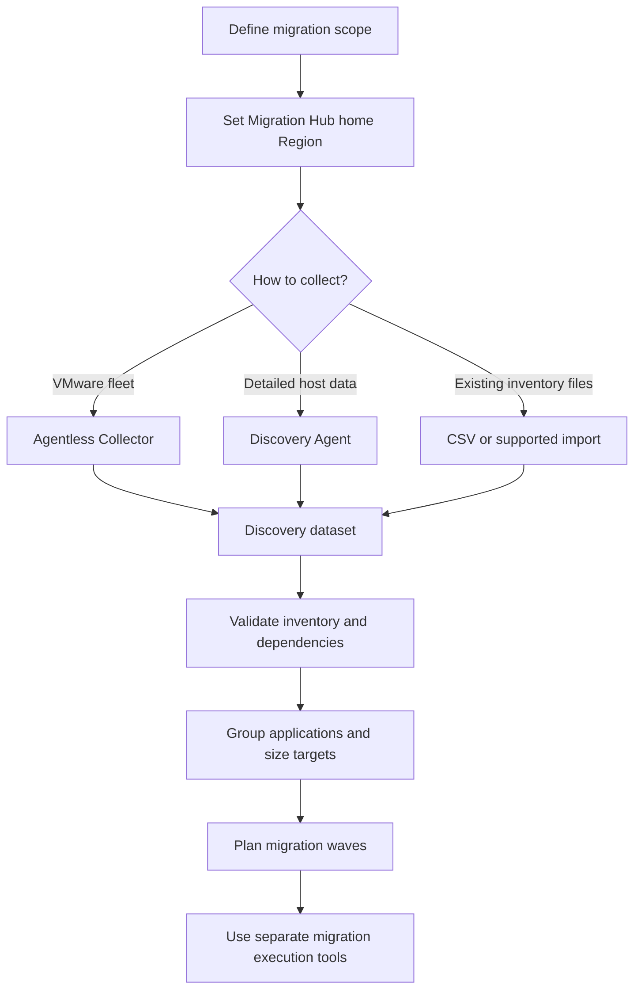
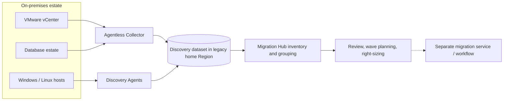
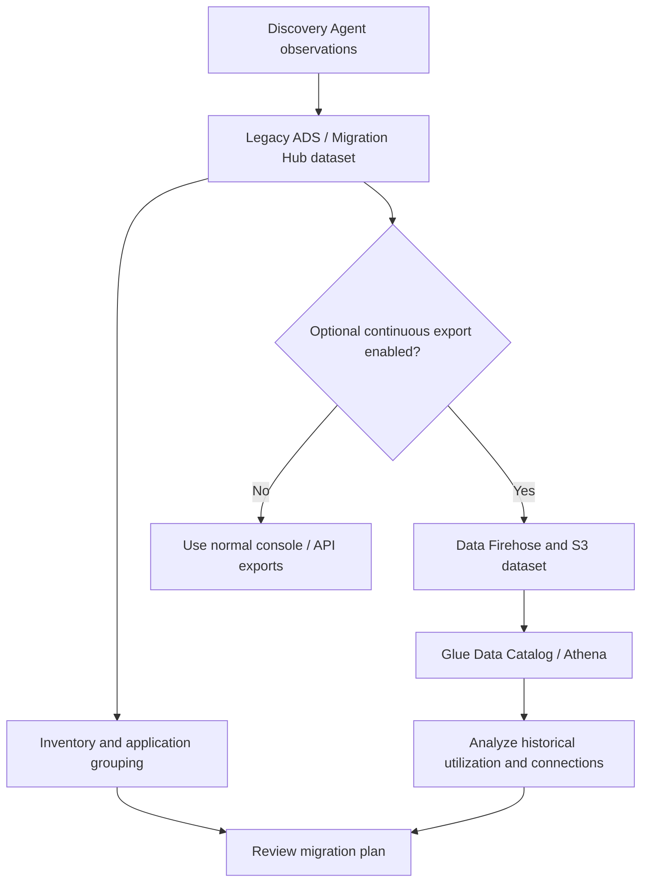
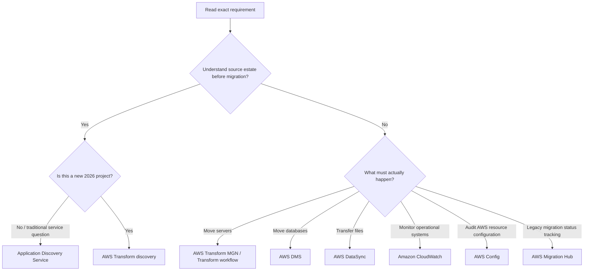

<div align="center">

# AWS Application Discovery Service

### Complete GitHub Study Guide · AWS Certified Cloud Practitioner + Solutions Architect – Associate

[](https://docs.aws.amazon.com/application-discovery/latest/userguide/what-is-appdiscovery.html)
[](https://aws.amazon.com/certification/certified-cloud-practitioner/)
[](https://aws.amazon.com/certification/certified-solutions-architect-associate/)


**One sentence to remember:** Application Discovery Service gathers evidence about an existing on-premises estate—inventory, utilization, running processes, and dependencies—to **plan** an AWS migration; it **does not perform** the migration.

[CCP essentials](#ccp-essentials) · [SAA deep dive](#saa-deep-dive) · [Comparisons](#service-comparisons) · [Exam traps](#exam-traps) · [Practice questions](#practice-questions)

</div>

> [!IMPORTANT]
> **CURRENT SERVICE STATUS — reviewed November 2, 2026.** AWS Application Discovery Service **stopped accepting new customers on November 7, 2025**. Existing customers can continue their existing discovery projects. For **new** discovery and assessment work, AWS directs customers to **[AWS Transform](https://docs.aws.amazon.com/transform/latest/userguide/discovery-tool.html)**. AWS Migration Hub likewise stopped accepting new customers on November 7, 2025. This guide covers Application Discovery Service for **legacy workloads, the CLF-C02/SAA-C03 service-recognition distinction, and conceptual architecture**—not as a recommended new deployment. [AWS availability notice](https://docs.aws.amazon.com/application-discovery/latest/userguide/application-discovery-service-availability-change.html) · [Migration Hub notice](https://docs.aws.amazon.com/migrationhub-strategy/latest/userguide/migrationhub-availability-change.html)

> [!NOTE]
> **Source and currency:** Expanded and corrected from the supplied `01-overview(10).md` notes, with behavior and lifecycle cross-checked against official AWS documentation on 2026-11-02. This is an original explanation; no proprietary course slides have been reproduced. Exam questions are original practice scenarios, not official or leaked AWS questions. Actual AWS exam scope can evolve; consult the current official exam guides.

---

## Table of contents

1. [What is AWS Application Discovery Service?](#what-is-application-discovery-service)
2. [What problem does it solve?](#problem-it-solves)
3. [Core terms and collection components](#components)
4. [How it works, step by step](#how-it-works)
5. [Key features, capabilities, and limits](#features)
6. [Real-world use cases and service selection](#use-cases)
7. [Cloud Practitioner essentials](#ccp-essentials)
8. [Solutions Architect – Associate deep dive](#saa-deep-dive)
9. [Service comparisons](#service-comparisons)
10. [Integration and architecture patterns](#integrations)
11. [Security, IAM, and shared responsibility](#security)
12. [Observability, auditing, and troubleshooting](#operations)
13. [Pricing and cost optimization](#pricing)
14. [Practical console and CLI example](#practical-example)
15. [Common exam traps and misconceptions](#exam-traps)
16. [Interview questions](#interview-questions)
17. [Original practice questions](#practice-questions)
18. [Scenario drills](#scenario-drills)
19. [Exam decision tree](#decision-tree)
20. [Quick-revision cheat sheet](#cheat-sheet)
21. [Official AWS references and currency](#references)
22. [Closing study takeaway](#closing-takeaway)

---

<a id="what-is-application-discovery-service"></a>
## 1. What is AWS Application Discovery Service?

**Beginner definition:** AWS Application Discovery Service collects information about servers, applications, resource usage, and inter-server communication in an existing on-premises environment. The goal is to understand **what you have before you move it** to AWS.

**Exam-ready definition:** A discovery-and-assessment service, integrated with the legacy AWS Migration Hub workflow, that obtains server configuration and utilization data and, with appropriate collectors, application-dependency information to support inventory analysis, workload grouping, right-sizing, and migration-wave planning. It is **not** a migration/replication tool. [AWS service overview](https://docs.aws.amazon.com/application-discovery/latest/userguide/what-is-appdiscovery.html)

**Analogy:** Moving a hospital to a new building requires an inventory of equipment, a measurement of power needs, and a map of which departments depend on which systems. Application Discovery Service is the **survey team and inventory notebook**. It does not transport equipment, construct the new hospital, or guarantee successful cutover. Migration services perform the movement.

| At a glance | Correct mental model |
|---|---|
| AWS category | Migration discovery, assessment, and planning |
| Typical source | On-premises VMware VMs, physical Windows/Linux servers, and database/analytics systems, subject to collection method |
| Main outputs | Inventory, capacity/utilization observations, connection/dependency evidence, application groupings, exports |
| Collection options | Agentless Collector, per-host Discovery Agent, or file-based import/partner data |
| Legacy management surface | AWS Migration Hub; discovery and planning data stored in its selected home Region |
| Major limitation | Discovery ≠ migration, replication, cutover, continuous infrastructure monitoring, or a guaranteed application architecture map |
| New-customer status | Closed since 2025-11-07; use AWS Transform for new projects |
| Charge | No Application Discovery Service fee; charges may arise from supporting AWS services |

> [!TIP]
> **Instant exam clue:** “Discover on-premises servers and application dependencies **before** an AWS migration” points to **Application Discovery Service** in traditional service-selection questions. If a scenario explicitly asks for a **new implementation today**, consider **AWS Transform**.

---

<a id="problem-it-solves"></a>
## 2. What problem does it solve?

**Before discovery:** IT teams often have stale spreadsheets, incomplete configuration management databases (CMDBs), little knowledge of real CPU peaks, and undocumented service-to-service connections. A migration plan based only on allocated resources or staff recollection can be too expensive or can break an application when a dependent service remains on-premises.

**After discovery:** Teams have a better-grounded inventory and utilization baseline, can identify servers that should move together, can investigate candidates for EC2 sizing, and can plan migration waves. **Collected evidence supports decisions; it does not make all decisions automatically.**

| Migration-planning question | Useful discovery evidence | What the team still needs to decide |
|---|---|---|
| Which machines exist? | Server identity, OS, IP, CPU, RAM, disks | In-scope vs excluded/retired machines |
| How much capacity is used? | Average and peak CPU, RAM, disk metrics | Measurement window, growth, sizing headroom |
| What communicates with what? | Observed TCP connections, processes where supported | Business dependency, directionality, criticality |
| Which servers form one app? | Connections and discovered server attributes | Business owner confirmation and grouping |
| Which wave migrates first? | Grouping, utilization, environmental context | Risk, downtime, regulations, dependencies, testing |
| What will AWS cost? | Capacity/utilization inputs | Target architecture, licensing, pricing model, data transfer |

Typical use cases: **data-center exit**, **VMware inventory audit**, **unknown application dependencies**, **server right-sizing**, **migration-wave sequencing**, **database estate assessment** (in historical supported workflows), and **reducing migration risk** before using an execution tool.

**Why a spreadsheet alone may be insufficient:** It may record a server's *configured* 16 vCPU/64 GiB but not that it usually uses 10% CPU and occasionally peaks at 85%, or that it talks to an authentication server and a license server. Discovery gathers evidence that the spreadsheet may miss; a CMDB remains useful for business metadata.

---

<a id="components"></a>
## 3. Core concepts and collection components

### Terminology

| Term | Meaning | Why it matters |
|---|---|---|
| **Inventory** | A list of source servers and their characteristics | Establishes migration scope |
| **Configuration data** | Static-ish facts: host name, IP, OS, CPU, RAM, disks | Starting point for sizing and grouping |
| **Utilization metrics** | Observed resource usage over a measurement window | Helps avoid blindly copying on-premises sizing |
| **Dependency mapping** | Identifying communication among systems | Helps select migration waves and firewall paths |
| **Process discovery** | Finding running software/processes | Adds context beyond server inventory |
| **Agent-based collection** | Software installed on each target machine | Can capture processes and detailed connections |
| **Agentless collection** | Collector appliance or remote collection without a per-VM agent | Easier broad coverage but capabilities depend on module |
| **VMware vCenter** | VMware management endpoint for an estate of VMs | Source for agentless VMware inventory |
| **Migration Hub home Region** | Legacy single AWS Region for discovery/planning data | Must be configured before data collection |
| **Application grouping** | Associating related discovered servers into a logical application | Enables workload-level migration planning |
| **Migration wave** | A coordinated set of workloads moved in a given phase | Dependencies may dictate order |
| **CSV import** | File-based ingestion of existing asset data | Useful when agents/collectors are not an option |
| **TCO** | Total cost of ownership | Utilization can inform AWS cost comparisons |

### Three core ingestion paths

| Path | How installed/used | Best at | Critical caveat |
|---|---|---|---|
| **Application Discovery Agent** | Installs on individual Windows/Linux machines, including physical hosts and VMs | Host metrics, running processes, observed TCP connections, detailed time-series data | Every target host needs installation/permissions/network access |
| **Agentless Collector** | A VM appliance deployed with an OVA in a VMware vCenter environment | VMware inventory and utilization across many VMs | **VMware module alone** cannot inspect guest processes; separate **Network Data Collection** module adds network-connection discovery |
| **File-based import** | Import supported data (CSV template or supported RVTools export) into Migration Hub | Bootstrap an inventory without deployment of collectors | Accuracy and missing metrics/dependencies reflect input quality; not live instrumentation |

An Agentless Collector can additionally use **database and analytics** collection modules for database metadata and metrics. Its **Network Data Collection** module collects connection data from servers discovered by its VMware module. It is incorrect to claim either that all agentless modes collect every process or that agentless collection can **never** discover network dependencies. [Collector modules](https://docs.aws.amazon.com/application-discovery/latest/userguide/agentless-collector.html) · [Network collection module](https://docs.aws.amazon.com/application-discovery/latest/userguide/agentless-collector-gs-network-data-collection.html) · [Discovery Agent](https://docs.aws.amazon.com/application-discovery/latest/userguide/discovery-agent.html)

### Service lifecycle distinctions

| Capability | Status as reviewed | Exam/architect implication |
|---|---|---|
| **Application Discovery Service** | New customers blocked since **2025-11-07**; existing projects supported | Historical service name may appear in study materials; do not recommend onboarding a new customer |
| **Migration Hub** | New customers blocked since **2025-11-07** | Legacy integration; use AWS Transform for new discovery/assessment orchestration |
| **Discovery Connector** | Separate *legacy component*: stopped being supported/accepting new data **2025-11-17** | **Not** the same as the newer Agentless Collector |
| **DMS Fleet Advisor** | End of support **2026-05-20** | Some old docs mention it; do not recommend for new database assessments |
| **AWS Transform MGN** | Renamed from AWS Application Migration Service on **2026-06-08**; supports direct server rehosting | The server-replication/cutover capability, distinct from discovery |
| **AWS Transform** | Recommended AWS destination for new projects | Discovery, assessment and more advanced migration planning/execution capabilities depend on the chosen workflow |

References: [MGN rebrand](https://aws.amazon.com/about-aws/whats-new/2026/06/aws-transform-mgn-rebrand/), [ADS availability](https://docs.aws.amazon.com/application-discovery/latest/userguide/application-discovery-service-availability-change.html), [Discovery Connector retirement](https://aws.amazon.com/blogs/migration-and-modernization/deprecation-of-aws-application-discovery-service-discovery-connector/), [DMS Fleet Advisor EoS](https://docs.aws.amazon.com/dms/latest/userguide/dms_fleet.advisor-end-of-support.html), [AWS Transform](https://docs.aws.amazon.com/transform/latest/userguide/discovery-tool.html).

---

<a id="how-it-works"></a>
## 4. How it works, step by step

The following describes a **legacy existing-customer** discovery workflow, not a recommended 2026 new-account setup.

1. **Define scope:** list data centers, business applications, owners, relevant networks, excluded systems and compliance constraints.
2. **Set the Migration Hub home Region:** discovery/planning information is held in this Region; it is **not necessarily** the final workload destination Region.
3. **Choose collection approach:** an Agentless Collector for VMware fleet inventory, Discovery Agent for detailed per-host evidence, or a supported file import; mix methods as needed.
4. **Authorize and connect:** configure IAM access, VMware read permissions, host-level permissions where required, and network egress. Protect all credentials on collectors.
5. **Collect over a representative window:** inspect utilization and connection samples during normal and peak business activity, not just an idle hour.
6. **Review and clean inventory:** identify duplicates, missing hosts, stale data, failed collectors, unreachable targets and unusual utilization values.
7. **Map dependencies:** combine observed network connections with app-owner knowledge. Observed connections do not prove all business dependencies.
8. **Group applications and plan waves:** select workloads that should migrate together; assess target architecture, right-sizing, security and cutover testing.
9. **Use a migration execution service:** for example, AWS Transform MGN (formerly AWS Application Migration Service) for server rehosting or AWS DMS for database data migration. **Discovery Service does not move resources.**



### Beginner example — a 120-server data center

A company has **120 on-premises servers** and does not know which ones communicate. It discovers VMware VMs broadly, installs per-host agents selectively where detailed process/connection information is required, confirms the dependency graph with application owners, and plans waves accordingly. Only **afterward** does it select migration tools.

### Nuanced example — a monthly-finance batch job

A finance VM appears almost idle during a two-day measurement but processes month-end invoices at 90% CPU. Sizing from the short observation risks undersizing on AWS. The architect must sample an appropriate business cycle, identify scheduler/DB/file-share dependencies, and include a representative load test. **Discovery evidence is a sample, not a guarantee of future demand.**

> [!WARNING]
> A *migration plan* is not the same as a *migration*. No servers are replicated, DNS switched, applications retested, or source systems decommissioned merely because discovery finishes.

---

<a id="features"></a>
## 5. Key features, capabilities, and limits

| Capability | What it gives you | Exam relevance / limit |
|---|---|---|
| Server discovery | Hardware/VM profiles and IDs | **CCP:** inventory before migration |
| Utilization collection | CPU, RAM, disk and other metrics depending on method | **SAA:** measurement horizon and right-sizing |
| Dependency discovery | Observed communications/connection information | **CCP:** dependencies; **SAA:** network and wave coordination |
| Process-level visibility | Running processes with Discovery Agent | **SAA:** distinguishes agent from VMware-only inventory |
| Agentless VMware collection | Many VMs via a vCenter-integrated appliance | **SAA:** guest-process visibility is not automatic |
| Network collection module | Network connections from eligible inventoried servers | **SAA:** module/prerequisites matter |
| Database and analytics module | Database/analytics server inventory and metadata | Historical assessment; **DMS Fleet Advisor is retired** |
| Import from existing inventory | Supported Migration Hub CSV/RVTools imports | Static import is not active monitoring |
| Application grouping | Logical server associations in legacy Migration Hub | Business validation required |
| Export and analysis | CSV/API data; agent-data analysis using S3/Athena when enabled | External AWS resources may incur charges |
| API access | Query server, process, connection, application items | Subject to IAM and eventual consistency |
| Historical Migration Hub integration | Track discovered groups and migration state | Tracking does not execute migration |

### Agentless vs agent: the high-value distinction

- **VMware Agentless Collector:** efficient wide inventory and resource utilization; the **VMware-only module** does not report processes inside VMs.
- **Agentless Collector Network Data Collection module:** additional configuration is required to observe network connections; it is not synonymous with VMware hypervisor inventory.
- **Discovery Agent:** runs on each Windows/Linux machine and gathers more granular process, TCP connection, and time-series performance information. The agent checks/captures data frequently (AWS documents ~15-second polling for selected measurements), but do not assume all sources and exports have identical intervals.
- **CSV/RVTools import:** reflects the fields supplied; cannot magically discover connections or usage absent from the file. [Official method comparison](https://docs.aws.amazon.com/application-discovery/latest/userguide/what-is-appdiscovery.html)

### Important constraints

- Use of Application Discovery Service requires an **eligible existing customer/account**; new customers should use AWS Transform.
- Legacy discovery data is tied to a chosen **Migration Hub home Region**; migrating workloads to a different AWS Region is a separate decision.
- The VMware module depends on a supported VMware vCenter setup and necessary read privileges.
- Agent setup requires OS privileges and the outbound connectivity specified in AWS docs. Collector connection usually needs HTTPS/TCP 443 to relevant AWS endpoints; additional modules may need guest-side access.
- Discovery is limited by permissions, running hosts, data freshness, sample window, firewall boundaries, and collector placement.
- Process names and TCP connections do **not** establish business-criticality, full data semantics, protocol success, or application readiness.
- API configuration query/export responses may exhibit **eventual consistency**. [AWS API query guide](https://docs.aws.amazon.com/application-discovery/latest/userguide/discovery-api-queries.html)

---

<a id="use-cases"></a>
## 6. Real-world use cases and service selection

| Requirement | Historic ADS method / choice | Why / caution |
|---|---|---|
| Discover hundreds of VMware VMs | Agentless Collector, VMware module | Scales discovery without agent per VM; verify OS-level gaps |
| Find running processes on physical Linux/Windows hosts | Discovery Agent | Agentless VMware inventory cannot inspect a physical host directly |
| Discover connection relationships | Discovery Agent or configured Network Data Collection module | Validate observed traffic, access and time window |
| Import an existing CMDB/RVTools export | File-based import | Completeness depends on import fields |
| Estimate EC2 size | Export/inspect observed utilization plus AWS cost modeling | Peak periods, growth and workload characteristics still matter |
| Build migration waves | Discovery dataset + business owner validation | Dependency evidence supports, not dictates, grouping |
| Move an on-premises server | **AWS Transform MGN (formerly AWS Application Migration Service)** / AWS Transform workflow | Not accomplished by ADS itself |
| Migrate an operational database | **AWS DMS** where applicable | Migration/replication and schema conversion are separate concerns |
| Transfer files to S3/EFS/FSx | **AWS DataSync** where suitable | Transfers data; not a discovery replacement |
| Discover a **new** estate in 2026 | **AWS Transform discovery tool** | Recommended new-customer path |

**When not to choose ADS:** a greenfield 2026 customer, ongoing production health monitoring, log analysis, continuous security compliance checks, direct server replication, database conversion, or an application cutover/orchestration requirement. For those use cases, choose a service appropriate to the *actual task*.

---

<a id="ccp-essentials"></a>
## 7. Cloud Practitioner (CCP) Essentials


### Fundamental points to memorize

1. Application Discovery Service supports **assessment and planning before migration**.
2. It inventories **on-premises servers, virtual machines, and workloads** using supported methods.
3. It can collect **configuration and performance/utilization information**.
4. It helps reveal **application/server dependencies** when appropriate collection capabilities are used.
5. Dependency mapping reduces the chance of separating interconnected systems during cutover.
6. It may help estimate the **AWS resources** needed by comparing current configuration with real usage.
7. It is a **discovery** tool, **not a server migration** tool.
8. **AWS Transform MGN** (formerly **AWS Application Migration Service**) is a separate server-rehosting capability.
9. **AWS DMS** is for database migration, not general server inventory.
10. **AWS DataSync** transfers data/files; it does not provide general application discovery.
11. The historic **AWS Migration Hub** interface aggregates discovery/planning and tracking information.
12. **Agent-based** and **agentless** collection approaches have different coverage and prerequisites.
13. Data can help form **logical application groups** and **migration waves**.
14. AWS service fees for discovery are **not charged**, but supporting AWS resources can cost money.
15. The service stopped accepting **new customers on November 7, 2025**.
16. **AWS Transform** is AWS's recommended alternative for **new** discovery/assessment work.

### CCP keyword bank

`discover` · `inventory` · `assess` · `on-premises servers` · `pre-migration` · `migration planning` · `application dependencies` · `server relationships` · `dependency mapping` · `resource utilization` · `CPU / RAM` · `performance data` · `VM discovery` · `data center` · `group applications` · `right-sizing` · `migration waves` · `discover first, migrate later`

### If the question says X, think Y

| Question clue | Best first association | Do not confuse with |
|---|---|---|
| “Inventory our on-premises servers **before moving** to AWS” | **Application Discovery Service** (traditional/legacy question) | AWS Transform MGN |
| “Understand which servers communicate” | **Application Discovery Service** with appropriate discovery | CloudWatch alone |
| “Track migration status across tools” | **Migration Hub** (legacy) | Discovery alone |
| “Replicate and move servers to AWS” | **AWS Transform MGN (formerly AWS Application Migration Service)** | Application Discovery Service |
| “Migrate a database with minimal downtime” | **AWS DMS** (depending on source/target) | Application Discovery Service |
| “Send a file system’s data to AWS” | **AWS DataSync** | Application Discovery Service |
| “Start a new discovery initiative today” | **AWS Transform** | New enrollment into ADS |

### 30-second CCP answer

> **Application Discovery Service helps an organization assess its existing on-premises infrastructure by collecting server, utilization, and dependency data before an AWS migration. It supports planning; it does not migrate resources. For a new project today, AWS recommends AWS Transform.**

---

<a id="saa-deep-dive"></a>
## 8. Solutions Architect – Associate (SAA) Deep Dive


### SAA architectural decision points

| Design axis | Question to ask | Sensible decision |
|---|---|---|
| Collection granularity | Inventory only, or processes/connection data too? | Choose VMware module, added network module, or per-host Agent appropriately |
| Target scope | VMware VMs, physical Linux/Windows, databases, imports? | Confirm collector's scope; do not assume one collector handles everything |
| Network | Can the collector/agent reach AWS? Can it reach the source? | Design permitted egress, DNS, proxies, and source-side connectivity |
| Identity | Who authorizes the collector and who can query the dataset? | Use documented roles/policies and least privilege |
| Data sensitivity | Does discovery include hostnames, addresses, process data? | Limit access, retention, exports and sharing |
| Completeness | Were business peaks and batch jobs observed? | Sample sufficiently and validate with owners |
| Home Region | Where is historic discovery metadata stored? | Choose Migration Hub home Region *before* collection |
| Destination Region | Where will migrated workloads execute? | Choose separately for compliance, latency, services and cost |
| Recovery | What happens if data collection stops? | Preserve prior records, identify gaps, resume collection; plan manual fallback |
| Cost | Which support components are enabled? | Review S3/Athena/Data Firehose and destination pricing |

### Architecture pattern A — staged VMware discovery

A company has 500 VMware VMs and can access vCenter but cannot install software on every guest. Start with **Agentless Collector** and the VMware inventory module. For deeper evidence, selectively enable the **Network Data Collection module** or deploy Discovery Agents on permitted hosts. Verify collector-to-source paths and AWS HTTPS egress. Do not claim vCenter inventory alone discovers each guest's processes. Group servers with application-owner confirmation.

### Architecture pattern B — physical servers and fine-grained dependencies

A data center has physical Windows and Linux hosts whose applications depend on local scheduled tasks and network connections. **Discovery Agent** is the historically relevant approach when host-level process data is needed. Confirm OS support, elevated installation privileges, access controls and permitted outbound communication. Plan collection across business peaks. A single hypervisor appliance is **not** a substitute for physical-host instrumentation.

### Architecture pattern C — design for Region, residency, and migration sequencing

A European company must inventory assets under a defined data-governance policy and will migrate production to one or more AWS Regions. Its *historic* Migration Hub **home Region** stores discovery/planning data, while **destination Regions** can be different. The architect must explicitly assess data residency for metadata (hostnames, IPs, discovered processes), not merely production databases. Then plan wave groups based on TCP observations plus business and application dependencies. [AWS Migration Hub home Region](https://docs.aws.amazon.com/migrationhub/latest/ug/home-region.html)

### Architecture pattern D — right-sizing without underestimating workloads

Server A has 32 GiB allocated and low average utilization but runs a quarterly analytics job. Server B uses 95% CPU only during weekly payroll. If the collection window misses these events, the cost model can be misleading. Combine **average + peak data**, scheduled workload knowledge, business growth, storage IOPS, network throughput, licensing, and load tests. A discovery tool provides sizing inputs, not an automatically optimal production architecture.

### Architecture pattern E — new-customer modern path

A company begins its first inventory project in late 2026. **Do not prescribe enrolling it into ADS or Migration Hub**: both closed to new customers. Use **AWS Transform** discovery/assessment. Its documented discovery workflow supports VMware vCenter, Microsoft Hyper-V, and server imports, and can use SSH/WinRM for deeper OS-level collection when authorized. An AWS Transform migration job may then offer planning and migration execution capabilities; this does **not** retroactively make legacy Application Discovery Service a migration engine. [AWS Transform discovery](https://docs.aws.amazon.com/transform/latest/userguide/discovery-tool.html) · [AWS Transform migration jobs](https://docs.aws.amazon.com/transform/latest/userguide/vmware-jobs.html)

### Data flow: discovery is a control/assessment workflow, not application traffic routing



The architecture is **conceptual**: some collector modules have additional discovery requirements and the database module historically integrated with DMS Fleet Advisor, which is now retired. This diagram does **not** imply database migration or packet forwarding through Migration Hub.

### Failure and design trade-offs

- **Agentless** reduces per-guest operational overhead but may miss deeper OS/process details without extra modules/credentials.
- **Agents** supply detail but increase installation, fleet maintenance, OS permission and credentials management work.
- **File import** reduces connectivity needs but can be stale, incomplete or missing dependencies.
- **Network observations** can omit infrequent or blocked traffic. No traffic observed does not mean no application relationship exists.
- **Time-series data** can expose seasonal peaks; snapshots may not.
- **Imported/discovered records** may arrive asynchronously and be eventually consistent through APIs.
- **Deployed collector availability** influences ongoing collection, not the uptime of the on-premises workload itself.

---

<a id="service-comparisons"></a>
## 9. Compare with similar or confusable AWS services

| Service | Primary job | Choose when the requirement says… | ADS relation / decisive difference |
|---|---|---|---|
| **AWS Application Discovery Service** (legacy) | Discover source inventory/utilization/dependencies | “Assess on-premises servers before migration” | **Discovers**; no migration |
| **AWS Transform** | New discovery, assessment and migration workflows | “New migration assessment / discovery project” | Current replacement/recommended path |
| **AWS Migration Hub** (legacy) | Central migration inventory/status and tools | “Track the migration portfolio” | Worked **with** ADS; not equivalent; new-customer closure |
| **AWS Transform MGN (formerly AWS Application Migration Service)** | Replicate/rehost servers into AWS | “Move/rehost physical or virtual servers” | **Executes** server migration |
| **AWS DMS** | Migrate/replicate supported databases | “Transfer a database to another DB target” | Does not replace general discovery |
| **AWS DataSync** | Transfer file/object data between supported locations | “Move on-prem file data to AWS storage” | Data movement, not estate discovery |
| **AWS Migration Evaluator** | Build migration cost/business cases from inventory inputs | “Financial case/TCO assessment” | Planning economics rather than discovery itself |
| **AWS Transform MGN + AWS Transform** | Server execution + orchestrated workflow | “Discover, plan, and rehost in a modern workflow” | Specific phases/services have distinct roles |
| **Amazon CloudWatch** | Operational telemetry/alarms for configured resources | “Monitor live systems, alert on errors” | Operations ≠ pre-migration estate inventory |
| **AWS Config** | Record/evaluate supported AWS resource configuration | “Check deployed AWS resource compliance/history” | Not equivalent to scanning on-prem application dependencies |
| **AWS DMS Fleet Advisor** (retired) | Former database-inventory recommendations | Historical “discover database estate” context | **Ended 2026-05-20**; not a current choice |

### Most tempting comparisons, worked out

<details>
<summary><strong>ADS vs AWS Migration Hub — discovery vs tracking</strong></summary>

ADS collected detailed on-premises evidence; Migration Hub aggregated the inventory and migration statuses and exposed grouping/tracking workflows. They historically **worked together**. Both stopped accepting new customers in November 2025. AWS Transform is the current alternative.

</details>

<details>
<summary><strong>ADS vs AWS Transform MGN (formerly AWS Application Migration Service) — assess vs move</strong></summary>

If asked to **identify dependencies / inventory / estimate sizing**, use the discovery concept. If asked to **replicate and migrate servers**, choose AWS Transform MGN (formerly AWS Application Migration Service), or an appropriate AWS Transform migration workflow. Discovery has no server cutover or continuous block replication function.

</details>

<details>
<summary><strong>ADS vs AWS DMS — application inventory vs database transfer</strong></summary>

ADS could discover database metadata as part of its collection approaches. AWS DMS is designed to migrate database data between supported sources/targets, sometimes with ongoing change replication. Database migration may also require schema conversion and application testing. DMS Fleet Advisor was a *separate*, now-retired assessment feature, not the same thing as core AWS DMS.

</details>

<details>
<summary><strong>ADS vs AWS DataSync — planning data vs moving files</strong></summary>

ADS measures and documents the existing estate. DataSync moves data between supported on-premises and AWS storage endpoints. A company might use discovery **first**, then DataSync for particular file repositories; neither replaces the other.

</details>

<details>
<summary><strong>ADS vs CloudWatch / AWS Config — migration assessment vs operations / compliance</strong></summary>

CloudWatch is about ongoing metrics, logs, alarms and service health; AWS Config tracks resource configuration changes and evaluates rules for supported AWS resources. They do not automatically provide a complete dependency map of an on-premises data center. A migration may require all three kinds of capability at different stages.

</details>

<details>
<summary><strong>Agentless Collector vs Discovery Connector — similar names, different lifecycle</strong></summary>

The **Discovery Connector** was an older VMware data collector and reached end of support on **November 17, 2025**. The **Agentless Collector** is a distinct later appliance with VMware, network, and database/analytics modules documented in the legacy ADS guide. It is incorrect to say that *all* agentless collection ceased merely because the Discovery Connector was retired. ADS itself nevertheless stopped accepting *new customers* in 2025.

</details>

---

<a id="integrations"></a>
## 10. Integration and architecture patterns

| Integration | Historical workflow | Caveat |
|---|---|---|
| **AWS Migration Hub** | Central UI for discovered servers, grouping, status | Existing legacy accounts only |
| **AWS IAM** | Authorize discovery users/agents/collectors and API operations | Role/policy requirements depend on path |
| **AWS CloudTrail** | Audit supported control-plane API activity | Not an agent process/traffic log |
| **Amazon S3** | Import staging or collected/exported data | Separate storage cost, encryption/access/retention responsibilities |
| **Amazon Athena + AWS Glue + Data Firehose** | Analyze Discovery Agent data when continuous export/data exploration enabled | **Opt-in**, not all data automatically queryable, additional charges |
| **AWS DMS** | Database migration after assessment | Fleet Advisor component retired; core DMS is a different service |
| **Amazon EC2** | Candidate destination for rehosted workloads | Inventory cannot certify suitability or instance choice |
| **AWS Transform** | New discovery/assessment and migration planning | Prefer for new accounts and initiatives |



The optional **Athena data exploration** pathway concerns **Discovery Agent** data; enabling it creates supporting resources and costs. Do not claim that every source, including any arbitrary CSV import, automatically generates all Athena tables. [Athena exploration](https://docs.aws.amazon.com/application-discovery/latest/userguide/explore-data.html) · [CloudTrail](https://docs.aws.amazon.com/application-discovery/latest/userguide/logging-using-cloudtrail.html)

---

<a id="security"></a>
## 11. Security, IAM, compliance, and shared responsibility

**AWS-managed:** AWS operates the managed discovery service back end and its infrastructure; the service uses AWS identity and logging integrations. **Customer-managed:** scope of what is discovered, collector/agent deployment and host privileges, account credentials, access policies, firewall/proxy rules, data handling, exports, supporting S3 buckets, and compliance with local rules.

| Security concern | Required architectural thinking |
|---|---|
| Discovery may expose hostnames, IPs and process information | Treat it as potentially sensitive infrastructure metadata |
| Collectors handle AWS credentials in legacy setup | Limit scope, protect on-premises access and follow documented credential safeguards |
| VMware collector must read inventory | Give only needed vCenter access; verify read/view permissions |
| Per-host Discovery Agent needs elevated deployment rights | Coordinate with OS admins; protect installation and lifecycle |
| Network egress is blocked | Grant only documented AWS endpoint/port access; avoid broad firewall exceptions |
| Data goes to a chosen home Region | Evaluate residency and privacy constraints for metadata, not only application data |
| S3/Athena enabled for exports | Configure bucket access, encryption, retention, logging and cost controls as appropriate |
| Multiple teams/accounts | Apply least privilege and organizational guardrails; do not assume cross-account read access |

AWS documents the managed policy **`AWSApplicationDiscoveryAgentAccess`** for the Discovery Agent, and **`AWSApplicationDiscoveryAgentlessCollectorAccess`** for Agentless Collector. Other capabilities can require additional policies. **Do not attach broad administrative policies** merely to make a demo work; use the current AWS managed-policy documentation and your organization's IAM review. [IAM managed policies](https://docs.aws.amazon.com/application-discovery/latest/userguide/security-iam-awsmanpol.html) · [Agentless Collector prerequisites](https://docs.aws.amazon.com/application-discovery/latest/userguide/agentless-collector-gs-prerequisites.html)

**Encryption details:** Discovery Agent-to-service data transmission uses **TLS** as documented by AWS; an HTTPS connection is not permission to assume every optional export is encrypted and access-controlled exactly as you intend. Verify the applicable managed service and customer-owned S3 settings for encryption at rest. [Discovery Agent security](https://docs.aws.amazon.com/application-discovery/latest/userguide/discovery-agent.html) · [Security guide](https://docs.aws.amazon.com/application-discovery/latest/userguide/security.html)

> [!WARNING]
> Do not put AWS access keys, collector passwords, local administrator credentials, or screenshots of asset inventories into a public GitHub README. The CLI section below is **read-only** and includes no credentials.

---

<a id="operations"></a>
## 12. Observability, auditing, troubleshooting, and failure behavior

**Legacy checks:** Review collector health/connection and data-collection status, the last update time, agent registration and service connection, the selected Migration Hub home Region, import task statuses, and inventory freshness. AWS **CloudTrail** records supported ADS API activity; it does **not** substitute for data-plane telemetry. [Collector dashboard](https://docs.aws.amazon.com/application-discovery/latest/userguide/agentless-collector-dashboard.html) · [CloudTrail integration](https://docs.aws.amazon.com/application-discovery/latest/userguide/logging-using-cloudtrail.html)

### Diagnostic checklist, in order

1. **Eligibility:** Is this an existing account/project? A new AWS account cannot enroll in ADS in 2026.
2. **Home Region:** Is the legacy Migration Hub home Region already configured, and is the CLI pointed at it?
3. **Collection state:** Is the agent/collector registered, healthy, and *actively collecting*? Installed does not mean collecting.
4. **Source reachability:** Is vCenter accessible? Do its credentials have the required permissions? Are target hosts on and reachable when required?
5. **AWS reachability:** Can the collector make needed outbound **TCP 443** connections, resolve required domains and use its proxy as configured?
6. **OS/agent prerequisites:** Do machines have supported OS versions, correct time synchronization, required privileges and functioning services?
7. **Freshness and scope:** Has data had time to propagate? Is the server excluded, offline, not supported, or outside the selected inventory?
8. **Dependencies absent:** Is the network collection module enabled? Are the needed host credentials available? Did the observation window include the connection?
9. **Import errors:** Inspect rejected CSV records and expected fields/formats; resubmit only corrected files.
10. **Optional Athena failure:** Inspect CloudTrail/IAM/service role access, S3/Glue/Data Firehose resources and continuous-export status before deleting anything.

| Symptom | Plausible causes | First action |
|---|---|---|
| Zero servers discovered | Wrong home Region, not collecting, no source access | Verify state and Region |
| Collector unhealthy | Broken vCenter URL, bad credentials, DNS, egress | Check collector dashboard and endpoints |
| Processes not visible in VMware inventory | VMware module is not per-host process inspection | Add appropriate per-host discovery path |
| Server relationships missing | Module off, blocked guest access, no traffic during sample | Verify module/permissions and lengthen window |
| API changes not immediately visible | Eventual consistency | Wait and re-query; check collection status |
| Athena dataset absent | Continuous export not enabled or resource/permission issue | Check opt-in and supporting resources |
| Errors while importing | Invalid/missing supported fields | Download failure file and correct rows |

**Failure model:** A collector outage causes **collection gaps**, not an automatic interruption to the source application's runtime. Stored data may remain available; missing observations can invalidate sizing or dependency conclusions. Do not infer a guaranteed RPO, RTO, or failover SLA from discovery documentation. [Troubleshooting](https://docs.aws.amazon.com/application-discovery/latest/userguide/agentless-collector-troubleshooting.html) · [API consistency](https://docs.aws.amazon.com/application-discovery/latest/userguide/discovery-api-queries.html)

---

<a id="pricing"></a>
## 13. Pricing and cost optimization

**AWS lists the Application Discovery Service itself as no-charge** for discovering on-premises servers and planning migrations. However, **separate AWS resources** provisioned for storing/exploring data—such as **Amazon S3, Athena and Data Firehose**—may incur charges. This does **not** make the entire migration project free, and it does **not** override the new-customer closure. [Official ADS pricing](https://aws.amazon.com/application-discovery/pricing/)

| Cost factor | Example of when it matters | Optimization idea |
|---|---|---|
| Collector/service | No fee for core ADS discovery historically | Avoid treating it as a purchasable new service |
| S3 | Imports, optional exports and dataset retention | Restrict export scope/retention based on policy |
| Athena | SQL query scans for discovery datasets | Narrow queries/partitions and examine scan charges |
| Data Firehose / supporting services | Optional data-exploration pipeline | Disable unused ongoing exports carefully |
| Network/operations | On-prem collector host and network administration | Use the lightest collection method that answers the question |
| Future AWS deployment | EC2, database, storage, egress, licenses | Model separately from discovery costs |

**Illustrative estimation formula (not a price quote):**

```text
Total discovery-related incremental AWS cost
  = optional S3 storage/requests
  + optional Athena scanned data
  + optional Data Firehose / Glue / related service charges
  + any other resources explicitly provisioned

Target migration and ongoing production costs are estimated separately.
```

No fixed dollar amounts are supplied because price depends on Region, services, query volume, storage, and current rates. Use the [AWS Pricing Calculator](https://calculator.aws/) for supported billable components. Note: the pricing page may still display historical "get started" calls to action; the **availability announcement** determines new-customer eligibility.

---

<a id="practical-example"></a>
## 14. Practical console and CLI example

### Read-only workflow for an **existing** legacy ADS customer

**Prerequisites:** an eligible existing account; a configured Migration Hub home Region; AWS CLI v2; credentials obtained through your organization's approved SSO/role workflow; and the necessary read permissions. Use AWS Transform's current documentation instead for a new customer.

```bash
# Replace with the existing AWS Migration Hub home Region for your account.
HOME_REGION="eu-central-1"

# Identify the currently assumed principal (does not create resources).
aws sts get-caller-identity

# Query up to 10 discovered server configuration items.
aws discovery list-configurations \
  --configuration-type SERVER \
  --max-results 10 \
  --region "$HOME_REGION"

# Check historical file-import jobs, if any.
aws discovery describe-import-tasks --region "$HOME_REGION"
```

**What the outputs mean:** `list-configurations` lists supported configuration items of type `SERVER`; it does not trigger discovery or guarantee that every physical server is present. `describe-import-tasks` checks import-job status; it does not create or re-run imports. AWS also supports `DescribeConfigurations`, `StartExportTask`, collection operations and APIs for other asset types, but a study lab needs only a short, safe example. [ListConfigurations API](https://docs.aws.amazon.com/application-discovery/latest/APIReference/API_ListConfigurations.html) · [Migration Hub import CLI](https://docs.aws.amazon.com/application-discovery/latest/userguide/discovery-import.html)

**Console conceptual steps:** In the historical Migration Hub workflow, choose the **home Region**, review discovery collectors and status, inspect the **Servers** and **Applications** inventory, verify application grouping, and export supported data if needed. Exact navigation can change in maintenance-mode products. Do not paste real asset details into a public repository.

---

<a id="exam-traps"></a>
## 15. Common exam traps and misconceptions

| Incorrect assumption / trap | Correct interpretation and mechanism | Level |
|---|---|---|
| 1. “Discovery Service migrates the servers.” | It collects/organizes evidence; server movement needs another service or workflow. | CCP |
| 2. “It is just a server hardware list.” | Utilization and observed dependencies are central value propositions. | CCP |
| 3. “It is the same as Migration Hub.” | ADS discovered; legacy Migration Hub grouped/tracked across tools. | CCP |
| 4. “DMS discovers and migrates all server applications.” | Core DMS specializes in supported database migration. | CCP |
| 5. “DataSync is the on-premises dependency mapper.” | DataSync is for transferring data between supported storage endpoints. | CCP |
| 6. “CloudWatch replaces migration discovery.” | Operational monitoring differs from assessment of a source estate. | CCP |
| 7. “AWS Config scans unknown on-premises app dependencies.” | Config concerns supported AWS resource configuration/compliance, not an automatic on-prem app map. | CCP/SAA |
| 8. “A new company can freely enable ADS today.” | New customer access closed November 7, 2025; choose AWS Transform. | CCP/SAA |
| 9. “Migration Hub is still a new-customer onboarding choice.” | New customers are no longer accepted since the same date. | SAA |
| 10. “The retired Discovery Connector means all ADS methods shut down.” | Connector was one component; existing ADS projects/other collector approaches were treated separately. | SAA |
| 11. “Agentless discovery automatically tells you all running processes.” | VMware inventory module cannot inspect processes inside VMs; use appropriate deeper collection. | SAA |
| 12. “Agentless Collector can never reveal network connections.” | Its **additional Network Data Collection module** can collect observed network data. | SAA |
| 13. “Installing agents on one VM discovers every physical server.” | Agent-based collection requires coverage on each target host. | SAA |
| 14. “CSV import gives live CPU/process graphs by default.” | Import can only provide the fields present in source data. | SAA |
| 15. “Migration Hub home Region is where servers must be migrated.” | Home Region stores discovery/planning data; target workload Region can differ. | SAA |
| 16. “Every service is available in every Region.” | Verify supported endpoints/Regions and prerequisites. | SAA |
| 17. “A server missing from the inventory definitely does not exist.” | Collection access/scope/freshness can be incomplete. | SAA |
| 18. “No TCP traffic means the two applications are independent.” | Infrequent, blocked or unobserved connections may be missed. | SAA |
| 19. “Average CPU alone yields a safe EC2 instance size.” | Peaks, business cycles, memory, storage/network demand and growth matter. | SAA |
| 20. “Discovery makes an optimal migration-wave plan automatically.” | Human dependency/business validation and design decisions are still necessary. | SAA |
| 21. “AWS handles all discovery security because it manages the service.” | Customers secure agents, credentials, access policies, exports and compliance. | SAA |
| 22. “TLS egress means our S3 exports need no security review.” | Data-at-rest controls and bucket access are separately evaluated. | SAA |
| 23. “All discovery records instantly reflect the latest agent status.” | API queries/exports may be eventually consistent. | SAA |
| 24. “Athena analysis is permanently on by default.” | Historical agent data exploration/continuous export requires enabling and extra resources. | SAA |
| 25. “ADS always costs exactly $0 overall.” | ADS itself has no service charge; supporting S3/Athena/Firehose can cost money. | CCP/SAA |
| 26. “DMS Fleet Advisor is a current alternative.” | Its support ended May 20, 2026; do not prescribe for new work. | SAA |
| 27. “Collector stopped = on-premises app must be down.” | Collection can fail independently of application availability. | SAA |
| 28. “Dependency graphs show full application semantics.” | Network edges are observations, not proof of business function, criticality or readiness. | SAA |

> [!IMPORTANT]
> **Mechanism behind the biggest traps:** Discovery produces *evidence*. Evidence is bounded by **collection method, time window, network access, IAM/OS permissions, and data freshness**. Those boundaries determine whether a dependency map or sizing conclusion is trustworthy.

---

<a id="interview-questions"></a>
## 16. Interview questions and concise answers

| Question | Answer |
|---|---|
| 1. What did Application Discovery Service do? | Collect on-premises server/inventory, utilization and dependency information for migration planning. |
| 2. Did it migrate servers? | No. Use a server migration execution tool/workflow separately. |
| 3. Why did architects care about dependencies? | Moving one app tier while leaving a necessary dependency behind can cause outage or latency issues. |
| 4. Agent-based or agentless for VMware? | Agentless for broad VM inventory; agent-based or extra module/credential access for deeper evidence as appropriate. |
| 5. How do you discover physical Windows/Linux hosts? | Historically use a Discovery Agent on each supported host, or import existing inventory. |
| 6. What is the home Region? | The selected AWS Region storing legacy Migration Hub discovery/planning data; not necessarily the migration destination. |
| 7. How do you size EC2 from discovery metrics? | Examine representative average/peak CPU/RAM, disk I/O, throughput, headroom, growth, and nontechnical constraints. |
| 8. Why might a dependency graph be incomplete? | Missing credentials, inactive schedules, short observation window, firewalls or out-of-scope machines. |
| 9. How would you troubleshoot zero discovered VMs? | Check account eligibility, home Region, collector health, vCenter permissions, outbound network, collection state. |
| 10. How did security responsibilities split? | AWS secured its service; customer controlled collectors, access, credentials, exported data, and compliance. |
| 11. What costs were associated with discovery? | ADS itself had no fee; optional S3/Athena/Data Firehose and later migration resources can be billed. |
| 12. What should a new customer use in 2026? | AWS Transform discovery/assessment instead of attempting new ADS/Migration Hub enrollment. |

---
<a id="practice-questions"></a>
## 17. Original exam-style practice questions

**33 original questions**: service recognition (CCP) followed by configuration, architecture, failure analysis, and trade-offs (SAA). These are **not official AWS exam questions**. Expand each question for the correct answer, rationale, and a tempting-distractor explanation.

<details>
<summary><strong>Q01 · CCP</strong> — A business wants an inventory of its on-premises servers and observed dependencies *before* migrating. In a traditional AWS exam-style service-selection question, what fits best?</summary>

- **A.** AWS Application Discovery Service
- **B.** AWS DataSync
- **C.** Amazon CloudWatch
- **D.** Amazon S3

**Correct answer: A. AWS Application Discovery Service**

**Why:** Application Discovery Service was designed to collect pre-migration server, usage, and dependency evidence.

**Important distinction:** DataSync moves supported data, but does not inventory a whole application estate.

</details>

<details>
<summary><strong>Q02 · CCP</strong> — Which statement accurately describes the boundary of Application Discovery Service?</summary>

- **A.** It performs DNS cutover to AWS
- **B.** It automatically rehosts every server
- **C.** It supports discovery and planning but does not migrate servers
- **D.** It replaces every AWS migration service

**Correct answer: C. It supports discovery and planning but does not migrate servers**

**Why:** Its primary output is assessment information; execution needs distinct migration tooling.

**Important distinction:** Automatic rehosting is the role of migration execution, not discovery.

</details>

<details>
<summary><strong>Q03 · CCP</strong> — Which service is primarily associated with rehosting entire servers into AWS?</summary>

- **A.** AWS Application Discovery Service
- **B.** AWS Transform MGN (formerly AWS Application Migration Service)
- **C.** AWS Config
- **D.** Amazon Athena

**Correct answer: B. AWS Transform MGN (formerly AWS Application Migration Service)**

**Why:** AWS Transform MGN (formerly AWS Application Migration Service) is the server-migration execution capability.

**Important distinction:** Discovery Service supplies input to migration planning; it does not replicate servers.

</details>

<details>
<summary><strong>Q04 · CCP</strong> — A team specifically wants to transfer database data to an AWS database target. Which specialized service is most relevant?</summary>

- **A.** AWS DataSync
- **B.** AWS Database Migration Service (DMS)
- **C.** AWS Application Discovery Service
- **D.** AWS Service Catalog

**Correct answer: B. AWS Database Migration Service (DMS)**

**Why:** Core AWS DMS handles supported database migration and replication scenarios.

**Important distinction:** The database discovery module supplies metadata; discovery does not perform the database migration itself.

</details>

<details>
<summary><strong>Q05 · CCP</strong> — An engineer says that migration discovery is just a list of serial numbers and CPUs. What critical dimension is missing?</summary>

- **A.** Observed application/server relationships
- **B.** An automatic container platform
- **C.** Global DNS records
- **D.** The virtual private cloud CIDR

**Correct answer: A. Observed application/server relationships**

**Why:** Dependencies and utilization are vital because moving connected systems separately can cause failures.

**Important distinction:** VPC CIDR planning can matter later, but it is not the missing purpose of discovery.

</details>

<details>
<summary><strong>Q06 · CCP</strong> — Which keyword cluster is the strongest match for the legacy Application Discovery Service concept?</summary>

- **A.** CDN, caching, edge delivery
- **B.** Encryption keys, secrets rotation
- **C.** Pre-migration, on-prem inventory, dependency mapping
- **D.** DNS resolver, alias record, TTL

**Correct answer: C. Pre-migration, on-prem inventory, dependency mapping**

**Why:** It is a migration *assessment* service.

**Important distinction:** The other clusters describe unrelated categories of AWS services.

</details>

<details>
<summary><strong>Q07 · CCP</strong> — Historically, which service provided a console for tracking migration statuses across AWS migration tools?</summary>

- **A.** AWS Migration Hub
- **B.** Amazon Route 53
- **C.** AWS IAM
- **D.** AWS DataSync

**Correct answer: A. AWS Migration Hub**

**Why:** Migration Hub aggregated discovery and migration tracking information.

**Important distinction:** ADS gathered environment evidence but was not the broad migration-tracking portal.

</details>

<details>
<summary><strong>Q08 · CCP</strong> — What does the presence of resource-utilization data help a migration team estimate?</summary>

- **A.** Appropriate AWS resource capacity
- **B.** Guaranteed zero downtime
- **C.** An official exam score
- **D.** Automatic data sovereignty compliance

**Correct answer: A. Appropriate AWS resource capacity**

**Why:** CPU/RAM/disk observations help with capacity estimates, subject to measurement gaps.

**Important distinction:** Neither downtime nor compliance can be guaranteed by collected metrics.

</details>

<details>
<summary><strong>Q09 · CCP</strong> — What is a dependency map intended to help answer?</summary>

- **A.** What is the public price of each EC2 family?
- **B.** Which servers or applications communicate?
- **C.** Who registered a domain?
- **D.** Which IAM users have active console sessions?

**Correct answer: B. Which servers or applications communicate?**

**Why:** Dependency mapping captures observed relationships among components.

**Important distinction:** It is not an IAM account audit or a pricing database.

</details>

<details>
<summary><strong>Q10 · CCP</strong> — Which statement about historic ADS pricing is correct?</summary>

- **A.** ADS has no direct service fee, but supporting AWS services may cost money
- **B.** Every AWS service involved is always free
- **C.** ADS is priced per migration cutover
- **D.** Cost is exactly equal to EC2 cost

**Correct answer: A. ADS has no direct service fee, but supporting AWS services may cost money**

**Why:** AWS pricing documentation lists core ADS discovery as no-charge and separately billed supporting resources.

**Important distinction:** S3, Athena, and Data Firehose may still incur usage charges.

</details>

<details>
<summary><strong>Q11 · CCP</strong> — A *new* customer begins a migration discovery project in November 2026. Which AWS offering does AWS recommend?</summary>

- **A.** Enroll in AWS Application Discovery Service
- **B.** Enroll in legacy AWS Migration Hub
- **C.** AWS Transform
- **D.** AWS DMS Fleet Advisor

**Correct answer: C. AWS Transform**

**Why:** ADS and Migration Hub stopped accepting new customers in November 2025; AWS Transform is the recommended current path.

**Important distinction:** DMS Fleet Advisor reached end of support in May 2026.

</details>

<details>
<summary><strong>Q12 · CCP</strong> — True or false: Finding on-premises workload relationships can reduce migration risk.</summary>

**Answer:** True

**Why:** Correct. Understanding dependencies helps avoid moving tightly coupled systems in an unsafe order.

**Important distinction:** This lowers *planning risk*, but does not eliminate migration risk.

</details>

<details>
<summary><strong>Q13 · CCP</strong> — Which service is best described as a file/data transfer tool, rather than general-purpose application discovery?</summary>

- **A.** AWS DataSync
- **B.** AWS Application Discovery Service
- **C.** AWS Migration Hub
- **D.** AWS Config

**Correct answer: A. AWS DataSync**

**Why:** DataSync transfers data between supported endpoints and is not an estate-inventory scanner.

**Important distinction:** ADS discovers/assesses; Migration Hub historically tracked; Config evaluates AWS configurations.

</details>

<details>
<summary><strong>Q14 · CCP</strong> — A student confuses an assessment with a migration. Fill the two blanks: discovery tells you **___**; a migration tool performs **___**.</summary>

**Answer:** What exists / how it behaves; movement of workloads or data

**Why:** A discovery dataset informs decisions about *what* to migrate. Execution tools actually move/replicate data and workloads.

**Important distinction:** Avoid equating a discovered application group with a migrated system.

</details>

<details>
<summary><strong>Q15 · CCP</strong> — What is the simplest memory trick for this AWS topic?</summary>

**Answer:** Discover first, move later.

**Why:** The service's role is observing and planning, not moving.

**Important distinction:** For current practical work, also remember the 2025 ADS availability change.

</details>

<details>
<summary><strong>Q16 · SAA</strong> — A company has 300 VMware VMs and cannot install agents inside each VM. For a **legacy eligible ADS project**, which collection design best starts broad inventory?</summary>

- **A.** Deploy Agentless Collector integrated with vCenter
- **B.** Deploy AWS DMS replication tasks on every VM
- **C.** Install an Application Discovery Agent on a single VM only
- **D.** Use AWS Config rules

**Correct answer: A. Deploy Agentless Collector integrated with vCenter**

**Why:** The Agentless Collector VMware module inventories VMware VMs through vCenter without a per-guest agent.

**Important distinction:** One Discovery Agent cannot enumerate every other host; AWS Config is not a VMware-estate discovery mechanism.

</details>

<details>
<summary><strong>Q17 · SAA</strong> — An architect needs the *names of running processes* on selected supported physical Windows/Linux servers. Which historic ADS method is a fit?</summary>

- **A.** VMware-only vCenter inventory
- **B.** Discovery Agent installed on each selected server
- **C.** S3 inventory
- **D.** Migration Hub CSV import with no process fields

**Correct answer: B. Discovery Agent installed on each selected server**

**Why:** Discovery Agent captures process details and host-level telemetry when correctly installed.

**Important distinction:** The VMware-only collector does not introspect guest process lists.

</details>

<details>
<summary><strong>Q18 · SAA</strong> — A VMware Agentless Collector has a populated server list, but no observed communication relationships. Which explanation should be checked first?</summary>

- **A.** VPC peering must be turned on
- **B.** Network Data Collection module and its access prerequisites may not be configured
- **C.** All VMware VMs must be migrated before discovery
- **D.** AWS Shield requires activation

**Correct answer: B. Network Data Collection module and its access prerequisites may not be configured**

**Why:** Network connection discovery is a separate module/capability requiring proper configuration.

**Important distinction:** A broad VMware inventory by itself does not imply network-module setup.

</details>

<details>
<summary><strong>Q19 · SAA</strong> — A legacy account configured `eu-central-1` as its Migration Hub home Region and intends to migrate servers into `eu-west-1`. Is that intrinsically impossible?</summary>

- **A.** Yes, home and destination Regions must always match
- **B.** No; the home Region holds discovery/planning data, while workloads can target other Regions
- **C.** Yes, because discovery is a global-only service
- **D.** No, because ADS automatically copies all source data to both Regions

**Correct answer: B. No; the home Region holds discovery/planning data, while workloads can target other Regions**

**Why:** The discovery/planning home Region is a distinct concept from each workload's destination Region.

**Important distinction:** The service does not auto-replicate workloads across Regions.

</details>

<details>
<summary><strong>Q20 · SAA</strong> — A rightsizing model uses only an idle weekend's average CPU measurement. What is the biggest flaw?</summary>

- **A.** AWS does not support CPU metrics
- **B.** The measurement may miss business peaks and periodic processing
- **C.** All EC2 instances require manual provisioning
- **D.** Only Spot Instances support CPU metrics

**Correct answer: B. The measurement may miss business peaks and periodic processing**

**Why:** Representative peak utilization, seasonal cycles, disk I/O, RAM and growth matter for sizing.

**Important distinction:** Lower average usage is not proof that a smaller instance handles peak demand.

</details>

<details>
<summary><strong>Q21 · SAA</strong> — An application has a rarely used disaster-recovery API call each quarter. No connection was observed during a one-week discovery. What follows?</summary>

- **A.** There is definitely no dependency
- **B.** Every port must be opened to the internet
- **C.** The dataset could miss rare communication; validate with owners and longer observation
- **D.** The app is already migrated

**Correct answer: C. The dataset could miss rare communication; validate with owners and longer observation**

**Why:** Observations depend on windows and permissions; absence of observed packets does not prove non-dependence.

**Important distinction:** Treating a missing edge as definitive is a common migration-planning mistake.

</details>

<details>
<summary><strong>Q22 · SAA</strong> — A Discovery Agent cannot register, and the host clock is substantially wrong. Why might NTP/time checks matter?</summary>

- **A.** Time mismatch can interfere with agent registration/authentication
- **B.** AWS requires the OS clock to be UTC exactly
- **C.** Migration Hub moves the agent after first registration
- **D.** NTP determines the migration destination Region

**Correct answer: A. Time mismatch can interfere with agent registration/authentication**

**Why:** AWS Agent prerequisites explicitly call out clock synchronization as a registration troubleshooting check.

**Important distinction:** A local timezone offset is not itself the same as an incorrect synchronized time.

</details>

<details>
<summary><strong>Q23 · SAA</strong> — Agentless Collector reports 'could not reach AWS' during setup. What is the best initial action?</summary>

- **A.** Open all inbound ports to the data center
- **B.** Verify DNS, firewall/proxy, and outbound HTTPS/TCP 443 to documented endpoints
- **C.** Delete all source VMs
- **D.** Recreate the AWS Organization

**Correct answer: B. Verify DNS, firewall/proxy, and outbound HTTPS/TCP 443 to documented endpoints**

**Why:** Collector connectivity needs appropriate outbound access, DNS resolution, and sometimes proxy configuration.

**Important distinction:** Broad inbound exposure is unnecessary and unsafe.

</details>

<details>
<summary><strong>Q24 · SAA</strong> — An organization wants to import a curated historical inventory without deploying any collectors. Which path did legacy Migration Hub support?</summary>

- **A.** Supported CSV/RVTools import
- **B.** Create an S3 lifecycle rule only
- **C.** Turn on CloudTrail Insights
- **D.** Create a Transit Gateway

**Correct answer: A. Supported CSV/RVTools import**

**Why:** Migration Hub could import supported inventory formats as an alternative to collectors.

**Important distinction:** File ingestion cannot discover omitted live processes or unknown network relationships.

</details>

<details>
<summary><strong>Q25 · SAA</strong> — An API client reads discovered configurations seconds after a change but sees an older result. What behavior should the design tolerate?</summary>

- **A.** Strong synchronous global consistency for every discovery API
- **B.** Eventual consistency of certain discovery query/export results
- **C.** Automatic deletion of all collectors
- **D.** All reads always fail after upload

**Correct answer: B. Eventual consistency of certain discovery query/export results**

**Why:** AWS documents that configuration query/export results may not reflect the latest updates immediately.

**Important distinction:** Racing an asynchronous data pipeline can produce stale output even when collection is healthy.

</details>

<details>
<summary><strong>Q26 · SAA</strong> — An architect enables optional Athena discovery-data exploration. Which newly relevant responsibility is easiest to overlook?</summary>

- **A.** S3/Glue/Data Firehose resources, access and additional charges
- **B.** A mandatory EC2 instance for every SQL query
- **C.** A required public S3 bucket
- **D.** Disabling IAM in the AWS account

**Correct answer: A. S3/Glue/Data Firehose resources, access and additional charges**

**Why:** The optional export/analysis pipeline provisions supporting services; permissions, retention and cost must be managed.

**Important distinction:** A public bucket is not required and would be a security problem.

</details>

<details>
<summary><strong>Q27 · SAA</strong> — A security review asks whether an on-prem collector's credentials are fully AWS-managed. What is the correct reply?</summary>

- **A.** Yes, there is no customer role
- **B.** No, customers must protect local credentials, access and their collectors
- **C.** Only if AWS DataSync is installed
- **D.** Yes, CloudTrail blocks every credential leak

**Correct answer: B. No, customers must protect local credentials, access and their collectors**

**Why:** Legacy collector/agent setup and local infrastructure access remain customer responsibilities.

**Important distinction:** CloudTrail is an audit record, not a substitute for credential protection.

</details>

<details>
<summary><strong>Q28 · SAA</strong> — A migration plan needs to know what fraction of connection and process telemetry is *guaranteed* captured by a VMware module. Which answer is best?</summary>

- **A.** 100% automatically
- **B.** Nothing is available from any agentless module
- **C.** Coverage is method/module- and access-dependent; process-level visibility differs from observed network connections
- **D.** Every packet is captured after 24 hours

**Correct answer: C. Coverage is method/module- and access-dependent; process-level visibility differs from observed network connections**

**Why:** The VMware module, separate Network Data Collection module, and Discovery Agent differ in information and prerequisites.

**Important distinction:** Neither total network capture nor full process introspection follows from basic VMware inventory.

</details>

<details>
<summary><strong>Q29 · SAA</strong> — A collector fails overnight, but business users continue using the on-premises application. Is this contradictory?</summary>

- **A.** Yes, collector uptime controls the application's uptime
- **B.** No; discovery data collection may stop while source applications keep running
- **C.** Yes, AWS terminates source applications on collector failure
- **D.** No, because ADS automatically migrates them

**Correct answer: B. No; discovery data collection may stop while source applications keep running**

**Why:** Discovery failure affects inventory freshness and observation coverage; it is not a source application dependency for normal business traffic.

**Important distinction:** There is no automatic server migration or termination caused by collector outage.

</details>

<details>
<summary><strong>Q30 · SAA</strong> — A customer wants an entirely new VMware/Hyper-V discovery and dependency analysis workflow in 2026. Which solution is the best recommendation?</summary>

- **A.** AWS Transform discovery tool with permitted access to source systems
- **B.** Install the retired ADS Discovery Connector
- **C.** Sign up for legacy AWS Migration Hub
- **D.** Use the retired DMS Fleet Advisor

**Correct answer: A. AWS Transform discovery tool with permitted access to source systems**

**Why:** AWS Transform provides current discovery pathways for VMware, Hyper-V and imports, with deeper OS access as configured.

**Important distinction:** The other choices have new-customer or end-of-support constraints.

</details>

<details>
<summary><strong>Q31 · SAA</strong> — A user says that all data has to stay in a particular jurisdiction. Which discovery architecture concern matters?</summary>

- **A.** Only the EC2 workload Region matters
- **B.** Only the DNS registrar matters
- **C.** Discovery metadata itself is stored in the selected legacy home Region
- **D.** Data sovereignty is irrelevant if the app is still on-premises

**Correct answer: C. Discovery metadata itself is stored in the selected legacy home Region**

**Why:** Hostnames, IPs and system details are sensitive metadata sent to the chosen Migration Hub home Region.

**Important distinction:** The destination workload location alone does not cover the residency of assessment data.

</details>

<details>
<summary><strong>Q32 · SAA</strong> — Which combination best supports trustworthy wave grouping for a complex enterprise application?</summary>

- **A.** One short CPU snapshot only
- **B.** Observed dependency data plus app-owner verification and an appropriate observation window
- **C.** Move every server in alphabetical order
- **D.** Use only the cheapest EC2 instance types

**Correct answer: B. Observed dependency data plus app-owner verification and an appropriate observation window**

**Why:** Use network evidence as one input, validate with business context, and account for low-frequency interactions.

**Important distinction:** A graph without business semantics can misrepresent critical application relationships.

</details>

<details>
<summary><strong>Q33 · SAA</strong> — A company wants to distinguish server sizing from actual migration execution. Name one service for the latter and two inputs for the former.</summary>

**Answer:** Execution: AWS Transform MGN (for applicable rehost scenarios). Sizing: representative CPU/RAM utilization and disk/network performance, plus headroom/business constraints.

**Why:** ADS historically helped gather capacity evidence; it was not itself the executor. AWS Transform may orchestrate a current end-to-end migration workflow.

**Important distinction:** Do not treat a raw vCPU count or average CPU alone as a final sizing recommendation.

</details>

---

<a id="scenario-drills"></a>
## 18. Scenario drills: choose a service, design, and pitfall

| Real-world requirement | Recommended service/design | Why | Critical pitfall |
|---|---|---|---|
| **1. A legacy enterprise has 400 VMware VMs and wants a rapid broad inventory.** | Existing ADS customer: Agentless Collector's VMware module; new project: AWS Transform | Broad inventory without a per-guest agent | Don't mistake vCenter metrics for full process-level introspection |
| **2. A physical Linux server relies on five undocumented services.** | Existing ADS project: install Discovery Agent on eligible hosts, validate observed dependencies | Per-host telemetry can expose processes and TCP relationships | One agent only covers its host; rare calls may be missed |
| **3. A hospital needs an application move plan with strict data locality.** | Discovery + chosen permitted home Region + governance review + explicit migration wave architecture | Discovery metadata is relevant to data residency | Home Region and target AWS Region are distinct |
| **4. A retailer wants to send 80 TB of file data to AWS.** | AWS DataSync, if endpoints and requirements are supported | The question asks for actual file movement | ADS does not transfer the files |
| **5. A finance app has idle periods and extreme month-end peaks.** | Sample representative workloads; model AWS target after reviewing peaks and I/O | Prevent under-sizing due to atypical sample | Average-only assessment can miss expensive spikes |
| **6. A new customer wants a VMware/Hyper-V inventory in 2026.** | AWS Transform discovery/assessment | Current recommended AWS offering | ADS/Migration Hub new-customer enrollment is closed |
| **7. A DBA needs to move a supported database with low downtime.** | Core AWS DMS + schema/app planning as needed | Database data migration is the requirement | Legacy ADS discovery and retired Fleet Advisor do not execute it |
| **8. Imported CSV lists 150 servers, but no dependency graph appears.** | Validate import fields; choose actual network/agent data collection where supported | Import preserves what its input contains | A spreadsheet cannot invent missing observed relationships |

### Worked drill: the broken dependency

**Scenario:** A team inventories an order API VM, a database VM, and a licensing server. It decides to migrate just the order API, then discovers that its license checks target a server still in the old data center. The API times out after cutover.

**Root cause:** The migration plan treated the application as one independent VM and failed to validate a dependency (potentially because license checks were infrequent during the discovery window).

**Better approach:** Collect representative connection observations, validate with application owners, decide whether the license server must migrate in the same wave or remain reachable, architect the path securely, and test it before cutover. **Discovery helps surface the risk but does not establish correct connectivity for you.**

---

<a id="decision-tree"></a>
## 19. Exam-question decision tree and keyword recognition



| Trigger words | Confirming clue | Think first | What could change the answer? |
|---|---|---|---|
| **discover / inventory / assess / pre-migration** | On-premises machines + usage/dependencies | ADS in traditional questions | Explicit new-customer date → AWS Transform |
| **application relationships / dependency mapping** | Need server-to-server interaction evidence | Appropriate discovery method | Is deep process visibility required? |
| **track the migration progress** | Different tools/statuses | Legacy Migration Hub | Current new workflow → AWS Transform |
| **rehost / replicate / migrate servers** | Actual workload movement | AWS Transform MGN / Transform workflow | Requirements may instead imply containers or redesign |
| **migrate database / minimal-downtime database move** | Source/target DB systems | AWS DMS | Schema conversion and compatibility require more work |
| **transfer file share data** | On-prem file server to AWS storage | DataSync | Bulk offline transfer might call for a different approach |
| **operational alarms and logs** | Service uptime, errors, observability | CloudWatch | Not an on-prem migration inventory request |
| **AWS resource compliance rules** | AWS config history/drift | AWS Config | Different from discovery/assessment |

> [!TIP]
> **Disambiguating sentence:** *“Before migrating, understand servers and dependencies”* ≠ *“Migrate the servers”* ≠ *“Track whether the migration finished.”*

---

<a id="cheat-sheet"></a>
## 20. Quick-revision cheat sheet

```text
AWS APPLICATION DISCOVERY SERVICE — CCP + SAA

WHY?        Understand an existing on-prem estate before migration.
WHAT?       Inventory + server configuration + utilization + dependencies.
OUTPUT?     Discovered assets, relationships, app groups, planning data.
NOT?        Not server replication, data cutover, or production monitoring.

COLLECTION:
  Agentless Collector  = broad VMware inventory; optional separate modules.
  Discovery Agent      = per-host Windows/Linux, processes + TCP + time series.
  File import          = only the details contained in imported sources.

LEGACY FLOW:
  Scope -> Home Region -> Collect -> Verify -> Group -> Plan -> MIGRATE
                                                        (other tools)

TOP COMPARISONS:
  ADS              = discover + assess (legacy)
  Migration Hub    = group/track progress (legacy)
  AWS Transform    = current new-project discovery and migration workflows
  AWS Transform MGN = move/rehost servers (formerly Application Migration Service)
  AWS DMS          = migrate databases
  AWS DataSync     = move supported files/data
  CloudWatch       = monitor operational telemetry
  AWS Config       = AWS resource configuration/compliance

THREE BIGGEST TRAPS:
  1. Discovery does not itself migrate workloads.
  2. Agentless inventory != automatic process and dependency coverage.
  3. ADS and Migration Hub closed to NEW customers on 2025-11-07.

OTHER 2026 STATUS:
  Discovery Connector ended: 2025-11-17 (distinct component).
  DMS Fleet Advisor ended: 2026-05-20.

EXAM CUE: on-prem inventory + dependencies BEFORE migration = ADS
CURRENT NEW PROJECT: AWS Transform
MEMORY TRICK: Discover first; move later.
```

**One-sentence exam answer:** AWS Application Discovery Service gathered configuration, utilization and application-dependency evidence from existing environments to assess and plan migration to AWS, but it did not perform the migration; AWS Transform is the recommended offering for new discovery projects.

---

<a id="references"></a>
## 21. Official AWS references and currency

**Last documentation review: 2026-11-02.** The official AWS sources below were checked during this review. The service's status and its legacy integrations have changed since many Cloud Practitioner study guides were authored.

1. [Application Discovery Service — What is it?](https://docs.aws.amazon.com/application-discovery/latest/userguide/what-is-appdiscovery.html) — scope, data types, collection options, Migration Hub home Region.
2. [Application Discovery Service availability change](https://docs.aws.amazon.com/application-discovery/latest/userguide/application-discovery-service-availability-change.html) — no new customers after November 7, 2025; AWS Transform transition.
3. [Agentless Collector guide](https://docs.aws.amazon.com/application-discovery/latest/userguide/agentless-collector.html) — VMware, network, database/analytics modules.
4. [Discovery Agent guide](https://docs.aws.amazon.com/application-discovery/latest/userguide/discovery-agent.html) — host/process/network metrics and agent behavior.
5. [Network Data Collection module](https://docs.aws.amazon.com/application-discovery/latest/userguide/agentless-collector-gs-network-data-collection.html) — additional agentless network-connection discovery.
6. [Migration Hub data import](https://docs.aws.amazon.com/application-discovery/latest/userguide/discovery-import.html) — CSV/RVTools imports and API/CLI examples.
7. [Migration Hub home Region](https://docs.aws.amazon.com/migrationhub/latest/ug/home-region.html) — data residency and distinction from migration target Regions.
8. [Data exploration in Athena](https://docs.aws.amazon.com/application-discovery/latest/userguide/explore-data.html) — optional agent-data analysis pathway.
9. [Security, IAM and CloudTrail](https://docs.aws.amazon.com/application-discovery/latest/userguide/security.html) — customer responsibilities and available control-plane auditing.
10. [Application Discovery Service pricing](https://aws.amazon.com/application-discovery/pricing/) — no core service charge; ancillary AWS charges.
11. [AWS Transform discovery tool](https://docs.aws.amazon.com/transform/latest/userguide/discovery-tool.html) — modern new-project discovery and assessment options.
12. [AWS Transform migrations](https://docs.aws.amazon.com/transform/latest/userguide/transform-app-vmware.html) — distinction between discovering, planning, and migration execution in current workflows.
13. [Migration Hub availability change](https://docs.aws.amazon.com/migrationhub-strategy/latest/userguide/migrationhub-availability-change.html) — new-customer closure and current alternative.
14. [Discovery Connector retirement](https://aws.amazon.com/blogs/migration-and-modernization/deprecation-of-aws-application-discovery-service-discovery-connector/) — component EoS on November 17, 2025.
15. [AWS Transform MGN rename](https://aws.amazon.com/about-aws/whats-new/2026/06/aws-transform-mgn-rebrand/) — June 8, 2026 renaming of AWS Application Migration Service.
16. [DMS Fleet Advisor end of support](https://docs.aws.amazon.com/dms/latest/userguide/dms_fleet.advisor-end-of-support.html) — May 20, 2026 lifecycle fact.

**Certification references:** [Official CLF-C02 exam guide](https://docs.aws.amazon.com/aws-certification/latest/cloud-practitioner-02/cloud-practitioner-02.html) · [Official SAA-C03 exam guide](https://docs.aws.amazon.com/aws-certification/latest/solutions-architect-associate-03/solutions-architect-associate-03.html) · [Cloud Practitioner exam page](https://aws.amazon.com/certification/certified-cloud-practitioner/) · [Solutions Architect – Associate exam page](https://aws.amazon.com/certification/certified-solutions-architect-associate/). As reviewed, the **CLF-C02 in-scope services list still names Application Discovery Service and the older “AWS Application Migration Service” label**, despite their 2025/2026 lifecycle and naming changes. That is why this guide teaches the traditional service distinctions *and* current names. No claim is made about specific exam question frequency.

### Source corrections and updates compared with the original overview

- The original note correctly taught **“discover and plan; do not migrate.”** This is preserved as the central mental model.
- The original note did **not** explain the November 2025 new-customer closure. The updated guide does, and directs new projects to **AWS Transform**.
- Added the separate **Discovery Connector** retirement, preventing confusion with **Agentless Collector**.
- Clarified that **basic VMware agentless inventory** and **extra network-dependency collection** are different capabilities; process details need an appropriate path.
- Added Migration Hub's new-customer closure, the **May 2026 DMS Fleet Advisor end of support**, and the **June 2026 AWS Application Migration Service → AWS Transform MGN rename** where older study material uses legacy names.
- Replaced the unqualified assumption that “service costs nothing” with the verified rule: **no direct ADS fee, potential AWS supporting-service charges**.
- Expanded home-Region, security, IAM, sample windows, eventual consistency, tool comparisons, SAA architecture, troubleshooting, and exam practice.
- Preserved the original 120-server analogy; improved its dependency and migration-wave reasoning.
- Older mentions of **AWS Server Migration Service** are historical context only; they are not presented as a current new-project recommendation.

---

<a id="closing-takeaway"></a>
## 22. Closing study takeaway

<div align="center">


**CCP:** recognize the service from **pre-migration inventory / application dependencies**.

**SAA:** choose the right **collection granularity**, **validate the data**, handle **security and Region boundaries**, and plan a migration using **separate execution tools**.

**2026 operational reality:** choose **AWS Transform** for a new discovery/assessment engagement.

**Discover first. Validate. Plan. Then move.**

</div>
