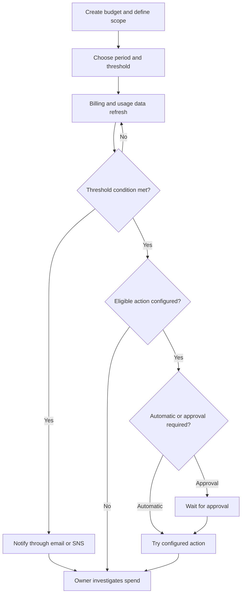
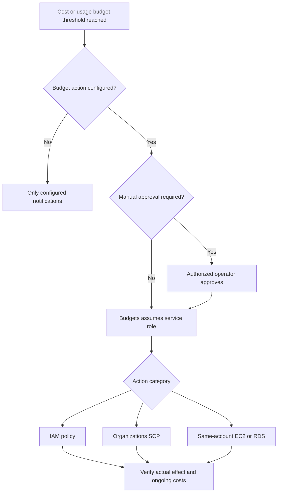
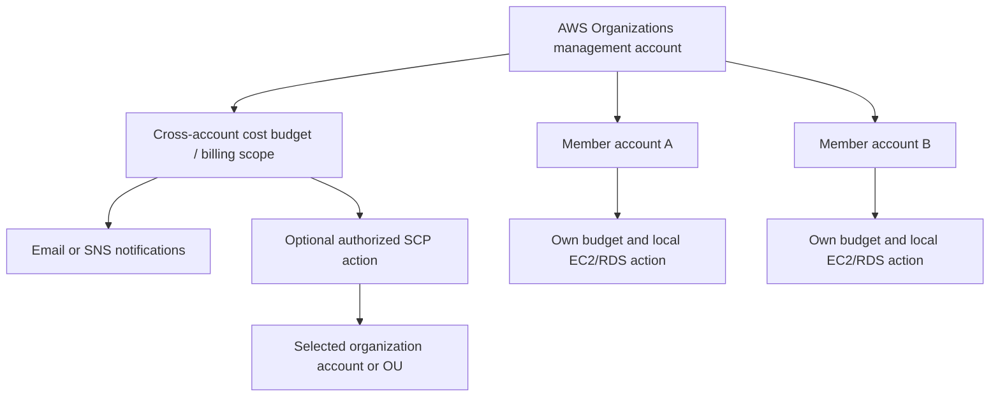
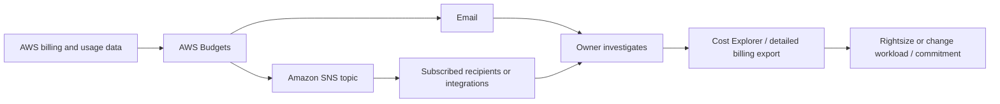
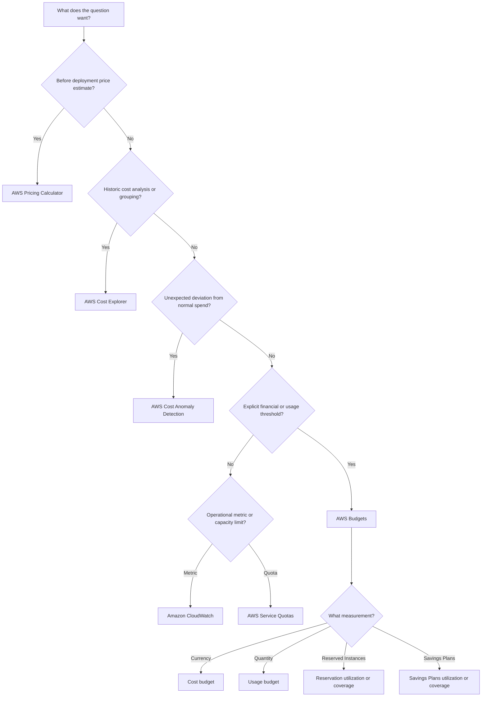

<div align="center">

# 📊 AWS Budgets

### Complete GitHub Study Guide · AWS Certified Cloud Practitioner + Solutions Architect – Associate

[](https://aws.amazon.com/aws-cost-management/aws-budgets/)
[](https://aws.amazon.com/certification/certified-cloud-practitioner/)
[](https://aws.amazon.com/certification/certified-solutions-architect-associate/)


**One sentence to remember:** AWS Budgets tracks **spending, service usage, and commitment utilization/coverage** against defined targets, notifies you when thresholds are crossed (or forecasted to be crossed where supported), and can optionally initiate configured cost-control actions.

[CCP essentials](#ccp-essentials) · [SAA architecture](#saa-deep-dive) · [Service comparisons](#service-comparisons) · [Exam traps](#exam-traps) · [Practice questions](#practice-questions) · [Cheat sheet](#quick-revision)

</div>

---

## Table of contents

1. [What is AWS Budgets?](#what-is-aws-budgets)
2. [Why AWS Budgets exists](#why-it-exists)
3. [Core concepts and the four budget types](#core-concepts)
4. [How AWS Budgets works](#how-it-works)
5. [Features, filters, periods, and notifications](#features)
6. [Use cases and selection guidance](#use-cases)
7. [Cloud Practitioner (CCP) essentials](#ccp-essentials)
8. [Solutions Architect – Associate (SAA) deep dive](#saa-deep-dive)
9. [Comparisons with related AWS services](#service-comparisons)
10. [Integrations and reference patterns](#integrations)
11. [Security and shared responsibility](#security)
12. [Observability and troubleshooting](#troubleshooting)
13. [Pricing and cost optimization](#pricing)
14. [Configuration and AWS CLI](#configuration)
15. [Exam traps](#exam-traps)
16. [Interview questions](#interview-questions)
17. [Original exam-style practice questions](#practice-questions)
18. [Scenario drills](#scenario-drills)
19. [Exam decision tree](#decision-tree)
20. [Quick-revision cheat sheet](#quick-revision)
21. [Source corrections and updates](#source-corrections)
22. [Official AWS references](#official-references)
23. [Closing study takeaway](#closing-takeaway)

---

<a id="what-is-aws-budgets"></a>
## 1. What is AWS Budgets?

**Beginner definition:** AWS Budgets is an AWS **Cloud Financial Management** service that helps you define spending or usage targets and get warnings when actual or predicted consumption approaches or exceeds those targets. It also monitors **Reserved Instance** and **Savings Plans** utilization and coverage.

**Exam-ready definition:** AWS Budgets is a configurable **budget-threshold and notification service**. It measures billing/usage metrics against a budget, and for **cost or usage budgets** it can run explicitly configured actions (with the required permissions and suitable targets). It is **not** an automatic billing cap, real-time circuit breaker, resource quota manager, or replacement for cost analysis.

**Analogy:** Your monthly phone data plan sends a warning when you reach 80% of your allowance. AWS Budgets is the warning system. An optional budget action is like a pre-agreed restriction, but cloud billing updates are delayed and the restriction cannot undo charges already incurred.

| At a glance | Correct mental model |
|---|---|
| Service | AWS Budgets (AWS Billing and Cost Management) |
| Primary purpose | Budgeting, threshold alerts, and optional actions |
| Four main categories | **Cost**, **Usage**, **Reservation**, **Savings Plans** |
| Spend measurement | Billing cost data; selectable cost accounting method |
| Usage measurement | Service-specific usage units, **not** currency |
| Commitment measurement | RI / Savings Plans utilization and coverage, generally percentages |
| Alert targets | Actual or forecasted cost/usage; underutilization or low coverage for commitment budgets |
| Recipients | Email, Amazon SNS, and supported chat integrations |
| Actions | Explicitly configured IAM policies, AWS Organizations SCPs, and selected EC2/RDS controls |
| Cadence | Daily, monthly, quarterly, annually, or custom time period as supported by type |
| Main limitation | Not real time; **no automatic hard spending ceiling** |
| Complementary service | AWS Cost Explorer for cost exploration and forecasting |

Source: [AWS Budgets product overview](https://aws.amazon.com/aws-cost-management/aws-budgets/) and [AWS Budgets user guide](https://docs.aws.amazon.com/cost-management/latest/userguide/budgets-managing-costs.html).

<a id="why-it-exists"></a>
## 2. Why AWS Budgets exists

Without budgets, a team can launch resources, forget to turn them off, consume more than intended, or buy Reserved Instances / Savings Plans that it does not fully use. The bill will still accumulate, and team members might notice only at month-end.

With AWS Budgets, you can create a **cost ownership and early-warning loop**:

1. Define what “acceptable” cost, usage, utilization, or coverage means.
2. Choose the accounts, services, cost allocations, and period to monitor.
3. Trigger actual or forecasted alerts when the selected threshold is crossed.
4. Notify the owner; optionally request approval for, or run, a configured action.
5. Investigate the reason in Cost Explorer or detailed billing data and adjust infrastructure or commitments.

**Realistic use cases:**

- Alert a developer before a monthly sandbox bill grows beyond an agreed amount.
- Track the total monthly cost of an AWS Organizations multi-account environment.
- Warn if S3 usage or EC2 instance-hours surpass an expected quantity.
- Track a particular project's costs using suitable **activated cost allocation tags** or cost categories.
- Detect **unused Reserved Instance commitment** via low RI utilization.
- Detect **uncovered eligible compute spend** via low Savings Plans coverage.
- Restrict **new provisioning** after approval or through a deliberately configured budget action.

> [!IMPORTANT]
> A $100 cost budget does **not** mean AWS will automatically stop charging at $100. Threshold evaluation depends on delayed cost/usage data; notifications and actions are configurable, not a guaranteed financial stop-loss.

---

<a id="core-concepts"></a>
## 3. Core concepts and the four budget types

### 3.1 The four major budget categories

| Budget type | Measures | Example target | What an alert means | Key distinction |
|---|---|---|---|---|
| **Cost budget** | Money spent or forecasted to be spent | $100 per month | Actual or expected charges cross a dollar/percentage threshold | **Currency**: How much will I pay? |
| **Usage budget** | Quantity of usage in a chosen unit | 1,000 compute hours | Usage or forecasted usage crosses the target | **Units**: How much service am I using? |
| **Reservation budget** | Reserved Instance **utilization** or **coverage** | Utilization at least 90% | RI commitments are underused, or eligible usage lacks RI coverage | **Reserved Instances**, not dollars spent |
| **Savings Plans budget** | Savings Plans **utilization** or **coverage** | Coverage at least 80% | Savings Plans commitments are underused, or eligible usage is not covered | **Savings Plans**, not RIs |

These are the **four main types**, even though the API distinguishes six underlying values: `COST`, `USAGE`, `RI_UTILIZATION`, `RI_COVERAGE`, `SAVINGS_PLANS_UTILIZATION`, and `SAVINGS_PLANS_COVERAGE`. See [custom budget types](https://docs.aws.amazon.com/cost-management/latest/userguide/custom-budgets.html) and [AWS Budgets API/CLI documentation](https://docs.aws.amazon.com/cli/latest/reference/budgets/create-budget.html).

### 3.2 Utilization vs. coverage — the distinction most people mix up

**Utilization: Am I actually using the commitment I already bought?**

- **RI utilization**: proportion of reserved commitment actually applied to qualifying usage.
- **Savings Plans utilization**: proportion of hourly Savings Plans commitment used.
- **Illustrative intuition:** You commit to 100 units of capacity/value and use 70 → about **70% utilization**. The real calculation follows AWS's relevant commitment rules and measurements.
- **Low utilization** indicates unused prepaid/committed benefit.

**Coverage: How much of my eligible actual usage receives a commitment discount?**

- **RI coverage**: share of eligible running usage covered by RIs.
- **Savings Plans coverage**: share of eligible spend covered by Savings Plans.
- **Illustrative intuition:** Of 100 units of eligible usage, 60 are covered → about **60% coverage**.
- **Low coverage** can signal substantial On-Demand exposure; it does **not automatically prove** buying another commitment is economical.

| Situation | Utilization | Coverage | Interpretation |
|---|---:|---:|---|
| Bought commitments but workload scaled down | Low | May be high or low | Potential overcommitment |
| Workloads expanded far beyond commitments | Often high | Low | Commitments busy, lots of usage still On-Demand |
| Stable workload and well-sized commitments | High | High | Good alignment, subject to financial analysis |

**Remember:** Utilization asks **“Did we use what we bought?”** Coverage asks **“Did our actual usage benefit from what we bought?”**

### 3.3 Vocabulary

| Term | Meaning |
|---|---|
| **Budget limit** | The cost amount, usage amount, or commitment measurement target |
| **Threshold** | Level that triggers an alert or action; amount or percentage where supported |
| **Actual** | Recorded expenditure or usage to date |
| **Forecasted** | Predicted cost/usage based on available history; **not** a guaranteed bill |
| **Budget period** | Daily, monthly, quarterly, annual, or custom monitoring interval |
| **Recurring** | Period renews and tracking continues |
| **Expiring** | One-time window; does not automatically renew |
| **Fixed budget** | Same target each period |
| **Planned budget** | Preset different targets across future months/quarters |
| **Auto-adjusting budget** | Target changes using the specified historical or forecast baseline |
| **Budget filter** | Narrow scope by dimensions such as service, account, Region, tag, etc. |
| **Budget notification** | Alert configuration with threshold and recipient(s) |
| **Amazon SNS topic** | Optional fan-out destination for messages; requires a functioning topic policy/subscriptions |
| **Budget action** | Approved or automatic control operation executed using required IAM permissions |
| **RI** | Reserved Instance: discount/commitment construct; coverage and utilization matter |
| **Savings Plans** | Compute-related hourly-spend commitment, distinct from RI reservations |

---

<a id="how-it-works"></a>
## 4. How AWS Budgets works, step by step

1. **Choose the outcome:** dollars, usage units, RI effectiveness, or Savings Plans effectiveness.
2. **Create the budget:** select the category and an applicable time period and target.
3. **Scope the measurement:** entire account, linked accounts (where permitted), services, Regions, cost categories, tags, usage types, or other supported dimensions.
4. **Define trigger conditions:** an actual threshold, a forecasted threshold (for cost/usage where supported), or a low utilization/coverage target.
5. **Select alert destinations:** email and/or SNS, and optionally supported chat configuration.
6. **Optionally add actions** for a **cost or usage budget**: select a supported action type, safe resources, a service role, and auto- versus manual-approval mode.
7. **AWS evaluates refreshed billing/usage data** against the condition and sends alerts or initiates eligible actions.
8. **You investigate and respond.** An alert is not an authoritative real-time bill and an action is not a universal stop to charges.



**Beginner example:** You set a **$100 monthly cost budget**, an **80% actual threshold**, and an **email recipient**. When recorded spend crosses **$80**, AWS can email that recipient. A separate forecasted alert could warn that the projected month-end total exceeds your selected threshold **before actual costs reach it**, provided enough history exists.

**More nuanced example:** In a non-production AWS Organizations member account, a monthly cost budget notifies an owner at 80% actual spend; at 100%, a configured and authorized budget action **attaches a restrictive IAM policy** to certain identities. This can prevent those identities from launching additional resources, **but does not stop existing workloads or every possible pathway for spending**. Governance must account for roles, existing infrastructure, and data delay.

> [!WARNING]
> AWS Budgets uses updated billing/usage information **at least daily**, not a per-request streaming meter. AWS documents roughly **five weeks of usage history** as needed for forecast-based alerts. RI/Savings Plans metrics may take **up to 48 hours** to become available. Never build safety-critical shutdown expectations around exact immediate timing.
>
> Sources: [Budgets best practices](https://docs.aws.amazon.com/cost-management/latest/userguide/budgets-best-practices.html), [reservation budget](https://docs.aws.amazon.com/cost-management/latest/userguide/create-reservation-budget.html), [Savings Plans budget](https://docs.aws.amazon.com/cost-management/latest/userguide/create-savingsplans-budget.html).

---

<a id="features"></a>
## 5. Features, filters, periods, and notifications

### 5.1 Supported budget periods and target methods

| Feature | What it means | Important qualification |
|---|---|---|
| Daily / monthly / quarterly / annually | Standard resetting reporting window | Pick a period that matches your responsibility |
| Custom period | User-selected start/end window | Does **not** auto-renew; track expiration |
| Recurring / expiring | Continue monitoring or stop at end of one-time period | One-time does not imply auto-renew |
| Fixed target | Same cost/usage limit each period | Good for stable sandbox spend |
| Planned target | Different limits for specified future months or quarters | Available for **monthly/quarterly** budget methods |
| Auto-adjusting target | Use a configurable usage/cost baseline to adjust a limit | Understand whether increasing spend can increase the target |
| Actual alert | Based on recorded, refreshed numbers | Usually alerts once per threshold per budget period |
| Forecasted alert | Based on projected trajectory | Requires enough history; may alert more than once if forecast re-crosses |

Sources: [Creating a cost budget](https://docs.aws.amazon.com/cost-management/latest/userguide/create-cost-budget.html), [Budget methods](https://docs.aws.amazon.com/cost-management/latest/userguide/budget-methods.html).

### 5.2 Scoping and filtering

Depending on budget type and access, available filters can include **AWS service, linked account, Region, Availability Zone, purchase option, usage type/usage type group, instance type, operation, cost allocation tag, and cost category**. Choose only the supported filters shown for the particular budget type.

**Example:** To track `project=demo` charges, activate the relevant **cost allocation tag** in your billing settings and scope a **cost budget** to it. Merely tagging a resource does not guarantee immediate retroactive cost attribution. Tags attached **to the budget object itself** are for budget administration/IAM; they do **not** constitute cost allocation tags for the budgeted resources.

**Cost-type settings** also affect the result: blended vs. unblended vs. amortized vs. net cost; inclusion/exclusion of taxes, credits, refunds, recurring/upfront RI charges, support charges, etc. Two valid budgets can report different totals for the same workloads if they use different financial definitions.

### 5.3 Alerts and subscriber details

- **Actual vs. forecasted:** Cost and usage thresholds can evaluate incurred or projected amounts. RI and Savings Plans budgets focus on utilization/coverage thresholds.
- **Email:** Up to **10 email subscribers per notification**, subject to confirmation where required.
- **SNS:** **One SNS topic per notification** (that topic can fan out to multiple subscribers with correct policies and subscriptions).
- **Chat:** AWS documents integrations to chat applications through the relevant AWS chat integration; exact console branding may evolve.
- **Alert counts:** Documentation is not completely uniform: [the AWS Budgets FAQ](https://aws.amazon.com/aws-cost-management/aws-budgets/faqs/) says **five alerts per budget**, while the [Budgets Notification API reference](https://docs.aws.amazon.com/aws-cost-management/latest/APIReference/API_budgets_Notification.html) says **up to ten notifications per budget**. Check the applicable console/API limit in your environment instead of using “five SNS notifications” as a universal rule.
- **Alert delivery:** SNS topic permissions and subscription confirmation are separate prerequisites. An alert with an invalid destination is not useful even if threshold evaluation works.

**Why 80% and 100% alerts are useful:** An **80% actual** alert tells you the recorded total is nearing the budget, whereas **100% forecasted** tells you the predicted end-of-period total crosses the budget. Either can occur before or after the other depending on usage history and spending patterns.

### 5.4 AWS Budgets Reports

**AWS Budgets Reports** is a scheduled **email summary of existing budgets**, not the same thing as a threshold-triggered budget notification.

- Daily, weekly, or monthly delivery.
- Up to 50 included budgets per report, up to 50 recipients, and up to 50 reports per account (per documentation).
- **$0.01 per report delivered**, not per recipient.
- Useful for cost owners who want recurring portfolio reviews without waiting for a threshold to be breached.

Source: [Reporting your metrics with AWS Budgets Reports](https://docs.aws.amazon.com/cost-management/latest/userguide/reporting-cost-budget.html).

---

<a id="use-cases"></a>
## 6. Use cases and when to choose AWS Budgets

| Requirement | Choose | Why | Common mistake |
|---|---|---|---|
| Warn when monthly AWS charges approach $250 | **Cost budget** | Currency-based threshold | Using a usage budget |
| Warn when service usage exceeds 2,000 hours | **Usage budget** | Quantity-based threshold | Treating an hour budget as money |
| Know whether paid RI capacity is wasted | **Reservation utilization** | Measures usage of RI commitment | Looking only at monthly RI spend |
| Know how much eligible instance usage gets an RI discount | **Reservation coverage** | Measures eligible usage receiving RI coverage | Confusing with utilization |
| Know whether committed Savings Plans value is consumed | **Savings Plans utilization** | Measures use of commitment | Treating Savings Plans like RIs |
| Know how much eligible compute usage is covered | **Savings Plans coverage** | Measures covered spend | Assuming high utilization means high coverage |
| Email spend dashboard every Monday | **AWS Budgets Reports** | Scheduled budget portfolio digest | Relying on alert emails |
| Investigate why costs increased | **Cost Explorer** | Historical analysis, grouping, forecasts | Expecting Budgets to explain every driver |
| Detect statistically unusual spikes | **Cost Anomaly Detection** | Anomaly-oriented monitoring | Treating a fixed budget as anomaly detection |
| Calculate an architecture's price before deployment | **AWS Pricing Calculator** | What-if estimates | Treating a budget as a pricing quote |
| Cap resource quantities, not spending | **Service Quotas / provisioning controls** | Service-level quotas and controls | Assuming budgets control quota limits |

> [!TIP]
> **CCP wording:** “Set a spending threshold and receive a notification” → **AWS Budgets**. “Analyze historical spend by service and forecast a trend” → **Cost Explorer**. “Estimate the bill for an architecture that has not been launched” → **AWS Pricing Calculator**.

---

<a id="ccp-essentials"></a>
## 7. 🟢 Cloud Practitioner (CCP) Essentials


### 7.1 Fundamental facts to memorize

1. **AWS Budgets = create targets + monitor + alert.**
2. It belongs to **AWS Cloud Financial Management / Billing and Cost Management**.
3. There are **four main budget categories**: Cost, Usage, Reservation, Savings Plans.
4. **Cost budget = dollars / currency amount**, not compute-hours.
5. **Usage budget = number of usage units**, not dollars.
6. **Reservation budget** monitors RI **utilization or coverage**.
7. **Savings Plans budget** monitors Savings Plans **utilization or coverage**.
8. **Utilization = use of commitment; coverage = protection of eligible usage**.
9. Budgets can send alerts for **actual** spending and **forecasted** spending (for supported cost/usage budgets).
10. Alerts can use **email** or **Amazon SNS**; optional chat integrations are available.
11. **Forecasting uses historical data**, so it is not available from the first minute of a new account.
12. You can scope budgets to specific services, accounts, Regions, etc., depending on type.
13. Monitoring and normal budget alerts are **free**; extra **action-enabled budgets** and **scheduled reports** can cost money.
14. **Budget actions are optional**, must be configured, and require permissions.
15. A budget does **not automatically disable AWS services or enforce a hard monthly cap**.
16. Cost Explorer is for **analysis and forecasting**; Budgets is for **threshold monitoring and responses**.
17. Pricing Calculator is primarily a **pre-deployment what-if estimate**.
18. AWS Budgets and Cost Explorer are **complementary**, not mutually exclusive.

### 7.2 High-value keyword bank

`monthly spending limit` · `cost threshold` · `usage threshold` · `budget alert` · `email notification` · `Amazon SNS` · `actual spend` · `forecasted spend` · `Reserved Instance utilization` · `RI coverage` · `Savings Plans utilization` · `Savings Plans coverage` · `cost allocation tag` · `budget action` · `cost control` · `Billing and Cost Management` · `budget report` · `AWS Organizations`

### 7.3 Keyword → service recognition

| If the question says… | Think… |
|---|---|
| “Notify an administrator at 80% of an allowed monthly amount” | AWS Budgets — cost budget |
| “Warn when S3 storage usage reaches a selected quantity” | AWS Budgets — usage budget |
| “Alert if RI commitments aren't being used” | AWS Budgets — RI utilization |
| “Alert if too much eligible compute use lacks a Savings Plans discount” | AWS Budgets — Savings Plans coverage |
| “Email a consolidated budget overview weekly” | AWS Budgets Reports |
| “Forecast that this month's spending will exceed the budget” | AWS Budgets forecasted alert |
| “Group last month's spending by service and Region” | AWS Cost Explorer |
| “Predict the cost of an EC2/RDS architecture before creation” | AWS Pricing Calculator |
| “Detect an unexpected spike relative to normal spend” | AWS Cost Anomaly Detection |
| “Prevent developers from provisioning new resources after a budget threshold” | AWS Budgets action with IAM/SCP and proper prerequisites |

### 7.4 CCP misconceptions

**Wrong:** “The cost budget is a monthly spending limit enforced by AWS.”  
**Correct:** It is a **monitoring threshold**; it can notify and optionally initiate configured controls.

**Wrong:** “A forecast alert proves I already spent the amount.”  
**Correct:** A forecast alert concerns a **predicted** outcome, not the recorded total.

**Wrong:** “Coverage and utilization mean the same thing.”  
**Correct:** They are different ratios, and both matter when assessing commitment effectiveness.

**30-second CCP answer:** **AWS Budgets lets you define cost and usage limits, monitor RI and Savings Plans effectiveness, and receive actual or forecasted budget alerts. Actions are optional; Budgets is not an automatic hard cap.**

---

<a id="saa-deep-dive"></a>
## 8. 🔵 Solutions Architect – Associate (SAA) Deep Dive


**SAA perspective:** AWS Budgets is a **governance/operations control-plane tool**, not a component in the application request path. It does not balance traffic, replicate data, improve application availability, or guarantee enforcement of a financial maximum. Its architectural value comes from scoping, permissions, reliable alerting, automated/approved remediation, and trade-offs.

### 8.1 Budget actions — supported mechanisms

AWS documents budget actions for **cost and usage budgets**:

| Action category | What it does | Prerequisite / limitation |
|---|---|---|
| **IAM policy action** | Apply a selected policy to configured IAM users, groups, or roles | Service role and suitable IAM permissions; effects depend on effective permissions |
| **SCP action** | Attach an AWS Organizations Service Control Policy | Only the **Organizations management account** can apply SCP actions; SCPs restrict permission ceilings, not existing charges |
| **EC2 action** | Target selected EC2 instances for supported controls (such as stop/start) | Targets **same-account** EC2 resources; correct permissions; verify business/ASG impact |
| **RDS action** | Target selected RDS DB instances for supported controls | Targets **same-account** RDS resources; engine and stopping constraints matter |

- An action can be **automatic** or **require explicit manual approval**.
- Multiple actions can attach to one eligible threshold.
- A **service role** assumed by Budgets must have the necessary privileges.
- An SCP **does not grant access**, even when attached successfully; it only constrains what principals can be permitted to do.
- A permissions change can stop **new** resource creation but does **not automatically terminate existing resources**, erase storage costs, or prevent billing under alternative identities or services.



Sources: [Configuring budget actions](https://docs.aws.amazon.com/cost-management/latest/userguide/budgets-controls.html), [Configuring a budget action](https://docs.aws.amazon.com/cost-management/latest/userguide/budgets-action-configure.html), and [Service role for actions](https://docs.aws.amazon.com/cost-management/latest/userguide/budgets-action-role.html).

### 8.2 Multi-account governance with AWS Organizations

A **management account** can create budgets to oversee organization-related costs and, where the required permissions and scope apply, perform an SCP action. Member accounts can maintain budgets for their own costs. Available filters differ by account type: a linked/member account **cannot** use a linked-account filter as though it were the management account.



**Critical distinction:** A management-account **SCP** action may affect another account through Organizations. A Budgets action that directly targets an **EC2 or RDS instance in a different account** is **not supported** by the documented direct targeting model. Set up local actions or a separate approved automation architecture when necessary.

**Advanced current capability:** AWS Budgets can use **billing views** for filtered cross-account billing datasets. Proper permissions are needed. If a view is deleted or access is revoked, its budget may show an **unhealthy** billing-view status and updates may pause. This is an advanced governance option, not a CCP memorization requirement. Source: [Creating a budget — billing view prerequisites](https://docs.aws.amazon.com/cost-management/latest/userguide/budgets-create.html).

### 8.3 Data latency, failure handling, and risk

1. **Delayed billing:** New charges can appear after the resource has already been running for a while. Alerts do not fire at the exact instant the spend occurs.
2. **Forecast availability:** Forecast alerts require sufficient historical usage; AWS documents approximately five weeks for Budgets forecasts.
3. **Action failures:** Incorrect service-role policies, missing `iam:PassRole` authority for setup, inaccessible targets, or SCP prerequisites can stop action execution.
4. **Auto Scaling:** An Auto Scaling Group can **replace a stopped EC2 instance**; a naive stop action is not a durable cost-control mechanism for autoscaled workloads.
5. **RDS stopping:** Stopping selected DB instances is subject to RDS-specific support and restart behavior; **storage/backups** may continue to incur charges.
6. **Organization changes:** If a member leaves an organization, historical data tracked by its budget changes. Reassess budget scope and threshold after account restructuring.
7. **SCP blast radius:** Applying a restrictive SCP without testing may block legitimate operations while leaving some underlying costs intact.
8. **Security:** Budget administration and the permission to execute actions must be separate, least-privilege concerns.

Source: [Best practices for AWS Budgets](https://docs.aws.amazon.com/cost-management/latest/userguide/budgets-best-practices.html).

### 8.4 Architectural decision principles

| Design choice | Benefit | Risk / alternative |
|---|---|---|
| Alert-only budget | Simple, minimally disruptive | Human response required; not a cost cap |
| Auto IAM denial | Reduces new provisioning by targeted identities | Does not stop existing resources; can disrupt deployments |
| Approved IAM/SCP action | Human verification before disruption | Requires on-call or owner availability |
| Direct EC2/RDS stop | Can reduce some running-resource charges | May harm availability; ASG can replace stopped instance |
| Broad management-account budget | Organization-wide spending visibility | Poor ownership without per-account/project budgets |
| Individual workload/tag budget | Clear cost accountability | Needs correct tagging and cost allocation setup |
| Forecast alert | Earlier warning of end-period overspend | Historical-data and model accuracy constraints |
| RI / Savings Plans budgets | Spot waste or uncovered committed spend | Financial decisions still require Cost Explorer / commitment analysis |

### 8.5 Five substantive SAA scenarios

**Scenario A — Protecting a development account without touching production.** A company has a shared production account and a sandbox account. Set **separate budget scopes**, alert engineering owners, and consider **manual-approval budget actions** only for sandbox-specific identities/resources. Avoid a broad SCP that unintentionally blocks production remediation. If a non-production ASG replaces a stopped instance, fix the controller/permissions rather than repeatedly stopping its members.

**Scenario B — Multi-account cost governance.** A management team wants organization-wide warnings and delegated team accountability. Combine an **organization-level budget** with narrower linked-account or cost-category budgets and a verified SNS notification path. Reserve SCP responses for carefully scoped organizational governance; deploy local account actions for EC2/RDS if truly required.

**Scenario C — CI/CD jobs unexpectedly growing.** A CI platform launches ephemeral compute, and costs spike between daily billing updates. Set **actual and forecasted budgets** for the relevant workload, but enforce **separate service-side concurrency or resource quotas** as immediate guards. Budgets is a delayed accounting signal, not a real-time admission controller.

**Scenario D — Savings Plans investment.** Finance observes **100% Savings Plans utilization**, but many compute hours remain On-Demand. This could mean **low Savings Plans coverage**: all committed spending is being used, yet the commitment does not cover all eligible workloads. Compare forecasts and purchasing recommendations, risk of long-term commitment, and expected workload demand before buying more.

**Scenario E — Database cost response.** An RDS development instance exceeds the budget. A stop action could help for eligible non-production instances, but is **not an unconditional long-term shutdown guarantee** and does not eliminate storage charges. Evaluate operational recovery and engine-specific rules; a manual approval workflow is safer for critical databases.

---

<a id="service-comparisons"></a>
## 9. ⚔️ Service comparisons

| AWS service/tool | Main job | Distinctive exam cue | Works with Budgets? |
|---|---|---|---|
| **AWS Budgets** | Define thresholds, alert, optionally act | “Notify when nearing spend/usage limit” | — |
| **AWS Cost Explorer** | Explore spend/usage patterns, group/filter, forecast | “Analyze past costs, find drivers, project trend” | Yes |
| **AWS Pricing Calculator** | Estimate hypothetical architectures and anticipated bills | “Estimate cost before deployment” | Yes, for planning |
| **AWS Cost and Usage Report / Data Exports** | Detailed billing usage line items for downstream analysis | “Raw billing dataset, S3 export, granular report” | Yes |
| **AWS Cost Anomaly Detection** | Detect unusual spend relative to expected behavior | “Unexpected cost spike/anomaly” | Yes |
| **Amazon CloudWatch** | Operational metrics/logs/alarms and some billing visibility | “CPU, latency, request count, application alarm” | Yes |
| **AWS Service Quotas** | Resource/service quota visibility and requests | “Can I create more VPCs/instances?” | Complementary, not a dollar cap |
| **AWS Organizations SCPs** | Establish permission guardrails across accounts | “Restrict available actions for organization principals” | Supported action target |
| **AWS Cost Optimization Hub** | Collect and prioritize rightsizing/cost recommendations | “Find savings opportunities” | Complementary |
| **AWS Trusted Advisor** | Account recommendations across categories | “Best-practice and cost-related recommendations” | Complementary |

### 9.1 Four comparisons worth mastering

<details>
<summary><strong>AWS Budgets vs AWS Cost Explorer</strong></summary>

- Budgets: **Am I crossing a threshold? Who should be told? Should an eligible action execute?**
- Cost Explorer: **Why is the bill high? Which service/account/Region changed? What does history predict?**
- Both can use forecasting, but only Budgets is primarily a **threshold-and-notification workflow**.
- Do **not** say Cost Explorer cannot forecast; it can.

</details>

<details>
<summary><strong>AWS Budgets vs AWS Pricing Calculator</strong></summary>

- Calculator: **pre-deployment what-if estimate**, given chosen workloads, rates, configuration and assumptions.
- Budgets: **post-deployment or ongoing** threshold monitoring against observed/forecasted data.
- Neither guarantees your bill; changing usage and prices can make estimated and actual costs differ.

</details>

<details>
<summary><strong>AWS Budgets vs AWS Cost Anomaly Detection</strong></summary>

- Budgets: user-defined targets such as “monthly spend above $250.”
- Anomaly Detection: look for **unexpected deviations** from normal cost patterns; an unusual small spike can matter even below a monthly budget.
- Use both: one for financial policy, the other for abnormal spending behavior.

</details>

<details>
<summary><strong>AWS Budgets vs CloudWatch / Service Quotas</strong></summary>

- Budgets responds to accounting measurements, not live application CPU or latency.
- CloudWatch tracks operational metrics and is the usual service for operational threshold alarms.
- Service Quotas controls resource limits; those limits are not equivalent to cost budgets.
- A good architecture can use all three: **operational monitoring + capacity limits + budget alerts**.

</details>

<details>
<summary><strong>AWS Budgets vs Cost and Usage Report (CUR) / Data Exports</strong></summary>

- AWS Budgets is a ready-made **threshold** mechanism.
- Detailed billing exports are for **granular analysis, custom queries, attribution, financial reporting** and downstream automation. They are not themselves user-facing threshold alerts.
- Prefer a budget for routine notifications and exported billing detail for deeper analytics or accounting pipelines.

</details>

---

<a id="integrations"></a>
## 10. Integrations and reference patterns

### 10.1 Alert-to-investigation workflow



The notification integration is **not** a network data path for application requests. It is a management workflow.

### 10.2 Relevant integrations

- **AWS Organizations:** consolidated billing awareness, member-account scope, and **SCP** action when performed from the authorized management account.
- **IAM:** permissions to view/create/edit budgets; a separate role for actions; least-privilege review.
- **Amazon SNS:** notification fan-out to subscribers; configure topic policy and subscription confirmation.
- **Chat integrations:** send notifications to a supported collaboration channel using the current AWS chat service workflow.
- **Cost Explorer:** investigate the cause of an alert; analyze trend, groups, filters, and forecasts.
- **Cost allocation tags / Cost Categories:** support team and project ownership within compatible budget filters.
- **EC2 and RDS:** carefully chosen same-account stop/start-type actions with account/service limitations.
- **AWS CLI / SDK / CloudFormation:** infrastructure-as-code and programmatic budget administration where permitted.
- **Billing views:** advanced filtered cross-account cost management, with specific IAM permissions and health-status considerations.

### 10.3 What Budgets does not architect

AWS Budgets does not select an Availability Zone, create an ALB, replicate an RDS database, store logs automatically in S3, encrypt application traffic, or enforce application latency. **Region/AZ values are mainly dimensions for tracking costs**; not a “multi-AZ deployment strategy.” Distinguish billing governance from availability architecture.

---

<a id="security"></a>
## 11. Security, permissions, and shared responsibility

AWS operates the managed service and its supporting infrastructure. **You** are responsible for selecting sensible thresholds, configuring who sees billing data, assigning notification recipients, managing IAM and Organizations permissions, and approving or authorizing potentially destructive actions.

**Required security reasoning:**

1. **Least privilege:** Separate budget viewers, editors, notification administrators, and action approvers.
2. **Action service role:** Budget actions need an appropriately trusted IAM service role with the necessary permissions; do not grant blanket administration merely for convenience.
3. **Setup permissions:** The person configuring an action may need `iam:PassRole` for the appropriate service role, subject to the documented policy and conditions.
4. **SCP authority:** An SCP action requires the Organizations **management account** and should be evaluated for blast radius.
5. **SNS delivery:** Restrict topic publishing with an appropriate topic policy; confirm needed subscriptions and avoid delivering finance data to unintended subscribers.
6. **Budget data access:** Costs can expose sensitive business information; use billing access controls and budget resource permissions/tags appropriately.
7. **Billing-view access:** Advanced cross-account billing views require specific sharing and IAM configuration; monitor their health status.
8. **Audit the configuration:** Record which identities changed budget targets, added destinations, or attached actions via suitable AWS management-event auditing and internal change reviews.
9. **Application data:** Budgets is not an app-data encryption service; manage encryption separately for your actual workloads and any downstream notification/archive systems.

> [!WARNING]
> A broad deny policy triggered by a budget can block recovery operations. Evaluate the affected roles, use explicit exception paths where appropriate, prefer approval gates for disruptive action, and test in non-production before enabling automation.

Useful official sources: [Budget action role](https://docs.aws.amazon.com/cost-management/latest/userguide/budgets-action-role.html), [Budgets best practices](https://docs.aws.amazon.com/cost-management/latest/userguide/budgets-best-practices.html), [IAM permissions for Cost Management](https://docs.aws.amazon.com/cost-management/latest/userguide/billing-permissions-ref.html).

---

<a id="troubleshooting"></a>
## 12. Observability, auditing, troubleshooting, and failure behavior

| Symptom | Check first | Why it matters |
|---|---|---|
| No notification despite recent spend | Billing refresh timing and period/scope | Cost data does not update instantly |
| Forecasted alert never arrives | Sufficient usage history (about 5 weeks) | Forecast may not be generated yet |
| Forecast alerted but actual spend is lower | Forecast vs actual selection | Prediction is not a charge |
| Reported total differs from invoice | Cost method, credits, taxes, support, filters | Different accounting definitions yield different totals |
| Tag-based budget has zero spend | Cost allocation activation, tagging, delay | Resource tags alone may not provide billed tag data |
| SNS alert does not arrive | Topic ARN, policy, subscriptions and confirmation | Publishing or delivery path may be broken |
| Email alert does not arrive | Recipient verification, address, spam routing | Destination may not be activated/delivered |
| Action is stuck or fails | Service role trust, IAM permissions, target eligibility | Action cannot execute without authorization |
| SCP action not available | Are you in Organizations management account? | SCP action is management-account only |
| EC2 cost remains after stop action | ASG replacement; EBS/IP/other residual charges | Stop does not equate to zero cost |
| RDS charges continue after stop | Storage, backups, service restart behavior | RDS has ongoing and service-specific costs |
| Cross-account budget looks wrong | Organization structure, linked-account filter, billing view status | Scope can change or become invalid |
| RI/Savings Plans budget shows delayed metrics | Allow up to 48 hours | Commitment metrics have a different processing delay |
| Custom period budget stopped alerting | Check end date / expiry | Custom budgets do not renew automatically |

**Practical investigation sequence:** Confirm the correct account and budget; inspect the selected period, amount, scope and cost metric; verify current actual/forecast values; check destination or action state; then use Cost Explorer for the cost driver. For advanced automation, inspect available **budget action history** through the documented Budgets API/CLI and independently validate the resource or policy state.

Sources: [Viewing budgets](https://docs.aws.amazon.com/cost-management/latest/userguide/budgets-view.html), [Best practices](https://docs.aws.amazon.com/cost-management/latest/userguide/budgets-best-practices.html), [Budgets CLI commands](https://docs.aws.amazon.com/cli/latest/reference/budgets/).

---

<a id="pricing"></a>
## 13. Pricing and cost optimization

**Official public AWS Budgets pricing, verified 2026-11-02:**

| Item | Pricing rule | Important distinction |
|---|---|---|
| Budgets **without actions** | **Free** to monitor and receive notifications | Does not mean SNS or related services can never charge separately |
| First **two action-enabled budgets** | **Free** per account per month | Independent of how many actions are configured on those budgets |
| Each additional action-enabled budget | **$0.10 per day** | Count budgets with actions, not individual action executions |
| AWS Budgets Reports | **$0.01 per report delivered** | Not charged per recipient |
| Related AWS services | Their own pricing may apply | Example: SNS integrations or downstream automations |

**Illustrative scenario:** Suppose your account has **four action-enabled budgets** active through a 30-day example month and **ten emailed budget reports** are delivered.

```text
Action-enabled budgets:       4
Free action-enabled budgets:  2
Chargeable budgets:           2
Action-budget charge:         2 × $0.10 × 30 days = $6.00
Budget report delivery:       10 × $0.01 = $0.10
Illustrative Budgets total:   $6.10
```

This deliberately excludes any separately charged related services. The daily active-budget count, delivery count, Region/service details, and actual billing terms determine the real amount. Do not replace a live bill with this example.

Source: [AWS Budgets pricing](https://aws.amazon.com/aws-cost-management/aws-budgets/pricing/). Also see [Cost Management quotas](https://docs.aws.amazon.com/cost-management/latest/userguide/management-limits.html) for the listed **10 actions per budget**, **100 actions per account**, and **20,000 budgets per management account** quotas; recheck quotas when designing large-scale automation.

**Optimization strategy:** Start with alert-only budgets, add owner-specific scopes, test notification routing, introduce actions only for justified workloads, and minimize paid scheduled reports by grouping multiple relevant budgets into each report.

---

<a id="configuration"></a>
## 14. Practical configuration and AWS CLI

### 14.1 Low-risk configuration in the AWS Console

1. Sign in to the **Billing and Cost Management** console with suitable access.
2. Open **Budgets → Create budget**.
3. For a quick start, choose **Use a template (simplified)**; AWS documents templates including **Zero spend**, **Monthly cost**, **Daily Savings Plans coverage**, and **Daily reservation utilization**.
4. Alternatively select **Customize (advanced)** and choose **Cost**, **Usage**, **Reservation**, or **Savings Plans**.
5. Choose target, period, filters, and cost method where applicable. For beginners, choose a **recurring monthly cost budget** for the account.
6. Create an **actual threshold** (for example, 80%) and optionally a **forecasted threshold** (for example, 100%) when supported.
7. Add an email address you control; confirm subscription if requested. Add SNS only if you need fan-out.
8. **Leave actions disabled initially**. Review, create, and confirm you can see the budget and notification configuration.
9. For additional protection, add an approved action only after verifying roles, targets, permissions, and failure impact.

Source: [Budget templates](https://docs.aws.amazon.com/cost-management/latest/userguide/budget-templates.html) and [Creating a cost budget](https://docs.aws.amazon.com/cost-management/latest/userguide/create-cost-budget.html).

### 14.2 Safe, read-only AWS CLI demonstration

Prerequisites: AWS CLI v2, a valid configured identity with access to AWS Budgets for the target account, and the account's real 12-digit ID. First set the `AWS_ACCOUNT_ID` environment variable in your shell to your actual account ID; the commands below do not include credentials:

```bash
# View existing budgets without creating resources or changing permissions.
aws budgets describe-budgets \
  --account-id "$AWS_ACCOUNT_ID"

# Inspect one named budget (replace the quoted example name).
aws budgets describe-budget \
  --account-id "$AWS_ACCOUNT_ID" \
  --budget-name "ExampleMonthlyCostBudget"
```

The `--account-id` flag is **required** for these operations. The CLI command does not set a billing cap; it only retrieves existing budget data. Review account/permissions before running it. References: [`describe-budgets`](https://docs.aws.amazon.com/cli/latest/reference/budgets/describe-budgets.html), [`describe-budget`](https://docs.aws.amazon.com/cli/latest/reference/budgets/describe-budget.html).

### 14.3 Cloud governance note

When automating budgets via IaC, account for **who owns budget changes**, how alerts are routed, and what happens if an action cannot execute. Put resource identifiers and budget targets under code review; never commit real credentials, SNS secret endpoints, or sensitive business billing details to a public repository.

---
<a id="exam-traps"></a>
## 15. ⚠️ Common exam traps and misconceptions

| # | Incorrect or incomplete claim | Correct interpretation | Level |
|---:|---|---|---|
| 1 | “AWS Budgets puts a hard cap on the bill.” | It **monitors**; it does not guarantee prevention of charges. | CCP |
| 2 | “Budget alerts are always enabled by default.” | You must configure the budget and relevant alert destinations. | CCP |
| 3 | “Budgets has only one spending-budget type.” | Four main types: **Cost, Usage, Reservation, Savings Plans**. | CCP |
| 4 | “A usage budget is expressed in dollars.” | Usage budgets measure usage **quantities/units**. | CCP |
| 5 | “RI utilization means RI coverage.” | Utilization measures **committed capacity used**; coverage measures **eligible usage covered**. | CCP/SAA |
| 6 | “Savings Plans and RI budgets measure the same commitment.” | They track **different commitment programs**. | CCP |
| 7 | “A forecasted threshold proves the bill already exceeded the limit.” | It is a **prediction**, not actual accrued spend. | CCP |
| 8 | “Cost Explorer cannot forecast.” | Cost Explorer **can forecast**; Budgets adds threshold alerts/actions. | CCP |
| 9 | “AWS Pricing Calculator is for alerting on live spend.” | It primarily provides **pre-deployment estimates**. | CCP |
| 10 | “Every cost spike will breach the monthly budget.” | Anomaly Detection may find unusual changes **below** a chosen budget. | CCP/SAA |
| 11 | “Five SNS notifications is a universal current hard limit.” | AWS references differ: **FAQ says five alerts**, API reference **ten notifications**; **one SNS topic per notification**. | SAA |
| 12 | “SNS sends alerts without any topic permissions.” | Topic publish permissions and subscription confirmation are required. | SAA |
| 13 | “An email subscriber always receives an alert immediately.” | Email routing/confirmation and data refresh cadence matter. | CCP/SAA |
| 14 | “Forecasts work on a newly created account immediately.” | Forecast-based alerts require enough history (AWS documents ~**five weeks**). | SAA |
| 15 | “Budgets evaluates charges in real time.” | Uses delayed billing/usage updates, **at least daily**. | CCP/SAA |
| 16 | “RI and Savings Plans numbers always appear instantly.” | Utilization/coverage metrics can require **up to 48 hours**. | SAA |
| 17 | “Creating a budget always creates cost charges.” | Standard alert-only budgets are **free**; actions/reports may be charged. | CCP |
| 18 | “Every configured budget action costs $0.10/day.” | First **two action-enabled budgets** are free; **additional action-enabled budgets** are charged, not per action. | SAA |
| 19 | “Budgets Reports emails and threshold alerts are the same.” | Reports are **scheduled digests**; alerts are threshold-based. | CCP |
| 20 | “A stopped EC2 instance in an ASG stays stopped.” | The **ASG can replace it**, defeating a naive stop action. | SAA |
| 21 | “Stopping RDS eliminates all its charges indefinitely.” | RDS rules and continuing storage/backup charges apply. | SAA |
| 22 | “Budgets can stop any resource in any AWS account directly.” | Direct EC2/RDS action targets are **same account** under documented model. | SAA |
| 23 | “SCP actions are available from any member account.” | Attaching SCPs through Budgets requires the **management account**. | SAA |
| 24 | “An SCP automatically gives a user permissions.” | SCPs define **maximum permissions**, never grant access. | SAA |
| 25 | “A budget action is automatically executed when you create a budget.” | Configure an eligible action and its **automatic vs. approval** behavior. | SAA |
| 26 | “No service role is needed for budget actions.” | Actions require appropriately privileged **service role** setup. | SAA |
| 27 | “A resource tag immediately and retroactively creates budget cost attribution.” | Activate cost-allocation tagging; availability is not necessarily immediate/retroactive. | SAA |
| 28 | “A budget resource tag is the same as a cost allocation tag.” | Budget tags serve **resource administration**; they are not cost allocation dimensions. | SAA |
| 29 | “A custom budget period automatically repeats next year.” | Custom periods **expire**, unlike a recurring monthly budget. | SAA |
| 30 | “An unblended cost budget must equal a net amortized cost budget.” | Cost-type accounting options produce different valid totals. | SAA |
| 31 | “A member account can filter by arbitrary linked accounts.” | The **Linked account** filter is not available inside a linked/member account as in the management account. | SAA |
| 32 | “Budget alerts guarantee resource capacity limits.” | **Service Quotas** and identity/provisioning constraints solve different problems. | CCP/SAA |

### Mechanisms behind the hardest traps

**Why is an alert not a hard cap?** Billing aggregation is not real-time admission control. Existing resources can continue to consume chargeable service units while data is collected, an alert is evaluated, a destination is reached, and any eligible action is processed.

**Why might an EC2 stop action not save the expected amount?** EC2 Auto Scaling attempts to maintain desired capacity. If an instance disappears or stops, its controller can create a replacement. Even without replacement, attached storage or other resources can still incur charges.

**Why does high utilization not equal high coverage?** Imagine a small prepaid commitment being used 100% of the time by a much larger workload. Every purchased committed unit is busy, but most actual usage is still uncovered and charged at its normal eligible rate.

**Why is the billing number sometimes surprising?** Different filters and cost-accounting definitions (blended, unblended, amortized, net) legitimately change the amount being tracked. Investigate the precise metric and exclusions before labeling the budget inaccurate.

---

<a id="interview-questions"></a>
## 16. Interview questions and concise answers

**1. What does AWS Budgets actually do?**  
It defines cost, usage, and commitment tracking targets, emits configured alerts, and can optionally perform authorized actions when a cost/usage budget threshold is reached.

**2. What are the four main types?**  
Cost, Usage, Reservation, and Savings Plans; the latter two monitor utilization and coverage.

**3. What is the difference between actual and forecasted spend?**  
Actual is recorded spend to date. Forecasted estimates what spend may be for the budget period, based on historical information.

**4. What does 100% Savings Plans utilization but 40% coverage tell you?**  
The purchased Savings Plans commitment is being used, but only 40% of eligible spend is covered. Additional commitment might help if sustained demand justifies it.

**5. How do Budgets and Cost Explorer complement each other?**  
Budgets tells you a defined threshold has been crossed; Cost Explorer helps identify contributing accounts, services, time trends, and possible forecasts.

**6. Can AWS Budgets enforce a $100 limit for a developer account?**  
Not as a guaranteed hard ceiling. Use alert thresholds and, if suitable, restricted provisioning permissions, budget actions, and service-side quotas to reduce risk.

**7. What permissions are needed for budget actions?**  
A suitable IAM service role with action-specific permissions, plus setup/approval permissions. For SCPs the action must be configured through an appropriate Organizations management account.

**8. Why might an EC2 stop action fail to cut costs?**  
An Auto Scaling Group may relaunch capacity; resource/storage charges may continue; billing data/action processing are delayed.

**9. Why would a cost budget show a different number from an invoice?**  
It might use different cost types, excluded credits/refunds/taxes/support, periods, or account/Region filters; posted final charges can also differ from estimates.

**10. How would you design multi-account spending governance?**  
Use a management-account aggregate budget, narrower account/project budgets, reliable SNS/email routing, least privilege, and cautious SCP actions with an approval workflow. Use account-local actions for direct EC2/RDS targeting.

**11. How do you troubleshoot a missing forecasted alert?**  
Check forecast history, threshold semantics, actual period/scope, refresh cadence, recipients/SNS policy, and whether a forecast was generated.

**12. Why not apply an automatic deny-all SCP at 80%?**  
It can disrupt recovery and deployments, does not erase existing charges, and is triggered from delayed data. Better scope the policy carefully, test it, and consider a manual approval gate.

---

<a id="practice-questions"></a>
## 17. 🧪 Original exam-style practice questions

The 30 questions below are **original study exercises**, **not official, leaked, or guaranteed exam questions**. Expand each answer only after deciding.

### CCP — service recognition (Q1–Q14)

<details>
<summary><strong>Q1 · CCP — Monthly threshold alert</strong></summary>

**Question:** A startup wants an email when its AWS monthly spending exceeds $200. Which service is the **best first choice**?

A. AWS Cost Explorer  
B. AWS Budgets  
C. AWS Pricing Calculator  
D. AWS CloudTrail

**Answer: B — AWS Budgets.** It creates threshold-based cost alerts. Cost Explorer is mainly analysis/forecasting, Calculator estimates hypothetical pricing, and CloudTrail audits API/management activity.

</details>

<details>
<summary><strong>Q2 · CCP — Service usage quantity</strong></summary>

**Question:** A developer wants to be warned if compute usage crosses a specified number of hours, independent of the dollar charge. Which budget type?

A. Cost  
B. Usage  
C. Reservation  
D. Savings Plans

**Answer: B — Usage.** It tracks selected service usage units. Cost measures currency; Reservation and Savings Plans track commitment effectiveness.

</details>

<details>
<summary><strong>Q3 · CCP — Correct four types</strong></summary>

**Question:** Which list correctly names the four main AWS Budgets categories?

A. Cost, Usage, Reservation, Savings Plans  
B. Cost, Security, Latency, Compliance  
C. CPU, RAM, Storage, Network  
D. Cost, IAM, EC2, CloudWatch

**Answer: A.** The other lists combine operational dimensions or unrelated AWS services with budget categories.

</details>

<details>
<summary><strong>Q4 · CCP — Forecast alerts</strong></summary>

**Question:** Your actual bill is $70 against a $100 monthly budget, but AWS predicts $135 by month-end. What could alert you now?

A. Only an actual 100% alert  
B. A forecasted budget threshold alert  
C. A Service Quotas limit increase  
D. AWS Artifact

**Answer: B.** A forecasted condition can alert before actual spend reaches the full budget, provided sufficient history and a properly configured threshold. Actual alerts require actual crossing; Quotas and Artifact serve different purposes.

</details>

<details>
<summary><strong>Q5 · CCP — Before deployment estimate</strong></summary>

**Question:** Which tool helps estimate monthly costs for a web architecture **not yet deployed**?

A. AWS Pricing Calculator  
B. AWS Budgets Reports  
C. AWS CloudTrail  
D. AWS Organizations SCP

**Answer: A — AWS Pricing Calculator.** It models costs from anticipated services and usage. Reports summarize budgets, CloudTrail audits, and SCPs constrain permissions.

</details>

<details>
<summary><strong>Q6 · CCP — Analyze last month</strong></summary>

**Question:** Finance wants a grouped chart of last month's spending by AWS service. Which service is the better primary fit?

A. AWS Budgets  
B. AWS Cost Explorer  
C. Amazon Route 53  
D. AWS IAM Identity Center

**Answer: B.** Cost Explorer offers historical cost/usage exploration and grouping. Budgets supplies threshold tracking, while Route 53 and Identity Center have unrelated primary purposes.

</details>

<details>
<summary><strong>Q7 · CCP — RI utilization</strong></summary>

**Question:** A company owns RIs but fears it is paying for capacity that goes unused. Which budget measurement is most relevant?

A. RI utilization  
B. RI coverage  
C. Service quota utilization  
D. CloudFront cache hit ratio

**Answer: A — RI utilization.** It asks how much of the purchased commitment is actually used. Coverage asks how much eligible running usage is covered by RIs; the other options are unrelated.

</details>

<details>
<summary><strong>Q8 · CCP — Savings Plans coverage</strong></summary>

**Question:** A team wants to know whether much of its eligible computing spend remains outside its Savings Plans benefit. Which measure?

A. Savings Plans coverage  
B. Savings Plans utilization  
C. EC2 CPU utilization  
D. Cost allocation activation

**Answer: A.** Coverage is the share of eligible usage/spend receiving the commitment benefit. Utilization measures use of the commitment already purchased; CPU measures workload resource use, not discount coverage.

</details>

<details>
<summary><strong>Q9 · CCP — Weekly digest</strong></summary>

**Question:** A manager wants a regular email with the state of many existing budgets even if none has reached a warning threshold. What should they use?

A. AWS Budgets Reports  
B. Actual-threshold-only alert  
C. Route 53 health check  
D. VPC Flow Logs

**Answer: A.** Reports deliver scheduled budget summaries. Threshold alerts need a matching condition, and the other options monitor unrelated systems.

</details>

<details>
<summary><strong>Q10 · CCP — Hard cap misconception</strong></summary>

**Question:** A user sets a $25 AWS cost budget and assumes AWS must shut off all services at $25. Is that correct?

A. Yes, for all AWS accounts  
B. Yes, but only for EC2  
C. No, a budget is not a guaranteed hard cap  
D. Yes, if the budget is monthly

**Answer: C.** Monitoring alone does not shut resources down. Optional actions are scoped, permission-dependent, delayed, and not a universal guarantee.

</details>

<details>
<summary><strong>Q11 · CCP — Abnormal cost spike</strong></summary>

**Question:** A business spends $2,000/month on average. One service unexpectedly increases by $40, still below the overall monthly limit. Which tool best targets unusual deviations?

A. AWS Cost Anomaly Detection  
B. AWS Budgets only  
C. AWS Service Catalog  
D. IAM Access Analyzer

**Answer: A.** Cost Anomaly Detection is designed to detect unexpected patterns. Budgets is useful for explicit limits but might not trigger here; Catalog and Access Analyzer address different needs.

</details>

<details>
<summary><strong>Q12 · CCP — What is free?</strong></summary>

**Question:** Which statement is correct?

A. Every budget action execution costs a fixed fee  
B. Standard Budgets monitoring and notifications are free  
C. Every budget report is always free  
D. AWS Budgets is always free regardless of actions

**Answer: B.** Monitoring/alerts without actions are free. Additional action-enabled budgets and delivered reports have published charges; the fee is not an arbitrary per-execution charge.

</details>

<details>
<summary><strong>Q13 · CCP — Notification fan-out</strong></summary>

**Question:** A team needs one budget alert routed to a set of subscribed downstream destinations. Which integration fits?

A. Amazon SNS  
B. Amazon EBS  
C. AWS Direct Connect  
D. Amazon Aurora

**Answer: A — Amazon SNS.** It fans out published notifications to subscribers, given correct policy and subscriptions. EBS is block storage, Direct Connect network connectivity, and Aurora a database.

</details>

<details>
<summary><strong>Q14 · CCP — Choose TWO</strong></summary>

**Question:** Which **TWO** statements are true?

A. AWS Budgets can use an actual spending threshold.  
B. AWS Budgets automatically caps all resources at the chosen monthly amount.  
C. AWS Budgets can monitor Savings Plans utilization.  
D. AWS Pricing Calculator sends AWS Budgets notifications by default.

**Answer: A and C.** Actual thresholds and Savings Plans utilization are supported. B mistakes monitoring for enforcement; D invents an automatic linkage.

</details>

### SAA — architecture and behavior (Q15–Q30)

<details>
<summary><strong>Q15 · SAA — ASG replacement</strong></summary>

**Question:** A budget action stops an EC2 instance in an Auto Scaling Group, but replacement capacity appears shortly afterward. Why?

A. SNS automatically starts EC2 instances  
B. Auto Scaling maintains its desired capacity  
C. The budget has become a usage budget  
D. RI coverage forces a replacement

**Answer: B.** The ASG attempts to maintain configured desired capacity. SNS is a delivery service; budget type and RI coverage do not independently launch replacement instances. Revise the controller/permission design rather than relying on stop alone.

</details>

<details>
<summary><strong>Q16 · SAA — Management-account SCP action</strong></summary>

**Question:** A company wants a budget threshold to attach an SCP to restrict provisioning in an organizational account. Where must the Budgets SCP action be configured?

A. From any standalone member account  
B. From the AWS Organizations management account with required permissions  
C. Only from the affected EC2 instance  
D. Within a VPC route table

**Answer: B.** AWS documents the management-account requirement for SCP actions. Other options cannot perform this Organizations governance function.

</details>

<details>
<summary><strong>Q17 · SAA — Cross-account direct resource target</strong></summary>

**Question:** A management-account budget should directly stop an RDS instance in a different member account. What is the critical limitation?

A. Direct RDS targets can be stopped in any linked account automatically  
B. The direct EC2/RDS budget-action targeting model does not support another account  
C. Cost Explorer must be deleted first  
D. SNS topics cannot exist in member accounts

**Answer: B.** AWS distinguishes management-account SCP reach from same-account EC2/RDS targeting. Architect a local authorized action or separate automation when needed. A, C, and D are not the documented limitation.

</details>

<details>
<summary><strong>Q18 · SAA — Role missing</strong></summary>

**Question:** A cost budget displays an alert, but its configured resource action cannot execute. What should be verified early?

A. The AWS Budgets action service role and its permissions  
B. Only the EC2 instance's public IP address  
C. The company's DNS registrar  
D. The S3 storage class of unrelated objects

**Answer: A.** Actions need a correctly configured service role and allowed operations. The other choices do not address the typical Budgets action control plane failure.

</details>

<details>
<summary><strong>Q19 · SAA — Forecast unavailable</strong></summary>

**Question:** A new account has only a week of activity. An actual alert works, but a forecast alert never fires. What is the best explanation?

A. Budgets does not support forecast alerts  
B. Budgets typically needs roughly five weeks of historical usage to forecast  
C. RI utilization must reach 100% before forecasts run  
D. CloudTrail prevents forecasting

**Answer: B.** AWS documents historical usage requirements for budget forecasting. A is false, and C/D are unrelated.

</details>

<details>
<summary><strong>Q20 · SAA — Utilization vs coverage</strong></summary>

**Question:** A business has 100% Savings Plans utilization but 45% coverage. Which interpretation is best?

A. All eligible spend is covered  
B. The purchased commitment is used, but much eligible usage is still uncovered  
C. Savings Plans are idle  
D. No spending is On-Demand

**Answer: B.** High utilization says the commitment is being consumed; low coverage says much eligible usage still falls outside it. A/C/D confuse the two measures.

</details>

<details>
<summary><strong>Q21 · SAA — Different cost amounts</strong></summary>

**Question:** Two monthly cost budgets cover the same project, but one is based on unblended costs while the other uses net amortized costs. Their totals differ. What should the architect do?

A. Treat it as proof AWS billing is broken  
B. Compare the cost basis and included/excluded charge categories  
C. Raise EC2 Service Quotas  
D. Delete all cost allocation tags

**Answer: B.** Different legitimate accounting treatments can produce different spend figures. The other actions do not diagnose cost-type discrepancies.

</details>

<details>
<summary><strong>Q22 · SAA — Automatic vs approval</strong></summary>

**Question:** A production cost-control change might disrupt operations. What is the safer initial budget-action configuration?

A. Auto-attach an untested deny-all SCP  
B. Require manual approval before applying a tested, scoped action  
C. Remove monitoring entirely  
D. Send alerts to an unconfirmed email address

**Answer: B.** Manual approval and scoped testing reduce the blast radius. A risks availability, C removes visibility, and D risks missed communication.

</details>

<details>
<summary><strong>Q23 · SAA — Spending between billing refreshes</strong></summary>

**Question:** A short-lived compute job can incur substantial cost within minutes. The company needs an immediate capacity guard. Which design is strongest?

A. Use Budgets alone as real-time enforcement  
B. Use service quotas / concurrency and IAM controls, with Budgets for spend monitoring  
C. Use only RI utilization alerts  
D. Replace the budget with an S3 lifecycle rule

**Answer: B.** Real-time resource-constraining mechanisms complement delayed Budgets. A assumes instantaneous spend data; C and D miss the actual problem.

</details>

<details>
<summary><strong>Q24 · SAA — Tag attribution</strong></summary>

**Question:** All project resources have `project=alpha` tags, but a new cost budget filtered to that tag shows no historical costs. Which step is important?

A. Activate eligible cost allocation tags and account for data availability/delay  
B. Change the EBS filesystem type  
C. Stop using budgets  
D. Create an unrelated IAM role for EC2 instances

**Answer: A.** Budget cost attribution depends on supported billing tag setup and processing. The other steps do not fix billing attribution.

</details>

<details>
<summary><strong>Q25 · SAA — Budget object tags</strong></summary>

**Question:** A team adds `team=infra` as a tag on the **budget resource**. Can it now assume this filters application spend to EC2 resources with the same tag?

A. Yes, budget-resource tags automatically filter charges  
B. No, budget-resource tags are for administration/access; choose actual cost allocation filters for spend  
C. Yes, but only for S3  
D. Tags cannot be used anywhere in Budgets

**Answer: B.** A budget's own tags are not cost allocation data. A/C confuse metadata with filtering; D is overbroad.

</details>

<details>
<summary><strong>Q26 · SAA — Custom period expires</strong></summary>

**Question:** A project budget has a custom fixed start and end date and then stops alerting after project completion. Why?

A. All budgets are deleted daily  
B. Custom-period budgets do not automatically renew after the specified end date  
C. Forecasting changes it into an RI budget  
D. Cost Explorer must have been disabled

**Answer: B.** Use a recurring budget when continuous monitoring is required. A/C/D are not the relevant behavior.

</details>

<details>
<summary><strong>Q27 · SAA — Organization scope</strong></summary>

**Question:** A member account wants to create a budget filtered by any other linked account in the organization. Which statement is best?

A. It can always filter all linked accounts directly  
B. The linked-account filter is unavailable in a linked account; use appropriate management-account scope or permitted billing views  
C. Move the budget to an EC2 subnet  
D. Create a CloudFront distribution first

**Answer: B.** Organizational cost scoping and permissions are different from local member-account visibility. The other answers invent capability or unrelated prerequisites.

</details>

<details>
<summary><strong>Q28 · SAA — Scheduled reports economics</strong></summary>

**Question:** A team sends one AWS Budgets Report to 30 recipients once a day. Based on public Budgets pricing, how are report-delivery fees assessed?

A. $0.01 for each recipient every day  
B. $0.01 for each delivered report, regardless of recipient count  
C. $1 for each included budget  
D. Reports are never charged

**Answer: B.** AWS charges per delivered report, not per recipient. A/C misstate the pricing unit and D ignores the report fee.

</details>

<details>
<summary><strong>Q29 · SAA — Billing view health</strong></summary>

**Question:** An advanced cross-account budget relies on a shared billing view. The source account revokes access, and budget updates stop. What should the team examine?

A. The billing-view permission and unhealthy status  
B. Only TCP port 443 of an application ALB  
C. The private subnet's NACL  
D. Amazon Route 53 DNS propagation

**Answer: A.** Budgets billing-view health can become `UNHEALTHY` when shared access disappears. The network options concern unrelated data-plane operations.

</details>

<details>
<summary><strong>Q30 · SAA — Choose TWO for governance</strong></summary>

**Question:** A company wants cost alerts and protection from unnecessary new provisioning across accounts. Which **TWO** measures are defensible?

A. Create scoped cost budgets with actual/forecasted notifications.  
B. Apply a carefully reviewed SCP budget action from the authorized Organizations management account.  
C. Assume budget thresholds immediately stop all existing AWS services.  
D. Rely on a Forecast value as a legally binding invoice.  
E. Configure only CloudWatch CPU alarms as the billing guardrail.

**Answer: A and B.** They provide billing awareness and controlled permissions restrictions. C mistakes accounting alerts for guaranteed shutdown, D confuses predictions with actual bills, and E monitors operational metrics rather than spend.

</details>

---

<a id="scenario-drills"></a>
## 18. Scenario drills

| Scenario requirement | Good choice | Reasoning | Pitfall to check |
|---|---|---|---|
| Student lab should notify at $5 actual spend | Recurring cost budget, email alert | Small, easy-to-understand cost threshold | It will **not** guarantee an exact $5 cap |
| FinOps needs a weekly update across 12 budgets | One AWS Budgets Report | Consolidated scheduled view; per-delivery pricing | Distinguish report email from threshold alerts |
| EC2 fleet grows under an ASG; unwanted spend must be restrained | Cost budget **plus** ASG scaling/IAM capacity guardrails | Budgets identifies trend; controller enforces capacity | Stopping single ASG instance can trigger replacement |
| RIs are paid for but appear unused | RI **utilization** budget | Identify waste in purchased commitment | Low coverage is a different problem |
| Compute spend rises while all Savings Plans are fully utilized | Savings Plans **coverage** + Cost Explorer | Determine how much eligible spend is still uncovered | Don't buy a new commitment without demand analysis |
| All organizational accounts need budget visibility | Management-account budgets plus account-level scopes | Central overview and ownership | Member filters and billing-view access differ |
| Team needs project-specific monitoring by tag | Cost budget using active cost allocation tag | Follow project spend across supported resources | Missing activation and reporting delay |
| Product launch needs a price quote for 10 EC2 instances | AWS Pricing Calculator | Model intended architecture and use patterns | It does not replace ongoing monitoring |

---

<a id="decision-tree"></a>
## 19. Exam decision tree and keyword recognition



**Disambiguating clues**

| Keyword | Likely answer | What would change the answer? |
|---|---|---|
| Budget amount, spend threshold, notify at 80% | **AWS Budgets** | “Model future architecture pricing” means **Pricing Calculator** |
| Actual vs forecasted monthly limit | **AWS Budgets** | “Analyze forecast trend without alerts” means **Cost Explorer** |
| Cost driver, breakdown by account or service | **Cost Explorer** | “Export granular billing line items” means **Cost and Usage Report / Data Exports** |
| Unused RI commitment | **RI utilization** | “Eligible hours covered by RI” means **RI coverage** |
| Uncovered Savings Plans eligible spend | **Savings Plans coverage** | “Unused amount of bought Savings Plans commitment” means **utilization** |
| Unexpected cost anomaly | **Cost Anomaly Detection** | “Crosses my explicit monthly maximum” means **Budgets** |
| Stop new provisioning with permissions | **IAM/SCP governance**, optionally Budget action | “Limit live resource capacity” also needs **service-side controls** |
| CPU >80% alarm | **CloudWatch** | “80% of monthly financial budget” means **Budgets** |

---

<a id="quick-revision"></a>
## 20. 📌 Quick-revision cheat sheet

```text
AWS BUDGETS = MONITOR TARGETS + ALERTS + OPTIONAL AUTHORIZED ACTIONS

4 BUDGET TYPES
  COST          -> Currency / spending
  USAGE         -> Service quantity / unit
  RESERVATION   -> RI utilization OR coverage
  SAVINGS PLANS -> Savings Plans utilization OR coverage

UTILIZATION = % of existing commitment used
COVERAGE    = % of eligible workload spend/usage covered

ALERTS
  Actual: recorded value crosses the threshold
  Forecasted: predicted amount crosses the threshold
  Recipients: email; SNS (one topic per notification); chat integration
  Budget data: not real time; forecast needs history

ACTIONS (COST/USAGE BUDGETS)
  IAM policy / Organizations SCP / selected EC2 or RDS action
  Automatic OR require manual approval
  Proper IAM service role required
  SCP action: management account
  Direct EC2/RDS target: same account

PRICE
  Monitoring / ordinary alerts: FREE
  First 2 action-enabled budgets: FREE
  Additional action-enabled budgets: $0.10/day each
  Budget reports: $0.01 per delivered report
  (Official pricing checked 2026-11-02)

SIMILAR SERVICES
  Budgets           -> Thresholds, notify, act
  Cost Explorer     -> Analyze history + forecasts
  Pricing Calculator-> Estimate planned architecture cost
  Cost Anomaly Det. -> Detect unexpected cost spikes
  CUR / Data Exports-> Detailed billing data
  Service Quotas    -> Service capacity quotas, NOT dollar spending caps

THREE BIGGEST TRAPS
  1. No guaranteed hard spending cap
  2. Not real-time billing data; actions may fail or be delayed
  3. RI / Savings Plans utilization != coverage
```

**Memory trick:** **Budget = agreed target + warning.** **Explorer = diagnosis.** **Calculator = pre-build estimate.** **Utilization = commitment used. Coverage = usage protected.**

**One-sentence exam answer:** *AWS Budgets monitors cost, usage, and commitment metrics against configurable budgets and can alert or carry out explicitly authorized cost-control actions, but it does not guarantee a hard spending limit.*

---

<a id="source-corrections"></a>
## 21. Source corrections and updates

The privately provided **AWS Certified Cloud Practitioner** course slides include an AWS Budgets overview on **slide/page 411**. The four categories and the general ideas of alerting and filtering are useful foundations. This guide independently expands the content and verifies modern details against official AWS sources; it does **not** republish the copyrighted slides.

| Source-study shorthand | More accurate/current nuance |
|---|---|
| “Send alarms when costs exceed budget” | AWS Budgets uses **budget notifications** and can monitor actual **or forecasted** cost/usage; a forecast can warn before the recorded spend reaches the target. |
| “Four budget types” | **Correct** at the top level; reservation and Savings Plans each have **utilization and coverage** subtypes. |
| “RI budgets support EC2, ElastiCache, RDS, Redshift” | That four-service list is **not exhaustive in current CLI documentation**; AWS also lists **Amazon OpenSearch Service** among RI budget `Service` filter choices. Verify the exact available service when configuring. |
| “Up to five SNS notifications per budget” | **Not a universally reliable present-day rule.** Current AWS FAQ states five alerts per budget, whereas the API `Notification` reference states up to ten notifications; each notification has **one SNS topic** and up to **ten email subscribers**. |
| “Same options as Cost Explorer” | The services share many useful cost dimensions, but **filter support varies by budget type, account context, and feature**; not every Cost Explorer analysis option maps one-to-one to an AWS Budget. |
| “Budget warns at limit” | **No automatic spending freeze**. Budgets can optionally run configured **IAM/SCP/EC2/RDS** actions, subject to limitations, time delays, and permissions. |

References: [AWS Budgets FAQ](https://aws.amazon.com/aws-cost-management/aws-budgets/faqs/), [Notification API](https://docs.aws.amazon.com/aws-cost-management/latest/APIReference/API_budgets_Notification.html), [CLI budget definition](https://docs.aws.amazon.com/cli/latest/reference/budgets/create-budget.html), [Budget action controls](https://docs.aws.amazon.com/cost-management/latest/userguide/budgets-controls.html).

---

<a id="official-references"></a>
## 22. Official AWS references and review currency

**Verified against AWS public documentation on 2026-11-02.** These are official materials; the core content above is original explanatory wording. AWS may change limits, feature availability, UI labels, and prices after this review date.

1. [AWS Budgets — product overview](https://aws.amazon.com/aws-cost-management/aws-budgets/)
2. [AWS Budgets — pricing](https://aws.amazon.com/aws-cost-management/aws-budgets/pricing/)
3. [AWS Budgets — FAQs](https://aws.amazon.com/aws-cost-management/aws-budgets/faqs/)
4. [Managing your costs with AWS Budgets](https://docs.aws.amazon.com/cost-management/latest/userguide/budgets-managing-costs.html)
5. [Creating a budget and billing-view prerequisites](https://docs.aws.amazon.com/cost-management/latest/userguide/budgets-create.html)
6. [Customizing a budget — four main types](https://docs.aws.amazon.com/cost-management/latest/userguide/custom-budgets.html)
7. [Creating a cost budget](https://docs.aws.amazon.com/cost-management/latest/userguide/create-cost-budget.html)
8. [Reservation budgets — utilization and coverage](https://docs.aws.amazon.com/cost-management/latest/userguide/create-reservation-budget.html)
9. [Savings Plans budgets — utilization and coverage](https://docs.aws.amazon.com/cost-management/latest/userguide/create-savingsplans-budget.html)
10. [Configuring budget actions](https://docs.aws.amazon.com/cost-management/latest/userguide/budgets-controls.html)
11. [AWS Budgets — best practices and alert timing](https://docs.aws.amazon.com/cost-management/latest/userguide/budgets-best-practices.html)
12. [Budget notifications — API reference](https://docs.aws.amazon.com/aws-cost-management/latest/APIReference/API_budgets_Notification.html)
13. [Reporting metrics with AWS Budgets Reports](https://docs.aws.amazon.com/cost-management/latest/userguide/reporting-cost-budget.html)
14. [AWS Cost Management quotas and restrictions](https://docs.aws.amazon.com/cost-management/latest/userguide/management-limits.html)
15. [AWS CLI — Budgets commands](https://docs.aws.amazon.com/cli/latest/reference/budgets/)

**Certification scope reference:** [CLF-C02 official exam guide](https://docs.aws.amazon.com/aws-certification/latest/cloud-practitioner-02/cloud-practitioner-02.html) and [AWS Certified Solutions Architect – Associate](https://aws.amazon.com/certification/certified-solutions-architect-associate/). This study guide differentiates **foundational service recognition (CCP)** and **architecture/cost-control decision reasoning (SAA)**; it does not claim that every advanced detail is an explicitly tested exam objective.

---

<a id="closing-takeaway"></a>
<div align="center">

### Study takeaway


**CCP:** Recognize cost/usage threshold alerts and the four budget types.  
**SAA:** Reason about scope, delay, permission boundaries, safe actions, multi-account governance, and why budgets are **not** hard spending caps.

</div>
