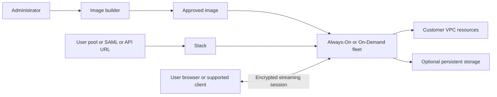
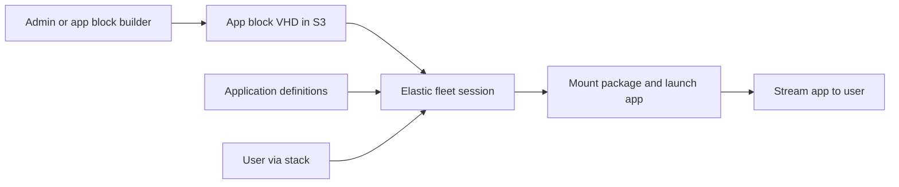
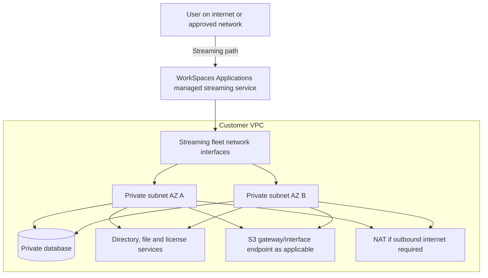
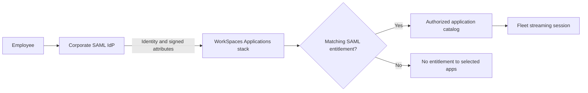
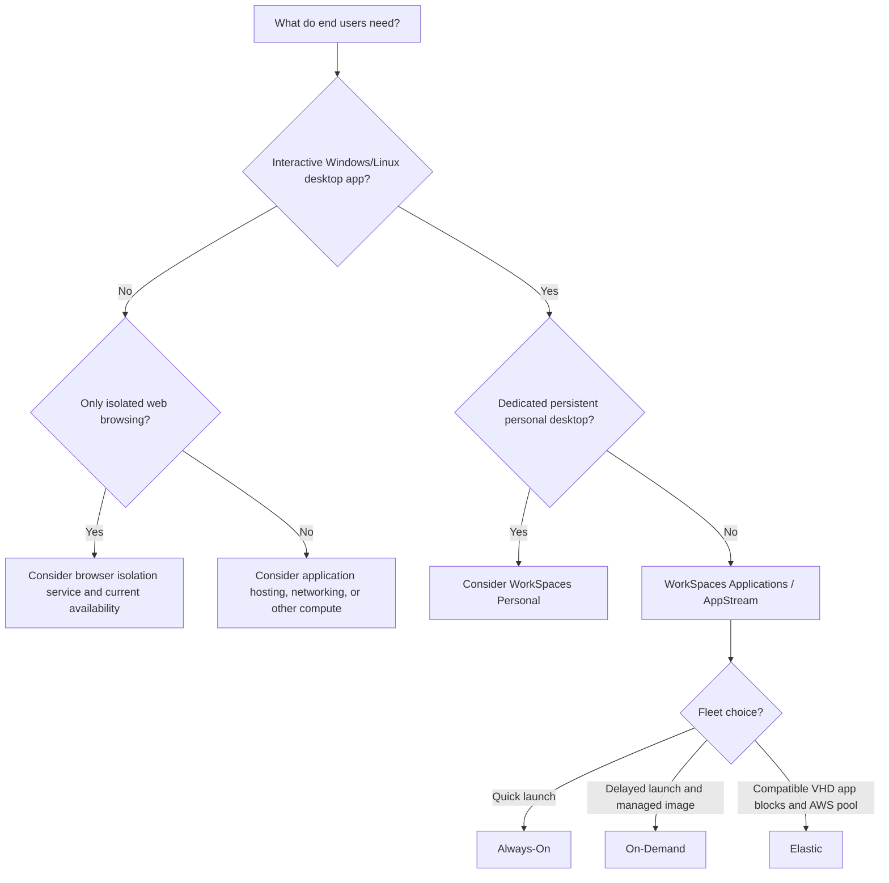

<div align="center">

# Amazon AppStream 2.0 — Amazon WorkSpaces Applications

### Complete GitHub Study Guide · AWS Cloud Practitioner + Solutions Architect – Associate

[](https://aws.amazon.com/workspaces/applications/)
[](https://aws.amazon.com/certification/certified-cloud-practitioner/)
[](https://aws.amazon.com/certification/certified-solutions-architect-associate/)


**One sentence to remember:** Run applications on AWS-managed streaming instances and let users interact with them remotely through a browser or supported client, without installing those applications locally.

[CCP essentials](#ccp-essentials) · [SAA architecture](#saa-deep-dive) · [Comparisons](#service-comparisons) · [Exam traps](#exam-traps) · [Practice](#practice-questions) · [Cheat sheet](#quick-revision)

</div>

> [!IMPORTANT]
> **Name change:** **Amazon AppStream 2.0** is now marketed as **Amazon WorkSpaces Applications** (AWS pages sometimes capitalize *Applications*). Older exam-preparation material, API namespaces, CLI commands, CloudWatch metrics, and documentation URLs still use `AppStream` or `appstream2`. This guide deliberately uses both names. **It is not the same product as Amazon WorkSpaces personal desktops.** [Official service overview](https://aws.amazon.com/workspaces/applications/).

> [!NOTE]
> **Source and scope:** Created from scratch using the requested AWS topic and the supplied README-generation specification. The upload was an authoring brief, **not** an existing AppStream README or service-content source. AWS technical details and current branding were checked against official AWS documentation on **2026-11-02**. Focus: recognition for **CLF-C02**, practical design decisions for **SAA-C03**. Exam questions below are original study exercises, not actual AWS exam questions.

---

## Table of Contents

1. [What is AppStream 2.0?](#what-is-appstream)
2. [The problem it solves](#problem)
3. [Core concepts and resource model](#core-concepts)
4. [How it works: two delivery paths](#how-it-works)
5. [Features, fleet types, and limitations](#features)
6. [When to use it](#use-cases)
7. [CCP essentials](#ccp-essentials)
8. [SAA architecture and scenario reasoning](#saa-deep-dive)
9. [Service comparisons](#service-comparisons)
10. [Integration patterns](#integrations)
11. [Security and shared responsibility](#security)
12. [Operations, metrics, and troubleshooting](#operations)
13. [Pricing and cost optimization](#pricing)
14. [Hands-on and AWS CLI](#hands-on)
15. [Exam traps](#exam-traps)
16. [Interview Q&A](#interview)
17. [Original practice questions](#practice-questions)
18. [Scenario drills](#scenario-drills)
19. [Exam decision tree](#decision-tree)
20. [Quick-revision cheat sheet](#quick-revision)
21. [Official AWS references](#references)
22. [Final study takeaway](#takeaway)

---

<a id="what-is-appstream"></a>
## 1. What Is Amazon AppStream 2.0?

**Beginner definition:** It lets you open and use an application that is actually running on an AWS-hosted computer. You see and control the app from your laptop or browser, but you do **not** have to install the application on your laptop.

**Exam-ready definition:** Amazon WorkSpaces Applications (formerly Amazon AppStream 2.0) is a **fully managed, application-and-desktop streaming service**. It runs applications on cloud-based streaming instances and transmits an interactive display to end users over an encrypted streaming connection. You can deliver existing desktop applications, publish application catalogs, or provide a **non-persistent desktop experience**, with user access, fleet capacity, application images, and data retention configured to meet the workload.

### An analogy

Imagine a university with expensive engineering software installed on powerful computers in a locked computer lab. Instead of requiring every student to visit the lab or install the program, the university lets each student **remotely operate a lab computer** from a web browser. The calculation happens in the lab; the student sees the application interface and sends clicks and keyboard input.

AppStream replaces that manually managed lab with AWS-managed streaming capacity. The analogy is imperfect: the service handles image/fleet provisioning and streaming, while customers still own their application licensing, access configuration, network controls, and data design.

### At a glance

| Dimension | Exam-ready fact |
|---|---|
| Category | End-user computing (EUC), application streaming, managed desktop streaming |
| Current AWS name | **Amazon WorkSpaces Applications** |
| Older/common name | **Amazon AppStream 2.0** |
| Application execution | On remote streaming instances, **not** on the user's device |
| Endpoint experience | HTML5-compatible browser or supported native WorkSpaces Applications client |
| Typical workload | CAD, graphics, engineering, corporate/legacy Windows or Linux apps, training labs |
| User view | Individual **application** windows/catalog or an optional **desktop** view |
| Main resources | Image builder / image, fleet, stack, user access, storage configuration |
| Fleet choices | **Always-On**, **On-Demand**, **Elastic** |
| Persistence model | Streaming compute is generally **non-persistent**; configure persistent files/settings separately |
| Networking | Fleet instances can connect to applications and services in customer VPC networks |
| Management | AWS runs streaming infrastructure; customers configure applications, images, access, capacity, security, costs |

**Do not confuse:** Remote display ≠ locally installed software; AppStream desktop view ≠ a persistent dedicated WorkSpace. [AWS FAQ](https://aws.amazon.com/workspaces/applications/faqs/).

---

<a id="problem"></a>
## 2. What Problem Does It Solve?

Without application streaming, a business may need to install and update a heavyweight program on every employee computer; buy powerful devices for GPU-intensive apps; maintain complex VPN and application configurations; or send sensitive files to unmanaged endpoints. This becomes difficult for temporary workers, seasonal demand, remote students, and heterogeneous client devices.

With AppStream, administrators centralize approved applications and compute. Users connect to an application catalog rather than manage installations. Administrators can choose fleet capacity, user authorization, VPC connectivity, and optional persistent storage centrally.

| Before | With WorkSpaces Applications |
|---|---|
| Install and patch applications on many endpoints | Build/update approved application images or packages centrally |
| Hardware must meet app CPU/GPU requirements | Use appropriately sized cloud streaming compute |
| Remote students must access a physical lab | Deliver applications remotely from a browser |
| Contractors need a complete locally managed machine | Give scoped remote access to the required app catalog |
| Capacity built for permanent peak | Use managed fleets and scaling appropriate to demand |
| Files left on temporary machines | Configure persistent home folders/other storage; control endpoint transfers |

It is **not** a general substitute for a web application framework, software license, backup service, VPN, identity provider, or data loss prevention platform. Licensing, application compatibility, and reliable network connectivity must still be checked.

---

<a id="core-concepts"></a>
## 3. Core Concepts and Resource Model

| Term | Meaning | Why it matters |
|---|---|---|
| **Image builder** | Managed instance used by an administrator to install, configure, and test apps before capturing an image | Custom image creation for Always-On/On-Demand |
| **Image** | Reusable configuration containing operating system and installed applications | Fleets launch instances based on an approved image |
| **Fleet** | Group/pool of streaming instances assigned to user sessions | Provides actual compute and determines capacity, instance type, and fleet billing |
| **Stack** | User-facing access configuration associated with a fleet, including policies/settings/storage | Controls how users access and use the streaming environment |
| **App block** | Application files/package stored as a VHD in S3, with mounting/launch information | **Elastic** application delivery; distinct from an image |
| **App block builder** | Tool for packaging app blocks | Builds deployable packages for Elastic fleets |
| **User pool** | Built-in user directory/access portal | Simple user access, but **not** for domain-joined fleet stacks |
| **SAML 2.0** | Federation through an external identity provider (IdP) | Enterprise SSO and attribute-based application entitlements |
| **Streaming URL** | Short-lived URL issued by an API/CLI | Testing or integrated access; treat it as a credential-like bearer link |
| **Application entitlement** | SAML-attribute-based rule selecting accessible applications | Fine-grained app visibility with supported federation |
| **Home folder** | Per-user file storage backed by S3 | Helps files survive replacement of session instances |
| **Application settings persistence** | Saves user application settings/profile data to S3 | Separate from persistence of user documents; Windows stacks |
| **Single-session** | One user's session per streaming instance | Simpler isolation and capacity calculations |
| **Multi-session** | Multiple user sessions per instance | Supported for **Windows Always-On/On-Demand**, not Linux/Elastic |

### Standard (image-based) architecture



**Read it from right to left if needed:** users reach a **stack**, which grants a view of applications streamed from its **fleet**. The fleet uses the **image** prepared with the image builder. User-data storage and VPC resources are separate responsibilities, not a guarantee of persistence or internet access.

> [!TIP]
> **Quick distinction:** **Image = what software is installed**; **Fleet = where it runs**; **Stack = how users access it**.

### Elastic application-delivery architecture



Elastic fleets use **app blocks** and AWS-managed instance provisioning rather than custom fleet images and your own fleet auto scaling. They still have configuration, concurrency limits, permissions, package compatibility requirements, and S3 access prerequisites. [Fleet types](https://docs.aws.amazon.com/appstream2/latest/developerguide/fleet-type.html) · [App blocks](https://docs.aws.amazon.com/appstream2/latest/developerguide/appstream-app-blocks.html).

---

<a id="how-it-works"></a>
## 4. How It Works, Step by Step

### Path A — conventional image-based application catalog

1. **Plan the workload.** Determine OS and app compatibility, GPU/CPU/RAM needs, licenses, expected concurrent sessions, SSO requirements, and data residency.
2. **Select a VPC, subnets, and security groups.** Provide network routes to license servers, internal databases, files, identity infrastructure, or required outbound resources.
3. **Launch an image builder.** Choose a compatible base image and instance family; install your licensed app(s), register launch entries, and test them.
4. **Capture a custom image.** Patch and version the image; don't embed secrets or user data.
5. **Create an Always-On or On-Demand fleet** from that image. Choose instance type, region/subnets, session settings, and scaling bounds. Start the fleet.
6. **Create a stack and associate the fleet.** Choose application or desktop experience, clipboard/print/file-transfer controls, and optional persistent storage.
7. **Give users access** via a user pool, SAML federation, or the API/temporary streaming URLs. Directory-joined streaming has additional SAML requirements.
8. **User starts a session.** The service assigns an available instance/session. Their browser/client receives the rendered remote interface; the app accesses resources through configured networks.
9. **End/recycle the session.** User data persists only through configured options. Next use can begin on another freshly provisioned instance.
10. **Monitor and refresh.** Inspect fleet capacity and session metrics; roll out new images and manage service/licensing costs.

### Path B — Elastic fleet

1. Package compatible applications into S3-backed **app blocks**; define how they start.
2. Create an **Elastic fleet**, configuring its supported resource choices and maximum concurrency rather than maintaining an image-based auto-scaling policy.
3. Associate the application definitions with the fleet and link it to a stack.
4. Authenticate users; AWS provisions the streaming pool. The package is downloaded/mounted for sessions before the application opens.
5. Watch cold-start/setup time, app compatibility, S3 access, quotas, and session costs.

**Simple example:** A remote student opens an expensive CAD program from a Chromebook. CAD runs on a cloud GPU instance; the Chromebook displays it and sends input. The university centrally controls app access and stores projects in a configured persistent location.

**More nuanced example:** A consulting firm gives federated staff access to different engineering apps. SAML group attributes control which apps each consultant sees. A multi-AZ, image-based fleet uses sufficient warm capacity for Monday morning demand. Home folders and application settings persistence are configured separately and tested for profile load/save timing.

**Prerequisites are not automatic:** merely creating an image or fleet does not create user permissions, data backups, third-party app licenses, SAML configuration, compliant private networking, or correctly sized capacity. [Getting started tutorial](https://docs.aws.amazon.com/appstream2/latest/developerguide/getting-started.html).

---

<a id="features"></a>
## 5. Key Features, Fleet Types, and Limitations

### The three fleet types — absolutely essential

| Fleet type | Idle capacity behavior | User startup | App delivery | Scaling / management | Main cost logic | Best for |
|---|---|---|---|---|---|---|
| **Always-On** | Provisioned instances remain **running** | Nearly immediate when available | Custom **image** | Customer-configured fleet scaling | Pay running capacity even if idle | Frequent, latency-sensitive users |
| **On-Demand** | Provisioned unassigned instances **stopped** | Typically **1–2 minutes** while starting | Custom **image** | Customer-configured fleet scaling | Pay running instances during use **plus lower stopped-instance charge** | Less frequent use; tolerable startup delay |
| **Elastic** | AWS manages underlying pool | Requires package download/mount/setup | **S3-backed app blocks** | AWS provisions instances; **configure maximum concurrency**, not auto-scaling rules | Session duration, per second with **15-minute minimum** | Compatible packaged apps and variable demand |

> [!WARNING]
> **Elastic is not “unlimited, configuration-free capacity.”** You still specify maximum concurrency, need sufficient service quotas, package the app correctly, and provide required network/S3 access. **On-Demand is not free when idle**; provisioned stopped instances have a lower fee. [AWS fleet-type guide](https://docs.aws.amazon.com/appstream2/latest/developerguide/fleet-type.html).

### Feature matrix

| Capability | Practical significance | Important condition |
|---|---|---|
| **App view and desktop view** | Publish just an app or a temporary desktop | Desktop view is still generally **non-persistent** |
| **Browser access** | Reach applications without installing the target app | Browser and network must meet streaming requirements |
| **Native client** | Enables additional integrations/peripherals | Client features vary by OS and device; verify before promising USB/monitor support |
| **GPU-capable instances** | Graphics/CAD/media visualization workloads | Choose supported instance family, image/driver, and pay accordingly |
| **Multi-session** | Multiple users share one streaming instance | **Windows Always-On/On-Demand only**; size sessions per instance carefully |
| **Auto scaling** | Match provisioned capacity to demand | Applies to Always-On/On-Demand; is not instantaneous |
| **SAML SSO** | Enterprise centralized sign-in | Requires IdP, correct federation configuration, and authorization |
| **App entitlements** | Map IdP attributes to app access | Applies to **SAML federated users**; not user-pool/API users |
| **AD integration** | Reach domain credentials/resources | Domain-joined Always-On/On-Demand require **SAML** access |
| **Home folders** | Retain user files across sessions | S3-backed and synchronization is not equivalent to live local disks |
| **Application settings persistence** | Retain Windows app preferences | Windows stacks only; separate from home folders |
| **Drive integration** | Google Workspace Drive / OneDrive for Business | Windows stacks, organization accounts, compatible images/agent versions |
| **SMB network drives** | Existing departmental shares | Customer must supply connectivity, access, permissions |
| **Clipboard/file/print controls** | Limit simple data movement to endpoints | These controls are **not comprehensive DLP**; in-app network channels can remain |
| **Session controls** | Idle timeout, disconnect grace, max duration | An ended or timed-out session can destroy unsaved local files |
| **Private streaming endpoints** | Keep eligible stream traffic via interface endpoints | Requires endpoint setup and supported configurations; authentication/web assets may still need internet |

A specific **2026 caveat**: AWS documents Google Drive and OneDrive integration with Windows **multi-session** fleets only when the image uses an agent/managed update released **on or after June 29, 2026**. Avoid assuming every older image supports it. [Google Drive setup](https://docs.aws.amazon.com/appstream2/latest/developerguide/google-drive.html).

---

<a id="use-cases"></a>
## 6. Real-World Use Cases and When to Choose It

| Requirement | Good fit? | Reason |
|---|---|---|
| University distributes CAD to students with modest laptops | **Yes** | Centralized installations and cloud compute |
| Enterprise publishes a Windows-only legacy desktop app to contractors | **Yes** | Remote access without local application installation |
| Architectural firm needs short-term GPU workstations for a training course | **Yes** | Stream graphics-intensive software; scale for schedule |
| Developers need a browser-based catalog of internal graphical utilities | **Often** | Central user-facing apps; configure VPC and authorization |
| Every employee needs the **same persistent personal desktop** day after day | **Usually prefer WorkSpaces Personal** | Dedicated persistent desktop is its main use case |
| Employee needs only isolated access to untrusted websites | **Consider secure browser / browser isolation** | Do not deploy a full app-streaming estate unnecessarily |
| Team needs to deploy a website/API | **No** | Use web-application hosting infrastructure, not app streaming |
| Automated backend batch rendering without interactive users | **Usually no** | Choose appropriate EC2, AWS Batch, container or other compute |

**Practical decision:** choose the service because users must **interactively operate a desktop application in the cloud**, not simply because it is “managed” or includes virtual machines.

---

<a id="ccp-essentials"></a>
## 7. Cloud Practitioner (CCP) Essentials


### 16 facts to memorize

1. **Amazon AppStream 2.0** is now called **Amazon WorkSpaces Applications**.
2. It is **fully managed application streaming**, not app downloads.
3. Applications execute on **AWS-side compute**.
4. The user interacts remotely through a **browser or supported client**.
5. **No local application installation** is required.
6. Useful for **existing desktop/legacy applications** without a rewrite.
7. Useful for **graphics-intensive, CPU-intensive, and GPU-assisted** applications.
8. A **fleet** supplies streaming capacity.
9. A **stack** supplies user-facing access settings and association to a fleet.
10. An **image** contains installed apps for standard image-based fleets.
11. **Always-On** prioritizes fast startup, with running-instance charges.
12. **On-Demand** has slower start, with cheaper stopped capacity (not zero).
13. **Elastic** uses app blocks and AWS-managed pool provisioning.
14. Streaming sessions are normally **non-persistent**; data/settings need deliberate persistence.
15. **Amazon WorkSpaces Personal** is more directly aligned to individual persistent desktops.
16. AWS runs the streaming platform; you still manage applications, permissions, data and cost choices.

### Keyword bank

`Application streaming` · `Desktop applications in the cloud` · `No local installation` · `HTML5 browser` · `Cloud-hosted apps` · `GPU workloads` · `Legacy apps` · `Remote access` · `End-user computing` · `Fully managed` · `Image` · `Fleet` · `Stack` · `Always-On` · `On-Demand` · `Elastic fleet` · `Non-persistent desktop` · `Centralized application management` · `SAML SSO` · `BYOD`

### If the exam says X → think Y

| Question cue | Think |
|---|---|
| “Stream a Windows desktop app without installation on end-user laptops” | **AppStream / WorkSpaces Applications** |
| “Users open CAD software from any browser” | **AppStream**, potentially graphics-capable instances |
| “Deliver the application, not a dedicated personal PC” | **AppStream** |
| “Dedicated, persistent virtual desktop per employee” | **Amazon WorkSpaces Personal** |
| “Start an already-provisioned application almost immediately” | **Always-On fleet** |
| “Occasional usage; users accept startup delay” | **On-Demand fleet** |
| “Package apps into VHDs in S3; AWS manages fleet provisioning” | **Elastic fleet** |
| “Who decides user permissions and stores application data?” | **Customer** under shared responsibility |

### 30-second CCP answer

> Amazon AppStream 2.0, now Amazon WorkSpaces Applications, is a fully managed AWS service that **streams applications or temporary desktops to end users**. Apps run on AWS, users access them through browsers or supported clients, and they avoid installing resource-heavy software locally. It differs from Amazon WorkSpaces Personal, which focuses on persistent personal virtual desktops.

---

<a id="saa-deep-dive"></a>
## 8. Solutions Architect – Associate (SAA) Deep Dive


SAA scenarios require more than recognizing “remote application.” Design for **actual concurrency**, **image lifecycle**, **network paths**, **identity**, **session/data durability**, **latency**, **security**, and **cost**.

### 8.1 Identity versus authorization

There are three common end-user access patterns:

| Access pattern | What it provides | Critical constraint |
|---|---|---|
| Built-in **user pool** | Regional hosted portal with managed users and stack assignments | Cannot assign stacks backed by **domain-joined** fleets |
| **SAML 2.0 federation** | Enterprise IdP sign-in; supports SAML attribute-based application entitlements | Requires proper IdP roles/claims, trust and stack/entitlement configuration |
| **Temporary streaming URL** (`CreateStreamingURL`) | API-generated, expiring session link | Must be protected and expired/limited; **does not** make a domain-joined fleet accessible by this route |

**Permissions have multiple layers:** an AWS administrator needs IAM permissions for service API operations; an end user needs a permitted sign-in/access flow; the running application needs OS/file/database permissions; and the streaming instance needs network access and, if it calls AWS APIs, an appropriate **IAM role for the fleet**. These layers are not interchangeable.

**Fine-grained application entitlements:** with SAML 2.0, you can evaluate IdP user attributes (for example department or group) against entitlements to choose app visibility. **Do not assume entitlements apply to user-pool or temporary-URL users**: AWS explicitly states they do not. [Entitlement API](https://docs.aws.amazon.com/appstream2/latest/APIReference/API_Entitlement.html).

### 8.2 Capacity and multi-session math

For **single-session**, approximately **one concurrent user session requires one available instance**. In **multi-session**, the fleet capacity is defined in **sessions**; the service determines how many Windows instances to provision, based on maximum sessions per instance.

Illustrative sizing example (not a utilization promise):

- Peak demand: **80 concurrent users**.
- Single-session: approximately **80 active streaming instances**, plus capacity buffer.
- Windows multi-session: at **5 permitted sessions per instance**, theoretical minimum **ceil(80/5) = 16 instances**, assuming the app remains performant at five users per machine.
- Do **not** select “50 sessions per instance” purely to minimize the bill: CPU/RAM, app thread-safety, user isolation, licensing, and workload spikes govern safe density.

Use **minimum/maximum capacity**, **target tracking**, **step**, and/or **scheduled scaling** for image-based fleets. Scale out **before** known peaks; provisioning may take several minutes, so new capacity is not instantaneous. Track `AvailableCapacity`, `CapacityUtilization`, and `InsufficientCapacityError`. [Scaling concepts](https://docs.aws.amazon.com/appstream2/latest/developerguide/autoscaling-concepts.html).

### 8.3 Network and Availability Zone design



This is a **conceptual connectivity diagram**, not a claim that streaming traffic directly enters an ordinary subnet through the same path as a private database request. The managed streaming front end connects users to instances; fleet network interfaces provide access to configured VPC resources. Network routes, security groups, DNS, proxies, VPC endpoints and firewall rules must be designed separately.

**Design checklist:**

- Select **two or more suitable subnets in different Availability Zones** for resilient deployments where supported.
- Size private subnet IPv4 space for maximum available fleet instances plus service/IP reservation and recovery headroom; no usable IPs means new instances can fail.
- Allow app-specific routes to database, directory, SMB, license servers, and S3 as needed. Private subnets do **not** automatically provide internet access.
- Use a NAT gateway or compatible VPC endpoints **only where the application's actual dependencies require them**.
- For streaming **interface VPC endpoints**, follow special endpoint, authentication, client networking, and platform limitations; they do **not** simply make every part of user sign-in completely offline.
- Align region choice with end-user latency, residency requirements, supported fleet/OS options, and storage location.

**Regional architecture:** stack/fleet and S3-backed settings are **regional**. Multi-AZ subnet choice can increase resiliency; cross-Region user routing and data replication require your own deliberate design. Do not assume automatic active-active multi-Region failover. [AWS AZ design guidance](https://docs.aws.amazon.com/whitepapers/latest/best-practices-for-deploying-amazon-appstream-2/availability-zones.html).

### 8.4 Persistence: three different things

| State | What happens by default / design | If it must survive |
|---|---|---|
| **Streaming instance's local OS/disk state** | Session environment is generally discarded/replaced | Rebuild image or use supported external persistent data location |
| **User documents** | Not guaranteed to persist merely by enabling a fleet | Enable **home folders** (S3), supported cloud drive, or SMB/share as appropriate |
| **User app customizations/settings** | Not guaranteed to carry across fresh sessions | Enable **application settings persistence** (Windows stack) and test supported files/versions |

For application settings, AWS stores a per-user VHD in an S3 bucket; the full VHD must load before the session, so large profiles can slow starts. A different Windows OS version may prevent previous settings from carrying over. Home-folder synchronization also has latency and file-size caveats. [How settings persistence works](https://docs.aws.amazon.com/appstream2/latest/developerguide/how-it-works-app-settings-persistence.html) · [Home folders](https://docs.aws.amazon.com/appstream2/latest/developerguide/home-folders.html).

### 8.5 Five architecture scenarios with decisions

**Scenario 1 — Near-instant access for a call center.** Agents open a critical application all day. A 1–2 minute startup is unacceptable. Prefer an **Always-On** image-based fleet, maintain spare ready capacity, and schedule scale-out ahead of shift changes. Trade-off: idle running instances cost more.

**Scenario 2 — University lab used three afternoons per week.** Students can accept setup delay. An **On-Demand** fleet is often economical, with scheduled capacity ahead of class; consider an **Elastic** fleet only if app block packaging and feature requirements fit. Pitfall: stopped On-Demand instances still accrue charges and insufficient preprovisioned capacity causes session rejection.

**Scenario 3 — Internal app requires a private license server.** Deploy the fleet with network access through suitable private subnets and security groups, route to licensing servers, and confirm required DNS/ports. Pitfall: a user can successfully authenticate while the application still fails because the **fleet** cannot reach its backend dependencies.

**Scenario 4 — Domain-joined app, enterprise SSO, department-specific catalogs.** Use supported **Always-On/On-Demand** fleets joined to Active Directory, access via **SAML 2.0**, and use SAML entitlements to present the right apps. Pitfall: the built-in user pool and `CreateStreamingURL` cannot authenticate sessions to domain-joined fleets.

**Scenario 5 — Users lose customized application preferences after every login.** Enable and test **Windows application settings persistence**, not merely S3 home folders. Check image OS/version compatibility, VHD size, storage access, and when the session is terminated. Pitfall: home folders preserve documents, not necessarily application profiles.

### 8.6 Operational trade-off summary

| Constraint | Prefer / configure | Check before deployment |
|---|---|---|
| Very fast opening | Always-On | Running idle cost and warm capacity |
| Cost-conscious intermittent use | On-Demand | Delay, standby fees and pre-provisioning |
| Elastic app packaging | Elastic | VHD/S3/app-block compatibility, concurrency limits |
| Multiple users on a machine | Windows multi-session Always-On/On-Demand | Performance, tenant isolation, licensing |
| User-specific personalization | Windows app settings persistence | VHD/version behavior |
| Large durable project files | Home folders or managed file shares | Sync behavior, permissions, data protection |
| Corporate SSO / domain access | SAML + relevant AD configuration | Federated claims and network connectivity |
| Resilience | Multiple AZ subnets, proactive capacity | IP headroom, quotas and failover assumptions |

---

<a id="service-comparisons"></a>
## 9. Compare With Similar or Confusable Services

| Service | Primary purpose | Choose it when… | Why it differs from AppStream |
|---|---|---|---|
| **Amazon WorkSpaces Applications** (formerly AppStream 2.0) | Stream individual apps or non-persistent desktops | Need centrally managed interactive cloud apps | **This topic** |
| **Amazon WorkSpaces Personal** | Persistent end-user cloud desktops | Employee needs their own long-lived desktop | Personal desktop lifecycle/state rather than transient app sessions |
| **Amazon WorkSpaces Pools** | Pooled non-persistent virtual desktops | Need a managed shared/pooled **desktop** experience | Desktop-centric pool offering; compare required app catalog/UX/features |
| **Amazon WorkSpaces Secure Browser** | Remote browser isolation | Need isolated browsing for websites/SaaS | Streams **browser sessions**, not arbitrary desktop app catalog; note availability/status changes |
| **Amazon EC2** | General-purpose virtual servers | Want raw OS/application/server control | Must build/manage user streaming and lifecycle yourself |
| **Amazon DCV** | High-performance remote display technology | Need a remoting protocol/solution for managed compute | A technology/component, not a complete managed app catalog/stack service |
| **AWS Elastic Beanstalk** | Deploy and manage web app environments | Host a web backend or website | Application **hosting**, not desktop app streaming |
| **Amazon ECS / EKS** | Container orchestration | Run containerized services/apps | Does not inherently give interactive Windows desktop application streaming |
| **AWS Client VPN** | Managed VPN connectivity | Remote users need network access to private networks | A network tunnel, not centralized remote execution of apps |

### Most confusing comparisons

<details>
<summary><strong>AppStream vs Amazon WorkSpaces Personal</strong></summary>

**AppStream/WorkSpaces Applications:** user starts a session and remotely operates selected applications or a temporary desktop on fleet capacity. Typically non-persistent compute; use separate storage/profile persistence.

**WorkSpaces Personal:** focuses on assigning individual users persistent cloud desktops. Pick it when the question explicitly requires a personal, retained desktop environment rather than an app catalog. It is possible for the two services to overlap in desktop display; base the choice on **persistence, user ownership, and application-delivery requirements**.

</details>

<details>
<summary><strong>Always-On vs On-Demand vs Elastic</strong></summary>

**Always-On:** image-based, warm running capacity, quick startup, running fees while idle.

**On-Demand:** image-based, provisioned but idle instances stopped, lower stopped fee, 1–2 minute typical start.

**Elastic:** package apps as S3 VHD app blocks, AWS manages pool provisioning, session-based per-second billing with minimum; max concurrency and quotas remain your responsibility. No customer-configured fleet auto scaling rules.

</details>

<details>
<summary><strong>AppStream vs EC2 + remote desktop</strong></summary>

With standalone **EC2**, you select instances and implement much of the OS, access gateway, remote desktop infrastructure, image/session lifecycle, scaling, logging, and operational security. AppStream provides managed application streaming, user access mechanisms, images/fleets/stacks, and capacity options. EC2 is more flexible for unusual OS/application/remote access needs but imposes more operational work.

</details>

<details>
<summary><strong>AppStream vs WorkSpaces Secure Browser</strong></summary>

AppStream is useful for full desktop **applications** such as CAD or finance tools. WorkSpaces Secure Browser is for **isolated browser sessions** accessing sites or SaaS apps, not a generic catalog of installed desktop applications. AWS has announced that Secure Browser is **not open to new customers after October 29, 2026**; verify alternatives and availability before selecting it for a new architecture. [AWS service page](https://aws.amazon.com/workspaces/secure-browser/).

</details>

<details>
<summary><strong>AppStream vs AWS Client VPN</strong></summary>

VPN lets a user device reach an internal network. It does not move software execution into AWS; the app may still need installation on the endpoint. AppStream executes the app centrally and streams its interface. A deployment can potentially use both when networking requires them; they are not equivalent products.

</details>

---

<a id="integrations"></a>
## 10. Integration and Architecture Patterns

### Identity + application entitlement



This diagram covers **SAML attribute-based app entitlements**. It does not imply every IdP automatically produces the necessary signed attributes, nor that user-pool/API access follows the same entitlement logic.

### Selected integrations

| Integration | Purpose | What must be configured |
|---|---|---|
| **VPC / subnets / SG / routes** | Access internal apps, RDS, licensing, file servers | Reachability, IP capacity, DNS and security rules |
| **AWS IAM** | Authorize administrators/API and assign an instance role | Least-privilege policies and correct role trust/use |
| **SAML IdP / Active Directory** | Enterprise login and domain resources | Federation, user entitlement, directory connectivity |
| **Amazon S3** | Home folders, saved settings VHDs, Elastic app blocks, reports | Supported stack options, permissions, network access, encryption/lifecycle |
| **CloudWatch** | Fleet/instance/session metrics and alarms | Dashboard and meaningful alarm thresholds |
| **CloudTrail** | Record supported administrative/API activity | Trail for retention beyond default Event history |
| **Athena / AWS Glue** | Query usage CSV reports from S3 | Explicitly enable reports, create tables and manage data costs |
| **AWS Service Quotas** | Raise regional/fleet/instance limits | Request changes before peak load |
| **NAT / VPC endpoints** | Provide dependency-specific egress/private access | Subnet routing, endpoint support, security policies |

**Control plane vs data plane:** AWS IAM/console/CLI calls configure stacks, fleets, images and sessions (management). User display/input streams are the interactive session path; application-to-database/S3/license-server requests follow the instance's configured network/identity permissions. CloudTrail API records alone are **not** a recording of every user screen/action.

---

<a id="security"></a>
## 11. Security, Permissions, Compliance, and Shared Responsibility

### Who handles what?

| AWS manages | Customer must design/configure |
|---|---|
| Managed app-streaming platform and underlying service operation | Application binaries, configuration, security testing, image patch/update lifecycle |
| Managed fleet provisioning and streaming components | User identity, IdP integration, IAM, application entitlements |
| Supported service-level encryption/transport mechanisms | File/clipboard/printing restrictions, secure backend connectivity, secrets, app permissions |
| Managed service availability mechanisms | Correct AZ/subnet choices, quotas, resilience, backup/data retention, incident response |
| Service pricing/metering | Cost guardrails, licensing obligations, instance sizing and unused-resource cleanup |

### Secure deployment checklist

1. Use **SAML federation** when enterprise identity, policy and entitlements are needed; enforce MFA through the chosen IdP/policy where supported.
2. Give administrators least-privilege `appstream:*`-related actions rather than blanket permissions; scope to resources where action-level support allows it. Consult the [AWS authorization reference](https://docs.aws.amazon.com/service-authorization/latest/reference/list_appstream.html).
3. Use the proper **fleet IAM role** for AWS API access from applications; don't place access keys or license credentials in images or scripts.
4. Use private subnets and minimum security-group access for internal systems; add internet egress or supported endpoints only when necessary.
5. Control clipboard directions, local printing, file upload/download and available client peripherals at the **stack** level. Also control internet and remote app egress; these features do **not** stop a user from emailing data within an allowed browser or application.
6. Protect S3-backed home folders/app settings/app blocks/reports; use suitable bucket permissions, retention, encryption and account isolation. AWS documents home-folder data encryption at rest with **S3-managed keys** and app settings VHDs with **AWS-managed KMS keys**.
7. Patch images, update agents, audit installed software and validate licensing. Do not assume an old fleet image is patched just because AWS operates the streaming infrastructure.
8. Secure temporary streaming URLs: short expiration, access-controlled generation and no leakage to tickets/source control.
9. Collect necessary audit data (CloudTrail/usage reports/application logs) **before** ephemeral sessions end; don't rely on a destroyed instance's local logs.
10. Verify OS/feature/region restrictions and current compliance scope against AWS's actual resources—not generic certification slogans.

> [!IMPORTANT]
> **Encryption is not a guarantee that corporate files never reach a user endpoint.** Streaming usually delivers encrypted display/input traffic, but clipboard, downloads, printing, in-app browsers and network transfers can create additional exfiltration paths unless intentionally controlled.

[Security guidance](https://docs.aws.amazon.com/prescriptive-guidance/latest/appstream-well-architected-framework/security.html) · [Data loss prevention](https://docs.aws.amazon.com/appstream2/latest/developerguide/data-loss-prevention.html).

---

<a id="operations"></a>
## 12. Observability, Auditing, Troubleshooting, and Failures

### The most useful CloudWatch concepts

WorkSpaces Applications publishes CloudWatch metrics to namespace **`AWS/AppStream`**, generally at **one-minute intervals**. The metric set depends on fleet type and single/multi-session mode. Always-On/On-Demand expose more capacity metrics; Elastic has a smaller set.

| Signal | Meaning | Investigate when… |
|---|---|---|
| `ActualCapacity` | Single-session instances ready or in use | Below required steady-state demand |
| `InUseCapacity` | Active streaming capacity | Approaching `ActualCapacity` |
| `AvailableCapacity` | Capacity ready for new sessions | Near zero before demand peak |
| `DesiredCapacity` / `PendingCapacity` | Target and provisioning-in-progress capacity | Autoscaling is behind schedule |
| `CapacityUtilization` | Percentage of available capacity in use | Consistently high or excessively low |
| `InsufficientCapacityError` | Rejected sessions due to no available capacity | **Any sustained nonzero value** |
| `InsufficientConcurrencyLimitError` | Elastic requests rejected at concurrency limit | Elastic cap/quota is exhausted |
| Multi-session user-session metrics | Capacity expressed as **sessions**, not only machines | Session density/capacity constraints |

**Single-session relationship:** `ActualCapacity = AvailableCapacity + InUseCapacity`. For an image-based fleet, desired capacity can include instances still being provisioned. Always validate formulas and dimensions for your selected fleet mode. [CloudWatch metrics reference](https://docs.aws.amazon.com/appstream2/latest/developerguide/monitoring-with-cloudwatch.html).

### Auditing tools

- **CloudTrail:** records supported WorkSpaces Applications **API actions** such as `CreateFleet`, `CreateStreamingURL`, `UpdateStack`, and `StartFleet`; use a trail for ongoing retention beyond recent Event history. It does **not** automatically record everything a user did inside a desktop app.
- **Usage Reports:** when subscribed, daily **session** and **application** CSV reports go to S3, by Region. Analyze in Athena/Glue if useful; beware storage/query costs.
- **Application/Windows logs:** session instances are ephemeral; deliberately export relevant logs before termination if application-level investigation is required.
- **CloudWatch alarms:** warn about rejected sessions, low spare capacity, or session/instance performance bottlenecks.

### Troubleshooting decision order

| Symptom | Check first | Then check |
|---|---|---|
| User sees no application or stack | Assigned stack, IdP claims, entitlement, login method | Domain-join restrictions and fleet association |
| Fleet will not start or scale | Fleet state, desired capacity, instance quota | IP exhaustion, AZ capacity, scaling activity and IAM |
| User gets “no capacity” | `AvailableCapacity`, `InsufficientCapacityError` | Scale-out policy, warm buffer, provisioning lead time |
| Long launch delay | Fleet type (On-Demand/Elastic), profile VHD size | S3/network access, app block setup, image performance |
| App opens but database/license check fails | SGs/routes, DNS, required port and backend status | Private endpoints/NAT, app licensing, directory auth |
| Files disappear after logout | Where user saved file and whether storage was enabled | S3 sync, storage permissions, session end timing |
| App customizations vanish | Windows application settings persistence | Settings group, OS version, VHD health and size |
| High bill with low usage | Always-On unused capacity, On-Demand stopped capacity | Image builders left on, user/license fees, storage and egress |
| CloudTrail cannot show an in-app click | Difference between API logs and app actions | Add appropriate application/session audit mechanism |

**Failure model:** if a streaming instance terminates, assume **unsaved session-local work may be lost**. If the fleet has no capacity or exceeds limits, users can be rejected despite an otherwise healthy stack. If the SAML IdP is unavailable, federated logins can fail; if an internal dependency is unavailable, the remote application can fail even when streaming itself works. Recovery is not equivalent to preserving each user's active process memory.

[Usage reports](https://docs.aws.amazon.com/appstream2/latest/developerguide/configure-usage-reports.html) · [CloudTrail integration](https://docs.aws.amazon.com/appstream2/latest/developerguide/logging-using-cloudtrail.html) · [Troubleshooting fleets](https://docs.aws.amazon.com/appstream2/latest/developerguide/troubleshooting-fleets.html).

---

<a id="pricing"></a>
## 13. Pricing and Cost Optimization

**Core rule:** bill drivers are **fleet type**, **instance type/OS**, **how long capacity is running or stopped**, **number of active unique users where user licensing applies**, and supporting resources. There is no universal “free when idle” or “per-user only” answer.

| Cost category | What creates charges |
|---|---|
| Always-On fleet | Running streaming instances, **including idle** instances |
| On-Demand fleet | Running instances in sessions **and** lower-cost provisioned stopped instances |
| Elastic fleet | Streaming session duration, with a **15-minute minimum**, per-second increments |
| Image builder / app block builder | Running builder instance time |
| Multi-session | Underlying Windows instance-hour, not simply a standalone fee per session |
| Windows Server user licensing | Monthly **RDS SAL user fees** when applicable; single/multi-session rates differ |
| Persistent data | S3 storage/requests and related data services as applicable |
| Additional storage / public IPv4 | Charges can apply depending on configuration |
| Ancillary network/services | NAT, endpoints, inter-service data charges, monitoring, license servers, etc. |

### Verified pricing facts as of 2026-11-02

AWS's pricing page lists **Windows Server RDS SAL** monthly user fees of **$4.19 per user for single-session** or **$6.42 for multi-session**, with qualified education pricing and Microsoft licensing exceptions. These are **additional to streaming compute** where applicable and can change. AWS also documents Windows On-Demand stopped capacity billing and Elastic **per-second session billing with 15-minute minimum**. Check current pricing and Region/OS before budgeting. [Official pricing](https://aws.amazon.com/workspaces/applications/pricing/).

**Illustrative cost formula (not a quote):**

```text
Estimated monthly bill =
  Always-On running instance-hours × regional instance rate
+ On-Demand running instance-hours × regional running rate
+ On-Demand stopped instance-hours × regional stopped rate
+ Elastic billable session instance-hours × regional rate
+ builder running-hours × corresponding rate
+ applicable unique Windows Server users × monthly RDS SAL
+ eligible application-license fees
+ added storage, S3, public IPv4, network and observability costs
```

**Capacity example (no invented hourly rates):** 20 Always-On machines used only 8 hours/day can still incur charges **while running outside those 8 hours**. Switching to On-Demand may reduce idle compute charges but introduces a stopped fee and startup delay. An Elastic configuration may avoid explicitly provisioning idle image-based capacity, but only if application packaging/feature restrictions fit and session-duration economics are favorable.

### Cost optimization moves

1. Estimate **concurrent** sessions rather than total employee headcount.
2. Compare Always-On, On-Demand and Elastic using **actual daily traffic patterns**.
3. Right-size CPU/GPU and Windows multi-session density after performance testing.
4. Pre-scale before peaks; scale down spare capacity when possible.
5. Stop unused image/app block builders and remove obsolete resources safely.
6. Review unique Windows users/month (not just concurrent users) and software-license conditions.
7. Avoid unnecessary public IPv4, NAT, storage overprovisioning, and neglected report buckets.
8. Validate calculations in the current official [AWS pricing page](https://aws.amazon.com/workspaces/applications/pricing/) and available AWS estimation tools.

---

<a id="hands-on"></a>
## 14. Practical Console and AWS CLI Examples

### A safe lab route (console)

1. Use a sandbox AWS account and a Region where the desired service features are available.
2. Open the [WorkSpaces Applications console](https://console.aws.amazon.com/appstream2/home).
3. Choose the **sample applications** getting-started path to create a stack, choose an image, and configure a small fleet.
4. Inspect **Images → Image Builder**, **Fleets**, and **Stacks**; note how the three resource types connect.
5. Use a temporary streaming URL for a **non-domain-joined test stack**, or assign a test user using supported user access.
6. Connect, open an app, confirm where the app actually executes, and test temporary files versus persistent folders.
7. Inspect **Fleet Usage** and CloudWatch `AWS/AppStream` metrics.
8. **Clean up**: end streaming sessions and remove or stop chargeable lab resources; inspect S3 buckets/storage as required.

### AWS CLI — verified commands

Prerequisites: AWS CLI v2 configured with an authorized test role; **existing** stack and **Running** associated fleet; a non-domain-joined environment for temporary streaming URL access. These examples **do not** create any billable environment by themselves.

```bash
# Inventory a fleet. Replace sample names/Region with your real lab resources.
aws appstream describe-fleets \
  --names demo-fleet \
  --region eu-west-1

# List available images.
aws appstream describe-images \
  --region eu-west-1

# Issue a short-lived URL for a designated test user.
# Do not paste the returned URL into GitHub, public logs or tickets.
aws appstream create-streaming-url \
  --stack-name demo-stack \
  --fleet-name demo-fleet \
  --user-id demo-test-user \
  --validity 300 \
  --region eu-west-1
```

The last operation requires IAM permission for the action **`appstream:CreateStreamingURL`** and only works with a compatible stack/fleet/access configuration. The output contains a short-lived streaming link, not a permanent user account or a free entitlement. A SAML/AD deployment needs its intended federated login method instead. [CLI reference](https://docs.aws.amazon.com/cli/latest/reference/appstream/create-streaming-url.html) · [Fleet description](https://docs.aws.amazon.com/cli/latest/reference/appstream/describe-fleets.html).

---

<a id="exam-traps"></a>
## 15. Common Exam Traps and Misconceptions

| Wrong assumption | Correct interpretation | Level |
|---|---|---|
| “AppStream installs apps on user laptops.” | Apps execute **remotely**; UI is streamed. | CCP |
| “AppStream is just another name for WorkSpaces Personal.” | AppStream = WorkSpaces **Applications**, a different service from personal persistent desktops. | CCP |
| “The name was never changed.” | Current marketing name is **Amazon WorkSpaces Applications**; older API names persist. | CCP |
| “It only streams complete desktops.” | Can stream selected apps **or** desktop view. | CCP |
| “Desktop view is a persistent personal computer.” | Desktop view is generally **non-persistent**. | CCP/SAA |
| “A stack is a set of EC2 instances.” | **Fleet** supplies streaming compute; stack governs user-facing configuration. | CCP |
| “An image is a user login portal.” | Image holds app/OS configuration. | CCP |
| “On-Demand has zero idle charges.” | Provisioned stopped instances carry a lower **stopped-instance fee**. | CCP/SAA |
| “On-Demand starts just as fast as Always-On.” | Typically **1–2 minute** start, depending on environment. | CCP |
| “Elastic is just On-Demand with auto scaling.” | Elastic uses **app blocks** and AWS-managed pool provisioning. | SAA |
| “Elastic requires a conventional image builder image.” | Elastic app delivery uses **S3-backed app blocks**, not standard fleet images. | SAA |
| “Elastic has limitless capacity.” | Max concurrency, regional service quotas and package dependencies apply. | SAA |
| “Every user must have a separate VM.” | **Windows multi-session** can share a supported instance. | SAA |
| “Multi-session works on Linux/Elastic.” | Currently **Windows Always-On/On-Demand only**. | SAA |
| “User pool authentication works with domain-joined fleets.” | Domain-joined sessions require **SAML**; user pools cannot be assigned. | SAA |
| “Temporary streaming URL works with domain-joined fleets.” | `CreateStreamingURL` is **not** supported for domain-joined sessions. | SAA |
| “SAML app entitlements work for any authentication method.” | Entitlements apply to **SAML federated identities**, not user-pool/API URL users. | SAA |
| “Creating a fleet automatically configures data persistence.” | Home folders, external storage and settings persistence are separate configurations. | CCP/SAA |
| “Home folder stores all Windows application settings.” | Home folders keep files; settings persistence handles supported app profile state. | SAA |
| “App settings persistence works on Linux stacks.” | Documented feature is **Windows stacks**. | SAA |
| “Google Drive personal Gmail accounts are supported.” | Google Drive integration requires supported **Google Workspace** organization accounts. | SAA |
| “CloudTrail captures every in-app mouse click.” | CloudTrail logs supported AWS API actions, not full user-session behavior. | SAA |
| “A VPC subnet automatically grants internet access.” | Routing and egress/NAT/endpoints must be configured for the app's needs. | SAA |
| “App streaming removes application licensing obligations.” | Customers still need compliant **app licenses**; Windows user fees may apply. | CCP/SAA |
| “The streaming service guarantees data cannot be downloaded.” | Configure file/clipboard/print restrictions **and** application egress/DLP controls. | SAA |
| “Auto scaling makes new instances available immediately.” | Provisioning takes time; schedule warm capacity for predictable peaks. | SAA |
| “An HA fleet automatically fails over between AWS Regions.” | Region-level failover and data handling require separate planning. | SAA |
| “Temporary URLs can safely be stored in source control.” | They grant time-limited access and must be handled securely. | SAA |
| “The biggest bill driver is always per-user fees.” | Cost varies substantially by fleet type, instance time, OS and other services. | SAA |
| “All fleet types expose identical CloudWatch metrics.” | Elastic has a more limited metric set; multi-session metrics are different. | SAA |

---

<a id="interview"></a>
## 16. Interview Questions and Short Answers

1. **What is AppStream?** A managed service for streaming applications/non-persistent desktops from AWS to users.
2. **How is it different from downloading an app?** Execution stays on remote compute; display and input are transmitted.
3. **What are image, fleet and stack?** Image = software; fleet = streaming compute; stack = user access and settings.
4. **When would you select Always-On?** When ready-to-use capacity and low startup delay justify higher idle charges.
5. **Why not always use On-Demand?** Stopped capacity still costs money and users wait while it starts.
6. **What makes Elastic special?** S3-backed app blocks and AWS-managed streaming pool rather than customer fleet scaling policies.
7. **Can an instance host multiple users?** Yes, with supported Windows multi-session configurations on Always-On/On-Demand.
8. **How would you retain an employee's files?** Configure home folders or supported external storage; never rely on ephemeral session disks.
9. **Why does corporate SSO matter?** Centralized identity, possible MFA through IdP, and application entitlements through SAML attributes.
10. **Why can't a user reach the app's license server?** Check fleet-to-license-server routes, SGs, DNS, firewall rules and directory dependencies separately from user streaming.
11. **How do you troubleshoot peak-hour session failures?** Check fleet availability and quotas, scaling activities, provisioning lag, IP headroom, and `InsufficientCapacityError`.
12. **What would you log?** CloudTrail API events, CloudWatch fleet metrics, usage CSV reports, and app/OS logs exported deliberately from transient sessions.

---

<a id="practice-questions"></a>
## 17. Original Exam-Style Practice Questions

The following **30 original practice questions** progress from CCP recognition to SAA design trade-offs. Reveal each explanation after answering.

<details><summary><strong>Q1 · CCP · Service recognition</strong></summary>

**Question:** A company wants employees to use Windows graphical software on thin laptops without installing it locally. Which service is the best fit? A) S3 B) WorkSpaces Applications C) Route 53 D) CloudTrail.

**Answer: B.** WorkSpaces Applications (AppStream 2.0) runs the software remotely and streams its interface. S3 stores objects, Route 53 provides DNS, and CloudTrail audits API actions.

</details>

<details><summary><strong>Q2 · CCP · Where does the app run?</strong></summary>

**Question:** Does an AppStream application execute on the employee's laptop or on AWS streaming compute?

**Answer:** On **AWS streaming compute**. The device displays the remotely rendered interface and sends inputs.

</details>

<details><summary><strong>Q3 · CCP · Name update</strong></summary>

**Question:** Which current AWS brand corresponds to Amazon AppStream 2.0? A) Amazon WorkSpaces Applications B) Amazon CloudFront C) Amazon Lightsail D) AWS App Runner.

**Answer: A.** WorkSpaces Applications is the current service name. The others are different products.

</details>

<details><summary><strong>Q4 · CCP · Main resource</strong></summary>

**Question:** Which resource provides streaming compute: an image, a fleet, or a stack?

**Answer:** The **fleet**. An image supplies the application build; the stack supplies user-facing access/settings.

</details>

<details><summary><strong>Q5 · CCP · Fast start</strong></summary>

**Question:** A manager requires nearly immediate access when capacity is provisioned. Which fleet: Always-On or On-Demand?

**Answer:** **Always-On**. Running warm instances reduce launch delay; On-Demand starts a stopped instance before use.

</details>

<details><summary><strong>Q6 · CCP · Idle pricing</strong></summary>

**Question:** True/false: An On-Demand fleet never costs anything when nobody is connected.

**Answer:** **False.** Provisioned unused On-Demand instances have a lower stopped-instance charge.

</details>

<details><summary><strong>Q7 · CCP · Persistence</strong></summary>

**Question:** A user saves a project solely to an ephemeral session's local disk. Is the file guaranteed to be available next session?

**Answer:** **No.** Configure supported persistent storage and ensure the file is actually saved there.

</details>

<details><summary><strong>Q8 · CCP · WorkSpaces distinction</strong></summary>

**Question:** An employee needs a **persistent personal virtual desktop**. Which product is a clearer first choice?

**Answer:** **Amazon WorkSpaces Personal**, rather than AppStream's primarily non-persistent application-streaming sessions.

</details>

<details><summary><strong>Q9 · CCP · Elastic package</strong></summary>

**Question:** Elastic fleets primarily deliver applications using what packaging artifact? A) S3 app block/VHD B) Route 53 record C) EBS snapshot of user's laptop D) CloudTrail trail.

**Answer: A.** Elastic uses app blocks, with application VHD content stored in S3. The other options do not describe Elastic application packaging.

</details>

<details><summary><strong>Q10 · CCP · GPU scenario</strong></summary>

**Question:** Could a low-powered client use GPU-intensive design software via AppStream, assuming the appropriate AWS instance and app compatibility?

**Answer:** **Yes.** Compute and rendering occur remotely; choose a graphics-capable configuration and validate latency, peripherals and licenses.

</details>

<details><summary><strong>Q11 · CCP · User browser</strong></summary>

**Question:** Must end users install the target desktop application on their laptops to access it through WorkSpaces Applications?

**Answer:** **No.** A supported browser can stream it; an optional native client supports additional features.

</details>

<details><summary><strong>Q12 · CCP · Shared responsibility</strong></summary>

**Question:** AWS manages the streaming infrastructure, so who decides which users may access a proprietary app?

**Answer:** The **customer** configures identity, assignment/entitlements, app permissions and licensing.

</details>

<details><summary><strong>Q13 · SAA · Shift change</strong></summary>

**Question:** A trading support team requires near-immediate app launches at 9:00 and tolerates higher base cost. Recommend a fleet strategy.

**Answer:** Use **Always-On** with sufficient warm available capacity and proactive/scheduled scale-out. Merely selecting On-Demand does not meet the latency requirement; scaling at 9:00 may be too late.

</details>

<details><summary><strong>Q14 · SAA · Cost and delay</strong></summary>

**Question:** A class runs for two hours on Tuesdays; users tolerate an initial delay. Which is worth evaluating first?

**Answer:** An **On-Demand fleet** with capacity scheduled before class, comparing an **Elastic** option if app blocks support the application. Always-On running all week could waste money; On-Demand still carries stopped-instance fees.

</details>

<details><summary><strong>Q15 · SAA · Multi-session compatibility</strong></summary>

**Question:** The team wants ten Linux users sharing one streaming instance under native multi-session. Supported?

**Answer:** **No** as specified. AWS documents native multi-session support for **Windows Always-On/On-Demand** fleets, not Linux.

</details>

<details><summary><strong>Q16 · SAA · Capacity estimate</strong></summary>

**Question:** For 45 concurrent sessions, assuming a tested Windows maximum of 5 sessions/instance, what is the theoretical minimum instance count?

**Answer:** **9 instances** (`ceil(45/5)`). Add a safety margin and performance testing; per-instance user capacity is not a promise of equivalent application performance.

</details>

<details><summary><strong>Q17 · SAA · AD authentication</strong></summary>

**Question:** A domain-joined Always-On fleet works, but users log in through the built-in user pool and are rejected. What is wrong?

**Answer:** User-pool access is **not supported** for domain-joined fleet stacks. Configure the documented **SAML 2.0** federated login path.

</details>

<details><summary><strong>Q18 · SAA · App-level access</strong></summary>

**Question:** Marketing should see one program and engineering another using corporate group claims. What feature fits?

**Answer:** **SAML attribute-based application entitlements**. Merely putting users in the built-in user pool does not apply these entitlements.

</details>

<details><summary><strong>Q19 · SAA · Data versus profile</strong></summary>

**Question:** A user can reopen project files but loses custom keyboard shortcuts in an application. Which persistence feature is most directly relevant?

**Answer:** **Application settings persistence** for a supported Windows stack. Home folders alone do not guarantee application profiles.

</details>

<details><summary><strong>Q20 · SAA · Private database</strong></summary>

**Question:** Users can stream a database client but it cannot reach a private RDS instance. Is this primarily an HTML5 browser problem?

**Answer:** **Usually no.** Inspect the **fleet-side** VPC subnet routing, security groups, DNS and database authorization; streaming success is separate from application backend connectivity.

</details>

<details><summary><strong>Q21 · SAA · IP exhaustion</strong></summary>

**Question:** Auto scaling policies request more capacity but instances cannot be provisioned in configured subnets. What network-level capacity issue should be checked?

**Answer:** **Free private IP space** in the selected subnets, along with quotas and other infrastructure. AWS reserves some addresses in each subnet.

</details>

<details><summary><strong>Q22 · SAA · CloudWatch</strong></summary>

**Question:** Which metric most directly indicates rejected streaming attempts due to insufficient fleet capacity? A) `InsufficientCapacityError` B) `S3BucketSizeBytes` C) `4xxErrorRate` D) `CPUUtilization` for Route 53.

**Answer: A.** WorkSpaces Applications emits **`InsufficientCapacityError`**. The other listed metrics do not represent fleet session rejections.

</details>

<details><summary><strong>Q23 · SAA · CloudTrail scope</strong></summary>

**Question:** A compliance team wants to know which administrator created a temporary streaming URL. What service helps? Does it also record every click in the app?

**Answer:** **CloudTrail** captures supported AppStream API actions including URL creation. **No**, it does not automatically record in-app user actions or video.

</details>

<details><summary><strong>Q24 · SAA · Elastic prerequisite</strong></summary>

**Question:** An Elastic fleet application fails because its VHD cannot be downloaded. What dependency should you investigate?

**Answer:** **S3 object access and connectivity**, package path/permissions, VPC routes/endpoints, and setup compatibility. Changing the fleet to Always-On is not a direct fix for missing app-block access.

</details>

<details><summary><strong>Q25 · SAA · Protecting data</strong></summary>

**Question:** You disable file downloads in a stack, but a browser within the remote app can still email attachments. Is the design fully preventing exfiltration?

**Answer:** **No.** Stack transfer controls are not complete DLP; restrict application/network egress and apply broader data security policies.

</details>

<details><summary><strong>Q26 · SAA · Cross-Region availability</strong></summary>

**Question:** A company uses a fleet in Region A and wants automatic recovery in Region B with matching user data. Does selecting two subnets in Region A accomplish this?

**Answer:** **No.** Multi-AZ helps within a Region. Region B needs a planned deployment, user routing, identity, app-image/package and data strategy.

</details>

<details><summary><strong>Q27 · SAA · Startup and profile size</strong></summary>

**Question:** Even Always-On launches have become slow after Windows settings persistence grows significantly. What should be checked?

**Answer:** **Application-settings VHD download/mount time**, storage access and profile contents. Warm compute cannot eliminate the cost of loading a large user profile.

</details>

<details><summary><strong>Q28 · SAA · License costs</strong></summary>

**Question:** A design budgets only streaming compute for 200 distinct Windows Server users. What may be missing?

**Answer:** **Monthly RDS SAL/user licensing fees**, software license fees and storage/network overhead as applicable. User fees are not proportional only to concurrent users.

</details>

<details><summary><strong>Q29 · SAA · IAM roles</strong></summary>

**Question:** A streamed app needs to read a specific S3 object without embedding long-lived credentials. What should be configured?

**Answer:** An appropriate **IAM role associated with fleet instances**, granting least-privilege S3 access, plus network and bucket permission requirements. User's SAML login alone does not necessarily grant instance-side S3 access.

</details>

<details><summary><strong>Q30 · SAA · Choosing among three fleets</strong></summary>

**Question:** A team has packaged, compatible applications as VHDs in S3, variable concurrency, no desire to manage image-fleet scaling policies, and accepts app-block mounting time. Which fleet type best aligns?

**Answer:** **Elastic fleet**. **Always-On/On-Demand** use conventional images and customer-configured fleet capacity scaling. Still verify max concurrency, quota, feature support, and actual total cost.

</details>

---

<a id="scenario-drills"></a>
## 18. Scenario Drills — Requirement → Design → Pitfall

| Real-world requirement | Recommended design | Why | Important pitfall |
|---|---|---|---|
| 500 staff, shift-aligned, must start in seconds | Always-On with scheduled warm pool and capacity alarms | Avoid cold instance starts | Underprovisioned buffer / high idle bill |
| 100 students, 2 hours/week, accept delayed first session | Compare On-Demand and compatible Elastic; schedule/limit sessions | Reduce always-running compute | On-Demand stopped cost, Elastic app-block compatibility |
| Engineering app uses internal AD and licensing server | Windows image-based fleet + SAML + directory/network path | Auth + backend connectivity | User pool/API URL to domain-joined fleet fails |
| Creative app needs high GPU and project files across sessions | Graphics instance, tests, supported persistent project store | Powerful remote compute and file retention | GPU/OS availability and saving to ephemeral desktop |
| Contractor app catalog restricted by department | SAML IdP with entitlement attributes; stack restrictions | Show appropriate approved apps | Entitlements don't apply to user-pool/API login |
| Sudden semester start overloads a fleet | Predict demand, scale out before start, verify regional quotas/IPs | Capacity takes time to provision | Assuming auto scaling is instantaneous |
| Audit requires who created access links and who used apps | CloudTrail for API calls + opt-in usage reports in S3 | Separate control-plane and usage evidence | Neither equals complete screen recording |

---

<a id="decision-tree"></a>
## 19. Exam Decision Tree / Keyword Recognition



| Keyword | Likely answer | What could change it |
|---|---|---|
| “No local installation of desktop application” | WorkSpaces Applications | If it's actually a website, ordinary web hosting may fit |
| “Individual persistent desktop” | WorkSpaces Personal | AppStream temporary desktop is insufficient without persistence design |
| “Instant app launch” | Always-On | Only if capacity is already available and dependencies are ready |
| “Cheaper intermittent image-based capacity” | On-Demand | Stopped standby costs and startup wait |
| “App blocks, VHDs, S3 packaging” | Elastic | Check OS/feature/package requirements |
| “Domain-joined app, SSO” | SAML access with supported fleet | Not built-in user pool or API URL for that fleet |
| “User loses project files” | Persistent user storage | Not solved by creating a bigger image |
| “User loses software preferences” | Windows settings persistence | Distinct from documents/home folder |
| “Session rejection at scale” | Metrics, quotas, available/pending capacity | May be subnet IP exhaustion, not only policy size |

---

<a id="quick-revision"></a>
## 20. Quick-Revision Cheat Sheet

```text
AMAZON APPSTREAM 2.0 = AMAZON WORKSPACES APPLICATIONS

WHAT: Managed application / non-persistent desktop STREAMING.
WHERE APP RUNS: On AWS streaming compute, not endpoint laptop.
USER ACCESS: HTML5 browser or supported native client.

IMAGE: Installed app/OS configuration for standard fleets.
IMAGE BUILDER: Create/test custom app image.
FLEET: Compute capacity that actually hosts sessions.
STACK: User access, association, policy and storage settings.

ALWAYS-ON: Running warm instances => fast start, higher idle cost.
ON-DEMAND: Idle provisioned instances stopped => startup delay,
           stopped fees plus running charges during sessions.
ELASTIC: S3-backed VHD app blocks; AWS-managed pool;
         max concurrency/quota still configured; session billing.

USERS: User Pool, SAML 2.0 or temporary Streaming URL.
DOMAIN-JOINED: Use supported SAML federation.
ENTITLEMENTS: SAML app visibility; not user-pool/API URLs.
MULTI-SESSION: Windows Always-On or On-Demand; not Linux/Elastic.

FILES: Home folders (S3), compatible cloud drives or SMB shares.
PREFERENCES: Separate Windows application-settings persistence.
VPC: Explicit routes/SGs, S3/endpoints, DNS, license-server access.
OPS: CloudWatch AWS/AppStream + CloudTrail + opted-in usage reports.
COST: Fleet compute + stopped capacity (if On-Demand) + potential
      Windows user fees + builders, data, network and related charges.

TOP TRAPS:
1. Streaming a desktop is NOT a permanent personal desktop.
2. On-Demand idle instances are NOT automatically free.
3. AWS management does NOT remove data, IAM or licensing duties.

EXAM KEYWORD:
"Deliver desktop applications through a browser without installing
 them locally" => WorkSpaces Applications / Amazon AppStream 2.0.
```

**Memory trick:** **Image = software kit; Fleet = computer lab; Stack = front desk/access rules.** A user remotely operates a computer in that lab, while the organization chooses how to protect and preserve the work.

---

<a id="references"></a>
## 21. Official AWS References and Review Currency

Technical references checked **2026-11-02**. AWS pricing, OS support, client restrictions, quota values, and feature availability can change by Region and over time.

1. [Amazon WorkSpaces Applications — official product and current name](https://aws.amazon.com/workspaces/applications/)
2. [Official FAQs — streaming, supported models, multi-session and requirements](https://aws.amazon.com/workspaces/applications/faqs/)
3. [Fleet types — Always-On, On-Demand, Elastic](https://docs.aws.amazon.com/appstream2/latest/developerguide/fleet-type.html)
4. [Getting started with sample applications](https://docs.aws.amazon.com/appstream2/latest/developerguide/getting-started.html)
5. [Image builders and image creation](https://docs.aws.amazon.com/appstream2/latest/developerguide/managing-image-builders.html)
6. [Elastic fleet app blocks](https://docs.aws.amazon.com/appstream2/latest/developerguide/appstream-app-blocks.html)
7. [Fleet auto-scaling concepts](https://docs.aws.amazon.com/appstream2/latest/developerguide/autoscaling-concepts.html)
8. [SAML attribute-based application entitlements](https://docs.aws.amazon.com/appstream2/latest/developerguide/application-entitlements-saml.html)
9. [Persistent storage choices](https://docs.aws.amazon.com/appstream2/latest/developerguide/persistent-storage.html) and [application settings persistence](https://docs.aws.amazon.com/appstream2/latest/developerguide/app-settings-persistence.html)
10. [CloudWatch metrics and dimensions](https://docs.aws.amazon.com/appstream2/latest/developerguide/monitoring-with-cloudwatch.html)
11. [CloudTrail API logging](https://docs.aws.amazon.com/appstream2/latest/developerguide/logging-using-cloudtrail.html) and [usage reports](https://docs.aws.amazon.com/appstream2/latest/developerguide/configure-usage-reports.html)
12. [Official pricing and licensing](https://aws.amazon.com/workspaces/applications/pricing/)
13. [AWS CLI — `create-streaming-url`](https://docs.aws.amazon.com/cli/latest/reference/appstream/create-streaming-url.html) and [IAM actions](https://docs.aws.amazon.com/service-authorization/latest/reference/list_appstream.html)
14. [Amazon AppStream 2.0 regional endpoints and quotas](https://docs.aws.amazon.com/general/latest/gr/aas2.html)
15. [Cloud Practitioner (CLF-C02) certification](https://aws.amazon.com/certification/certified-cloud-practitioner/) and [Solutions Architect – Associate (SAA-C03)](https://aws.amazon.com/certification/certified-solutions-architect-associate/)

**Currency note:** AWS now places AppStream under the WorkSpaces Applications brand, yet documentation, metrics, and CLI commands legitimately retain legacy `appstream` wording. Any numerical pricing in this guide is **dated** and must be reconfirmed before spending money. AWS does not publish an official guarantee that any particular question will appear on either certification exam.

---

<a id="takeaway"></a>
## 22. Final Study Takeaway

<div align="center">


**CCP:** If the question is about opening cloud-hosted desktop applications **without installing them locally**, think **Amazon AppStream 2.0 / Amazon WorkSpaces Applications**.

**SAA:** Choose the right **fleet type**, then design for **identity, app packaging, VPC dependencies, persistence, concurrency, observability, availability, and cost**.

</div>
