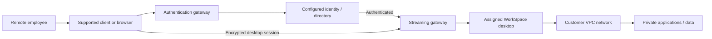
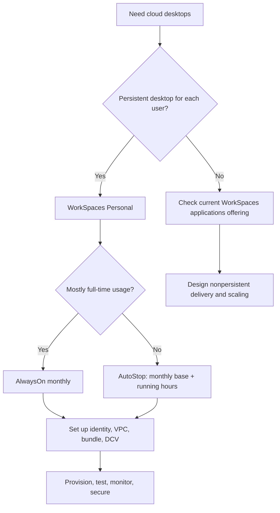
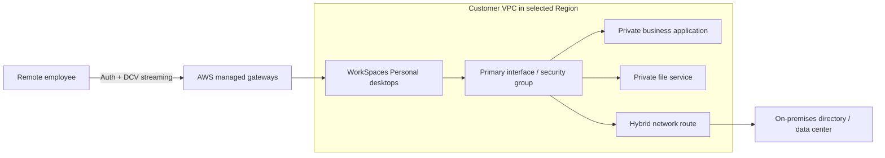
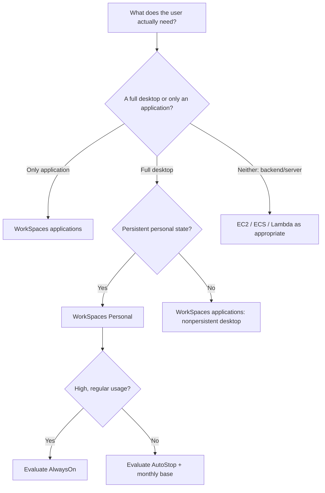

<div align="center">

# Amazon WorkSpaces

### Complete GitHub Study Guide · AWS Cloud Practitioner + Solutions Architect – Associate

[](https://aws.amazon.com/workspaces/)
[](https://aws.amazon.com/certification/certified-cloud-practitioner/)
[](https://aws.amazon.com/certification/certified-solutions-architect-associate/)


**One sentence to remember:** Amazon WorkSpaces delivers managed virtual desktops from AWS to end users; **WorkSpaces Personal** gives a user a persistent desktop, while other WorkSpaces-family offerings address different delivery models.

[CCP essentials](#ccp-essentials) · [SAA architecture](#saa-deep-dive) · [Comparisons](#service-comparisons) · [Exam traps](#exam-traps) · [Practice](#practice-questions)

</div>

---

> [!IMPORTANT]
> **2026 service-status alert — do not study obsolete product names as though nothing changed.** Amazon WorkSpaces Pools stopped accepting new customers **July 31, 2026** and reaches end of support **December 31, 2027**. PCoIP-based WorkSpaces Personal stopped accepting new customers **July 31, 2026** and reaches end of support **October 31, 2027**; use **Amazon DCV** for new WorkSpaces Personal planning. Amazon WorkSpaces Secure Browser closed to new customers **October 29, 2026** (existing users may continue; this is *not* an announced total shutdown). Amazon WorkSpaces Thin Client stopped accepting new customers **April 20, 2026** and reaches end of support **March 31, 2027**. Former **Amazon AppStream 2.0** is now branded **Amazon WorkSpaces applications**. Verify current status before designing a new deployment: [Pools notice](https://docs.aws.amazon.com/workspaces/latest/adminguide/wsp-pools-end-of-support.html) · [PCoIP notice](https://docs.aws.amazon.com/workspaces/latest/adminguide/workspaces-pcoip-end-of-support.html) · [Secure Browser notice](https://docs.aws.amazon.com/workspaces-web/latest/adminguide/workspaces-secure-browser-maintenance-mode.html) · [Thin Client notice](https://docs.aws.amazon.com/workspaces-thin-client/latest/ag/workspacesthinclient-end-of-support.html) · [Applications](https://aws.amazon.com/workspaces/applications/).
>
> **Scope:** This guide focuses on **WorkSpaces Personal**, the core service usually meant by “Amazon WorkSpaces” in CCP questions. It also covers the related family and legacy concepts to prevent confusion. Lifecycle information is correct to the **2026-11-02** review date, not a prediction of future AWS policy.

## Table of contents

1. [What is Amazon WorkSpaces?](#what-is-amazon-workspaces)
2. [What problem does it solve?](#what-problem-does-it-solve)
3. [Core concepts and terminology](#core-concepts-and-terminology)
4. [How WorkSpaces works](#how-workspaces-works)
5. [Key features and capabilities](#key-features-and-capabilities)
6. [Use cases and service-selection rules](#use-cases-and-service-selection-rules)
7. [CCP essentials](#ccp-essentials)
8. [SAA deep dive](#saa-deep-dive)
9. [Service comparisons](#service-comparisons)
10. [Integrations and architecture patterns](#integrations-and-architecture-patterns)
11. [Security and shared responsibility](#security-and-shared-responsibility)
12. [Monitoring, troubleshooting, and recovery](#monitoring-troubleshooting-and-recovery)
13. [Pricing and cost optimization](#pricing-and-cost-optimization)
14. [Console and CLI walkthrough](#console-and-cli-walkthrough)
15. [Exam traps](#exam-traps)
16. [Interview questions](#interview-questions)
17. [Practice questions](#practice-questions)
18. [Scenario drills](#scenario-drills)
19. [Decision tree and keyword recognition](#decision-tree-and-keyword-recognition)
20. [Quick-revision cheat sheet](#quick-revision-cheat-sheet)
21. [Official AWS references and currency](#official-aws-references-and-currency)
22. [Closing takeaway](#closing-takeaway)

---

<a id="what-is-amazon-workspaces"></a>
## 1. What is Amazon WorkSpaces?

**Beginner definition:** Instead of buying and configuring a separate office computer for each worker, an organization can give that worker a **desktop running in AWS**. The person views and controls it remotely from a supported computer or web browser. Their normal device is the **client**; the desktop and its applications run in the AWS cloud.

**Exam-ready definition:** **Amazon WorkSpaces** is a managed **Desktop as a Service (DaaS)** offering that provisions, delivers, and manages virtual desktop infrastructure (VDI). **WorkSpaces Personal** provides a **persistent, assigned virtual desktop**: the same user reconnects to their own desktop and retains its state, subject to recovery, configuration, and lifecycle behavior.

**Analogy:** Imagine renting a fully equipped office that stays in an AWS building. You enter through a secure window (the streaming client), while the furniture and documents remain in that office. You still must control who has the key, what programs are installed, and whether anyone can copy a document outside. A remote **display** is not the same as physically shipping the computer to the user's house.

| Attribute | Correct mental model |
|---|---|
| Category | End User Computing; managed DaaS / VDI |
| Main user goal | Access a remote Windows or Linux desktop |
| Primary form | **WorkSpaces Personal**: personalized, persistent desktop |
| Location | Desktop deployed in a **selected AWS Region** and VPC |
| Identity | A directory/identity integration authenticates end users |
| Delivery | Client or supported web access streams desktop interaction |
| Desktop configuration | OS image + **bundle** (compute/storage), protocol, running mode |
| Security | AWS-managed underlying service + customer-configured identity, OS/apps, network and data controls |
| Billing | Personal: **AlwaysOn (monthly)** or **AutoStop (base monthly + running-hour charges)** |
| Not the same as | EC2 server, RDS database, WorkSpaces applications, or a web-only browser |

> [!TIP]
> **Fast recognition cue:** “Provide staff secure, managed, cloud-hosted **virtual desktops** without operating on-premises VDI” → think **Amazon WorkSpaces**. “Give every employee their **own persistent desktop**” → **WorkSpaces Personal**.

### DaaS vs VDI vs remote desktop

- **VDI** is the broader architecture of centralized virtual desktops. On-premises VDI typically means the company operates its virtualization hosts, brokers, capacity, and supporting infrastructure.
- **DaaS** is the desktop delivered **as a service**; AWS manages substantial infrastructure and orchestration, reducing customer operational work.
- **Remote display protocol** (e.g., Amazon DCV) transmits interactive desktop visuals/input; it is **not** the place where applications execute.
- **RDP** is a Microsoft remote-desktop protocol and is **not** another name for the managed WorkSpaces service or its current streaming protocol.

---

<a id="what-problem-does-it-solve"></a>
## 2. What problem does it solve?

**Traditional approach:** A company buys workstations or builds on-premises VDI, configures hardware and software, manages access from remote locations, maintains capacity and data-center infrastructure, and supports lost/broken endpoints.

**With WorkSpaces Personal:** A company provisions managed cloud desktops, chooses a configuration and AWS Region, connects its user directory, and lets authorized staff work through a remote desktop client. AWS handles the physical desktop-serving infrastructure and key parts of the managed desktop service; **the company still manages applications, access, configuration, many OS responsibilities, compliance, and costs**.

**Typical cases:**

- Remote or hybrid workforce using managed corporate desktops.
- Contractors who need controlled access to internal tools without shipping a high-end PC.
- Developers needing consistent desktop environments and software installed centrally.
- Temporary business expansions that need additional desktops faster than purchasing devices.
- Distributed employees whose desktop workloads should be located close to corporate data.
- Graphic-design or engineering users requiring a suitable graphics-capable bundle, after checking current OS/GPU compatibility.

**When basic tools are insufficient:** A VPN connects devices to a network but does **not** supply a full managed desktop. An EC2 Windows instance is a virtual machine but does **not** automatically give you WorkSpaces' managed desktop lifecycle, end-user delivery, directory workflow, and pricing model. An application-streaming service may deliver apps without supplying each user a persistent personal desktop.

---

<a id="core-concepts-and-terminology"></a>
## 3. Core concepts and terminology

| Term | Meaning | Why it matters |
|---|---|---|
| **WorkSpace** | An individual managed desktop (usually Personal) | Unit assigned to a user, administered and billed |
| **Personal / persistent** | A specific user returns to the same assigned desktop | Retains installed apps, user data and settings, subject to policies and recovery |
| **Pools / nonpersistent** | Historically, users receive fresh shared-pool desktops | Different lifecycle and billing; **closed to new customers** |
| **Image** | OS and software baseline used to create desktops | Standardized application/OS foundation |
| **Bundle** | Image plus hardware/storage configuration | Selects resources and performance/cost characteristics |
| **Directory** | Manages user accounts and authentication for WorkSpaces | Required identity integration; multiple supported models |
| **AWS Directory Service** | Managed AD options and AD Connector | Supports directory-backed authentication and integration |
| **IAM Identity Center** | Workforce identity service for supported directory arrangements | Can authenticate users with WorkSpaces-managed directory models |
| **AD Connector** | Gateway to an existing AD; **not** a standalone directory copy | Allows use of on-premises directory credentials; needs connectivity |
| **Amazon DCV** | AWS remote display/streaming technology for desktops | Current protocol direction; client network rules matter |
| **PCoIP** | Legacy WorkSpaces Personal streaming option | **Sunsetting**; not a new deployment choice |
| **VPC / subnet / AZ** | Your AWS networking layout and placement | WorkSpaces needs suitable networking and directory connectivity |
| **AlwaysOn** | Personal running mode with monthly desktop charge | Predictable access and fixed monthly spending |
| **AutoStop** | Personal mode that stops after disconnection timeout | Monthly base **plus** billed running hours |
| **Root volume** | Windows `C:` or Linux `/` | OS and installed software; recovery implications |
| **User volume** | Windows `D:` or Linux `/home` | User files/profile content; snapshot implications |
| **Restore / rebuild** | Two different recovery operations | Can roll back or erase different parts of desktop state |
| **AWS KMS key** | Encryption key used for WorkSpaces volumes, if configured | Key permissions and availability affect desktop access |
| **Client / web access** | End-user device/app used to connect | Different clients and protocols have support constraints |

### The main WorkSpaces Personal parts



*Conceptual, not packet-level:* Client authentication and display streaming are distinct phases; actual service-controlled interfaces and routing are more detailed. WorkSpaces Personal documentation describes a management/streaming network interface plus a primary VPC network interface for desktop access to customer resources. See [WorkSpaces Personal overview](https://docs.aws.amazon.com/workspaces/latest/adminguide/managing-wsp-personal.html).

### Identity choices: do not mix them up

| Choice | Scenario | Important qualification |
|---|---|---|
| **AWS Managed Microsoft AD** | Directory hosted by AWS | Managed AD service, with customer domain/network responsibilities |
| **AD Connector** | Keep existing on-premises Microsoft AD | Connector redirects auth/queries; dependable hybrid network is essential |
| **Simple AD** | Compatible, more basic directory | Not a complete replacement for all Microsoft AD features |
| **WorkSpaces-managed directory / IAM Identity Center** | Supported workforce identity setup | Uses a different authentication model; exact options depend on configuration |
| **Microsoft Entra ID through supported integration** | Cloud workforce identity | Verify integration, product, and Region prerequisites |
| **SAML 2.0 federation** | Organization uses an identity provider | Documented for supported **Directory Service-backed** WorkSpaces Personal directories; do not assume every model uses the identical SAML flow |

Official reference: [Manage directories](https://docs.aws.amazon.com/workspaces/latest/adminguide/manage-workspaces-directory.html) and [SAML integration prerequisites](https://docs.aws.amazon.com/workspaces/latest/adminguide/amazon-workspaces-saml.html).

---

<a id="how-workspaces-works"></a>
## 4. How WorkSpaces works, step by step

1. **Select a Region** where the service, needed bundles, clients, and compliance requirements are supported.
2. **Plan the VPC** and subnets; standard directory-based deployments use **subnets in different Availability Zones**. Plan DNS, internet/private routes, and access to corporate systems.
3. **Choose a directory/identity method**, making sure connectivity and authentication work (for example, on-premises AD via AD Connector).
4. **Choose a WorkSpaces Personal bundle**: operating system, compute capacity, storage, and compatible **Amazon DCV** protocol.
5. **Choose a running mode**: AlwaysOn for regularly used desktops or AutoStop for less frequent use. Choose storage encryption **at creation** if required.
6. **Provision the desktop and associate a user** using the console or supported APIs. Users do not ordinarily need their own AWS account to sign in to the end-user desktop.
7. **User authenticates** in a supported client/web access flow; after authentication, the service establishes interactive desktop streaming.
8. **User works inside the remote environment**. Application connections to private databases, file shares, and intranet hosts follow **your VPC routes, security controls and DNS**.
9. **Operate and monitor** the desktop: patch and maintain software, apply least privilege, monitor health and login behavior, choose backup/recovery methods, and review costs.



**Simple example — 20 remote accountants:** Provision 20 persistent WorkSpaces with relevant office applications, controlled access to corporate files, directory credentials, and a pricing mode based on expected usage. The employees sign in from their laptops and return to their own desktops.

**More nuanced example — European and US teams:** Deploy WorkSpaces separately in European and US Regions for user proximity/data policy reasons, **with separate regional identity/network preparation, image management, access policies, cost estimates and operational checks**. This is **not** automatic single-WorkSpace multi-Region failover or automatic replication.

> [!WARNING]
> A persistent desktop does **not** mean its files can never be lost. Rebuild, restore, termination, user mistakes, encryption-key problems and your own configuration can affect availability or data. Backups and continuity remain design topics.

---

<a id="key-features-and-capabilities"></a>
## 5. Key features and capabilities

| Feature | Capability | Example | Exam significance |
|---|---|---|---|
| Managed desktop infrastructure | AWS operates the underlying DaaS platform | Avoid owning VDI hypervisors | **CCP** |
| Persistent Personal desktop | Same user's desktop across sessions | Developer retains IDE installation | **CCP** |
| Windows and Linux desktop options | OS selected from supported bundles | Choose compatible OS/apps | **CCP/SAA** |
| Custom images / bundles | Standardize builds and sizes | Company baseline with approved apps | **SAA** |
| AWS Directory Service integration | Connect authentication to corporate identities | AD Connector to on-premises AD | **SAA** |
| Client and browser access | Remote visual interaction | Laptop connects to hosted desktop | **CCP** |
| Region / VPC placement | Put workloads near appropriate data and users | WorkSpaces in EU VPC | **SAA** |
| AlwaysOn / AutoStop | Balance experience and cost | Full-time vs intermittent workers | **CCP/SAA** |
| KMS volume encryption | Encrypt selected root/user volumes | Regulated employee documents | **SAA** |
| CloudWatch / CloudTrail / EventBridge | Monitor health and control-plane actions | Alert on unhealthy desktop | **SAA** |
| Restore and rebuild | Recover from specific snapshots or baseline | Fix broken desktop | **SAA** |
| Graphics-capable bundles | More graphics processing for compatible workloads | 3D/CAD where supported | **SAA** |

### Operating systems and licensing

WorkSpaces Personal offers Windows desktop experiences and several Linux distributions. **Do not equate "Windows desktop experience" with licensed Windows 11 by default**: AWS license-included Windows bundles may run supported **Windows Server** operating systems, while Windows 10/11 desktop licensing is subject to **bring-your-own-license (BYOL)** requirements. Availability varies by bundle, Region, protocol, and lifecycle. [Current bundle/OS matrix](https://docs.aws.amazon.com/workspaces/latest/adminguide/amazon-workspaces-bundles.html).

### Important feature conditions

- **WorkSpaces Personal is primarily persistent;** historical Pools/nonpersistent behavior belongs to a different service model.
- **Amazon DCV** is the forward-looking WorkSpaces Personal protocol; the old PCoIP option is being retired.
- **Not all client devices, web browsers, features, or peripheral redirection options support all protocols.** Check the [client compatibility matrix](https://docs.aws.amazon.com/workspaces/latest/userguide/amazon-workspaces-clients.html).
- **KMS encryption is a provisioning choice**, not a guarantee every existing volume was automatically encrypted with the particular key you wanted.
- **A desktop placed in one AZ is not thereby an active-active desktop in two AZs.** Two-subnet directory/VPC setup must not be misread as duplicate user desktops.

---

<a id="use-cases-and-service-selection-rules"></a>
## 6. Real-world use cases and service-selection rules

| Requirement | Prefer | Reason / caution |
|---|---|---|
| Each employee needs their own managed Windows/Linux desktop | **WorkSpaces Personal** | Persistent state and user personalization |
| Existing on-premises VDI is costly and requires operations staff | **WorkSpaces Personal** | Managed DaaS removes much of the underlying desktop-platform work |
| Users need only a published application, not a full personalized desktop | **WorkSpaces applications** | Stream apps without assigning a persistent personal desktop |
| New nonpersistent/shared desktop deployment | **WorkSpaces applications** | WorkSpaces **Pools is closed to new customers** |
| Run a backend website, batch process, or API server | **EC2 / ECS / Lambda**, as appropriate | Not an end-user desktop problem |
| Serve secure website content from an isolated browser | Browser-isolation solution | WorkSpaces Secure Browser exists for incumbents but **closed to new customers** |
| Host an enterprise database | **RDS / Aurora / other database service** | WorkSpaces is a client desktop, not a managed DB engine |
| Keep existing VDI broker/control software but use AWS desktop infrastructure | **WorkSpaces Core / VDI partners** | Infrastructure/APIs plus third-party VDI software, not the same full DaaS offering |

**Avoid WorkSpaces Personal** when the user's real need is an unattended server, a scalable web tier, a simple access tunnel, a virtual browser alone, or nonpersistent desktop sharing where personal persistent state adds cost and complexity.

---

<a id="ccp-essentials"></a>
## 7. Cloud Practitioner (CCP) essentials


### 18 facts worth memorizing

1. Amazon WorkSpaces is **Desktop as a Service (DaaS)**.
2. It delivers **virtual desktops in the AWS Cloud**.
3. It reduces the need for **on-premises VDI infrastructure**.
4. Users can connect **remotely** from supported devices.
5. The desktop executes in AWS; the end user's device shows an interactive session.
6. **WorkSpaces Personal** is a **persistent** desktop model.
7. A user typically reconnects to the **same assigned WorkSpace**.
8. It can provide **Windows or Linux** desktop environments (subject to current support).
9. AWS manages the **underlying desktop-delivery infrastructure**.
10. Customers still manage their **users, configurations, applications and data protection**.
11. It is designed for **remote workers, contractors and enterprise employees**.
12. It uses **directory/identity** integration to authenticate desktop users.
13. **AlwaysOn** means a predictable **monthly charge** for the desktop.
14. **AutoStop** means a **monthly base fee plus billed running hours**; **not hourly-only with zero idle cost**.
15. AWS **KMS** can encrypt WorkSpaces storage volumes when configured.
16. WorkSpaces deployments are **regional**, not a globally replicated desktop by default.
17. **Amazon WorkSpaces applications** (formerly **AppStream 2.0**) is most associated with **application streaming** and also supports nonpersistent desktops.
18. **Current lifecycle notices matter:** Pools and PCoIP are sunsetting; don't recommend them as new default solutions.

### CCP keyword bank (20)

`Desktop as a Service` · `DaaS` · `virtual desktop` · `VDI` · `remote workforce` · `work from home` · `persistent desktop` · `personalized desktop` · `Windows desktop` · `Linux desktop` · `managed desktop` · `on-premises VDI replacement` · `centralized desktop` · `secure access` · `directory authentication` · `AlwaysOn` · `AutoStop` · `monthly billing` · `hourly billing` · `WorkSpaces`

### If an exam question says X, consider Y

| Question wording | Recognition |
|---|---|
| “Employees need cloud-hosted desktops from home” | **Amazon WorkSpaces** |
| “Replace on-premises virtual desktop infrastructure” | **Amazon WorkSpaces** |
| “Dedicated desktop experience retained between logins” | **WorkSpaces Personal** |
| “A single legacy Windows app needs browser-delivered access” | **WorkSpaces applications**, formerly AppStream 2.0 |
| “Server to host an API” | **EC2, ECS, or Lambda**, not WorkSpaces |
| “Frequently used desktop with predictable monthly bill” | **Personal AlwaysOn** |
| “Occasionally used Personal desktop” | **Personal AutoStop** (including base monthly fee) |
| “Encrypt the desktop storage using AWS-managed key mechanisms” | **AWS KMS integration** |

### CCP recognition mini-scenarios

**Question:** “A company is opening remote branches and wants employees to use their full corporate desktops without operating in-house VDI. What AWS service?”  
**Answer:** Amazon WorkSpaces, specifically WorkSpaces Personal if persistent individual desktops are needed.

**Question:** “Can a company use Amazon EC2 instead?”  
**Answer:** EC2 is general compute. It can run a Windows server, but does not by itself provide the complete managed WorkSpaces desktop service.

**30-second CCP recap:** **WorkSpaces = managed cloud desktops (DaaS).** Windows/Linux desktop environments, remote workforce, persistent Personal desktops, and monthly or monthly-plus-hourly choices. **Applications are different from desktops.**

---

<a id="saa-deep-dive"></a>
## 8. Solutions Architect – Associate (SAA) deep dive


> [!NOTE]
> **SAA depth ≠ claims about guaranteed exam frequency.** These are useful architecture decision points related to WorkSpaces and common supporting AWS services, not an official promise that the exam tests every implementation detail.

### 8.1 Architecture boundaries and data flow

A WorkSpaces Personal design has **three different security/connectivity relationships**:

1. **Client ↔ AWS authentication and streaming service:** the end user's computer connects to AWS-managed gateways using the supported client/protocol and required outbound networking. Authentication traffic and streaming traffic are **not the same flow**.
2. **Desktop ↔ VPC resources:** the WorkSpace uses its primary VPC network interface and applicable VPC routing/security groups to reach internal APIs, file shares, Active Directory, and other systems.
3. **Administration ↔ AWS APIs:** administrators use the console, CLI, IAM permissions, and audit tools to provision, observe, or modify WorkSpaces.

**Key architecture insight:** Opening a web browser on a WorkSpace does not cause corporate applications to execute on the user's laptop. But end-user policies such as clipboard redirection, data upload/download, printing, and local-drive mapping still matter when evaluating data-exfiltration risk.

### 8.2 Network and subnet design

- **Region:** Choose one supporting the desired OS, bundle, protocol, compliance requirements, and price point.
- **VPC:** WorkSpaces desktops connect to a customer VPC for access to business resources.
- **Subnets/AZs:** Configure suitable subnets across **different AZs** for supported directory-based deployment. Verify available AZs and IP capacity; avoid treating a two-subnet requirement as automatic per-desktop cross-AZ replication.
- **Private subnet architecture:** WorkSpaces in private subnets may need **NAT** for internet egress or network paths to endpoints; private corporate resources may stay private.
- **Hybrid:** AD Connector and access to on-premises applications require functioning network paths (e.g. VPN or Direct Connect, routes, DNS, firewall rules and AD ports).
- **Security groups:** Control WorkSpace access to VPC resources. Do not confuse desktop outbound VPC access with client-to-AWS-managed streaming gateway requirements.
- **Ports:** WorkSpaces documentation identifies **443** for authentication/session information and protocol-related traffic on **4195 (DCV)** or legacy **4172 (PCoIP)**, but **actual TCP/UDP directions, IP allowlists, and client requirements must be checked against current official port documentation**; do not build a firewall policy from one memorized port number alone.



This diagram is conceptual, not a guarantee that client traffic passes through the VPC's primary interface. See [WorkSpaces networking](https://docs.aws.amazon.com/workspaces/latest/adminguide/amazon-workspaces-networking.html), [VPC setup](https://docs.aws.amazon.com/workspaces/latest/adminguide/amazon-workspaces-vpc.html), and [IP/port requirements](https://docs.aws.amazon.com/workspaces/latest/adminguide/workspaces-port-requirements.html).

### 8.3 Identity and authorization design

- The **desktop user's login** is authenticated by the configured **directory/identity provider**, **not merely by attaching an IAM policy to the user**.
- **IAM** authorizes AWS administrators/services to call WorkSpaces **management APIs**; configure least privilege rather than distributing AWS console credentials to all desktop users.
- If using **AD Connector**, ensure directory controllers and network connectivity remain reachable; loss of the directory path can break new authentication or directory-dependent operations.
- **MFA/SSO** depend on supported directory/federation arrangements; check the particular identity model rather than claiming every WorkSpace has MFA automatically enabled.
- **End users don't need separate AWS accounts** just to sign into their assigned desktop.

### 8.4 Security and encryption design

- WorkSpaces Personal volumes can be encrypted using the AWS managed WorkSpaces KMS key or an eligible **symmetric customer managed KMS key**.
- Specify **root and/or user volume encryption at launch**. According to current WorkSpaces documentation, **existing unencrypted WorkSpaces cannot simply be encrypted in place**.
- Encrypted snapshots of encrypted volumes are covered by the integrated volume-encryption mechanism.
- A **disabled or inaccessible customer managed KMS key** can make an encrypted WorkSpace **unusable**; key permissions, lifecycle, and change control are operational dependencies.
- Encryption **at rest** and **streaming encryption in transit** address different threats. Neither prevents an authorized user from copying sensitive information by an allowed channel.
- BYOL, Windows licensing, patching, AV/EDR, logging, file access, permitted peripherals, and user rights still require active governance.

### 8.5 Availability, backup, recovery and failure modes

| Concern | Correct design principle |
|---|---|
| One AZ affected | Architecture with more than one AZ may improve service resilience, but **a specific user's WorkSpace is not inherently a multi-AZ active-active pair** |
| One Region affected | Plan separate regional deployment/continuity if needed; **automatic cross-Region desktop failover is not implicit** |
| Unhealthy WorkSpace | Check status/metrics, then consider reboot, **restore** or **rebuild** with attention to data loss |
| Restore | Uses snapshots of **both root and user volumes** from a healthy point in time; **rolls both volumes back** |
| Rebuild | Recreates the **root volume from the bundle image** and **user volume from snapshot**; applications installed after the bundle image can be lost |
| Automatic snapshots | Scheduled roughly **every 12 hours** for documented recovery operations; **not continuous backup or zero-RPO guarantee** |
| Termination | Destructive for WorkSpace-stored data; plan data retention/export and off-desktop backups |
| Identity outage | New logins and directory-dependent actions may fail; troubleshoot the identity/network chain |
| Disabled KMS key | Encrypted WorkSpaces may become unusable; protect the key lifecycle |

Reference: [Restore](https://docs.aws.amazon.com/workspaces/latest/adminguide/restore-workspace.html) and [Rebuild](https://docs.aws.amazon.com/workspaces/latest/adminguide/rebuild-workspace.html).

### 8.6 OS/software image management

Use AWS-supplied bundles or supported custom images/bundles to standardize packages. Consider separate development, accounting, and graphics personas. Update software and test compatibility in pilot desktops before changing a fleet. **A custom image from an encrypted WorkSpace is not supported** under the documented WorkSpaces Personal KMS rules; design your image/encryption workflow accordingly. Do not assume new image content retroactively appears on every running desktop.

### 8.7 Four worked SAA scenarios

**Scenario A — Remote staff need access to private ERP and on-premises AD.**  
Use **WorkSpaces Personal** with a suitable VPC, AD Connector or supported AD design, private connectivity to the data center, reachable DNS/domain controllers, and security-group/routes that permit the desktop to reach the ERP. **Trap:** A user connecting over the public internet to the streaming gateway does **not** mean the desktop automatically can reach your private on-premises directory and ERP.

**Scenario B — 200 employees use a desktop all day; 30 auditors log in a few hours weekly.**  
Segment usage: **AlwaysOn** may fit full-time employees; **AutoStop** may lower costs for occasional users. Calculate AutoStop with **both base monthly fees and running-hours**, not just session duration. **Trap:** Starting and maintenance time can be billable; AutoStop is not zero-cost while stopped.

**Scenario C — Company must encrypt desktop data under customer-controlled keys.**  
Create WorkSpaces with root/user volume encryption enabled from the start, configure a suitable customer managed symmetric KMS key and its authorized use, ensure recovery/key-monitoring procedures, and enforce data-movement policy. **Trap:** Enabling KMS permissions alone does not encrypt a previously unencrypted desktop in place; disabling the key may break existing encrypted desktops.

**Scenario D — Full Region outage cannot interrupt regulated teams.**  
Evaluate additional deployments in a second AWS Region with replicated **business data**, identity integration, images, software, monitoring, and an operational failover plan. Users may need separate desktops/access instructions. **Trap:** Merely choosing two AZ subnets in one Region or drawing arrows to another Region does not create automatic regional desktop replication.

**Scenario E — New deployment requires ephemeral desktops for shift workers.**  
Use the **nonpersistent desktop capabilities of WorkSpaces applications** after verifying current suitability, concurrency, session persistence, and licensing. **Trap:** WorkSpaces Pools is closed to new customers; WorkSpaces Personal is persistent and can be a costly mismatch for shared sessions.

---
<a id="service-comparisons"></a>
## 9. Compare with similar or easily confused AWS services

### The service-selection matrix

| Service / product | Main job | Persistent personal desktop? | Select it when the question says... | Current caution |
|---|---|---|---|---|
| **Amazon WorkSpaces Personal** | Fully managed cloud desktops | **Yes** | “Individual virtual desktop,” “remote workforce,” “retain desktop settings” | Supported core DaaS focus |
| **Amazon WorkSpaces Pools** | Shared, nonpersistent virtual desktops | **No** | “Pooled/fresh desktop every session” in **legacy** architecture | Closed to new users; ends **2027-12-31** |
| **Amazon WorkSpaces applications** (**formerly AppStream 2.0**) | Streams applications **and nonpersistent desktops** | No assigned persistent Personal desktop | “Run desktop applications through a browser,” “new nonpersistent desktops” | New branding; don't say it is *only* single-app streaming |
| **Amazon WorkSpaces Core / VDI partners** | AWS VDI infrastructure/APIs for partner-managed desktops | Depends on partner | “Keep third-party VDI control plane/software” | Not equivalent to all-inclusive WorkSpaces Personal |
| **Amazon WorkSpaces Secure Browser** | Remote isolated browser for websites and SaaS | No | “Browser isolation” or “secure enterprise browser” | Closed to **new** users **2026-10-29**; existing allowed |
| **Amazon WorkSpaces Thin Client** | Dedicated physical endpoint for cloud desktops | Device, not desktop | “Simple centrally managed end-user hardware” | End of support **2027-03-31** |
| **Amazon EC2** | General-purpose cloud virtual servers | Not as a managed WorkSpaces product | “Run a server/VM/application/backend” | Customer responsible for OS/remote access configuration |
| **Amazon ECS / Amazon EKS** | Container orchestration | No | “Run containerized services” | Not an end-user desktop service |
| **AWS Client VPN** | Managed client VPN networking | No | “Private network access from employee devices” | Provides connectivity, **not** a virtual desktop |
| **AWS Directory Service** | Directory and authentication infrastructure | No | “Managed AD,” “connect existing AD” | Can **complement** WorkSpaces, not replace it |

> [!IMPORTANT]
> **Current naming matters:** The product once labeled **Amazon AppStream 2.0** is **Amazon WorkSpaces applications**. It can provide **application streaming and nonpersistent desktops**. The simplistic old rule “AppStream = app only, WorkSpaces = any desktop” is no longer sufficient. [Official service page](https://aws.amazon.com/workspaces/applications/).

<details>
<summary><strong>Comparison 1 — WorkSpaces Personal vs Amazon EC2</strong></summary>

**WorkSpaces Personal** is designed to give a workforce a managed, end-user, remote desktop experience with service-oriented provisioning and lifecycle. **EC2** is general compute for servers; an EC2 Windows instance might display a desktop over configured remote-access software, but you must design licensing, identity, client experience, scaling, security, and operations yourself. Choose by **end-user desktop delivery** vs **general virtual-machine compute**.

</details>

<details>
<summary><strong>Comparison 2 — WorkSpaces Personal vs WorkSpaces applications</strong></summary>

Personal is primarily a **persistent, personally assigned full desktop**, suitable for installing software and retaining individual settings. WorkSpaces applications (formerly AppStream 2.0) is for **application streaming** and now also **nonpersistent desktop sessions**. The distinction is **state and delivery model**, not simply “full desktop vs one app.” Validate concurrency, authentication, OS, storage persistence, and service pricing.

</details>

<details>
<summary><strong>Comparison 3 — WorkSpaces Personal vs historical WorkSpaces Pools</strong></summary>

Personal gives each worker an assigned persistent desktop. Pools supplied a **fresh nonpersistent desktop** from a provisioned pool, potentially storing selected user settings/files externally. **As of 2026-11-02, Pools is closed to new customers and scheduled for sunset.** For a *new* nonpersistent requirement, evaluate **WorkSpaces applications**; for an *existing Pools customer*, plan migration before **2027-12-31**.

</details>

<details>
<summary><strong>Comparison 4 — WorkSpaces Personal vs WorkSpaces Core</strong></summary>

WorkSpaces Personal is an **all-in-one managed desktop service**. WorkSpaces Core is infrastructure and APIs that allow partner solutions to deliver VDI; the **VDI management/software layer comes from a third party**. Core is not the answer merely because the question says “managed desktop.” [Official VDI partner FAQ](https://aws.amazon.com/workspaces/vdi-partners/faqs/).

</details>

<details>
<summary><strong>Comparison 5 — WorkSpaces vs Client VPN</strong></summary>

A VPN lets an employee's **existing device** reach a network. WorkSpaces supplies a **remote cloud desktop** where programs actually execute. A WorkSpace can use private network paths to corporate applications, so networking and virtual desktop delivery can work **together**. A VPN alone cannot create a personalized AWS desktop.

</details>

<details>
<summary><strong>Comparison 6 — Secure Browser vs WorkSpaces Personal</strong></summary>

Secure Browser is a remote browser environment for **websites and SaaS**; Personal offers an **entire general-purpose desktop**. A person needing one isolated HR website doesn't necessarily need a full desktop. However, Secure Browser was **closed to new customers October 29, 2026**; do not recommend new signups without acknowledging that.

</details>

---

<a id="integrations-and-architecture-patterns"></a>
## 10. Integrations and architecture patterns

| Integration | What it contributes | Design concern |
|---|---|---|
| **AWS Directory Service / AD Connector** | Enterprise directory authentication | DNS, AD connectivity, trust, domain controllers |
| **IAM Identity Center / SAML 2.0** | Supported workforce SSO/federated authentication | Specific supported directory model and IdP requirements |
| **Amazon VPC** | Network placement and resource reachability | Subnets, security groups, routing, NAT and IP capacity |
| **AWS Site-to-Site VPN / Direct Connect** | Network route to on-premises applications/directory | Latency, path health, DNS and firewall constraints |
| **AWS KMS** | Encryption keys for provisioned WorkSpaces volumes | Symmetric keys, key grants, disabling/deletion risks |
| **Amazon CloudWatch** | WorkSpace state, health, usage and connection metrics | Correct metric namespace and dimensions; alarms |
| **AWS CloudTrail** | Auditing WorkSpaces management API calls | Trail configuration, destinations, retention |
| **Amazon EventBridge** | Automation in response to supported WorkSpaces events | Event coverage and filtering |
| **Amazon S3 / FSx** | Enterprise content, files or supported persistent repositories | Access control, identity, availability, backup, pricing |
| **AWS Budgets / Cost Explorer** | Cost governance | Monitor Personal monthly/AutoStop costs and supporting infrastructure |

### Pattern A: corporate hybrid desktop

The **user** connects to an AWS-managed streaming service. The **desktop** connects through its VPC to an on-premises domain controller or file service. The AWS management plane is separate again.

### Pattern B: centralized desktops, local endpoints

Keep processing and desktop software in AWS while workers use lower-powered endpoint devices. Do **not** assume every endpoint can run every WorkSpaces client or that local data copying is technically impossible without configured controls.

### Pattern C: cross-Region workforce

Choose regional placements that serve users and comply with residency policies. If the same company needs deployments in `eu-west-1` and `us-east-1`, design **identity, network connectivity, images, user profiles, data access, backup and operations** explicitly for each. **WorkSpaces itself isn't one globally replicated persistent desktop.**

---

<a id="security-and-shared-responsibility"></a>
## 11. Security, permissions, compliance, and shared responsibility

### Who is responsible for what?

| AWS typically manages | The customer still designs/configures |
|---|---|
| Physical data centers, underlying host infrastructure | Identity and joiner/mover/leaver process |
| Managed desktop delivery platform and foundational service components | WorkSpaces administration IAM permissions |
| Infrastructure maintenance of the managed service | Guest OS update management and allowed applications, per WorkSpaces guidance |
| AWS-provided integration points for KMS, networking, logs | Selecting/enabling volume encryption; key policy/availability |
| Service-side streaming/connectivity mechanisms | VPC security groups, routes, DNS, VPN/DX and client network permissions |
| Documented service recovery capabilities | Backups, recovery decisions, user data retention, compliance and testing |

Specific patch/update responsibility varies with supported operating system, service design and configuration. Reference: [Security in WorkSpaces](https://docs.aws.amazon.com/workspaces/latest/adminguide/security.html).

### Security controls you should be able to explain

- **Authentication:** directory, SSO, and supported MFA methods; authorized employees only.
- **Management-plane IAM:** grant administrators only the WorkSpaces API actions they require; don't use the AWS root user for daily administration.
- **VPC least privilege:** security groups/routes permit only necessary directory, app and file-service connections.
- **At rest:** optional WorkSpaces volume encryption using KMS at desktop provisioning; check both volumes and key grants.
- **In transit:** authenticated encrypted streaming between supported client and service; ensure supported protocol/client version and network paths.
- **Endpoint protection:** control clipboard, local drives, file transfer, printing, device redirection and downloads as appropriate to supported client/policy capabilities.
- **Logs/audits:** CloudTrail for API activity, CloudWatch for supported health/connection metrics; neither should be described as an automatic full screen recording or content audit.
- **Data governance:** a cloud desktop does **not** automatically prevent the user from exporting, emailing, printing or copying sensitive information.

### KMS exam traps in detail

1. **Encryption must be specified at WorkSpace creation** under the documented Personal capability; simply enabling an account-level KMS key later is not equivalent to encrypting an existing unencrypted desktop.
2. The **root** and **user** volume are separate choices; design explicitly for both if both must be encrypted.
3. WorkSpaces volume encryption supports an **AWS managed WorkSpaces KMS key** or eligible **symmetric customer managed KMS key**, not arbitrary asymmetric keys.
4. **Disabling or removing access to the key** can make an encrypted desktop inaccessible, especially for reboot/rebuild operations.
5. **Volume encryption does not replace directory MFA, endpoint policy or off-desktop backup**.

Official detail: [Encrypted WorkSpaces in WorkSpaces Personal](https://docs.aws.amazon.com/workspaces/latest/adminguide/encrypt-workspaces.html).

---

<a id="monitoring-troubleshooting-and-recovery"></a>
## 12. Monitoring, auditing, troubleshooting, and failure behavior

### What to observe

| Tool / signal | Example | What it does **not** mean |
|---|---|---|
| **CloudWatch — `AWS/WorkSpaces`** | `Available`, `Unhealthy`, `Stopped`, `ConnectionAttempt` | Not the same as automatically recording every application event |
| **CloudTrail** | API calls to create, modify, or administer WorkSpaces | Not a recording of all user keystrokes or remote desktop content |
| **EventBridge** | Supported session/login events | Doesn't fix an identity/network outage by itself |
| **Directory logs / identity logs** | Auth failures, MFA policy or AD connectivity | A directory failure isn't always a desktop-compute problem |
| **Guest OS / application diagnostics** | Windows/Linux app issues | Guest troubleshooting still matters with a managed DaaS |
| **Billing and Cost Explorer** | Monthly desktops, running-hour consumption | CloudWatch connection counts are not a substitute for cost calculation |

Official: [CloudWatch metrics](https://docs.aws.amazon.com/workspaces/latest/adminguide/cloudwatch-metrics.html) and [monitoring overview](https://docs.aws.amazon.com/workspaces/latest/adminguide/amazon-workspaces-monitoring.html).

### Practical troubleshooting checklist (in order)

1. **Scope:** Is one user's desktop down, all users in one Region, or only access to one corporate application?
2. **Account/Region:** Are you examining the right Region, WorkSpace ID, running mode and directory?
3. **WorkSpace state:** Is it `AVAILABLE`, `STOPPED`, `UNHEALTHY`, provisioning, or undergoing maintenance?
4. **Client:** Is the user on a supported OS/browser/client version for **DCV**, with valid registration/auth settings?
5. **Client network:** Can outbound authentication/streaming reach AWS endpoints and current required ports/IP ranges? Check proxies/firewalls.
6. **Directory:** Can the user authenticate? Are AD/IdP connectivity, DNS, credentials, MFA and directory trust functioning?
7. **Desktop VPC path:** Can the WorkSpace access required app servers, file services, DNS, directory resources and NAT/hybrid gateways?
8. **Guest OS/software:** Is there a boot, patch, disk-space, application or endpoint-security issue?
9. **KMS:** For encrypted desktops, is the key **enabled** and the service authorized to use it?
10. **Metrics/events:** Review CloudWatch, CloudTrail, EventBridge, guest diagnostics, and AWS Health information.
11. **Recovery:** Weigh **reboot vs restore vs rebuild**; confirm snapshots and data-loss impact first.
12. **Escalate:** Contact AWS Support with timestamp, Region, WorkSpace/directory identifiers, events, client logs and observed error symptoms.

### Which recovery operation?

| Operation | Main effect | Typical risk |
|---|---|---|
| **Reboot** | Restarts desktop | Temporary interruption; not an OS/data rollback |
| **Restore** | Rolls root **and** user volumes back from snapshots | Changes after the selected snapshot may be lost |
| **Rebuild** | Resets root from bundle image; user volume from snapshot | Custom-installed programs/config changes lost; user data rolls back |
| **Terminate** | Removes WorkSpace | **Destructive**; do not use as a harmless troubleshooting action |

**Not a zero-RPO promise:** Documented automatic snapshots occur on a schedule (roughly every 12 hours), are subject to health/prerequisites and are not a substitute for a business backup plan.

---

<a id="pricing-and-cost-optimization"></a>
## 13. Pricing and cost optimization

### WorkSpaces Personal billing

| Mode | Cost components | Best fit | Trade-off |
|---|---|---|---|
| **AlwaysOn** | Fixed **monthly WorkSpace charge** | Daily/full-time use | Charges even when worker isn't logged in |
| **AutoStop** | **Monthly base fee + running hours** (and relevant other charges) | Intermittent use | Start-up delay; base fee continues when stopped |

For a simplified monthly comparison for a given **Region, bundle, OS/license, and storage choice**:

```text
AlwaysOn monthly estimate
  ≈ monthly AlwaysOn desktop rate + extra applicable charges

AutoStop monthly estimate
  ≈ monthly AutoStop base
   + (billable running hours × hourly rate)
   + extra applicable charges

Approximate break-even running hours
  ≈ (AlwaysOn monthly rate − AutoStop monthly base) / AutoStop hourly rate
```

**Illustrative algebra, not a current price quote.** The formula assumes comparable bundle, license, Region and storage, and omits additional networking, data-transfer, software, directory, and ancillary charges. Billing granularity, minimums and maintenance/startup hours can affect results; AWS FAQ documents partial hours as full hourly units under its billing rules. Never claim an exact price without checking an official Region-specific rate. [WorkSpaces Personal pricing](https://aws.amazon.com/workspaces/desktop-as-a-service/pricing/) and [billing FAQ](https://aws.amazon.com/workspaces-family/workspaces/faqs/).

### What changes the bill?

- Selected **bundle** (compute, memory, graphics and storage).
- **Region**, **Windows/Linux licensing** and BYOL eligibility.
- **AlwaysOn** vs **AutoStop** and real usage pattern, including startup/maintenance.
- Number of **provisioned desktops** and extended storage features.
- **Identity/networking** dependencies (e.g., Directory Service, NAT, VPN/Direct Connect if charged).
- Applicable **data transfer**, monitoring, backups and third-party licenses.
- Migrating or terminating desktops can change costs but can also cause downtime/data loss.

**Cost strategy:** Measure usage first; map personas to appropriately sized bundles; choose AutoStop for genuinely sporadic users; evaluate [Cost Optimizer for Amazon WorkSpaces](https://aws.amazon.com/workspaces/pricing/) for utilization analysis; use AWS Cost Explorer, tags, and budgets to detect idle resources. Review the status of sunset products before committing to a new architecture.

> [!WARNING]
> **AutoStop does not mean “only pay when a user is typing.”** Charges depend on WorkSpace state and billing rules; a monthly base fee persists. Avoid choosing the wrong answer just because the scenario says “hourly.”

---

<a id="console-and-cli-walkthrough"></a>
## 14. Practical Console and AWS CLI walkthrough

### Safe concept-first console exercise

1. Sign in with an **authorized AWS administrator identity** (do not use root).
2. Select the AWS Region, then open the **Amazon WorkSpaces console**.
3. Explore **bundles**, available OS/protocol options and directory creation/registration workflows.
4. In a **sandbox/test account**, create or select a permitted directory and the necessary VPC/subnets. Check network, permissions, and any directory charges.
5. Select a **Personal** bundle and **Amazon DCV**; choose a test user and running mode.
6. If the exercise needs storage encryption, select supported **root/user encryption and KMS key before creation**.
7. Provision and connect from a supported client. Verify that the desktop can reach the intended VPC/private services.
8. Inspect **status**, **CloudWatch**, **CloudTrail**, and cost usage. Clean up only after exporting needed user data.

**Cost warning:** Directory/VPC networking resources and desktops can incur charges even when no user is connected. Don't launch billable resources purely to practice service recognition.

### Read-only CLI examples

These commands require AWS CLI v2 configured with valid credentials and **authorized** `workspaces:Describe*`-style permissions appropriate to the exact operation. They do not create, modify, or terminate resources.

```bash
# Replace eu-west-1 with a Region where WorkSpaces is supported.
aws workspaces describe-workspace-bundles \
  --region eu-west-1 \
  --owner AMAZON \
  --query 'Bundles[*].[Name,BundleId]' \
  --output table

# List desktops in the selected Region and their status / running modes.
aws workspaces describe-workspaces \
  --region eu-west-1 \
  --query 'Workspaces[*].[WorkspaceId,UserName,State,WorkspaceProperties.RunningMode]' \
  --output table

# Discover directory resources visible to the authorized caller.
aws workspaces describe-workspace-directories \
  --region eu-west-1 \
  --query 'Directories[*].[DirectoryId,DirectoryName,State]' \
  --output table
```

If no desktops or directories exist, empty output is expected; CLI access by itself doesn't provision anything. Bundle names can include retired/legacy images, so cross-check actual provisioning eligibility. Commands based on the [official AWS CLI WorkSpaces examples](https://docs.aws.amazon.com/cli/latest/userguide/cli_workspaces_code_examples.html).

---

<a id="exam-traps"></a>
## 15. Common exam traps and misconceptions

| # | Misconception | Correct interpretation | Level |
|---|---|---|---|
| 1 | “WorkSpaces is a database service.” | It provides **virtual desktops**, not a managed database. | CCP |
| 2 | “WorkSpaces is just EC2 with a different name.” | WorkSpaces includes managed desktop provisioning, delivery, identity workflow and lifecycle. | CCP |
| 3 | “VDI means AWS sends a physical PC to the user.” | The desktop runs remotely; only interactive access streams to the endpoint. | CCP |
| 4 | “WorkSpaces Personal desktops are shared anonymously among workers.” | Personal assigns a **persistent desktop to a user**. | CCP |
| 5 | “Every WorkSpaces offering is persistent.” | Historical **Pools** and **applications** include nonpersistent delivery modes. | CCP/SAA |
| 6 | “AppStream 2.0 is still the only correct product name.” | It is now **WorkSpaces applications**; legacy study questions may use the old term. | CCP |
| 7 | “AppStream/WorkSpaces applications can only stream one app, never a desktop.” | Current WorkSpaces applications also supports **nonpersistent desktops**. | CCP/SAA |
| 8 | “WorkSpaces Pools is a normal new-customer default in late 2026.” | Closed to new customers **2026-07-31**; ends **2027-12-31**. | SAA |
| 9 | “PCoIP should be preferred for new deployments.” | PCoIP-based Personal is sunsetting; **Amazon DCV** is current direction. | SAA |
| 10 | “Secure Browser is open for brand-new sign-ups in November 2026.” | Closed to new customers **2026-10-29**; existing use continues. | SAA |
| 11 | “AWS Thin Client is a virtual desktop itself.” | It is **endpoint hardware**, and its support ends **2027-03-31**. | CCP/SAA |
| 12 | “AlwaysOn means you pay only for logged-in hours.” | **AlwaysOn = monthly desktop charge**. | CCP |
| 13 | “AutoStop has zero charges while stopped.” | **Monthly base** remains; running-hour billing also applies. | CCP/SAA |
| 14 | “AutoStop always resumes instantly.” | It requires startup time; AlwaysOn best fits instant regular access. | SAA |
| 15 | “Every user needs their own AWS account to open a WorkSpace.” | End users normally authenticate through the configured **directory/identity** model. | CCP/SAA |
| 16 | “IAM replaces the employee directory.” | IAM manages **AWS API permissions**; end-user desktop login uses the configured identity mechanism. | SAA |
| 17 | “AD Connector stores an independent complete copy of AD.” | It connects to **existing AD**; directory/network availability is important. | SAA |
| 18 | “Two AZ subnets mean every WorkSpace is actively replicated across AZs.” | Subnets span AZs for the design; each user's desktop isn't automatically active-active. | SAA |
| 19 | “WorkSpaces is global and desktops seamlessly move between Regions.” | Deployments are **regional**; multi-Region continuity must be engineered. | CCP/SAA |
| 20 | “A user can reach the streaming service, so they can reach private ERP.” | VPC routing, security groups, directory, DNS and hybrid paths are **separate dependencies**. | SAA |
| 21 | “All WorkSpaces volumes are automatically encrypted under my chosen CMK.” | Specify eligible root/user volume encryption and KMS key at launch. | SAA |
| 22 | “I can encrypt an existing unencrypted WorkSpace in place.” | WorkSpaces Personal documentation states encryption is configured at launch. | SAA |
| 23 | “An asymmetric KMS key works for WorkSpaces volume encryption.” | Select supported **symmetric** KMS key type. | SAA |
| 24 | “Disabling the KMS key has no effect once the volume was encrypted.” | A key disabled/inaccessible can make the desktop **unusable**. | SAA |
| 25 | “A KMS-encrypted desktop automatically blocks screenshots or copying.” | Storage encryption doesn't stop allowed **endpoint/clipboard/file transfer**. | SAA |
| 26 | “Restore and rebuild are synonyms.” | **Restore** rolls root+user to snapshots; **rebuild** restores root from bundle and user from snapshot. | SAA |
| 27 | “Snapshots provide continuous backup / zero data loss.” | Documented snapshots are scheduled (around **12 hours**); RPO isn't zero. | SAA |
| 28 | “Rebuild preserves every program installed after provisioning.” | New root derives from the **bundle image**, so custom installations can be lost. | SAA |
| 29 | “CloudTrail records everything a user sees and types.” | CloudTrail is primarily **AWS API audit**; it does not automatically record complete desktop sessions. | SAA |
| 30 | “WorkSpaces automatically patches every custom app and meets my compliance needs.” | Customer retains application, OS-management, access and compliance responsibilities. | SAA |
| 31 | “WorkSpaces Core is just another name for WorkSpaces Personal.” | Core supplies APIs/infrastructure for **partner VDI** rather than identical all-in-one DaaS. | SAA |
| 32 | “Windows 11 licenses are included with every Windows desktop.” | Windows desktop BYOL has specific eligibility; license-included bundles can use Windows Server. | SAA |

**Mechanism to internalize:** **Authentication**, **streaming connectivity**, **desktop-to-business-resource network reachability**, **storage encryption**, and **recovery** are **five different design concerns**. A single “secure virtual desktop” checkbox does not solve all five.

---

<a id="interview-questions"></a>
## 16. Interview questions and concise answers

1. **What is WorkSpaces?** — A managed AWS DaaS service for cloud-hosted virtual desktops, with Personal supplying persistent assigned desktops.
2. **Why choose WorkSpaces over EC2?** — WorkSpaces solves end-user virtual desktop delivery and management; EC2 is a general-purpose VM building block.
3. **What does persistent mean?** — The same user normally reconnects to an assigned desktop with retained personal state; it doesn't eliminate backup risks.
4. **AlwaysOn vs AutoStop?** — AlwaysOn is a fixed monthly desktop charge; AutoStop has monthly base plus billable running hours and a startup delay.
5. **How does an employee authenticate?** — Through the configured directory/identity method, possibly AD Connector, Managed AD or supported workforce identity integration; not automatically through a personal IAM user.
6. **How would you connect a WorkSpace to an on-premises ERP?** — Use VPC routes/security groups, appropriate VPN/Direct Connect paths, DNS, and reachable directory/app servers; test from inside the desktop.
7. **What is the KMS design risk?** — Configure symmetric-key volume encryption when provisioning and protect key/grant availability; disabling the key can break encrypted desktop use.
8. **Why isn't two-AZ subnet design automatically disaster recovery?** — Multiple AZs support deployment topology, but a user's specific desktop isn't an automatically replicated active-active cross-AZ instance.
9. **Restore versus rebuild?** — Restore root and user volumes from snapshots; rebuild root from bundle and user from snapshot, with different data-loss implications.
10. **What replaced AppStream 2.0 terminology and what about nonpersistent desktops?** — The current product is WorkSpaces applications; it supports streaming apps and nonpersistent desktops, while WorkSpaces Pools is being retired.
11. **How would you investigate a user unable to log in?** — Check client/protocol, AWS endpoint access, directory credentials/IdP, DNS/AD reachability, WorkSpace status, supported metrics/events, and KMS key state if encrypted.
12. **How do you estimate 500 desktops' cost?** — Segment users by usage, choose OS/bundles/Regions, compare AlwaysOn against AutoStop with monthly base + billable hours, include directory/network/licensing/transfer and validate official Region-specific rates.

---
<a id="practice-questions"></a>
## 17. Original exam-style practice questions

These **30 original** questions are self-study exercises, **not** copied, official, or leaked exam questions. The CCP questions emphasize service recognition; the SAA questions emphasize design trade-offs. Open each answer after choosing an option.

### CCP: questions 1–15

<details>
<summary><strong>Q1 · CCP — Remote employees need cloud desktops</strong></summary>

A company wants employees to access full, managed desktops remotely without owning on-premises VDI infrastructure. Which service is the most direct fit?

- A. Amazon WorkSpaces
- B. Amazon RDS
- C. Amazon SQS
- D. Amazon CloudFront

**Answer: A — Amazon WorkSpaces.** It is managed DaaS for remote desktops. RDS is a database service; SQS is a queue; CloudFront is content delivery.

</details>

<details>
<summary><strong>Q2 · CCP — What does DaaS mean?</strong></summary>

DaaS in the Amazon WorkSpaces context stands for what?

- A. Database as a Service
- B. Desktop as a Service
- C. Directory as a Service
- D. Data Analytics as a Service

**Answer: B — Desktop as a Service.** AWS supplies managed cloud desktop infrastructure. Although directory services can participate, they are not what DaaS means.

</details>

<details>
<summary><strong>Q3 · CCP — Personal desktop persistence</strong></summary>

A software engineer needs to return to the same personal desktop with installed tools and saved settings. Which option best fits?

- A. WorkSpaces Personal
- B. S3 Standard
- C. CloudFront Functions
- D. Amazon SNS

**Answer: A.** WorkSpaces Personal provides persistent assigned desktops. The other choices don't deliver a persistent end-user desktop.

</details>

<details>
<summary><strong>Q4 · CCP — WorkSpaces is not a database</strong></summary>

Which service should a company use specifically to run a managed relational database?

- A. WorkSpaces Personal
- B. Amazon RDS
- C. Amazon WorkSpaces Thin Client
- D. AWS Client VPN

**Answer: B — Amazon RDS.** WorkSpaces supplies a desktop, Thin Client is hardware, and Client VPN supplies remote network connectivity.

</details>

<details>
<summary><strong>Q5 · CCP — AlwaysOn price model</strong></summary>

A workforce needs its virtual desktops ready for regular daily use and wants a fixed monthly desktop price. Which WorkSpaces Personal running mode is more appropriate?

- A. AutoStop
- B. AlwaysOn
- C. Spot
- D. Provisioned Concurrency

**Answer: B — AlwaysOn.** It is billed with a fixed monthly desktop rate. AutoStop includes monthly base and billable usage, and the other options aren't Personal running modes.

</details>

<details>
<summary><strong>Q6 · CCP — AutoStop is not entirely free while stopped</strong></summary>

Which statement is correct for WorkSpaces Personal AutoStop?

- A. There is no charge of any kind when the desktop is stopped.
- B. It is charged exactly like an EC2 Spot Instance.
- C. It uses a monthly base charge plus billable running-hour charges.
- D. It cannot retain user settings.

**Answer: C.** The monthly base remains while stopped. A is the tempting misconception. AutoStop is not EC2 Spot and does not eliminate Personal desktop persistence.

</details>

<details>
<summary><strong>Q7 · CCP — Main end-user activity</strong></summary>

What is an employee primarily doing when connecting to a WorkSpaces Personal desktop?

- A. Operating a remote desktop running in AWS
- B. Creating a Route 53 hosted zone
- C. Replicating an S3 bucket
- D. Editing an IAM SCP

**Answer: A.** WorkSpaces is for end-user computing. The other answers describe separate infrastructure/administrative tasks.

</details>

<details>
<summary><strong>Q8 · CCP — Windows or Linux?</strong></summary>

Which statement is most accurate?

- A. WorkSpaces is exclusively Linux-based.
- B. WorkSpaces is exclusively Windows 11-based.
- C. WorkSpaces offers supported Windows and Linux desktop configurations.
- D. WorkSpaces has no operating system.

**Answer: C.** Availability and licensing depend on bundle/Region. The absolute claims in A, B, and D are incorrect.

</details>

<details>
<summary><strong>Q9 · CCP — Application streaming product</strong></summary>

A company wants to stream an existing desktop software application to end users without delivering everyone an individually persistent desktop. Which AWS service is most relevant?

- A. Amazon WorkSpaces applications
- B. Amazon EBS
- C. Amazon Redshift
- D. Amazon Route 53

**Answer: A.** WorkSpaces applications, formerly AppStream 2.0, supports application streaming. EBS, Redshift and Route 53 solve different problems.

</details>

<details>
<summary><strong>Q10 · CCP — Corporate directory</strong></summary>

A company wants desktop users to authenticate with its existing corporate identities. What supporting service category is relevant?

- A. Directory/identity integration
- B. Amazon S3 lifecycle transition
- C. AWS Snowball Edge
- D. Amazon CloudFront edge cache

**Answer: A.** WorkSpaces integrates with supported directory/identity methods. The other options do not provide user-directory authentication.

</details>

<details>
<summary><strong>Q11 · CCP — Client VPN vs desktop</strong></summary>

Which service **creates a managed virtual desktop** rather than only a path into a private network?

- A. AWS Client VPN
- B. Amazon WorkSpaces Personal
- C. AWS Direct Connect
- D. AWS Site-to-Site VPN

**Answer: B.** A VPN/Direct Connect provides connectivity, not the remote desktop itself.

</details>

<details>
<summary><strong>Q12 · CCP — Who manages infrastructure?</strong></summary>

Which responsibility is most directly reduced when moving from on-premises VDI to Amazon WorkSpaces?

- A. Managing the underlying VDI hardware and desktop-serving platform
- B. Managing employee permissions and offboarding
- C. Classifying sensitive customer data
- D. Maintaining all custom enterprise apps without testing

**Answer: A.** AWS manages much of the infrastructure. The customer is still accountable for identities, data governance and application operations.

</details>

<details>
<summary><strong>Q13 · CCP — Regional placement</strong></summary>

How should an architect think about WorkSpaces locations?

- A. Every user desktop is automatically duplicated across all AWS Regions.
- B. WorkSpaces Personal desktops are deployed into a selected AWS Region.
- C. WorkSpaces has no concept of geography.
- D. CloudFront POPs replace the desktop's Region.

**Answer: B.** WorkSpaces is region-scoped. Automatic worldwide replication and CloudFront-based placement are incorrect.

</details>

<details>
<summary><strong>Q14 · CCP — Encrypting virtual desktop storage</strong></summary>

What AWS service integrates with WorkSpaces to encrypt eligible desktop storage volumes at provisioning?

- A. AWS KMS
- B. Amazon Polly
- C. Amazon SQS
- D. AWS CodeBuild

**Answer: A.** KMS manages the relevant encryption keys. The other services aren't storage-key management services.

</details>

<details>
<summary><strong>Q15 · CCP — Product rename</strong></summary>

An older course mentions Amazon AppStream 2.0. What is its current product name?

- A. AWS Glue
- B. Amazon WorkSpaces applications
- C. Amazon WorkSpaces Personal
- D. Amazon CloudWatch RUM

**Answer: B.** AppStream 2.0 is now branded WorkSpaces applications. It isn't the same Personal persistent-desktop service.

</details>

### SAA: questions 16–30

<details>
<summary><strong>Q16 · SAA — New nonpersistent desktops in late 2026</strong></summary>

An organization is launching a *new* nonpersistent desktop service for rotating contact-center shifts in November 2026. What should the architect investigate first?

- A. New WorkSpaces Pools enrollment
- B. WorkSpaces applications nonpersistent desktop capabilities
- C. Amazon WorkSpaces Thin Client as a cloud VM
- D. Amazon RDS read replicas

**Answer: B.** WorkSpaces applications has nonpersistent desktop capability. **Pools closed to new customers July 31, 2026**, making A an outdated recommendation; Thin Client is endpoint hardware and RDS is unrelated.

</details>

<details>
<summary><strong>Q17 · SAA — Private ERP unreachable</strong></summary>

A user can sign in to the WorkSpace but cannot reach a private application in the company data center. What should be reviewed first?

- A. CloudFront cache invalidation only
- B. Routes, security groups, DNS, and VPN/Direct Connect connectivity from the desktop VPC
- C. S3 replication only
- D. AWS Budget thresholds only

**Answer: B.** Desktop streaming authentication and desktop-to-ERP networking are separate flows. The other options do not explain private network reachability.

</details>

<details>
<summary><strong>Q18 · SAA — Identity choice for on-premises AD</strong></summary>

A company wants remote cloud desktops that authenticate using an existing on-premises Active Directory without building another full independent AD domain. Which directory integration is relevant?

- A. AD Connector
- B. AWS Shield Advanced
- C. Amazon CloudFront OAC
- D. Amazon Route 53 traffic policy only

**Answer: A.** AD Connector uses the existing AD, **provided there is network/DNS/domain-controller connectivity**. It is not a fully independent replicated directory.

</details>

<details>
<summary><strong>Q19 · SAA — Admin IAM vs login</strong></summary>

A desktop user cannot sign in. An engineer attaches an IAM policy allowing `workspaces:DescribeWorkspaces` to that user's AWS IAM role. Why is this unlikely to solve the problem?

- A. WorkSpaces uses an employee directory/identity flow to authenticate desktop sessions; the permission is for management APIs.
- B. WorkSpaces never uses AWS API permissions for administration.
- C. WorkSpaces cannot integrate with directories.
- D. All desktop logins are anonymous.

**Answer: A.** Distinguish desktop session identity from IAM management authorization. The other claims are false.

</details>

<details>
<summary><strong>Q20 · SAA — Encrypted desktop after launch</strong></summary>

A WorkSpaces Personal desktop was launched with unencrypted volumes. A new requirement mandates KMS volume encryption. What is the safer architecture expectation?

- A. Toggle an arbitrary KMS key and assume the existing disk becomes encrypted immediately.
- B. Plan a supported **new encrypted desktop/provisioning and data migration** process.
- C. Encrypt only the user’s laptop.
- D. Use an asymmetric KMS key for in-place conversion.

**Answer: B.** WorkSpaces Personal volume encryption is specified during launch; in-place encryption of an existing unencrypted WorkSpace is not supported by the documented capability. A/D assume unsupported behavior; C doesn't encrypt AWS-resident volumes.

</details>

<details>
<summary><strong>Q21 · SAA — Encryption key disabled</strong></summary>

An encrypted WorkSpace becomes unusable after a key-management change. What is an important hypothesis?

- A. The symmetric customer managed KMS key was disabled or its access lost.
- B. The WorkSpace has become a CloudFront distribution.
- C. A Route 53 alias record expired.
- D. AutoStop automatically deletes KMS keys.

**Answer: A.** WorkSpaces relies on its key for access to encrypted volumes. This is an operational dependency; the other options are unrelated.

</details>

<details>
<summary><strong>Q22 · SAA — Restore versus rebuild</strong></summary>

A user's root-volume software installation became corrupt. Which action **restores the root from the original WorkSpaces bundle image** while using a snapshot for the user volume?

- A. Restore
- B. Rebuild
- C. Change billing mode
- D. Rotate IAM access keys

**Answer: B — Rebuild.** Restore uses point-in-time snapshots of root and user; **rebuild** resets root from the bundle image and user from a snapshot. Be prepared for custom installed software to disappear.

</details>

<details>
<summary><strong>Q23 · SAA — Accurate snapshot claim</strong></summary>

Which is the best description of WorkSpaces Personal automatic recovery snapshots?

- A. Continuous real-time replication with guaranteed zero lost data
- B. Scheduled snapshots, documented around every 12 hours, with restore/rebuild prerequisites
- C. Snapshots of the user laptop disk
- D. Automatically equivalent to cross-Region failover

**Answer: B.** The recovery mechanism is periodic and requires the relevant snapshots. A/D are overpromises; C confuses the client and hosted desktop.

</details>

<details>
<summary><strong>Q24 · SAA — High availability misunderstanding</strong></summary>

An architect creates two subnets in different AZs for a WorkSpaces directory. Has the architect guaranteed each individual user's desktop will automatically survive one AZ failure without reconnection?

- A. Yes: every WorkSpace is mirrored active-active.
- B. Yes: CloudFront automatically copies desktop disks.
- C. No: subnet topology does not imply an active-active duplicate of each individual desktop.
- D. Yes: S3 Cross-Region Replication automatically applies.

**Answer: C.** Different-AZ subnets are a deployment prerequisite/design feature, not a guaranteed per-user replicated instance. A/B/D invent unavailable automatic behavior.

</details>

<details>
<summary><strong>Q25 · SAA — Full-time vs occasional cost model</strong></summary>

A firm has 300 employees with daily eight-hour desktop use and 20 auditors who connect occasionally. What approach best supports a cost comparison?

- A. Put all users on EC2 Spot because WorkSpaces Personal uses Spot pricing.
- B. Choose AlwaysOn for regular users and evaluate AutoStop for auditors using monthly base **plus** billable hours.
- C. Select AutoStop for all without calculating monthly base costs.
- D. Use the same bundle and charge in every Region.

**Answer: B.** Segment by actual usage and calculate full monthly costs. A mislabels the product, C ignores charges, and D ignores regional/configuration variation.

</details>

<details>
<summary><strong>Q26 · SAA — Secure Browser service status</strong></summary>

On November 2, 2026, a new AWS customer asks to enroll in Amazon WorkSpaces Secure Browser for the first time. What is the main caveat?

- A. It is a database service.
- B. It has been closed to new customers since October 29, 2026.
- C. It requires every user to install a WorkSpaces Personal desktop.
- D. Its entire service shut down on October 29, 2026.

**Answer: B.** WorkSpaces Secure Browser entered maintenance/closed-to-new-customer status, **not** a documented shutdown for existing customers. D exaggerates the lifecycle notice.

</details>

<details>
<summary><strong>Q27 · SAA — PCoIP migration</strong></summary>

An enterprise has legacy PCoIP WorkSpaces Personal deployments and is planning protocol support through 2028. Which design action is best?

- A. Keep PCoIP indefinitely with no migration plan.
- B. Migrate to Amazon DCV with client/network/peripheral pilot testing before October 31, 2027.
- C. Replace DCV with HTTP only.
- D. Assume a PCoIP zero client can always run DCV with a firmware toggle.

**Answer: B.** Official AWS guidance sets PCoIP end of support **2027-10-31**. Protocol migration affects firewall requirements and endpoint compatibility; older PCoIP zero-client hardware may need replacement.

</details>

<details>
<summary><strong>Q28 · SAA — Data-security assumption</strong></summary>

A WorkSpace stores confidential data on an encrypted volume. Which additional control is still relevant?

- A. Prevent or restrict unauthorized local drive/clipboard/file-transfer mechanisms according to supported policies.
- B. Disable all audit logs permanently.
- C. Treat storage encryption as authorization for anyone to sign in.
- D. Remove the directory from the architecture.

**Answer: A.** Encryption at rest does not prevent authorized-session exfiltration. B/C/D reduce security rather than enforce it.

</details>

<details>
<summary><strong>Q29 · SAA — Regional business continuity</strong></summary>

A business requires a contingency if an AWS Region becomes unavailable. What is the correct approach?

- A. WorkSpaces Personal duplicates every desktop across all Regions by default.
- B. Deploy and test a separate multi-Region continuity design, including identity, images, application data and user access.
- C. Select any two AZs and assume a second Region is covered.
- D. Increase the EC2 Spot bid of the WorkSpace.

**Answer: B.** Regional resilience is an explicitly designed workload property. A/C falsely assume automatic replication; D does not apply.

</details>

<details>
<summary><strong>Q30 · SAA — Correct VDI family choice</strong></summary>

A company insists on retaining a third-party VDI broker and management suite but wants AWS infrastructure and APIs under it. Which offering is conceptually closest?

- A. Amazon WorkSpaces Core / VDI partners
- B. Amazon S3 Transfer Acceleration
- C. Amazon Route 53 Resolver
- D. Amazon Kinesis Data Firehose

**Answer: A.** WorkSpaces Core is designed for VDI partner software/infrastructure integration. It is not the same turnkey experience as Personal; B/C/D are unrelated services.

</details>

---

<a id="scenario-drills"></a>
## 18. Scenario drills — requirements, decisions and pitfalls

| Requirement | Recommended design | Reasoning | Key pitfall |
|---|---|---|---|
| 70 full-time remote developers need personalized IDE setups | WorkSpaces Personal + compatible compute bundle + **AlwaysOn** evaluation | Personal retains user-specific installed tools and desktop state | Not a zero-management service: applications and access still need governance |
| 300 shift staff share disposable work sessions | WorkSpaces **applications** with nonpersistent delivery | Shared ephemeral desktops may fit better than 300 personal desktops | **Pools** is closed to new customers; validate session persistence/licensing |
| Users authenticate using existing on-prem AD | WorkSpaces Personal + **AD Connector** (or supported AD design) + private hybrid connectivity | Retains corporate authentication source | Broken AD/DNS/network can block logins |
| Financial desktops need at-rest encryption under a customer key | Encrypt root+user volumes at creation using eligible KMS key; restrict data movement | Protects stored volume/snapshot data and control of key use | Disabled key can break desktops; KMS doesn't stop clipboard copying |
| US and EU teams need low-latency desktops while business data obeys regional policy | Independent regional WorkSpaces deployment and governed data placement | Place compute where it serves users/data residency | **No automatic cross-Region replication** of each user's desktop |
| 15 auditors need desktops sporadically | Test **AutoStop** against monthly AlwaysOn based on usage | Hourly metering may fit intermittent access | Base monthly charge and startup/maintenance time remain |
| Recover a corrupt OS after unsuccessful guest repair | Assess **rebuild** using documented snapshots | Resets the root from bundle image | App installs after image creation can be lost; user data rolls back |
| Desktop users can log in but not reach internal inventory portal | Inspect VPC security groups, routes, DNS and hybrid private connectivity | Session login path and desktop-to-app path differ | Don't try to solve with only the user's IAM policy |

---

<a id="decision-tree-and-keyword-recognition"></a>
## 19. Exam-question decision tree and keyword recognition



| Keyword in the prompt | Choose / investigate | What changes the answer? |
|---|---|---|
| “Remote workers need their own Windows/Linux computers” | **WorkSpaces Personal** | If only one app is needed, consider WorkSpaces applications |
| “Keep personal desktop settings between logins” | **Persistent Personal** | Shared ephemeral workloads point elsewhere |
| “Run legacy desktop app via browser without local installation” | **WorkSpaces applications** | Full persistent personal desktop changes selection |
| “Start a fresh desktop at every shift” | **WorkSpaces applications** (new deployment) | Existing Pools environments require sunset/migration planning |
| “Need virtual machine for web server” | **EC2/ECS/etc.** | No end-user desktop requested |
| “Need network tunnel into the VPC” | **Client VPN / connectivity** | A VPN does not supply cloud desktop compute |
| “Keep third-party VDI management software” | **WorkSpaces Core** | Personal is the integrated DaaS option |
| “Use existing AD” | **AD Connector / supported directory integration** | Hybrid DNS, routes, and network health matter |
| “Monthly predictable desktops” | **AlwaysOn** | Check hours and break-even vs AutoStop |
| “Infrequent/occasional desktops” | **AutoStop** | Must include monthly base and startup time |
| “At-rest encrypted WorkSpaces volumes” | **KMS at launch** | Check key and both volumes; can't encrypt existing unencrypted WorkSpace in place |
| “Return root and user volumes to last healthy snapshot” | **Restore** | Rebuild instead recreates root from bundle image |
| “Reinstall base OS/image but keep snapshotted user volume” | **Rebuild** | Custom installs and newer user data may be lost |
| “Need cross-Region resilience” | **Design separate deployments** | Not automatic with two AZ subnets |
| “PCoIP new deployment in late 2026” | **Amazon DCV** | PCoIP sunset schedule changes design |

**Fast elimination rule:** If the requirement is about **employee desktops**, do not be distracted by compute/storage services with similar underlying technology. If it is about **application streaming**, don't default to persistent WorkSpaces Personal. If it is about **remote network access**, a VPN does not equal a desktop.

---

<a id="quick-revision-cheat-sheet"></a>
## 20. Quick-revision cheat sheet

```text
AMAZON WORKSPACES — CCP + SAA

WHAT: Managed Desktop as a Service (DaaS) / cloud-hosted virtual desktops.
MAIN SERVICE: WorkSpaces Personal = persistent assigned desktop.
CLIENT: Remote device streams the AWS-hosted desktop through supported access.
OS: Supported Windows and Linux bundles; Windows licensing matters.
IDENTITY: Directory/identity integration, not simply IAM desktop login.
NETWORK: Chosen Region + VPC + suitable subnets, DNS, security, routes.
PROTOCOL: Amazon DCV for new Personal designs; PCoIP is being retired.
BILLING:
  AlwaysOn = fixed monthly desktop charge.
  AutoStop = monthly base + billable running hours (+ startup delay).
SECURITY: Customer still handles identity, apps, data, guest config and policies.
ENCRYPTION: Eligible symmetric AWS KMS key; root/user volumes at launch.
RECOVERY:
  Restore = root + user from snapshots.
  Rebuild = root from bundle; user from snapshot.
  Snapshots ~12h schedule; not continuous zero-RPO backup.
MONITOR: CloudWatch metrics, CloudTrail admin APIs, EventBridge events.

DO NOT CONFUSE:
  WorkSpaces Personal -> individual persistent cloud desktop.
  WorkSpaces applications -> app streaming / nonpersistent desktop.
  WorkSpaces Core -> AWS infrastructure/APIs for third-party VDI.
  EC2 -> generic server/virtual machine.
  Client VPN -> private network connectivity, no managed desktop.

2026 LIFECYCLE:
  Pools: no new customers after 2026-07-31; ends 2027-12-31.
  PCoIP Personal: no new customers after 2026-07-31; ends 2027-10-31.
  Secure Browser: no new customers from 2026-10-29; incumbents continue.
  Thin Client: no new customers after 2026-04-20; ends 2027-03-31.

BIGGEST TRAPS:
  1) AutoStop is NOT zero-cost while stopped.
  2) Two-AZ subnets are NOT automatic user-desktop replication.
  3) KMS encryption and snapshots are NOT automatic, universal data protection.

ONE-LINE EXAM ANSWER:
  Amazon WorkSpaces is AWS's managed DaaS for provisioning virtual
  desktops, particularly persistent personal desktops for remote employees.
```

**Final memory trick:** **WorkSpaces = my work computer lives in AWS.** WorkSpaces **applications** = the program (or a nonpersistent desktop session) is delivered to me. **EC2** = a general server that I would have to turn into a suitable remote-work solution myself.

---

<a id="official-aws-references-and-currency"></a>
## 21. Official AWS references and currency note

**Reviewed: 2026-11-02.** Official AWS documentation and service notices were checked on this date. AWS product availability, license conditions, regional bundle support, protocol/client requirements and prices change. Always recheck these before design or purchase decisions.

### Core service and architecture references

1. [Amazon WorkSpaces family overview](https://aws.amazon.com/workspaces/).
2. [WorkSpaces Personal — administration and component overview](https://docs.aws.amazon.com/workspaces/latest/adminguide/managing-wsp-personal.html).
3. [WorkSpaces Personal — VPC configuration](https://docs.aws.amazon.com/workspaces/latest/adminguide/amazon-workspaces-vpc.html).
4. [WorkSpaces directories and identity choices](https://docs.aws.amazon.com/workspaces/latest/adminguide/manage-workspaces-directory.html).
5. [WorkSpaces Personal — supported bundles, OS and licensing](https://docs.aws.amazon.com/workspaces/latest/adminguide/amazon-workspaces-bundles.html).
6. [Amazon WorkSpaces client compatibility](https://docs.aws.amazon.com/workspaces/latest/userguide/amazon-workspaces-clients.html).
7. [KMS encryption for WorkSpaces Personal](https://docs.aws.amazon.com/workspaces/latest/adminguide/encrypt-workspaces.html).
8. [WorkSpaces Personal restore](https://docs.aws.amazon.com/workspaces/latest/adminguide/restore-workspace.html) and [rebuild](https://docs.aws.amazon.com/workspaces/latest/adminguide/rebuild-workspace.html).
9. [CloudWatch metrics for WorkSpaces](https://docs.aws.amazon.com/workspaces/latest/adminguide/cloudwatch-metrics.html).
10. [Official WorkSpaces DaaS pricing](https://aws.amazon.com/workspaces/desktop-as-a-service/pricing/) and [FAQ](https://aws.amazon.com/workspaces-family/workspaces/faqs/).

### Important 2026 changes and adjacent services

11. [WorkSpaces Pools end-of-support notice](https://docs.aws.amazon.com/workspaces/latest/adminguide/wsp-pools-end-of-support.html).
12. [PCoIP-based WorkSpaces Personal end-of-support notice](https://docs.aws.amazon.com/workspaces/latest/adminguide/workspaces-pcoip-end-of-support.html).
13. [WorkSpaces applications — formerly AppStream 2.0](https://aws.amazon.com/workspaces/applications/).
14. [WorkSpaces Secure Browser — availability change](https://docs.aws.amazon.com/workspaces-web/latest/adminguide/workspaces-secure-browser-maintenance-mode.html).
15. [WorkSpaces Thin Client end-of-support notice](https://docs.aws.amazon.com/workspaces-thin-client/latest/ag/workspacesthinclient-end-of-support.html).
16. [WorkSpaces Core / VDI partners FAQ](https://aws.amazon.com/workspaces/vdi-partners/faqs/).
17. [AWS CLI WorkSpaces examples](https://docs.aws.amazon.com/cli/latest/userguide/cli_workspaces_code_examples.html).

### Certification references

- [AWS Certified Cloud Practitioner](https://aws.amazon.com/certification/certified-cloud-practitioner/) — CLF-C02 exam scope and current exam guide.
- [AWS Certified Solutions Architect – Associate](https://aws.amazon.com/certification/certified-solutions-architect-associate/) — SAA-C03 exam scope and current exam guide.

**Course-study provenance:** The orientation matches the learning themes of the supplied AWS Cloud Practitioner slide deck, notably its **Amazon WorkSpaces overview (slide 432)**, **regional-office example (slide 433)**, and **historical WorkSpaces-versus-AppStream comparison (slide 435)**. Those copyrighted teaching slides are **not copied or redistributed** here. The README adds AWS-verified updates and architecture material rather than treating older course terminology as definitive. No user-supplied slide imagery is embedded in this document.

### Corrections relative to older study material

- **“Amazon AppStream 2.0”** → current branding: **Amazon WorkSpaces applications**. Its capabilities now include **nonpersistent desktops**, not only single-application streaming.
- **“WorkSpaces = on-demand or always on”** → interpret correctly as **Personal AutoStop** (monthly base + hourly usage) or **AlwaysOn** (monthly); there are different usage models for other family products.
- **“WorkSpaces is great for thousands of users”** → scaling is possible but subject to **Region, quotas, identity, network capacity, licenses and budget**; do not assume instant unlimited scale.
- **“Data is secure because it integrates with KMS”** → KMS encryption must be **configured correctly at provisioning**, and security also requires identity, data-movement policies, monitoring and governance.
- **“WorkSpaces runs across multiple Regions”** → you can **deploy separate regional environments**; the same Personal desktop is not replicated to both by default.
- **Legacy product assumptions** → Pools, PCoIP, Secure Browser availability and Thin Client lifecycle have material 2026 notices. Refer to the dated links above.

---

<a id="closing-takeaway"></a>
## 22. Closing study takeaway

<div align="center">


**CCP:** Recognize **Amazon WorkSpaces** when organizations need managed **virtual desktops for employees** instead of operating their own VDI hardware.

**SAA:** Distinguish **persistent desktops vs application/nonpersistent delivery**, then reason through **directory, VPC, DCV client, KMS, snapshots, running mode, Region, cost and service lifecycle**.

**Best one-line summary:** **WorkSpaces Personal = a managed, persistent work computer hosted in AWS, delivered to the user remotely.**

</div>
