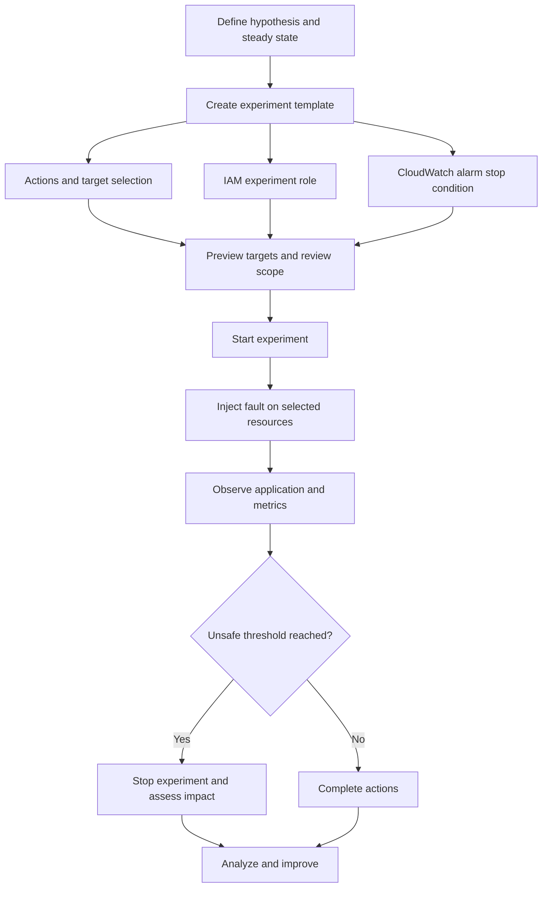
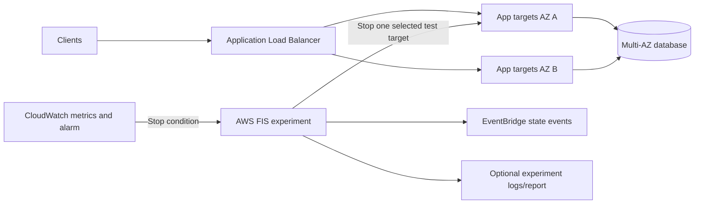
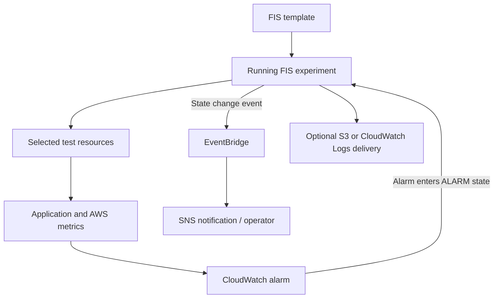
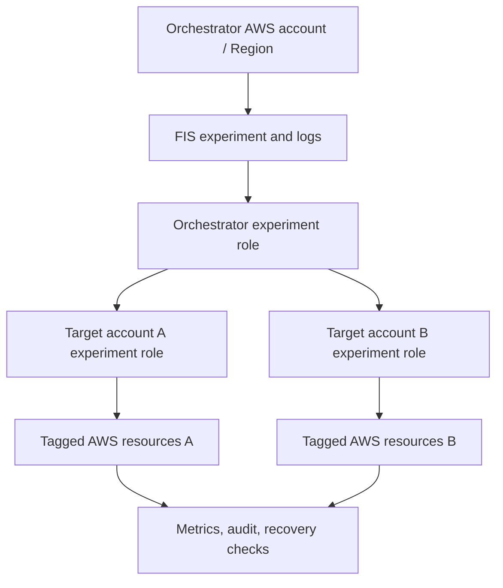
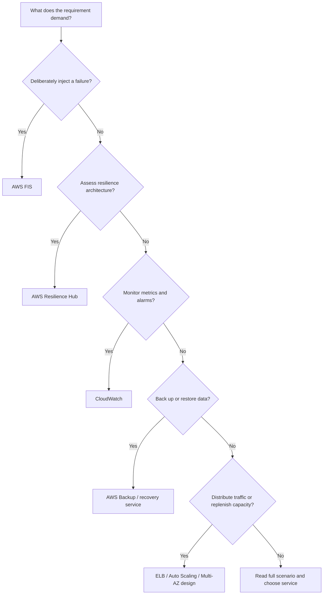

<div align="center">

# AWS Fault Injection Service (AWS FIS)

### Complete GitHub Study Guide · Cloud Practitioner (CLF-C02) + Solutions Architect – Associate (SAA-C03)

[](https://aws.amazon.com/fis/)
[](https://aws.amazon.com/certification/certified-cloud-practitioner/)
[](https://aws.amazon.com/certification/certified-solutions-architect-associate/)


**One sentence to remember:** AWS FIS deliberately injects controlled failures into selected AWS workloads so you can **measure, verify, and improve their resilience before real incidents occur**.

[CCP essentials](#ccp-essentials) · [SAA deep dive](#saa-deep-dive) · [Service comparisons](#service-comparisons) · [Exam traps](#exam-traps) · [Practice questions](#practice-questions)

</div>

> [!NOTE]
> **Naming correction:** A commonly used course slide calls this **AWS Fault Injection Simulator**. The current official product name is **AWS Fault Injection Service (AWS FIS)**. Some AWS IAM managed policies still contain `AWSFaultInjectionSimulator` in their names; that does **not** mean they are a different service. The accompanying course slide is on **page 458** of *AWS Certified Cloud Practitioner Slides v44* (Stéphane Maarek). This guide is an original explanation expanded using the official AWS documentation linked below, not a reproduction of the copyrighted slides.

---

## Table of contents

1. [What is AWS FIS?](#what-is-aws-fis)
2. [The problem FIS solves](#the-problem-fis-solves)
3. [Core concepts and terminology](#core-concepts-and-terminology)
4. [How an experiment works](#how-an-experiment-works)
5. [Capabilities, actions, and limitations](#capabilities-actions-and-limitations)
6. [Real-world use cases](#real-world-use-cases)
7. [Cloud Practitioner essentials](#ccp-essentials)
8. [Solutions Architect – Associate deep dive](#saa-deep-dive)
9. [Service comparisons](#service-comparisons)
10. [Integration and architecture patterns](#integration-and-architecture-patterns)
11. [IAM, security, compliance, and safety](#iam-security-compliance-and-safety)
12. [Observability, auditing, and troubleshooting](#observability-auditing-and-troubleshooting)
13. [Pricing and cost optimization](#pricing-and-cost-optimization)
14. [Practical console and CLI example](#practical-console-and-cli-example)
15. [Exam traps](#exam-traps)
16. [Interview questions](#interview-questions)
17. [Practice questions](#practice-questions)
18. [Scenario drills](#scenario-drills)
19. [Decision tree and exam keywords](#decision-tree-and-exam-keywords)
20. [Quick-revision cheat sheet](#quick-revision-cheat-sheet)
21. [Official references and currency note](#official-references-and-currency-note)
22. [Closing takeaway](#closing-takeaway)

---

<a id="what-is-aws-fis"></a>
## 1. What is AWS FIS?

**Simple definition:** AWS Fault Injection Service is a managed service for **chaos engineering**: intentionally creating controlled disruptions in AWS workloads to see whether your architecture recovers in the way you expect.

**Exam-ready definition:** AWS FIS orchestrates fault-injection experiments using **experiment templates**, **actions**, **targets**, **IAM experiment roles**, and optional **CloudWatch alarm stop conditions**, experiment logging, and reports. It can apply actions to supported AWS resources to evaluate reliability, availability, recovery, and observability. See the [official introduction](https://docs.aws.amazon.com/fis/latest/userguide/what-is.html).

### Analogy: a building's fire drill

A fire drill deliberately creates an emergency *scenario* to test whether alarms, exit paths, and people respond correctly. FIS similarly creates *controlled technical failures*—for example, stopping a test EC2 instance or introducing network delay—to determine whether load balancing, retries, failover, and monitoring work. Unlike a drill, **FIS takes real actions against real resources**: systems and data can actually be affected.

| At a glance | AWS FIS |
|---|---|
| Category | Resilience testing / chaos engineering |
| Main purpose | Validate failure-handling assumptions and find resilience weaknesses |
| Control plane | Managed AWS service for configuring, starting, and tracking experiments |
| Unit of work | Experiment, created from an experiment template |
| Core primitives | Actions, targets, stop conditions, experiment IAM role |
| Example faults | EC2 stop/reboot, workload stress, network impairment, database failover |
| Example targets | EC2, ECS, EKS, RDS/Aurora, supported network and other resource types |
| Monitoring | CloudWatch metrics/alarms, EventBridge notifications, FIS status, logs |
| Optional outputs | S3/CloudWatch Logs experiment logs; S3 PDF experiment reports |
| Default protection? | **No**: FIS does not automatically harden your app or enable rollback |
| Scope | Experiments are run in an AWS Region; multi-account experiments can span accounts within a Region |
| Main exams | Recognize the service at CCP; reason about safe failure testing at SAA |

> [!IMPORTANT]
> **FIS is a testing tool, not an availability mechanism.** Multi-AZ architecture, Auto Scaling, load balancers, backup and recovery, and correct application design provide resilience. **FIS tests whether those measures actually work.**

---

<a id="the-problem-fis-solves"></a>
## 2. The problem FIS solves

A system can pass unit tests and normal load tests but still fail during a node loss, database failover, brief network outage, latency spike, or dependency failure. Teams often **assume** that their architecture will recover. FIS lets them test those assumptions under controlled conditions.

| Without controlled failure testing | With AWS FIS |
|---|---|
| “We have two AZs, so we're resilient.” | Stop a component and measure whether remaining capacity absorbs traffic. |
| “Our retries work.” | Inject latency/errors and verify retries do not create a storm. |
| “An Auto Scaling group replaces failed hosts.” | Interrupt a host and time replacement plus application readiness. |
| “Our alarm will tell us.” | Trigger a failure and verify the alarm detects it promptly. |
| “Our database failover is fast.” | Trigger a supported failover and measure connection recovery. |
| “Our runbook is sufficient.” | Collect evidence about the actual recovery sequence. |

Common beneficiaries: operations and site reliability engineering (SRE), platform engineering, distributed-app teams, development teams shipping business-critical applications, and organizations testing recovery time objectives (RTOs).

FIS is **not** a substitute for unit tests, performance load generators, penetration tests, AWS Backup, or production readiness reviews. It is a complement to those practices.

---

<a id="core-concepts-and-terminology"></a>
## 3. Core concepts and terminology

| Term | Meaning | Why it matters |
|---|---|---|
| **Chaos engineering** | Forming a hypothesis, inducing a controlled failure, observing the system, and learning | Mental model behind FIS |
| **Steady state** | Normal measurable behavior (e.g., acceptable error rate and p95 latency) | Establish a baseline before a fault |
| **Hypothesis** | A falsifiable statement such as “requests remain available if one EC2 host stops” | Gives the experiment a pass/fail criterion |
| **Experiment template** | Reusable definition of actions, targets, role, stop conditions, and optional settings | A template is **not** an executed experiment |
| **Experiment** | One actual run from a template | Each run receives its own experiment ID/status |
| **Action** | A specific fault-injection or other supported FIS operation | Example: `aws:ec2:stop-instances` |
| **Target** | Resource or resources selected for an action | Narrow the blast radius intentionally |
| **Selection mode** | `ALL`, `COUNT(n)`, or `PERCENT(n)` for matched targets | Controls how many resources are chosen |
| **Action dependencies** | `startAfter` ordering between actions | Supports sequential and parallel tests |
| **Experiment role** | IAM role FIS assumes to act on resources | Service permissions are not automatic |
| **Stop condition** | CloudWatch alarm-based guardrail | Stops an experiment if an unacceptable threshold is reached |
| **Target preview** | `actionsMode: skip-all` checks target resolution without performing actions | Valuable preflight, **not** full permission validation |
| **Scenario library** | AWS-maintained predefined fault scenarios in the FIS console | A useful starting point; inspect all targets and safeguards |
| **Experiment logs** | Operational records about experiment execution | Troubleshooting/audit via CloudWatch Logs or S3 |
| **Experiment report** | Optional PDF evidence of actions and dashboard response | Post-test review and resilience evidence; separate charge |
| **Blast radius** | The portion of the system potentially affected | Must be minimized, especially in production |
| **Recovery time** | Observed time until service performance returns to acceptable state | Compare to your RTO and SLO |

**Relationships:** A template describes an experiment; its **actions** apply to **targets** using an **experiment IAM role**. **Stop conditions** can halt the run; monitoring, logs, and reports help you understand the outcome.



For configuration fields and ordering, see [experiment template components](https://docs.aws.amazon.com/fis/latest/userguide/experiment-templates.html).

---

<a id="how-an-experiment-works"></a>
## 4. How an experiment works

1. **Define a hypothesis:** “If one web instance becomes unavailable, at least one healthy instance continues serving requests.”
2. **Establish a baseline:** Record request success rate, latency, host count, ALB healthy targets, and alarms.
3. **Choose the smallest safe scope:** Select a *disposable test environment* or narrowly tagged instances; identify data risks and maintenance windows.
4. **Select an action:** For example, `aws:ec2:stop-instances` or an ECS/EKS workload disruption.
5. **Select targets:** Resource ARN(s), tags and relevant resource filters; choose `COUNT(1)` for a single randomly selected match when supported.
6. **Configure a service role:** Give FIS exactly the underlying permissions required for the action.
7. **Set stop conditions:** Attach an existing CloudWatch alarm for unacceptable application impact. Add a manual stop and incident-response plan too.
8. **Preview the targets:** Use the FIS target preview. Remember it is not a complete rehearsal and selected resources can change before the actual run.
9. **Start the experiment:** FIS resolves the eligible targets and performs the actions using the configured role.
10. **Measure actual outcomes:** Check client-side success/error rates, latency, time to recover, infrastructure changes, and alert effectiveness.
11. **Stop and recover if required:** An alarm or operator can stop ongoing injection; verify the system really has returned to steady state.
12. **Improve and repeat:** Fix architectural weaknesses, tune alarms or runbooks, then start a **new experiment** from the same or updated template.

### Beginner example: an EC2 instance stops

**Hypothesis:** An ALB distributing traffic across healthy targets in two Availability Zones should keep the service usable if *one* test instance stops, assuming sufficient spare capacity and correct health checks.

- Set up at least two healthy EC2 application instances in different AZs behind an ALB.
- Target a single test instance, not every instance.
- Inject `aws:ec2:stop-instances` and watch ALB target health and request errors.
- Record how quickly traffic leaves the unhealthy target and whether the application returns to normal.
- **Do not assume** an ALB creates replacement capacity: an Auto Scaling group or other replacement process is needed.

### More advanced example: a database failover

**Hypothesis:** The application can reconnect to its database within an agreed RTO after a supported RDS/Aurora failover.

- Exercise a supported `aws:rds:failover-db-cluster` or `aws:rds:reboot-db-instances` action where appropriate.
- Record write failures, transaction retries, connection pool recovery, DNS/endpoint behavior, and p95 latency.
- Use application metrics and logs to distinguish database failover from broken reconnect logic.
- A database becoming available again does not guarantee your application recovered correctly; transaction idempotency and client retry behavior matter.

> [!WARNING]
> A real fault can trigger Auto Scaling, data loss, billing changes, recovery actions, or a wider outage. **Start with preproduction.** AWS [explicitly recommends planning and testing outside production first](https://docs.aws.amazon.com/fis/latest/userguide/what-is.html).

---

<a id="capabilities-actions-and-limitations"></a>
## 5. Capabilities, actions, and limitations

The precise action catalog changes over time, and support varies by action, resource type, Region, configuration, and prerequisites. The [AWS FIS actions reference](https://docs.aws.amazon.com/fis/latest/userguide/fis-actions-reference.html) is authoritative.

| Area | Supported examples | Design interpretation |
|---|---|---|
| **Amazon EC2** | Stop, reboot, terminate instances; simulate Spot interruption signals | Test instance failure and replacement; effects differ by action |
| **EC2 via Systems Manager** | CPU/memory or other stress using supported SSM documents | Requires the requisite agent, permissions, and document compatibility |
| **Amazon ECS** | Stop tasks, drain container instances; supported task stress/network faults | Observe task replacement and service-level behavior |
| **Amazon EKS** | Delete pods, stress pod CPU/memory, impair network, terminate managed node group instances | Validate Kubernetes scheduling, disruption budgets, and spare capacity |
| **Amazon RDS / Aurora** | Reboot instances, supported cluster failover | Measure database reconnection/recovery |
| **Networking** | Network connectivity disruptions, packet-loss or latency actions for supported targets | Test timeouts, retries and cross-AZ/cross-Region dependencies |
| **EBS** | Supported volume I/O pause or latency disruptions | Test disk dependencies and timeout handling |
| **Other supported resources** | Action-specific tests for services such as Lambda, S3, Kinesis, and ElastiCache | **Read the exact action definition** rather than assuming uniform coverage |
| **Scenario library** | Prebuilt EC2, EKS, AZ interruption and other scenarios | Accelerates setup but does not replace target/safety review |
| **Multi-account** | Central orchestration into authorized target accounts within one Region | Requires roles/trust and target-account configurations |
| **Reports/logging** | Experiment state/actions, optional log delivery and PDF report | Evidence and debugging are distinct from stopping harm |

### Fault injection vs recovery action vs wait

FIS supports multiple action categories. A **fault-injection action** impairs a target; a **recovery action** can be part of a scenario; and **wait actions** can enforce timing. Do not assume every action has automatic undo behavior.

### Important supported behaviors

- **Actions can run concurrently or sequentially**, using `startAfter` dependencies.
- **Targets can be specific or selected dynamically** through tags/filters; selection modes include `ALL`, `COUNT(n)`, and `PERCENT(n)`.
- **Templates are reusable**, but each completed/stopped experiment instance is immutable as a run; to repeat, start another experiment.
- **Default `accountTargeting` is `single-account`.** Multi-account behavior must be explicitly configured.
- **Default `emptyTargetResolutionMode` is `fail`.** `skip` is available for certain unresolved tag-based targets, but doesn't apply to all unique-ID targets.
- **Default start actions mode is `run-all`.** Choose `skip-all` for a no-fault target preview.
- **Experiment logging is disabled by default**; enable it explicitly to send records to the chosen destination.

### Limitations that change architecture decisions

1. FIS tests **supported target/action combinations**, not arbitrary infrastructure in all environments.
2. AWS FIS does **not** cause an actual AWS-wide Region or Availability Zone outage; scenarios inject selected **symptoms** of failures into your resources.
3. Multi-account orchestration is **regional**, not a magic global multi-Region experiment controller.
4. Certain container/Kubernetes actions need agents, policies, service-account permissions, target-side configuration or supported runtime platforms.
5. FIS does not automatically restore a terminated instance, reverse a destructive database operation, or repair an application bug.
6. A CloudWatch alarm guards an ongoing run; its detection, evaluation, and action-stop latency must be considered.
7. Scenario library content and action defaults need review; e.g., the [AZ power-interruption scenario](https://docs.aws.amazon.com/fis/latest/userguide/az-availability-scenario.html) instructs customers to add appropriate stop conditions.

---

<a id="real-world-use-cases"></a>
## 6. Real-world use cases

| Workload question | Suitable FIS experiment | What you would measure |
|---|---|---|
| Can the web tier survive a host failure? | Stop one tagged EC2 test host | Error rate, ALB healthy targets, replacement time |
| Can ECS survive container task loss? | Stop an eligible ECS task | Task replacement, request availability |
| Can Kubernetes workloads tolerate node/pod loss? | Pod delete / supported node group interruption | Scheduling, readiness, client errors |
| Are retry/backoff settings safe? | Inject supported latency or network impairment | Retry rate, p95/p99 latency, queue growth |
| Does application failover work for a database? | Supported RDS/Aurora failover test | DB connection recovery and business transactions |
| Is a Multi-AZ design actually effective? | Narrow impairment, then broader documented AZ scenario | SLO compliance during component loss |
| Can alerts detect problems quickly? | Inject a small, observable fault | Time to detection and time to mitigation |
| Are recovery runbooks usable? | Schedule a measured test with operators | MTTR, operational bottlenecks, evidence |

**When not to choose FIS:** A question asking to *store backups*, *detect and block an attack*, *automatically scale traffic*, *assess architecture without generating failures*, or *generate normal client load* points to other services or tools.

---

<a id="ccp-essentials"></a>
## 🟢 7. Cloud Practitioner (CCP) essentials


### 16 fundamental facts to memorize

1. **FIS = AWS Fault Injection Service.** Its official name is **Service**, not Simulator.
2. It is a **fully managed chaos-engineering/fault-injection** service.
3. It intentionally generates **disruptive events** to assess workload resilience.
4. Its purpose is to **find weaknesses before unplanned outages**.
5. It can help reveal **hidden bugs, bottlenecks, and failure-handling problems**.
6. It uses **experiment templates** to define tests.
7. A **template** is a blueprint; an **experiment** is an actual run.
8. **Actions** specify the disruptions; **targets** identify impacted resources.
9. Targets may include supported **EC2, ECS, EKS, and RDS** resources.
10. **CloudWatch** supplies metrics and alarm-based stop conditions.
11. **EventBridge** can deliver experiment state-change notifications.
12. FIS does **not** automatically make infrastructure fault tolerant.
13. It can execute **real disruptions**, so testing has risk.
14. You should first use a **preproduction/test environment**.
15. Experiments can be repeated by **starting new runs** from templates.
16. You pay for **executed action time** (and optional reports and related services), subject to the official pricing model.

### CCP keyword bank

`Chaos engineering` · `Controlled failures` · `Fault injection` · `Resilience testing` · `Disruptive events` · `Experiment template` · `Stress application` · `CPU spike` · `Memory stress` · `Network latency` · `Instance interruption` · `Failure recovery` · `Performance bottlenecks` · `Hidden bugs` · `CloudWatch alarms` · `Observability` · `Fault tolerance` · `Preproduction testing`

| If the question says... | Think... |
|---|---|
| “Intentionally introduce failures into AWS applications” | **AWS FIS** |
| “Chaos engineering on AWS workloads” | **AWS FIS** |
| “Test resilience during EC2, ECS, EKS or RDS disruptions” | **AWS FIS** |
| “Inject CPU/memory/network disruptions to observe recovery” | **AWS FIS**, given a supported action/setup |
| “Test whether fault-tolerant architecture really works” | **AWS FIS** |
| “Continuously watch logs and metrics” | **Amazon CloudWatch** |
| “Assess resilience posture and suggest improvements” | **AWS Resilience Hub** |
| “Create and restore backups” | **AWS Backup** |
| “Distribute web traffic across healthy targets” | **Elastic Load Balancing** |

**30-second CCP answer:** AWS FIS is a managed chaos-engineering service that runs controlled fault-injection experiments against AWS workloads so teams can observe application behavior, discover resilience problems, and improve recovery. Tests are configured with experiment templates and can use CloudWatch alarms as guardrails.

> [!TIP]
> In CCP multiple choice, the strongest cue is usually **“deliberately inject disruptions and test how an application responds.”** Not “monitor a system,” “create a backup,” or “recover a Region automatically.”

---

<a id="saa-deep-dive"></a>
## 🔵 8. Solutions Architect – Associate (SAA) deep dive


### Design questions an architect must answer

| Question | Architectural decision |
|---|---|
| What is the system's steady state? | Define request success, latency, throughput, queue age, or transaction metrics. |
| What failure are we testing? | Choose the smallest representative action and supported target type. |
| How much impact is acceptable? | Define blast radius, time limit, CloudWatch alarm, and manual stop criteria. |
| Are replacement resources available? | Check ASG minimum/desired capacity, ECS/EKS capacity, ALB health checks, database replicas. |
| What must recover? | Distinguish infrastructure replacement from application session/transaction recovery. |
| How will we know it succeeded? | Measure RTO and application-level SLO, not only FIS's action status. |
| What permissions are needed? | Give caller FIS permissions and `iam:PassRole`; grant experiment role limited target API actions. |
| How will evidence be retained? | Enable logs, CloudWatch dashboards, optional PDF reports, and audit trails. |

### Failure boundaries: Region, AZ, instance, and application

- **Instance failure:** The rest of an application might remain healthy, depending on spare capacity and fault isolation.
- **Availability Zone impairment:** For a multi-AZ design, test whether regional services and load balancing continue in the surviving AZs. A predefined AZ scenario approximates symptoms—it is not a real AZ power shutdown.
- **Database failover:** An available standby does not ensure an application's connections, transaction retries, and DNS caching recover.
- **Dependency impairment:** Latency spikes might amplify retries and consume connection pools. Monitor downstream impact.
- **Multi-Region architecture:** FIS includes supported cross-Region *connectivity* impairments, but orchestrated experiment control is scoped to a Region. Plan and coordinate independent regional validation carefully.

### Core resilience-testing architecture



**Key insight:** ALB, sufficient alternate capacity, an appropriate database design, correct client timeouts, and recovery configuration are part of the **application architecture**. FIS measures them; it does not provision them.

### SAA scenario 1: “Our website uses two AZs”

A company runs one EC2 instance in each of two AZs behind an ALB. An architect wants to prove that a single-host failure will not cause an outage.

**Choose:** FIS `aws:ec2:stop-instances` against one intentionally marked test instance, with baseline ALB metrics and a CloudWatch stop condition.

**Reasoning:** The experiment establishes whether ALB health checks and the surviving instance keep requests within the SLO. **Architecture caveat:** one remaining server might lack capacity, and FIS does not create replacement instances. An ASG with sensible min/desired capacity is often appropriate.

### SAA scenario 2: EKS restarts do not prove customer experience

An EKS deployment has a readiness probe and multiple replicas. The team deletes one pod with FIS, and Kubernetes recreates it, but requests temporarily fail.

**Choose:** FIS pod disruption plus end-to-end request monitoring. **Investigate:** readiness probe accuracy, pod disruption budgets, connection draining, pod spread/topology, spare node capacity, and ALB target deregistration timing.

**Reasoning:** Infrastructure convergence is not the same as meeting a user-facing availability SLO. The test exposes an operational gap that normal deployment checks may miss.

### SAA scenario 3: database failover with connection-pool issues

An application uses a supported Multi-AZ database, but previously experienced long recovery during failover.

**Choose:** An applicable FIS database failover/reboot action and transaction-level monitoring.

**Reasoning:** Validate endpoint/DNS resolution, connection pool recreation, retry/backoff, transaction safety, and actual RTO. **Trap:** “Multi-AZ enabled” does not mean application connections never break.

### SAA scenario 4: cross-account resilience testing

A company separates networking, application, and supporting services into accounts. It wants centralized fault-injection experiments affecting authorized resources in multiple accounts in the **same AWS Region**.

**Choose:** A **multi-account AWS FIS experiment** from an orchestrator account. Configure target-account configurations and cross-account IAM roles/trust, consistent tags, CloudTrail, and (if used) cross-account stop-alarm permissions.

**Reasoning:** AWS FIS supports central coordination but does **not** automatically gain permissions just because accounts belong to AWS Organizations. AWS recommends using **AZ IDs instead of AZ names** when targeting the same physical AZ across accounts.

### SAA scenario 5: a broad AZ interruption scenario is too dangerous

A production service has never undergone resilience testing. Engineers propose running the FIS AZ power-interruption scenario against all matching resources.

**Choose:** First run a *small preproduction* experiment, validate alarm thresholds and monitoring, explicitly inspect scenario actions/target tags, and progress through tightly controlled tests.

**Reasoning:** The documented AZ scenario includes many action types and its reference notes that stop conditions must be added. A useful prebuilt scenario is **not** automatically safe for a specific workload.

### Design checklist: resilience is a system property

- Availability: enough independent capacity, correct health checks and isolation.
- Durability: ensure actions cannot unintentionally destroy the only copy of data.
- Security: narrow target selection and IAM action authority.
- Reliability: explicit recovery requirements and runbooks.
- Operations: stop thresholds, monitoring, on-call awareness, and post-test review.
- Cost: action-minute billing plus ancillary recovery/compute/database/logging costs.
- Consistency: retry/idempotency may be needed after interrupted stateful operations.
- Performance: watch latency, throttling and retry amplification, not only “up/down.”

---

<a id="service-comparisons"></a>
## 9. Service comparisons

| Service/tool | Primary purpose | Key exam distinction | Use with FIS? |
|---|---|---|---|
| **AWS FIS** | Deliberately generate controlled failure symptoms | **Inject faults to validate resilience** | Central test service |
| **AWS Resilience Hub** | Assess resilience posture, track RTO/RPO risks and recommendations | **Assess and recommend**, including FIS experiments | **Yes**; complementary |
| **Amazon CloudWatch** | Metrics, logs, dashboards, alarms | **Observe** and trigger an alarm stop condition | **Yes**; essential observability |
| **AWS CloudTrail** | Audit API activity | Who called an API, when, and related request information | **Yes**; accountability |
| **AWS Backup** | Centrally manage backups and restore policies | **Backup/recovery data**, not injecting a failure | **Yes**; resilience lifecycle |
| **AWS Elastic Disaster Recovery** | Replication and disaster recovery to AWS | Restore workloads after a disaster | Complementary, not replaced |
| **Elastic Load Balancing / Auto Scaling** | Route traffic and adjust/replenish compute capacity | **Actual availability capacity mechanisms** | FIS tests them |
| **AWS Step Functions** | Orchestrate application workflows | Workflow/business logic, not native chaos experiments | Potential integration; different purpose |
| **AWS X-Ray / tracing** | Analyze request dependencies and latency | Diagnose fault propagation in requests | Complementary observability |
| **AWS Trusted Advisor** | Account checks and optimization recommendations | Recommendations, not injected fault experiments | Different purpose |

### Five common confusions

<details><summary><strong>FIS vs AWS Resilience Hub</strong></summary>

**FIS performs fault-injection experiments.** AWS Resilience Hub analyzes application resilience against defined objectives and can recommend appropriate FIS experiments. Use them together to plan, exercise, and improve recovery. A resilience assessment itself does **not** create the disruptive test.

</details>

<details><summary><strong>FIS vs CloudWatch</strong></summary>

CloudWatch *observes and alerts* on system metrics. FIS *introduces a fault*. A CloudWatch alarm can serve as a **stop condition** in an FIS template. CloudWatch does not itself perform the specified FIS action just because an alarm exists.

</details>

<details><summary><strong>FIS vs AWS Backup</strong></summary>

Backup creates and manages recovery copies; FIS tests failure behavior. Do not confuse “test recovery procedures” with “provide backups.” Also, a successful FIS experiment is **not proof that a backup can be restored** without an actual recovery verification.

</details>

<details><summary><strong>FIS vs Elastic Load Balancing / Auto Scaling</strong></summary>

ALB directs traffic to healthy targets; ASG can add or replace EC2 capacity. FIS tests whether those controls meet your availability objectives. If the SAA question asks to *build* resilience, choose architecture controls; if it asks to *inject failures and verify* those controls, choose FIS.

</details>

<details><summary><strong>FIS vs ordinary load/performance testing</strong></summary>

A load generator increases legitimate client request traffic. FIS deliberately disrupts a resource or dependency (e.g., latency, pod failure). CPU/memory stress can be a fault test, but FIS is **not** a generic replacement for request load testing or benchmarks.

</details>

---

<a id="integration-and-architecture-patterns"></a>
## 10. Integration and architecture patterns

### Pattern A — FIS + CloudWatch + EventBridge



**Read the feedback loop carefully:** the CloudWatch alarm can **stop the experiment**; it does not guarantee that all injected effects or application consequences will be undone. EventBridge state notifications are delivered on a **best-effort** basis and are useful for notifications/automation, not the sole emergency stop control. [AWS EventBridge integration](https://docs.aws.amazon.com/fis/latest/userguide/monitoring-eventbridge.html).

### Pattern B — Prebuilt scenario library

AWS maintains a **console-only scenario library**. Choose a relevant scenario; customize tags/target selection, review the exact actions and preconditions, create a template in your account, and run it only after safety review. Scenario availability and supported targets change; consult the [scenario library](https://docs.aws.amazon.com/fis/latest/userguide/scenario-library.html) and [scenario reference](https://docs.aws.amazon.com/fis/latest/userguide/scenario-library-scenarios.html).

### Pattern C — Central multi-account orchestration



Roles and trust must be explicitly configured. Target accounts are **not** granted fault-injection permissions merely because they're members of AWS Organizations. A multi-account experiment targets accounts in a **Region**; the orchestrator owns the experiment and its control-plane configuration. See the [multi-account guide](https://docs.aws.amazon.com/fis/latest/userguide/multi-account.html).

### Pattern D — Resilience Hub to FIS

AWS Resilience Hub can produce tailored **fault-injection experiment recommendations** for applications; the recommended scenarios use AWS FIS actions. This helps bridge resilience **assessment** and **verification**. [AWS Resilience Hub integration](https://docs.aws.amazon.com/resilience-hub/latest/userguide/testing.html).

---

<a id="iam-security-compliance-and-safety"></a>
## 11. IAM, security, compliance, and safety

### Two permissions questions

1. **Who can administer/start the experiment?** The user/role invoking the FIS API needs appropriate `fis:*` permissions scoped to the desired APIs and resources, plus `iam:PassRole` when associating the experiment role where required.
2. **What can the service modify?** The **FIS experiment role** must trust `fis.amazonaws.com` and grant only the precise underlying API permissions for the selected fault actions. A role allowed to stop EC2 instances does not automatically gain RDS or EKS privileges.

### Example trust-policy structure

This **illustrative** trust policy uses account and experiment ARN conditions recommended by AWS. Replace the example account/Region with your own and review the experiment template/run permissions before using it.

```json
{
  "Version": "2012-10-17",
  "Statement": [
    {
      "Effect": "Allow",
      "Principal": { "Service": "fis.amazonaws.com" },
      "Action": "sts:AssumeRole",
      "Condition": {
        "StringEquals": { "aws:SourceAccount": "111122223333" },
        "ArnLike": {
          "aws:SourceArn": "arn:aws:fis:eu-west-1:111122223333:experiment/*"
        }
      }
    }
  ]
}
```

The AWS-managed starter policies are named with the legacy `Simulator` word, such as `AWSFaultInjectionSimulatorEC2Access`. They may be broader than least privilege, so inspect their contents and prefer tight custom policies for important environments. [FIS experiment role documentation](https://docs.aws.amazon.com/fis/latest/userguide/getting-started-iam-service-role.html).

### Practical safety guardrails

1. **Narrow resource tags**: use a dedicated tag such as `fis-safe=true` and verify those resources.
2. **Limit resource count**: prefer `COUNT(1)` to `ALL` where possible.
3. **Prefer preproduction first**: test the full procedure before production.
4. **Create a CloudWatch stop alarm**: target a real business-impact threshold (e.g., sustained error rate), not an arbitrary instance CPU value.
5. **Define a run duration** where the action supports it; do not assume all actions are automatically reversible.
6. **Preview resolved targets** and verify the selection **immediately before** execution.
7. **Protect privileged access**: distinct experiment roles and restricted `iam:PassRole` are important.
8. **Prepare recovery steps**: if a destructive action is chosen, stopping the experiment may be insufficient.
9. **Inform stakeholders**: record owner, approval, change window, rollback/recovery procedure, and on-call contact.
10. **Audit effects**: retain logs, API activity and application-level evidence.

> [!WARNING]
> **A stop condition is not a transactional rollback.** FIS stops the ongoing experiment if the configured CloudWatch alarm is triggered, but already-completed actions or application side effects can persist. Recheck the selected action's exact recovery behavior.

**Shared responsibility:** AWS operates the FIS service, while **you** choose disruptive actions, target scope, IAM authority, observability, safe timing, and application recovery. That responsibility persists even if you start from a predefined AWS scenario.

---

<a id="observability-auditing-and-troubleshooting"></a>
## 12. Observability, auditing, and troubleshooting

| Tool/output | What it tells you | Key caveat |
|---|---|---|
| FIS console / CLI | Experiment/action state and resolved targets | Action success does not prove app resilience |
| CloudWatch application metrics | Latency, errors, request volume, custom business SLOs | You must instrument meaningful metrics |
| CloudWatch alarm | Threshold triggering stop condition | Alarm evaluation takes time; test its behavior |
| EventBridge | FIS experiment state change events | Best-effort delivery; not guaranteed notification timing |
| CloudTrail | FIS control-plane/API activity and activity in target accounts | Verify event coverage and trail retention |
| FIS experiment logs | Detailed experiment execution records | Logging must be enabled; destinations incur cost |
| FIS PDF experiment report | Summary plus optional CloudWatch dashboard snapshots | Optional; **charged per generated report** |
| Application and distributed traces | User impact, dependency failures, latency propagation | Complement—not replaced by—FIS run state |

**Logging destinations:** an Amazon S3 bucket and/or a CloudWatch Logs log group. Experiment logging is **disabled by default**. As documented, current experiment logging uses schema version `2`. See [experiment logging](https://docs.aws.amazon.com/fis/latest/userguide/monitoring-logging.html).

**Experiment reports:** optional PDF output to an S3 bucket, with optional metric widgets from **one** CloudWatch dashboard. You can specify pre/post-experiment observation windows. Reports are particularly helpful for evidence and review; use **experiment logs** for troubleshooting execution errors. [Experiment report configuration](https://docs.aws.amazon.com/fis/latest/userguide/experiment-report-configuration.html).

### Troubleshooting checklist

1. **Did the run start?** Inspect the FIS experiment ID and reason for its status (`initiating`, `running`, `failed`, `stopped`, or `completed`).
2. **Did targets resolve?** Check Region, resource ARNs, target tags, resource state, and selection mode; default empty-target behavior is `fail`.
3. **Did target selection surprise you?** Verify whether `COUNT(n)`/`PERCENT(n)` randomly chose different eligible resources and whether the environment changed after preview.
4. **Are roles correct?** Review FIS caller `fis:*`, `iam:PassRole`, experiment role trust, resource action permissions, and cross-account role chaining if used.
5. **Do action-specific prerequisites exist?** EKS/Kubernetes permissions, SSM agents/documents, ECS task prerequisites, target-side network support, or supported database state may apply.
6. **Did a stop alarm trigger?** Review CloudWatch alarm state, period, evaluation threshold, and missing-data treatment.
7. **Did the action run but the app fail?** Check ALB, ASG, pod scheduling, transaction retry, clients, queues, and network dependencies.
8. **Are logs missing?** Logging is off unless configured; check log destination access and delivery delay.
9. **Is the report missing?** Confirm optional report configuration, S3/KMS permissions, run status, and report delivery timing.
10. **Can you repeat?** You cannot resume an ended experiment. Start a **new run** from a template.

---

<a id="pricing-and-cost-optimization"></a>
## 13. Pricing and cost optimization

**Verified from the official [AWS FIS pricing page](https://aws.amazon.com/fis/pricing/) on 2026-11-03.** Actual charges can change; always check pricing before execution.

| Cost component | Published pricing and rule |
|---|---|
| **Action time** | **US $0.10 per action-minute** outside AWS GovCloud (US), irrespective of action type or number of affected resources |
| **Additional accounts** | **US $0.10 per action-minute per additional target account** beyond the first |
| **GovCloud pricing** | **US $0.12 per action-minute**, plus the same amount per additional target account |
| **Action-time rounding** | Each action duration is calculated from action start to end, **rounded to nearest minute** |
| **Experiment report** | **US $5 per delivered report** |
| **Related services** | AWS resources, S3, CloudWatch/CloudWatch Logs, event/monitoring infrastructure, and recovery activity may cause additional charges |
| **Upfront/minimum fee** | No FIS upfront or minimum fees stated on pricing page |

**Single-account formula (non-GovCloud):**

```text
FIS injection cost = sum of billed action-minutes × $0.10
```

**Multi-account formula (non-GovCloud):**

```text
FIS injection cost = total billed action-minutes × ($0.10 × number_of_target_accounts)
```

This is **per action**, so simultaneous actions contribute multiple action-minutes. A one-account experiment with two 20-minute actions plus a later 10-minute action has `2×20 + 10 = 50` action-minutes and a **$5 FIS action charge**. If one optional report is delivered, the FIS subtotal becomes **$10**, excluding other AWS service charges. This calculation is illustrative and assumes no different rounding impact.

**Optimization levers:** keep experiments brief and well-targeted; reduce redundant parallel actions; use small preproduction environments; do not generate reports unless their evidence is valuable; control log retention; estimate effects such as replacement EC2 hours and database recovery operations separately.

> [!TIP]
> **Exam trap:** “Pay for FIS” is **not the same as** paying for all infrastructure consequences. A fault that triggers replacement capacity can incur resource charges beyond the FIS action-minute fee.

---

<a id="practical-console-and-cli-example"></a>
## 14. Practical console and CLI example

### Lowest-risk learning path (Console)

1. Open [AWS FIS Console](https://console.aws.amazon.com/fis/) in a Region where FIS and the desired action are supported.
2. Use **disposable EC2 test instances**, never an unreviewed production target.
3. Create an IAM experiment role trusting FIS with precisely the relevant EC2 permissions.
4. Define a meaningful CloudWatch alarm for an unacceptable impact threshold.
5. Choose **Create experiment template** and add `aws:ec2:stop-instances`.
6. Target a single clearly tagged test instance and configure restart after a short duration.
7. Include the stop alarm, enable logging if desired, and **create the template**.
8. Generate a **target preview** (actions skipped) to validate resource selection.
9. Obtain explicit approval before the real run; inspect CloudWatch while the actual action executes.
10. Verify that the test instance, any dependent applications, and infrastructure return to the expected state.

### Illustrative JSON template

The following is valid **JSON structure** based on the AWS [official EC2 FIS template examples](https://docs.aws.amazon.com/fis/latest/userguide/experiment-template-example.html). The sample account, role, alarm and target tag are teaching values. **Do not execute it without replacing them and reviewing scope**, verifying permission, and preparing recovery.

```json
{
  "description": "Preproduction: safely stop one tagged EC2 instance and observe recovery",
  "targets": {
    "myTestInstances": {
      "resourceType": "aws:ec2:instance",
      "resourceTags": {
        "fis-safe": "true"
      },
      "selectionMode": "COUNT(1)"
    }
  },
  "actions": {
    "StopOneInstance": {
      "actionId": "aws:ec2:stop-instances",
      "parameters": {
        "startInstancesAfterDuration": "PT2M"
      },
      "targets": {
        "Instances": "myTestInstances"
      }
    }
  },
  "stopConditions": [
    {
      "source": "aws:cloudwatch:alarm",
      "value": "arn:aws:cloudwatch:eu-west-1:111122223333:alarm:PreprodHighErrorRate"
    }
  ],
  "roleArn": "arn:aws:iam::111122223333:role/FISExperimentRole",
  "tags": {
    "Purpose": "ResilienceTraining"
  }
}
```

Save your customized template JSON as `fis-experiment-template.json`. The following commands are **syntax examples**. The `start-experiment` command **runs a real disruption**; don't execute it on live workloads as a learning shortcut.

```bash
# 1. Create the reusable experiment template (does not inject a fault).
aws fis create-experiment-template \
  --cli-input-json file://fis-experiment-template.json \
  --region eu-west-1

# 2. Review experiment templates, then select the template ID.
aws fis list-experiment-templates --region eu-west-1

# 3. Preview target selection only (no fault actions).
aws fis start-experiment \
  --experiment-template-id EXT_REPLACE_WITH_YOUR_TEMPLATE_ID \
  --experiment-options actionsMode=skip-all \
  --region eu-west-1

# 4. REAL DISRUPTION: run only after authorization, scope review,
# alarm validation, and recovery preparation.
aws fis start-experiment \
  --experiment-template-id EXT_REPLACE_WITH_YOUR_TEMPLATE_ID \
  --region eu-west-1

# 5. If needed, stop an in-progress experiment.
aws fis stop-experiment \
  --id EXP_REPLACE_WITH_YOUR_EXPERIMENT_ID \
  --region eu-west-1
```

`startInstancesAfterDuration` is specific to the **EC2 stop** action and is not a universal rollback feature. If the instance is managed by an Auto Scaling group, it may be replaced before the configured restart occurs. Verify actual post-experiment state. The [AWS FIS CLI reference](https://docs.aws.amazon.com/cli/latest/reference/fis/create-experiment-template.html) and [experiment options](https://docs.aws.amazon.com/fis/latest/userguide/experiment-options.html) describe exact command shapes.

---

<a id="exam-traps"></a>
## ⚠️ 15. Common exam traps and misconceptions

| Misconception | Correct interpretation | Level |
|---|---|---|
| FIS is the service that makes workloads highly available. | It **tests resilience**; architecture creates availability. | CCP |
| FIS only monitors failures. | It **deliberately injects** supported faults. | CCP |
| FIS is another name for CloudWatch. | CloudWatch observes; FIS disrupts. | CCP |
| FIS creates backups before every test. | No automatic backup guarantee; plan protection separately. | CCP/SAA |
| FIS runs harmless simulated alerts only. | Actions affect **real** resources. | CCP/SAA |
| Creating an experiment template starts the fault. | You separately start an **experiment** from the template. | CCP |
| A completed experiment proves the workload survived. | Check actual **application SLOs and recovery**. | SAA |
| A CloudWatch stop condition rolls back all effects. | It stops the run; completed/destructive effects can remain. | SAA |
| Every experiment template automatically has a CloudWatch stop alarm. | Configure one; `source: none` is possible. | SAA |
| A target preview is an actual test. | `skip-all` performs no fault actions. | SAA |
| A target preview confirms all permissions will work. | AWS specifically says it **does not** validate required action permissions. | SAA |
| `COUNT(1)` always picks the same EC2 instance. | Eligible target choice can be **random**. | SAA |
| Targeting by tag can never affect newly tagged production resources. | Dynamic eligible resources can change between preview and run. | SAA |
| `ALL` is always the safest selection. | It can expand blast radius; use careful selection. | SAA |
| Empty target sets always get skipped. | Default is **fail**; `skip` is an option with conditions. | SAA |
| Multi-account experiments require no extra setup. | Target-account IAM roles/trust and configurations are required. | SAA |
| An AWS Organizations account group automatically grants FIS authority. | Organization membership does **not** replace IAM trust. | SAA |
| AZ names identify the same physical AZ in every account. | Use **AZ IDs** when coordinating AZ-specific cross-account actions. | SAA |
| An AZ interruption scenario means AWS actually disables an AZ. | It injects selected **symptoms** against supported targets. | SAA |
| Prebuilt scenarios are always safe by default. | Examine scope/action defaults and add required guardrails. | SAA |
| AWS FIS can fault-inject any resource in any Region. | Supported target/action combinations and regional availability vary. | SAA |
| CPU stress on EC2 needs no dependencies. | Some host-level actions are implemented through **Systems Manager documents/agents**. | SAA |
| Kubernetes repairs always imply user requests remained available. | Check readiness, routing, capacity and user-facing metrics. | SAA |
| A Multi-AZ RDS failover causes no application interruption. | Connection pools, DNS and retries may still fail. | SAA |
| Stopping FIS restarts any terminated EC2 instance. | Termination is not equivalent to reversible stop/restart. | SAA |
| FIS experiments are free if the action fails quickly. | Billing depends on action runtime; check price and rounding. | CCP/SAA |
| Only the longest action matters for cost. | Sum **each action's billed minutes**, including parallel actions. | SAA |
| FIS PDF reports are included free with every run. | Reports are optional and priced separately. | SAA |
| Experiment logging is automatically on. | Explicitly configure S3/CloudWatch Logs. | SAA |
| EventBridge is the only reliable emergency stop. | Best-effort event notification is **not** a replacement for an FIS stop alarm or operator response. | SAA |
| A finished experiment can be resumed. | Start a **new experiment** from the reusable template. | SAA |

**The underlying mechanism of the biggest traps:** FIS has an **experiment control plane** that instructs service APIs and target-side agents to produce effects. FIS can stop issuing/maintaining an action, but cannot undo every external consequence. Therefore **target design, IAM, telemetry, and recovery** are integral to safe resilience testing.

---

<a id="interview-questions"></a>
## 16. Interview questions and short answers

**1. What is AWS FIS?** A managed fault-injection service used to validate AWS workload behavior under deliberately introduced disruptions.

**2. Why use chaos engineering?** To move from assumptions about resilience to empirical evidence about recovery, fault isolation, monitoring, and user experience.

**3. What is the difference between an action and a target?** An action is *what fault to inject*; a target is *which resources receive it*.

**4. What lives inside an experiment template?** Actions, targets, stop conditions, experiment role and optional settings such as logging/report configuration.

**5. Can I test my application in production?** AWS supports production experiments, but strongly recommends first planning and validating in a preproduction environment, using narrow scope and safety controls.

**6. How do you keep blast radius low?** Dedicated tags/ARNs, `COUNT(1)` or small percentages, short duration, alarms, role restrictions, preview and operational approval.

**7. How does FIS use IAM roles?** FIS assumes an experiment role that trusts `fis.amazonaws.com` and grants the underlying permissions required for the chosen actions.

**8. Does an alarm stop reverse all effects?** No. It stops the experiment; already completed or stateful effects can remain and require recovery.

**9. How would you test an ASG and ALB together?** Stop a carefully chosen EC2 target and monitor ALB healthy targets, client error rate, replacement capacity, and time to normal service.

**10. How would you troubleshoot an FIS run that fails immediately?** Inspect state/reason, target resolution, permissions, Region, required agents/documents, quotas, stop conditions, and logging.

**11. FIS vs Resilience Hub?** Resilience Hub assesses and recommends improvements/experiments; FIS actually executes supported disruption tests.

**12. What evidence proves resilience?** Application SLO and user transaction measurements during and after the fault, recovery time, alert behavior, FIS logs, and optional reports—**not just** an FIS “completed” status.

---

<a id="practice-questions"></a>
## 🧪 17. Original exam-style practice questions

> All questions below are **original learning exercises**, not actual or leaked AWS exam questions. Answers and reasoning are provided in collapsible sections.

<details><summary><strong>Q1 · CCP — What is the primary purpose of AWS FIS?</strong></summary>

**Answer:** To deliberately inject supported disruptions and measure application resilience. It does not back up workloads or automatically restore application health.

</details>

<details><summary><strong>Q2 · CCP — An AWS team wants to practice chaos engineering. Which service?</strong></summary>

**Answer:** **AWS Fault Injection Service.** CloudWatch measures and alerts; FIS generates the controlled faults.

</details>

<details><summary><strong>Q3 · CCP — Which term describes a reusable FIS experiment blueprint?</strong></summary>

**Answer:** **Experiment template.** A template defines what would run; starting an experiment executes it.

</details>

<details><summary><strong>Q4 · CCP — Choose the best description of an FIS target. A) Alert B) Resource C) Backup D) Dashboard</strong></summary>

**Answer:** **B) Resource.** A target is the AWS resource or resources to be affected by a chosen action. The others can be related to monitoring/recovery but are not the target definition.

</details>

<details><summary><strong>Q5 · CCP — Which service can provide an FIS alarm-based stop condition?</strong></summary>

**Answer:** **Amazon CloudWatch.** FIS can reference an existing CloudWatch alarm, unlike S3 or AWS Backup, which do not serve as alarm sources.

</details>

<details><summary><strong>Q6 · CCP — Does FIS create fault-tolerant infrastructure?</strong></summary>

**Answer:** **No.** It tests whether the architecture and recovery controls already implemented can handle faults.

</details>

<details><summary><strong>Q7 · CCP — Which workload components can FIS target? A) Only IAM users B) Only billing C) Supported EC2/EKS/ECS/RDS resources D) Only on-premises servers</strong></summary>

**Answer:** **C.** AWS FIS has actions targeting supported AWS resource types; support is action- and configuration-dependent. A/B/D incorrectly describe its scope.

</details>

<details><summary><strong>Q8 · CCP — You want to find performance bottlenecks that only occur under disruptions. Which service?</strong></summary>

**Answer:** **AWS FIS**, paired with monitoring. Pure normal-load testing is a different technique, though it can complement FIS.

</details>

<details><summary><strong>Q9 · CCP — What is the primary distinction between AWS FIS and AWS Backup?</strong></summary>

**Answer:** FIS **injects failures** to test resilience; Backup **manages backups and restore** for supported resources.

</details>

<details><summary><strong>Q10 · CCP — Is testing on a production environment a risk-free FIS default?</strong></summary>

**Answer:** **No.** Fault-injection operations are real. AWS recommends validating in preproduction first, with appropriate safeguards.

</details>

<details><summary><strong>Q11 · SAA — An ALB distributes traffic to two EC2 instances. How can you test one-instance loss?</strong></summary>

**Answer:** Create an FIS template with `aws:ec2:stop-instances` on one carefully chosen test instance; monitor ALB healthy targets, user error rate, and response times. An ALB alone cannot guarantee adequate surviving capacity.

</details>

<details><summary><strong>Q12 · SAA — You use a target tag and `COUNT(1)`. Will the same resource always be selected?</strong></summary>

**Answer:** **No.** Selection can be random among eligible matching resources. For a specific resource, select exact ARNs instead (subject to action/target constraints).

</details>

<details><summary><strong>Q13 · SAA — What is the safe action mode for previewing targets without injecting faults?</strong></summary>

**Answer:** Start with `actionsMode=skip-all`. `run-all` is the default and performs actions. A preview does not validate all underlying action permissions.

</details>

<details><summary><strong>Q14 · SAA — FIS finishes with status completed, but p99 latency violated the SLO. Pass or fail?</strong></summary>

**Answer:** **The resilience hypothesis failed.** FIS completion means the experiment actions completed, not that the application met business or technical objectives.

</details>

<details><summary><strong>Q15 · SAA — An alarm triggers while an action has already terminated a test instance. Does FIS restore it?</strong></summary>

**Answer:** **Not automatically.** An alarm stops ongoing experiment execution but cannot undo completed termination. Ensure instance replacement/restore is designed separately.

</details>

<details><summary><strong>Q16 · SAA — A team uses three AWS accounts for one app. Can they orchestrate one regional FIS experiment?</strong></summary>

**Answer:** **Yes**, through multi-account experiments, configured roles/trust, target-account entries, and regional coordination. AWS Organizations membership by itself is insufficient.

</details>

<details><summary><strong>Q17 · SAA — Should `eu-west-1a` be treated as the same physical AZ in two unrelated accounts?</strong></summary>

**Answer:** **No.** Use **AZ IDs** for physical AZ alignment across accounts, as AWS recommends in multi-account FIS experiments.

</details>

<details><summary><strong>Q18 · SAA — A target tag matches no resources. What is the default behavior?</strong></summary>

**Answer:** The default empty-target resolution mode is **`fail`**. Optional **`skip`** behavior is available under documented conditions; explicit unique-identifier target failures are handled differently.

</details>

<details><summary><strong>Q19 · SAA — How do you evaluate connection-pool recovery after database failover?</strong></summary>

**Answer:** Run an appropriate supported RDS/Aurora FIS failover action with transaction and latency monitoring. Verify reconnect behavior, retries, DNS/endpoint refresh, and elapsed time—not just the database instance status.

</details>

<details><summary><strong>Q20 · SAA — An EKS pod is recreated quickly, but users see 5xx errors. Why?</strong></summary>

**Answer:** Kubernetes restart success is only part of resilience. Investigate readiness, connection draining, routing, replica capacity, stateful sessions, and dependency health.

</details>

<details><summary><strong>Q21 · SAA — A prebuilt AZ disruption scenario has no stop alarms. Can it be assumed safe?</strong></summary>

**Answer:** **No.** Review the AWS scenario definition, scope, and prerequisites; add application-specific CloudWatch stop conditions, and start in preproduction. The documented AZ power scenario notes this explicitly.

</details>

<details><summary><strong>Q22 · SAA — Which IAM identity is required to modify target resources during an FIS test?</strong></summary>

**Answer:** The **FIS experiment role**, trusted by `fis.amazonaws.com` and authorized for the underlying actions. The caller also requires suitable FIS and role-passing permissions.

</details>

<details><summary><strong>Q23 · SAA — Which is the best way to debug missing FIS execution records?</strong></summary>

**Answer:** Confirm experiment logging is enabled in the template; verify the destination (CloudWatch Logs/S3) and delivery permissions, then inspect experiment status and delivery delay. Logging is not enabled by default.

</details>

<details><summary><strong>Q24 · SAA — An action runs 10 minutes in parallel with another 10-minute action. How many action-minutes?</strong></summary>

**Answer:** **20 action-minutes**, not 10. Both actions accrue billed runtime. At the verified non-GovCloud rate for one account, the basic injection charge is **$2**, excluding any extra AWS costs.

</details>

<details><summary><strong>Q25 · SAA — FIS versus Resilience Hub: which actually creates an EC2 fault during a test?</strong></summary>

**Answer:** **AWS FIS.** Resilience Hub provides assessments and tailored experiment recommendations, but the recommended experiment's fault injection uses FIS actions.

</details>

<details><summary><strong>Q26 · SAA — Why might a `COUNT(1)` target preview not predict the exact resource selected later?</strong></summary>

**Answer:** Target inventory can change, and random sampling can produce a different match. Preview is a scope check, not a binding reservation of a specific resource.

</details>

<details><summary><strong>Q27 · SAA — Is an optional PDF experiment report the recommended way to debug a failed FIS experiment?</strong></summary>

**Answer:** **No.** Use **experiment logs** for debugging failures. PDF reports are for evidence and observations of testing and may include CloudWatch dashboard snapshots.

</details>

<details><summary><strong>Q28 · SAA — A test is stopped because of a CloudWatch alarm. Can the stopped run be resumed?</strong></summary>

**Answer:** **No.** You cannot resume a stopped experiment; you can start a new one from the same or modified experiment template.

</details>

<details><summary><strong>Q29 · SAA — What would you monitor for a network-latency experiment?</strong></summary>

**Answer:** Customer-facing errors and p95/p99 latency, retries/backoff, queue age, connection pool saturation, upstream/downstream availability, and recovery time. Merely seeing an injected delay isn't sufficient.

</details>

<details><summary><strong>Q30 · SAA — How does a CloudWatch alarm compare with an EventBridge FIS state event?</strong></summary>

**Answer:** A **CloudWatch alarm** can be attached as an FIS **stop condition**. An **EventBridge state event** describes an experiment transition and can notify/trigger workflows on a best-effort basis; it is not the same stop mechanism.

</details>

---

<a id="scenario-drills"></a>
## 18. Scenario drills

| Requirement | Recommended test or service | Why | Critical pitfall |
|---|---|---|---|
| Validate web app after one server fails | AWS FIS EC2 stop test + ALB/ASG monitoring | Tests real replacement and routing | Surviving targets may have insufficient capacity |
| Confirm system meets a 30-second DB recovery objective | Supported FIS RDS/Aurora failover + transaction monitoring | Measures actual reconnect/retry behavior | A standby alone does not ensure client recovery |
| See whether Kubernetes handles pod loss | FIS EKS pod disruption with service SLOs | Exercises scheduling and readiness | Pod restart ≠ no 5xx errors |
| Prove AZ-resilience mechanisms | Incremental targeted FIS test; then reviewed AZ impairment scenario | Validates isolation under progressively realistic symptoms | Broader scenario may affect many services |
| Identify architecture improvements without running disruption | AWS Resilience Hub assessment | Analysis/recommendations before hands-on testing | Assessment ≠ executed experiment |
| Verify alarms and recovery workflows | FIS + CloudWatch alarms + EventBridge notifications | Measures detection and response | EventBridge notification delivery is best effort |
| Check cross-account dependent app in same Region | Multi-account AWS FIS experiment | Central orchestrator and target roles | Requires trust and consistent AZ IDs |
| Prove backup data can be restored | AWS Backup restore testing / restore drills | Tests recoverability of data | FIS does not provide backups |

---

<a id="decision-tree-and-exam-keywords"></a>
## 19. Exam decision tree and keyword recognition



### Keywords that strongly indicate **FIS**

`Fault injection` · `Chaos engineering` · `Test fault tolerance` · `Disruptions on purpose` · `Inject CPU/memory stress` · `Simulate network latency` · `Stop or reboot instances to test recovery` · `Validate failover` · `Observe behavior under faults` · `Discover hidden resilience weaknesses` · `Resilience experiment templates` · `Blast radius` · `Stop conditions`

### Keywords that change the answer

| Wording | Often points to |
|---|---|
| “Automatically scale based on demand” | EC2 Auto Scaling, Application Auto Scaling |
| “Improve service availability during AZ failures” | Multi-AZ architecture, ELB, appropriate redundancy |
| “Analyze resilience posture and recommend changes” | AWS Resilience Hub |
| “Monitor alarms, metrics and operational dashboards” | Amazon CloudWatch |
| “Record who ran an experiment/API command” | AWS CloudTrail |
| “Generate synthetic client traffic” | A load-testing solution, not FIS alone |
| “Protect against data loss through scheduled backups” | AWS Backup or service-specific backup capabilities |
| “Inject specific failures to verify those safeguards” | **AWS FIS** |

---

<a id="quick-revision-cheat-sheet"></a>
## 📌 20. Quick-revision cheat sheet

```text
AWS FIS = AWS Fault Injection Service
CATEGORY: Managed chaos engineering / resilience testing
PURPOSE: Deliberately disrupt supported AWS workloads and observe recovery

TEMPLATE: Reusable definition of an experiment
EXPERIMENT: One executed run of the template
ACTION: The fault/disruption to perform
TARGET: The resources to affect (ARNs/tags, ALL/COUNT/PERCENT)
STOP CONDITION: CloudWatch alarm to halt running experiment
ROLE: IAM experiment role trusted by fis.amazonaws.com

MAIN INTEGRATIONS:
  CloudWatch     -> metrics and alarm-based stop conditions
  EventBridge    -> experiment state-change notifications
  CloudTrail     -> API audit activity
  S3 / CW Logs   -> optional experiment logs
  S3             -> optional PDF experiment reports
  Resilience Hub -> assess and recommend FIS experiments

COMMON TESTS: EC2 stop/reboot; EKS/ECS disruption;
              supported RDS/Aurora failover; network impairments

SAFETY: use preproduction, tight tags, small blast radius,
        stop alarm, appropriate IAM, preview, runbook

DEFAULTS: single-account; empty target = fail;
          start actions mode = run-all; logging off

TRAPS:
  1) FIS does NOT itself make your application resilient.
  2) Stopping an experiment does NOT guarantee rollback.
  3) Completed FIS actions do NOT prove your SLO was met.

COST: Billed action-minutes (+ accounts), optional report,
      and any separate AWS resource/monitoring charges.

EXAM ANSWER: Deliberate fault injection to test AWS workload resilience.
```

**Memory trick:** **FIS = “Fail It Safely—then See what happens.”** The “safely” part requires *your* configuration, alarms and operational discipline.

---

<a id="official-references-and-currency-note"></a>
## 21. Official AWS references and currency note

**Reviewed:** **2026-11-03**. The content integrates **page 458** of the user-provided CCP course slides as educational context and expands/corrects it using current official AWS documentation. The slide names the service “Simulator”; official contemporary pages name it **Service**. Availability, action prerequisites, quotas, fees and scenario features can change; check live AWS documentation before executing production experiments.

1. [AWS FIS product overview](https://aws.amazon.com/fis/) — purpose, capabilities, positioning.
2. [What is AWS Fault Injection Service?](https://docs.aws.amazon.com/fis/latest/userguide/what-is.html) — definitions, cautionary guidance, concepts.
3. [Experiment template components](https://docs.aws.amazon.com/fis/latest/userguide/experiment-templates.html) — actions, targets, stop conditions, roles, options.
4. [FIS action reference](https://docs.aws.amazon.com/fis/latest/userguide/fis-actions-reference.html) — supported actions, target types, permissions, prerequisites.
5. [FIS target definitions](https://docs.aws.amazon.com/fis/latest/userguide/targets.html) — resource types, selectors, restrictions.
6. [Stop conditions](https://docs.aws.amazon.com/fis/latest/userguide/stop-conditions.html) — CloudWatch-based safety controls.
7. [Experiment options](https://docs.aws.amazon.com/fis/latest/userguide/experiment-options.html) — default `run-all`, target preview, single/multi-account, empty targets.
8. [IAM roles for FIS experiments](https://docs.aws.amazon.com/fis/latest/userguide/getting-started-iam-service-role.html) — service trust and action permissions.
9. [Scenario library](https://docs.aws.amazon.com/fis/latest/userguide/scenario-library.html) — curated scenario selection.
10. [Multi-account experiments](https://docs.aws.amazon.com/fis/latest/userguide/multi-account.html) — orchestrator, account configuration, regional constraints.
11. [Experiment logging](https://docs.aws.amazon.com/fis/latest/userguide/monitoring-logging.html) — S3 and CloudWatch Logs destinations.
12. [EventBridge experiment events](https://docs.aws.amazon.com/fis/latest/userguide/monitoring-eventbridge.html) — near-real-time state-change events.
13. [Experiment report configuration](https://docs.aws.amazon.com/fis/latest/userguide/experiment-report-configuration.html) — optional PDF and dashboards.
14. [AWS FIS pricing](https://aws.amazon.com/fis/pricing/) — action-minute fees, multi-account and PDF reports.
15. [Example AWS FIS experiment templates](https://docs.aws.amazon.com/fis/latest/userguide/experiment-template-example.html) — verified JSON patterns.
16. [AWS Resilience Hub FIS integration](https://docs.aws.amazon.com/resilience-hub/latest/userguide/testing.html) — assessment-to-test workflow.
17. [Cloud Practitioner exam overview](https://aws.amazon.com/certification/certified-cloud-practitioner/) — current exam overview.
18. [Solutions Architect – Associate exam overview](https://aws.amazon.com/certification/certified-solutions-architect-associate/) — current exam overview.

> [!NOTE]
> **Certification depth:** FIS is primarily a **service-recognition topic for CCP**. SAA value lies in reasoning about fault isolation, monitoring, disaster recovery, availability architecture and secure operational testing. The expanded SAA material here is a study aid; it is **not** a claim that every FIS API detail is explicitly tested by AWS.

---

<a id="closing-takeaway"></a>
## 22. Closing takeaway

<div align="center">

[](https://aws.amazon.com/certification/certified-cloud-practitioner/)
[](https://aws.amazon.com/certification/certified-solutions-architect-associate/)

**CCP:** Know the managed AWS service that deliberately introduces controlled failures.

**SAA:** Know what must already be architected, secured, monitored and recovered—and use FIS to test whether those assumptions hold.

**The most important distinction: FIS tests your resilience; it does not create it.**

</div>
